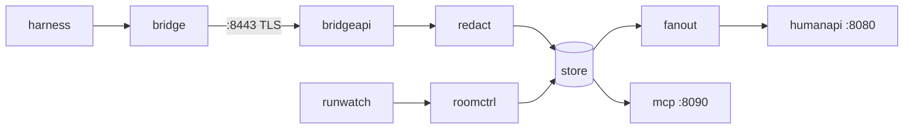

# maku: contributor and agent guide

The Go services behind SP2 collaboration rooms: `maku-broker` (the log of record, its API and
the `Room` controller) and `maku-bridge` (the sidecar that mirrors a run's harness into its
room); and SP3's `maku-factory` (the `Task` reconciler that turns an issue label into a
narrated run, the issue poller and the run meter). Architecture and ports: [README](README.md) and [docs/architecture.md](docs/architecture.md). Prerequisites, commits, migrations and
releases: `CONTRIBUTING.md`.

## Quality gate: run before every commit

```bash
task check      # exit 0, or it is not done
```

| Step | Runs | Fails on |
|---|---|---|
| `spdx` | `hack/spdx.sh` | a `.go` file, tracked or new, whose first line is not `// SPDX-License-Identifier: Apache-2.0` |
| `tidy` | `go mod tidy -diff` | `go.mod` or `go.sum` drift |
| `lint` | `hack/lint.sh` | any golangci-lint issue under [`.golangci.yaml`](.golangci.yaml), gofmt and goimports included |
| `vuln` | `go run …/govulncheck@v1.8.0 ./...` | a known vulnerability reachable from our code, stdlib included |
| `test` | `go test -race -count=1 ./...`, envtest's API server from `setup-envtest` 1.36.x | a failing test or a data race; never cached |
| `crd:check` | `crd:gen`, then `git diff --exit-code -- config/crd api charts` | a committed CRD, deepcopy or the chart's CRD copy that differs from what the types generate |
| `chart:check` | `helm lint --strict` and `tests/render.sh` for `charts/maku-factory` and `charts/maku` | either chart losing a property the platform relies on, or the maku chart rendering a config its component's loader refuses |
| `quickstart:check` | `hack/quickstart/check.sh`, offline: `bash -n`, shellcheck, `lib_test.sh` | the quickstart scripts, their manifests and the maku chart disagreeing on a name they share |
| `migrations` | `atlas migrate validate --dir file://internal/store/migrations`, offline | an `atlas.sum` that no longer matches the migrations: re-hash with `atlas migrate hash` |
| `docs` | `hack/docs_test.sh`, `hack/docs.sh` | a reader page with a per-row status tag, or a dead relative link or anchor |
| `names` | `hack/names_test.sh`, `hack/names.sh` | an artifact, API group or metric name from before the maku rebrand outside the historical docs |
| `scripts` | `scripts/*_test.sh` | an operator script, such as `shadow-merge-tally.sh`, no longer reading GitHub's shapes as its test fakes them |
| `ui:test` | `npm ci`, `tsc --noEmit`, `vitest run` in `web/` | a type error or a failing UI test |
| `ui:check` | `web/`'s build into `internal/humanapi/ui/dist/` | a committed bundle that differs from what `web/` builds, or a built file not committed |

CI's required `check` job joins the same steps, run as `task check:static` and three `task test:shard` slices; `analyze` (CodeQL) and `harness-test` are the other required checks.
Store tests use testcontainers, so `task test` needs a running Docker daemon.

**Lint through `task lint`, never a bare `golangci-lint run`.** A v1 binary often sits earlier
on PATH (`go install …/golangci-lint` drops one into `$GOPATH/bin`), and v1 cannot read a v2
config. `hack/lint.sh` takes `$GOLANGCI_LINT`, else `mise which golangci-lint` (the pin in
`mise.toml`), else PATH, and refuses anything that is not v2 with the fix in the message. It
also pins `GOTOOLCHAIN` to `go.mod`: under a newer Go, golangci-lint's bundled staticcheck
panics and aborts the whole run. Never answer that with `--disable=staticcheck`. `vuln` goes
through `go run` for a sibling reason: a `govulncheck` built by an older Go fails to load
packages that need a newer one.

## Conventions

### Shape

- **Packages by domain or pipeline stage, never by layer.** No `service/`, `repository/`,
  `handler/`, `models/`, `utils/`, `pkg/`. A package's `// Package …` comment is its contract;
  read it before changing the package.
- **`cmd/<bin>/main.go` stays thin.** It builds the root context and logger and calls
  `app.Run<Bin>(ctx, args, stdout) error`; constructing the store, manager and servers lives in
  `internal/app`, one file per binary or subcommand, where tests can call it. `main` alone calls
  `os.Exit`.
- **Interfaces belong to the consumer and stay minimal.** `roomctrl` declares the two store
  methods it calls, not `*store.Store`. Often unexported; duplicating a one-method interface in
  two packages is fine. Constructors return concrete types.
- **Plain constructor injection.** No package-level state beyond `version.Version`, no `init()`
  doing work.
- **Exported symbols carry doc comments** (enforced by `revive`): the comment states the
  contract, and a non-obvious *why* sits next to the code rather than in a separate log.

### Idioms

- **`ctx context.Context` first** on every function that does I/O or blocks. Never store it in
  a struct. `context.Background()` appears in `main` and in the shutdown drain only.
- **Errors wrap with `%w`** (`fmt.Errorf("append event: %w", err)`) and compare with
  `errors.Is` / `errors.As` only, `http.ErrServerClosed` included (`errorlint`).
- **Typed errors for what callers branch on:** sentinels (`store.ErrNoRoom`,
  `store.ErrSealed`), or a struct with `Unwrap()` when the caller needs a field, such as
  retryable against permanent in the bridge's uploader. Each API maps them to status codes in
  one place.
- **`log/slog` only, injected.** Constructors take a `*slog.Logger`; library code never calls
  `slog.Default()`. JSON in the cluster, text locally, format and level overridable by env.
  `forbidigo` bans `fmt.Print*`, `log.Print|Fatal|Panic*` and the process-default logger (the
  `slog.*` package functions) outside `cmd/` and tests.
- **Strict config.** One `Load(path)`: decode rejecting unknown fields
  (`yaml.Decoder.KnownFields(true)` / `json.Decoder.DisallowUnknownFields`), then the one
  `ApplyDefaults`, then `Validate()`. A typo fails startup. Secrets are referenced by env-var
  name or mounted-file path (`ROOM_TOKEN_FILE`, `ClientIDFile`) and read at use, so a rotation
  needs no restart.
- **Every `http.Server` sets its bounds:** `ReadHeaderTimeout`, `ReadTimeout`, `IdleTimeout`,
  `MaxHeaderBytes` and `WriteTimeout`. A listener that streams (SSE on `:8443`, WebSocket on
  `:8080`) sets `WriteTimeout: 0` and bounds each non-streaming route with
  `http.TimeoutHandler` or `http.ResponseController` deadlines instead. Shutdown:
  `signal.NotifyContext(SIGINT, SIGTERM)`, then a separate drain context bounded under the pod's
  `terminationGracePeriodSeconds`.
- **One audited egress client**, `internal/httpx`: timeout, redirect cap, credential headers
  stripped on a cross-host redirect, cloud metadata addresses refused. `forbidigo` bans
  `http.DefaultClient` and `http.Get|Head|Post|PostForm` everywhere else, tests included (use
  `httptest.Server.Client()`); review catches a hand-rolled `&http.Client{}`.
- **Injectable clock.** Time-dependent code takes `now func() time.Time` or a small clock
  interface. `forbidigo` bans `time.Sleep` outside tests: wait on `select` over `ctx.Done()` and
  a timer.
- **Bounded concurrency.** A fixed worker count or a semaphore, never a goroutine per event.
  Every goroutine has an owner that waits for it (`sync.WaitGroup`, `errgroup`) and a context
  that stops it. Every buffer has a cap (the bridge's `MaxBuffer`).

### Tests

- **TDD.** The failing test first, then the least code that passes it.
- **Table-driven** `t.Run` by default; case names state the behaviour.
- **stdlib `testing` only.** No testify, gomock or mockery. Hand-written `fake…` structs
  implement the consumer's interface; assert on behaviour, not on call sequences.
- **Doubles by boundary:** `httptest` for HTTP, controller-runtime's fake client for the
  reconciler, and **testcontainers-go Postgres for `internal/store` only**: grants, RLS and
  constraints need the real server. Every other package fakes the store interface.
- **Goldens only for rendered artifacts** (a rendered page, a generated manifest), in
  `testdata/` beside the package, rewritten only by an explicit flag such as
  `go test ./internal/x -update-golden`. Never golden a value you can assert on.
- **`-race` always.** `task test` has it; do not drop it to make a flake pass.

### Observability

- **Metrics:** the OpenTelemetry metric API with the Prometheus exporter on `:9090`. Scrapes carry
  `maku_rooms_*` (the SP2 §9 set, e.g. `maku_rooms_events_appended_total`; the bridge's
  `maku_rooms_bridge_*` counters are served by the broker, the bridge serves none), and
  `maku_factory_*` in the factory (SP3 §7, `internal/factory/fmetrics`); counters end `_total`,
  durations `_seconds`. Instruments are still created as `rooms_*` and `agent_factory_*` in Go: the
  exporter renames every family on scrape (`metrics.MakuName`), so a new instrument takes the old
  prefix and is served under `maku_`; `hack/names.sh` refuses the old names outside Go. Buckets per
  histogram family sit on real thresholds (SC-12: fan-out p95 under 0.5 s). Instruments hang off an
  injected set that works with a no-op provider in tests. Label values are bounded: never a payload
  field; `room` only on the per-Active-room gauge and on per-live-run series such as
  `maku_factory_run_charge_info`, whose `run` label already makes one series per run.
- **`maku_rooms_build_info{version}` = 1** from the first metric; `maku_factory_build_info{version}`
  in the factory.
- **Traces: the factory has them, the rooms side does not yet.** The factory emits one root span
  per task, and its spans reach the trace router with no allowlist (O-1 M3): ids, tier, phase and
  a reason code only, never issue text; `internal/factory/tracing` and the rooms client pin it.
  The rooms client adds a client span per broker call (`broker <method> <route>`, the room id,
  the status) on the same exporter, and sends W3C `traceparent` to the broker.
  The room broker and bridge have no span and propagate no `traceparent`; a tracked follow-up adds
  OTel spans across bridge → broker → store and outbound calls, W3C `traceparent` on every hop.
  When they land, spans carry ids (room, run, seq), event types and end reasons, never payload
  text or an error message that could echo it.

## Package map

By pipeline stage. Every package below exists.



| Stage | Package | Contract |
|---|---|---|
| Entry | `cmd/maku-broker` | `serve`, `retention` and `migrate` (the schema, the chart's init container) subcommands |
| Entry | `cmd/maku-bridge` | the sidecar binary |
| Entry | `cmd/maku-slack`, `internal/slackapp` | the factory's Slack App: intake from a thread, webhooks to the thread (docs/slack.md) |
| Entry | `cmd/maku`, `internal/maku` | the human CLI and its client; `maku mcp`, the stdio relay to `/mcp` |
| Entry | `internal/maku/skill` | the embedded factory-handoff Agent Skill, released with maku; `maku skill install` writes it |
| Entry | `internal/app` | wiring per binary, the only importer of every adapter |
| Entry | `internal/config` | the broker's config file: strict decode, defaults, validation |
| Entry | `internal/logging` | a binary's `*slog.Logger`: JSON or text, level by env |
| Entry | `internal/version` | build version stamped by `-ldflags` |
| Entry | `cmd/maku-run-controller` | the run controller binary, on clusters without cloud-native-ref's Crossplane runtime; its wiring is `app.RunController` |
| Ingress | `internal/bridge` | harness adapter over loopback, event mapping, status, uploader, SSE consumer |
| Ingress | `internal/wire` | bridge and browser frames: the types both ends of a connection share |
| Ingress | `internal/authn` | offline JWT verification for runs, system callers and humans; principal mapping |
| Ingress | `internal/sponsored` | what the broker and the factory must agree on for a sponsored principal: the names neither may give one, the shape of the git ref it may send |
| Log | `internal/envelope` | C4 v1 event types, payload builders, validation, limits |
| Log | `internal/intent` | the Slack reply's closed intents: the schema check, the span rule, the one gateway call (pure, no room reads) |
| Log | `internal/redact` | gitleaks detection over every JSON string of a payload |
| Log | `internal/store` + `migrations/` | append, range, cursors, seal; the only package that speaks SQL |
| Rooms | `api/v1alpha1` | `Room` types and deepcopy; CRD generated into `config/crd/` |
| Rooms | `internal/runwatch` | `AgentRun` informer: liveness, membership, run events, end reason |
| Rooms | `internal/roomctrl` | `Room` reconciler: row, seq 1, finalizer, status projection |
| Rooms | `internal/suspend` | the suspend trigger: a suspendable run waiting on an approval in an idle attended room is suspended, and resumed once nothing waits, through its claim's annotations |
| Runs | `internal/runctl` | the run controller: `maku.ogenki.io` AgentRuns reconciled into the pod, ServiceAccount, ConfigMaps and CiliumNetworkPolicy that cloud-native-ref's composition builds, minus the gateway, octo-sts, traces, Kueue and suspend |
| API | `internal/bridgeapi` | `:8443`: hello, events, SSE stream, system API, approvals |
| API | `internal/tlsreload` | a server key pair from two mounted files, TLS 1.3 minimum, re-read when cert-manager renews it: `:8443` and the factory's run-request API serve it (D7); `tlsreload/tlsreloadtest`, its test-only pair writer |
| API | `internal/mcp` | `:8090` MCP server, the `room_*` tools |
| API | `internal/mcpwire` | the JSON-RPC wire both MCP servers share: one message in, one answer out |
| API | `internal/github`, `internal/verdictpost` | the factory App client; the leader's verdict comments |
| API | `internal/brief`, `internal/runrequest` | fenced brief; manifest and factory run requesters |
| API | `internal/prpattern` | a repository's pull-request URL patterns, compiled once per repository in a bounded cache |
| API | `internal/webhook` | the broker's outbound events (F6): id-only payloads, signed as Standard Webhooks sign them; the broker and the Slack App use it |
| Viewers | `internal/fanout` | LISTEN/NOTIFY hub: coalesced per-room reads, a 1 s poll while the listener is down |
| Viewers | `internal/policy` | the §1 permission matrix |
| Viewers | `internal/summary` | the pure fold of a room's log into `summary/v1`, the one object the room page and `maku status` render |
| Viewers | `internal/roomview` | the factory's four room views as `maku` renders them; the one place that makes untrusted text inert |
| Viewers | `internal/ghidentity`, `internal/repoaccess` | D7: a member's GitHub login from their ZITADEL link; whether it may read a room's repository, cached, failing closed |
| Viewers | `internal/humanapi` + `ui/dist/` | `:8080` WebSocket, room list, actions, embedded UI; `POST /mcp`, the humans' MCP server |
| Viewers | `web/` | TypeScript UI and its vitest suite |
| Ops | `internal/metrics` | the §9 metric set and the Prometheus exporter maku-broker serves |

The factory (SP3), by the same stages. Its wiring is `internal/app/factory.go`; its chart,
`charts/maku-factory`, ships the `Task` CRD.

| Stage | Package | Contract |
|---|---|---|
| Entry | `cmd/maku-factory` | the binary; `FACTORY_CONFIG`, `POD_NAMESPACE` |
| Entry | `internal/factory/config` | the factory's config file: strict decode, defaults, validation, its hash |
| Intake | `internal/factory/intake` | the issue poller: maintainer labels, snapshots, dedup, stop labels |
| Intake | `internal/factory/sanitize`, `internal/factory/taskid` | untrusted text defused to a fixpoint; C2 task names and ids |
| Intake | `internal/factory/fence` | the single-owner fence: a repository is acted on only by the factory its default branch's `.github/agent-factory.yaml` names |
| Intake | `internal/factory/finding` | what both RunLore intakes write the same way: the task text, the public stub issue, the label charset that keeps attacker-influenced identifiers inert |
| Tasks | `api/factory/v1alpha1` | `Task` types and deepcopy; CRD generated into `config/crd/` |
| Tasks | `internal/factory/triage`, `internal/factory/reconciler` | template, tier and budget; the `Task` state machine |
| Tasks | `internal/factory/runs`, `internal/factory/killswitch` | the `AgentRun` claim; the stop object |
| Tasks | `internal/factory/steering` | a task class's steering note, read on the default branch at triage; an agent pull request that changes one is refused |
| Tasks | `internal/factory/ledger` | the budget ledger: one ConfigMap per UTC day, its resourceVersion the transaction; admission reserves a run's ceiling, the run's end releases it, the meter owns the spent and settled columns; `api`, `intake`, `meter` and `reconciler` import it |
| Gate | `internal/factory/filefence`, `internal/factory/mdlinks`, `internal/factory/semverdiff` | a class's file conditions on a diff, one implementation for the gate and the adopt poller; Markdown link targets as the links-only shape reads them; whether a diff is a dependency bump of one kind |
| Gate | `internal/factory/decision` | the per-decision record: the values each declared row read, so the tally can replay a cap |
| Gate | `internal/factory/fluxwatch` | Flux's objects for the post-merge monitor (MC7): uncached, read-only, `unstructured` |
| Out | `internal/factory/forge`, `internal/factory/narrate` | GitHub as the factory App (`internal/factory/forge/forgetest`: its test-only fake); narration, at least once |
| Out | `internal/factory/minter` | v4 D10's per-run tokens: `Roles`, the one role table every run and publisher token is minted from, and `Minter`, a token for one repository and role from the agents App; nothing uses it until rollout step 3's PR B |
| Out | `internal/factory/rooms` | the broker's system API over TLS |
| Out | `internal/factory/applier` | hardening H2's safe-output applier: checks each `output_requested` and applies it as the publisher (the agents App, its token from `PublisherTokens`, octo-sts today) or the factory App, answered exactly once; not started until `enforceOutputs` exists |
| Ops | `internal/factory/meter`, `internal/factory/fmetrics`, `internal/factory/tracing` | the run meter; the §7 metrics; one root span per task |
| API | `internal/factory/api` | the run-request API, `POST /v1/runs` (the chart's `api` port, `:8082`; TLS 1.3 with `api.tls`) |

## Seams

The core carries no platform-specific constants — no cluster names, domains, OpenBao paths,
Crossplane kinds, ZITADEL ids or other cloud specifics — in `internal/envelope`,
`internal/redact`, `internal/store`, `internal/httpx` or `internal/wire`. Platform facts enter
through config, or through a consumer-side interface defined where they're used (see
Idioms above).

Packages that do touch the platform name their seam:

| Package | Seam |
|---|---|
| `internal/authn` | issuers, subject patterns and the system allowlist are config; the audiences `room-broker` and `rooms-system` are constants in `internal/authn/jwt.go` |
| `internal/runwatch` | the run kind (`runwatch.Kind`: group, namespace, claim-name prefix) is config, the broker's and the factory's `runs:`, built in `internal/app` and passed to each consumer; unset, `runwatch.DefaultKind`, cloud-native-ref's `cloud.ogenki.io`, `agents`, `xplane-run-`. The `agents.ogenki.io/revoked` annotation and the three suspend annotations are constants; a `RunSource` interface would replace them in a spin-out |
| `internal/runrequest` | the rendered claim reuses runwatch's seam plus the claim's spec fields; the factory is SP3's `POST /v1/runs`, at the configured `factoryURL` |
| `internal/runctl` | the `maku.ogenki.io` `AgentRun` CRD (typed, `api/v1alpha1`), Cilium's `CiliumNetworkPolicy` and the run pod's layout (the bridge as a native sidecar, the broker CA at `/etc/room-broker-ca`); the runs namespace, name prefix, RuntimeClass, images, Secrets, broker URL, labels and CA Secret are config, and the egress profiles have built-in defaults (github, pypi, npm, golang, crates) |
| `internal/roomctrl` | the `Room` CRD group |
| `internal/bridgeapi` | principal allowlists come from config |
| `internal/bridge` | the OpenHands agent-server loopback API and its event kinds; a harness adapter interface would replace them for another harness |
| `internal/factory/runs` | the `AgentRun` claim SP1's XRD accepts: its run kind (runwatch's `Kind`, from the factory's `runs:` config), the `agents.ogenki.io/*` labels and annotations, the principal `system:factory` and the Kueue queues `factory` and `interactive`; the reconciler reaches it through its `RunClient` interface only |
| `internal/factory/config` | every deployment fact is config: repository, maintainers, the App logins, the rooms UI and broker URLs, the broker CA and token paths, the meter's URL and query, tiers and the trace collector. The vocabularies it checks against are constants: SP1's roles, C5's logical model names, the tiers and the Task CRD's template enum |
| `internal/github` | GitHub's REST API and App auth; the API URL and the App's key directory are the caller's, the token scope (`pull_requests: write`, one repository; GitHub adds `metadata: read`, which the D7 reads use) is a constant |

Why: the project may go platform-agnostic after the phase-7 UX sign-off, decided if 2 of 4 hold
— daily use, AHP 1.0 still leaving identity and audit out, a second harness or runtime needed,
outside demand. Keeping the seams clean now makes that decision cheap.

## Security rules

- **Nothing unredacted leaves the request.** `redact` runs on every payload before it is
  appended, logged, traced, counted or put in an error. Log and trace ids, seq and event type,
  never a payload or a header value.
- **SQL only in `internal/store`, parameterised** (`$1`, `$2`). Never build SQL from a value;
  identifiers are constants.
- **The broker's role is append-only by design.** `rooms_broker` holds `SELECT, INSERT` on
  `events`, and row-level security is on; only `rooms_retention` deletes, and only expired rooms.
  A migration never widens a grant, disables RLS or gives `rooms_broker` `UPDATE` or `DELETE` on
  `events`. The store tests prove it (SC-10); a change that breaks them is a design change, not
  a test fix.
- **No secret on argv.** Tokens, keys and DSNs come from mounted files or the environment,
  never flags or a child process's arguments: `/proc/<pid>/cmdline` is world-readable.
- **TLS on `:8443`.** The broker serves it with a reloading `GetCertificate` (`internal/tlsreload`);
  the bridge verifies against `BROKER_CA_FILE` and refuses a non-`https://` `BROKER_URL`. The
  factory's `:8082` serves the same loader when `api.tls` is set, and the broker refuses an
  `http://` `factoryURL` unless `factoryInsecure: true`. Never `InsecureSkipVerify`, tests
  included (use `httptest.NewTLSServer`'s client, or `tlsreloadtest.WritePair` and a root pool).
