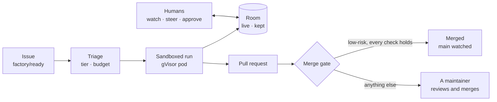

# Maku

<picture>
  <source media="(prefers-color-scheme: dark)" srcset="docs/assets/brand/png/maku-lockup-horizontal-dark.png">
  
</picture>

**Run coding agents on your own Kubernetes cluster without having to trust them.**

Label a GitHub issue and Maku takes it from there: it picks a model and a budget, runs agents in
isolated sandboxes, and brings back a pull request. You can watch every step live, steer the agent,
approve what it may not do alone, or stop it. Whatever happens is kept in a record nobody can
rewrite, the agent included.

Every control sits outside the agent. A run can't raise its own budget, widen its own network access
or approve its own merge, however it was prompted. That is what makes it reasonable to leave agents
working unattended on real repositories.

<a href="https://blog.ogenki.io/maku/">
  
</a>

**[Watch a run in the live demo →](https://blog.ogenki.io/maku/)** · **[Try it on your laptop →](docs/quickstart.md)**

## Main features

### From issue to pull request

- **Label to start.** A maintainer's `factory/ready` label starts a task; the same label from anyone
  else starts nothing. Tasks can also come from a Slack thread, a schedule, a
  [RunLore](docs/factory.md#triggers) finding, or your own coding agent.
- **Triage.** Each task gets a template (who runs, in what order) and a tier (model, deadline, token
  budget), chosen once. See [tiers and templates](docs/factory.md#triage-tiers-templates-classes).
- **Agents that check each other.** An implementer opens the pull request on an `agent/<task>`
  branch and a reviewer gives its verdict. A tester can write the failing test first, and a large
  task can be [split](docs/factory.md#splits).
- **Narrated on GitHub.** The factory comments each step on the issue and pull request. A **Request
  changes** review sends the work back to an agent on the same branch.

### Sandboxed and bounded

- **Isolated runs.** Each agent gets its own gVisor pod behind a default-deny network policy with an
  egress allowlist. Nothing dials into a sandbox.
- **Short-lived, scoped credentials.** They're minted for one run alone, so a reviewer can't push.
- **Budgets it can't raise.** [Per-run and per-task caps](docs/factory.md#budgets), in tokens or USD,
  are enforced from outside the sandbox. A run that reaches its cap is revoked.
- **A kill switch.** One [stop object or label](docs/factory.md#the-kill-switch) ends every task and
  pauses intake.

### Rooms: live and on the record

A room is a flight recorder and a group chat for one piece of agent work.

- **Watch and steer.** Follow each command and its output as it happens, and redirect the agent
  mid-run from the [web UI](docs/web-ui.md).
- **Approvals.** The push waits for your decision, and the card shows the raw action rather than the
  agent's description of it.
- **A record you can trust.** The broker's database role can only read and insert events
  ([the guarantees](docs/room-log.md#the-guarantees)). Secrets are [redacted](docs/security.md#redaction)
  before anything is stored, and each event carries an identity taken from a verified credential.
- **Fork and hand off.** [Start a new room](docs/web-ui.md#forks) from any message, or hand the
  context to the next run.

### A merge gate for low-risk changes

- **Humans merge by default.** Only a class of change you mark `live` merges itself, and only when
  [every check holds](docs/factory.md#the-merge-gate): the diff's shape, its files, its size, CI.
- **Try before arming.** A `shadow` class is decided the same way but never merged, so you can read
  its decisions first.
- **A way back.** After a merge, `main` is watched and a red result opens a revert. Reverts count
  towards a breaker that pauses the class.
- **Proof, not trust.** An [oracle class](docs/factory.md#oracle-classes) such as `dead-links` has a
  detector that says what is wrong, and the gate proves the pull request fixed exactly that.

### Where you already work

- **`maku` CLI.** [Read a task's status, follow its log, post a note or fork a room](docs/cli.md)
  from a terminal.
- **Your coding agent.** `maku setup` registers an [MCP server](docs/cli.md#the-mcp-server) and a
  [handoff skill](docs/cli.md#the-factory-handoff-skill) for Claude Code, Codex, Copilot, Cursor,
  Gemini and OpenCode.
- **Slack.** [A mention drafts an issue](docs/slack.md), a maintainer's check mark files it, and the
  thread follows its progress.
- **Observability.** [Prometheus metrics and alerts](docs/operations.md), and a trace per task.

## How it works



| Component | Role |
|---|---|
| `maku-factory` | Turns a labelled issue into a task, runs its agents, narrates, and applies the merge gate |
| `maku-broker` | The log of record: authenticates writers, redacts and orders events, serves the web UI and the APIs |
| `maku-bridge` | A sidecar in each run's pod that pushes the agent's events to the broker and carries steering back |
| `maku-harness` | The image a run executes in: the OpenHands agent-server, plus `gh` |
| `maku-run-controller` | Turns an `AgentRun` into a sandboxed pod, on clusters without cloud-native-ref's runtime |
| `maku-slack` | The Slack App |
| `maku` | The terminal client for people, and the MCP relay for their coding agents |

Details, ports and trust boundaries are in [Architecture](docs/architecture.md).

## Get started

| You want | Start at | What you get |
|---|---|---|
| To try it | [Quickstart](docs/quickstart.md): `task demo`, a laptop and Docker, no cloud | The whole factory loop in about 15 minutes: label an issue, get a reviewed pull request and the merge gate's verdict. A demo, not production: [what production adds](docs/quickstart.md#what-production-adds) |
| To install it on your cluster | [Install on your cluster](docs/install.md): `maku install --print`, then Helm, Flux or Argo CD | A production install: your issuer, Postgres, Secrets tooling and sandbox nodes, checked by the preflight |
| The whole platform | [ai-native-ref](https://github.com/Smana/ai-native-ref) | The factory with its gateway, identities, policies and dashboards, deployed with GitOps |
| To fit it into your own cluster | [Integration](docs/integration.md) | What each piece needs and what to pin |

```bash
git clone https://github.com/Smana/maku && cd maku
task demo          # a cluster, a GitHub App, your repository from a template, the chart, the room page
```

It asks for an OpenAI-compatible model and two GitHub clicks, and runs on a public repository you own: on a
laptop, the agent can read the model key. The [quickstart](docs/quickstart.md) walks the loop; its last
section is the older one-run path, `task quickstart`.

## Status

Maku runs daily as part of the Agent Factory, on AWS and GCP. There's one maintainer, and the API and
CRDs are still `v1alpha1`. What is proven live and what comes next is on the
[status page](https://airef.ogenki.io/docs/status/), and each version's notes are on the
[latest release](https://github.com/Smana/maku/releases/latest).

Maku is for platform teams who want coding agents under their own rules. It isn't a hosted service.

## Documentation

| You are | Read |
|---|---|
| New here | [Concepts](docs/concepts.md), then [Architecture](docs/architecture.md) |
| A maintainer with a factory issue or PR | [The factory](docs/factory.md) |
| Following a run | [Web UI](docs/web-ui.md) and [the `maku` CLI](docs/cli.md) |
| Assessing the risk | [Security](docs/security.md): the threat model and what each control leaves open |
| Operating a cluster | [Integration](docs/integration.md), then [Operations](docs/operations.md) |
| Changing the code | [AGENTS.md](AGENTS.md), then [Development](docs/development.md) |

Every page is indexed in [docs/](docs/README.md).

## Contributing

```bash
mise install    # the tools, pinned in mise.toml
task check      # every gate CI runs; store tests need a running Docker daemon
```

See [CONTRIBUTING.md](CONTRIBUTING.md). Report vulnerabilities privately: [SECURITY.md](SECURITY.md).

## Support this work

One person maintains Maku and pays for the AWS, GCP and model-API time its live tests need;
[sponsoring it](https://github.com/sponsors/Smana) helps cover that.

## License

Apache-2.0
