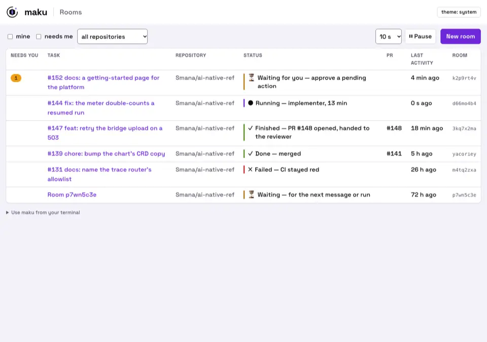
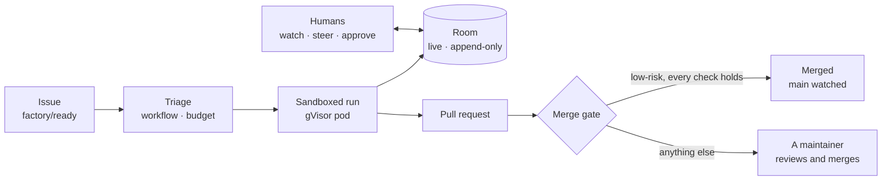

# Maku

<picture>
  <source media="(prefers-color-scheme: dark)" srcset="docs/assets/brand/png/maku-lockup-horizontal-dark.png">
  
</picture>

**Run coding agents on your own Kubernetes cluster without having to trust them.**

Label a GitHub issue and Maku takes it from there: it picks a workflow and a budget, runs agents in isolated gVisor sandboxes behind a default-deny network policy, and brings back a reviewed pull request. You can watch every step live in a room, steer the agent mid-run, approve what it may not do alone, or stop it. Every control — token and USD caps, network egress, push approvals, and the merge gate — sits outside the sandbox, and every event is recorded in an append-only room log that no agent can rewrite.

**[Try the quickstart →](docs/quickstart.md)** · **[Read the concepts and glossary →](docs/concepts.md)** · **[Browse the documentation →](docs/README.md)** · **[Watch a run in the live demo →](https://blog.ogenki.io/maku/)**

## Architecture

## Features

| Area | What Maku enforces |
|---|---|
| **From issue to pull request** | A maintainer's `factory/ready` label (or a Slack thread, schedule, [RunLore](docs/factory.md#triggers) finding, or coding-agent handoff) starts a [Task](docs/concepts.md#glossary); an implementer opens the pull request, a tester can lock a failing test first, a reviewer records its verdict, and large tasks [split](docs/factory.md#splits) |
| **Sandboxed and bounded** | Each run executes in its own gVisor pod with short-lived per-role GitHub tokens, external [token and USD budgets](docs/factory.md#budgets) that revoke exhausted runs, and a [kill switch](docs/factory.md#the-kill-switch) that stops active work and pauses intake |
| **Rooms: live and on the record** | Each task runs in a [Room](docs/concepts.md#glossary) where humans watch and steer from the [web UI](docs/web-ui.md), decide raw push approvals, [fork](docs/reference/web-ui-settings.md#forks) from any event, and rely on [append-only database guarantees](docs/reference/room-log.md#the-guarantees) and secret [redaction](docs/reference/security-controls.md#redaction) |
| **A merge gate for low-risk changes** | Humans merge by default; only classes bound in `live` mode auto-merge when [every gate check holds](docs/factory.md#the-merge-gate) (diff shape, file fence, size, CI, [oracle proofs](docs/factory.md#oracle-classes)), `shadow` mode records decisions first, and post-merge failures trigger reverts and a circuit breaker |
| **Where you already work** | Use the [`maku` CLI](docs/cli.md), register the [MCP server](docs/cli.md#the-mcp-server) and [handoff skill](docs/cli.md#the-maku-handoff-skill) with `maku setup`, file and track tasks from [Slack](docs/slack.md), and scrape [Prometheus metrics, alerts, and traces](docs/operations.md) |

## Start here

| Goal | First page |
|---|---|
| **Try it on a laptop** | [Quickstart](docs/quickstart.md) (`task demo`, Docker and a GitHub account, ~15 minutes) |
| **Understand the model** | [Concepts and glossary](docs/concepts.md) and [Architecture](docs/architecture.md) |
| **Onboard a repository** | [Onboard a repository](docs/onboard-a-repository.md) (`maku repo add` and `maku repo check`) |
| **Turn on auto-merge** | [Merge policies](docs/merge-policies.md) |
| **Install and operate it** | [Install on your cluster](docs/install.md), then [Operations](docs/operations.md) and [Security](docs/security.md) |
| **Use a running deployment** | The reference platform's [user guide](https://airef.ogenki.io/docs/use/guide/) and [live status page](https://airef.ogenki.io/docs/status/) |
| **Browse all pages** | [Documentation index](docs/README.md) |

## Contributing

See [CONTRIBUTING.md](CONTRIBUTING.md), [AGENTS.md](AGENTS.md), and [Contributing docs](docs/contributing/README.md). Report vulnerabilities privately via [SECURITY.md](SECURITY.md).

One person maintains Maku and funds the cloud and model-API time its live tests run on; [sponsoring on GitHub](https://github.com/sponsors/Smana) helps cover that.

## License

Apache-2.0
