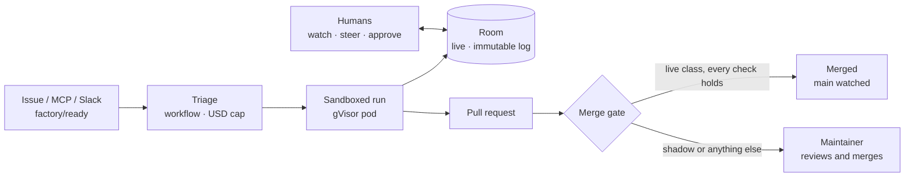

# Maku

<picture>
  <source media="(prefers-color-scheme: dark)" srcset="docs/assets/brand/png/maku-lockup-horizontal-dark.png">
  
</picture>

**A 100% sovereign, Kubernetes-native coding-agent factory (Apache-2.0).**

Run coding agents on your own Kubernetes cluster without trusting a third-party SaaS control plane
or the agents themselves. Maku complements local coding agents (Claude Code, OpenCode, Cursor,
Codex, Copilot, Gemini): hand off an issue from your editor, Slack or GitHub, and Maku runs
sandboxed agents under strict budgets, streams every action into an auditable room, and brings back
a reviewed pull request.

Every control sits outside the sandbox. A run cannot raise its own budget, widen its own network
egress, touch another repository's token or approve its own merge, however it is prompted.

<a href="https://blog.ogenki.io/maku/">
  
</a>

**[Try on your laptop (15 min) →](docs/quickstart.md)** · **[Run a Tier-1 Pilot →](docs/pilot.md)** · **[Install on your cluster →](docs/install.md)** · **[Watch a run →](https://blog.ogenki.io/maku/)**

## Why Maku

### Sovereign control plane, zero vendor lock-in

- **Your cluster, your data, your keys.** No SaaS control plane, no seat tax, no vendor lock-in.
  Bring any OIDC identity provider (Okta, Entra ID, Keycloak, ZITADEL), any OpenAI- or
  Anthropic-compatible model provider (SaaS or self-hosted), and your own GitOps controller (Helm,
  Flux or Argo CD).
- **Data-class model routing.** Route public and private repositories through separate
  `agentgateway` model policies so private code only reaches providers you explicitly authorize.
- **Database-enforced audit trail.** Room logs live in PostgreSQL 16+ under three separated roles
  with row-level security and immutable triggers — even a compromised broker cannot rewrite past
  events ([the guarantees](docs/reference/room-log.md#the-guarantees)).

### Sandboxed and bounded

- **gVisor isolation per run.** Each agent executes in its own sandboxed pod behind a default-deny
  network policy and egress allow-list. Nothing dials into a sandbox.
- **Per-run scoped GitHub tokens.** Short-lived GitHub App tokens are minted per run and role, so a
  reviewer cannot push and an implementer cannot merge.
- **Hard external budgets.** [Per-run and per-task USD and token caps](docs/factory.md#budgets) are
  enforced at the model gateway outside the sandbox. A run that hits its cap is revoked.
- **One kill switch.** A single [stop object or label](docs/factory.md#the-kill-switch) ends active
  tasks and pauses intake immediately.

### Collaborative rooms, complementary to local agents

- **Hand off where you work.** `maku setup` registers an [MCP server](docs/cli.md#the-mcp-server)
  and handoff skill for Claude Code, OpenCode, Cursor, Codex, Copilot and Gemini;
  [Slack](docs/slack.md) and GitHub labels (`factory/ready`) feed the same workflow.
- **Watch, steer and approve.** Follow live tool calls in the [web UI](docs/web-ui.md) or
  [`maku` CLI](docs/cli.md), redirect an agent mid-run, approve sensitive actions from raw diffs,
  or [fork a room](docs/web-ui.md#the-room-page) from any event.
- **Agents that check each other.** Pair an implementer with a reviewer (optionally on a second
  model family), add a test-first tester, or split large tasks automatically.

### Earned auto-merge with automatic rollback

- **Human review by default.** Every merge class starts in `shadow` mode — Maku evaluates the gate
  and logs its verdict while humans merge.
- **Promote by policy.** Only classes you explicitly mark `live` in GitOps merge automatically, and
  only when diff shape, paths, size, reviewer verdict and required CI checks all hold
  ([merge policies](docs/merge-policies.md)).
- **Revert breaker.** After a merge, Maku watches the default branch; a red build opens a revert PR
  and trips a breaker that pauses the class.

## How it works



| Component | Role |
|---|---|
| `maku-factory` | Turns a labelled issue into a task, schedules agent runs, narrates on GitHub and evaluates the merge gate |
| `maku-broker` | The log of record: authenticates writers, redacts and orders events, serves the web UI, MCP and Slack APIs |
| `maku-bridge` | Sidecar inside each run pod that streams events to the broker and carries human steering back |
| `maku-harness` | The run container image executing the agent harness and `gh` |
| `maku-run-controller` | Turns an `AgentRun` into a sandboxed pod with per-run network policies on any Kubernetes cluster |
| `maku-slack` | Optional Slack App for thread intake, proposals and approval notifications |
| `maku` | Terminal CLI for developers and operators, plus the stdio MCP relay for local coding agents |

Details, ports and trust boundaries are in [Architecture](docs/architecture.md).

## Get started

### 1. Try it on your laptop (15 minutes)

```bash
git clone https://github.com/Smana/maku && cd maku
task demo          # kind/k3d cluster, demo GitHub App, template repo, Helm chart, room UI
```

`task demo` asks for an OpenAI-compatible model endpoint and two GitHub clicks, then runs the full
issue-to-PR loop on a public repository you own. See the [quickstart](docs/quickstart.md) for
prerequisites and [what production adds](docs/quickstart.md#what-production-adds).

### 2. Install on your Kubernetes cluster

Choose the tier that matches where your team is today — both run the exact same Helm chart, CRDs,
PostgreSQL schema and T12 audit guarantees:

| | Tier-1 Pilot (Week 1–4) | Tier-2 Hardened Production |
|---|---|---|
| **Guide** | [Tier-1 Pilot](docs/pilot.md) | [Install on your cluster](docs/install.md) |
| **Database** | Hardened bundled PostgreSQL 16+ (`values-pilot.example.yaml`, 1 replica, PVC, TLS 1.3, optional S3/VolumeSnapshot backup) | External HA PostgreSQL 16+ (CloudNativePG, RDS, Cloud SQL or Azure Flexible Server) |
| **GitHub Apps** | 1 factory App (`apps.merger.mode: factory`) + 1 agents App | Optional separate merger App |
| **Sandbox** | **gVisor mandatory** on private repositories | Dedicated gVisor node pool |
| **Merge gate** | 100% human-approved (`shadow` mode) | Earned `live` auto-merge + revert breaker |
| **Network** | Standard Ingress/HTTPRoute + default-deny `NetworkPolicy` | Private gateway + Cilium FQDN egress |

## Run a pilot with your team

Maku is Apache-2.0 open source, not a commercial SaaS product. If your engineering team uses
**GitHub (Cloud or Enterprise Server) + Kubernetes** and wants to pilot sovereign coding agents on
real private repositories, read the [Tier-1 Pilot guide](docs/pilot.md):

- **You own** your Kubernetes cluster (with gVisor), GitHub repositories and model API keys.
- **The maintainer provides** open-source bootstrap support and collaborates on improvements driven
  by your real stack (with optional paid freelance days if you want dedicated hands-on integration).
- **Start a conversation:** [get in touch](https://blog.ogenki.io/about/).

## Status and reference deployment

Maku runs daily on live clusters; CRDs are currently `v1alpha1`. See [Roadmap](docs/roadmap.md), the
[latest release](https://github.com/Smana/maku/releases/latest) and the
[status page](https://airef.ogenki.io/docs/status/) for what is proven live and what is next.

Looking for a full GitOps reference deployment alongside optional self-hosted GPU serving? See
[ai-native-ref](https://github.com/Smana/ai-native-ref) ([airef.ogenki.io](https://airef.ogenki.io/)).

## Documentation

| You are | Read |
|---|---|
| Evaluating Maku | [Quickstart](docs/quickstart.md) · [Tier-1 Pilot](docs/pilot.md) · [Concepts](docs/concepts.md) |
| Installing on Kubernetes | [Install on your cluster](docs/install.md) · [The database](docs/database.md) · [Model gateway](docs/gateway.md) |
| Using Maku day to day | [Web UI](docs/web-ui.md) · [the `maku` CLI](docs/cli.md) · [The factory](docs/factory.md) |
| Reviewing security | [Security](docs/security.md) · [Room log](docs/reference/room-log.md) · [Architecture](docs/architecture.md) |
| Operating in production | [Operations](docs/operations.md) · [Observability](docs/observability.md) · [Integration](docs/integration.md) |
| Contributing | [AGENTS.md](AGENTS.md) · [Development](docs/contributing/development.md) |

Every page is indexed in [docs/](docs/README.md).

## Contributing

```bash
mise install    # pinned tool versions (mise.toml)
task check      # every gate CI runs; store tests need a running Docker daemon
```

See [CONTRIBUTING.md](CONTRIBUTING.md). Report security vulnerabilities privately via
[SECURITY.md](SECURITY.md).

## Support this work

One maintainer builds Maku and pays for the cloud clusters and model API time used in live testing.
[GitHub Sponsors](https://github.com/sponsors/Smana) helps fund that infrastructure.

## License

Apache-2.0
