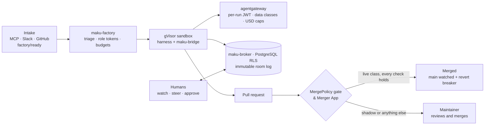
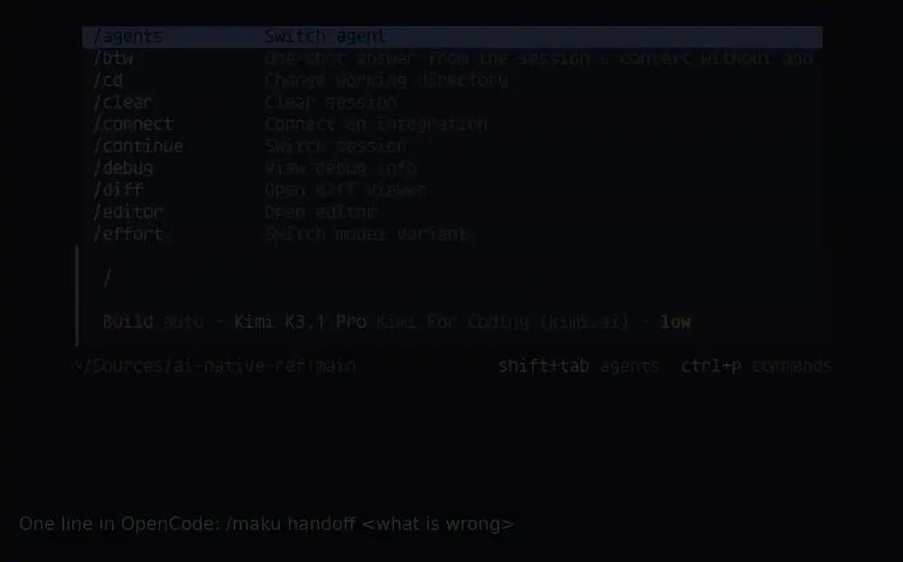

# Maku

<picture>
  <source media="(prefers-color-scheme: dark)" srcset="docs/assets/brand/png/maku-lockup-horizontal-dark.png">
  
</picture>

**The open-source software factory for Kubernetes (Apache-2.0).**

Own the entire issue-to-PR pipeline instead of renting a black-box SaaS. Composed from open-source
cloud-native tools, **Maku** lets you bring your own cluster, models, coding harness, and OIDC—with
hard USD budgets, auditable rooms, and GitOps merge gates built in.

Open stack. Every control sits outside the sandbox: a run cannot raise its own budget, widen its
egress allow-list, touch another repository's token, or approve its own merge—however it is
prompted.

**[Website & Docs →](https://maku.ogenki.io/)** · **[Try on your laptop (15 min) →](https://maku.ogenki.io/docs/get-started/quickstart/)** · **[Drive a recorded room →](https://maku.ogenki.io/demo/)** · **[Run a Tier-1 Pilot →](https://maku.ogenki.io/docs/get-started/pilot/)**

## Built on open standards — swap any layer

| Layer | Built-in / Supported |
|---|---|
| **Models** | Any OpenAI- or Anthropic-compatible provider (SaaS or self-hosted) |
| **Coding harness** | OpenCode, OpenHands (pluggable loopback adapter) |
| **Sandbox** | gVisor (`runsc`) pods per run via Kubernetes RuntimeClass |
| **Model gateway** | `agentgateway` — per-run JWTs, data-class routing, hard USD caps |
| **Network egress** | Default-deny `NetworkPolicy` / Cilium FQDN allow-lists |
| **Audit log** | PostgreSQL 16+ with 3 separated roles, RLS, and immutable triggers |
| **Identity** | Any OIDC provider (Okta, Entra ID, Keycloak, ZITADEL) |
| **GitOps & deploy** | Single Helm chart — works with Helm, Flux, or Argo CD |

## Why Maku

### Open cloud-native stack, zero vendor lock-in

- **Your cluster, your data, your keys.** No SaaS control plane, no seat tax, no vendor lock-in.
  Bring your own Kubernetes cluster, OIDC identity provider, model providers, and GitOps controller.
- **Data-class model routing.** Route public and private repositories through separate
  `agentgateway` model policies so private code only reaches providers you explicitly authorize.
- **Database-enforced audit trail.** Room logs live in PostgreSQL 16+ under three separated roles
  with row-level security and immutable triggers — even a compromised broker cannot rewrite past
  events ([the guarantees](https://maku.ogenki.io/docs/reference/room-log/#the-guarantees)).

### Sandboxed runs with hard external budgets

- **gVisor isolation per run.** Each agent executes in its own sandboxed pod behind a default-deny
  network policy and egress allow-list. Nothing dials into a sandbox.
- **Per-run scoped GitHub tokens.** Short-lived GitHub App tokens are minted per run and role, so a
  reviewer cannot push and an implementer cannot merge.
- **Hard external budgets.** [Per-run, per-person, and per-task USD caps](https://maku.ogenki.io/docs/concepts/factory/#budgets) are
  enforced at the model gateway outside the sandbox. A run that hits its cap is revoked.
- **One kill switch.** A single [stop object or label](https://maku.ogenki.io/docs/concepts/factory/#the-kill-switch) ends active
  tasks and pauses intake immediately.

### Collaborative rooms, complementary to local agents

- **Hand off where you work.** Run `maku setup` once to register the [MCP server](https://maku.ogenki.io/docs/use/cli/#the-mcp-server)
  and handoff skill for Claude Code, OpenCode, Cursor, Codex, Copilot, and Gemini;
  [Slack](https://maku.ogenki.io/docs/use/slack/) and GitHub labels (`factory/ready`) feed the same workflow.
- **Watch, steer, and approve.** Follow live tool calls in the [Web UI](https://maku.ogenki.io/docs/use/web-ui/) or
  [`maku` CLI](https://maku.ogenki.io/docs/use/cli/), redirect an agent mid-run, approve sensitive actions from raw diffs,
  or [fork a room](https://maku.ogenki.io/docs/use/web-ui/#the-room-page) from any event.
- **Agents that check each other.** Pair an implementer with a reviewer (optionally on a second
  model family), add a test-first tester, or split large tasks automatically.

### Earned auto-merge & scheduled upkeep routines

- **Human review by default.** Every merge class starts in `shadow` mode — Maku evaluates the gate
  and logs its verdict while humans merge.
- **Promote by policy.** Only classes you explicitly mark `live` in GitOps merge automatically, and
  only when diff shape, paths, size, reviewer verdict, and required CI checks all hold
  ([merge policies](https://maku.ogenki.io/docs/use/merge-policies/)).
- **Revert breaker.** After a merge, Maku watches the default branch; a red build opens a revert PR
  and trips a breaker that pauses the class.
- **Scheduled upkeep routines.** Opt-in [upkeep routines](https://maku.ogenki.io/docs/use/upkeep-routines/) run recurring
  hygiene (`dead-links`, `renovate-red`, `doc-drift`, `dead-code`, `flaky-tests`, `dup-unifier`,
  or custom `Routine` CRDs) inside an isolated daily upkeep budget, open-PR cap, and yield breaker.

## How it works



| Component | Role |
|---|---|
| `maku-factory` | Turns a labelled issue into a task, schedules agent runs, narrates on GitHub, and evaluates the merge gate |
| `maku-broker` | The log of record: authenticates writers, redacts and orders events, serves the Web UI, MCP, and Slack APIs |
| `maku-bridge` | Sidecar inside each run pod that streams events to the broker and carries human steering back |
| `maku-harness` | The run container image executing the agent harness (OpenCode / OpenHands) and `gh` |
| `maku-run-controller` | Turns an `AgentRun` into a sandboxed pod with per-run network policies on any Kubernetes cluster |
| `maku-slack` | Optional Slack App for thread intake, proposals, and approval notifications |
| `maku` | Terminal CLI for developers and operators, plus the stdio MCP relay for local coding agents |

Details, ports, and trust boundaries are in [Architecture](https://maku.ogenki.io/docs/concepts/architecture/).

### See it in action

Try three real recorded runs (standard review, earned auto-merge, and guarded approval) directly in your browser with the **[Interactive Room Replay →](https://maku.ogenki.io/demo/)**, or watch a real end-to-end run (`issue #479 → PR #480 · 2:06 · $0.14 · 15×`):

<a href="https://maku.ogenki.io/demo/">
  
</a>

## Get started

### 1. Try it on your laptop (15 minutes)

```bash
git clone https://github.com/Smana/maku && cd maku
task demo          # kind/k3d cluster, demo GitHub App, template repo, Helm chart, room UI
```

`task demo` asks for an OpenAI-compatible model endpoint and two GitHub clicks, then runs the full
issue-to-PR loop on a public repository you own. See the [quickstart](https://maku.ogenki.io/docs/get-started/quickstart/) for
prerequisites and [what production adds](https://maku.ogenki.io/docs/get-started/quickstart/#what-production-adds).

### 2. Install on your Kubernetes cluster

Choose the tier that matches where your team is today — both run the exact same Helm chart, CRDs,
PostgreSQL schema, and immutable audit guarantees:

| Control | Tier-1 Pilot (Week 1–4) | Tier-2 Hardened Production |
|---|---|---|
| **Guide** | [Tier-1 Pilot](https://maku.ogenki.io/docs/get-started/pilot/) | [Install on your cluster](https://maku.ogenki.io/docs/install/) |
| **Database** | Hardened bundled PostgreSQL 16+ (`values-pilot.example.yaml`, 1 replica, PVC, TLS 1.3, optional S3/GCS backup) | External HA PostgreSQL 16+ (CloudNativePG, RDS, Cloud SQL, or Azure Flexible Server) |
| **GitHub Apps** | 1 factory App (`apps.merger.mode: factory`) + 1 agents App | Optional dedicated Merger App separated from the factory |
| **Sandbox** | **gVisor mandatory** on private repositories | Dedicated gVisor node pool with warm headroom |
| **Merge gate** | 100% human-approved (`shadow` mode) | Earned `live` auto-merge + daily caps + automatic revert breaker |
| **Network** | Standard Ingress/HTTPRoute + default-deny `NetworkPolicy` | Private gateway + Cilium FQDN egress allow-lists |

## Pilot Maku with your engineering team

Maku is Apache-2.0 open source and runs on any Kubernetes cluster with GitHub (Cloud or Enterprise
Server). I'm looking for a **partner team** to run a Tier-1 Pilot on real private repositories — you
own your cluster and model keys, and I help bootstrap and co-build against your stack.

**[Read the Tier-1 Pilot guide →](https://maku.ogenki.io/docs/get-started/pilot/)** · **[Get in touch →](https://blog.ogenki.io/about/)**

## Status and reference deployment

Maku runs daily on live clusters; CRDs are currently `v1alpha1`. See [Status & roadmap](https://maku.ogenki.io/docs/status/), the
[latest release](https://github.com/Smana/maku/releases/latest), and the
[reference deployment status](https://airef.ogenki.io/docs/status/) for what is proven live and what is next.

Looking for a full GitOps reference deployment alongside optional self-hosted GPU serving? See
[ai-native-ref](https://github.com/Smana/ai-native-ref) ([airef.ogenki.io](https://airef.ogenki.io/)).

## Documentation

| You are | Read |
|---|---|
| Evaluating Maku | [Quickstart](https://maku.ogenki.io/docs/get-started/quickstart/) · [Interactive Room Replay](https://maku.ogenki.io/demo/) · [Tier-1 Pilot](https://maku.ogenki.io/docs/get-started/pilot/) · [Alternatives](https://maku.ogenki.io/docs/concepts/alternatives/) |
| Installing on Kubernetes | [Install on your cluster](https://maku.ogenki.io/docs/install/) · [The database](https://maku.ogenki.io/docs/install/database/) · [Model gateway](https://maku.ogenki.io/docs/install/gateway/) |
| Using Maku day to day | [User guide](https://maku.ogenki.io/docs/guide/) · [Web UI](https://maku.ogenki.io/docs/use/web-ui/) · [`maku` CLI](https://maku.ogenki.io/docs/use/cli/) · [Merge policies](https://maku.ogenki.io/docs/use/merge-policies/) · [Upkeep routines](https://maku.ogenki.io/docs/use/upkeep-routines/) |
| Reviewing architecture & security | [Architecture](https://maku.ogenki.io/docs/concepts/architecture/) · [Security](https://maku.ogenki.io/docs/concepts/security/) · [Room log](https://maku.ogenki.io/docs/reference/room-log/) · [Architecture decisions](https://maku.ogenki.io/docs/decisions/) |
| Operating in production | [Operations](https://maku.ogenki.io/docs/operate/) · [Observability](https://maku.ogenki.io/docs/install/observability/) · [Integration](https://maku.ogenki.io/docs/install/integration/) |
| Contributing | [AGENTS.md](AGENTS.md) · [Development](https://maku.ogenki.io/docs/contributing/development/) |

Every page is indexed at [maku.ogenki.io/docs](https://maku.ogenki.io/docs/).

## Contributing

```bash
mise install    # pinned tool versions (mise.toml)
task check      # every gate CI runs; store tests need a running Docker daemon
```

See [CONTRIBUTING.md](CONTRIBUTING.md). Report security vulnerabilities privately via
[SECURITY.md](SECURITY.md).

## Support this work

One maintainer builds Maku and pays for the cloud clusters and model API time used in live testing.
[GitHub Sponsors](https://github.com/sponsors/Smana) helps fund that infrastructure.

## License

Apache-2.0
