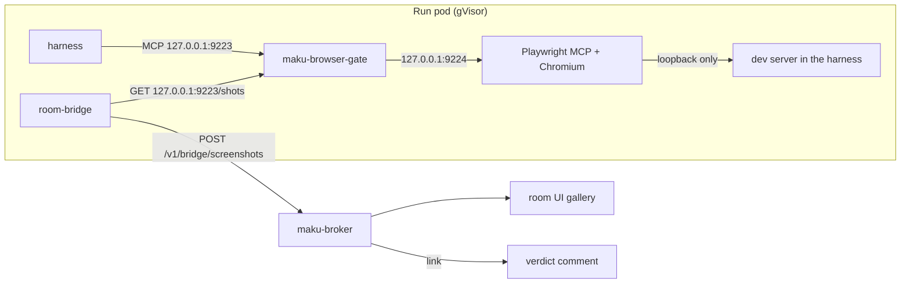

<!-- page-type: how-to -->

# Browser verification and screenshots

A Repository can give its implementer and tester runs a headless browser. The agent starts the repository's dev server inside its sandbox, opens it in the browser, reads the page's accessibility tree and takes screenshots to check layout, colour and dark mode. Every screenshot is also kept for the humans: it shows in the room, and the reviewer's verdict on the pull request links to it.

The browser is off unless a Repository opts in. Runs of other repositories get no sidecar and pull no browser image.

## How it fits together



- **`browser` sidecar** (image `ghcr.io/smana/maku-browser`): Chromium headless shell and Playwright MCP, behind `maku-browser-gate`. It is a native sidecar: the kubelet stops it when the harness exits and restarts it after an out-of-memory kill. It mounts its own `/tmp` (512Mi) and cache (128Mi) only, with no workspace, no Secret and no token.
- **The gate** serves the harness an allow-list of browser tools, refuses any URL that is not `http://127.0.0.1`, `http://localhost` or `http://[::1]`, caps each run's screenshots (10 by default, 25 at most) and each image (512 KiB), and keeps a copy of each screenshot.
- **The bridge** relays the kept screenshots to the broker with its own token, which never enters the harness container. The model has no upload tool.
- **The broker** decodes each image, refuses anything over 1920×1080, re-encodes it (which drops metadata and any extra bytes), and stores it beside the room: at most 25 per run, 100 per room and 64 MiB per room. Screenshots are deleted with the room.

## Turn it on

1. Pin the browser image in the `maku` chart values, and size the runs namespace's ResourceQuota for it (+512Mi request and +2Gi limit per opted-in run):

   ```yaml
   runController:
     images:
       browser: {repository: ghcr.io/smana/maku-browser, tag: "<version>@sha256:<digest>"}
     browser:
       resources:
         requests: {cpu: 250m, memory: 512Mi}
         limits: {cpu: "2", memory: 2Gi}
   ```

2. List the gateway aliases whose model accepts images. Each must be an alias its listener serves; the run-controller refuses its config at load otherwise:

   ```yaml
   runController:
     model:
       gateway:
         vision:
           public: [tier-light, mistral-light]
           internal: [agent-default, tier-light]
   ```

3. Opt the Repository in. Only a maintainer's Repository object turns it on; an issue body, a label or `POST /v1/runs` cannot:

   ```yaml
   apiVersion: maku.ogenki.io/v1alpha1
   kind: Repository
   metadata: {name: docs-site, namespace: maku}
   spec:
     repository: acme/docs-site
     screenshots:
       enabled: true
       roles: [implementer, tester]   # the default, and the most allowed
       maxScreenshots: 10             # 1 to 25
   ```

The factory freezes the setting onto each task at triage, so a later change applies to new tasks only.

## When the model cannot see images

A run whose alias is not on the vision list still gets the browser. Its screenshots still reach the room, but the gate answers the model with text only (`screenshot #n kept for the room; your model cannot see images`), so a text-only model never receives an image. The agent relies on `browser_snapshot`, the page's accessibility tree.

## What humans see

- **In the room**, each screenshot appears as a card in the conversation, with the page path and size, and in a gallery above the run's events. Selecting one opens it full size. A card says when the run's model could not see it.
- **On GitHub**, the reviewer's verdict comment ends with a link: `Screenshots: <k> taken by the agent, in the room: <rooms URL>/r/<room>#screenshots`. GitHub never receives the images. The link opens only for people who can read the room, which for a repository's room means GitHub read access to that repository.

## Boundaries

| Concern | Control | What remains |
|---|---|---|
| The browser reaching other hosts | The gate's URL check; Chromium's dead proxy and resolver rules for every non-loopback host; Playwright's origin list as hygiene | Network policy is per pod, so a Chromium exploit can reach what the pod reaches: the harness's own trust domain. The sidecar holds no credential. |
| Arbitrary files posing as screenshots | Only the bridge uploads; the broker re-encodes every image and sets its content type | The agent controls what the page shows, so a screenshot is agent output, shown with the trust of the run's messages |
| Private pixels leaving | Stored in the broker, shown to room readers only, never posted to GitHub | — |
| Cost | 10 screenshots by default; accessibility tree first | About $0.05–0.20 per run on a vision model |

## Troubleshooting

| You see | Meaning |
|---|---|
| `url_refused` | The agent asked for a non-loopback URL. Start the dev server on `127.0.0.1`. |
| `tool_not_allowed` | The tool is off the gate's allow-list (for example `browser_evaluate`). |
| `screenshot_cap_reached` | The run used its `maxScreenshots`. |
| No gallery in the room | The run's Repository has no `screenshots`, or `runController.images.browser.tag` is unset. |
| `spec.screenshots needs images.browser configured` | A run asked for the browser before the image was pinned. |
