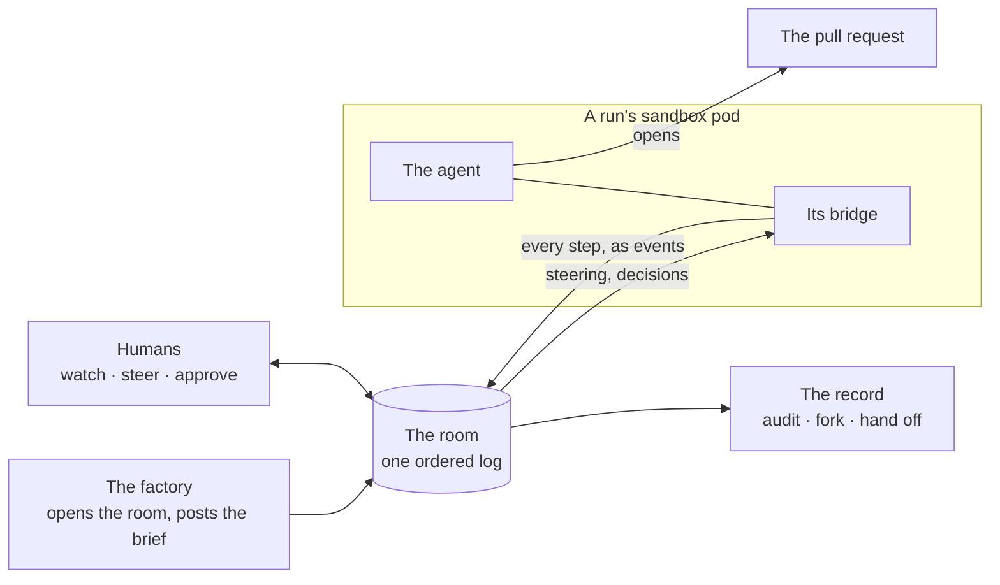
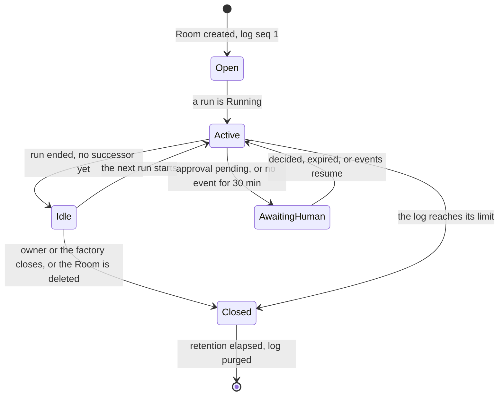

<!-- page-type: explanation -->
# Concepts

A room is a flight recorder and a group chat for one piece of agent work. While a run is live, you watch every step, steer the agent, and approve actions it may not take alone. Afterwards the room stays as an ordered, redacted record nobody can rewrite, ready to audit, fork from any message, or hand off to the next run.

## In one picture

Everything that happens in a room is an event in its log, assigned a gapless sequence number by the broker alone.

## Glossary

### The factory

| Term | Meaning |
|---|---|
| **Task** | One labelled issue's lifecycle (`Task` CR in `maku.ogenki.io`, [reference](reference/task-crd.md)): its room, runs, pull request, verdict and narration |
| **Trigger** | What starts or stops work: `factory/ready`, `factory/stop`, `factory/revert`, `/factory retry`, `/factory split`, a schedule, a RunLore finding, or a sponsored API call |
| **Triage** | Picks a task's workflow, template and tier once at intake ([Triage](factory.md#triage-tiers-templates-classes)) |
| **Tier** | `light`, `standard` or `frontier`: a run's logical model alias (`tier-*`), deadline and budget, fixed per run |
| **Workflow** | Which roles work on a task (`template` names the ordered list): `quick` (implementer), `standard` (implementer + reviewer, default), `careful` (scoped first, judged before review), or `none` (adopted PR); see [shipped workflows](factory.md#the-shipped-workflows) |
| **Budget** | Token or USD cap enforced outside the sandbox per run, task, day and person ([Budgets](factory.md#budgets)) |
| **Class** | Change category matched by merge policy (`docs-links`, `revert`, an oracle class, or `review` when none matches) |
| **Merge gate** | Decides whether an agent PR merges itself (`maku/merge-gate`): each bound class is `live` (merges when checks hold), **shadow** (decided identically without merging), or `"off"` |
| **Oracle class** | Class backed by a deterministic detector (`dead-links`) whose holdout check proves the PR fixed that exact finding |
| **Split** | Breaking a broad task into bounded child tasks proposed by the scoper and approved with `/factory split` |
| **Kill switch** | `agent-factory-stop` ConfigMap or `factory/stop` on the control issue: pauses intake and revokes active runs |
| **Narration** | Progress and status comments posted from the factory's outbox onto the issue and pull request |
| **Needs you** | Items waiting on a viewer: a pending approval, a driver hold, an escalated question, or a human merge |
| **Summary** | Deterministic fold (`summary/v1`) of a room's log rendered by the web UI and `maku status` |
| **Progress note** | A run's one-line status update (`room_progress`, [API](reference/api.md), ≤ 280 characters, at most once a minute) |

### Rooms and runs

| Term | Meaning |
|---|---|
| **Room** | One session's policy (owner, driver, members, approvals, retention, data class) and log (`Room` CR, [reference](reference/room-crd.md)) |
| **Run** | One sandboxed `AgentRun` pod on one role and branch, with a fixed deadline and budget; one run is `Running` per room at a time |
| **Sandbox** | Isolated gVisor pod behind default-deny network policy and an explicit egress allow-list |
| **Run role** | A run's role is one of four: `implementer`, `reviewer`, `tester`, `triager`. The scoper is a `triager` run; the judge is a model call inside the implementer's run, not a run |
| **Harness** | OpenHands agent-server loop inside the run container on `127.0.0.1:8000` |
| **Bridge** | `maku-bridge` (sidecar `room-bridge`): pushes harness events to the broker and delivers steering, interrupts and decisions back |
| **Broker** | `maku-broker` (`room-broker`, see [naming](superpowers/naming.md#technical-names)): authenticates writers, redacts, sequences and stores events, and serves the UI and APIs |
| **Model gateway** | Proxy outside the sandbox that holds provider keys, pins aliases, enforces budgets and meters calls ([Model gateway](gateway.md)) |
| **Participant** | Any human, run or system caller recorded joining or leaving a room |
| **Principal** | Verified identity stamped on every event by the broker: `agent:<runId>`, `human:` or `system:<component>` |
| **Room id** | 8 lowercase unpadded base32 characters (`[a-z2-7]{8}`), shared by room, run and task names (`agent/<id>` branches) |
| **Room role** | Cumulative human standing in a room (`watcher` < `collaborator` < `owner`), plus the separate `approver` flag |
| **Driver** | Single principal allowed to steer or interrupt the active run, fenced by `driverEpoch` across *give*, *request* and *take* |
| **Message delivery** | `none` (chat only), `queued` (FIFO into the next run's brief), or `steering` (injected live by the driver) |
| **Handoff** | Work and commit SHA passed from one run role to the next (`handoff` event), distinct from driver transfer |
| **Verdict** | The reviewer's `approve` or `changes` (`message{kind: review_verdict}`), also posted once on the PR |
| **Brief** | Bounded, fenced context assembled by the broker for the next run from the latest handoff, verdict and queued messages |
| **Approval** | Human allow/deny decision on a pending harness action (`approval_requested` / `approval_decided`) |
| **Fork** | New room copied from events `1..N` (`maku fork`), owned by the forker with `attended` approvals by default |
| **Step / Call line** | One collapsible agent message with its tool calls on the room page, and each `tool_call` + `tool_result` row inside it |

### The log

| Term | Meaning |
|---|---|
| **Envelope** | Frozen v1 event shape (`v, id, seq, roomId, runId, actor, type, causedBy, origin, ts, redactions, payload`; [Event envelope](reference/event-envelope.md)) |
| **seq** | Gapless per-room sequence number starting at 1, assigned under the room's database row lock |
| **Origin** | Event source: `harness` (from a run), `client` (human, system caller or room tool) or `broker` |
| **Idempotency key** | `(roomId, originClient, originSeq)`: replays return the stored event without appending a duplicate |
| **Seal** | Final event closing a room (on close, deletion, or 100,000 events / 256 MiB), starting its retention clock |
| **Retention** | Days a sealed log is kept (`spec.retention`, default `90d`) before `maku-broker retention` purges it |
| **Bridge lease** | Single-run lock (`rooms.bridge_run`) fencing displaced bridges and refusing concurrent live bridges with `409 room_busy` |
| **Data class** | Immutable `public` or `internal` classification governing allowed model backends and PR verdict summary visibility |
| **Redaction** | Broker replacement of detected secrets with `[REDACTED:<rule>]` before storage, recorded in `redactions` |
| **End reason** | Room-level cause on `state_changed{run_phase}` (`agent_finished`, `agent_error`, `model_unavailable_*`, `agent_stuck`, `deadline`, `pod_lost`, `room_busy`, `judge_impossible`, `stalled`, `not_met`, `budget_calls`, `revoked`, `deleted`, `budget-run`) |

## A room's phases

The broker projects `status.phase` from the log and the room's runs every 15 s.

`AwaitingHuman` reflects a pending approval or a 30-minute stall. Deleting a `Room` runs the `maku.ogenki.io/room-log` finalizer, which deletes its runs and seals the log; the sealed log keeps its own retention clock after the CR is gone.

## Who does what

| Actor | Creates | Reads | Writes into the log |
|---|---|---|---|
| The factory | `Room` CRs and every `AgentRun` | `GET /v1/rooms/{id}/events`, `GET /v1/rooms/{id}/queue` | Task snapshot (`task_state`), task facts (`POST /v1/rooms/{id}/task`), queued PR reviews (`POST /v1/rooms/{id}/queue`) |
| A run | nothing | `room_read` | Harness events via the bridge; `room_post`, `room_handoff`, `room_verdict` |
| A human | rooms from the UI, forks | the web UI, `maku` | Messages, driver actions, approval decisions |
| The broker | human-requested and forked `Room`s; **never** an `AgentRun` | everything | Lifecycle events, seals, limits, verdict outcomes |

The factory re-reads the pull request right before starting the next run: reviews submitted while waiting join its brief, reviews dismissed beforehand are skipped, and a review dismissed after being queued still reaches that run. Full permissions are in [Security controls](reference/security-controls.md#authorization-matrix).
