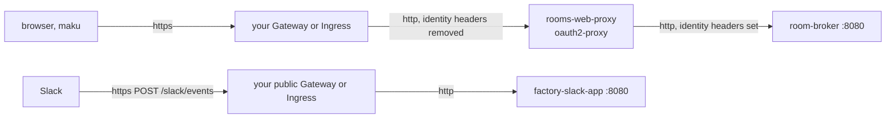

# Exposure

How people and Slack reach an install, through the Gateway or the Ingress controller the cluster
already runs. The umbrella chart (`charts/agent-factory`) renders the routes and the web front door.
Your gateway or Ingress terminates TLS: the chart never issues a certificate.

## What must be public

| Surface | Callers | Must be public | Path |
|---|---|---|---|
| `web` | people's browsers, `maku`, the `maku mcp` server | no: a private gateway (a VPN, a tailnet) is enough | everything on its hosts: the rooms UI, `/api`, `/v1/ws`, `/mcp`, `/.well-known/roomctl`, `/link/*` |
| `slack` | Slack's servers | yes | `POST /slack/events` only |
| the factory | no one outside the cluster | no: never exposed | the factory polls GitHub, so GitHub needs no webhook path. Its run API (`:8082`) is the broker's, its intake (`:8080`) is in-cluster |

GitHub's account-link callback (`/link/github/callback`) is a browser redirect, not a call from
GitHub, so it rides the web host, which may stay private.



Each hop inside the cluster is plain HTTP, inside the default-deny policies.

## The values

```yaml
expose:
  mode: httproute            # none (the default) | httproute | ingress
  httproute:
    parentRefs: [{name: private, namespace: infra, sectionName: https}]
    timeouts: {}             # the web route's, rendered only when set
  ingress:
    className: ""
    annotations: {}          # every surface's, e.g. cert-manager.io/cluster-issuer
  web:
    hostnames: [rooms.example.com]
  slack:                     # rendered only with slack.enabled
    hostnames: [factory-slack.example.com]
    parentRefs: [{name: public, namespace: infra, sectionName: factory-slack}]
  networkPolicy:
    from: []                 # mode kubernetes: your gateway's or ingress controller's pods
    cilium: {fromEntities: [ingress]}
webProxy:
  enabled: true
  existingSecret: rooms-proxy
maku:
  broker:
    webProxy: true
```

Each surface takes its own `hostnames`, and its own `parentRefs` (`httproute`) or `className`,
`annotations` and `tls` (`ingress`). A surface's own value replaces the shared one; `annotations` are
merged, the surface's winning. So the Slack events path can be public while the web stays on a
private gateway. `expose.web.enabled` and `expose.slack.enabled` (both `true`) leave a surface out,
for a team that routes it itself.

### What fails the render

| Condition | Why |
|---|---|
| an exposed surface with no `hostnames` | a route for no host matches nothing, or everything |
| `httproute` with no `parentRefs` on the surface or under `expose.httproute` | the route would attach to no Gateway |
| `ingress` with no `className` on the surface or under `expose.ingress` | the chart does not guess the default class |
| `expose.web` with `maku.broker.human.mode: local` | local mode serves one loopback user behind a port-forward |
| `expose.web` without `webProxy.enabled` | in oidc mode the broker reads the identity headers oauth2-proxy sets, so a client must never reach it directly |
| `expose.web` or `webProxy` with `maku.networkPolicies.mode: none` | nothing would keep a client from the broker's `:8080` around the front door |
| an exposed surface in mode `kubernetes` with an empty `expose.networkPolicy.from` | default-deny would drop every request; name the gateway's pods |
| an exposed surface in mode `cilium` with an empty `fromEntities` | the same |

## The routes

| | `httproute` | `ingress` |
|---|---|---|
| web | `rooms-web`: `PathPrefix /` to `rooms-web-proxy:80`, removing the ten identity headers below; `timeouts` when set | `rooms-web`: `Prefix /` to `rooms-web-proxy:80` |
| slack | `factory-slack-events`: `Exact /slack/events` with `method: POST` to `factory-slack-app:8080`. Every other path and method is the gateway's 404 | `factory-slack-events`: `pathType: Exact` `/slack/events`. Ingress has no method match: the Slack App answers anything but `POST` with 405 |

The web route removes these request headers by exact name, because Gateway API's `remove` takes no
wildcards: `X-Forwarded-Access-Token`, `X-Forwarded-User`, `X-Forwarded-Email`,
`X-Forwarded-Groups`, `X-Forwarded-Preferred-Username`, `X-Auth-Request-User`,
`X-Auth-Request-Email`, `X-Auth-Request-Preferred-Username`, `X-Auth-Request-Groups` and
`X-Auth-Request-Access-Token`. Ingress has no portable header removal, so in `ingress` mode the strip
rests on oauth2-proxy alone ([what the probe proved](#what-the-probe-proved)).

**WebSockets.** The rooms page holds `/v1/ws` open for up to an hour, and the broker pings it every
30 seconds. A gateway whose default request timeout would cut it needs
`expose.httproute.timeouts: {request: 0s}` (Envoy-based gateways). An Ingress controller's WebSocket
timeouts are its own annotations, under `expose.web.annotations`.

**TLS.** Under `httproute`, TLS is the Gateway listener's. Under `ingress`, `tls` names your Secret,
and `annotations` may carry `cert-manager.io/cluster-issuer`. The broker's own `:8443` certificate is
the run bridge's, not an exposed surface.

## The web front door

`webProxy.enabled` renders oauth2-proxy as `rooms-web-proxy`: a Deployment (two replicas), its
Service (`http` 80, `metrics` 44180), a PodDisruptionBudget, a ServiceAccount with no token, and its
policies. Its arguments are derived from `maku.broker.human`, so the issuer and the groups are stated
once. [Identity](identity.md#oauth2-proxys-arguments) lists them. `maku.broker.webProxy: true` opens the
broker's `:8080` to these pods, and to nothing else.

| Value | Default | What it does |
|---|---|---|
| `image` | oauth2-proxy v7.15.5, by digest | the version the probe asserted |
| `existingSecret` | required | the web client and the cookie secret (D14): keys `client-id`, `client-secret`, `cookie-secret` (`keys` renames them). The cookie secret is 32 random bytes: `openssl rand -base64 32 \| tr -- '+/' '-_'` |
| `cookieRefresh` | `1h` | under the ID token's lifetime |
| `cookieSameSite` | `strict` | `lax` when the IdP is on another site than the web host: a strict CSRF cookie does not come back from a cross-site sign-in |
| `extraArgs` | `{}` | appended as `--key=value`; a key the chart derives fails the render, naming it |
| `extraEnv`, `extraVolumes`, `extraVolumeMounts` | `[]` | e.g. a private IdP CA (`SSL_CERT_FILE`) |
| `networkPolicy.idp.to`, `.port` | the issuer | the IdP's egress: in mode cilium, `toFQDNs` on the issuer's host; in mode kubernetes, every public address. Set them for an in-cluster IdP |

It also needs `maku.broker.human.issuer`, an `https` `maku.broker.publicURL` (the sign-in returns to
`<publicURL>/oauth2/callback`), and `maku.broker.oidc.existingSecret`, whose `cli` key is the client
`maku`'s bearers are issued to.

**The policies.** In mode `kubernetes` a NetworkPolicy, in mode `cilium` a CiliumNetworkPolicy:

- ingress on `:4180` from `expose.networkPolicy.from` (or `fromEntities`), and from the kubelet in
  cilium mode;
- ingress on `:44180` from the scraper (`maku.networkPolicies.kubernetes.metricsFrom`, or
  `monitoring.serviceMonitor.cilium.fromEndpoints`);
- egress to DNS, to the broker's `:8080` and to the IdP.

With `monitoring.serviceMonitor.enabled`, a ServiceMonitor scrapes it.

### Your own front door

A team that runs its own oauth2-proxy sets `expose.web.enabled: false` and `webProxy.enabled: false`,
and routes to it itself. Its proxy must do what the chart's does: overwrite
`X-Forwarded-Access-Token` on every request, and strip it on its skip-auth routes. Open the broker's
`:8080` to it alone with `maku.broker.networkPolicy.extraIngress`. Routing the web straight to the
broker is never safe: a client could then send an access header of its own and pass as a web
session.

## Exposing only Slack

```yaml
expose:
  mode: httproute
  web: {enabled: false}
  slack:
    hostnames: [factory-slack.example.com]
    parentRefs: [{name: public, namespace: infra}]
  networkPolicy:
    from: [{namespaceSelector: {matchLabels: {kubernetes.io/metadata.name: gateway}}}]
slack:
  enabled: true
```

People then reach the web through a port-forward, or through a front door of their own.

## What the probe proved

`task chart:expose:probe` runs `charts/agent-factory/tests/expose-probe/probe.sh` on a throwaway
k3d: agentgateway v1.6.0 on Gateway API v1.2.1, k3s's Traefik, and oauth2-proxy v7.15.5 against the
e2e stub issuer.

| | What was asserted | Result |
|---|---|---|
| X1 | The Slack route answers only `POST /slack/events` | agentgateway answers 404 to `GET /slack/events`, `/slack/eventsx`, `/slack/events/x`, `/slack` and `/`. Traefik's `Exact` path answers 404 to the other paths, and passes `GET /slack/events`: Ingress has no method match, so the App's 405 is the guard |
| X2 | The web route removes each of the ten identity headers | all ten removed |
| X3 | `/v1/ws`, pinged every 30 s, stays open 6 minutes | through agentgateway with and without `timeouts`, through Traefik, and through agentgateway then oauth2-proxy |
| X4 | oauth2-proxy never forwards a client's `X-Forwarded-Access-Token` | with a CLI bearer it is overwritten with the bearer (both headers equal: never a web session); with a session it is the session's own access token; on a skip-auth route it is stripped. A client's other nine identity headers pass oauth2-proxy unchanged, so in `ingress` mode they reach the broker as sent: the broker reads only `Authorization` and `X-Forwarded-Access-Token` |
| X4 | The skip-auth routes and the cookies | `GET /.well-known/roomctl` and `GET /link/github/callback?…` pass without a session; `POST /link/github/callback`, `GET /link/github` and `/link/github/callbackx` redirect to sign in. The cookies are `Secure`, `HttpOnly`, `SameSite=Strict`. A bearer in no agents group is 403 |
| X5 | `oidc-groups-claim` with a nested claim (`realm_access.roles`) | not read: a member's bearer is 403. So the chart sets `allowed-group` only for a top-level roles claim |
| X6 | `HTTPRoute.spec.rules[].timeouts` on the v1.2.1 standard CRDs | kept, and agentgateway accepts the route |

`task chart:expose:k3d` then installs the chart that way, by HTTPRoute and by Ingress, and signs in
through it.
