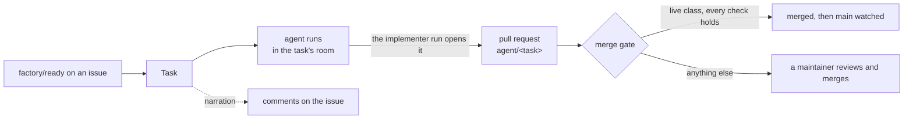
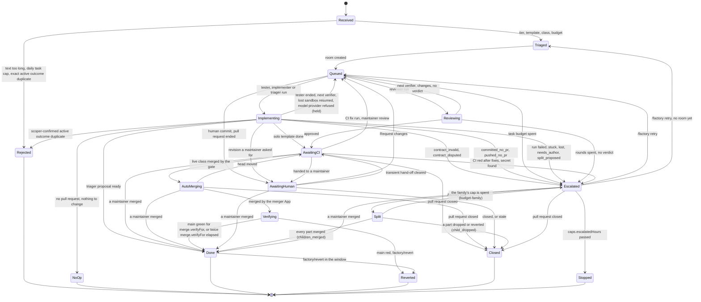
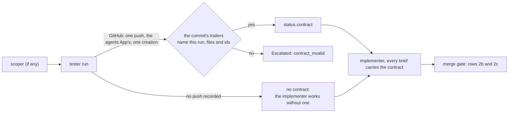
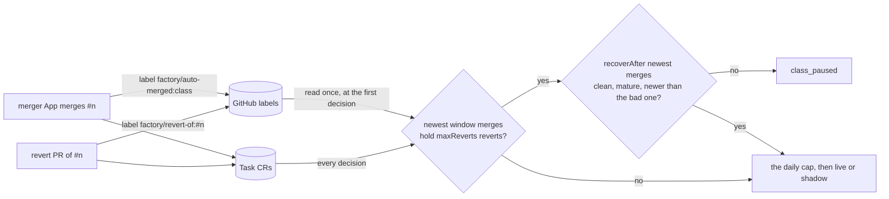

# The factory

A maintainer labels an issue; the factory turns it into a task, runs agents on it in sandboxes,
narrates each step on the issue, and stops at its budget. The agent run opens the pull request;
the factory watches it through CI and its merge gate. Humans steer through GitHub reviews and
comments, or from the task's room. Only low-risk classes the config marks `live` merge
themselves; a `shadow` class is decided the same way and never merged.



## Triggers

Every label below is read once a minute (`poll.issues`). Labels applied by non-maintainers start nothing (`maintainers` in [the config](reference/config.md), compared case-insensitively).

| Trigger | Effect | Who |
|---|---|---|
| Label `factory/ready` (`triggerLabel`) on an issue | Creates a `Task` from a sanitised snapshot and SHA-256 of the issue's title and body, then removes the label (ignored on PRs; re-labelling supersedes an escalated task). Apply `plan-first` or `report` beforehand to choose that outcome; two outcome labels at once refuse with `outcome_conflict` and run `change` | Maintainer |
| Label `factory/review` on a pull request | Creates a read-only `review` `Task` on that pull request, runs one `reviewer` with a read-only token, posts its verdict comment, and ends `Done` (`review_posted`); never pushes, merges, or opens a second run | Maintainer with `write`, or PR author |
| Comment `/factory fix` alone on a line on a completed `report` issue | Files a `change` `Task` on the same issue with the investigation's findings as its scope | Maintainer with `write` |
| Label `factory/stop` on the issue or its PR | Revokes and deletes active runs and ends the task `Stopped` (kept if no task is running yet so a later start stops immediately; removed and answered if applied by a non-maintainer) | Maintainer |
| **cancel task** or **discard task** on the room page, `maku cancel <task> [--discard]`, or the `cancel` tool | Stops the task as `factory/stop` does, reason `cancelled`, even when its issue was deleted; a discard also closes the pull request, deletes `agent/<task>` and closes the issue as not planned ([`POST /v1/tasks/{task}/cancellations`](reference/api.md#post-v1taskstaskcancellations)) | The task's owner or a maintainer, with write |
| The task's issue deleted on GitHub | Ends the task `Stopped`, reason `issue_deleted`, within 5 minutes | — |
| Label `factory/revert` on an auto-merged PR within `merge.revertWindow` | Opens a revert PR via the merger App, ends the task `Reverted`, and counts against the class [breaker](#the-merge-gate) (human merges are never reverted: on a PR the factory did not merge, the factory removes the label and comments that it opened no revert, naming `maku policy drill`) | Maintainer |
| Label `factory/drill` on an auto-merged PR **before** `factory/revert` | Marks the revert a [drill](#the-merge-gate), copies the label to the revert PR, and skips the breaker | Maintainer |
| Label `factory/hold` on a PR | Hands the PR to a human (`held`) before class or approval checks; removing it re-enters the gate (`reentered_unheld`), though it does not disarm an already-armed GitHub auto-merge | Anyone able to label |
| Comment `/factory split` alone on a line on a `split_proposed` issue | Approves the proposed [split](#splits) and charges every part to the commenter (read before `/factory retry`) | Maintainer with `write` |
| Comment `/factory retry` alone on a line on an escalated issue or PR | Queues a fresh run ([Escalation](#escalation-reminders-and-stale-tasks)) | Maintainer with `write` |
| Comment `/factory retry deeper` alone on a line on an escalated or no-op issue or PR, or run `maku retry <task> --deeper` | Steps the task up once to the next workflow on its ladder on the same room, branch and pull request. A deeper workflow costs its own `budget:` tier's ceiling; when that is more than the cost confirmed for the task, the retry is refused with `deeper_over_cap`. To confirm the higher cost, start the task again with that workflow (New task, or `maku start --workflow <name>`) | Maintainer with `write` |
| Comment `/factory retry harness=openhands` alone on a line on an escalated OpenCode issue or PR | Counts the failed OpenCode attempt under its original cohort, then queues an OpenHands rescue run in cohort `rescue` on the same workflow, branch, and room ([Opt-in OpenCode harness](opencode-harness.md)) | Maintainer with `write` |
| **Request changes** review on the task's PR | Queues a revision run on the same branch with the review in its brief, then hands back to the maintainer | Maintainer |
| `factory/stop` on `control.issue`, or `agent-factory-stop` ConfigMap | Stops every task and pauses intake ([The kill switch](#the-kill-switch)) | Maintainer or operator |
| Schedule (`schedules[]`, 5-field UTC cron) | Starts one task per slot under an hour old (`probe: renovate-red` batches up to five red `renovate[bot]` PRs older than 24 h; `probe: dead-links` files confirmed Wayback-backed findings reported as 404/410/unresolved by the newest two `oracle.workflow` runs on `main`, up to `oracle.maxFindings`) | The factory |
| `POST /intake/runlore` or `POST /v1/tasks` | Opens an `investigate` task (`factory/proposed` issue) from RunLore or a sponsored/internal task ([API](reference/api.md#the-factorys-api)) | RunLore or sponsored caller |

A `factory/ready` applied by the factory App counts only on an issue the broker filed from a web **New task** start and recorded: the task is then the recorded maintainer's ([broker-confirmed handoff](security.md#authorization)). The label waits up to two minutes for the broker's record.

Refused `factory/ready` labels are removed and answered once (`unauthorised_labeller`, `edited_after_label`, `task_active`, `unsanitisable`); a maintainer re-applying `factory/ready` while the issue's task is still running is answered `task_active`. The factory applies `factory/class:<class>`, `factory/stale` (closed after 14 quiet days), `factory/orphaned` (PR whose `Task` was lost, human-only thereafter), `factory/needs-author`, `factory/proposed`, `factory/split-proposed`, and `factory/child-of:#p`.

### Commands posted early, and input that is not acted on

No command or review is dropped without an answer:

| Input | What the factory does |
|---|---|
| A maintainer's command (`/factory retry`, `retry deeper`, `retry harness=openhands`, `split`, `fix`) posted on the task's issue before the task is in the phase it applies in | Holds it in `status.held` and replies at once: `held /factory retry: it applies when the task is escalated`. When the task reaches that phase, the command is applied once, under the same checks as one posted then (write access, caps), whatever its age, and the factory replies that it was acted on |
| A held command that cannot apply | Expires with a reply mentioning its author: the task left that phase without it (another answer, or the escalation's expiry, came first), the task ended, or 24 hours passed |
| A maintainer's `/factory plan approve`, `revise` or `split` posted while no plan is under review | Never applied to a later plan: a plan command answers the plan it was posted on. The factory replies at once, and the next plan's review comment names the command under **Posted before this plan existed, not applied**; answer that plan there |
| A maintainer's command this task can never act on (`/factory fix` on a task that is not a `report`, `/factory split` on a workflow without splits, a plan command with no plan gate, the OpenHands rescue on a task not on OpenCode) | Replies that it was not acted on, and why |
| A command from anyone without write access on the repository, or who is not one of its maintainers, or a **Request changes** review from someone who is not a maintainer | Not acted on, as before, and answered once on the issue or pull request: what was not acted on and that only maintainers with write steer the factory. One such reply per person per task per hour (`status.refusals`), so a loop of posts cannot make the factory talk on; the reply never quotes what they wrote |

The newest held command of a kind replaces an older one (the three retries are one kind). A task holds
at most 16. The issue is read for early commands at most every 30 seconds per task; a command posted
less than a minute before the task's phase changes counts in the new phase, as before. A command
posted on the pull request rather than the issue is read only in its phase.

## A task's life

A task's phase appears in `kubectl get tasks` and in its room summary. Any open phase moves to `Stopped` on `factory/stop`, the kill switch, or a superseding `factory/ready`.



`Rejected`, `NoOp`, `Done`, `Reverted`, `Closed` and `Stopped` are terminal; manual PR merges or closes end the task from any watching phase (`Merged` exists in the CRD enum without an active transition because auto-merges enter `Verifying`). Tasks count against `caps.activeTasks` while in `Implementing`, `Reviewing`, `AwaitingCI`, `AutoMerging` or `Verifying`.

### Outcome-overlap detection

Idempotency keys prevent replaying one request; `intake.overlap.mode` (`off` by default, `shadow`, or `enforce`) checks whether two distinct **issue, sponsored API, or scheduled** tasks pursue the same outcome (split, coordination, adopted and RunLore tasks are excluded).

Before triage or room creation, the factory hashes `lowercase(repository) + NUL + canonicalGoal` (NFKC, lowercase, punctuation/whitespace normalized `spec.text`) and ranks up to **20 same-repository candidates** from Tasks, AgentRuns and retained room outcomes by lexical term overlap and recency, reading GitHub issues/PRs only for retained candidates. Results persist once per generation in `status.overlap` (fingerprint, classification, cited IDs/phases, checked sources, optional evaluation-run ID, `checkedAt`, and a ≤ 512-char note, never raw untrusted prose):
- **`active_duplicate`:** exact active fingerprint, or a read-only evaluation scoper run citing a supplied active candidate. Under `mode: enforce`, exact-active matches end `Rejected` (`overlap_active_duplicate`) before any run or budget reservation; setting `scoperEnforcement: true` also refuses valid scoper-confirmed active matches after the single evaluation run.
- **`completed_duplicate`, `prior_attempt`, `partial_overlap`, `no_match`, `unverified_overlap`:** proceed through the normal lifecycle (`unverified_overlap` covers source outages, malformed scoper output, or unsupported citations — missing evidence never becomes a refusal). Rollout gates are in [Operations](operations/factory.md#outcome-overlap-rollout-and-shadow-evidence).

### The tester stage

On a repository with `workflow.testFirst: true`, every public task whose workflow's `loops` row sets `tests: true` (including the shipped `careful` row) runs a **tester** on `agent/<task>` after the scoper and before the implementer (never on internal tasks or via human/run APIs, which refuse `tester_is_factory_only`). The tester writes failing tests only; the harness verifies they fail on base and pushes a single commit (`test: the test contract`) carrying `Agent-Contract`, `Agent-Run`, `Agent-Contract-File` and `Agent-Contract-Id` trailers.



The factory trusts GitHub's branch history rather than room notes: it adopts the contract only if the agents App created the branch once from an ancestor on the default branch and every touched file is an addition/edit inside `.github/agent-checks.yaml`'s `tests.paths` outside `tests.runner` (≤ 50 files/IDs and ≤ 512 bytes, else `contract_invalid` or `contract_too_large`). If no push appears (after waiting up to 5 minutes on `contract_ready`), the implementer runs without a contract. When a contract exists, every implementer brief fences its commit, files and test IDs (`CONTRACT-<nonce>`): modifying contract tests hands off as `contract_modified`, and handing off back to `tester` escalates immediately as `contract_disputed`. Required check `merge.contractCheck` proves base-red / head-green at merge.

### When the factory waits for you

When a task pauses in `Queued`, `Implementing`, `AwaitingCI`, `AwaitingHuman` or `Escalated`, the room page, `maku status`, and issue comments report the same reason code and next step:
- **`Queued` / `AwaitingCI`:** normally waits automatically for run slots, daily budget reset, room availability, or required checks (returning automatically up to three times when transient `policy_pending`, `policy_absent`, `head_unreported` or `ci_cancelled` clears on the same head).
- **`AwaitingHuman`:** waits for a maintainer review and admin-bypass merge (`gh pr merge <n> --squash --admin`), a commit-bound approval (`gh api .../reviews -f commit_id=<sha> -f event=APPROVE` or the web UI) once runs have ended for over a minute when `merge.approveToMerge` is enabled, or — on a `plan-first` task (`plan_review`, label `factory/plan-proposed`) — the issue author's or a maintainer's `/factory plan approve`, `/factory plan revise <comment>`, or `/factory plan split` (or `POST /v1/tasks/{task}/plans`). No run exists while a plan waits; past `workflow.planGateHours` (default 72) the status comment marks it parked and any of the three answers resumes it. With `workflow.planGate: auto`, the plan approves at once and says so in the room.
- **`Escalated`:** waits for a maintainer to inspect the room and comment `/factory retry`, `/factory split`, or close the PR.

Every waiting, hand-off, escalation and terminal reason code is listed in [Narration and task status](reference/narration.md#when-the-factory-waits-for-you).

### Model provider refusals

Provider balance, auth, or quota/rate-limit errors are treated as platform holds rather than agent failures. The broker maps the last `harness_error` to `model_unavailable_billing`, `model_unavailable_auth` or `model_unavailable_quota`; the factory returns the task to `Queued` without consuming resumes or review rounds, retries with 1→2→4→8→16→30-minute backoff, counts `maku_factory_model_refused_total{cause,role}`, and escalates on the sixth consecutive refusal.

## Narration

The factory App posts at-least-once event comments from a 16-entry outbox onto the issue (or PR when no issue exists), maintains one live **Factory status** comment on issue tasks, answers **Request changes** reviews on the PR (`revise-<runs>`, `revised-<runs>`), and writes `task_state` and run-history facts to the room log without quoting untrusted user text. All comment keys, workflow step-up rules (`profile_chosen`, `profile_escalated`), outbox semantics, and waiting reasons are in [reference/narration.md](reference/narration.md).

## Triage: tiers, templates, classes

Triage runs once in `Received`. Every task is rated `standard`; no classifier is called. `triage.controlPercent` sends that share to `frontier`. Each tier binds a gateway logical model (`tier-*` / `agent-default`), `runMinutes`, `runTokens`/`taskTokens`, and optional `runUSD`/`taskUSD`. Templates (`solo`, `pair`, `investigate`, `review`) list the ordered roles (`implementer`, `reviewer`, `triager`), and workflows supply both template and loop policy.

### The shipped workflows

A **workflow** names which stages work on a task (`workflows` in [config](reference/config.md); legacy profile keys are refused: [upgrading](upgrading.md#workflows-name-what-runs)). Omitted entries default to the list form:

```yaml
workflows:
  quick:
    description: "One implementer. For changes a check can verify."
    budget: standard
    stepUp: standard
    stages:
      - {role: implementer, stall: true}
  standard:
    description: "An implementer and a reviewer. The default."
    budget: standard
    stepUp: careful
    stages:
      - {role: implementer, stall: true}
      - {role: reviewer, maxRounds: 2}
  careful:
    description: "Scoped first, judged before review. For wide or unclear tasks."
    budget: frontier
    stages:
      - {role: scoper, split: {maxParts: 4}, gate: {when: plan-first}}
      - {role: tester, when: repository.testFirst}
      - {role: implementer, search: true, stall: true, judge: evidence}
      - {role: reviewer, maxRounds: 2}
  none:
    template: none
```

`quick` and `standard` end a run that commits nothing in 80 steps; only `careful` runs the completion judge (`judge: evidence`, which compiles to `tier-light`). The shipped `careful` workflow splits tasks into up to 4 parts whenever the factory meters USD costs (`meter.prices` and `runs.gatewayIdentity`). Existing workflows written with `template`, `tier` and `loops` rows continue to load, and `maku install --print` writes the list form directly. On a verified failure (`budget-run`, `budget-task`, `stalled`, `not_met`, `review_rounds_exhausted`, `ci_red`), an unpinned task steps up once along `quick` → `standard` → `careful` (`Repository.spec.workflow.stepUp`: `auto`, `ask`, or `off`); pinned tasks, capped tasks, confirmed plans that did not show the stepped-up figure, tasks in an arm of the workflow evaluation, and failures of a run whose role the trigger does not step escalate with an offer (`/factory retry deeper`) and the reason instead; only `stepUp: off` escalates without one. `budget-task` steps up whichever role ran last.

Reviewers run on the opposite tier (`standard` after `frontier`, `frontier` otherwise, unless `reviewerModel` overrides it) and receive fenced acceptance checks plus the PR URL without the implementer's handoff. The reviewer brief asks for correctness defects against the diff and acceptance checks only (style, naming, and unasked scope are not findings), and an `approve` verdict with no comment is a complete answer. On a foreign pull request (`outcome: review`, template `review`), the reviewer runs alone with a read-only token, starts from the pull request's head branch (`baseRef`) on its own `agent/<task>` branch (a person's branch is no agent branch, and it pushes to neither), posts one verdict comment (`Done` `review_posted`), and never pushes or merges; the merge gate ignores verdicts on pull requests not authored by the agents App. `investigate` runs a read-only `triager`: RunLore and internal API sources force `internal` data class, whereas a public `report` task keeps its `public` data class, posts its findings on the issue (`Done` `findings_posted`), and offers `/factory fix` to file a `change` task with those findings.

When a workflow enables `ask` (on by default in `quick`, `standard`, and `careful`), triage checks deterministically before starting any run that an issue states an acceptance check (`## Acceptance`, or an `Acceptance:` label, plain or bold, with text on its line or a list or paragraph on the lines after it). Issues without one bounce immediately to `Escalated` (`needs_author`) with `factory/needs-author` and zero runs started; schedules and confirmed intake plans that already settled acceptance proceed unasked, and `/factory retry` proceeds as assumed without re-asking.

Triage selects the workflow by first match: (1) a maintainer's pin, (2) task source (`quick` for reverts, oracle findings and unpinned schedules; `none` for adopted PRs), or (3) `Repository.spec.workflow.default` (`standard` if unset), recording `status.profile.source` and hashing unpinned default-path tasks into `control` (`evaluation.controlPercent`) or `treatment` cohorts for live cost/merge-rate evaluation. Triage also sets the predicted merge class (`schedule.class`, maintainer-sponsored `spec.intake.class`, origin class, or `review`; `class:<name>` issue labels are ignored with a one-time notice).

### Pinning a workflow

A maintainer can pin a workflow via a `workflow:<name>` label before `factory/ready` or via a confirmed plan's `spec.intake.profile` (`profile:<name>` labels are ignored). Pins are validated at intake and triage: conflicting labels (`profile_conflict`), non-maintainer appliers (`not_maintainer`), unknown/`none` workflows (`profile_unknown`), or `careful` with `testFirst` on a repository without `tests.paths` (`profile_no_tests_paths`) do not fail the task — it runs unpinned and narrates `profile_refused` ([refusal codes and cohort table](reference/narration.md#workflow-pin-refusals)). Fewer-role pins remain safe because unreviewed diffs only auto-merge when a diff shape or oracle holds.

## Budgets

Budgets bound token and dollar spend from outside the sandbox:
- **Per-run cap (`runTokens`, `runUSD`):** the meter revokes a run as `budget-run` as soon as it reaches either its token limit or its priced USD limit. Unpriced models never cost $0; they bind on token caps (or $1.70 / 1M tokens for daily reservations).
- **Per-task cap (`taskTokens`, `taskUSD`):** before starting a run, the task must have at least one full run left (one quarter for a reviewer, capped at the remainder; the overlap evaluation scoper is recorded without counting against task caps). When insufficient and `budgets.enforceTask` is `true` (default), the task escalates as `budget-task` and `/factory retry` cannot bypass it; lost sandboxes also resume only within the remaining cap.
- **Fleet and human daily caps (`factoryDailyUSD`, `humanDailyUSD`):** reservations and settled spend are tracked per UTC day in `agent-factory-ledger-usd-<YYYYMMDD>` ConfigMaps. Exhausting the fleet day holds queued tasks in `waiting_daily_budget` until `00:00 UTC`; gateway fleet 429s revoke runs as `budget-fleet`.

### Per-person caps

When `budgets.perPerson.enabled: true`, each human-triggered run reserves against both the fleet and the responsible GitHub login (`github:<login>` for labellers, `/factory retry` authors, and linked `POST /v1/runs` callers). In shadow (`enforcePrincipal: false`) over-cap runs only increment `budget-principal-shadow`; with `enforcePrincipal: true`, intake drops the label with a comment, `Queued` escalates `budget-person` (a different maintainer's `/factory retry` charges the retrier), the API returns `429 person_budget_exhausted`, and live runs exceeding their person's day are revoked as `budget-principal`. Every budget key, PromQL meter query, ledger rule and failover bound is in [reference/budgets.md](reference/budgets.md).

## The merge gate

Once a task is ready, the gate reads the pull request in `AwaitingCI` and checks, in order;
every "no" goes to a human. Row 12 is read last, only when the others would merge or post a
shadow decision. With no class `live` or `shadow` it reads nothing and hands off as
`merge_gate_off`. A repository may bind its classes in its own `.github/agent-factory.yaml`:
[merge policies](merge-policies.md) covers that file, its switches and its reasons.

| # | Check | If it fails |
|---|---|---|
| 1 | The secret scan (`merge.leakScanCheck`) is not red | Escalated, `secret_scan_red` |
| 2a | The repository is this factory's ([the fence](reference/config.md#the-ownership-fence)) | `not_owned` |
| 2 | Every `merge.requiredChecks` is green | Red: a fix run, up to `merge.fixRuns`, then `ci_red`. Cancelled: re-run, up to `merge.checkReruns`. Pending: wait |
| 2b | A task with a contract: `merge.contractCheck` is green too, as a required check. On a task without one the job only reports | As row 2: red is a fix run, pending waits |
| 2c | A task with a contract: no contract file changed since the tester's commit (GitHub's compare of that commit and the head; a head that is not its descendant, such as after a rebase, or more than 100 commits from it, counts every contract file as changed). Read once CI is green | Unread: wait, `contract_unread`. Changed: `contract_modified`, never a fix run |
| 3 | `policy-bot: main` is green, posted by `merge.policyBotLogin` | `policy_absent`, `policy_pending`, `gate_path` |
| 3a | The pull request does not carry `factory/hold` | `held` |
| 4 | The author is `agentsLogin`, and no maintainer approved it | `not_agent_authored`, `maintainer_approved` |
| 5 | A policy holds on the diff: rows 6 to 11 run for every candidate policy and the strictest `live` one that holds decides ([selection](merge-policies.md#selection-from-the-diff)); a task with findings or an adopted pull request has its one class | `no_policy_matched`, each policy's refusal in `considered=` |
| 6 | The template's reviewer approved, the room reported the head, and every approval is of that head (a policy with no `diffShape` and no `oracle` also requires a reviewer's approve, refusing `reviewer_verdict_missing` otherwise) | `no_approving_verdict`, `head_unreported`, `verdict_stale`, `reviewer_verdict_missing` |
| 7 | The head's `Agent-Run` trailer names one of the task's runs | `foreign_trailer` |
| 8 | The class's declared conditions, in this order: `allowedFiles`, `protectedFiles`, `modifyOnly`, `maxPatchFiles`, `maxModifiedLines` (GitHub's counts), `diffShape` (`links-only`: link targets only, each staying relative, on its https host, or moving to web.archive.org; built into `docs-links`), or `semver-patch`, `semver-minor` and `added-entry` for an [adopted class](#adopted-classes) (computed from the diff; `companionFiles` extends the files an `added-entry` may touch), `holdoutChecks` (SUCCESS from GitHub Actions), `oracle` (the task's `spec.findings` no longer link targets in the head, and every finding was a link target on the base and none is on the head, and no target moved but to the exact snapshot its finding gave) | `file_not_allowed`, `file_protected`, `file_added_or_deleted`, `patch_too_large`, `class_mismatch`, `holdout_red`, `oracle_finding_open`, `oracle_unrequested`; a pending holdout waits as `holdout_pending` |
| 9 | A `live` class: its breaker has not tripped | `class_paused` |
| 10 | A `live` class: under `merge.maxPerDay` today, and under the class's `maxPerDay` | `auto_merge_cap` |
| 11 | The class is `live` | `shadow_would_arm`: the decision is posted, nothing is merged |
| 12 | Every push to the branch was the agents App's | `human_commit_in_pr` |

A `shadow` class skips rows 9 and 10: a shadow class records `shadow_would_arm` whatever the
breaker and the day's count say; the marker says `paused=` and `capped=`. A shadow decision
arms nothing, so a blocker that only decides whether to arm has nothing to block. `ledger_truncated`
is the one breaker input that still stops a shadow record: an unread ledger decides nothing.

A condition on the diff (row 8's file conditions and shape) is decided on GitHub's own file list,
read only when every other row would merge or post a shadow decision. Two rules are stricter than
policy-bot's own matching. `allowedFiles` patterns must start with `^` and end with `$`
(the config refuses others) and are matched against the whole path, as `^(?:pattern)$`;
`protectedFiles` patterns are unanchored, so one matches anywhere in a path. A `holdoutChecks`
entry passes only when every run of that name was posted by GitHub Actions with the raw conclusion
`SUCCESS`: a skipped or neutral job (an `if:` or `paths:` filter) refuses as `holdout_red`, since
it checked nothing. A holdout check that is not reported yet, or still running, holds the task as
`holdout_pending`; one that never reports holds it for `merge.awaitingCIFor` (24h unless set, `0s` for no bound), then hands it off as `ci_wait_expired` (issue #182).

When every check holds on a live class, the merger App merges the decided head; GitHub refuses
the merge if the head moved, and the new head is decided again. The task then watches
`merge.verifyChecks` on the merge commit for `merge.verifyFor`: red reverts, green ends `Done`. No result within twice `merge.verifyFor` (a check cancelled, as `cancel-in-progress` does on main, never finished, or never reported, so don't list a path-filtered workflow) ends `Done` `merged_unverified`. A
maintainer's `factory/revert` within `merge.revertWindow` reverts too. The revert pull request
auto-merges only while the `revert` class is live; otherwise a maintainer merges it.

The breaker: a class whose newest `merge.breaker.window` merges hold `merge.breaker.maxReverts`
reverts goes back to human review, whatever the config. Maintainers' merges of that class refill
the window, so clean ones lift it. Each revert is announced on the control issue. The gauge
`maku_factory_class_paused{repository,class}` reads 1 while the class is paused, refreshed at each
decision and at each monitor pass of one of the class's merges.

**Recovery.** With `merge.breaker.recoverAfter` set (0, the default, keeps the window rule
alone), "the class resumes if the `recoverAfter` newest merges are all newer than the newest bad
merge, carry no revert, follow-up or regression, and are mature". A merge is mature once it is
older than the class's `monitor.followUpWindow`, or `merge.revertWindow` for a class without a
monitor. An immature merge is skipped: it neither counts nor blocks. A new bad merge, mature or not,
trips the class again at once. `recoverAfter` must be below `window`: at `window` or more the bad
merge leaves the window first. A monitored class whose `followUpWindow` is shorter than
`revertWindow` counts a merge mature while a maintainer's `factory/revert` of it is still possible.
Such a revert trips the class again once the breaker sees it: at once for a merge whose Task exists,
after a restart for one known only from GitHub's labels, which are read once per process.

**Drills.** Two paths open a drill revert. For any merged pull request, whoever merged it, run
`maku policy drill owner/name#PR`: the merger App opens a revert labelled `factory/drill` for a
maintainer to merge ([promotion](merge-policies.md#promotion-shadow-to-live)). For a pull request
the factory merged, a maintainer who reverts on purpose (a runbook drill) labels the pull request
`factory/drill` before `factory/revert`; the labels never revert a human's merge, and the factory
answers them on one with a comment naming `maku policy drill`. The merger copies the label to the revert pull request and
records `status.pullRequest.drill`: "the ledger does not count that revert". The ledger reads a
revert pull request's `factory/drill` only when the label is still on it and its newest label event
is the merger App's or a maintainer's; anyone else's label, or a truncated event list, counts the
revert. "A `main_red` revert is never a drill": the factory never marks one, whatever labels the
reverted pull request carries. A drill is narrated as one: the reverted pull request is told the
breaker does not count it, and the control issue gets a drill notice instead of the demotion one.
`maku_factory_pr_outcomes_total{outcome="reverted"}` still counts it: the pull request was reverted.

A maintainer's label is trusted, but a `factory/drill` added after the revert (by hand to the revert
pull request, a past one included) lifts a pause only through GitHub's labels: when no Task for the
reverted merge exists, as on a rebuilt factory, at the next process start, since the labels are read
once per process. While the merge's Task exists it still records the revert as counted, and the
class stays paused: label the pull request `factory/drill` before `factory/revert`.

A drill-reverted merge counts as a clean merge: it refills the window and, once mature, counts
towards `recoverAfter`. The merge was fine and the revert was planned.

The breaker and the daily cap read their merges from the Tasks and from GitHub, so a rebuild that
loses every Task keeps a demoted class demoted. The merger App labels what it merged
`factory/auto-merged:<class>` and its revert pull request `factory/revert-of:#<n>`. The factory
reads those labels at its first decision and keeps them for the process's life. Until that read
succeeds, the gate decides nothing. Only auto-merges carry a label, so maintainers' merges from
before a rebuild do not refill the window: a demotion can only last longer. A failed label write
is logged and retried while the factory still reads that pull request; it never holds up the
merge or the revert. The labels need `issues: write` on the merger App, which the factory asks
for only while a class is `live`.



**Approve-to-merge.** With `merge.approveToMerge`, row 3 arms on a maintainer's `APPROVED` review of
the current head, for the agents' pull requests only: the merger merges that head outside the
caps, labels it `factory/approved-merge`, and records it as a human merge: Done without Verifying,
never reverted on `main_red`, watched by the monitor. A hand-off a human's judgement covers returns
to the gate when a maintainer approves the head it was handed off at. The switch is off by
default and acts only when the factory gates at all: when a class of any configured repository is
live, shadow or monitored (the factory-wide condition for the merger key). With none, a task hands
off `merge_gate_off` before the approval is read. The switch also gates re-entry from caps and pauses: an `auto_merge_cap`
hand-off returns on the next UTC day, and a `class_paused` one once the pause lifts, only while it
is on.

A shadow decision's comment carries the head it judged and what a live class would have met
(`event=would-arm-<n> head=<sha> paused=<bool> capped=<bool>`).
`scripts/shadow-merge-tally.sh --class docs-links` counts the pull requests a maintainer then
merged at that head: the gate's evidence that the class would have merged nothing a human would
not. Comments from before the head was recorded never count.

**The decision record.** Every non-wait decision the gate's rows reach (arm, shadow, human,
escalate, and an adopted task's `ci_red` or `ci_cancelled`) also appends one hidden line to its
comment, with the values each row read, so a tally can replay a cap later. That comment is posted on the
pull request, a hand-off's included (`no_policy_matched` with its `considered=`), where the decision timeline
and the evidence tally read it. An agent task's `ci_red`
or `ci_cancelled` starts a fix run or a re-run instead, and posts no record:

```
<!-- agent-factory-decision head=<sha> class=docs-links decision=shadow:shadow_would_arm files=2/3 lines=12/20 shape=ok holdout=ok oracle=ok age=n/a evidence=ok paused=false capped=false reviewer=glm-5.3 -->
```

| Field | Reads |
|---|---|
| `class=` | The policy the decision was made under: the one the diff matched, `-` when none did, the task's class for a task with findings or an adopted pull request. The tally filters by it under `--class`; each shadow policy that held has a line of its own |
| `decision=` | `<verdict>:<reason>` as the gate decided it |
| `files=`, `lines=` | GitHub's counts of the diff over the class's caps (0 is no cap). Lines are additions plus deletions |
| `shape=`, `holdout=`, `oracle=`, `age=` | `ok` when held, `n/a` when the class declares none, the refusal's reason when refused, `pending` for a release age still waiting |
| `evidence=` | `ok`, or the refusal's reason |
| `paused=`, `capped=` | What the breaker and the day's count said, whether or not they stopped the decision. `-` when the decision stopped at a row before the gate read them |
| `policy=`, `dual=` | Only with `policyManagement.dualEvaluation`: the first 12 hex digits of the repository policy's hash (`-` when none was read) and how its decision compared, as `maku_factory_policy_dual_decisions_total` counts it. For a cut-over repository, `policy=` alone: the hash of the policy that decided |
| `grant=` | Only on a decision a saved approval grant let arm (`policyManagement.approvalMemory`): `<id>:<version>`, the grant and the version it was read at |
| `policygen=`, `repogen=` | For a [bound class](merge-policies.md#factory-resources): the generation of its own `MergePolicy`, and of the `Repository` holding the binding. `Task.status.configGenerations.mergePolicy` records the same policy generation: the class is fixed at triage |
| `resolved=` | For a declared class: the first 12 hex digits of the resolved class's hash (the definition the gate decided on, mode excluded), which an approval grant binds to. A class that changes suspends its grants; another class's edit does not |
| `reviewer=` | The reviewer run's served models joined with `+`; `none` when the class has no reviewer run |

A value the decision never read prints `-`: a refusal leaves the rows after it unread, and a
decision that did not read the diff prints `files=-/3 lines=-/20` (the caps always print). `-` is
not `0`: a replay must not count a diff nobody read as an empty one, so it counts such a record as
unreplayable. A `patch_too_large` from a compare at GitHub's 300-file cap prints `-` too. The
record is **its own `agent-factory-decision` line, beside the event marker, not fields in it**,
which leaves the would-arm marker and the
tally's regex for it unchanged. The same facts go to the log as `merge decision` with `rows=`.

Some hand-offs carry no record:
- the ones decided before the rows are read: `merge_gate_off`, `ledger_truncated`, and the
  `class_mismatch` of an adopted task whose class was removed, renamed or lost its author;
- the waits' own endings, `ci_cancelled` (the re-run budget spent) and `ci_wait_expired`.

A `class_mismatch` raised by the class's declared conditions (row 8) is a decision of the gate and
carries a record, which is why `--strictness` counts it as a refusing row. A decision where
policy-bot matched another class than the prediction goes through the gate too, and carries a
record. `ledger_truncated` is decided before the gate and stays the one input that still
stops a shadow record. Early refusals (the base checks, the author, an unarmed class) carry a record with every count unread.

**The human path's metrics** ([operations](operations/factory.md#factory-metrics)):
- `maku_factory_merge_decisions_total` gains `repository`.
- `maku_factory_human_wait_seconds_total` gains `reason` (the hand-off's) and `class` (the task's).
- `maku_factory_handoff_to_merge_seconds{class,reason,how}` is a histogram of the time from a pull
  request's first hand-off to its merge. `how` is `approved` (the merger, on a maintainer's
  approval) or `human`.

The clock starts at the first `AwaitingHuman` entry, recorded in
`status.pullRequest.handedOffAt`. **A task already in `AwaitingHuman` when Maku is upgraded has
none, and its merge records no observation.** A hand-off the gate later arms on the class's own
conditions (after `reentered_day_turned` or `reentered_unpaused`) records none either, since `how`
is only `approved` or `human`; and Renovate's own automerge of an adopted pull request counts as
`how=human`.

`reason` passes the factory's own closed codes: the wait reasons, the escalation codes
(`budget-*`, `revoked`, `deleted`, `manual`, and the like), the meter's revocations and the run
ends (`run_lost`, `resumes_exhausted`, `PodLost`, `Disrupted`, `PodFailed`, and the lowered terminal
phases), and every reason narrate has prose for, the gate's refusals (`class_paused`,
`patch_too_large`, `file_*`, `oracle_*`, …) and the stops included. Only free text reads `other`,
such as a hand-written `revoked` annotation.

### The gate's commit status

With `merge.gateStatus: true`, every decision on an agent pull request is posted on its head as
the commit status `maku/merge-gate`, once per head, state and description. An adopted pull request
(Renovate's) and a revert pull request get only the merger's `success`, just before it merges them
([branch protection](#branch-protection-for-the-merge-gate)):

| Decision | State | Description |
|---|---|---|
| `arm` | `success` | `<class>: merging`. Posted last, after the integration hold and the grant are read again, immediately before the merge call. A post that fails stops the merge, and the next pass tries again |
| `shadow` | `pending` | `<class>, shadow: would merge; a maintainer merges` |
| `wait` | `pending` | `<class>: waiting, <reason>` |
| `human` | `pending` | `<class>: a human decides, <reason>` |
| `escalate`, `ci_red`, `ci_cancelled` | `failure` | `<class>: escalated, <reason>` or `<class>: <reason>` |

**Only the factory's own merge is ever `success`.** A shadow decision hands the pull request to a
human, so its status stays `pending`. Were it `success`, a ruleset requiring `maku/merge-gate`
would let any writer merge it, an agent token with `contents: write` included. For the same reason,
a merge call that fails after the `success` puts its state back: `pending` for a moved head
(`head_moved`), for a merge GitHub refuses as it stands (`not_mergeable`, a 405) and for any other
error (`merge_failed`), so no `success` is left on a head the factory did not merge.

### Branch protection for the merge gate

`maku/merge-gate` is the gate a production repository's branch protection can require. It is
posted by the merger App's connection, which asks for `statuses: write` while `merge.gateStatus` is
on. Once the merger is folded into the factory App, that App is the factory App. The factory posts
the gate's decisions **on agent pull requests only**: never on a human's pull request. On a pull
request the merger merges without the gate deciding it as an agent's (an adopted one, Renovate's,
or a revert pull request), it posts only `success`, just before that merge, so the status is
accurate either way.

**It is required for agent pull requests, not for humans'.** GitHub cannot scope a required
status to a pull request's head branch: a branch ruleset's `conditions.ref_name` matches the branch
being merged into, so a rule on `agent/*` would protect those branches, not merges from them. The
requirement is therefore a ruleset of its own on the default branch, beside the repository's normal
one, that the human roles and the merger App bypass when they merge a pull request
(`bypass_mode: pull_request`). A human's merge skips this ruleset and follows the repository's
normal rules. The merger's bypass keeps its reverts and adopted merges flowing, which no gate
decision covers. The agents App holds no repository role and is no bypass actor, so an agent
token can merge only once the factory has posted `success`, which it does only to merge itself.
The status is pinned to the App that posts it, so a status of the same name from any other App or
token does not count:

```bash
APP_ID=$(cat /path/to/the/merger/app_id)   # the App that posts maku/merge-gate, and merges
gh api "repos/OWNER/REPO/rulesets" --method POST --input - <<EOF
{
  "name": "default branch: the merge gate, for agent pull requests",
  "target": "branch",
  "enforcement": "active",
  "conditions": {"ref_name": {"include": ["~DEFAULT_BRANCH"], "exclude": []}},
  "bypass_actors": [
    {"actor_id": 2, "actor_type": "RepositoryRole", "bypass_mode": "pull_request"},
    {"actor_id": 4, "actor_type": "RepositoryRole", "bypass_mode": "pull_request"},
    {"actor_id": 5, "actor_type": "RepositoryRole", "bypass_mode": "pull_request"},
    {"actor_id": $APP_ID, "actor_type": "Integration", "bypass_mode": "pull_request"}],
  "rules": [
    {"type": "required_status_checks", "parameters": {"strict_required_status_checks_policy": false,
      "required_status_checks": [{"context": "maku/merge-gate", "integration_id": $APP_ID}]}}
  ]
}
EOF
```

| Part | What it is for |
|---|---|
| `required_status_checks`: `maku/merge-gate` with `integration_id` | An agent pull request merges only when the factory decided `arm` on its head. Without `integration_id`, any App's or token's status of that name would count |
| Bypass: the maintain (2), write (4) and admin (5) repository roles, on pull requests | People who may merge under the repository's normal rules keep doing so: their own pull requests, and an agent pull request the gate handed to a human (`AwaitingHuman`, shadow decisions). Their merge is judged by the normal ruleset's approvals and checks. Drop a role from the list to keep its holders from merging an agent pull request the gate did not arm |
| Bypass: the merger App (`Integration`), on pull requests | Its revert pull requests and adopted merges carry no gate decision: without the bypass, a rollback or a deps-patch merge stalls on a 405. The merger posts `success` immediately before its direct merge of a green, pinned revert head or an adopted pull request |
| The agents App is no bypass actor | Its tokens, which hold `contents: write` until H3, cannot merge past the gate. Never add it, or any App whose token a run can hold |

The repository's normal ruleset stays as it is: its `pull_request` rule, its CI checks,
`non_fast_forward` and `deletion`. The factory's own merge must satisfy it as today, with the
merger App as one of its bypass actors or a `pull_request` rule with 0 approvals.

**Renovate's own automerge is blocked by the gate's ruleset**: its pull requests carry no
`maku/merge-gate`, and Renovate's App bypasses nothing. Choose one:
- **Recommended: adopt them.** An [adopted class](#adopted-classes) (`author.adopt`) turns
  Renovate's pull requests into tasks the merger merges, posting `success` first, under the class's
  conditions and with Renovate's automerge off.
- Add Renovate's App as an `Integration` bypass actor of the gate's ruleset. Its merges then follow
  the normal ruleset alone, as a human's do.

**Direct pushes to the default branch are blocked too.** A `required_status_checks` rule refuses
any push whose commit lacks the status, for any App, bot or human, and only a bypass actor in
`always` mode may push. List as `Integration` bypass actors, with `bypass_mode: always`, each App
that pushes to the default branch directly: Flux's image automation, a release bot, a changelog
bot. Never list the agents App. A human role's `pull_request` bypass does not cover a push: use the
normal ruleset's `pull_request` rule to send people through pull requests.

**The demo requires no gate.** The demo and the [quickstart](quickstart.md) run on one GitHub App,
which is the factory, the merger and every run at once. No ruleset can tell the merger's status from
an agent's, so a required `maku/merge-gate` would protect nothing there, and they keep the gate
advisory. A production install, with its two Apps, adds the ruleset above.

**The factory reports whether the rule is in place.** On each fence pass over a repository with
`merge.gateStatus`, it reads `GET repos/{owner}/{repo}/rules/branches/{default branch}` with the
factory App's token and sets `maku_factory_merge_gate_required{repository}` to 1 when a ruleset
requires `maku/merge-gate` from the App that posts it, else 0. Each drop to 0 logs a warning
([operations](operations/factory.md#factory-metrics)). It never refuses: the factory merges by its own
decision, and the rule guards the branch against everyone else. A pass that cannot read the rules
keeps the last value and counts `maku_factory_merge_gate_rules_unread_total{repository}`.

What the observer does not see:
- **Classic branch protection**, since reading it needs `administration: read`, which no factory
  App holds: use a ruleset.
- **Bypass actors.** GitHub's branch-rules read lists the rules, not who may bypass them, so a
  ruleset that lets an App or the agents' role bypass still reads 1. Review the ruleset's bypass
  list when you create it.
- **Enforcement.** The observer reads no enforcement mode. GitHub documents that the read leaves
  out rulesets in `evaluate` or `disabled` mode, and the observer relies on that. Should an
  `evaluate` ruleset ever count, 1 would mean "would be required" while nothing blocks. Set the
  gate's ruleset to `active`, and check it there.

**Retiring policy-bot, in order** (for a repository that set `merge.policyBot: true` and
`merge.gateStatus: false`, as installs before v4 step 8 did by default):
1. Set `merge.gateStatus: true` (or remove it), with the merger App granted `statuses: write`.
2. Watch `maku/merge-gate` beside `policy-bot: main` for a week
   (`maku_factory_merge_decisions_total` per verdict).
3. Move the `.policy.yml` gate list into each class's `deny.protectedFiles`
   ([merge policies](merge-policies.md)): with policy-bot gone, nothing else keeps a gate path
   from merging.
4. Create the gate's ruleset above.
5. Remove `policy-bot: main` from the normal ruleset.
6. Set `merge.policyBot: false` (or remove it). `merge.policyBotLogin` may then be removed.

**policy-bot remains an optional integration.** Keep it when a repository wants rules for pull
requests the factory does not decide, such as its approval rules for human-authored pull requests:
the factory posts `maku/merge-gate` only on agent pull requests. With `merge.policyBot: true` the
gate reads `policy-bot: main` as before.

### Adopted classes

A class that declares `author.adopt` takes another author's pull requests, Renovate's, instead of
the agents App's. The factory authors no bump: an adopt poller turns an eligible open pull request
into a Task with no run, and the same [merge gate](#the-merge-gate) decides and merges it like any
class. Everything here is off by default: a class that declares no `author.adopt` behaves as before,
and an adopted class adopts nothing until it is `shadow` or `live`. The first state is `shadow`:
Renovate keeps merging, the factory records its decision and monitors the merge.

```yaml
classes:
  deps-patch:
    shadow: true
    author: {adopt: {logins: ["renovate[bot]"], branches: ["^renovate/"]}}
    diffShape: semver-patch
    releaseAgeCheck: renovate/stability-days
    modifyOnly: true
    allowedFiles: ['^(apps|flux|infrastructure|observability|security|tooling)/.+\.ya?ml$']
    maxPatchFiles: 3
    maxModifiedLines: 10
    maxPerDay: 2
  deps-minor: {shadow: true, author: {adopt: {logins: ["renovate[bot]"], branches: ["^renovate/"]}}, diffShape: semver-minor, modifyOnly: true, allowedFiles: ['…']}
```

A catalog repository adopts the pull requests of a bot that adds one entry file, with the `added-entry`
shape. This is RunLore's knowledge base: `runlore[bot]` adds `incidents/<slug>-<8 hex>.md`, appends
to `index.md` and `log.md`, and labels the pull request `ready-to-merge`. Its validator is the
holdout check `validate`, the job `validate` of the workflow "Validate KB"
(`.github/workflows/validate-kb.yml`, which runs `lore validate-kb`):

```yaml
classes:
  kb-entries:
    shadow: true
    author: {adopt: {logins: ["runlore[bot]"], branches: ["^runlore/kb-"]}}
    diffShape: added-entry
    allowedFiles: ['^incidents/[^/]+\.md$']
    companionFiles: ['^index\.md$', '^log\.md$']
    requiredLabel: ready-to-merge
    holdoutChecks: [validate]
```

| Key | Holds |
|---|---|
| `author.adopt.logins` | The adopted authors. Each ends in `[bot]` (a human login is refused at start) |
| `author.adopt.branches` | Head branch prefixes: `^` and a literal prefix, as `^renovate/`. The leading `^` is required, and any other regexp character is refused (the prefix is matched as written) |
| `diffShape` | `semver-patch` or `semver-minor` (`added-entry` has its own row), required with `author.adopt`; a semver shape needs `modifyOnly: true`. `semver-minor` is `shadow` only: the config refuses it `live` |
| `diffShape: added-entry` | One new catalog entry and appends to its companion files, required with `author.adopt` and `modifyOnly: false`. It needs `allowedFiles` (where entries go), `holdoutChecks` (the validator: the factory runs no command and reads only the diff) and `requiredLabel`. `semver-minor`'s `shadow`-only rule does not apply to it |
| `companionFiles` | Anchored patterns (`^` and `$`, as `allowedFiles`) of the files an `added-entry` pull request may append to beside its entry. Needs `diffShape: added-entry`; `allowedFiles` in the fence admits them too |
| `requiredLabel` | A label (1 to 50 characters) the pull request must carry, applied by an adopted login. Needs `author.adopt` |
| `releaseAgeCheck` | The commit status that holds the release age, posted by an adopted login (Renovate's `renovate/stability-days`). Needs `author.adopt` |

**The poller.** A leader-only loop, once a minute, off unless a class adopts and is `shadow` or
`live` (a class that is off adopts nothing). On a repository the factory owns, it lists the open
pull requests and adopts one only when it is into `main`, from the same repository (never a fork),
by an adopted login on an adopted branch, carrying the class's `requiredLabel` when it has one (checked before the diff is read, so a pull request without it is neither diffed nor judged, and one labelled later is seen at the same head), and its diff, computed by the factory, matches the shape of a class and keeps that class's file conditions (`allowedFiles`, `protectedFiles`, `modifyOnly`, `maxPatchFiles`, `maxModifiedLines`: the gate's own functions), so a pull request outside the fence is never bound to the class, whatever its shape. A list that
fails or fills its page, or a diff that cannot be read, adopts nothing and is retried. The list is one page of 100 open pull requests: a repository with 100 or more open pull requests adopts nothing until some close. At most 10
adopted Tasks are open per repository and class, the rest wait for one to end. The Task is named from its key,
`adopt:<repository>#<number>`, so there is never a second Task for one key, across a restart or after
the first ended. Adopted Tasks fill none of the factory's caps (`caps.tasksPerDay`, `caps.activeTasks`,
`caps.awaitingHumanWIP`), and their `Payer()` is empty: they run no agent and cost nothing.

**The shapes.** The diff is judged on the files' contents at the pinned head, never on Renovate's
labels or title. `semver-patch` and `semver-minor` (package `semverdiff`) are strict:

- every changed file is modified and has as many lines on both sides; only version tokens change,
  and the text between them is byte-identical;
- a version token is any `v?MAJOR.MINOR.PATCH`, optionally `-pre` or `+build`: so the class's
  `allowedFiles` is what bounds what is adopted and passed (any three-number token in an allowed file counts);
- at least one version moves. `semver-patch`: each moved version keeps MAJOR.MINOR and raises PATCH.
  `semver-minor`: each keeps MAJOR and raises MINOR, or keeps MINOR and raises PATCH;
- a digest may change only when attached to the moved version (`<ver>@sha256:`); any other digest on
  the line is byte-identical. A digest-only update is refused;
- refused as well: control characters (C0, DEL, C1; a tab is fine), leading zeros, a `v` prefix that
  appears or disappears, a pre-release or build suffix, a changed trailing newline, an unchanged file.
  A lockfile fails by construction.

`added-entry` (package `entrydiff`) is the shape of a catalog entry's pull request. It holds when:

- exactly one file is `added`, its path matches `allowedFiles`, it is absent on the base, and on the
  head it is non-empty valid UTF-8 whose line count equals the stat's additions;
- every other file is `modified`, matches `companionFiles`, deletes no line, adds 1 to 10 lines,
  and keeps the base's lines in order (an append, or lines inserted);
- no file is renamed;
- the entry and each added line hold no control character but tab and newline and no Unicode format
  character (zero-width, bidi), and no path holds a control or format character, newline included.

The shape reads the diff only. What the entry says is the holdout check's job (`validate`), and the
fence bounds where it goes. A symlink to a one-line target still passes the shape (its text is the
target's): `runlore[bot]` as the only adopted author and the required `validate` check cover it.

**The gate in author mode.** Rows 4 to 7 change for an adopted class, and the label row adds to row 4's evidence, the rest read as for any class:

| Check | If it fails |
|---|---|
| The pull request is from the repository itself | `fork_pull_request` |
| Its author is an adopted login, on an adopted branch | `not_adopted_author`, `branch_not_allowed` |
| No repository member's `CHANGES_REQUESTED` stands | `changes_requested` |
| Every commit's author is an adopted login, and every push to the branch was one's | `human_commit_in_pr`, `push_unrecorded` (`adoption_unread`: the decision ran without the read) |
| `diffShape` holds on the diff the factory computed at the pinned head | `class_mismatch` |
| `releaseAgeCheck` is `SUCCESS`, posted by an adopted login | `release_age_pending` waits; `release_age_red` |
| `requiredLabel`, when the class declares one, is on the pull request, and its newest `labeled` event is an adopted login's (a list of events cut at its page reads as unproven) | `label_missing`, `label_not_adopted` |

The veto is a repository member's or collaborator's: a review counts only when GitHub's
`authorAssociation` is `OWNER`, `MEMBER` or `COLLABORATOR`, so a stranger's review (anyone can submit
one on a public repository) parks nothing. It is fail-closed on what it cannot place: it also holds
when the review list was cut at GitHub's page, on a review whose author GitHub no longer shows (a
"ghost") or whose association it did not say, and on a dismissed `CHANGES_REQUESTED` whose author's
association qualifies. Only the same reviewer's later `APPROVED` lifts it. On a host that dismisses
stale approvals on push, a member's approval that gets dismissed therefore becomes a permanent veto
of that pull request; it fails closed, and a maintainer takes the pull request.
A review list cut by more than 20 reviews (the page read) still vetoes, so 21 stranger reviews park
the pull request: fail-closed, and a maintainer takes it. The filter relies on `authorAssociation`:
on an organisation-owned repository, a token that cannot see a private member's membership may read
them as `CONTRIBUTOR`, which drops their veto. An adopted class is meant for a user-owned repository,
or for a token that can read organisation membership. An
adopted pull request has no agent run, so `changes_requested` is never a revision brief. There is no
reviewer verdict, room report or `Agent-Run` trailer to check (the agents author mode's rows); an
approval by a maintainer is `maintainer_approved`, as for any class.

The decision is made on the head the factory read, and the merge is pinned to it (`ExpectedHeadOid`):
GitHub refuses it if Renovate pushed since. A read error of the commit authors or the push record is retried on the next pass; a commit list cut at its page reads as `human_commit_in_pr`. `adoption_unread` only means the decision ran without the read, and it never passes: the gate fails closed.

**The lifecycle.** An adopted Task starts in `AwaitingCI` and never runs an agent. When the gate says no:

| Reason | What happens |
|---|---|
| `human_commit_in_pr`, `ci_red`, `release_age_red`, `push_unrecorded`, `policy_pending`, `policy_absent`, `ci_cancelled`, `ci_wait_expired` | Hands off to `AwaitingHuman`, and **re-enters on a new head**: Renovate's rebase or a fresh push is decided again whole, up to 3 times (`maxGateReentries`, counted) |
| `auto_merge_cap`, `class_paused` | Same: re-enters on a new head, counted. A `live` class only: a `shadow` class records `shadow_would_arm` through them |
| `shadow_would_arm` | The shadow decision: returns to `AwaitingCI` on Renovate's next head (`adopted_head_moved`), not counted, since it is no hand-off |
| Every other reason: `no_policy_matched`, `class_unarmed`, `class_mismatch`, `holdout_red`, `label_missing`, `label_not_adopted`, `fork_pull_request`, `changes_requested`, `not_adopted_author`, `branch_not_allowed`, `file_not_allowed`, `file_protected`, `file_added_or_deleted`, `patch_too_large`, `not_mergeable`, a class that no longer adopts, and the like | Terminal: the Task stays handed off. A new head does not revive them. A closed or merged pull request ends the Task |

Known limit: `label_missing` is terminal. RunLore's refresh of an entry removes `ready-to-merge` and
pushes; an adopted entry that was already handed off stays handed off, and labelling it again does
not revive it. A maintainer merges it, or closes it and RunLore files a new one. The label is also
not bound to a head: a label applied to head A stands on head B, so the gate keeps checking who
applied it, and relies on RunLore's removal on push.

`push_unrecorded` is GitHub not having recorded the push of the head yet (its events lag a push):
the Task waits for it at most 10 minutes, then hands off. A push made during a long CI wait gets no
such grace. `ci_red` hands off instead of starting a fix run: a red Renovate branch is the
`renovate-red` schedule's job, not an agent's here. An adopted Task in `AwaitingHuman` never reminds
a maintainer and never stale-closes Renovate's pull request, which would fight Renovate. A shadow decision is narrated `would auto-merge:
`<class>`` with `head=<sha> paused=<bool> capped=<bool>` and no claim of a verdict: no agent reviewed the change.

**The tally.** `scripts/shadow-merge-tally.sh --class deps-patch --author app/renovate` counts, as
for any class, the pull requests merged at the head a would-arm comment judged
(`merged_unchanged`) against those merged after a push (`changed`). `--author` is who opened the
pull requests and defaults to `app/ogenki-agents`. For an adopted class `merged_unchanged` is
Renovate's own automerge of the judged head, not a maintainer's judgement, so what the tally shows
is how often the gate agreed with Renovate; the evidence for going live is `--outcomes`.

### The post-merge monitor

A class that declares `monitor` keeps every merge of its tasks under watch, whoever merged it:
the factory's own auto-merge, and a Renovate or maintainer merge made before the factory decided
(a merge made before the factory decides still ends the task `Done "merged"` and is monitored, so
the breaker counts outcomes of merges the factory never decided: a demotion can follow from one).
An adopted class is the exception: its merge is watched only when the gate recorded `shadow_would_arm`
or `arm` for the head that was merged. Renovate's automerge of a pull request the gate refused, or
never decided, is not labelled `factory/merged:<class>` and feeds neither the breaker nor the tally. Nothing
here ever reverts: main red within `verifyFor` still opens the revert (see above); the monitor only
records a verdict, labels, narrates and feeds the breaker.

An adopted class's own next bump is not a follow-up: a later merged pull request by one of the
class's adopted logins (Renovate's) is skipped when the monitor looks for fixes of a merge, since
Renovate keeps moving the same files.

```yaml
classes:
  dead-links:
    monitor:
      oracleRuns: 2          # scheduled detector runs that must not report the merged targets; needs an oracle
      flux: {source: flux-system/flux-system, within: 15m}   # a Flux GitRepository (an OCIRepository is not read), and how long after it first shows the merge
      verification: {within: 6h}   # optional: wait for an internal principal's verdict on the fix (see below)
      followUpWindow: 72h    # how long later merges are read for a fix of this one; the verdict is final after it
merge:
  awaitingCIFor: 6h          # bound AwaitingCI on a wait verdict; 24h when omitted, 0s is no bound
  breaker: {window: 10, maxReverts: 1, maxFollowUps: 1, recoverAfter: 3}   # maxFollowUps 0 counts none; recoverAfter 0 never recovers early
```

`flux.source` must name a Flux **GitRepository** (`namespace/name`, the one that delivers the
repository to the factory's cluster); an OCIRepository is not read, so the signal would end
`inconclusive` (config validation checks only the format). `flux` needs the chart's `monitor.flux.enabled` (off by default). It renders the ClusterRole and
ClusterRoleBinding `agent-factory-flux-reader`: `get` on `gitrepositories`, `list` on
`kustomizations` and `helmreleases`, no `watch`, nothing else of the cluster. The reads are uncached.
Without it every read is refused and the signal ends `inconclusive`. `merge.breaker.maxFollowUps` must be between 0 and `window`, `recoverAfter` at least 0 and below `window`.

**The signals.**

| Signal | Reads | Regression | Healthy |
|---|---|---|---|
| Main's CI | The `merge.verifyChecks` on the merge commit. An auto-merge that ended `merged_verified` was already watched by the task, so it counts healthy; one that ended `merged_unverified` is read like any other merge | Red | Green once `verifyFor` has passed. Still pending after twice that: `inconclusive` |
| Detector (oracle) | Each scheduled run of the class's oracle workflow after the merge, oldest first, through the probe's readers | A run reports gone a target this merge wrote | `oracleRuns` clean runs. A run that failed or whose findings are refused: `inconclusive` |
| Flux | The `source` GitRepository (`get`), and the Kustomizations and HelmReleases of that source (`list`), on the factory's cluster | A Kustomization or HelmRelease of the source turned not Ready from the blame start (the source's fetch of the merge commit, or the merge's own time when the source was first seen already at a later commit) until `within` after the source was first seen holding it | The source holds the merge, `within` has passed since it applied it, nothing turned not Ready in the window. A source that never holds the merge within `within`, or is suspended: `inconclusive` |
| RunLore's verification | `status.monitor.verification`, recorded by [`POST /v1/tasks/{task}/verification`](reference/api.md#post-v1taskstaskverification). Only for a merge whose `spec.origin` names a task of an internal principal with `verification: true` | `persisting` | `resolved`. No verdict `within` after the merge: `inconclusive` |
| Follow-ups | Pull requests merged after this one, within `followUpWindow`, that change lines this one introduced: GitHub's blame at the later pull request's own parent, overlapped with its patch | None: a follow-up is never a verdict, it is a bad outcome counted by the breaker | |

The verification signal is `monitor.verified`. `within` (1 minute up to `followUpWindow`) counts from the
merge. `persisting` is a `regression` at once: the factory labels the pull request, comments, counts it
for the breaker, and files one follow-up issue, labelled `factory/proposed`, titled
`RunLore: the fix in #<pr> did not hold (<alert>)` (recorded in `status.monitor.followUpIssue`, never
twice). It names the pull request, the alert and the origin room; the evidence stays on the origin
task. `maku_factory_monitor_verifications_total{class, verdict}` counts the verdicts read
(`resolved`, `persisting`, `none`).

The detector signal reads each scheduled run after the merge (or a maintainer's `workflow_dispatch`),
oldest first: one that reports gone a target this merge wrote (same file, and the snapshot it wrote
or the original URL) is a `regression`; a run that did not succeed (failed, cancelled, skipped, timed
out), or whose findings are refused, is `inconclusive`; `oracleRuns` clean runs are
`healthy`. Matching the original URL can also count an older occurrence of that URL in the same
file. A read that fails leaves it open, `inconclusive` after 72 h.

The Flux signal is `healthy` only when the source holds the merge commit, `within` has passed
since the source first showed it to the monitor (`status.monitor.applied`, its fetch time, an upper
bound on when the merge was applied), and no Kustomization or HelmRelease of that source turned not
Ready in that window: from `status.monitor.blameFrom` (the fetch time when the source showed the
merge commit itself, else the merge's own time) to `applied + within`. A later flap is never
blamed. The objects found not Ready are kept (the first five, `fluxBlamed`) and named in the
verdict comment. A reader error leaves the signal open (`inconclusive` at the window's end). Known
limits: a suspended source makes it `inconclusive` at any pass, and attribution is per source, not
per merge, so overlapping windows, or a later commit's failure inside the window, count against
every open merge of that source.

A follow-up read that fails or cannot say makes the verdict `inconclusive`, never `healthy`
(`followUpsUnread`): no blame for a file, an omitted patch, a truncated search or merged list
(`ErrMergedTruncated`), and a rebase merge of several commits, whose parent is not the base the
patch was written against. The factory reads a window's merges at most once per 10 minutes.

**The verdict** is the worst signal: `regression`, then `inconclusive`, then `healthy`. A signal
still open when the window ends counts `inconclusive`. A `regression` is posted at once and the
watch goes on to the end of the window to count follow-ups; any other verdict is posted when the
window ends. The comment ends `<!-- agent-factory … event=monitor-<n> verdict=<v> -->` and lists
what it read, with `follow_ups=N`. A regression, and each follow-up found, are also posted on the
control issue (under their own keys), when it lives on the task's repository.
`maku_factory_monitor_verdicts_total{class,verdict,repository}` counts each verdict once.

**An origin task's verdict reaches the room.** For a task with `spec.origin`, the verdict is in the task facts (`monitor`) and
the broker sends it as [`room.monitor_verdict`](reference/api.md#webhooks). A sealed log takes no facts, so the room stays open while
the task's monitor is due and has no verdict; the reconciler looks again after `monitorEvery`. A task without an origin closes its room
as before. Known limit: that wait has no `roomCloseCap` test, so for a class window over 24 h the room stays open past the cap
until the verdict is decided, and `roomCloseCap` (24 h from the task's end) is not what ends it. The cap acts after the verdict is
set: if its facts are still unposted at that pass because the post was answered `ErrNoRoute`, `ErrNoRoom`, `ErrNotPermitted` or
`ErrSealed`, the room closes at the cap with `facts_due` and the verdict is never sent. `alert-rules` (2 h) is not exposed to
this; a maintainer's `class:` label naming a longer window is.

**The labels** the merger writes (it asks for `issues: write` while any class is `live` or has a
`monitor`):

| Label | On | Meaning |
|---|---|---|
| `factory/merged:<class>` | Every monitored merge, auto or not | The merge is in the class's ledger |
| `factory/follow-up-of:#<n>` | A later merged pull request | It fixed lines of #n: one bad outcome of #n (`outcome=follow_up`) |
| `factory/monitor:regression` | The monitored pull request | Its verdict was `regression`: a bad outcome |

**What demotes.** The breaker counts, among a class's newest `window` merges, reverts, follow-ups
and regressions: `maxReverts` of the first, or `maxFollowUps` of the others, send the class back
to human review (`class_paused`). A ledger read that fills its page of 100 with its oldest pull
request still inside the window or the day fails closed (`ledger_truncated`). These reads (the
regression and merged labels, a follow-up read per windowed merge, the truncation check) happen only
for a repository with a class that declares `monitor` or with `maxFollowUps > 0`; without either the
ledger reads what it always did. Only auto-merges
count toward `merge.maxPerDay` and the class's `maxPerDay`; a maintainer's or Renovate's merge
is in the ledger for the breaker, not for the caps.

**Load and bounds.** Each watched task is read at most once per 10 minutes: `PullRequest`,
`CommitChecks` until main's signal is final, and one `MergedSince` per repository (shared by
every task of it). Each later pull request is read once per process (`PullFiles`, plus one blame
per file both changed), so a steady state costs about 2 GitHub calls per watched task per
10 minutes. A restart forgets the throttle and the caches and re-reads up to 100 pull requests and
their blames in one burst per repository. The caches hold derived line sets, never patches, and
drop an entry when the pull request it describes leaves the longest window.

### Promotion

The workflow end to end, with approval memory, is in [merge policies](merge-policies.md#workflows).
With `policyManagement.promotion` on (merge policy stage 6), the settings pages show each
class's evidence and let a maintainer ask to promote a shadow class to live. The evidence is the
[tally](#calibration)'s, computed in Go from the same records (`internal/factory/evidence`, tested
on the script's fixtures), read through the repository's App connection over the last 180 days and
cached 10 minutes. The page never waits on it: the policy file and the default branch are read on
the request, the evidence off it.

```mermaid
sequenceDiagram
    participant UI as settings page
    participant F as factory API
    participant S as evidence.Service
    participant R as Refresher (leader)
    participant GH as GitHub search
    UI->>F: GET /v1/policy/evidence
    F->>S: Report
    S-->>F: policy, classes, editor inputs; evidence as last read, or pending
    F-->>UI: 200 at once
    S-)GH: missing or older than 10 min: one read, its own 3 min deadline
    R-)S: every minute, each owned repository that is due
    GH--)S: 4 searches at a time; a failure keeps the last good evidence
    UI->>F: every 5 s while a class is pending
```

One read runs per repository at a time; a failed one is tried again after a minute, a rate-limited
one after a backoff doubling from 2 to 30 minutes, and either logs `policy evidence unread` with its
`reason` (`rate_limited`, `deadline_exceeded`, `unreadable`). The page then shows the older evidence
with its age and that reason; `maku_factory_policy_evidence_age_seconds` is its age on the leader.
A class still pending offers no promotion, and the broker refuses one `evidence_pending`.

Each class's evidence:

| Field | Source |
|---|---|
| clean | Shadow decisions merged unchanged at the head their would-arm comment judged |
| bad | Mature, conclusive merges of the class reverted (not a drill), followed up or regressed |
| immature, pending | Merges younger than the class's `followUpWindow`; mature ones with no verdict yet |
| bound, ladder | Clopper-Pearson 95% upper bound on bad; the 29/46/61 widening steps, reported only |
| reviewers | Per reviewer model, merged unchanged against changed |
| drill | `passed` when a `factory/drill` revert of one of the class's pull requests merged; `open`; `none` |

A class is eligible with at least `mergeGuardrails.minPromotionEvidence` clean decisions (20), no
bad mature outcome, and a passed drill. **Promote to live** reads the evidence again server side,
records the request in `policy_promotions` with that evidence, its threshold and the requester,
and answers the binding's `mode: shadow` changed to `mode: live`: in the repository's
`.github/agent-factory.yaml` under repository authority, with the GitHub edit page to submit it
from, else in its `Repository` manifest. Maku never opens the pull request nor edits `factory:`;
the maintainer records its number, then `merged` or `abandoned`. Only a bound class is
promotable.

Below the minimum, a maintainer asks for an exception with a written justification and a lower
minimum; one of `policyManagement.operators` approves it (for 14 days) or refuses it, once, and an
approved exception carries a promotion at its own minimum. Bad outcomes and the drill still block.
Both tables are insert then one constrained move; `maku_rooms_policy_changes_total` counts them.

**The editor.** A bound repository's page edits its bindings: each binding's mode and parameters,
the policy's meaning shown read-only. **Check** is the factory's: each binding resolved as the gate
resolves it, or refused with its reason, and the `Repository` manifest to commit. A policy is edited
on its own page, checked against every consumer the maintainer reads, and answers the
`mergepolicy-<name>.yaml` to commit. Under repository authority the bindings are the file's, edited
by pull request. Editors write nothing; a configured promotion opens a pull request through the factory App, a rollback drill opens its revert through the merger App, and neither merges it ([the settings pages](merge-policies.md#the-settings-pages)).

**The decision timeline.** For a pull request, each decision record the factory wrote renders in
the gate's order: fixed base, author mode, class, the recorded conditions, deny, approval subset,
grant (the `grant=` a decision armed on, or "no grant used"), breaker and caps, verdict; the stage
that refused is named, the later ones are not reached. Its revisions are what the record holds:
the repository policy's hash (compared, with dual evaluation, or the policy that decided, under
repository authority), the reviewer, the grant and its version; the guardrails and workflows are the pod's
config, bound by its checksum, not per record. It links the decision's comment and the policy
file's commits.

### Calibration

Widen a class one step only when the evidence allows it. `scripts/shadow-merge-tally.sh --class
<class> --outcomes --since <date> --window <followUpWindow>` (whole hours, like `168h`) lists the class's merged pull requests
and their outcomes (reverted, follow-up fix, regression), leaves out the immature (merged less than
the window ago) and the inconclusive, and prints the Clopper-Pearson 95% upper bound on the rest:

```
merges=31 mature=30 conclusive=29 inconclusive=1 bad=0 reverted=0 follow_up=0 regression=0 bound=0.098… budget=0.10 widen=yes
```

A pause no longer stops a shadow class's would-arm record: the tally counts through it.
A drill revert does not count for the breaker, and the tally sets drills apart: a drilled
merge keeps its verdict and its line ends in ` drill`, the totals gain `drill=<n>`, and under
`--outcomes` it is neither `reverted` nor bad (`drill=<n>` counts every listed drill, apart from
`bad`).

The [decision record](#the-merge-gate) makes two more counts possible:

```
scripts/shadow-merge-tally.sh --class docs-links --replay lines=40 --strictness
merged_unchanged=2 changed=1 reverted=1 auto_merged=0 drill=1
reviewer glm-5.3: merged_unchanged=2 changed=0
reviewer kimi-k3: merged_unchanged=0 changed=1
replay lines=40: would_arm=6 would_refuse=0 unreplayable=1
strictness: refused=3 refused_merged_unchanged=2
```

- `--replay lines=N` (or `files=N`) says how many recorded decisions would arm under another cap.
  The set is the `shadow` and `arm:armed` decisions plus those refused `patch_too_large`, recounted
  on their recorded counts: a decision would arm when the chosen count is at most N and the other
  count is within its recorded cap. A record with an unread count (`-`) is counted as
  `unreplayable=`. `arm:maintainer_approved` is left out: it is a human's judgement, not a cap of
  the class. Anything but `lines=N` or `files=N` exits 2.
- `--strictness` counts the decisions a class row refused (`patch_too_large`, `file_not_allowed`,
  `file_protected`, `file_added_or_deleted`, `class_mismatch`, `holdout_red`,
  `oracle_finding_open`, `oracle_unrequested`, `release_age_red`): `refused=<n>`, and
  `refused_merged_unchanged=<m>` of them a human then merged unchanged, at the head the record
  names. That is the gate's too-strict side.
- Per reviewer model, `reviewer <model>: merged_unchanged=<n> changed=<n>`, read from the record
  in the comment of the last would-arm. A record with `reviewer=-` and a comment from before the
  record get no line; `none` (a class with no reviewer) does. A change of a live class's reviewer
  model is a config change, reviewed as a class switch is, and starts a new count: tally
  from the date of the change.

The tally reads merged pull requests only, and keeps a record whose `class=` is the `--class`.
A record on a hand-off comment counts as its hand-off whatever its `decision=` says, so a
`not_mergeable` hand-off after an arm is no arm.

The rule: widen one step only when `bound < budget` (0.10 by default; `--budget` changes it), by
the owner's config pull request citing the tally's output. Zero bad merges need 29 conclusive
ones, one needs 46, two need 61.

## Oracle classes

A class with an `oracle` (`dead-links` is the first) has a detector, a GitHub Actions workflow on
`main`, that says what is wrong; the gate proves the pull request fixed exactly that and nothing
else.

**The detector.** `oracle.workflow` must upload an artifact named `findings` holding
`findings.json` on every run, `[]` when nothing is dead. A run without it is an error (the probe
retries every tick and starts nothing), not a clean run. Each entry is `{file, line, url, status}`
with an optional `archive`, a `web.archive.org` snapshot of that same URL. `status` is `404`,
`410` or `nxdomain` for a finding; anything else (403, 429, 5xx, a timeout) is never one.

**The probe.** It reads the newest two completed runs of the workflow on `main` that a schedule or
a maintainer's `workflow_dispatch` started (a pull request's run, or another actor's dispatch, is
skipped); both must have succeeded. A finding needs two consecutive runs: it is kept only when both
report the same file and URL with a gone status. It must also be allowed (`allowedFiles`, not
`protectedFiles`, `https`) and still a link target in that file on `main`. A finding is dropped,
not refused, for: a path the class may not change, an `http` URL, a URL no longer a link target
on `main`, or no `archive` (the oracle allows a move only to the finding's exact snapshot, so a
finding without one can never pass and is not given to an agent; when none is left there is no task
and the run pair is saved). Findings past `oracle.maxFindings` are dropped, keeping the first in file-then-URL
order; once the task is closed, a later run pair picks up what remains. A malformed entry anywhere in a run, even one
past the cap, refuses the whole run: it starts no task, is logged and counted as an intake error.
A run pair is weighed once; a maintainer's re-run of a run (a new attempt) is weighed again.

**The task.** Its text is rendered from the validated paths and URLs and fixed words only, never
free text from the artifact, and its `spec.findings` carry `{file, url, archive}`. The text stops at `caps.maxTextBytes`: findings that would pass it are left out whole and picked up by a later run pair. The template is
`solo` at `light`, with no classifier call and no reviewer.

**The gate.** The `oracle` condition holds when every finding was a link target in its file on the
base and none is on the head, and every other link target the head moved is a finding's, moved to
exactly the `archive` that finding gave. A move to a page on the same host, or to any other
snapshot, is `oracle_unrequested`; the probe has already dropped findings with no `archive`. A finding still on the head is
`oracle_finding_open`. `holdoutChecks` and `diffShape: links-only` hold the rest of the diff.

The merger App's token must read `actions` (runs and artifacts). Artifact downloads redirect to
`productionresultssa*.blob.core.windows.net`, which the factory's egress must allow.


## Escalation, reminders and stale tasks

The factory re-reads the pull request right before starting the next run so newly submitted reviews join its brief and reviews dismissed beforehand are skipped (a review dismissed after being queued still drives that run).

### Queued notes

A note queued in a task's room (`answer` with no question open, `maku post --queue`, the room's **Queued for the next run**, or a maintainer's queued review) is quoted in the task's very next run that plans or changes the work, whatever started it:

| Next run | Quotes the queued notes |
|---|---|
| First run (scoper, implementer or triager) | Yes, when queued before it starts |
| `/factory retry`, `retry deeper`, a step-up, a resumed run | Yes |
| Plan revision (`/factory plan revise`) | Yes, in the scoper's brief |
| Revision after Request changes, CI fix | Yes |
| Tester, reviewer and verifier runs | No: the notes wait for the next of the runs above |

The notes are quoted after the brief, in the untrusted `QUEUED-DATA` fence, oldest first, within the revision brief's 13 KiB bound. A note that does not fit is clipped with a marker naming its `seq`, or waits whole for a later run with every note after it. A run consumes exactly the notes its brief quoted, once the run exists; the room then records `queued_consumed` and shows `queued #<seq> used by run <id>`, and the note leaves **Queued for the next run**.

| Condition | Factory action |
|---|---|
| Maintainer with `write` comments `/factory retry` alone on a line (outside code fences, unedited, after escalation, or [held](#commands-posted-early-and-input-that-is-not-acted-on) from before it) | Queues one fresh run within 5 minutes; after `review_rounds_exhausted` or `no_verdict`, buys one revision and one review |
| `AwaitingHuman` PR has no maintainer review, comment or human push for **48 h** | Posts one reminder mentioning maintainers per quiet spell (noting if already approved and waiting for merge) |
| Still quiet at **14 days** (≥ 24 h after reminder) and latest maintainer review is not an approval | Applies `factory/stale`, closes the PR, and ends the task `Closed` (`stale`); approved PRs are never closed |
| `Escalated` task has no retry for `caps.escalatedHours` (default `168`, `0` disables) | Ends `Stopped` (`escalation_expired`), leaving the PR open; paused while a human drives the room |

## The kill switch

Creating ConfigMap `agent-factory-stop` in the factory's namespace (kept out of Git so GitOps never reverts it) immediately:
- ends every open task `Stopped` (`kill_switch`) and revokes/deletes its runs;
- revokes and deletes every live `AgentRun` in `agents` every 15 s, including human-started runs;
- pauses label, schedule and RunLore intake (`503 factory_stopped`) and `POST /v1/runs` (`503 kill_switch`), while still honouring `factory/stop` and `factory/revert`.

Labelling `control.issue` with `factory/stop` creates the ConfigMap annotated `agents.ogenki.io/stop-source: control-issue`, and removing the label deletes only that annotated object. An operator stop created directly stays engaged until deleted in cluster:

```bash
kubectl create configmap agent-factory-stop -n <factory namespace>
```

To stop a single task, set annotation `agents.ogenki.io/stop: "true"` on its `Task`.

## Private code

Private and internal repositories require explicit SaaS-model acknowledgement (`spec.privateCode.acknowledged: true`) on their `Repository` CR; see [Private code in Install on your cluster](install.md#private-code).

## Splits

On workflows whose `loops` row configures `split` (and where `meter.prices` plus `runs.gatewayIdentity` are set), the scoper of a classifier-rated `frontier` task — or any tier when `split.anyTier: true` — can propose 2..`maxChildren` ordered `ready` part scopes alongside the whole-task scope (sponsored API tasks with `spec.maxMicroUSD` are never split: [sponsored principals](reference/sponsored-principals.md)). Invalid proposals are ignored (`status.split.state: ignored`); valid proposals post the plan, add `factory/split-proposed`, and wait in `Escalated` (`split_proposed`).

- **Approval and billing:** `/factory split` from a maintainer with `write` approves the plan and charges every part to that approver (re-labelling a part later charges the re-labeller; `/factory retry` declines the split and runs the whole task at the parent's cap).
- **Sequential execution:** the parent enters `Split` and opens `Part k of N of #p` (`factory/child-of:#p`, sub-issue, `pair` at `childTier` without a scoper) only after part `k-1` reaches `Done`. Part PRs that write `Fixes/Closes/Resolves #<parent>` hand off to a human as `closes_parent`.
- **Family budget and completion:** `spec.split.familyMicroUSD` bounds the parent plus all parts (`min(childTier.taskUSD, remaining)`); running out escalates `budget-family`. Merging the last part closes the parent `Done` (`children_merged`); closing a part unmerged or reverting a part ends the parent `Closed` (`child_dropped`) and stops remaining active parts (`family_dropped`). `factory/stop` on the parent stops the parent and all open parts.
