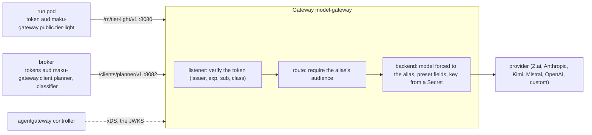

# The model gateway

Agent Factory reaches every model through one gateway: [agentgateway](https://agentgateway.dev) v1.6,
configured by the `maku-gateway` chart. Runs, the planner and the Slack intent classifier each call it
with their own projected ServiceAccount token. The gateway checks the token, then calls the provider
with a key that only the gateway holds. This page covers the seam, the values, the provider presets and
the identity model. The chart's own [README](../charts/maku-gateway/README.md) lists what it renders.



## The seam

| Piece | Who brings it | How |
|---|---|---|
| Gateway API standard CRDs, v1.2 or later | the cluster | the [Gateway API release](https://gateway-api.sigs.k8s.io/guides/#installing-gateway-api) |
| agentgateway's CRDs, v1.6.0 | `agent-factory-crds` with `agentgateway-crds.enabled: true`, or yours | installed before the umbrella, like every CRD |
| agentgateway's controller, v1.6.0 | the umbrella with `agentgateway.enabled: true`, or yours | its GatewayClass `agentgateway` |
| The Gateway, its policies, backends, routes, catalog and NetworkPolicy | `maku-gateway` (standalone, or the umbrella with `maku-gateway.enabled: true`) | these values |
| One Secret per provider | you | `kubectl create secret`, ESO, Sealed Secrets: the chart only names it (D14) |

All three switches are off by default, so a release that sets none of them renders exactly what it did
before. The umbrella fails the render when `maku-gateway.runs` differs from `maku.runs`, or when the
gateway's broker ServiceAccount is not `room-broker`.

## Values

| Key | Default | What it is |
|---|---|---|
| `enabled` | `false` | Renders the gateway |
| `name` | `model-gateway` | The Gateway and its Service: `<name>.<release namespace>.svc` |
| `image` | `cr.agentgateway.dev/agentgateway:v1.6.0` by digest | The proxy, pinned by digest (`image.digest` is required); keep it on the controller's version |
| `listeners` | `public: 8080`, `internal: 8081`, `clients: 8082` | One listener per data class, and one for the broker's clients |
| `audiencePrefix` | `maku-gateway` | Every accepted audience starts with it |
| `identity.issuer` | (required) | The cluster's ServiceAccount issuer (`kubectl get --raw /.well-known/openid-configuration`) |
| `identity.jwks.source` | `url` | `url`: `jwks.url` is the issuer's public JWKS (GKE, EKS). `apiserver`: the in-cluster apiserver's (kind, k3d, kubeadm) |
| `identity.jwks.allowAnonymousDiscovery` | `false` | Required with `source: apiserver`; see [the JWKS](#the-jwks) |
| `runs` | `agents`, `run-` | The runs this gateway serves; must equal the factory's and the broker's |
| `broker` | `room-broker` in the release namespace | The clients listener's only caller |
| `providers.<name>` | none | `preset`, `existingSecret` (required), `key` (`apiKey`), `dataClasses` (`[public]`), `transformations`, `egress`; `host`, `port`, `path`, `tls` for `custom` only |
| `aliases.public`, `aliases.internal` | none | `<alias>: {provider, model}`, with aliases from the AgentRun's model names; `internal` takes the four tiers only |
| `clients.planner`, `clients.classifier` | off | `{enabled, provider, model}`: the planner's `tier-frontier`, the classifier's `tier-light` |
| `modelCatalog.prices` | none | The factory's `meter.prices` rows; each model must be served by an alias or a client |
| `timeouts` | `runs: 600s`, `clients: 60s` | A long completion must not be cut; the clients' own deadlines are 20 s and 5 s |
| `networkPolicy.mode` | `""` (kubernetes) | `kubernetes`, `cilium` or `none`; see [Network](#network) |
| `metrics.allowFrom` | none | NetworkPolicy peers allowed to scrape the proxy's `:15020` |

A smallest working set, with one in-cluster provider:

```yaml
maku-gateway:
  enabled: true
  identity:
    issuer: https://kubernetes.default.svc.cluster.local
    jwks: {source: apiserver, allowAnonymousDiscovery: true}
  providers:
    zai: {preset: zai, existingSecret: zai-api-key}
  aliases:
    public:
      tier-light: {provider: zai, model: glm-5.3-flash}
      tier-frontier: {provider: zai, model: glm-5.3}
```

## Presets

Each provider's quirks live in the chart. A value can add a transformation, but a value that names a
field the preset sets fails the render with `providers.<name>.transformations.<field>: the <preset> preset
sets it (<why>); use preset custom to own it`. No value can rewrite `model`: each route forces it.

| Preset | Provider | Always rendered | Always reasons |
|---|---|---|---|
| `openai` | native OpenAI | nothing | no |
| `anthropic` | native Anthropic: Chat Completions in, Messages out | nothing | no |
| `zai` | `api.z.ai`, `/api/paas/v4/chat/completions` | nothing | `glm-5.3` |
| `mistral` | `api.mistral.ai`, `/v1/chat/completions` | `reasoning_effort: "none"`: agentgateway 1.6 and 1.7 cannot parse the list `content` Mistral's reasoning answers with (a 502) | no |
| `moonshot` | `api.kimi.ai`, `/coding/v1/chat/completions` (the Kimi Code plan's host) | `temperature: 1` and no `top_p`: K3.1 Pro fixes both | every model: `reasoning_content` spends `max_tokens` first |
| `custom` | your `host`, `port`, `path`, `tls` | only yours | no |

A classifier mapped to a model that always reasons fails the render: its 64 tokens would be spent
reasoning, and its reply would be empty. The planner may run on one, beside its `reasoningEffort: low`.
Whether K3.1 Pro refuses `temperature: 0` or ignores it is unverified; the preset sets 1 either way.

## Identity

- **The token.** Each caller holds a projected ServiceAccount token per audience:
  - a run: `<prefix>.<dataClass>.<alias>`, for its model and its judge;
  - the broker: `<prefix>.client.planner` and `<prefix>.client.classifier`.
- **The listener** verifies the token offline against `identity.issuer`, and requires `exp` and `sub`.
  - `public` and `internal` require a sub matching `^system:serviceaccount:<runs namespace>:<namePrefix>[a-z2-7]{8}$`
    and an audience starting `<prefix>.<listener>.`.
  - `clients` requires the broker's exact sub and an audience starting `<prefix>.client.`.
  - The audiences are checked in CEL, not in the JWT provider's audience list, which agentgateway caps.
- **The route** for an alias requires its own audience. A caller that rewrites its path to another
  alias holds no token for it, and gets 403. That pins each run to its claim's model and judge.
- **The headers.** The gateway strips any incoming `x-ar-agent`, `x-ar-human`, `x-ai-gateway-client-id`
  and `agent-session-id`, sets `x-ar-agent` to the verified sub, and removes the token before the provider.
  Metrics carry `ar_agent` and the access log `x_ar_agent`, both the verified sub, which is what the
  factory's meter matches. The access log also carries `cost`, priced from `modelCatalog.prices`.
- **No token** gets 401; a token for another audience gets 403. No path falls back to a default model.

### The JWKS

agentgateway's controller fetches the issuer's keys and pushes them to the proxies; the proxies never
call the issuer. With `source: url` the controller fetches `jwks.url`. With `source: apiserver` it
fetches `https://kubernetes.default.svc.<clusterDomain>/openid/v1/jwks`, verified with the
`kube-root-ca.crt` ConfigMap. That fetch carries no credential, so it needs two things:

- `allowAnonymousDiscovery: true`, which binds `system:service-account-issuer-discovery` to
  `system:unauthenticated`. This is Kubernetes' documented setting for OIDC discovery, and it exposes the
  issuer's public keys only. The chart refuses `source: apiserver` without it.
- An apiserver that admits anonymous requests. kubeadm and kind do. k3s does not:
  start it with `--kube-apiserver-arg=anonymous-auth=true`.

## Network

`networkPolicy.mode` `kubernetes` (the default) renders a default-deny NetworkPolicy on the proxy pods:

| Direction | Peer | Port |
|---|---|---|
| in | run pods (label `agents.ogenki.io/run-id`) in the runs namespace | `public`, `internal` |
| in | the broker's pods | `clients` |
| in | `metrics.allowFrom` | 15020 |
| out | the cluster DNS | 53 |
| out | the controller (`networkPolicy.controller`) | 9978 (xDS) |
| out | each provider: its `egress.peers`, else its `egress.cidrs`, else any address outside `networkPolicy.exceptCIDRs` | the provider's port |

`cilium` renders the same as a CiliumNetworkPolicy, with each provider by FQDN. Use it only for
providers outside the cluster. `none` renders no policy. The JWKS is not on the list: the controller
fetches it, so the controller's own network policy must allow the JWKS source.

## Proving it

- `task chart:gateway:probe` asserts what the chart relies on, against agentgateway on a throwaway k3d:
  - the JWKS from the apiserver, which needs the anonymous discovery binding;
  - CEL over `jwt.aud`;
  - the path rewrite and the forced model;
  - the presets on the wire;
  - the metrics labels;
  - the Gateway API floor (v1.2.1, one HTTPRoute per alias).
- `task chart:gateway:k3d` installs the demo with the gateway on, and checks three calls from a run-like
  pod: 200 on its alias, 403 on another alias, 401 with no token.
