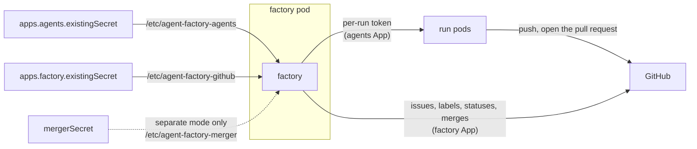

# GitHub Apps

A production factory talks to GitHub through two GitHub Apps, and optionally a third and a fourth.
Each App's permissions are data in `internal/githubapps`. The tables below are generated from that
data, and a test fails when they drift. Rollout step 7 adds `maku install`, which creates the Apps
from the same data through GitHub's manifest flow. Until then, create them by hand with the
permissions below.

| App | Writes | Its key goes in | Required |
|---|---|---|---|
| **The agents App** | code and pull requests, through each run's token | `apps.agents.existingSecret` (old key: `runTokens.appSecret`) | Yes, with `runTokens.enabled` |
| **The factory App** | issues, labels, statuses, merges | `apps.factory.existingSecret` (old key: `githubSecret`) | Yes |
| The merger App | arming, merges, reverts, the gate's status | `mergerSecret`, with `apps.merger.mode: separate` | No: `apps.merger.mode: factory` folds it into the factory App |
| policy-bot | its own `policy-bot: main` status | policy-bot's own install | No: `maku/merge-gate` replaces it |

Each key is a Secret with the keys `app_id` and `private_key`. The chart
([`charts/maku-factory`](../charts/maku-factory/README.md)) mounts it and writes the config keys
that read it:

## The agents App

The agents App mints a short-lived installation token for each run. The token is scoped to the
run's one repository and carries the permissions its role gets from the role table
([`minter.Roles`](factory.md#run-tokens-the-role-table)). With
`config.hardening.publisher.minter`, the publisher's token comes from this App too. Its required
set is the union of the role table over every role and every enforced combination:

<!-- apps:agents:begin -->
| Permission | Access |
|---|---|
| `actions` | read |
| `checks` | read |
| `contents` | write |
| `issues` | write |
| `metadata` | read |
| `pull_requests` | write |
<!-- apps:agents:end -->

No run token holds all of these. An implementer gets `contents: write` and `pull_requests: write`,
and loses them as the repository enforces `pr`, `comment`, `labels` and then `push`. A reviewer is
read-only, and only the publisher gets `issues: write`.

**The agents App never holds `statuses`, `workflows` or `administration`:**

- **Without `statuses`,** no agent token can post `maku/merge-gate`. The gate's ruleset also pins
  the status to the App that posts it, by `integration_id`.
- **Without `workflows`,** GitHub refuses an agent's push that touches `.github/workflows/`, so a
  run cannot change the CI that judges it.
- **Without `administration`,** no agent token can change a ruleset or branch protection.

**The agents App is never a bypass actor** on any ruleset: not on the gate's ruleset, and not as an
`always` bypass for direct pushes ([Branch protection for the merge
gate](factory.md#branch-protection-for-the-merge-gate)). A bypass would let an agent token merge
past `maku/merge-gate`.

Under `runTokens.perRun`, the factory refuses an agents App that is the factory App, outside the
demo. It checks two things: `agentsLogin` must differ from `factoryLogin`, and the agents App's
files must differ from the factory App's. An agent token must never carry the factory's
permissions.

## The factory App

The factory App reads and writes issues, applies labels, opens no code, and with the merger folded
in, arms and merges pull requests and posts `maku/merge-gate`. Its required set depends on the
merger.

With the merger folded in (`apps.merger.mode: factory`), and `merge.checkReruns`, a live or
monitored class, and `merge.gateStatus` all on:

<!-- apps:factory-folded:begin -->
| Permission | Access |
|---|---|
| `actions` | write |
| `checks` | read |
| `contents` | write |
| `issues` | write |
| `metadata` | read |
| `pull_requests` | write |
| `statuses` | write |
<!-- apps:factory-folded:end -->

`actions: write` serves `merge.checkReruns` alone, `statuses: write` serves `merge.gateStatus`
alone, and `issues: write` is the factory's own. Leave out what your config does not use: the
merger asks only for what is on.

With a separate merger App, the factory App needs only its own set:

<!-- apps:factory:begin -->
| Permission | Access |
|---|---|
| `contents` | read |
| `issues` | write |
| `metadata` | read |
| `pull_requests` | write |
<!-- apps:factory:end -->

When the merger signs with the factory App's key (`github.mergerAppIDFile` equal to
`github.appIDFile`), every repository's `merge.mergerLogin` must be `factoryLogin`. The gate tells
the factory's own merges from a human's by that login, so any other value would read the factory's
merges as human merges. The config refuses it.

**Webhook events:** none. The factory polls issues and pull requests (`poll.issues`, `poll.tasks`;
[Triggers](factory.md#triggers)), so neither App needs a webhook URL or subscribes to events.

## The optional merger App

`apps.merger.mode: separate`, the default, keeps a third App for the merge-side calls: checks,
arming, merges and reverts. Its required set, with every option on:

<!-- apps:merger:begin -->
| Permission | Access |
|---|---|
| `actions` | write |
| `checks` | read |
| `contents` | write |
| `issues` | write |
| `metadata` | read |
| `pull_requests` | write |
| `statuses` | write |
<!-- apps:merger:end -->

**What it buys:** the merge key is separate from the issue writer's. Whoever takes the factory App's
key can write issues and labels, but cannot merge. The cost is a third App to create, install and
rotate.

**The gate's ruleset names the merger App as an `Integration` bypass actor,** in `pull_request`
mode. It must be able to merge a green revert or an adopted pull request that the gate did not
decide. Whichever App signs the merges holds that bypass: the merger App in separate mode, the
factory App once folded. Folding it in moves the bypass and the status's `integration_id` to the
factory App ([Branch protection for the merge
gate](factory.md#branch-protection-for-the-merge-gate)).

## policy-bot, an optional fourth App

policy-bot is an optional integration. With `merge.policyBot: false` and `merge.gateStatus: true`,
branch protection requires `maku/merge-gate` instead, and each class's
`conditions.deny.protectedFiles` holds the gate paths that `.policy.yml` held. A repository that
keeps policy-bot installs it as its own App, and `merge.policyBotLogin` names it.

## The demo

The laptop demo runs on one App for all three roles. `apps.merger.mode: factory` points the merger
at the factory App's files, the runs mint from the same App, and `agentsLogin`, `factoryLogin` and
`mergerLogin` are its one login. With one App, no ruleset can tell the merger's status from an
agent's, so the demo keeps the gate advisory and requires no ruleset.

## Checked at start

**The Apps are compared by App id, not by file path.** At start the factory reads each `app_id`
file. Two Secrets can hold the same App, and the chart cannot see that, so the factory refuses to
start in two cases:
- **Under `runTokens.perRun`, outside the demo, the agents App's id is the factory App's or the
  merger App's.** The merger App is the gate ruleset's bypass actor, so a run token would merge past
  `maku/merge-gate`.
- **The merger App's id is the factory App's, and a repository's `merge.mergerLogin` is not
  `factoryLogin`.** Such a merger is folded into the factory App, whatever the paths say.

The chart also refuses a Secret named twice: `apps.agents.existingSecret` (or `runTokens.appSecret`)
naming the factory's or the merger's Secret, or a separate `mergerSecret` naming the factory's.

**The permission check:** under `runTokens.perRun`, when a replica becomes leader, it reads each
served repository's installation of both Apps (`GET /app/installations/{id}`). It compares the
grants with the sets above. The factory App's set follows the config's merger options, and
includes the merger's permissions when the merger is folded in. For each permission an
installation lacks, the factory logs a warning once and sets
`maku_factory_github_app_permission_missing{app, permission}` to 1
([operations](operations.md)). A permission reads 0 only when every installation could be read.
The gauge is not refreshed until the next leader change. A run whose token asks for a missing
permission fails to mint with `permission_not_granted` and waits Pending.
