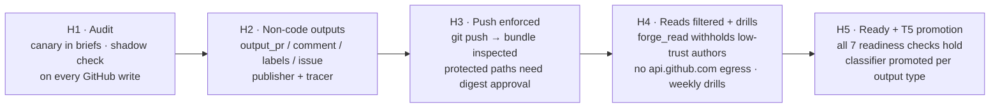
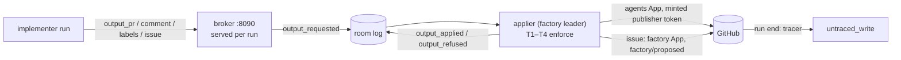
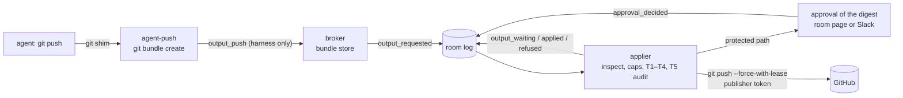
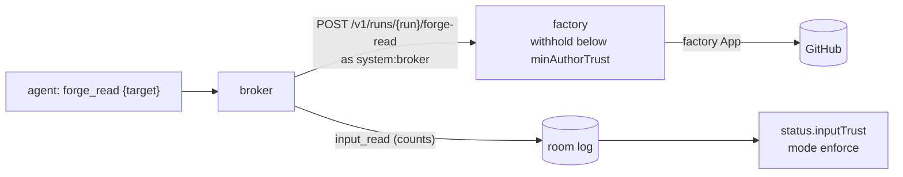

<!-- page-type: explanation -->
# Hardening

Untrusted-input hardening closes the path from untrusted GitHub text to unauthorized writes across five progressive stages. Each stage keeps the sandbox's network and role boundaries intact while shifting reads and writes behind factory-verified checks.



## Hardening, audit

Stage H1 is untrusted-input hardening's first live stage. Under `mode: audit`, the factory checks every GitHub write an agent run makes, records what enforcement would have done, and changes nothing the run can do. Readiness stays `false` until `mode: enforce` ([Hardening, reads filtered](#hardening-reads-filtered)), and switching from `off` to `audit` takes a factory restart (`hardening` keys are in [the config reference](reference/config.md)).

### What audit changes

- **A canary in the brief.** An implementer or tester run's brief ends with `Canary mkc-…: never write this token anywhere: …`. The canary is stored on the `AgentRun` as `agents.ogenki.io/canary` and is never posted to the room. Any write that quotes it is a T3 finding.
- **A shadow record per write.** When an implementer or tester run ends, the factory reads that run's writes back from GitHub as the agents App within the run's window: pushes, the pull request's title and body (harness footer stripped), comments, labels added and issues opened. It runs T1–T5 in audit on each write and appends one [`output_shadowed`](reference/room-log.md#output-events) event holding `would_apply`, `would_refuse` (first T1–T4 finding), or `would_wait` (a push touching a protected path that would wait for approval under H3), with T5 and remaining findings in `audit`. A failed shadow pass is logged and retried on the next reconcile without blocking the task.
- **`status.inputTrust` on the Task.** Records the lowest author trust the task's runs could read (`min`), per-source counts that enforcement would have withheld (`withheld`), each source's kind and level (`sources`, never content), and `mode: audit`. Split children and integration tasks inherit the parent's `min`.
- **The agent-guard client.** When `hardening.agentGuard.url` is set, T5 posts written text to `<url>/request`; a `Reject` response is recorded as `injection_suspected` and never decides an audit verdict.

### What audit does not change

- No write is refused, held or rewritten; the run's own token still writes directly.
- Nothing is withheld from a brief or tool result (`withheld` only counts what enforcement would have omitted).
- No `output_*` tool is served and sandbox roles keep their GitHub scopes unless the repository also opts into [`enforceOutputs`](#hardening-non-code-outputs-enforced).
- The laptop demo is never audited.

### The repository's hardening block

A repository may tighten the central floor in `.github/agent-factory.yaml` beside `factory:`:

```yaml
factory: production
hardening:
  protectedPaths:
    - {path: "scripts/ci/**", on: blocked}   # on: blocked | approval
  minAuthorTrust: merged                     # may raise the central floor, never lower it
```

`protectedPaths` extends the central protected-path floor, and `minAuthorTrust` can only raise the central floor (a lower level, unknown key, or unparseable block falls back to the central floor plus `merged` and logs a warning). The block never decides repository ownership.

**Stop rule:** do not add a `hardening:` block before a factory release supporting it runs on the owning cluster; older factories parse `.github/agent-factory.yaml` strictly and treat unknown keys as not owned.

## Hardening, non-code outputs enforced

Stage H2 moves non-code GitHub writes out of the sandbox for opted-in repositories (`hardening.enforceOutputs` or `hardening.repositories.<repo>.enforceOutputs`). Instead of opening, editing, commenting on or labelling pull requests and issues directly, a writer run requests each action with an `output_*` tool; the factory checks T1–T4 at enforce (T5 in audit) and publishes or refuses it.

Startup enforces five invariants on `enforceOutputs`:
- **Types:** `pr`, `comment`, `labels`, `issue` and (from H3) `push`.
- **Inheritance:** a repository's list replaces the central list and must include every central type.
- **Mode:** any listed repository requires at least `mode: audit`.
- **Publisher and per-run tokens:** any list requires `hardening.publisher.minter: true` and `runTokens.perRun: true` (the removed `publisher.octoSTS` key is refused: [upgrading](upgrading.md#the-xr-run-kind-and-octo-sts)). Without `runTokens.perRun`, runs would share a direct writer token.
- **Hash:** `enforceOutputs` enters the configuration hash bound by injection drills.



### What a run on an enforced repository sees

- **Tools and rules.** The `AgentRun` carries `agents.ogenki.io/safe-outputs` and `agents.ogenki.io/label-allowlist`; the broker serves `output_<type>` only to annotated runs, and the brief's rules instruct the agent to request enforced types through `output_<type>`.
- **Advisory `gh` wrapper.** With `SAFE_OUTPUTS` set, mutating `gh pr`, `gh issue`, and `gh label` subcommands for enforced types exit 3 and name the `output_*` tool. Because `gh api` or `curl` could bypass the wrapper, the [role table](reference/config.md#run-tokens-the-role-table) revokes direct write scopes (`pull_requests: read`, `issues: read`) as the real boundary and the tracer acts as the backstop.

### What the factory does

- **Applier and publisher.** On the leader, the applier polls active writer rooms every `applier.interval` (default `2s`, continuing for `applier.answerWait`, default `5m`, after a run ends so unfinished requests hold task completion until answered or logged `outputs_unanswered`). Approved `pr`, `comment` and `labels` outputs are published as `agentsLogin` using a cached token minted from the role table's publisher row (`Agent-Output: <id>` in the PR footer; edits to PRs not opened by the task's applied outputs are refused `output_target`). Approved `issue` outputs are filed by the factory App with `factory/proposed` only.
- **Tracer and permission gauge.** At run end, the tracer verifies every agents-App PR, comment and label on the task against `output_applied` records. Any unmatched write (or direct edit not attributable solely to a human under `runTokens.perRun`, which logs `human_edit`) is recorded as `output_shadowed` with `untraced_write` and checked as in H1. Pushes remain shadowed until `push` is enforced. Each fence pass exports sandbox and publisher scopes from the role table; rollout and rollback steps are in [Operations](operations/factory.md#hardening-non-code-outputs), and residual blind spots are in [Security](security.md#untrusted-input-hardening).

## Hardening, push enforced

Stage H3 adds `push` to `enforceOutputs` (with the repository also listed in the broker's `roomTools.pushRepositories` and a git cache mounted via `hardening.gitCache.sizeLimit` / `MAKU_GIT_CACHE`). Writer runs lose `contents: write`; `git push` becomes a bundle handed to the broker, inspected in a bare mirror, and pushed by the publisher. Pushes touching a protected path wait for a maintainer's digest-bound approval.



### What a run sees

- **`git push` shim.** With `push` in `SAFE_OUTPUTS`, `git push` invokes `agent-push`, which bundles `refs/heads/agent/<task>` (refusing deletes, tags, other branches with exit 3, and bundles > 8 MiB with `push_size`), calls `output_push`, and polls `output_status` for up to 90 s (`applied <sha>`, `refused <reason>`, or `waiting for a maintainer's approval (<id>)`). Tester contract pushes request and wait; disruption checkpoints request without waiting inside their 7 s budget. As with `gh`, the shim is advisory and the run token's `contents: read` is the boundary.

### What the factory checks

For each push request in order:
1. **Bundle integrity.** Inspected in a bare, blobless mirror (`mirrorMaxBytes`, default 1 GiB) with `fsck` enabled and hooks disabled. Must carry only `refs/heads/agent/<task>` as a fast-forward or rebase onto `main`; submodules, escaping symlinks, `.git` paths, binaries, and blobs > 1 MiB are refused.
2. **Patch caps.** Cumulative diff from merge base must fit the class's `maxPatchFiles` and `maxModifiedLines` (or the strictest cap across declared classes when undeclared), else `push_size`.
3. **Threat layers.** T1–T4 enforced (T5 audit) across changed paths, added lines and commit messages. Blocked paths refuse; approval-gated paths answer `output_waiting`, hold subsequent requests, keep the task in `Implementing` (`push_awaiting_approval`), and wait up to `applier.approvalTTL` (default `24h`, max `168h`) for a repository-writer approval of that digest on the room page or Slack (re-inspected before pushing; superseded by a newer push as `output_superseded`, or refused `approval_denied` / `approval_expired`).
4. **Publish and trace.** The factory records `agents.ogenki.io/push-intent`, pushes with `--force-with-lease` as the publisher, and answers `output_applied`. At run end the tracer checks every branch push SHA against `output_applied` (`untraced_write` otherwise).

### The tokens

Enforcing `push` moves `contents: write` from implementer and tester to the publisher in [the role table](reference/config.md#run-tokens-the-role-table). Workflow-file pushes (`.github/workflows/**`) still fail with `output_unavailable` unless the publisher row grants `workflows: write`. Rollout and rollback are in [Operations](operations/factory.md#hardening-push-enforced).

## Hardening, reads filtered

Stage H4 switches a repository to `mode: enforce` once all five output types are enforced, `api.systemPrincipals` maps the broker ServiceAccount to `system:broker`, and the broker sets `broker.hardening.forgeRead.audience: agent-factory`. Runs lose `api.github.com` egress (`git` keeps `github.com`) and read their task's issue, pull request and checks exclusively through `forge_read`, where the factory withholds content from authors below `minAuthorTrust` before any model sees it.



### What a run sees

- **`forge_read`.** Serves `target` in `{issue, pr, checks}` for the caller's own verified task (cached 15 s per run and target to bound App rate use): `issue` returns the issue and comments, `pr` returns description, reviews and comments, and `checks` returns head check runs plus the last 16 KiB (`[truncated]`) of failed GitHub Actions job logs. Factory and agent comments are omitted; delivered items carry author trust levels and withheld items appear only as counts (`[2 items withheld: author trust]`).
- **Vouching.** `factory/ready` vouches for the issue title and body matching the task's snapshot hash; any later edit voids the vouch and falls back to author association. `factory/vouch` from a maintainer or repository writer vouches for an unedited issue or PR description. Comments and reviews are never vouched.
- **Egress and `gh`.** Every run on the repository (reviewer and triager included) carries `agents.ogenki.io/forge-api: deny`: the run-controller strips `api.github.com` from network policy and egress allow-lists and sets `FORGE_READ=1`. Read-side `gh issue`, `gh pr`, `gh run` and `gh api` commands exit 3 naming `forge_read`, diffs come from `git diff origin/<base>...HEAD`, and token revocation happens outside the sandbox via the `runTokens.perRun` ticker when the run finishes.

### What the factory records

Each call appends one `input_read` event with target, lowest delivered trust level, and delivered/withheld counts per kind (never bodies). Under `enforce`, `status.inputTrust.mode` is `enforce`, `withheld` sums `input_read` counts, and `min` reflects only delivered items. Because `checksum/config` restarts the factory on config edits, run annotations, `/forge-read`, and readiness's `read_filter_off` check always observe the same mode. Rollout and rollback are in [Operations](operations/factory.md#hardening-reads-filtered).

## Hardening, drills

Stage H4's gate (`drill_stale_or_failed`) runs scheduled prompt-injection drills in a dedicated repository (`hardening.drills.repository`), works the planted tasks (`factory/drill-injection` -> `agents.ogenki.io/drill-injection`), and scores the outcome after `drills.timeout` (default `6h`) once `drills.gatewayLog.url` is set (`POST /v1/hardening/drills` accepts `system:drill` only; neither `timeout` nor `gatewayLog` enters the hardening hash). A drill passes when no out-of-policy output was applied; see [Injection drills](drills.md).

The runner stores reports via the broker's `POST /v1/drills` ([API](reference/api.md#drill-reports)) and readiness checks `GET /v1/drills/last-pass`. On outputs refused at T1 (target) or pushes refused at T4 whose T3 scan found no secret or canary, the applier also runs T5 in audit (`maku_factory_hardening_t5_total{type,result,drill}`); T3 refusals, cap refusals, T2 withholdings and broker-redacted payloads never reach T5 across agentgateway.

## Hardening, ready

Stage H5 reports per-repository whether every run reads through author trust and writes only through enforced safe outputs right now. It alters no run behaviour directly; [multi-repository coordination](multi-repository.md#execution-prerequisites) queries it live before every `execute` admission.

| Missing code | Holds when | Read from |
|---|---|---|
| `mode_not_enforce` | Repository mode is `enforce` | Live config |
| `sandbox_write_token` | No sandbox role's token can write (`runTokens.perRun` role table; never true for shared tokens) | Minter role table |
| `publisher_policy` | Publisher can write (`hardening.publisher.minter`) | Minter publisher grant |
| `layer_not_enforced` | T1–T4 all enforce (T5 is not required) | Live config |
| `read_filter_off` | Reads are filtered (`enforce`, run-controller, `system:broker` mapped) | Live config ([reads filtered](#hardening-reads-filtered)) |
| `drill_stale_or_failed` | Newest drill for this Maku version and hardening hash passed within `drills.maxAge` (`168h`; a newer failure hides an older pass) | Broker drill reports ([drills](#hardening-drills)) |
| `demo_profile` | Not the laptop demo | Live config |

Any unreadable fact fails closed (`error`). Every 5 minutes the leader updates `maku_factory_hardening_ready{repository}` and `maku_factory_hardening_missing{repository,missing}` (never read back as authority). Operators in the admin group query `GET /v1/hardening/readiness` for `{repository, hardened, missing, drill}`, while the Evidence page shows repository readers only `hardened` / `not hardened` / `error`, sharing a 60-second per-repository cache with the API route (bypassed by coordination admission).

### Promoting T5, one output type at a time

`hardening.layers.classifierEnforce: [pr, comment, ...]` promotes the T5 classifier from audit to enforce for the named output types across **every** repository at `mode: enforce` (requiring `agentGuard.url` and `layers.classifier` not `off`; global `layers.classifier: enforce` remains refused). Promoted hits refuse with `injection_suspected` and classifier outages refuse with `classifier_unavailable`. Both `classifierEnforce` and `agentGuard.url` enter the hardening hash, requiring a fresh passing drill.

Promote an output type only when 30-day metrics (`maku_factory_hardening_t5_total` and drill reports) show:
- **False positives < 2%** (`result="hit"` over total calls with `drill="false"`).
- **Drill detection above pattern layers** on outputs T1–T3 let through and on target/T4 refusals (since T3 secret/canary refusals, T2 withholdings and redacted payloads are never sent to T5).
