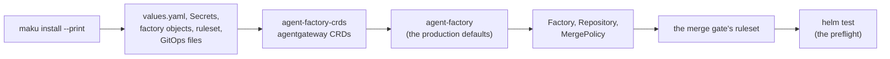

# Install on your cluster

This page installs the agent factory on a Kubernetes cluster your platform team already runs (D1):
with its own identity provider, its own Secrets tooling and its own GitOps controller. It is not the
way to try the factory: that is the [quickstart](quickstart.md), on a laptop, in about 15 minutes.

An install is one factory (D2): one namespace, two GitHub Apps, one database and the repositories it
serves. It runs three components (the factory, the broker and the run-controller) beside the model
gateway, and it never applies anything on its own. You review the files, then apply them yourself or
hand them to Flux or Argo CD.



## What you bring

Each seam is something your cluster or your organization provides. The chart's defaults are
production: every render checks the seams of every component you turn on, and its render fails naming each one you have not set, with its
key and its doc ([from the demo to production](upgrading.md#from-the-demo-to-production)).

| Seam | Required | You bring | The chart's default | Without it |
|---|---|---|---|---|
| Kubernetes 1.30 or later, with a CNI that enforces NetworkPolicy | yes | the cluster | `maku.networkPolicies.mode: cilium`; `kubernetes` for any other CNI | the run-controller's preflight refuses runs |
| A sandbox RuntimeClass | yes | gVisor or Kata on the nodes ([below](#sandbox-nodes)) | `gvisor` | the preflight refuses runs |
| Postgres 16 or later | yes | a database, its three roles and one DSN Secret each ([the database](database.md)) | none: the bundled Postgres is the demo's | the render fails |
| An OIDC issuer | yes | the issuer, a web client, a CLI client and a groups claim ([identity](identity.md)) | `preset: generic`, `tokenUse: id` | nobody can sign in |
| Two GitHub Apps | yes | created by `maku install --print` ([GitHub Apps](github-apps.md)) | the merger folded into the factory App | no work starts |
| Model provider keys | yes | one Secret per provider, read only by the model gateway ([model gateway](gateway.md)) | `model.mode: gateway` | runs fail at the gateway |
| Exposure of the web | yes, for people | a Gateway or an IngressClass, and its TLS ([exposure](exposure.md)) | `expose.mode: none` | the web is reachable by port-forward only |
| A public path for Slack | with Slack | `POST /slack/events` on a public host | off | no Slack App |
| The Slack App | no | a Slack App and its three Secrets ([Slack App](slack.md#install)) | `slack.enabled: false` | MCP, the CLI and the web only |
| RunLore's knowledge MCP | no | its endpoint ([integration](integration.md)) | unset | no knowledge-base lookups for triagers |
| External Secrets Operator | no | a ClusterSecretStore ([install Secrets](install-secrets.md#externalsecrets)) | off | create the Secrets another way |
| The prometheus-operator CRDs, Grafana's dashboard sidecar | no | the CRDs, the sidecar ([observability](observability.md)) | off | metrics only: no scrape objects, alerts or dashboards |
| A meter | yes, outside the demo | a Prometheus-compatible URL holding agentgateway's metrics | none | the factory refuses to start |

GitHub needs no public path: the factory polls for labels, and no webhook reaches it. Only the
Slack App's events path must be public, and only when it is installed.

## Write the install: `maku install --print`

```bash
maku install --print --out ./maku-install
```

It asks one question per seam, with its default in brackets, and checks each answer against the
charts' own values schemas, so it refuses what `helm template` would refuse. `--answers FILE` answers
every question from a YAML file keyed by question id instead, for CI. With `apps.create` it creates
the agents App and the factory App through GitHub's manifest flow, then waits until you install both
on your repositories. It never prints a key. [maku](cli.md) lists every flag.

The directory it writes:

| Path | What it holds |
|---|---|
| `values.yaml` | the umbrella's values, every image by digest, no secret value |
| `crds/values.yaml` | the CRD chart's values |
| `factory/` | the `Factory`, one `Repository` per repository, and a `MergePolicy` per class, every class in shadow |
| `github/` | the merge gate's ruleset and the `gh` commands that create it, which it never runs |
| `secrets/` | mode 0700, files 0600, git-ignored: the Apps' keys, a generated cookie secret, the client ids, and templates with empty keys for what it never asks (the DSNs, the provider key, the issuer's client secret, Slack's) |
| `gitops/` | the same install for Flux and for Argo CD |
| `README.md` | the commands to run next, in order |

It refuses a non-empty directory without `--force`, and never overwrites `secrets/`. The factory's
API runs on TLS from the cert-manager ClusterIssuer you name (`tls.issuer`); without one, only an
explicit `factory.insecure: true` accepts plaintext, which the install banner then shows.

## Apply it

The order matters, whatever applies it: the CRD chart, then agentgateway's CRDs outside any Helm
release (they are too large for one), then the Secrets, then the umbrella with its own CRDs skipped,
then the factory objects and the ruleset.

### Plain Helm

```bash
helm install agent-factory-crds oci://ghcr.io/smana/charts/agent-factory-crds --version <version> -n maku --create-namespace
kubectl apply --server-side -f config/agentgateway        # from a checkout of the same tag
kubectl apply -n maku -f secrets/                         # after filling secrets/templates/
helm install agent-factory oci://ghcr.io/smana/charts/agent-factory --version <version> -n maku -f values.yaml
kubectl apply -n maku -f factory/
bash github/apply-ruleset.sh
helm test agent-factory -n maku
```

The written `README.md` holds these lines with your names.

### Flux

`gitops/flux.yaml` holds two `OCIRepository` sources, the CRD chart's `HelmRelease`, a `Kustomization`
of `config/agentgateway` with `prune: false`, and the umbrella's `HelmRelease`, which `dependsOn` the
CRDs and sets `install.crds` and `upgrade.crds` to `Skip`. Commit `secrets/` through your own Secrets
tooling, never as files. Flux runs the preflight when the `HelmRelease` sets `spec.test.enable: true`.

### Argo CD

`gitops/argocd.yaml` holds three `Application`s in sync waves: the CRD chart (wave 0), agentgateway's
CRDs with `Prune=false` (wave 1), and the umbrella with `skipCrds: true` (wave 2). Argo CD runs no Helm
test hook: run the preflight by hand, as below.

## Check it: the preflight

`maku.preflight.enabled` and `maku-factory.preflight.enabled`, both on by default since rollout step 8
(and written by `maku install --print`), render the install's preflight twice: a Helm test hook, which `helm test <release>` runs, and a suspended CronJob for tools that run no
hooks:

```bash
helm test agent-factory -n maku
kubectl -n maku create job --from=cronjob/agent-factory-preflight preflight-now   # Argo CD
```

Each result is one JSON line on the Job's log, and its summary is the termination message. A check
that cannot decide fails with the code `undecided`; it never passes. `preflight.strict: true` fails
on a warning too.

`maku preflight` runs it from your machine, through any of these tools: it creates a Job from the
CronJob, waits for it, prints one table by seam and the summary, and deletes the Job.

```bash
maku preflight --namespace maku --release agent-factory          # --strict: fail on a warning too
maku preflight --namespace maku --release agent-factory --json   # the JSON lines, for a pipeline
```

It adds the checks that only your machine can make, the `cli` rows of the table below: each hostname
of the web and Slack routes resolves, the web host is oauth2-proxy's and serves `/.well-known/roomctl`
through it, and the Slack host answers `POST /slack/events` only. `--no-outside` skips them. It exits 1
on a fail, and 2 when the release renders no preflight or the Job leaves no report. Your kubeconfig
needs, in the namespace, `get` and `list` on CronJobs, `create`, `get` and `delete` on Jobs, `list` on
Pods, `get` on `pods/log`, and `get` on HTTPRoutes and Ingresses ([CLI](cli.md)).

The checks, generated from the catalog in `internal/preflight`:

<!-- preflight:begin -->
| Check | Seam | Runs in | What it checks | Fails with | Warns with | Proves |
|---|---|---|---|---|---|---|
| `kubernetes` | cluster | pod | the server version is 1.30 or later | `kubernetes_too_old` |  | D26 |
| `crds` | cluster | pod | the six maku CRDs at the chart's served versions, and each CRD the values need (agentgateway's, Gateway API's, prometheus-operator's, ESO's) | `crd_missing`, `crd_version` |  | D13, A11 |
| `runtimeclass` | sandbox | pod | the RuntimeClass sandbox.runtimeClassName names exists | `runtimeclass_missing` | `unsafe_allow_runc` | D18 |
| `secrets` | secrets | pod | each Secret of the registry the values enable exists, with its documented keys | `secret_missing`, `secret_key_missing` |  | D14 |
| `run-path` | network, sandbox | run-controller | the run-controller's preflight: RuntimeClass, git Secrets, the CNI probe, the gateway | `run_path_runtimeclass`, `run_path_git_secrets`, `run_path_network`, `run_path_gateway` | `network_policy_none` | D6, D18 |
| `database` | postgres | broker | the three DSNs: reachable, Postgres 16 or later, roles without BYPASSRLS, the schema current | `db_unreachable`, `db_too_old`, `db_role_bypasses_rls`, `db_wrong_role`, `db_schema_behind`, `db_schema_ahead`, `db_ledger_unreadable` |  | D9 |
| `oidc` | identity | broker, factory | discovery answers, its issuer matches, the JWKS fetches | `oidc_discovery`, `oidc_issuer_mismatch`, `oidc_jwks` |  | D8 |
| `github-link` | identity | broker | the GitHub link's OAuth client authorizes, and its callback is the web host's | `link_client`, `link_callback_mismatch` |  | D8 |
| `apps` | github | factory | each served repository has both App installations, with their grants | `app_not_installed`, `app_permission_missing` |  | D10, D12 |
| `merge-gate` | github | factory | the default branch's ruleset requires maku/merge-gate from the posting App | `merge_gate_not_required` | `merge_gate_rules_unread` | D11 |
| `private-code` | github | factory | each private repository has privateCode.acknowledged: without it, it is refused new tasks | `private_code_unacknowledged` |  | D3 |
| `models` | models | broker, run-controller | the planner, the classifier and one run alias per listener answer a one-token completion | `model_unreachable`, `model_refused` |  | D7 |
| `knowledge` | runlore | broker | tools/list lists kb_search and kb_get within the timeout | `knowledge_unreachable`, `knowledge_tools_missing` |  | D20 |
| `exposure` | exposure | factory, cli | no route reaches the broker around the proxy; each host resolves and answers | `broker_exposed_around_proxy`, `host_unresolved`, `route_unanswered`, `slack_route_too_wide` |  | D19 |
| `tracing` | observability | run-controller | the collector's OTLP port accepts a run's connection | `collector_unreachable` |  | D21 |
<!-- preflight:end -->

## Private code

A Repository serving private code needs `spec.privateCode.acknowledged: true`. That field states the code is sent to the configured models, which are usually SaaS.

```yaml
apiVersion: maku.ogenki.io/v1alpha1
kind: Repository
metadata: {name: platform}
spec:
  factoryRef: production
  repository: acme/platform
  privateCode: {acknowledged: true}   # true or absent: false is refused
```

The factory reads each served repository's visibility through the factory App. `private` and
`internal` count as private code, and so does a read that fails. A private repository without the
field is refused new tasks, and tasks already started finish: its `PrivateCode` condition is `False`,
the gauge `maku_factory_private_code_unacknowledged` reads 1, the preflight fails
`private_code_unacknowledged`, and the install banner says so. Self-hosted models remain possible through agentgateway, but nothing in the product
depends on them. The [Repository reference](factory.md#private-code) has the details.

## Sandbox nodes

Every run pod runs under the RuntimeClass `maku.sandbox.runtimeClassName` names (D18), and the
run-pod admission policy refuses any other. The nodes, and the runtime on them, are yours.
`sandbox.unsafeAllowRunc` runs agents on the node's own runtime: the demo and kind only, and the
render refuses it without the demo's `demoValues`.

| Platform | The runtime | `sandbox.runtimeClassName` |
|---|---|---|
| GKE | a node pool with GKE Sandbox enabled, which brings gVisor and its RuntimeClass `gvisor` (handler `gvisor`) | `gvisor` |
| k3s | gVisor's `runsc` and its containerd shim on each node, added to k3s's containerd through its config template | `gvisor` |
| kubeadm | gVisor's `runsc`, or Kata Containers, registered as a containerd runtime handler | `gvisor`, or your Kata class |
| EKS | no managed sandbox: a node group whose image (a custom AMI, or a Bottlerocket variant) carries a `runsc` or Kata handler in containerd | the class you create for it |

Where the cluster has the handler but no RuntimeClass, `maku.runController.createRuntimeClass: true`
with `runtimeHandler` renders one under the class's name. The preflight's `runtimeclass` check fails
`runtimeclass_missing` when the class does not exist, and the run-controller refuses runs until it
does ([operations](operations.md#the-run-controllers-preflight)).

## The support floor

| Piece | Floor |
|---|---|
| Kubernetes | 1.30 (the ValidatingAdmissionPolicies), tested on the three latest minors |
| Postgres | 16 |
| GitHub | GitHub.com, or GHES 3.14 |
| Helm | 3.15. Helm 3.14 assumes Kubernetes 1.29 when it renders offline, so its `helm template` needs `--kube-version` |
| Flux | 2.4 |
| Argo CD | 2.12 |
| Gateway API | v1.2 |

## Several installs in one cluster

Several teams means several installs (D2), each in its own namespace with its own Apps, database,
runs namespace (`maku.runs.namespace`) and fence. Every cluster-scoped object an install renders
carries its namespace: the admission policies, the run-controller's and the preflight's cluster
roles, the broker's token review binding, and the factory's Flux binding. The roles every install
shares, the three aggregated into `admin`, `edit` and `view` and `agent-factory-flux-reader`, are
`agent-factory-crds`', installed once per cluster with the CRDs. `tests/two-installs.sh` renders two
installs of the same release name in two namespaces and finds no cluster-scoped name they share.

Two things stay the cluster's, so one install at most renders them:

- the RuntimeClass, when `maku.runController.createRuntimeClass` is set; leave it off elsewhere, or
  create the class yourself;
- agentgateway's controller (`agentgateway.enabled`): it serves every Gateway of its class, so the
  other installs set it false and use the same controller.

## Upgrading

Every release that changes an install step has a section in [upgrading](upgrading.md), and
the chart fails a render that misses a seam a newer release requires, naming it.
[From the demo to production](upgrading.md#from-the-demo-to-production) lists the seams the gate
checks, and [adopting the umbrella from `maku-factory`](upgrading.md#adopting-the-umbrella-from-maku-factory)
moves an existing factory release under the umbrella without replacing its Deployment.
