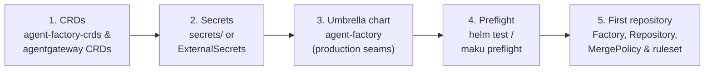

<!-- page-type: how-to -->

# Install on your cluster

Install the agent factory on a Kubernetes cluster your platform team runs, with your own identity provider, Secrets tooling and GitOps controller. To try the loop on a laptop in 15 minutes, run the [quickstart](quickstart.md). To start a Week-1 pilot on private repositories without provisioning an external database first, start with [Tier-1 Pilot](pilot.md) (`charts/agent-factory/values-pilot.example.yaml`).

An install is one factory (one namespace, two GitHub Apps, one database and the repositories it serves) running the factory, the broker and the run-controller beside the model gateway. `maku install --print` writes plain manifests for review; apply them with Helm, Flux or Argo CD.



## What you bring

Each seam is something your cluster or your organization provides. The chart's defaults are
production: every render checks the seams of every component you turn on, and its render fails naming each one you have not set, with its
key and its doc ([from the demo to production](upgrading.md#from-the-demo-to-production)).

| Seam | Required | You bring | The chart's default | Without it |
|---|---|---|---|---|
| Kubernetes 1.30 or later, with a CNI that enforces NetworkPolicy | yes | the cluster | `maku.networkPolicies.mode: cilium`; `kubernetes` for any other CNI | the run-controller's preflight refuses runs |
| A sandbox RuntimeClass | yes | gVisor or Kata on the nodes ([sandbox nodes](sandbox-nodes.md)) | `gvisor` | the preflight refuses runs |
| Postgres 16 or later | yes | Tier-1 Pilot: hardened bundled Postgres (`database.mode: bundled` or `values-pilot.example.yaml`, [pilot](pilot.md)); Tier-2: your own Postgres (`maku db bootstrap` or `database.mode: cnpg`, [the database](database.md)) | `postgres.enabled: false` (Tier-2 external) | the render fails |
| An OIDC issuer | yes | the issuer, a web client, a CLI client and a groups claim ([identity](identity.md)) | `preset: generic`, `tokenUse: id` | nobody can sign in |
| Two GitHub Apps | yes | created by `maku install --print` ([GitHub Apps](github-apps.md)) | the merger folded into the factory App | no work starts |
| Model provider keys | yes | one Secret per provider, read only by the model gateway ([model gateway](gateway.md)) | `model.mode: gateway` | runs fail at the gateway |
| Exposure of the web | yes, for people | a Gateway or an IngressClass, and its TLS ([exposure](exposure.md)) | `expose.mode: none` | the web is reachable by port-forward only |
| A public path for Slack | with Slack | `POST /slack/events` on a public host | off | no Slack App |
| The Slack App | no | a Slack App and its three Secrets ([Slack App](slack.md#install)) | `slack.enabled: false` | MCP, the CLI and the web only |
| RunLore's knowledge MCP | no | its endpoint ([integration](integration.md)) | unset | no knowledge-base lookups for triagers |
| External Secrets Operator | no | a ClusterSecretStore ([install Secrets](install-secrets.md#externalsecrets)) | off | create the Secrets another way |
| The prometheus-operator CRDs, Grafana's dashboard sidecar | no | the CRDs, the sidecar ([observability](observability.md)) | off | metrics only: no scrape objects, alerts or dashboards |
| A meter | yes, outside the demo | a Prometheus-compatible URL holding agentgateway's metrics | none | the factory refuses to start |

GitHub needs no public path: the factory polls for labels, and no webhook reaches it. Only the
Slack App's events path must be public, and only when it is installed.

## Write the install: `maku install --print`

```bash
maku install --print --out ./maku-install
```

It asks one question per seam (or reads `--answers FILE` in CI), validates answers against the chart schemas, optionally creates both GitHub Apps (`apps.create`), and writes `values.yaml`, `crds/values.yaml`, `factory/`, `github/`, `secrets/` (mode `0700`, never overwritten), `gitops/` and `README.md` ([generated install directory](reference/support.md#generated-install-directory)). Add repositories later with `maku repo add owner/name` ([Onboard a repository](onboard-a-repository.md), [CLI](cli.md)).

## Apply it

The order matters, whatever applies it: the CRD chart, then agentgateway's CRDs outside any Helm
release (they are too large for one), then the Secrets, then the umbrella with its own CRDs skipped,
then the factory objects and the ruleset.

### Plain Helm

```bash
helm install agent-factory-crds oci://ghcr.io/smana/charts/agent-factory-crds --version <version> -n maku --create-namespace
kubectl apply --server-side -f config/agentgateway        # from a checkout of the same tag
kubectl apply -n maku -f secrets/                         # after filling secrets/templates/
helm install agent-factory oci://ghcr.io/smana/charts/agent-factory --version <version> -n maku -f values.yaml
kubectl apply -n maku -f factory/
bash github/apply-ruleset.sh
helm test agent-factory -n maku
```

The written `README.md` holds these lines with your names.

### Flux

`gitops/flux.yaml` holds two `OCIRepository` sources, the CRD chart's `HelmRelease`, a `Kustomization`
of `config/agentgateway` with `prune: false`, and the umbrella's `HelmRelease`, which `dependsOn` the
CRDs and sets `install.crds` and `upgrade.crds` to `Skip`. Commit `secrets/` through your own Secrets
tooling, never as files. Flux runs the preflight when the `HelmRelease` sets `spec.test.enable: true`.

### Argo CD

`gitops/argocd.yaml` holds three `Application`s in sync waves: the CRD chart (wave 0), agentgateway's
CRDs with `Prune=false` (wave 1), and the umbrella with `skipCrds: true` (wave 2). Argo CD runs no Helm
test hook: run the preflight by hand, as below.

## Check it: the preflight

`maku.preflight.enabled` and `maku-factory.preflight.enabled` (on by default) render a Helm test hook and a suspended CronJob. Each check logs a JSON line and fails closed (`undecided` fails; `preflight.strict: true` fails on warnings):

```bash
helm test agent-factory -n maku
kubectl -n maku create job --from=cronjob/agent-factory-preflight preflight-now   # Argo CD
maku preflight --namespace maku --release agent-factory                            # adds outside route checks
```

Pass `--json` in pipelines, `--no-outside` to skip client-side route probes, or run `maku repo check owner/name` for one repository ([CLI permissions and checks](reference/support.md#preflight-cli-permissions-and-checks)).

The checks, generated from `internal/preflight`:

<!-- preflight:begin -->
| Check | Seam | Runs in | What it checks | Fails with | Warns with |
|---|---|---|---|---|---|
| `kubernetes` | cluster | pod | the server version is 1.30 or later | `kubernetes_too_old` |  |
| `crds` | cluster | pod | the six maku CRDs at the chart's served versions, and each CRD the values need (agentgateway's, Gateway API's, prometheus-operator's, ESO's) | `crd_missing`, `crd_version` |  |
| `runtimeclass` | sandbox | pod | the RuntimeClass sandbox.runtimeClassName names exists | `runtimeclass_missing` | `unsafe_allow_runc` |
| `secrets` | secrets | pod | each Secret of the registry the values enable exists, with its documented keys | `secret_missing`, `secret_key_missing` |  |
| `run-path` | network, sandbox | run-controller | the run-controller's preflight: RuntimeClass, git Secrets, the CNI probe, the gateway | `run_path_runtimeclass`, `run_path_git_secrets`, `run_path_network`, `run_path_sandbox`, `run_path_gateway` | `network_policy_none` |
| `database` | postgres | broker | the three DSNs: reachable, Postgres 16 or later, roles without BYPASSRLS, the schema current | `db_unreachable`, `db_too_old`, `db_role_bypasses_rls`, `db_wrong_role`, `db_schema_behind`, `db_schema_ahead`, `db_ledger_unreadable` |  |
| `oidc` | identity | broker, factory | discovery answers, its issuer matches, the JWKS fetches | `oidc_discovery`, `oidc_issuer_mismatch`, `oidc_jwks` |  |
| `github-link` | identity | broker | the GitHub link's OAuth client authorizes, and its callback is the web host's | `link_client`, `link_callback_mismatch` |  |
| `apps` | github | factory | each served repository has both App installations, with their grants | `app_not_installed`, `app_permission_missing` |  |
| `merge-gate` | github | factory | the default branch's ruleset requires maku/merge-gate from the posting App | `merge_gate_not_required` | `merge_gate_rules_unread` |
| `private-code` | github | factory | each private repository has privateCode.acknowledged: without it, it is refused new tasks | `private_code_unacknowledged` |  |
| `models` | models | broker, run-controller | the planner, the classifier and one run alias per listener answer a one-token completion | `model_unreachable`, `model_refused` |  |
| `knowledge` | runlore | broker | tools/list lists kb_search and kb_get within the timeout | `knowledge_unreachable`, `knowledge_tools_missing` |  |
| `exposure` | exposure | factory, cli | no route reaches the broker around the proxy; each host resolves and answers | `broker_exposed_around_proxy`, `host_unresolved`, `route_unanswered`, `slack_route_too_wide` |  |
| `tracing` | observability | run-controller | the collector's OTLP port accepts a run's connection | `collector_unreachable` |  |
<!-- preflight:end -->

## Private code

A `Repository` serving private code needs `spec.privateCode.acknowledged: true` (acknowledging code is sent to the configured models, usually SaaS; self-hosted models via agentgateway remain optional):

```yaml
apiVersion: maku.ogenki.io/v1alpha1
kind: Repository
metadata: {name: platform}
spec:
  factoryRef: production
  repository: acme/platform
  privateCode: {acknowledged: true}   # true or absent: false is refused
```

On each 5-minute fence pass, the factory reads visibility through the factory App (`private`, `internal`, and failed reads fail closed as private code; nothing starts before the first read). Without acknowledgement, running tasks finish while new work is refused across the `PrivateCode` condition, the `private-code` preflight check, `maku_factory_private_code_unacknowledged`, and the install banner ([private code surfaces](reference/support.md#private-code-surfaces)). Demo mode and [multi-repository coordination](multi-repository.md) (`publicOnly: true`) remain public-only.

## Upgrading

See [upgrading](upgrading.md) for release-by-release install changes, and [install support and cluster reference](reference/support.md) for the support floor and running several installs in one cluster.
