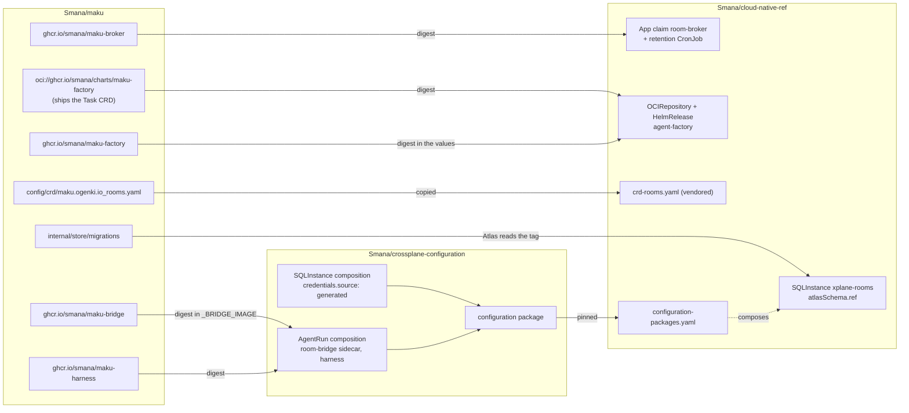
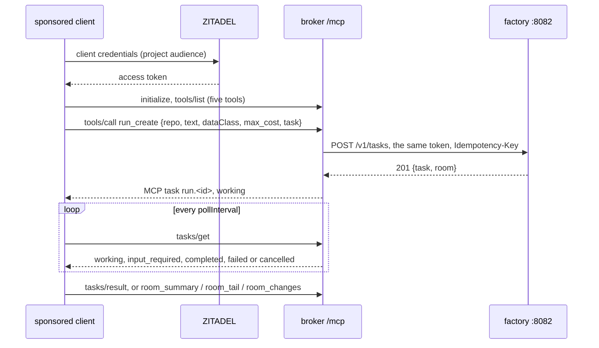

# Integration

This repository ships six images (`maku-broker`, `maku-bridge`, `maku-factory`, `maku-harness`,
`maku-run-controller`, `maku-slack`), the `maku-factory` and `maku` charts, the `maku` CLI, two CRDs (`Room`, `Task`) and the log's migrations.
[cloud-native-ref](https://github.com/Smana/cloud-native-ref) deploys the broker, the factory chart,
the databases, the CRDs and the policies; [crossplane-configuration](https://github.com/Smana/crossplane-configuration)
adds the bridge to every `AgentRun` that names a room. Each consumer pins a build by digest: a
release, or a PR pre-release for an integration branch.



## What each repository carries

### cloud-native-ref

| Area | Carries |
|---|---|
| Rooms | The vendored `Room` CRD and its schema in the validation catalog; the broker's `App` claim, config, RBAC and CNP; two broker replicas; the retention CronJob; `Certificate room-broker-tls` and `ExternalSecret room-broker-ca`; `task agent:run -- --room` |
| Log database | `SQLInstance xplane-rooms` with generated credentials, its CNPG network policy and the log's recovery seed |
| Humans | ZITADEL roles `agents-admin`, `agents-member`, the `rooms-proxy` client and the CLI's ZITADEL client (formerly `roomctl`), a native app; oauth2-proxy (bearer tokens accepted for `maku`); the `HTTPRoute` on the Tailscale Gateway |
| Agents | The `room-broker` backend on both MCPRoutes with its key and CNP; the factory App's key; egress to `api.github.com` |
| Factory | The `agent-factory` `OCIRepository` (`flux/sources/ocirepo-agent-factory.yaml`, cosign-verified; the chart it pulls is named `maku-factory` from v0.30.0 on, so its pin moves to that name with the v0.30.0 bump) and `HelmRelease` with its values (`tooling/base/agent-factory/`) |
| Observability | Its own `VMServiceScrape`s and `VMRule`s, until it turns on the umbrella chart's `monitoring` values ([observability](observability.md)), which render the scrape objects and the product alerts; the alerts on its own platform (the CNPG volume, Karpenter, its gateway budgets) stay its own |
| Design records | ADR-0044 (session protocol), ADR-0049 (room client and human auth) |

Every child added to `clusters/aws-0-agent-platform/` has its twin in
`clusters/gcp-0-agent-platform/`. The whole set sits in the `agent-platform` Flux umbrella,
suspended by default.

### crossplane-configuration

| Area | Carries |
|---|---|
| `SQLInstance` | `spec.credentials.source: store \| generated` (default `store`) and login roles that own no database. In `generated` mode, a `Password` generator and an `ExternalSecret` per role, `refreshPolicy: CreatedOnce`, keys `username`, `password`, `uri`. It yields `xplane-rooms-cnpg-rooms` (owner), `xplane-rooms-cnpg-role-rooms-broker` and `xplane-rooms-cnpg-role-rooms-retention` |
| `AgentRun`, with `roomRef` | The `room-bridge` native sidecar after `identity-proxy`, and its [gate](#the-gate); a `room-token` projected volume (audience `room-broker`, 600 s) mounted by the bridge alone; the `room-broker-ca` mount; kubelet ingress on 8085; the constant `_BRIDGE_IMAGE`; `BRANCH` for the bridge |
| `AgentRun`, the harness | The room rules in the agent's `rules.md`; `ROOM_ID` and `TASK_URL` for the harness; the harness image pin (`maku-harness` from v0.30.0) that stamps the PR footer |
| `AgentRun`, provenance | `status.harnessImage`: the `harness` container's `imageID` from the run's pod, only as `<repository>@sha256:<digest>`, kept once set. The factory records it per run (R10); without it the record's `harnessImage` stays empty |

## Pins

| Consumer | Pins | From | Named |
|---|---|---|---|
| cloud-native-ref `infrastructure/base/room-broker/app.yaml` and `retention-cronjob.yaml` | The broker image, same digest in both | This repo's release | `v0.11.0@sha256:…` |
| cloud-native-ref `crd-rooms.yaml` | The `Room` CRD | `config/crd/`, or `crd-rooms.yaml` on the release; re-copied with every broker pin | — |
| cloud-native-ref `sqlinstance.yaml` `atlasSchema.ref` | The migrations | The broker image's release tag, so schema and binary match | `v0.11.0` |
| cloud-native-ref `flux/sources/ocirepo-agent-factory.yaml` | The factory chart, with the `Task` CRD | `oci://ghcr.io/smana/charts/maku-factory` | `0.11.0` plus its digest |
| cloud-native-ref `tooling/base/agent-factory/helm-values-configmap.yaml` `image.tag` | The factory image | This repo's release | `v0.11.0@sha256:…` |
| crossplane-configuration `apis/agentrun/kcl/main.k` `_BRIDGE_IMAGE` | The bridge image | This repo's release | `v0.11.0@sha256:…` |
| crossplane-configuration, the `AgentRun` composition | The harness image | This repo's release | `v0.11.0@sha256:…` |
| cloud-native-ref `configuration-packages.yaml` | The composition package | crossplane-configuration's release | Its release tag; a PR pre-release is `v<x.y.z>-pr<N>.<sha7>`, `<sha7>` = the PR's **synthetic merge commit**: copy it from the CI summary, never derive it |

For an integration branch, a PR of this repository publishes a pre-release of every image,
`v<next patch>-pr<N>.<sha8>@sha256:…`, and of the chart, `<next patch>-pr<N>.g<sha8>`, `<sha8>` the
PR head ([`ci.yaml`](../.github/workflows/ci.yaml)).

Rules that keep pins honest:

- **Digest, never tag alone.** Read the digest with
  `skopeo inspect --raw docker://<ref> | sha256sum`, or copy it from the CI job summary.
- **Verify before pinning**: [security](security.md#supply-chain) gives the cosign command.
- **Re-vendor the CRD and move `atlasSchema.ref` with every broker pin**, so the three never drift.
  The composition resolves a `v*` ref as a tag and anything else as a branch; this repository
  deletes a branch on merge, so a branch ref 404s once its PR merges.
- **Crossplane never upgrades an installed package dependency.** During a live check, patch the core
  package to the same pre-release by hand.

## Contracts

### The broker's configuration

One file, `ROOMS_CONFIG` (a ConfigMap, Flux-substituted). Parsing is strict: an unknown key or a
`subPattern` without exactly one capture group fails the rollout, not the first request. The broker
reads it once at start, so restart it after a change. A machine issuer whose JWKS the broker cannot
fetch at start fails the rollout too; the `human` issuer does not: until it answers, humans get
`401` and agents are unaffected.

| Key | Meaning |
|---|---|
| `publicURL` | `https://rooms.<private domain>`, used in links |
| `runIssuers[]` | `{mode, issuer, jwksURL, subPattern}`. `mode` is `jwks` (default): the cluster's OIDC issuer, its JWKS URI per cloud (`<issuer>/keys` on EKS, `<issuer>/jwks` on GKE). `mode: tokenreview` asks the apiserver instead and takes no `issuer` or `jwksURL`: for a cluster whose issuer the broker cannot fetch (kind); the broker's ServiceAccount needs `system:auth-delegator` |
| `systemIssuer` | `{issuer, jwksURL}` for `rooms-system` tokens. Optional: only the factory uses it, and without it the system routes answer `401` |
| `systemPrincipals` | `{<sub>: <principal>}`, e.g. `system:serviceaccount:agent-system:agent-factory: system:factory` |
| `human.mode` | `oidc` (default): the block below. `local`: one `human:local` user in the admin and member groups, `:8080` bound to loopback (reach it by port-forward), `publicURL` exactly `http://localhost:<port>` (or a loopback address); the broker answers that port under `localhost`, `127.0.0.1` and `[::1]` and refuses any other Host or Origin. It takes no issuer, files, `origin`, `groups` or `access`; the config is refused otherwise ([quickstart](quickstart.md)) |
| `human` | `{issuer, jwksURL, clientIDFile, roomctlClientIDFile, projectIDFile, origin, groups: {admin, member}}`. The ids are files read at use, because ZITADEL mints new ones on every build; the group names are literals. `jwksURL` is optional with an `https://` issuer: its discovery document names `jwks_uri`, read at the first token. `preset` is `zitadel` (the default, today's token rules) or `generic`, any OIDC issuer: `rolesClaim` (required: a claim name, or an RFC 6901 pointer such as `/realm_access/roles`) holds the `groups` values, `tokenUse` is `id` (the default: the ID token is the credential) or `access` (with `audience` or `audienceFile`, which a sponsored principal needs too), and `projectIDFile` is refused. `mcp.sponsoredClientClaim` (`generic` only: `cid`, `appid`, `azp` or `client_id`) names a sponsored token's client, as the factory's `api.sponsoredClientClaim` does |
| `human.access` | `{ttl}`: room visibility follows GitHub ([room access](security.md#identities)), the caller's login read from their [GitHub account link](github-link.md); it needs `human.githubLink`. `ttl` caches each answer, default and maximum `5m`. Needs `ROOMS_GITHUB_APP_DIR`, or the broker refuses to start. Unset: only `agents-admin` sees rooms |
| `roomTools.knowledge` | `{url, tools, roles, timeout, maxBytes}`: a knowledge MCP endpoint, RunLore's, which `:8090` forwards [`kb_search` and `kb_get`](api.md#8090--room-tools) to. `url` is https, or http to an in-cluster `<svc>.<ns>.svc[.<domain>]`, with no credentials; `tools` a subset of `kb_search` and `kb_get` (both by default); `roles` AgentRun roles (`triager` by default); `timeout` 1 s to 12 s (10 s), under `:8090`'s 15 s bound on one call; `maxBytes` at most 256 KiB (64 KiB). Unset: no knowledge tool is served. The maku chart's `broker.roomTools.knowledge` renders it, and opens the broker's egress to `networkPolicy.to` on the URL's port, or `networkPolicy.port`; its schema refuses what the broker would (an external `http://` URL, credentials in it, a timeout over 12 s) |
| `human.mcp` | `{enabled}`: serve [`POST /mcp`](api.md#post-mcp), the MCP server `maku mcp` relays. Off by default. On, it needs `human.roomctlClientIDFile`, since `/mcp` takes the CLI's tokens only, or the broker refuses to start |
| `human.mcp.sessionStart[]` | `owner/name` repositories whose `issue_draft` answers `canStart` (the caller writes to them on GitHub), so the `handoff` prompt may start the factory there. Empty by default: none does. Needs `human.mcp.enabled` and `human.access` (without the GitHub check `canStart` is always off); each entry is `owner/name`, matched case-insensitively, and listed once |
| `human.mcp.sponsored[]` | `{name, clientIDFile}`: the service accounts that may call `run_create` ([sponsored principals](factory.md#sponsored-principals)); each is also declared in the factory's `api.sponsored`, which decides everything else. Needs `human.mcp.enabled` and `factoryURL`. The name is a DNS label, not reserved (`factory`, `runlore`, `scheduler`, `room-broker`, `policy`) and unique |
| `human.needs` | `{enabled}`: serve [`GET /api/needs`](api.md#get-apineeds) and the `needs_list` tool on `/mcp`, needs/v1's two doors (CD28). On by default: the list is read-only, and the room page, `maku needs` and the App read it. Off, both doors go together: the route is `404`, and `needs_list` is on neither tool list. Needs no other key |
| `human.slackLink` | `{principal, teamID, repository}`: the [Slack self-serve link](slack.md#self-serve-link). `principal` is one of `human.mcp.sponsored` (the Slack App), the only caller of `slack_link_code` and `slack_unlink`; `teamID` the one workspace a code may be for; `repository` the `owner/name` whose GitHub App installation names the account's login on the page. Needs `human.access`. Serves `/link/slack` and, on `:8443`, `GET /v1/links/slack` to `system:factory` only. Off by default |
| `human.approvalMemory` | `true` serves saved approval grants (merge policy stage 5): [the page and its API](api.md) to humans, and `POST /v1/grants/lookup`, `/v1/grants/{id}/use` and `/v1/grants/{id}/disable` on `:8443` to the factory alone. Off by default: every path is a `404` and the factory's lookups are refused. The factory consults grants only under its own `policyManagement.approvalMemory` |
| `human.slackDecide` | `{principal, teamID}`: the Slack App's one deciding route, [`POST /api/slack/decisions`](api.md#post-apislackdecisions), where the Approve and Deny buttons of a `forge.push` card decide the approval. `principal` is one of `human.mcp.sponsored` (the Slack App), the only caller; `teamID` the one workspace whose clicks this broker decides. Needs `human.access`, since a decision is the linked human's room standing *and* repository write. Off by default: the path is then the mux's `404`. The App's own `channels.<id>.approvals` is the other half of the pair, and no card is drawn without it |
| `human.slackIntents` | `{principal, teamID, url, apiKeyFile, model, deadline, minConfidence, confirmTTL, maxInputChars, dailyCalls, perUserPerHour, retentionDays}`: serves [`intent_classify`](api.md#intent_classify-on-mcp), the Slack App's read-only classification of a thread reply into one of nine intents ([Slack](slack.md#understanding-a-reply)). `principal` is one of `human.mcp.sponsored` (the Slack App), the only caller; `teamID` the one workspace whose users are classified; `url` the model gateway's in-cluster classifier route and `apiKeyFile` the `classifier` client's bearer, read at use; the maku chart fills both from `broker.modelGateway` when the block leaves them unset ([gateway](gateway.md#the-planner-and-the-classifier)). `model` can only be `tier-light`. Defaults, tuned by the shadow data: `deadline` `5s`, `minConfidence` `0.7`, `confirmTTL` `10m` (1m to 1h), `maxInputChars` `2000` (at least 200), `dailyCalls` `500` and `perUserPerHour` `20` (the App's own budget, never a person's), `retentionDays` `30` (how long an opted-in channel's replies are kept). Off by default: the tool is then on no list. Refused in local mode |
| `human.dashboards[]` | `{label, url}`: links the room page shows in its title strip, such as Grafana dashboards, e.g. `- {label: Room metrics, url: "https://grafana.example.com/d/agent-room/rooms?var-room={room}"}`. None by default, and the strip then shows no group. The page fills `{room}` (the room id), `{run}` (its current or last run) and `{task}` (its Task, named as the room) with `encodeURIComponent`, and hides a link whose placeholder the room has no value for. At most 8; `label` is 1 to 40 printable characters; `url` is an absolute `https://` URL with no userinfo, its placeholders only `{room}`, `{run}` and `{task}` and only in the path, query or fragment. Any other `{…}`, an unmatched brace or an unknown key fails startup. Allowed in local mode too |
| `factoryURL` | The factory's run API on the factory Service's `api` port: `https://agent-factory.agent-system.svc:8082` once the factory serves `api.tls`. The broker forwards each human's bearer token there, so an `http://` URL is refused at start unless `factoryInsecure` is `true`. The upgrade step is in [operations](operations.md#upgrades). It moves with the factory chart's port and its `api.listen`. Unset: `start_run` returns a manifest for the owner to apply |
| `factoryCAFile` | PEM file of the CA that signs the factory's `api` certificate, read on every run request, so a rotation needs no restart. Unset: the system roots. The maku chart mounts `broker.factoryCA.secretName` (key `ca.crt`) at `/etc/room-broker/factory-ca/ca.crt` |
| `factoryInsecure` | `true` admits an `http://` `factoryURL`, sending human tokens to the factory in the clear: for a cluster whose CNI encrypts pod traffic, or a test. Default `false` |
| `tls` | `{certFile, keyFile}` of `:8443`; default `/etc/room-broker/tls/tls.{crt,key}`. Re-read when they change |
| `runs` | `{group, namespace, namePrefix}`: where AgentRuns live. Defaults `maku.ogenki.io`, `agents`, `run-` (the run-controller's); `group` takes no other value since v4 step 8 ([upgrading](upgrading.md#the-xr-run-kind-and-octo-sts)). The factory's config takes the same block. Read once at start. At least one `runIssuers[].subPattern` must match `system:serviceaccount:<namespace>:<namePrefix><id>` and capture the id, or the broker refuses to start |
| `suspend` | `{enabled, after}`: the suspend trigger (v2 warm-sandboxes design §6). Off by default; `after` defaults to `5m`, within `[1m, 25m]`, under the attended approval's 30 minutes. On, at each 15 s resync of an attended room, a run with `spec.suspendable: true` that is `Running`, has a pending approval and sits in a room whose log has not moved for `after` gets `agents.ogenki.io/operating-mode: Suspended` and `agents.ogenki.io/remaining-seconds`: its budget, or the seconds its pod was given, less its running time since `status.startedAt` or its last resume. Once no approval of the run is pending (decided, expired or superseded), it gets `operating-mode: Running` and `agents.ogenki.io/resumed-at` (RFC 3339). Each write is a merge patch under the claim's `resourceVersion`. It needs `patch` on `agentruns` in `agents`, and the platform's admission policy should limit the broker's AgentRun updates to these three annotations on a suspendable run |

| Broker environment | Meaning |
|---|---|
| `ROOMS_CONFIG` | Path of the config file |
| `ROOMS_DATABASE_URL` | The `uri` of `xplane-rooms-cnpg-role-rooms-broker` (the retention job: `…-rooms-retention`) |
| `ROOMS_MIGRATION_DATABASE_URL` | `migrate` only: the `uri` of `xplane-rooms-cnpg-role-rooms-owner`. The migrations run as that role and refuse any other, so the broker's own DSN never reaches them |
| `POD_NAMESPACE` | Where Rooms and the leader lease live |
| `LOG_FORMAT`, `LOG_LEVEL` | `json`, `info` (defaults); `text` and `debug` locally |
| `ROOMS_MCP_KEY` | The key the MCPRoute injects. Unset: `:8090` refuses every call |
| `ROOMS_GITHUB_APP_DIR` | The factory App's key volume (`app_id`, `private_key`; optional, `defaultMode: 0440` with the pod's `fsGroup`). Unset: no verdict is posted. Set but empty: verdicts wait, up to 24 h, for the key, and room access checks fail closed. Room access reads `GET /user/{id}` and `GET /repos/{o}/{r}/collaborators/{login}/permission` with it (`metadata: read`) |

### The bridge's environment

Set by the `AgentRun` composition.

| Variable | Value |
|---|---|
| `ROOM_ID`, `RUN_ID` | The run's `roomRef` and id |
| `CONVERSATION_ID` | The harness conversation: the `AgentRun`'s uid |
| `BROKER_URL` | `https://room-broker.agent-system.svc.cluster.local:8443` |
| `BROKER_CA_FILE` | `/etc/room-broker-ca/ca.crt` |
| `HARNESS_URL` | `http://127.0.0.1:8000` |
| `ROOM_TOKEN_FILE` | `/var/run/secrets/agents/room/token` |
| `EGRESS_PROFILES` | The run's egress profiles, comma-separated. The classifier reads them: a package install outside them is `egress.new` |
| `HEALTH_ADDR` | `:8085` (default): `/healthz` for kubelet only, and `POST /final-read` for the harness on loopback: the bridge reads the harness log to its end and mirrors it, then answers `{"events","unmirrored","sealed"}` within 3 s (`504` past it). Its body may be `{"endReason": "<reason>"}` (at most 256 bytes), the reason one of `judge_impossible`, `stalled`, `not_met` and `budget_calls`: the bridge records it once as `state_changed{harness_end}` before it reads the log. `agent-run` calls it on SIGTERM before it stops agent-server. The bridge serves no metrics; the broker counts its stalls and stubs |
| `LOG_FORMAT`, `LOG_LEVEL` | `json`, `info` (defaults); `text` and `debug` locally |
| `FLUSH_GRACE` | How long the SIGTERM drain may take; `25s` (default), at most `28s`. Set it lower when the harness uses much of the pod's 30 s grace: the kubelet signals the sidecar only after the harness exits |
| `GOMEMLIMIT` | Unset: the binary sets `48MiB`, the soft heap limit its buffer budget is sized for inside the 64 Mi limit. A pod spec may set its own |
| `BRANCH` | The run's branch: the one push that is `forge.push`. Unset, every push is `forge.other` |
| `MCP_READ_ONLY_TOOLS` | The MCP tools that only read, comma-separated `<server>__<tool>` names (a tool the gateway calls `<server>_<tool>`, as agentgateway does, matches the same entry); the classifier lets them through as plain, and every other MCP tool is `mcp.write`. Unset, every MCP tool is `mcp.write`, the room tools included (fail closed), and the bridge logs a `WARN` at start. Set it in the composition before a bridge that reads it rolls out: an older bridge ignores it, a newer one without it classes every room tool call `mcp.write`, which an attended room sends to an approver and an unattended one denies |
| `MCP_BARE_SERVER` | A server name (no underscore): a tool name with no `__` that is not a builtin is read as `<server>__<tool>` and looked up in `MCP_READ_ONLY_TOOLS`. For a harness that calls the server directly, as the demo's runs call the broker's room tools; the run controller sets it to `room-broker`, with the five room tools and `kb_search` and `kb_get` in `MCP_READ_ONLY_TOOLS`, when `roomToolsURL` is set. The knowledge tools are always listed: the broker alone decides whether it serves them. Unset, a bare name is `mcp.write` |
| `AGENT_SUSPENDABLE` | `true` on a run whose `AgentRun` has `spec.suspendable: true`, the harness's variable of the same name. Its new pod's conversation reloads paused, and the bridge alone continues it: a pending step is answered from the room's decision, as a waiting one is; with none, one `/run`. Only a pause this bridge found at its first status counts, so a human's interrupt stays one. Unset, a paused conversation is left paused |

The list the bridge carried built in before `MCP_READ_ONLY_TOOLS` existed, which the composition sets:

- `flux-operator-mcp`: `search_flux_docs`, `get_flux_instance`, `get_kubernetes_api_versions`, `get_kubernetes_resources`, `get_kubernetes_metrics`, `get_kubernetes_logs`
- `mcp-victoriametrics`: `documentation`, `query`, `query_range`, `metrics`, `metrics_metadata`, `labels`, `label_values`, `series`, `alerts`, `rules`, `explain_query`, `prettify_query`, `metric_statistics`, `tsdb_status`, `active_queries`, `top_queries`
- `mcp-victorialogs`: `documentation`, `query`, `hits`, `facets`, `field_names`, `field_values`, `stats_query`, `stats_query_range`, `streams`, `stream_ids`, `stream_field_names`, `stream_field_values`, `flags`
- `room-broker`: `room_read`, `room_post`, `room_progress`, `room_handoff`, `room_verdict` (the room tools only append to the room)

A name matches on its last `<server>__<tool>` pair, so a prefix the harness adds cannot hide the server.

Resources: requests 20m / 32Mi, limits 100m / 64Mi; read-only root filesystem, all capabilities
dropped.

### The gate

The composition adds `maku-bridge gate`, the same image with the argument
`gate`, as a plain init container after the bridge and before the harness. It reads the bridge's
`/admission` on `127.0.0.1` at `HEALTH_ADDR`'s port, exits 0 once the bridge holds the room, and
exits 1 once the room refuses the run. The pod's `restartPolicy: Never` then fails the run before
the harness starts. Without the gate the lease only holds the log: a refused run still executes,
unrecorded, on the room's shared branch.

### What the broker reads from `AgentRun`

`spec.roomRef` (immutable), `spec.role`, `spec.principal`, `spec.branch`, `spec.budget.maxMinutes`,
`spec.dataClass`, `spec.egress.profiles`, `spec.repository`, `status.phase`, `status.startedAt`, the
annotation `agents.ogenki.io/revoked`, and `metadata.uid`. The run's CNP already opens egress to
`room-broker` on 8443, and DNS for its name, when `roomRef` is set.

### What the factory gets

| Contract | Where |
|---|---|
| Create a room | Create a `Room` CR with `spec.owner` and `spec.driver: system:factory` and the required `spec.dataClass` ([fields](concepts.md#reference-the-room-crd)) |
| Read a room | `GET /v1/rooms/{id}/events` on `:8443`, audience `rooms-system` ([API](api.md#get-v1roomsidevents)) |
| Report task state | `POST /v1/rooms/{id}/messages`, `kind: task_state` |
| Report task facts | `POST /v1/rooms/{id}/task`: phase, run, budget, issue and PR as `state_changed{kind: task}`, which the room summary and `Room.status.task` read ([API](api.md#post-v1roomsidtask)) |
| Queue a message for the next run | `POST /v1/rooms/{id}/queue`, listed by `GET` and consumed by `POST …/queue/consume` ([API](api.md#the-queue-routes)) |
| Verdicts and handoffs | `message{kind: review_verdict}` and `handoff` in the log; the verdict comment is the broker's, the factory never posts it again |
| Who drives | `Room.status.driver` and `driverEpoch`: the factory never advances a room while a `human:` holds the token |
| Run requests | `POST {factoryURL}/v1/runs` on the factory's `:8082` (TLS, or plaintext under `factoryInsecure`) with `{role, repository, baseRef, task, dataClass, roomRef, egressProfiles?}`, the human's own access token as `Authorization: Bearer` (never an asserted `sub`), and `Idempotency-Key: <roomId>:<originClient>:<originSeq>`, the act's own key. The broker requests the run, then records it, so a client retrying a failed record sends the same key and gets the same run; a request without a key is refused before the call (`internal/runrequest`). How the factory answers a key, a replay and a refusal: [the factory's API](factory.md#the-factorys-api) |

### A sponsored client's sequence

A machine that starts factory work, such as a CI job or the Slack App, is a sponsored principal.
It needs a ZITADEL machine user with a client-credentials client, whose token carries the project
audience. No in-cluster path to the broker's `/mcp` exists yet: it needs a network rule for
in-cluster clients, which ai-native-ref adds with `human.mcp.sponsored`, and until then nothing
reaches `/mcp` from inside the cluster. The factory's `:8082` is reachable from the tailnet, so a
sponsored token is accepted there by `POST /v1/tasks` (and refused on `/v1/runs`, below). With `api.tls` on, such a client must use `https://` and trust the factory's CA; the certificate names only `agent-factory.<ns>.svc[.<domain>]`, not a tailnet name, so a client on one fails verification until it reaches an in-cluster name.



1. Get a token with the client-credentials grant, `scope` including the project audience scope. Its
   `client_id` must be the principal's `clientIDFile`; the sponsor, the day and the ceiling come from
   the factory's config, never from the token. A name maps to the **same** client-id file in the
   broker's `human.mcp.sponsored[]` and the factory's `api.sponsored[]`: if they differ, one client
   reads another's rooms.
2. `initialize` on `/mcp`, then `tools/call` `run_create` with `task: {ttl?}`. Send an
   `idempotency_key` (the same key makes the same task).
3. Poll `tasks/get` until `completed`. `input_required` names the room page: a human answers there,
   never through the client. Read the room with `room_summary`, `room_tail` and `room_changes`: a sponsored
   principal reads the rooms of its own tasks only, as a `watcher`. `room_summary` and `room_changes`
   return a Markdown view as `content` text, to display: parse `structuredContent`, never the text.

[`run_create`](api.md#sponsored-principals-on-mcp) and the factory's
[`POST /v1/tasks`](api.md#post-v1tasks) give the arguments and the refusals.

### Starting a run in a room without the factory

With `factoryURL` unset, `start_run` returns the `AgentRun` claim for the owner to apply; its run id
is derived from the act's idempotency key alone (sha256), so applying a retry's claim twice makes
one run (`internal/runrequest`).

`task agent:run -- --room <roomId>` (cloud-native-ref) sets `spec.roomRef` and defaults
`spec.branch` to `agent/<roomId>`, since a human room's runs share one branch. An explicit
`--branch` wins; a room id that is not a valid room id is refused.

## RunLore

[RunLore](https://github.com/Smana/runlore) stays its own product, outside the chart. It integrates
with Maku in three ways, each optional and independent of the others:

| Integration | Direction | Where it is set |
|---|---|---|
| Findings become `investigate` tasks | RunLore → the factory | the factory's `runlore` block (`POST /intake/runlore`), or RunLore as an [internal principal](factory.md#internal-principals) |
| Room events | the broker → RunLore | a `webhooks[]` subscriber named `runlore` in the broker's config |
| The knowledge base for runs | a run → the broker → RunLore | `roomTools.knowledge` in the broker's config, `maku.broker.roomTools.knowledge` in the chart |

The third gives a run `kb_search` and `kb_get` (the `triager` role by default, the role of an
`investigate` task) as two more of the broker's [room tools on `:8090`](api.md#8090--room-tools).
The broker forwards each call to RunLore's MCP endpoint. A run still has one MCP server, the broker,
and its egress is unchanged: only the broker reaches RunLore. With `networkPolicies.mode` `cilium` or
`kubernetes`, set `broker.roomTools.knowledge.networkPolicy.to` to RunLore's pods, and the broker's
egress opens the URL's port to them alone. A policy matches the pod's port after service
translation: when RunLore's Service maps the URL's port to another `targetPort`, set
`networkPolicy.port` to it. For an endpoint outside the cluster in cilium mode, an entry may be a whole
peer, such as `{toFQDNs: [{matchName: kb.example.com}]}` or `{toCIDR: [203.0.113.0/24]}`; in
kubernetes mode, an `ipBlock`:

```yaml
maku:
  broker:
    roomTools:
      knowledge:
        url: http://runlore.runlore.svc.cluster.local:8080/mcp
        networkPolicy:
          to:   # cilium: endpoint selectors; kubernetes: NetworkPolicy peers
            - matchLabels:
                io.kubernetes.pod.namespace: runlore
                app.kubernetes.io/name: runlore
```

Without it, a run's harness and its investigate prompt work as before: the prompt names the tools
only "if they are available".
