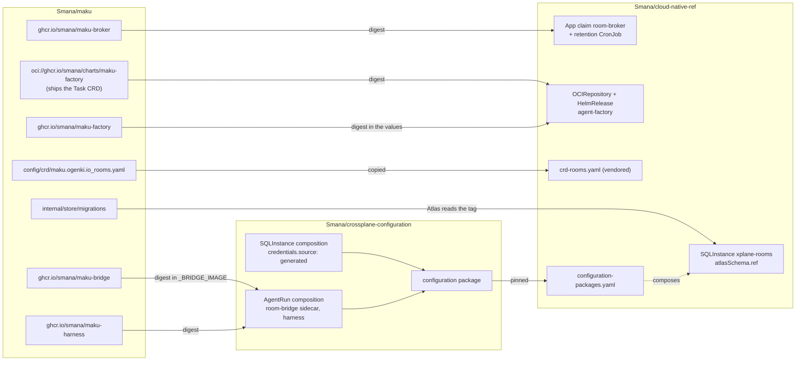
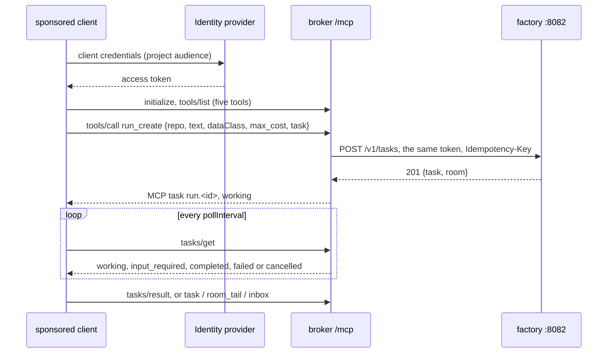

<!-- page-type: how-to -->

# Integration

This repository ships six images (`maku-broker`, `maku-bridge`, `maku-factory`, `maku-harness`,
`maku-run-controller`, `maku-slack`), the charts under [`charts/`](../charts/) (`agent-factory`, the umbrella;
`agent-factory-crds`; `maku`; `maku-factory`; `maku-gateway`; `maku-slack`), the `maku` CLI, the
CRDs the `agent-factory-crds` chart installs (`Room`, `AgentRun`, `Task`, `Factory`, `Repository`,
`MergePolicy`) and the log's migrations.
[cloud-native-ref](https://github.com/Smana/cloud-native-ref) deploys the broker, the factory chart,
the databases, the CRDs and the policies; [crossplane-configuration](https://github.com/Smana/crossplane-configuration)
adds the bridge to every `AgentRun` that names a room. Each consumer pins a build by digest: a
release, or a PR pre-release for an integration branch.

For the broker's configuration keys (`ROOMS_CONFIG`), the bridge's environment variables, and the room-to-factory contracts, see [The config file](reference/config.md#broker-fields).



## What each repository carries

### cloud-native-ref

| Area | Carries |
|---|---|
| Rooms | The vendored `Room` CRD and its schema in the validation catalog; the broker's `App` claim, config, RBAC and CNP; two broker replicas; the retention CronJob; `Certificate room-broker-tls` and `ExternalSecret room-broker-ca`; `task agent:run -- --room` |
| Log database | `SQLInstance xplane-rooms` with generated credentials, its CNPG network policy and the log's recovery seed |
| Humans | OIDC roles `agents-admin`, `agents-member`, the `rooms-proxy` client and the CLI's client (formerly `roomctl`), a native app; oauth2-proxy (bearer tokens accepted for `maku`); the `HTTPRoute` |
| Agents | The `room-broker` backend on both MCPRoutes with its key and CNP; the factory App's key; egress to `api.github.com` |
| Factory | The `agent-factory` `OCIRepository` (`flux/sources/ocirepo-agent-factory.yaml`, cosign-verified) and `HelmRelease` with its values (`tooling/base/agent-factory/`) |
| Observability | Its own `VMServiceScrape`s and `VMRule`s, until it turns on the umbrella chart's `monitoring` values ([observability](observability.md)) |
| Design records | ADR-0044 (session protocol), ADR-0049 (room client and human auth) |

Every child added to one cluster's `clusters/<cluster>-agent-platform/` directory has its twin in
the other cluster's. The whole set sits in the `agent-platform` Flux umbrella,
suspended by default.

### crossplane-configuration

| Area | Carries |
|---|---|
| `SQLInstance` | `spec.credentials.source: store \| generated` (default `store`) and login roles that own no database. In `generated` mode, a `Password` generator and an `ExternalSecret` per role, `refreshPolicy: CreatedOnce`, keys `username`, `password`, `uri`. It yields `xplane-rooms-cnpg-rooms` (owner), `xplane-rooms-cnpg-role-rooms-broker` and `xplane-rooms-cnpg-role-rooms-retention` |
| `AgentRun`, with `roomRef` | The `room-bridge` native sidecar after `identity-proxy`, and its [gate](reference/config.md#the-gate); a `room-token` projected volume (audience `room-broker`, 600 s) mounted by the bridge alone; the `room-broker-ca` mount; kubelet ingress on 8085; the constant `_BRIDGE_IMAGE`; `BRANCH` for the bridge |
| `AgentRun`, the harness | The room rules in the agent's `rules.md`; `ROOM_ID` and `TASK_URL` for the harness; the harness image pin (`maku-harness`) that stamps the PR footer |
| `AgentRun`, provenance | `status.harnessImage`: the `harness` container's `imageID` from the run's pod, only as `<repository>@sha256:<digest>`, kept once set. The factory records it per run; without it the record's `harnessImage` stays empty |

## Pins

| Consumer | Pins | From | Named |
|---|---|---|---|
| cloud-native-ref `infrastructure/base/room-broker/app.yaml` and `retention-cronjob.yaml` | The broker image, same digest in both | This repo's release | `v0.11.0@sha256:…` |
| cloud-native-ref `crd-rooms.yaml` | The `Room` CRD | `config/crd/`, or `crd-rooms.yaml` on the release; re-copied with every broker pin | — |
| cloud-native-ref `sqlinstance.yaml` `atlasSchema.ref` | The migrations | The broker image's release tag, so schema and binary match | `v0.11.0` |
| cloud-native-ref `flux/sources/ocirepo-agent-factory.yaml` | The factory chart, with the `Task` CRD | `oci://ghcr.io/smana/charts/maku-factory` | `0.11.0` plus its digest |
| cloud-native-ref `tooling/base/agent-factory/helm-values-configmap.yaml` `image.tag` | The factory image | This repo's release | `v0.11.0@sha256:…` |
| crossplane-configuration `apis/agentrun/kcl/main.k` `_BRIDGE_IMAGE` | The bridge image | This repo's release | `v0.11.0@sha256:…` |
| crossplane-configuration, the `AgentRun` composition | The harness image | This repo's release | `v0.11.0@sha256:…` |
| cloud-native-ref `configuration-packages.yaml` | The composition package | crossplane-configuration's release | Its release tag; a PR pre-release is `v<x.y.z>-pr<N>.<sha7>`, `<sha7>` = the PR's **synthetic merge commit**: copy it from the CI summary, never derive it |

For an integration branch, a PR of this repository publishes a pre-release of every image,
`v<next patch>-pr<N>.<sha8>@sha256:…`, and of the chart, `<next patch>-pr<N>.g<sha8>`, `<sha8>` the
PR head ([`ci.yaml`](../.github/workflows/ci.yaml)).

Rules that keep pins honest:

- **Digest, never tag alone.** Read the digest with
  `skopeo inspect --raw docker://<ref> | sha256sum`, or copy it from the CI job summary.
- **Verify before pinning**: [security](reference/security-controls.md#supply-chain) gives the cosign command.
- **Re-vendor the CRD and move `atlasSchema.ref` with every broker pin**, so the three never drift.
  The composition resolves a `v*` ref as a tag and anything else as a branch; this repository
  deletes a branch on merge, so a branch ref 404s once its PR merges.
- **Crossplane never upgrades an installed package dependency.** During a live check, patch the core
  package to the same pre-release by hand.

## Wiring an external agent or MCP client

### A sponsored client's sequence

A machine that starts factory work, such as a CI job or the Slack App, is a [sponsored principal](reference/sponsored-principals.md). It needs an OIDC machine user with a client-credentials client whose token carries the project audience. With `api.tls` on, an in-cluster client must use `https://` and trust the factory's CA (`agent-factory.<ns>.svc[.<domain>]`).



1. Obtain a token with the client-credentials grant, `scope` including the project audience scope. Its
   `client_id` must match the principal's `clientIDFile` in both the broker's `human.mcp.sponsored[]` and the factory's `api.sponsored[]` ([broker fields](reference/config.md#broker-fields)).
2. Call `initialize` on `/mcp`, then `tools/call` `run_create` with `task: {ttl?}` and an
   `idempotency_key` (the same key makes the same task).
3. Poll `tasks/get` until `completed`. `input_required` names the room page: a human answers there,
   never through the client. Read the room with `task`, `room_tail` and `inbox` (parse `structuredContent`, never the display text).

[`run_create`](reference/api.md#sponsored-principals-on-mcp) and the factory's
[`POST /v1/tasks`](reference/api.md#post-v1tasks) give the arguments and the refusals.

### Starting a run in a room without the factory

With `factoryURL` unset, `start_run` returns the `AgentRun` claim for the owner to apply; its run id
is derived from the act's idempotency key alone (sha256), so applying a retry's claim twice makes
one run (`internal/runrequest`).

`task agent:run -- --room <roomId>` (cloud-native-ref) sets `spec.roomRef` and defaults
`spec.branch` to `agent/<roomId>`, since a human room's runs share one branch. An explicit
`--branch` wins; a room id that is not a valid room id is refused.

## RunLore

[RunLore](https://github.com/Smana/runlore) stays its own product, outside the chart. It integrates
with Maku in three ways, each optional and independent of the others:

| Integration | Direction | Where it is set |
|---|---|---|
| Findings become `investigate` tasks | RunLore → the factory | the factory's `runlore` block (`POST /intake/runlore`), or RunLore as an [internal principal](reference/sponsored-principals.md#internal-principals) |
| Room events | the broker → RunLore | a `webhooks[]` subscriber named `runlore` in the broker's config |
| The knowledge base for runs | a run → the broker → RunLore | `roomTools.knowledge` in the broker's config, `maku.broker.roomTools.knowledge` in the chart |

The third gives a run `kb_search` and `kb_get` (`triager` role by default) as two more of the broker's [room tools on `:8090`](reference/api.md#8090--room-tools). The broker forwards each call to RunLore's MCP endpoint, so a run still talks only to the broker. With `networkPolicies.mode` `cilium` or `kubernetes`, set `broker.roomTools.knowledge.networkPolicy.to` to RunLore's pods (and `networkPolicy.port` if the Service translates `targetPort`):

```yaml
maku:
  broker:
    roomTools:
      knowledge:
        url: http://runlore.runlore.svc.cluster.local:8080/mcp
        networkPolicy:
          to:   # cilium: endpoint selectors; kubernetes: NetworkPolicy peers
            - matchLabels:
                io.kubernetes.pod.namespace: runlore
                app.kubernetes.io/name: runlore
```

Without it, a run's harness and its investigate prompt work as before: the prompt names the tools
only "if they are available".
