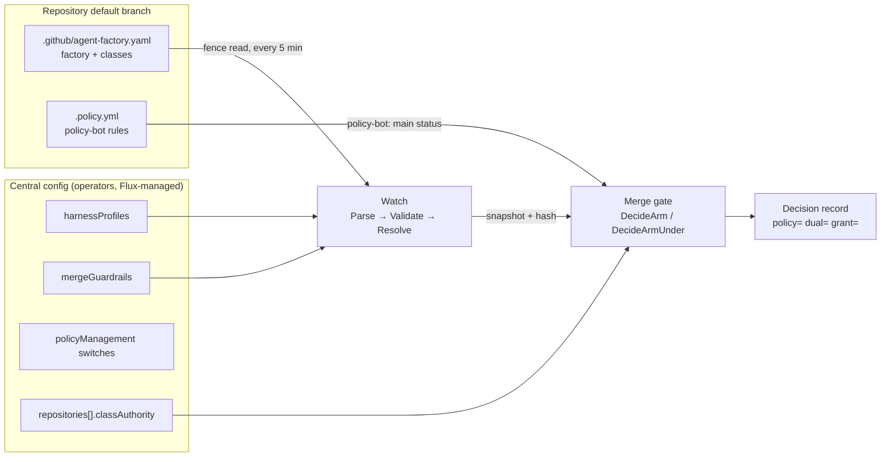
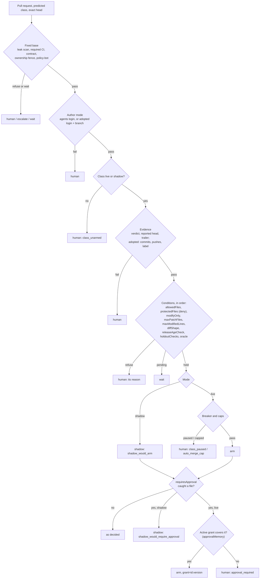
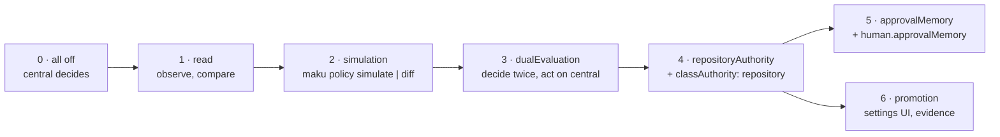
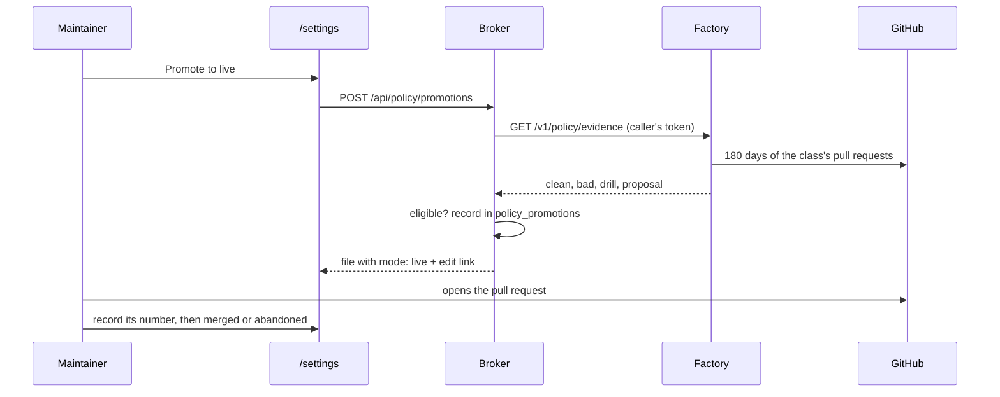
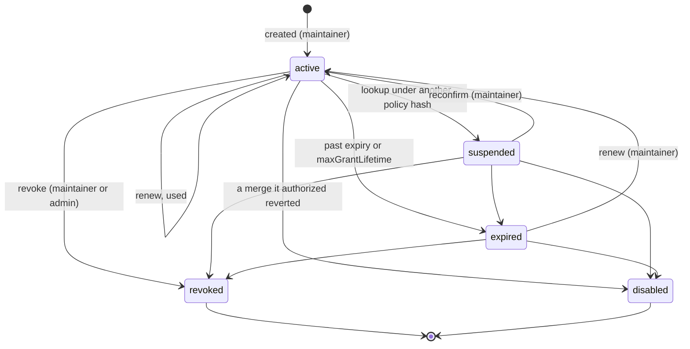

# Merge policies

A repository declares its merge classes in `.github/agent-factory.yaml`; the factory's central
config bounds what those classes may say. Six switches under `policyManagement` roll this out, all
off by default. **Until `repositoryAuthority` cuts a repository over, the central config alone
decides its merges**: the repository's file is read, compared, re-decided and simulated, never
acted on.

| You want to | Go to |
|---|---|
| Set up a repository | [Start here](#start-here) |
| Understand the model | [Concepts](#concepts) |
| Turn a stage on, or back off | [Rollout stages](#rollout-stages) |
| Look up a field | [Reference](#reference) |
| Write a class | [Recipes](#recipes) |
| Check, simulate, promote, save a grant | [Workflows](#workflows) |
| Read a decision, a metric or a reason | [Operating it](#operating-it) |
| Fix something | [Troubleshooting](#troubleshooting) |
| Undo something | [Rollback](#rollback) |

The merge gate itself (the fixed base, the decision record, adopted classes, the monitor) is in
[the factory](factory.md#the-merge-gate). This page covers what a repository's policy changes.

## Start here

**With zero config, nothing auto-merges and no evidence is collected.** A repository whose
`.github/agent-factory.yaml` holds only `factory:` has no repository policy: every task outside the
central classes is `review`, so a human merges it, and no shadow decision is recorded. A repository
that wants auto-merge later then starts from zero evidence. A cut-over repository whose file declares
no class pauses (`policy_invalid`).

Start instead with this file. Every class is in `shadow`: it decides every pull request it matches,
records what it would have done, and merges nothing. That record is the evidence a later
[promotion](#promotion-shadow-to-live) needs.

<!-- check: repository -->
```yaml
factory: aws-0
classes:
  docs-links:
    mode: shadow
    author: agents
    harness: plain
    conditions:
      all:
        - holdoutChecks: ['Check the documentation links 🔗']
  revert:
    mode: shadow
    author: agents
    harness: plain
    conditions:
      all:
        - holdoutChecks: ['Check the documentation links 🔗']
  docs:
    mode: shadow
    author: agents
    harness: plain
    conditions:
      all:
        - allowedFiles: ['^docs/.+\.md$', '^README\.md$']
        - maxPatchFiles: 5
        - maxModifiedLines: 100
      deny:
        - protectedFiles: ['^docs/(adr|decisions|security)/']
    limits:
      maxPerDay: 2
    monitor:
      followUpWindow: 168h
# Anything outside these classes is review: a human merges it.
```

Replace the holdout with your repository's documentation link check. Then:

1. Add a `low-risk: docs` rule to `.policy.yml` by hand ([below](#a-class-with-any-and-its-policy-bot-rules)
   shows the shape). Maku generates no policy-bot rule, and without one the class's pull requests
   stop at `policy_pending`.
2. Open one pull request with both files. It touches `.github/`, so a maintainer merges it.
3. Merge the shadow decisions you agree with, unchanged; after twenty, [promote](#promotion-shadow-to-live).

The operators' half is the central guardrails every class inherits. This is the recommended setup.
It is **not yet deployed** on aws-0, where `mergeGuardrails` is unset:

<!-- check: central -->
```yaml
harnessProfiles:
  plain: {}
  checked: {checks: true}
  adopted-none: {template: none}
mergeGuardrails:
  protectedFiles:                       # the self-modification fence, once instead of per rule
    - '^\.github/'
    - '^\.policy\.yml$'
    - '(^|/)(AGENTS|CLAUDE)\.md$'
    - '^\.(agents|claude)/'
    - '(^|/)(go\.sum|package-lock\.json|pnpm-lock\.yaml|uv\.lock|Cargo\.lock)$'
  maxPatchFiles: 20
  maxModifiedLines: 400
  maxPerDay: 5
  # minPromotionEvidence 20 and maxGrantLifetime 90 days are the code's defaults
```

Guardrails apply only to classes read from a repository file (`mergepolicy.Resolve`), never to
central ones. Set before a cutover, they make the dual evaluation's repository decision stricter
than the central one and show up as disagreements. Land them in the cutover's own pull request.

| Default | Value |
|---|---|
| Mode | `shadow` for every class |
| Author | `agents`; adopting a bot is a class of its own |
| Paths | An allow list per class, plus the guardrails' deny list |
| Size | 5 files, 100 lines for the docs class; 20 and 400 the central ceiling |
| Rate | 2 a day per class; no class above 5 (the repository's total stays `merge.autoMergesPerDay`) |
| Everything else | `review`: a human merges |

## Concepts



| Term | Meaning | Code |
|---|---|---|
| Repository policy | The `classes` block of `.github/agent-factory.yaml` on the default branch. A file with `factory:` alone is the ownership fence and declares no policy | `internal/factory/mergepolicy/policy.go` |
| Central config | The factory's config file: `harnessProfiles`, `mergeGuardrails`, `policyManagement`, and per repository `classAuthority`, maintainers, `merge`, schedules, budgets | `internal/factory/config/mergepolicy.go` |
| Class | A named kind of change: what it may touch, which evidence it needs, whether it merges. `docs-links` and `revert` are required in every policy; `review` never merges through the gate and may be declared for its evaluation keys only | `mergepolicy.Validate` |
| Mode | `live` merges, `shadow` records what it would have done, `off` does neither | `Mode` |
| Author mode | `agents`: the factory's agents App wrote it through a task's runs. `adopt`: another App's pull requests (Renovate), adopted by login and branch prefix | `ClassPolicy.Author` |
| Conditions | `all`: leaves that must all hold. `any`: two to eight branches, one of which must hold. `deny`: paths that refuse. One closed vocabulary, one leaf one key | `Conditions`, `Leaf` |
| `requiresApproval` | Paths that send an otherwise-arming pull request to a maintainer, even in a live class. A [saved grant](#approval-memory) can let a later one arm | `ApprovalLeaf` |
| Limits | `maxPerDay`: the class's own daily cap, at most the guardrail's | `Limits` |
| Monitor | The existing [post-merge monitor](factory.md#the-post-merge-monitor) settings | `config.Monitor` |
| Harness profile | A centrally named way to run a class (`checks`, `testFirst`, `template`, `tier`, `loop`). A class names one; it cannot invent one | `HarnessProfile` |
| Guardrails | Central bounds: protected paths and mandatory checks every class gains, caps no class may exceed | `MergeGuardrails` |
| Snapshot | One read of the file: its sha256, the resolved classes, the error. Each decision binds to it (`policy=<12 hex>`) | `mergepolicy.Snapshot` |
| policy-bot | The independent second evaluator. The gate's fixed base needs `policy-bot: main` green, posted by `merge.policyBotLogin`, so every class that should arm needs a policy-bot rule that approves its pull requests | `baseChecks` in `internal/factory/reconciler/arm.go` |

### How a class resolves

`mergepolicy.Resolve` turns a declared class into the `config.Class` the gate already decides on:

1. The `harness` must name a central profile. `template: none` is required for `author: adopt` and
   refused otherwise. The profile's `checks` and `testFirst` become the class's.
2. Every `all` leaf is applied; every `deny` adds its paths to `protectedFiles`.
3. Each `any` branch is a copy of that class with the branch's leaves added: one variant per branch.
4. Each variant gains the guardrails: their `protectedFiles` and `mandatoryChecks` are appended
   (`mandatoryChecks` become holdout checks, so GitHub Actions must report them); a cap the class
   leaves unset inherits the guardrail's; a cap above it is refused (`guardrail_mismatch`).
5. Every variant then passes the gate's own class check (`config.ValidateClass`).

### Resolution order

The order the code decides in (`decide` in `internal/factory/reconciler/arm.go`, then
`withApproval` in `evaluate.go`). The first row that refuses names the reason.



| Rule | Detail |
|---|---|
| `any` | Every variant is decided; an arm outranks a shadow, a shadow a wait, a wait any refusal. With none holding, the first branch's refusal stands |
| The diff | Conditions on the diff hold until it is read: the first pass decides without it, and only a decision that would arm or shadow reads it and decides again |
| The approval subset | Applies to a class's own arm or shadow, never to a maintainer's approval, which is already a human's. It is decided after the caps: a capped pull request says `auto_merge_cap`, not `approval_required` |
| Deny | `protectedFiles` is the second condition checked, after `allowedFiles`: a file both outside the allow list and protected reports `file_not_allowed`. Either way a human merges |
| Built-in shape | `docs-links` and `revert` are held to `diffShape: links-only` when they declare none, and may declare no other |

### Shadow and live

A shadow class runs every row a live one does and records `shadow_would_arm` (or
`shadow_would_require_approval`) with the head it judged; a maintainer merges. Those records are the
[promotion evidence](#promotion-shadow-to-live): only `shadow_would_arm` decisions merged unchanged
at their head count. Grants are never consulted in shadow.

### policy-bot's role

policy-bot reads `.policy.yml` from the base branch and posts `policy-bot: main`. The gate reads only
that status: `success` lets the class rows run; `error` is `gate_path`; anything else is
`policy_pending`; a missing status or one from another login is `policy_absent`. Maku neither reads
nor writes `.policy.yml`. A class that should arm needs a rule approving exactly its pull requests,
and a pull request changing `.github/` or `.policy.yml` must stay outside every agent rule, so a
human merges policy changes.

**The `low-risk:` rule is still written by hand.** Nothing in Maku generates it from the class or
checks that it matches. Add it in the same pull request as the class; a class without one waits at
`policy_pending` on every pull request.

## Rollout stages



| Stage | Switch (factory) | Needs | Does | Merge authority | Exit, as the code measures it | Off |
|---|---|---|---|---|---|---|
| 1 | `read` | — | Each fence read parses, validates and resolves the file and compares it with the central classes | Central | `maku_factory_policy_central_divergence == 0` and no `maku_factory_policy_load_errors_total` series | Unset: no observation; the gauge keeps its last value until restart |
| 2 | `simulation` | — | Unlocks `maku policy diff` and the fixture replay (`maku policy simulate`), and the editor's replay rows. Offline | Central | The simulator agrees with the gate on the conformance fixtures | Unset: both verbs refuse, the editor shows no simulation. The spec's rule: turn it off when the simulator disagrees with the gate |
| 3 | `dualEvaluation` | `read` | Every merge decision is decided again under the repository's snapshot; agreement counted and written as `dual=` | Central | A week with no `agreement="unexplained"` | Unset: the record loses `policy=`/`dual=` |
| 4 | `repositoryAuthority` | `read`; the repository entry sets `classAuthority: repository` and declares no `classes` | The gate decides the repository on its own file; triage, intake, schedules and the monitor read its classes | Repository file | An invalid or unreadable file pauses auto-merge | Revert the cutover: restore the entry's central `classes` and drop `classAuthority`, then the switch. The switch off with `classAuthority: repository` still set fails config load |
| 5 | `approvalMemory` | `read`; broker `human.approvalMemory: true` | Grants are looked up, uncached, before each decision of a live class with a `requiresApproval` subset once the diff is read, and again before the merge call | Repository file plus grants | Grant lifecycle and rollback proofs | Unset: no lookup, the subset asks a maintainer again. Broker off: every grant path is a `404` |
| 6 | `promotion` | Broker `policyManagement.promotion: true` and `factoryURL` | The factory serves `GET /v1/policy/evidence` and `/v1/policy/repositories`; the broker serves `/settings/*` and records promotions | Unchanged | One promotion request yields a correct, human-reviewed pull request | Unset on both: the pages and routes are `404` |

Stages 5 and 6 act on merges only for a cut-over repository: before stage 4 a grant changes only
the dual evaluation's repository decision, and a promotion changes only what the comparison reads.

Turn a switch on with a pull request to the central config; the broker reads its own
`policyManagement` block with the same type and the same rules (`internal/config/config.go`). A
config breaking a rule below fails the rollout, so a bad flip never runs.

| Rule | Message |
|---|---|
| `dualEvaluation`, `approvalMemory`, `repositoryAuthority` each need `read` | `policyManagement.<switch> needs read: …` |
| `classAuthority: repository` needs the switch | `classAuthority repository needs policyManagement.repositoryAuthority` |
| A cut-over entry declares no `classes` | `classAuthority repository: classes are declared centrally too, two authoritative sources (MP15): remove them` |
| Broker `promotion` needs `factoryURL` | `policyManagement.promotion needs factoryURL: …` |

## Reference

### `.github/agent-factory.yaml`

Parsed strictly (`mergepolicy.Parse`): unknown keys, duplicate keys, a key in another case
(`Mode:`), a key at the wrong layer, and a leaf setting zero or two keys are each an error. A bare
`off` reads as `mode: off` (YAML's `false`). Then `mergepolicy.Validate` checks it against the
central config.

| Key | Type | Default | Constraint |
|---|---|---|---|
| `factory` | string | required | A factory name (DNS label). Must equal the config's `factory`. Maku never edits it |
| `classes` | map of class name → class | absent: no policy | Class names: lowercase letters, digits, `-`, at most 40, starting and ending alphanumeric. `review` takes `harness`, `harnessAllowed` and `escalation` only |

Two rules every file with classes must meet:

| Rule | Error | Fix |
|---|---|---|
| It declares `docs-links` and `revert`. `mode: off` is enough | `class revert is required in a file that declares classes (OD-8): add it, "revert: {mode: off, author: agents, harness: <a profile>}" keeps it unarmed` | Add the line the error gives. The editor adds both as `off` when a file's first class is created |
| Every `live` or `shadow` class with `author: agents` declares `allowedFiles`, in `all` or in every `any` branch. `docs-links` and `revert` are exempt (their `links-only` shape is built in), and so is an adopted class (its diff shape bounds it) | `class docs: a live or shadow class needs allowedFiles, in all or in every branch of any: …` | Name the paths the class may touch. Without them every path of the repository is in the class, and only policy-bot fences it |

An unknown key names where it is, the key meant when it is close or another tool's name for it, and
every key valid there:

```
mergepolicy: classes.docs.conditions.all[0]: key "maxFiles" is not a field (did you mean "maxPatchFiles"?); keys are matched exactly, in their documented case: one of allowedFiles, …
```

| Bound | Value |
|---|---|
| File size | 256 KiB |
| Classes | 32 |
| Patterns per list | 64 |
| Patterns in the file | 256 |
| Pattern length | 512 bytes |
| `any` branches | 2 to 8 |

#### A class

| Key | Type | Default | Constraint |
|---|---|---|---|
| `mode` | `live` \| `shadow` \| `off` | required | Refused on `review`: a human merges it |
| `author` | `agents` \| `adopt` | required | Refused on `review` |
| `adopt` | `{logins: [..], branches: [..]}` | — | Required with `author: adopt`, refused otherwise. Logins end in `[bot]`; branches are `^` plus a literal prefix (`^renovate/`) |
| `harness` | string | required | A key of the central `harnessProfiles`. `template: none` for `adopt`, any other for `agents` |
| `harnessAllowed`, `escalation` | as the [central keys](#central-config) | none | The same constraints; carried into the gate's class only when set. On `review` they are, with `harness`, the only keys: `adopt`, `conditions`, `requiresApproval`, `limits` and `monitor` are refused there |
| `conditions.all` | list of leaves | none | Each leaf one key; a key at most once |
| `conditions.any` | list of 2–8 lists of leaves | none | No empty branch; a key in `all` is not repeated in a branch |
| `conditions.deny` | list of `{protectedFiles: [..]}` | none | Non-empty lists. Unanchored regular expressions |
| `requiresApproval` | list of `{changedFiles: [..]}` | none | Non-empty lists. Unanchored regular expressions |
| `limits.maxPerDay` | int | 0: the guardrail's | 0 or more; at most `mergeGuardrails.maxPerDay` when that is set |
| `monitor` | `followUpWindow`, `oracleRuns`, `flux`, `verification` | none | As [the monitor](factory.md#the-post-merge-monitor): `followUpWindow` 1h–720h, `oracleRuns` 0–5 and needs `oracle`, `flux.within` 5m–6h, `verification.within` 1m–`followUpWindow` |

#### Leaves

Each leaf of `all` or of an `any` branch sets exactly one key. An empty value is refused rather than
read as absent.

| Leaf | Level | Type | Gate reason when it refuses | Constraint |
|---|---|---|---|---|
| `allowedFiles` | core | list of regexp | `file_not_allowed` | Each starts with `^` and ends with `$`: the match is unanchored, as policy-bot's is |
| `modifyOnly` | core | `true` | `file_added_or_deleted` | `false` is refused: leave it out. Renames and copies count as added |
| `maxPatchFiles` | core | int ≥ 1 | `patch_too_large` | At most the guardrail's |
| `maxModifiedLines` | core | int ≥ 1 | `patch_too_large` | Additions plus deletions, GitHub's count. At most the guardrail's |
| `diffShape` | adopted | `links-only` \| `semver-patch` \| `semver-minor` \| `added-entry` | `class_mismatch` | Semver shapes and `added-entry` need `author: adopt`; semver needs `modifyOnly: true`; `semver-minor` is shadow only; `added-entry` needs `allowedFiles`, `holdoutChecks`, `requiredLabel` and no `modifyOnly` |
| `holdoutChecks` | core | list of check names | `holdout_red`; waits `holdout_pending` | SUCCESS reported by GitHub Actions on the head; their workflow is a gate path |
| `releaseAgeCheck` | adopted | commit status name | `release_age_red`; waits `release_age_pending` | Needs `author: adopt`; the status must be posted by an adopted login |
| `oracle` | **expert** | `{probe: dead-links, workflow, maxFindings: 1..16}` | `oracle_finding_open`, `oracle_unrequested` | Needs `holdoutChecks`, `diffShape: links-only`, `modifyOnly`, `allowedFiles`, and `maxModifiedLines` ≥ 2 × `maxFindings` when set. See [oracle classes](factory.md#oracle-classes) |
| `companionFiles` | **expert** | list of regexp | `class_mismatch` | Anchored like `allowedFiles`; needs `added-entry` |
| `requiredLabel` | **expert** | string, 1–50 characters | `label_missing`, `label_not_adopted` | Needs `author: adopt`; set by an adopted login |

`deny[].protectedFiles` (core) refuses with `file_protected`; a rename from a protected path counts.
`requiresApproval[].changedFiles` (core) asks with `approval_required`. `any` branches are
**expert**: no real file uses them yet, and the guided form leaves them to the YAML view.

| Level | Means |
|---|---|
| core | Every template uses it; start here |
| adopted | Only for `author: adopt` (Renovate lanes); refused on an agents class |
| **expert** | Valid in one narrow combination only. `oracle` needs `links-only`, `modifyOnly`, holdouts and `allowedFiles`; `companionFiles` needs `added-entry`; `requiredLabel` needs `adopt`. The guided form shows `companionFiles` and `requiredLabel` to every class, and they fail validation on an agents class |

#### Names from other tools

The parser refuses another tool's name and suggests the key meant. The ones it recognizes:

| You may know | Tool | Here |
|---|---|---|
| `only_changed_files`, `files`, `paths` | policy-bot, Mergify | `allowedFiles` |
| `no_changed_files`, `protectedPaths`, `denyFiles` | policy-bot | `conditions.deny[].protectedFiles` |
| `modified_lines`, `maxLines`, `maxChangedLines` | policy-bot | `maxModifiedLines` |
| `files_count`, `maxFiles`, `maxChangedFiles` | Mergify | `maxPatchFiles` |
| `check-success`, `checks`, `requiredChecks` | Mergify, GitHub | `holdoutChecks` |
| `label`, `labels`, `requiredLabels` | Mergify | `requiredLabel` |
| `minimumReleaseAge`, `releaseAge` | Renovate | `releaseAgeCheck` |
| `file_not_added` + `file_not_deleted` | policy-bot | `modifyOnly: true` (no suggestion: write it) |
| `has_workflow_result` | policy-bot | `holdoutChecks` (no suggestion: write it) |

A suggestion is matched case-insensitively; a key within two edits of a valid one (`allowedFile`) is
suggested too.

### Central config

All three blocks live at the top level of the factory's config. Defaults are off or absent.

| Key | Type | Default | Constraint |
|---|---|---|---|
| `harnessProfiles.<name>` | `{template, tier, checks, testFirst, loop, description}` | none | Name like a class name. `template`: `solo`, `pair`, `trio`, `investigate` or `none`; `tier`: a tier; `loop`: `off` or a `loops` row; `testFirst` needs `checks`; `none` takes no other key; `description` ≤ 120 bytes |
| `mergeGuardrails.protectedFiles` | list of regexp | none | Appended to every class's `protectedFiles` |
| `mergeGuardrails.mandatoryChecks` | list of check names | none | Appended to every class's `holdoutChecks` |
| `mergeGuardrails.maxPatchFiles`, `maxModifiedLines`, `maxPerDay` | int | 0: no guardrail | A class above it is refused; a class without one inherits it |
| `mergeGuardrails.minPromotionEvidence` | int | 0, read as 20 | 0 or ≥ 20; fewer needs an operator's exception per request |
| `mergeGuardrails.maxGrantLifetime` | duration | 0, read as `2160h` (90 days) | 0 to `8760h`. Every lookup expires a grant older than this since its creation or last renewal |
| `policyManagement.read`, `simulation`, `dualEvaluation`, `repositoryAuthority`, `approvalMemory`, `promotion` | bool | `false` | See [the stages](#rollout-stages) |
| `policyManagement.operators` | list of GitHub logins | none: no exception can be approved | Read by the broker |
| `classes.<c>.harnessAllowed` | list of profile names | none | Each in `harnessProfiles`, none below `harness` (roles, tier, the loop row's `scope` and `judge`); refused on a `live` or `shadow` class. Carried into the gate's class only when set |
| `classes.<c>.escalation` | `{outOfBudget, notConverged}` | none: the group goes to the human | Each a profile of `harnessAllowed`; refused on a `live` or `shadow` class |
| `repositories[].classAuthority` | `central` \| `repository` | `central` | `repository` needs `repositoryAuthority` and no `classes` |

The broker reads `policyManagement` (only `promotion` and `operators` matter there) and
`human.approvalMemory` (bool, default `false`) from its own config.

A profile's `checks` and `testFirst` are the class's. Its `template`, `tier` and `loop` shape the
runs of a task whose class declares `harnessAllowed` or `escalation` ([the scoper](factory.md#the-scoper)
resolves the profile); `template` is also read for [coordination](factory.md#multi-repository-coordination)
checks. A file declares `review` with `harness`, `harnessAllowed` and `escalation` only, and the
export writes it that way when the central `classes.review` has a `harness`; on `review` the
`harness` is always the evaluation's floor, so a cut-over repository's review tasks keep the floor,
the variants and the steps the central class had. Without a floor `review` stays implicit on both
sides, and its tasks run as before the evaluation.

<!-- check: central -->
```yaml
harnessProfiles:
  plain: {}
  checked: {checks: true}
  tested: {checks: true, testFirst: true}
  adopted-none: {template: none}
mergeGuardrails:
  protectedFiles: ['^\.github/', '^\.policy\.yml$']
  mandatoryChecks: ['Security scanning 🔒']
  maxPatchFiles: 20
  maxModifiedLines: 400
  maxPerDay: 5
  minPromotionEvidence: 20
  maxGrantLifetime: 720h
policyManagement:
  read: true
  simulation: true
  dualEvaluation: true
```

A fuller example of the three blocks. The repository files on this page are validated against the [recommended guardrails](#start-here) instead (see [how](#how-this-pages-examples-are-checked)).

## Recipes

Start every class in `shadow`. A recipe's file shows only the new class beside the two required
ones; yours keeps its others.

### Your first file: export the central classes

Before stage 4 the repository's file should say exactly what the central config says, so the
comparison reads 0. Write it from the config, then check it:

```bash
maku policy export --config factory.yaml --repository Smana/cloud-native-ref > .github/agent-factory.yaml
maku policy check  --config factory.yaml --repository Smana/cloud-native-ref .github/agent-factory.yaml
# equivalent
```

`export` keeps each class's mode, moves `protectedFiles` into `deny`, and picks for each class the
first profile, by name, whose `checks`, `testFirst` and adoption match and which pins no
`template`, `tier` or `loop`. A class no profile fits is an error: add the profile first.

### Documentation only

<!-- check: repository -->
```yaml
factory: aws-0
classes:
  docs-links: {mode: live, author: agents, harness: plain}
  revert: {mode: live, author: agents, harness: plain}
  docs-broad:
    mode: shadow
    author: agents
    harness: plain
    conditions:
      all:
        - allowedFiles: ['^docs/.+\.md$', '^README\.md$']
        - maxPatchFiles: 10
        - maxModifiedLines: 200
        - holdoutChecks: ['Check the documentation links 🔗']
      deny:
        - protectedFiles: ['^docs/superpowers/', '^docs/specs/', '^docs/security/']
    requiresApproval:
      - changedFiles: ['^docs/architecture/']
    limits: {maxPerDay: 2}
    monitor: {followUpWindow: 168h}
```

Paths and caps only: a symlink or a file mode change under `docs/` is not told apart.

### Dependency updates

An adopted class: Renovate's pull requests, no run. It needs a `template: none` profile.

<!-- check: repository -->
```yaml
factory: aws-0
classes:
  docs-links: {mode: live, author: agents, harness: plain}
  revert: {mode: live, author: agents, harness: plain}
  deps-patch:
    mode: shadow
    author: adopt
    adopt: {logins: ['renovate[bot]'], branches: ['^renovate/']}
    harness: adopted-none
    conditions:
      all:
        - allowedFiles: ['^(apps|flux|infrastructure)/.+\.ya?ml$']
        - modifyOnly: true
        - maxPatchFiles: 3
        - maxModifiedLines: 10
        - diffShape: semver-patch
        - releaseAgeCheck: renovate/stability-days
      deny:
        - protectedFiles: ['^infrastructure/base/crossplane/configuration-core/']
    limits: {maxPerDay: 2}
    monitor:
      followUpWindow: 168h
      flux: {source: flux-system/flux-system, within: 1h}
```

Minor updates get a class of their own, `deps-minor`, which is **shadow only**: `semver-minor`
refuses `mode: live` (`semver-minor is shadow only`), so it collects evidence and never merges. The
editor's template is this, with no daily cap of its own:

<!-- check: repository -->
```yaml
factory: aws-0
classes:
  docs-links: {mode: off, author: agents, harness: plain}
  revert: {mode: off, author: agents, harness: plain}
  deps-minor:
    mode: shadow
    author: adopt
    adopt: {logins: ['renovate[bot]'], branches: ['^renovate/']}
    harness: adopted-none
    conditions:
      all:
        - diffShape: semver-minor
        - modifyOnly: true
        - maxPatchFiles: 3
        - maxModifiedLines: 10
        - releaseAgeCheck: renovate/stability-days
    monitor: {followUpWindow: 168h}
```

See [adopted classes](factory.md#adopted-classes) for how adoption reads commits and pushes.

### Generated files

<!-- check: repository -->
```yaml
factory: aws-0
classes:
  docs-links: {mode: live, author: agents, harness: plain}
  revert: {mode: live, author: agents, harness: plain}
  generated-files:
    mode: shadow
    author: agents
    harness: plain
    conditions:
      all:
        - allowedFiles: ['^gen/.+$']
        - modifyOnly: true
        - holdoutChecks: ['Regenerate and compare']
```

The holdout is a gate-path GitHub Actions workflow that regenerates `gen/` from the head and fails on
any byte of difference; Maku reads its result and never runs repository code.

### Tightening and relaxing

`maku policy diff` (and the editor's **Check**) proves a change structural, class by class
(`mergepolicy.Structural`). A tightening is bounded on every row by the old class: fewer allowed
paths, more denied ones, a wider approval subset, lower caps, more evidence, a lower mode. Anything
else, including a rewritten pattern, another harness profile, a `harnessAllowed` variant or an
`escalation` step added or changed, is a relaxation.

| Change to `docs-broad` above | Verdict | Why, as printed |
|---|---|---|
| `maxModifiedLines: 100`, deny adds `'^docs/runbooks/'` | `tightening` | |
| `maxPatchFiles: 15`, `allowedFiles` gains `svg` | `relaxation` | `allowedFiles broadened or rewritten; maxPatchFiles raised or removed` |
| A new class | `relaxation` | `the class is new` (a new class in `mode: off` is a tightening) |
| A removed class | `tightening` | |

On a cut-over repository, a relaxation of a class that is `live` in the new file runs that class in
shadow and logs `repository merge policy relaxed: the class runs in shadow` with the why. The
demotion lives in the factory's memory: a restart lifts it.

### A class with `any`, and its policy-bot rules

Two shapes of documentation change in one class. Each `any` branch is a variant decided on its own;
the class holds when one does.

<!-- check: repository -->
```yaml
factory: aws-0
classes:
  docs-links: {mode: live, author: agents, harness: plain}
  revert: {mode: live, author: agents, harness: plain}
  docs-small:
    mode: shadow
    author: agents
    harness: plain
    conditions:
      all:
        - modifyOnly: true
      any:
        - - allowedFiles: ['^docs/.+\.md$']
          - maxModifiedLines: 40
        - - allowedFiles: ['^website/content/.+\.md$']
          - maxModifiedLines: 20
      deny:
        - protectedFiles: ['^docs/(superpowers|specs)/']
    limits: {maxPerDay: 2}
```

policy-bot has no `any` inside a rule: write one rule per branch and list both in `policy.approval`.
Each rule repeats the repository's whole gate list plus the class's `deny` (the list here is
shortened to the guardrails'), and must approve nothing the class refuses:

```yaml
policy:
  approval:
    - or:
        - human-authored
        - "low-risk: docs-small (docs)"
        - "low-risk: docs-small (website)"
approval_rules:
  - name: "low-risk: docs-small (docs)"
    if:
      has_author_in: {users: ["ogenki-agents[bot]"]}
      only_has_contributors_in: {users: ["ogenki-agents[bot]"]}
      from_branch: {pattern: '^agent/[a-z2-7]{8}$'}
      only_changed_files: {paths: ['^docs/.+\.md$']}
      no_changed_files: {paths: ['^\.policy\.yml$', '^\.github/', '^docs/(superpowers|specs)/']}
      file_not_added: {paths: ['.*']}
      file_not_deleted: {paths: ['.*']}
      modified_lines: {total: "< 41"}
  - name: "low-risk: docs-small (website)"
    if:
      has_author_in: {users: ["ogenki-agents[bot]"]}
      only_has_contributors_in: {users: ["ogenki-agents[bot]"]}
      from_branch: {pattern: '^agent/[a-z2-7]{8}$'}
      only_changed_files: {paths: ['^website/content/.+\.md$']}
      no_changed_files: {paths: ['^\.policy\.yml$', '^\.github/', '^docs/(superpowers|specs)/']}
      file_not_added: {paths: ['.*']}
      file_not_deleted: {paths: ['.*']}
      modified_lines: {total: "< 21"}
```

Put both files in **one pull request**, from a branch: the editor's edit link opens one file. The
pull request touches `.github/` and `.policy.yml`, so no agent rule approves it and a maintainer
merges it. policy-bot reads the base branch, so the new rules apply from the merge on. Maku reads
neither the rule names nor the rules; the parity test that holds a class's fence to its
`low-risk: <class>` rule is the host's (`scripts/ci/tests/test-agent-merge-gate-parity.py` in
ai-native-ref), and it reads only central classes.

### Moving a repository to its own file (stage 4)

1. Stages 1–3 on, the exported file merged, divergence 0, a week without `unexplained`.
2. One central config pull request, with the [guardrails](#start-here) if you set them:

<!-- check: central -->
```yaml
policyManagement: {read: true, dualEvaluation: true, repositoryAuthority: true}
repositories:
  - name: Smana/cloud-native-ref
    maintainers: [Smana]
    triggerLabel: factory/ready
    classAuthority: repository
    # merge, checks and schedules stay as they were; classes is removed
```

3. Keep the removed `classes` block: reverting this pull request is the rollback. No tool writes a
   repository file back into central classes, so a class changed in the file after the cutover
   must be carried back by hand.

## Workflows

### Validate a class: `maku policy diff`

To validate a new or changed class, use `diff`, never `check`. `diff` parses both files strictly,
validates each against the guardrails and profiles, and names each class's structural change. Pass
the same file twice to validate one file alone. It needs `policyManagement.simulation` in the
config you pass.

```bash
maku policy diff --config factory.yaml --repository owner/name old.yaml new.yaml
```

It prints `CLASS CHANGE WHY` per class: `unchanged`, `tightening`, or `relaxation` with why.

### Migration only: `maku policy check`

```bash
maku policy check --config factory.yaml --repository owner/name .github/agent-factory.yaml
```

`check` means **equivalent to the central classes**, not "valid". It parses and validates as `diff`
does, then prints `equivalent` or each difference (`docs-broad: only in the repository`). Use it for
the export before a cutover, and in a repository's CI while the central config still decides. A file
that adds a class, an `any` or a `requiresApproval` subset fails it by design.

### Fixture replay: `maku policy simulate`

```bash
maku policy simulate --config factory.yaml --repository owner/name new.yaml \
  internal/factory/reconciler/testdata/conformance/*.json
```

A **fixture replay**, not an impact preview: it replays Maku's conformance fixtures under the central
class and under the file's class with the gate's own evaluator, and prints `CENTRAL`, `REPOSITORY`
and the change (`unchanged`, `newly_auto_merged`, `newly_blocked`, `newly_approval_required`,
`changed`). It needs `policyManagement.simulation`.

The fixtures are recorded under the test config in `internal/factory/reconciler/simulate_test.go`,
for the classes `dead-links` and `docs`. Under any other config a row prints `(the fixture recorded
another central decision)`: it no longer conforms and proves nothing. Read a replay as proof that the
evaluator the editor uses is the gate's, not as a preview of your repository's pull requests; the
editor's strictness counterfactual is the only historical view. Replaying real pull requests is not
part of this release.

### The settings editor

With `policyManagement.promotion` on (factory and broker), `/settings/merge-policies/<owner>/<name>`
holds the editor; see [the web UI](web-ui.md#settings) for who may do what.

| Mode | Edits |
|---|---|
| Guided form | One class: mode, author and `adopt`, harness (from the central list), the `all` leaves except `oracle`, `deny`, `requiresApproval`, `limits`, `monitor.followUpWindow`. `any` branches and `oracle` are kept as they are |
| Templates | `docs-broad`, `deps-patch`, `deps-minor` (shadow only), `generated-files`, all in shadow. The harness starts on the first central profile the template's author may take (`template: none` for the two deps templates). A file's first class brings `docs-links` and `revert` as `mode: off`, so the first **Check** does not fail on classes you never wrote. The templates live in `web/src/policy-templates.json`, and `mergepolicy.TestEveryEditorTemplatePassesCheck` runs each through the factory's own `Parse` and `Validate`, started the way the editor starts it, on the deployed profiles: a template that would fail **Check** fails `task test` |
| Expert YAML | The whole file, same validation. `factory:` is refused if changed |

**Check** sends the file to the factory (`POST /api/policy/repositories/<owner>/<name>/preview`): the
gate's `Parse`, `Validate`, `Resolve`, the structural change against the current policy (the file's
classes, or the central ones as `export` would write them), the fixture replay when `simulation` is on,
and the strictness counterfactual of the class's recent decisions. The answer is the whole file and
the GitHub edit link on the default branch. **Maku writes nothing**: paste the file into the edit
page and open the pull request yourself. Since a policy pull request touches `.github/`, a human
merges it.

### Promotion: shadow to live



A class is eligible when all three hold (`evidence.Evaluate`):

| Blocker | Clears when |
|---|---|
| `below_minimum` | At least `mergeGuardrails.minPromotionEvidence` (20) shadow decisions a maintainer merged unchanged at the head the decision judged |
| `bad_outcome` | No mature, conclusive merge of the class was reverted (other than a drill), followed up or regressed |
| `no_drill` | A `factory/drill` revert of one of the class's pull requests merged |

Only a class of the repository's own file is promotable (`not_in_repository_policy` otherwise), and
only from `shadow` (`not_shadow`). The proposal changes the one `mode:` line and is parsed again.
Evidence is cached 10 minutes per repository and replica. The 29/46/61 ladder and the
Clopper-Pearson bound are shown, never acted on.

Below the minimum, a maintainer requests an exception (a lower minimum, a justification of 20 to
2,000 characters); one of `policyManagement.operators` approves or refuses it once. An approved
exception lasts 14 days and carries a promotion of that class at its own minimum; bad outcomes and
the drill still block.

### Approval memory

For a pull request a live class's `requiresApproval` subset sent to a maintainer
(`approval_required`), `/settings/approval-memory` offers two choices:

| Choice | Effect |
|---|---|
| Merge once | Approve the head on GitHub: the approved-merge path merges that head only and saves nothing |
| **Merge and create rule** | Saves a grant and **merges nothing**: this pull request stays waiting for a human, and a maintainer still merges it (approve its head with `merge.approveToMerge`, or merge it by hand), because an `approval_required` hand-off never returns to the gate by itself. The grant covers later pull requests. **Preview rule** first shows the exact predicate, the future pull requests it would match, what stays outside it, its expiry and how to revoke it |

The form takes the repository, class, pull request, the record's `policy=` hash and the caught
files; the page reads them prefilled from `?repository=&class=&pr=&policy=&file=…`. Each caught file
becomes an exact pattern. A grant matches a later pull request when it is `active`, of the same
repository and class, bound to the policy in force (its hash a prefix of the snapshot's), unexpired,
every file the subset caught matches one of its patterns, and its optional diff shape
(`links-only`, `semver-patch`, `semver-minor`) holds. The lowest id wins, so a decision replays.

A grant never bypasses the fixed base, the class's conditions and deny, the breaker, the caps, a
class in shadow or off, a policy change, or its expiry.



| Action | Who | Note |
|---|---|---|
| Create, renew, reconfirm | A maintainer (GitHub write) | Lifetime 1–365 days, 90 by default, cut at each lookup by `maxGrantLifetime`. Reconfirm rebinds to the hash the suspension was found under, never one you name |
| Revoke | Any maintainer, or an admin | Immediate and final |
| Export | Any reader | `GET /api/approval-memory/export?repository=` as YAML |

The factory reads grants immediately before the decision and again before the merge call, never
from a cache; a failed lookup authorizes nothing. The decision record names the grant
(`grant=<id>:<version>`).

## Operating it

### Metrics

Definitions are in [operations](operations.md#factory-metrics); this is what to watch per stage.

| Stage | Query | Healthy |
|---|---|---|
| 1 | `max by (repository) (maku_factory_policy_central_divergence)` | 0 |
| 1, 4 | `sum by (repository, reason) (increase(maku_factory_policy_load_errors_total[1h]))` | No series |
| 3 | `sum by (repository, agreement) (increase(maku_factory_policy_dual_decisions_total[1d]))` | No `unexplained`; `explained` only while divergence > 0; no `no_policy` once the file is read |
| 4 | `sum by (repository, class, change) (increase(maku_factory_policy_changes_total[1d]))` | `relaxation` only with a pull request you meant |
| 5 | `maku_factory_approval_grants_active`, `increase(maku_factory_approval_grant_events_total{event="disabled"}[1d])` | `disabled` 0 |
| 6 | `increase(maku_rooms_policy_changes_total[7d])` | Each `promotion_requested` followed by `promotion_pr_opened` |
| All | `sum by (class, reason) (increase(maku_factory_merge_decisions_total{reason=~"policy_.*\|approval_required"}[1h]))` | `policy_*` 0 |

Maku ships no alert on these series; add the host's rules for an invalid or unreadable policy and a
disabled grant.

### Reading a decision

`/settings/merge-policies/<owner>/<name>/decisions/<pr>` renders each record the factory wrote on
the pull request in the gate's order: fixed base, author mode, class, deny, requires approval,
grant, breaker and caps, verdict. The stage that refused is named; later stages are not reached. The
record's fields are in [the factory](factory.md#the-merge-gate):

```
<!-- agent-factory-decision head=<sha> class=docs-broad decision=human:approval_required files=2/10 lines=14/200 … policy=3f2a9c1e0b7d -->
```

| Field | Use |
|---|---|
| `policy=` | The snapshot decided under (cut over), or compared (dual). Match it against `sha256sum .github/agent-factory.yaml` at the commit; it is the `policy` a grant binds to |
| `dual=` | `agree`, `explained`, `unread`, `unexplained`, `no_policy`. With anything but `agree` the factory logs `merge decision under the repository policy` with both decisions |
| `grant=` | The grant and version that let it arm |

The guardrails and profiles in force are the pod's config, bound by its checksum, not per record.
`policy_unavailable` and `policy_invalid` decisions map to no stage on the timeline.

### Reasons

The gate's policy-related reasons. Every other reason is in [the factory](factory.md#when-the-factory-waits-for-you).

| Reason | Verdict | Means | Fix |
|---|---|---|---|
| `policy_unavailable` | wait | Cut over, and the file has not been read yet or its last read is older than 15 minutes (the fence's window). Bounded by `merge.awaitingCIFor` | Check the fence read: `maku_factory_repository_owned`, GitHub reachability. It resumes on the next read |
| `policy_invalid` | human | Cut over, and the default branch's file is invalid, over a guardrail, or declares no class | Fix `.github/agent-factory.yaml` (the factory log `repository merge policy read` has the error), or merge by hand |
| `approval_required` | human | A live class would arm, and a file is in its `requiresApproval` subset; no grant covers it. Also when the grant that armed it no longer holds at the merge call | Approve the head or merge it; **Merge and create rule** to let later ones arm |
| `shadow_would_require_approval` | shadow | The same, in a shadow class | Nothing: it is a grant candidate, not promotion evidence |
| `shadow_would_arm` | shadow | Every row held; the class is in shadow | Merge it if you agree: that is the evidence |
| `class_unarmed` | human | The predicted class is `off`, or absent from the file | Merge by hand, or arm a class |
| `file_not_allowed`, `file_protected`, `file_added_or_deleted`, `patch_too_large` | human | A path or size condition, or a `deny` or guardrail path | Out of the class: a human merges |
| `class_mismatch` | human | The diff shape does not hold | As above |
| `holdout_red`, `holdout_pending` | human, wait | A holdout or a `mandatoryChecks` entry is red, skipped, neutral, not from Actions, or not yet reported | Fix the check; a mandatory check must be a GitHub Actions job |
| `release_age_red`, `release_age_pending`, `label_missing`, `label_not_adopted` | human, wait | Adopted-class evidence | See [adopted classes](factory.md#adopted-classes) |
| `approval_stale` | human | With `merge.approveToMerge`, a maintainer's approval is of another head, or came before the head stopped moving | Approve the current head |
| `head_unreported` | human | No run of the task reported the head | See [the factory](factory.md#when-the-factory-waits-for-you) |
| `changes_requested` | human | A maintainer's newest review requests changes, or the review list was truncated | Resolve the review |
| `policy_pending`, `policy_absent`, `gate_path` | human | policy-bot's status: no rule approved, no status, or a gate path | Add or fix the class's policy-bot rule; a gate path is human-only |
| `class_paused`, `auto_merge_cap` | human | The breaker paused the class, or the repository's or class's day is spent | Wait for the next UTC day or the pause to lift |

Other policy vocabularies:

| Where | Values |
|---|---|
| `maku_factory_policy_load_errors_total{reason}` | `invalid`, `guardrail_mismatch` (valid in shape, over a guardrail or naming an unknown profile), counted at every read; `unreadable`, `stale`, counted per gate pass of a cut-over repository |
| `policy diff` | `unchanged`, `tightening`, `relaxation` |
| Promotion blockers | `below_minimum`, `bad_outcome`, `no_drill` |
| Settings API refusals | `not_a_maintainer`, `not_an_operator`, `no_such_class`, `not_promotable`, `evidence_pending`, `not_eligible`, `exception_unusable`, `minimum_not_below`, `justification_length`, `bad_state`, `records_unavailable` |
| Grant API refusals | `bad_predicate`, `repository_permission`, `grant_state` (status or version moved: reload), `grants_unavailable` |

## Rollback

Every rollback is a pull request: to the repository's file for a class, to the central config for a
stage. Nothing here needs a restart beyond the factory's own rollout.

### A class

| To | Do | Takes effect |
|---|---|---|
| Stop a live class merging | Set its `mode: shadow` (or `off`) in the file | On the next fence read, within 5 minutes. A lower mode is a tightening |
| Undo a promotion | Revert the promotion's pull request | As above |
| Stop one pull request now | Request changes on it (an agents pull request then gets a revision run, an adopted one goes to a human). The [kill switch](factory.md#the-kill-switch) stops everything | At once |
| Stop one saved grant | **Revoke** it on `/settings/approval-memory` | At once, for good |
| Undo a bad file on a cut-over repository | Revert it on the default branch. Meanwhile an invalid file already pauses auto-merge (`policy_invalid`); human merges continue | On the next read |

A relaxation needs no rollback to be safe: a cut-over repository runs a relaxed live class in
shadow until the factory restarts.

### A stage

Roll back from the top: a lower stage cannot be off while a higher one needs it.

| Stage | Roll back with | Effect |
|---|---|---|
| 6 | `promotion: false` on the factory and the broker | Pages and routes `404`. A merged promotion stays in the file: revert it there |
| 5 | `approvalMemory: false`; broker `human.approvalMemory: false` | No lookup; the subset asks a maintainer. Grants stay in the database, unused |
| 4 | Revert the cutover pull request (central `classes` back, `classAuthority` gone), then `repositoryAuthority: false` | Central decides again. The switch off first fails config load. No tool writes a repository file back into central classes, so a class changed in the file since the cutover is carried back by hand |
| 3 | `dualEvaluation: false` | No second decision; records lose `policy=` and `dual=` |
| 2 | `simulation: false` | `diff` and `simulate` refuse, the editor shows no fixture replay |
| 1 | `read: false` (3, 4 and 5 off first) | Nothing read; the divergence gauge keeps its last value until restart |

## Troubleshooting

**`maku policy check` says `not equivalent` for a file I just wrote.** `check` means "equivalent to
central", not "valid": a new class is `only in the repository`. Validate it with `maku policy diff`
(the same file twice is fine).

**`harness "x" is not in harnessProfiles`.** The class names a profile the central config does not
have. Ask an operator to add it, or pick one the editor lists.

**`template none runs nothing, and only an adopted class takes it`.** `author: adopt` needs a
`template: none` profile, and `agents` must not use one.

**`maxPatchFiles 30 is over the guardrail's 20`.** A class may only lower a guardrail cap. Leave the
leaf out to inherit it.

**`allowedFiles "docs/.+" must start with ^ and end with $`.** Anchor allow lists. Deny and approval
patterns are unanchored on purpose: `'^docs/specs/'` covers the directory.

**`key "Mode" is not a field (did you mean "mode"?)`.** Keys are case-exact. The message starts
with where the key is (`classes.docs.monitor:`) and lists every key valid there.

**`class revert is required in a file that declares classes`.** Add the line the error gives:
`revert: {mode: off, author: agents, harness: plain}` keeps it unarmed.

**`a live or shadow class needs allowedFiles`.** An agents class in `live` or `shadow` must say which
paths it may touch, in `all` or in every `any` branch.

**`any holds at least two branches: one is all`.** Move a single branch's leaves into `all`.

**`X is in all and in a branch of any`.** A key appears in one place only, so no branch overrides
`all`.

**The divergence gauge stays at 1 after I fixed the file.** It updates on the next valid read, up to
five minutes later. After a failed read or a removed file it keeps the last compared value until the
factory restarts; read it with the load-error counter.

**`dual=unread`.** The repository's decision needed the diff and the central decision did not read
it. Expected on a pull request the central class never diff-checks; it is not a disagreement.

**A cut-over repository stopped auto-merging.** `policy_unavailable` (reads failing) or
`policy_invalid` (the file) in the decision; `maku_factory_policy_load_errors_total` names which.
Human merges still work.

**A live class went to shadow on its own.** A merged change was a relaxation; the log line
`repository merge policy relaxed` says why. It stays in shadow until the factory restarts; promote it
again with evidence if the relaxation was intended.

**My grant stopped matching.** `suspended`: the policy changed, reconfirm it. `expired`: renew it.
`disabled`: its merge was reverted, create a new one if still right. Otherwise the pull request
caught a file the grant's patterns do not cover, or the class is not live.

**The settings pages are a `404`.** `policyManagement.promotion` is off on the broker, or on the
factory (`factoryURL` must point at it). Approval memory's page needs `human.approvalMemory`.

**Promote to live answers `not_promotable`.** The class is central (stage 4 not done) or not in
shadow.

## How this page's examples are checked

Every YAML block marked for it is parsed and validated by
`internal/app/maku_policy_docs_test.go`, run by `task test`: each central block is laid over the test
config `internal/app/testdata/policy-factory.yaml` and loaded with `config.Parse`; each repository
file is checked with `mergepolicy.Parse` and `mergepolicy.Validate` against that config with this
page's first central block. The `.policy.yml` block is policy-bot's format, which Maku does not read:
it is checked by nothing here.
