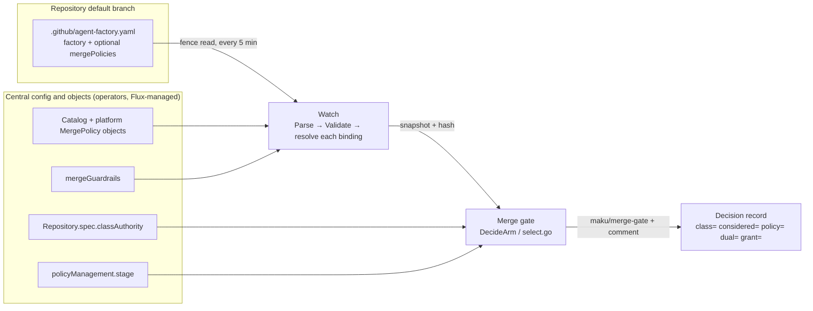
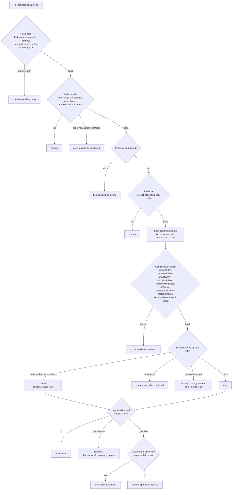
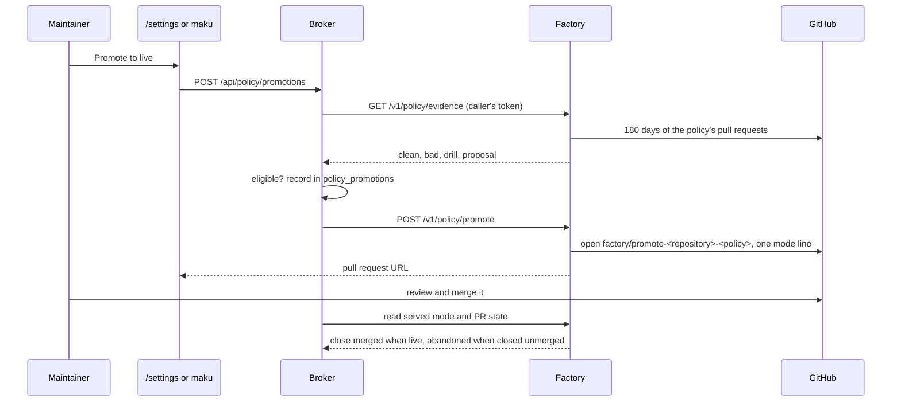
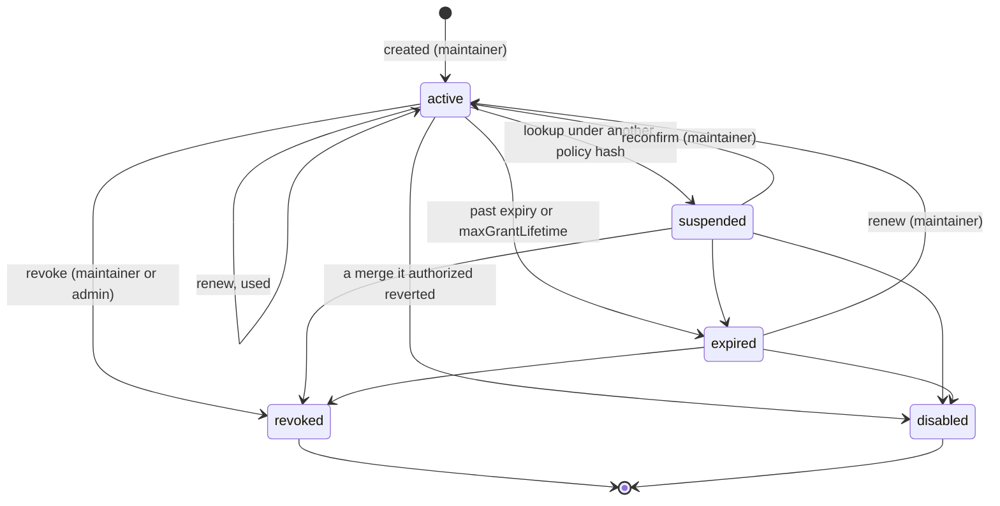

# Merge policies

Every served `Repository` evaluates Maku's shipped catalog of three bounded `MergePolicy` objects
(`docs-links`, `deps-patch`, `docs`) in `shadow` from its first pull request, with no
binding and no `.policy.yml` rule. The merge gate picks the policy from the diff, records shadow
evidence for every shadow policy that holds, and merges under the strictest `live` one that holds. A
binding in `Repository.spec.mergePolicies` or `.github/agent-factory.yaml` is an exception: it takes
a policy `live`, disables a catalog policy (`mode: disabled`), or narrows its paths and caps. The
factory's central guardrails cap every resolved policy. `policyManagement.stage` (`read`, `simulate`,
`manage`; `manage` by default) sets how far repository-file management is rolled out. **Until a
repository sets `classAuthority: repository`, the factory's own config and objects alone decide its
merges**: the repository's file is read, compared, re-decided and simulated, never acted on.

| You want to | Go to |
|---|---|
| Onboard a repository with zero policy YAML | [Start here](#start-here) |
| Understand selection, resolution and concepts | [Concepts](#concepts) |
| Configure `policyManagement.stage` | [Repository-file authority](upgrading.md#repository-file-authority) |
| Look up field tiers, check names or fields | [Reference](#reference) |
| Copy one of the three worked examples | [Worked examples](#worked-examples) |
| Browse repository-file binding recipes | [Recipes](#recipes) |
| Check, simulate, promote, save a grant | [Workflows](#workflows) |
| Read a decision, a metric or a reason | [Operating it](#operating-it) |
| Fix something | [Troubleshooting](#troubleshooting) |
| Undo something | [Rollback](#rollback) |
| Define a policy, bind it from a `Repository` | [Factory resources](#factory-resources) |

The merge gate itself (the fixed base, the decision record, adopted classes, the monitor) is in
[the factory](factory.md#the-merge-gate). This page covers merge policies, bindings and promotion.

## Start here

**A new `Repository` binds nothing.** Leave `spec.mergePolicies` unset on the `Repository`, and put
only the ownership fence in `.github/agent-factory.yaml` (`factory: <name>`). No `MergePolicy`
manifest and no `.policy.yml` rule is needed (`maku/merge-gate` is the gate status by default):

1. Every served `Repository` automatically evaluates [the catalog](#the-catalog) (`docs-links`,
   `deps-patch`, `docs`) in `shadow`.
2. On every agent pull request, the gate evaluates the diff against all candidate policies
   ([selection from the diff](#selection-from-the-diff)) and writes a `shadow_would_arm` record for
   each shadow policy that holds, regardless of any issue label.
3. Merge the pull requests you agree with unchanged. For the first drill, choose one merged shadow
   pull request, apply `factory/revert` and `factory/drill`, and let the merger open and merge the
   revert. That single drill covers the repository: evidence now accumulates only from maintainer
   merges at the exact judged head. Once a policy reaches its clean minimum (`5` for `evidence: low`,
   `20` for `standard`), [promote it](#promotion-shadow-to-live) with a one-line `mode: live` binding.

A binding overrides the catalog default for that policy: `mode: live` promotes it,
`mode: disabled` turns a catalog policy off for the repository, and `allowedFiles`,
`protectedFiles`, `holdoutChecks` or lower caps tighten it.

```yaml
# before: 11 bindings, 7 of which merge nothing
# after: a new repository has no mergePolicies key at all; a repository with exceptions lists only those
mergePolicies:
  - {name: docs-links, mode: live, holdoutChecks: ["Check the documentation links 🔗"]}
  - {name: alert-rules, mode: shadow, allowedFiles: ['^observability/.+\.ya?ml$']}
  - {name: dead-links,  mode: shadow, allowedFiles: ['^(docs|website/content)/.+\.md$'], oracleWorkflow: dead-links.yaml}
  - {name: deps-patch,  mode: shadow, protectedFiles: ['^security/base/zitadel/']}
```

### The catalog

Rendered by the `agent-factory` chart with the factory (`mergePolicies.catalog.enabled`, on by
default), in the factory's namespace, labelled `maku.ogenki.io/catalog: "true"`. Each carries its own
bound, since no binding supplies one:

| Policy | What it merges | Bound | `evidence` |
|---|---|---|---|
| `docs-links` | Link targets in Markdown, nothing else, 20 lines | `diffShape: links-only` | `low` (5) |
| `deps-patch` | Renovate patch updates after their release age (`renovate/stability-days`): adopted from `renovate[bot]` on `renovate/` branches, 3 files, 10 lines, 2 a day | `diffShape: semver-patch` | `low` (5) |
| `docs` | Prose in Markdown files (`^.+\.mdx?$`), 5 files, 100 lines, 2 a day | `allowedFiles` | `standard` (20) |

```yaml
kind: MergePolicy
metadata: {name: docs-links}
spec:
  description: Link targets in Markdown, nothing else.
  diffShape: links-only
  modifyOnly: true
  maxModifiedLines: 20
  evidence: low
---
kind: MergePolicy
metadata: {name: deps-patch}
spec:
  description: Renovate patch updates, after their release age.
  author: {adopt: {logins: ["renovate[bot]"], branches: ['^renovate/']}}
  diffShape: semver-patch
  modifyOnly: true
  maxPatchFiles: 3
  maxModifiedLines: 10
  releaseAgeCheck: renovate/stability-days
  maxPerDay: 2
  evidence: low
---
kind: MergePolicy
metadata: {name: docs}
spec:
  description: Prose in Markdown files, small changes.
  allowedFiles: ['^.+\.mdx?$']
  maxPatchFiles: 5
  maxModifiedLines: 100
  maxPerDay: 2
  evidence: standard
```

A binding narrows a catalog policy like any other: `allowedFiles` on a `docs` binding must match as
well as the policy's. A platform that keeps its own object of a catalog name lists it in
`mergePolicies.catalog.exclude`; an unlabelled `MergePolicy` of a catalog name fails the install,
naming it, until it is listed there or deleted.

### Required workflow stages (`spec.requires`)

A `MergePolicy` may declare `requires: [plan, tests, judge, review]` (at most 4 items) to require
stages for tasks touching its paths. Class requirements add stages to whatever workflow a task runs
and never remove one (`quick` under a class requiring `review` runs the reviewer). Requirements are
applied at triage for the predicted class and evaluated late against the scoper's `touches` list and
against the first pull request diff so label-path tasks touching regulated paths run each newly
required stage once. `tests` is added only when the repository configures both `tests.paths` and
`merge.contractCheck`; otherwise the factory narrates the unmet requirement and the merge gate hands
the pull request to a maintainer with `required_stage_missing`.

Two-human sign-off on a pull request is enforced by a GitHub branch ruleset requiring two approvals,
without the merger App on that ruleset's bypass list: `merge.approveToMerge` merges via an ordinary
`mergePullRequest` call, so GitHub refuses the merge until two people have approved. The plan gate's
**Approve** approves the scope before implementation and is not an approval of the pull request.

Every bound and catalog policy also inherits the central guardrails (`MergeGuardrails.WithDefaults`):
when `mergeGuardrails` is unset on the `Factory`, `protectedFiles` starts with `^\.github/`,
`^\.policy\.yml$` and `^CODEOWNERS$`, and `maxPatchFiles`, `maxModifiedLines` and `maxPerDay` default
to `10`, `300` and `5`. A platform can customize them centrally:

<!-- check: central -->
```yaml
workflows:
  plain: {}
  checked: {checks: true}
  adopted-none: {template: none}
mergeGuardrails:
  protectedFiles:                       # the self-modification fence, once instead of per rule
    - '^\.github/'
    - '^\.policy\.yml$'
    - '(^|/)(AGENTS|CLAUDE)\.md$'
    - '^\.(agents|claude)/'
    - '(^|/)(go\.sum|package-lock\.json|pnpm-lock\.yaml|uv\.lock|Cargo\.lock)$'
  maxPatchFiles: 20
  maxModifiedLines: 400
  maxPerDay: 5
  # maxGrantLifetime 90 days is the code's default; a policy's evidence sets its promotion minimum
```

Guardrails cap every bound class, a file's or a `Repository`'s (`config.Resolve`), including a
repository-authoritative file with no central `classes`. A policy cap above one is clamped; an
explicit binding value above one is refused alone (`GuardrailMismatch`). An unset `merge.maxPerDay`
inherits the guardrail's daily cap.

| Default | Value |
|---|---|
| Zero-binding `Repository` | Evaluates all three catalog policies in `shadow` |
| Selection | Strictest `live` policy whose conditions hold on the diff |
| Guardrails when unset | `^\.github/`, `^\.policy\.yml$`, `^CODEOWNERS$`; `10` files, `300` lines, `5` per day |
| Promotion minimum | `5` clean shadow merges (`evidence: low`) or `20` (`standard`), plus one drill per repository |
| Unreviewed prose (MR12) | A policy with no `diffShape` and no `oracle` requires a reviewer's `approve` |
| Everything else | `no_policy_matched`: a human merges |

## Concepts



| Term | Meaning | Code |
|---|---|---|
| Policy | A `MergePolicy` object: one bounded merge rule, named by the object. What it may say is in [policies and bindings](#policies-and-bindings) | `config.PolicySpec` |
| Catalog | The three `MergePolicy` objects (`docs-links`, `deps-patch`, `docs`) shipped by the `agent-factory` chart and evaluated in `shadow` by every served `Repository` unless bound otherwise | `internal/factory/resources/bindings.go` |
| Binding | One entry of `mergePolicies` (on a `Repository` or in `.github/agent-factory.yaml`): a policy's name, its `mode` (`live`, `shadow`, `disabled`), and this repository's narrowing parameters | `config.Binding` |
| Repository policy | The `mergePolicies` bindings of `.github/agent-factory.yaml` on the default branch. A file with `factory:` alone is the ownership fence and binds no policy | `internal/factory/mergepolicy/policy.go` |
| Central config | `Factory` and config-file settings: `workflows`, `mergeDefaults`, `mergeGuardrails`, `policyManagement.stage`, and per repository `classAuthority`, maintainers, `merge`, `workflow`, `schedules`, budgets | `internal/factory/config/mergepolicy.go` |
| Mode | `live` merges, `shadow` records what it would have done, `disabled` turns a catalog or bound policy off. Always the binding's | `config.Binding.Mode` |
| Author mode | `agents`: the factory's agents App wrote it through a task's runs. `adopt`: another App's pull requests (Renovate), adopted by login and branch prefix | `Class.Author` |
| Conditions | The [fields](#conditions) that must all hold on the diff, plus `protectedFiles`, the paths that refuse | `config.Class` |
| `requiresApproval` | Paths that send an otherwise-arming pull request to a maintainer, even in a `live` policy. A [saved grant](#approval-memory) can let a later one arm | `ApprovalLeaf` |
| `maxPerDay` | The policy's own daily cap, at most the guardrail's (`merge.maxPerDay` caps the repository whole) | `Class.MaxPerDay` |
| Monitor | The [post-merge monitor](factory.md#the-post-merge-monitor) settings, declared on the policy | `config.Monitor` |
| Guardrails | Central bounds: protected paths and mandatory checks every resolved policy gains, caps no policy or binding may exceed | `MergeGuardrails` |
| Snapshot | One read of `.github/agent-factory.yaml`: its sha256, the resolved classes, the error. Each decision binds to it (`policy=<12 hex>`) | `mergepolicy.Snapshot` |

### How a binding resolves

`config.Resolve` turns a policy and one repository's binding of it into the `config.Class` the gate
decides on. Each binding resolves on its own: one that does not drops its policy, never the
`Repository` or the file.

1. The binding names a `MergePolicy` the factory serves (`MissingRef` otherwise; `disabled` drops the
   policy before resolution).
2. The policy's meaning, the binding's mode, each fill-once parameter from where it is set, a
   binding's `allowedFiles` narrowing the policy's, the additive lists unioned and the lower cap
   ([the combination rules](#policies-and-bindings)).
3. The guardrails are applied: their `protectedFiles` and `mandatoryChecks` are appended
   (`mandatoryChecks` become holdout checks, so GitHub Actions must report them); a cap left unset
   inherits the guardrail's; a policy cap above it is clamped, while an explicit binding cap above it
   is refused (`GuardrailMismatch`).
4. The resolved policy must carry `allowedFiles` or a `diffShape` (`Unbounded` otherwise) and pass
   the gate's class rules (`Invalid` otherwise).

### Resolution order

The order the code decides in (`DecideArm` in `internal/factory/reconciler/arm.go`, the selection in
`select.go`, then `withApproval` in `evaluate.go`). The first row that refuses names the reason.



### Selection from the diff

| Rule | Detail |
|---|---|
| Candidates | Every policy the repository evaluates in `live` or `shadow`, the catalog's included, except adopted ones and those with an `oracle`. A task with findings (a schedule's probe) or an adopted pull request is decided on its one class instead |
| A policy holds | Every condition it declares holds on the diff. A policy with no `diffShape` and no `oracle` also needs a reviewer's approve: without a reviewer in the workflow it refuses `reviewer_verdict_missing` (MR12) |
| Strictest | A `diffShape` first; then the lower `maxModifiedLines`; then the lower `maxPatchFiles` (0, no cap, sorts last in both); then the name |
| No fall-through | When the strictest live policy that holds is paused or at its `maxPerDay`, a human merges: a looser policy never takes over |
| Shadow | Each shadow policy that holds records its own `shadow_would_arm` line, whether or not a live policy merged |
| Pending | A pending holdout waits only when its policy would decide: stricter than every policy of its tier that holds |
| No match | `no_policy_matched`; the record's `considered=` names each policy's refusal |

| Rule | Detail |
|---|---|
| The diff | Conditions on the diff hold until it is read: the first pass decides without it, and only a decision that would arm or shadow reads it and decides again |
| The approval subset | Applies to a policy's own arm or shadow, never to a maintainer's approval, which is already a human's. It is decided after the caps: a capped pull request says `auto_merge_cap`, not `approval_required` |
| Deny | `protectedFiles` is the second condition checked, after `allowedFiles`: a file both outside the allow list and protected reports `file_not_allowed`. Either way a human merges |
| Built-in shape | `docs-links` is held to `diffShape: links-only` when it declares none, and may declare no other. `links-only` reads `.md` and `.mdx` files only; any other changed path refuses `class_mismatch` even when `allowedFiles` admits it |

### description

A policy's `description` says, in one plain sentence, what the policy is for: "Fixes a broken link in
the docs, and nothing else." It is optional plain text of at most **280** characters, set on the
`MergePolicy` (`spec.description`) or on a class of the central config; a binding has none. **The
gate never reads it**: two policies that differ only in their description decide every pull request
alike. A policy's [settings page](reference/web-ui-settings.md#settings) shows it.

### Shadow and live

A shadow policy runs every row a live one does and records `shadow_would_arm` (or
`shadow_would_require_approval`) with the head it judged; a maintainer merges. Those records are the
[promotion evidence](#promotion-shadow-to-live): only `shadow_would_arm` decisions merged unchanged
at their head count. Grants are never consulted in shadow.

Repository-file authority and the legacy rollout stages are documented in [upgrading](upgrading.md#repository-file-authority).

## Reference

### Field tiers

| Tier | Policy fields | Binding fields |
|---|---|---|
| Essential | `allowedFiles`, `maxPatchFiles`, `maxModifiedLines`, `maxPerDay`, `evidence`, `description` | `name`, `mode` (`live`, `shadow`, `disabled`) |
| Shape and checks | `diffShape`, `modifyOnly`, `protectedFiles`, `holdoutChecks`, `releaseAgeCheck`, `monitor` | the same lists, added to the policy's; the three caps, lowered |
| Expert | `oracle`, `companionFiles`, `requiredLabel`, `author.adopt`, `requiresApproval` | `oracleWorkflow`, the fill-once fields |

### The seven check names

Maku reads seven check-name fields across repository merge settings, central guardrails and merge
policies:

| Field | Where set | Reported by | When read and what happens |
|---|---|---|---|
| `requiredChecks` | `Repository.spec.merge`, `Factory.spec.mergeDefaults` | Any CI check or status on the PR head | Fixed base before any policy runs: pending waits; cancelled re-runs up to `merge.checkReruns`; red starts a fix run up to `merge.fixRuns`, then hands off `ci_red` |
| `verifyChecks` | `Repository.spec.merge`, `Factory.spec.mergeDefaults` | Main-branch push CI on the merge commit | Watched after an auto-merge for `merge.verifyFor`: green ends `Done`; red reverts the merge (`main_red`) |
| `leakScanCheck` | `Repository.spec.merge`, `Factory.spec.mergeDefaults` | Secret scanner check run (must also appear in `requiredChecks` and `verifyChecks`) | First check in the fixed base and post-merge verification: red escalates immediately (`secret_scan_red`) with no fix run |
| `contractCheck` | `Repository.spec.merge`, `Factory.spec.mergeDefaults` | Test-contract job (must not appear in `requiredChecks`; required when `workflow.testFirst` is set) | Fixed base on tasks that carry a test contract (reports only on other tasks): pending waits, red triggers a fix run |
| `mandatoryChecks` | `Factory.spec.mergeGuardrails` | GitHub Actions check run (`SUCCESS`) | Appended centrally to every bound policy's `holdoutChecks` during resolution |
| `holdoutChecks` | `MergePolicy.spec`, `Binding` | GitHub Actions check run (`SUCCESS`) on the PR head | Policy condition on the head (its workflow file is a gate path): missing or running waits `holdout_pending`; red, skipped, neutral or non-Actions refuses `holdout_red` |
| `releaseAgeCheck` | `MergePolicy.spec` (`author.adopt` only) | Commit status posted by an adopted login (for example `renovate/stability-days`) | Policy condition on an adopted PR head: pending waits `release_age_pending`; failure or another author refuses `release_age_red` |

### `.github/agent-factory.yaml`

Parsed strictly (`mergepolicy.Parse`): unknown keys, duplicate keys, a key in another case
(`Mode:`) and a key at the wrong layer are each an error. Then `mergepolicy.Validate` checks it
against the central config.

| Key | Type | Default | Constraint |
|---|---|---|---|
| `factory` | string | required | A factory name (DNS label). Must equal the config's `factory`. Maku never edits it |
| `mergePolicies` | list of [bindings](#a-binding) | absent: fence only | Each item binds a `MergePolicy` the factory serves, by name, at most once. Names: lowercase letters, digits, `-`, at most 40, starting and ending alphanumeric (`review` is refused) |

A file with a `classes` key is refused whole (`ErrClassesRemoved`). Under central authority,
`maku policy export` writes the `Repository`'s bindings; under repository authority the `Repository`
binds nothing, and `.github/agent-factory.yaml` holds the bindings.

Rules a file that sets `mergePolicies` must meet:

| Rule | Error | Fix |
|---|---|---|
| `mode` is `live`, `shadow` or `disabled` (`"off"` and `review` are refused) | `binding docs-links: mode "off" is not live, shadow or disabled` | Use `disabled` for a catalog policy, or delete the binding |

An unknown key names where it is, the key meant when it is close or another tool's name for it, and
every key valid there:

```
mergepolicy: mergePolicies[2]: key "maxFiles" is not a field (did you mean "maxPatchFiles"?); keys are matched exactly, in their documented case: one of allowedFiles, …
```

| Bound | Value |
|---|---|
| File size | 256 KiB |
| Bindings | 32 |
| Patterns per list | 64 |
| Patterns in the file | 256 |
| Pattern length | 512 bytes |
| `requiresApproval` entries per binding | 16 |

#### A binding

The file's `mergePolicies` is the same list as a `Repository`'s `spec.mergePolicies` ([factory
resources](#factory-resources)): it names a `MergePolicy` of the factory's namespace and supplies the
mode (`live`, `shadow` or `disabled`) and this repository's parameters (`allowedFiles`,
`companionFiles`, `requiredLabel`, `oracleWorkflow`, `holdoutChecks`, `protectedFiles`,
`requiresApproval`, `maxPatchFiles`, `maxModifiedLines`, `maxPerDay`). Each binding resolves on its
own: one that does not resolve drops its policy, never the file, and a file that does not parse
pauses auto-merge (`policy_invalid`). The guardrails cap every binding.

<!-- check: repository -->
```yaml
factory: aws-0
mergePolicies:
  - {name: docs-links, mode: live, holdoutChecks: ['Check the documentation links 🔗']}
  - {name: docs,       mode: disabled}
  - name: alert-rules
    mode: shadow
    allowedFiles: ['^observability/.+\.ya?ml$']
    requiresApproval: [{changedFiles: ['^observability/base/']}]
```

#### Conditions

What a resolved policy may require, set on the policy, the binding, or both as [the combination
rules](#policies-and-bindings) allow. An empty value is refused rather than read as absent.

| Field | Meaning and unit | Default and who sets it | Refusal reason | Example |
|---|---|---|---|---|
| `allowedFiles` | Regular expressions for paths that may change, each anchored `^…$` | Unset: unbounded unless a `diffShape` bounds it; policy and/or binding | `file_not_allowed`; admission also rejects an unanchored pattern | `['^website/content/.+\.md$']` |
| `maxPatchFiles` | Changed file count, integer ≥ 0 (`0` means no cap) | Guardrail default 10; policy or binding may lower | `patch_too_large`; an explicit binding raise is `OverPolicy` | `5` |
| `maxModifiedLines` | Additions plus deletions, integer ≥ 0 | Guardrail default 300; policy or binding may lower | `patch_too_large` | `100` |
| `maxPerDay` | Automatic merges per UTC day, integer ≥ 0 | Guardrail default 5, also an unset repository `merge.maxPerDay`; policy or binding may lower | `auto_merge_cap` | `2` |
| `merge.paused` | Operator pause for all automatic policy decisions: `{reason}` | Unset; `Repository.spec.merge` or central merge defaults. A maintainer's approve-to-merge still works | `paused`; alerts after 24 hours | `{reason: Incident freeze}` |
| `merge.autoRevert` | Merge the factory's green revert only at the head GitHub created | `false`; `Repository.spec.merge` or central merge defaults. No `revert` policy needed | Revert waits for a maintainer on a missing or moved head | `true` |
| `evidence` | Clean decisions before promotion: `low` 5, `standard` 20 | `standard`; policy only, `low` needs `diffShape` or `oracle` | Admission: `evidence: low needs diffShape or oracle` | `standard` |
| `description` | Plain sentence for settings and `kubectl get`, ≤ 280 characters | Empty; policy only, never read by the gate | None | `Fixes broken links in docs` |
| `diffShape` | Mechanical diff shape: `links-only`, `semver-patch`, `semver-minor`, `added-entry` | Unset; policy only (`docs-links` is `links-only` built in) | `class_mismatch`; `Unsupported value` at admission | `links-only` |
| `modifyOnly` | Forbid add/delete/rename/copy/mode change | `false`; policy only | `file_added_or_deleted` | `true` |
| `protectedFiles` | Unanchored regular expressions for paths that always refuse | Central guardrails add `^\.github/`, `^\.policy\.yml$`, `^CODEOWNERS$`; policy and binding add more | `file_protected` | `['^docs/superpowers/']` |
| `holdoutChecks` | GitHub Actions check names that must return `SUCCESS` | `mergeGuardrails.mandatoryChecks` plus policy/binding additions | `holdout_red`; waits `holdout_pending` | `['Check the documentation links 🔗']` |
| `releaseAgeCheck` | Commit status proving an adopted release has aged | Unset; policy only, needs `author.adopt` | `release_age_red`; waits `release_age_pending` | `renovate/stability-days` |
| `monitor` | Post-merge checks: `{verification, oracleRuns, flux, followUpWindow}` | No monitor; policy only, `flux` uses `Repository.spec.merge.fluxSource` | Post-merge revert or regression; missing source is `MissingParameter` | `{followUpWindow: 168h}` |
| `oracle` | Detector findings and cap: `{probe: dead-links, maxFindings: 1..16}`; binding supplies `oracleWorkflow` | No oracle; policy and binding | `oracle_finding_open`, `oracle_unrequested` | `{probe: dead-links, maxFindings: 2}` |
| `companionFiles` | Anchored paths an `added-entry` PR may append to | Empty; policy or binding, needs `added-entry` | `class_mismatch` | `['^index\.md$']` |
| `requiredLabel` | Label an adopted PR must carry from an adopted login | Empty; policy or binding, needs `author.adopt` | `label_missing`, `label_not_adopted` | `ready-to-merge` |
| `author.adopt` | External authors and branches adopted instead of the agents App: `{logins, branches}` | Agents App; policy only | `not_adopted_author`, `branch_not_allowed` | `{logins: ['renovate[bot]'], branches: ['^renovate/']}` |
| `requiresApproval[].changedFiles` | Unanchored paths that still need a maintainer, even when live | Empty; policy and binding union | `approval_required`; `shadow_would_require_approval` in shadow | `[{changedFiles: ['^docs/architecture/']}]` |

#### Names from other tools

The parser refuses another tool's name for a binding key and suggests the key meant. The ones it
recognizes:

| You may know | Tool | Here |
|---|---|---|
| `only_changed_files`, `paths` | policy-bot, Mergify | `allowedFiles` |
| `no_changed_files`, `protectedPaths`, `denyFiles` | policy-bot | `protectedFiles` |
| `modified_lines`, `maxLines`, `maxChangedLines` | policy-bot | `maxModifiedLines` |
| `files_count`, `maxFiles`, `maxChangedFiles` | Mergify | `maxPatchFiles` |
| `check-success`, `checks`, `requiredChecks` | Mergify, GitHub | `holdoutChecks` |
| `label`, `labels`, `requiredLabels` | Mergify | `requiredLabel` |
| `has_workflow_result` | policy-bot | `holdoutChecks` (no suggestion: write it) |

A suggestion is matched case-insensitively; a key within two edits of a valid one (`allowedFile`) is
suggested too.

### Central config

All three blocks live at the top level of the factory's config (or `Factory.spec`).

| Key | Type | Default | Constraint |
|---|---|---|---|
| `workflows.<name>` | `{template, tier, checks, loop, escalation, effort, models, description}` | the shipped `quick`, `standard`, `careful`, `none` | Name like a policy name. `template`: `solo`, `pair`, `investigate` or `none`; `tier`: a tier; `loop`: `off` or a `loops` row; `escalation`: `{outOfBudget, notConverged}`, each a workflow; `effort` and `models` map non-implementer roles to `low`/`medium`/`high` and a model alias (internal runs: tier aliases only); `none` takes no other key; `description` ≤ 120 bytes |
| `mergeGuardrails.protectedFiles` | list of regexp | `^\.github/`, `^\.policy\.yml$`, `^CODEOWNERS$`, always first | Appended to every bound policy's `protectedFiles` |
| `mergeGuardrails.mandatoryChecks` | list of check names | none | Appended to every bound policy's `holdoutChecks` |
| `mergeGuardrails.maxPatchFiles`, `maxModifiedLines`, `maxPerDay` | int | 0, read as `10`, `300` and `5` | A policy cap above it is clamped; an explicit binding cap above it is `GuardrailMismatch`; one without it inherits it |
| `mergeGuardrails.maxGrantLifetime` | duration | 0, read as `2160h` (90 days) | `0` to `8760h`. Every lookup expires a grant older than this since its creation or last renewal |
| `policyManagement.stage` | `read` \| `simulate` \| `manage` | `manage` | See [the stages](upgrading.md#repository-file-authority) |
| `policyManagement.operators` | list of GitHub logins | none: no exception can be approved | Read by the broker |
| `repositories[].classAuthority` | `central` \| `repository` | `central` | `repository` needs `policyManagement.stage: manage` and no central `classes` or `mergePolicies` |

The broker reads `policyManagement` (`stage` and `operators`) and `human.approvalMemory` (bool,
default `false`) from its own config.

A policy selects no workflow: a task's workflow comes from a maintainer's `workflow:<name>` label, its
source or the `Repository`'s `workflow.default` ([how the workflow is chosen](factory.md#the-shipped-workflows)).
Workflow fields (`harness`, `harnessAllowed`, `escalation`, `checks`, `testFirst`), `requires`,
`mode: "off"`, and the `review` policy were removed from `MergePolicy` and bindings
([upgrading](upgrading.md#merge-policies-removals)). The default workflow's `template` is read for
[coordination](multi-repository.md) checks.

<!-- check: central -->
```yaml
workflows:
  plain: {}
  checked: {checks: true}
  adopted-none: {template: none}
mergeGuardrails:
  protectedFiles: ['^\.github/', '^\.policy\.yml$']
  mandatoryChecks: ['Security scanning 🔒']
  maxPatchFiles: 20
  maxModifiedLines: 400
  maxPerDay: 5
  maxGrantLifetime: 720h
policyManagement:
  stage: simulate
```

A fuller example of the three blocks. The repository files on this page are validated against the
central block in [Start here](#start-here) instead (see [how](#how-this-pages-examples-are-checked)).

## Worked examples

**1. Restrict `docs` to the site and take it live.** *Need:* ANR wants prose fixes under
`website/content/` merged, and nothing under `docs/superpowers/`.

```yaml
# Repository ai-native-ref
mergePolicies:
  - {name: docs, mode: shadow, allowedFiles: ['^website/content/.+\.md$'], maxModifiedLines: 60}
```

The binding's `allowedFiles` is a second filter: a path must match the policy's list and the
binding's, so a binding can only narrow (MR3). *Shadow shows:*
`class=docs decision=shadow:shadow_would_arm files=2/5 lines=31/60`. *Promotion:* at 20 clean
decisions the Evidence page proposes the one-line change `mode: live`; a maintainer merges it.

**2. Create `alert-rules`.** *Need:* threshold tweaks in alert YAML, verified after the merge.

```yaml
kind: MergePolicy
metadata: {name: alert-rules}
spec:
  description: Alert rule changes, verified after the merge.
  allowedFiles: ['^observability/.+\.ya?ml$']
  modifyOnly: true
  maxPatchFiles: 3
  maxModifiedLines: 40
  monitor: {verification: {within: 2h}, followUpWindow: 2h}
---
# Repository cloud-native-ref
mergePolicies:
  - {name: alert-rules, mode: shadow}
```

*Shadow shows* which alert pull requests would have merged and, in `considered=`, why the others
did not (`alert-rules:file_added_or_deleted`). No shape checks this diff, so it merges only with a
reviewer's verdict (MR12). *Promotion:* `standard`, 20 decisions.

**3. Create `dead-links` with an oracle.** *Need:* a daily scan lists dead links; the fix must
remove exactly those and touch nothing else.

```yaml
kind: MergePolicy
metadata: {name: dead-links}
spec:
  description: Fixes for the dead links the scan reported.
  diffShape: links-only
  modifyOnly: true
  maxModifiedLines: 20
  oracle: {probe: dead-links, maxFindings: 10}
  monitor: {oracleRuns: 2, followUpWindow: 168h}
  maxPerDay: 1
  evidence: low
---
# Repository
schedules:
  - {name: dead-links, cron: "0 7 * * *", class: dead-links, probe: dead-links, workflow: quick, text: Fix the dead external links listed below.}
mergePolicies:
  - {name: dead-links, mode: shadow, allowedFiles: ['^(docs|website/content)/.+\.md$'], oracleWorkflow: dead-links.yaml}
```

*Shadow shows* `oracle=ok` only when every finding is gone from the head. *Promotion:* 5 decisions,
about five weeks at one finding a week instead of five months.

## Recipes

Start every new binding in `shadow`. On a `Repository` object you bind only exceptions; a
repository-authoritative `.github/agent-factory.yaml` lists only the policies it wants to override.
Every resolved policy must be bounded by `allowedFiles` or `diffShape` (`Unbounded` otherwise).

### Export a repository's bindings to `.github/agent-factory.yaml`

Before cutting a repository over to `classAuthority: repository`, `.github/agent-factory.yaml` should
match what the factory serves so divergence reads `0`. `export` writes the repository's
[bindings](#factory-resources) as the file's `mergePolicies`, and `check` verifies equivalence:

```bash
maku policy export --config factory.yaml --manifests resources.yaml --repository Smana/cloud-native-ref > .github/agent-factory.yaml
maku policy check  --config factory.yaml --manifests resources.yaml --repository Smana/cloud-native-ref .github/agent-factory.yaml
# equivalent
```

A repository whose classes are still the config file's is refused (`the repository's classes are
the config file's, and the file binds central policies: migrate the repository first`): convert it
first with [`maku config migrate --from`](#factory-resources).

### Documentation with approval-gated architecture paths

<!-- check: none -->
```yaml
apiVersion: maku.ogenki.io/v1alpha1
kind: MergePolicy
metadata: {name: docs-broad, namespace: agent-system}
spec:
  description: Prose changes to the documentation, within a size bound.
  maxPatchFiles: 10
  maxModifiedLines: 200
  maxPerDay: 2
  monitor: {followUpWindow: 168h}
```

<!-- check: repository -->
```yaml
factory: aws-0
mergePolicies:
  - {name: docs-links, mode: live, holdoutChecks: ['Check the documentation links 🔗']}
  - name: docs-broad
    mode: shadow
    allowedFiles: ['^docs/.+\.md$', '^README\.md$']
    holdoutChecks: ['Check the documentation links 🔗']
    protectedFiles: ['^docs/superpowers/', '^docs/specs/', '^docs/security/']
    requiresApproval: [{changedFiles: ['^docs/architecture/']}]
```

Because `docs-broad` has no `diffShape` and no `oracle`, the gate also requires an approving
reviewer verdict (`reviewer_verdict_missing` otherwise, MR12).

### Dependency updates

An adopted policy: Renovate's pull requests, with no agent run (`none` workflow).

<!-- check: none -->
```yaml
apiVersion: maku.ogenki.io/v1alpha1
kind: MergePolicy
metadata: {name: deps-patch, namespace: agent-system}
spec:
  description: Renovate's patch bumps, once the release has aged.
  author: {adopt: {logins: ['renovate[bot]'], branches: ['^renovate/']}}
  modifyOnly: true
  maxPatchFiles: 3
  maxModifiedLines: 10
  diffShape: semver-patch
  releaseAgeCheck: renovate/stability-days
  maxPerDay: 2
  evidence: low
  monitor:
    followUpWindow: 168h
    flux: {within: 1h}    # the source is the Repository's merge.fluxSource
```

<!-- check: repository -->
```yaml
factory: aws-0
mergePolicies:
  - {name: docs-links, mode: live, holdoutChecks: ['Check the documentation links 🔗']}
  - name: deps-patch
    mode: shadow
    allowedFiles: ['^(apps|flux|infrastructure)/.+\.ya?ml$']
    protectedFiles: ['^infrastructure/base/crossplane/configuration-core/']
```

Minor updates get a policy of their own, `deps-minor`: the same author, `diffShape: semver-minor`,
`modifyOnly`, the same caps and release age, no daily cap of its own. It is **shadow only**: a
binding in `mode: live` is refused (`semver-minor is shadow only`), so it collects evidence and never
merges.

<!-- check: repository -->
```yaml
factory: aws-0
mergePolicies:
  - {name: docs-links, mode: disabled}
  - {name: deps-minor, mode: shadow, allowedFiles: ['^(apps|flux|infrastructure)/.+\.ya?ml$']}
```

See [adopted classes](factory.md#adopted-classes) for how adoption reads commits and pushes.

### Generated files

<!-- check: none -->
```yaml
apiVersion: maku.ogenki.io/v1alpha1
kind: MergePolicy
metadata: {name: generated-files, namespace: agent-system}
spec:
  description: Regenerated files, compared byte for byte by a holdout.
  modifyOnly: true
```

<!-- check: repository -->
```yaml
factory: aws-0
mergePolicies:
  - {name: docs-links, mode: live, holdoutChecks: ['Check the documentation links 🔗']}
  - name: generated-files
    mode: shadow
    allowedFiles: ['^gen/.+$']
    holdoutChecks: ['Regenerate and compare']
```

The holdout is a gate-path GitHub Actions workflow that regenerates `gen/` from the head and fails on
any byte of difference; Maku reads its result and never runs repository code.

### Two documentation scopes as separate policies

Two shapes of documentation change are two policies, each bound on its own, with its own evidence,
promotion and daily cap:

<!-- check: none -->
```yaml
apiVersion: maku.ogenki.io/v1alpha1
kind: MergePolicy
metadata: {name: docs-small, namespace: agent-system}
spec:
  modifyOnly: true
  maxModifiedLines: 40
  protectedFiles: ['^docs/(superpowers|specs)/']
  maxPerDay: 2
---
apiVersion: maku.ogenki.io/v1alpha1
kind: MergePolicy
metadata: {name: website-small, namespace: agent-system}
spec:
  modifyOnly: true
  maxModifiedLines: 20
  protectedFiles: ['^docs/(superpowers|specs)/']
  maxPerDay: 2
```

<!-- check: repository -->
```yaml
factory: aws-0
mergePolicies:
  - {name: docs-links, mode: live, holdoutChecks: ['Check the documentation links 🔗']}
  - {name: docs-small,    mode: shadow, allowedFiles: ['^docs/.+\.md$']}
  - {name: website-small, mode: shadow, allowedFiles: ['^website/content/.+\.md$']}
```

When a pull request touches only `website/content/guide.md` within 20 lines and both policies are
`live`, `website-small` wins [selection](#selection-from-the-diff) because its `maxModifiedLines`
(`20`) is stricter than `docs-small`'s (`40`).

### Tightening and relaxing

`maku policy diff` proves a change structural, policy by policy (`mergepolicy.Structural`), on the
resolved classes. A tightening is bounded on every row by the old policy: fewer allowed paths, more
denied ones, a wider approval subset, lower caps, more evidence, a lower mode. Anything else,
including a rewritten pattern, is a relaxation.

| Change to the `docs-broad` binding above | Verdict | Why, as printed |
|---|---|---|
| `maxModifiedLines: 100`, `protectedFiles` adds `'^docs/runbooks/'` | `tightening` | |
| `allowedFiles` gains `'^docs/.+\.svg$'` | `relaxation` | `allowedFiles broadened or rewritten` |
| A new binding | `relaxation` | `the class is new` (a new binding in `mode: disabled` is a tightening) |
| A removed binding | `tightening` | |

On a cut-over repository, a relaxation of a policy that is `live` in the new file runs that policy in
shadow and logs `repository merge policy relaxed: the class runs in shadow` with the why. The
demotion lives in the factory's memory: a restart lifts it.

### Moving a repository to its own file (`classAuthority: repository`)

1. `policyManagement.stage` at `simulate` or `manage`, the exported `.github/agent-factory.yaml`
   merged, divergence `0`, and a week without `unexplained` dual evaluations.
2. One central pull request switching the repository to `classAuthority: repository` and removing its
   central bindings:

<!-- check: central -->
```yaml
policyManagement: {stage: manage}
repositories:
  - name: Smana/cloud-native-ref
    maintainers: [Smana]
    triggerLabel: factory/ready
    classAuthority: repository
    # merge, checks and schedules stay as they were; classes is removed
```

A repository served from a `Repository` object sets `classAuthority: repository` there instead,
and drops its `mergePolicies`: the file then holds the bindings
(`classAuthority repository: the repository's file holds the bindings (MP15)`).

3. Reverting that pull request is the rollback. No tool writes a repository file back to central
   objects, so a binding changed in `.github/agent-factory.yaml` after cutover is carried back by
   hand.

## Workflows

### Validate a binding file: `maku policy diff`

To validate a new or changed `.github/agent-factory.yaml`, use `diff`, never `check`. `diff` parses
both files strictly, resolves each binding against the policies `--manifests` serves and the central
guardrails, and names each policy's structural change. Pass the same file twice to validate one file
alone. It requires `policyManagement.stage` at `simulate` or `manage`.

```bash
maku policy diff --config factory.yaml --manifests resources.yaml --repository owner/name old.yaml new.yaml
```

It prints `CLASS CHANGE WHY` per policy: `unchanged`, `tightening`, or `relaxation` with why.

### Migration only: `maku policy check`

```bash
maku policy check --config factory.yaml --manifests resources.yaml --repository owner/name .github/agent-factory.yaml
```

`check` means **equivalent to the central policies**, not "valid". It parses and validates as `diff`
does, then prints `equivalent` or each difference (`docs-broad: only in the repository`). Use it for
the export before a cutover, and in a repository's CI while the central config still decides.

### Fixture replay: `maku policy simulate`

```bash
maku policy simulate --config factory.yaml --repository owner/name new.yaml \
  internal/factory/reconciler/testdata/conformance/*.json
```

A **fixture replay**, not an impact preview: it replays Maku's conformance fixtures (version 2) under
the central policies and under the file's policies with the gate's own evaluator, and prints
`CENTRAL`, `REPOSITORY` and the change (`unchanged`, `newly_auto_merged`, `newly_blocked`,
`newly_approval_required`, `changed`). It requires `policyManagement.stage` at `simulate` or
`manage`.

The fixtures are recorded under the test config in `internal/factory/reconciler/simulate_test.go`,
for `dead-links` and `docs`. Under any other config a row prints `(the fixture recorded another
central decision)`: read a replay as proof that the evaluator is the gate's, not as a preview of your
repository's pull requests.

### Recorded-diff backtest

`maku policy backtest new.yaml --repository owner/name --since 30d` replays the newest recorded
per-policy decisions under an edited file, with the same evaluator the gate uses. The policy and
binding editors offer the same replay against the last 30 days. Each row links to a real pull
request and shows its before and after. Only changed and unknown rows print; the counts include
unchanged decisions too. A warning names a rule that matched none.

A backtest reconstructs the diff from the merge commit's first parent and the judged head, and
reuses the recorded checks and fixed-base evidence. If those immutable references or the diff are
unavailable, the row is `unknown`, never `unchanged`. Oracle decisions are also `unknown` because
their original finding snapshots are not in the decision record. The replay writes nothing.

### The settings pages

With `policyManagement.stage: manage` (factory and broker), `/settings/merge-policies/<owner>/<name>`
shows a repository's policies and evidence, and `/settings/merge-policies/policies/<name>` shows one
policy; see [the web UI](reference/web-ui-settings.md#settings) for permissions. Editors write
nothing: each answers with the manifest or file edit to commit. Promotion is the one exception,
below, and opens a pull request without merging it.

| Repository | Where its bindings are edited | **Check** answers |
|---|---|---|
| Bound, `central` authority | The **Bindings editor**: each binding's mode and parameters, the policy's meaning read-only | The `Repository` manifest, `repository-<name>.yaml`, each binding resolved or refused with its reason: commit it where the platform's GitOps applies it |
| `repository` authority | `.github/agent-factory.yaml`, by pull request: the page shows each policy's file binding and no editor | Nothing on the page: [`maku policy diff`](#validate-a-binding-file-maku-policy-diff) checks the file. It touches `.github/`, so a human merges it |
| Not migrated (its classes are the config file's) | Nowhere: the page says "Not migrated yet: `maku config migrate` prints its Repository." | — |

A policy's page shows its definition and its consumers. Its editor checks a changed spec
(`POST /api/policy/policies/<name>/preview`): the `mergepolicy-<name>.yaml` to commit and each
consumer's change, live consumers first.

### Promotion: shadow to live



A policy is eligible when all three hold (`evidence.Evaluate`):

| Blocker | Clears when |
|---|---|
| `below_minimum` | At least the policy's minimum shadow decisions a maintainer merged unchanged at the head the decision judged: `5` at `evidence: low`, `20` at `standard` (the default) |
| `bad_outcome` | No mature, conclusive merge of the policy was reverted (other than a drill), followed up or regressed |
| `no_drill` | A `factory/drill` revert of one of the repository's pull requests merged: the drill is per repository, so one clears it for every policy |

Shadow evidence is keyed by `class=<policy>` in the gate's decision marker, so clean shadow merges
recorded under earlier label-chosen decisions and under diff-chosen decisions count together with no
migration. Only a served `shadow` policy is promotable. The factory re-reads the GitOps file and
changes only its `mode: shadow` line to `mode: live`; the pull request body carries the clean, bad
and drill counts and the supporting pull requests. `Factory.spec.gitops` names the repository, path
and base branch. A `requested` record resumes after a failed open; a second request is refused once
the PR is open. There are no **Merged** or **Abandon** buttons: served live closes the record
`merged`, and an unmerged close closes it `abandoned`, allowing another request.

With `gitops` unset, the response instead carries the one-line proposal and its `gh pr create`
command; the maintainer opens the PR manually. `maku policy promote POLICY --repository owner/name`
uses the same flow. For the first rollback drill, choose a merged PR of the repository and run
`maku policy drill owner/name#PR`: the factory opens a revert labelled `factory/drill`, and a
maintainer reviews and merges that too.

Below the minimum, a maintainer may request an exception (a lower minimum and a justification of 20
to 2,000 characters); one of `policyManagement.operators` approves or refuses it once. An approved
exception lasts 14 days; bad outcomes and the drill still block.

### Approval memory

For a pull request a live policy's `requiresApproval` subset sent to a maintainer
(`approval_required`), `/settings/approval-memory` offers two choices:

| Choice | Effect |
|---|---|
| Merge once | Approve the head on GitHub: the approved-merge path merges that head only and saves nothing |
| **Merge and create rule** | Saves a grant and **merges nothing**: this pull request stays waiting for a human, and a maintainer still merges it (approve its head with `merge.approveToMerge`, or merge it by hand), because an `approval_required` hand-off never returns to the gate by itself. The grant covers later pull requests. **Preview rule** first shows the exact predicate, the future pull requests it would match, what stays outside it, its expiry and how to revoke it |

The form takes the repository, policy, pull request, the record's `policy=` or `resolved=` hash and
the caught files (`?repository=&class=&pr=&policy=&file=…`). Each caught file becomes an exact
pattern. A grant matches a later pull request when it is `active`, of the same repository and policy,
bound to the policy in force, unexpired, every caught file matches one of its patterns, and its
optional diff shape (`links-only`, `semver-patch`, `semver-minor`) holds. The lowest id wins.

A grant never bypasses the fixed base, the policy's conditions and deny, the breaker, the caps, a
policy in shadow or disabled, a policy change, or its expiry.



| Action | Who | Note |
|---|---|---|
| Create, renew, reconfirm | A maintainer (GitHub write) | Lifetime 1–365 days, 90 by default, cut at each lookup by `maxGrantLifetime`. Reconfirm rebinds to the hash the suspension was found under |
| Revoke | Any maintainer, or an admin | Immediate and final |
| Export | Any reader | `GET /api/approval-memory/export?repository=` as YAML |

The factory reads grants immediately before the decision and again before the merge call, never
from a cache; a failed lookup authorizes nothing. The decision record names the grant
(`grant=<id>:<version>`).

## Operating it

### Metrics

Definitions are in [operations](operations/factory.md#factory-metrics); this is what to watch per stage.

| `stage` | Query | Healthy |
|---|---|---|
| `read`, `simulate`, `manage` | `max by (repository) (maku_factory_policy_central_divergence)` | `0` |
| `read`, `simulate`, `manage` | `sum by (repository, reason) (increase(maku_factory_policy_load_errors_total[1h]))` | No series |
| `simulate`, `manage` | `sum by (repository, agreement) (increase(maku_factory_policy_dual_decisions_total[1d]))` | No `unexplained`; `explained` only while divergence > 0; no `no_policy` once the file is read |
| `manage` (`repository` authority) | `sum by (repository, class, change) (increase(maku_factory_policy_changes_total[1d]))` | `relaxation` only with a pull request you meant |
| `manage` (grants) | `maku_factory_approval_grants_active`, `increase(maku_factory_approval_grant_events_total{event="disabled"}[1d])` | `disabled` `0` |
| `manage` (promotions) | `increase(maku_rooms_policy_changes_total[7d])` | Each eligible automatic promotion reaches `promotion_pr_opened`, then `promotion_merged` when served live or `promotion_abandoned` when closed unmerged; a no-GitOps request begins at `promotion_requested` |
| All | `sum by (class, reason) (increase(maku_factory_merge_decisions_total{reason=~"policy_.*\|approval_required"}[1h]))` | `policy_*` `0` |

Maku ships no alert on these series; add the host's rules for an invalid or unreadable policy and a
disabled grant.

### Reading a decision

`/settings/merge-policies/<owner>/<name>/decisions/<pr>` renders each record the factory wrote on
the pull request in the gate's order: fixed base, author mode, policy conditions, requires approval,
grant, breaker and caps, verdict. The stage that refused is named; later stages are not reached. The
record's fields are in [the factory](factory.md#the-merge-gate):

```
<!-- agent-factory-decision head=<sha> class=docs-broad decision=human:approval_required files=2/10 lines=14/200 … policy=3f2a9c1e0b7d -->
```

| Field | Use |
|---|---|
| `policy=` | The snapshot decided under (cut over), or compared (dual). Match it against `sha256sum .github/agent-factory.yaml` at the commit |
| `dual=` | `agree`, `explained`, `unread`, `unexplained`, `no_policy`. With anything but `agree` the factory logs `merge decision under the repository policy` with both decisions |
| `grant=` | The grant and version that let it arm |
| `policygen=` | The generation of the bound policy's `MergePolicy` the decision used, [below](#factory-resources). Absent for a class the config file declares |
| `repogen=` | Only for a bound policy: the generation of the `Repository` that holds the binding (its mode and parameters) |
| `considered=` | Each candidate policy that did not hold, as `<policy>:<reason>`, comma-separated. Each shadow policy that held has a record line of its own after the decision's |
| `resolved=` | The first 12 hex digits of the resolved policy's hash: the policy's definition and this repository's binding together, mode excluded. It is what an approval grant binds to, so the approval-memory form prefills from it; an edit to another policy leaves it, and its grants, unchanged |

The guardrails and workflows in force are the pod's config, bound by its checksum, not per record.
`policy_unavailable` and `policy_invalid` decisions map to no stage on the timeline.

### Reasons

The gate's policy-related reasons. Every other reason is in [the factory](factory.md#when-the-factory-waits-for-you).

<!-- reasons:table:start -->
| Reason | Means | Next step |
|---|---|---|
| `held` | a maintainer put this pull request on hold (factory/hold) | a maintainer reviews the task and chooses the next step |
| `policy_unavailable` | the repository's merge policy could not be read recently, so auto-merge waits | a maintainer reviews the task and chooses the next step |
| `policy_invalid` | the repository's merge policy is invalid, so auto-merge is paused | a maintainer reviews the task and chooses the next step |
| `approval_required` | it changes a file its class asks a maintainer to approve | a maintainer reviews the task and chooses the next step |
| `shadow_would_require_approval` | a shadow policy would merge, except a path needs a maintainer approval | a maintainer approves the current head; this is not clean promotion evidence |
| `shadow_would_arm` | it would auto-merge, and the merge gate is in shadow | a maintainer reviews the task and chooses the next step |
| `no_policy_matched` | no merge policy of the repository holds on this diff: a maintainer reviews and merges it | a maintainer reviews the task and chooses the next step |
| `reviewer_verdict_missing` | no reviewer read this change, and its policy has no shape to check it | a maintainer reviews the task and chooses the next step |
| `file_not_allowed` | it changes a file outside its class's allowed files | a maintainer reviews the task and chooses the next step |
| `file_protected` | it changes a file its class protects | a maintainer reviews the task and chooses the next step |
| `file_added_or_deleted` | it changes a file in a way other than editing its content (an add, delete, rename, copy or mode change), which its class does not allow | a maintainer reviews the task and chooses the next step |
| `patch_too_large` | it changes more files or lines than its class allows | a maintainer reviews the task and chooses the next step |
| `class_mismatch` | the diff is not the class the triage predicted | a maintainer reviews the task and chooses the next step |
| `holdout_red` | a holdout check its class requires did not succeed (failed, cancelled, neutral, skipped, or not posted by GitHub Actions), or its checks could not all be read | a maintainer reviews the task and chooses the next step |
| `holdout_pending` | a holdout check has not passed yet | nothing to do: the task goes on when the holdout checks report |
| `release_age_red` | the release age check failed, or was not posted by the adopted login | a maintainer reviews the task and chooses the next step |
| `release_age_pending` | the release age check has not passed yet | nothing to do: the task goes on when the release age check passes |
| `label_missing` | it does not carry the label its class requires | a maintainer reviews the task and chooses the next step |
| `label_not_adopted` | its required label was not applied by a login the class adopts | a maintainer reviews the task and chooses the next step |
| `approval_stale` | a maintainer's approval is of an older head: approve the current one | a maintainer reviews the task and chooses the next step |
| `head_unreported` | the task's implementer never reported its current head in the room: no handoff of its runs names that commit | a maintainer reviews the task and chooses the next step |
| `changes_requested` | a reviewer requested changes, and the factory does not merge over them | a maintainer reviews the task and chooses the next step |
| `policy_pending` | the merge policy is not ready | a maintainer reviews the task and chooses the next step |
| `policy_absent` | the merge policy has not evaluated the pull request | a maintainer reviews the task and chooses the next step |
| `gate_path` | it touches a gate path, so an agent can never merge it | a maintainer reviews the task and chooses the next step |
| `class_paused` | auto-merge of this class is paused after a revert, a follow-up fix or a regression in its recent merges | a maintainer reviews the task and chooses the next step |
| `auto_merge_cap` | today's auto-merge cap is reached | a maintainer reviews the task and chooses the next step |
<!-- reasons:table:end -->

Other policy vocabularies:

| Where | Values |
|---|---|
| `maku_factory_policy_load_errors_total{reason}` | `invalid`, counted at every read; `unreadable`, `stale`, counted per gate pass of a cut-over repository. A binding over a guardrail is refused alone (`GuardrailMismatch`), never the file |
| `policy diff` | `unchanged`, `tightening`, `relaxation` |
| Promotion blockers | `below_minimum`, `bad_outcome`, `no_drill` |
| Settings API refusals | `not_a_maintainer`, `not_an_operator`, `no_such_class`, `not_promotable`, `evidence_pending`, `not_eligible`, `exception_unusable`, `minimum_not_below`, `justification_length`, `bad_state`, `records_unavailable` |
| Grant API refusals | `bad_predicate`, `repository_permission`, `grant_state` (status or version moved: reload), `grants_unavailable` |

## Rollback

Every rollback is a pull request: to the repository's `Repository` (or `.github/agent-factory.yaml`)
for a policy, or to the central `Factory` / config for a stage.

### A policy

| To | Do | Takes effect |
|---|---|---|
| Hold one pull request immediately | Apply the `factory/hold` label on GitHub (MR10), or request changes on it | Next gate pass (at once) |
| Demote a live policy to shadow | Set its binding's `mode: shadow` (or `mode: disabled` to turn it off) in the `Repository` or `.github/agent-factory.yaml` | Once Flux applies the `Repository`, or on the next fence read within 5 minutes |
| Undo a promotion | Revert the promotion's pull request | As above |
| Stop one saved grant | **Revoke** it on `/settings/approval-memory` | At once, for good |
| Undo a bad file on a cut-over repository | Revert it on the default branch. Meanwhile an invalid file already pauses auto-merge (`policy_invalid`); human merges continue | On the next read |

A relaxation needs no rollback to be safe: a cut-over repository runs a relaxed live policy in
shadow until the factory restarts.

### A stage

| To roll back | Set | Effect |
|---|---|---|
| Repository authority (`classAuthority: repository`) | Revert the cutover pull request (restore `Repository.spec.mergePolicies` and drop `classAuthority: repository`), before lowering `stage` below `manage` | Central `Repository` bindings decide again |
| Settings pages, promotions and grant lookups | `policyManagement.stage: simulate` on the factory and broker (and `human.approvalMemory: false` on the broker) | `/settings/*` and `/v1/policy/*` return `404`; grants stay in the database unused |
| Simulation and dual evaluation | `policyManagement.stage: read` | `maku policy diff` and `simulate` refuse; decision records omit `policy=` and `dual=` |

## Troubleshooting

**`maku policy check` says `not equivalent` for a file I just wrote.** `check` means "equivalent to
central", not "valid": a new policy is `only in the repository`. Validate it with `maku policy diff`
(the same file twice is fine).

**`the classes shape was removed in this release`.** The file uses the removed `classes:` map: write
`mergePolicies` bindings instead, with `maku policy export` once the factory serves the repository
from a `Repository` ([upgrading](upgrading.md#the-per-repository-merge-policy-removed-v0480)).

**A policy has unknown field `harness`, `requires` or `mode "off"`.** v0.52.0 removed workflow
fields and `requires` from `MergePolicy`, replaced binding `mode: "off"` with `mode: disabled` (or
deleting the binding), and replaced the six `policyManagement` switches with `stage`. Run
`maku config migrate` or consult [merge policies removals](upgrading.md#merge-policies-removals).

**A policy I bound is missing.** Its binding did not resolve and dropped that policy alone.
`maku policy check` prints `<policy>: refused, <reason>: …`, and a `Repository`'s `BindingsValid`
condition names it; the reasons are in [policies and bindings](#policies-and-bindings).

**`maxPatchFiles 30 is over the guardrail's 20`.** A binding may only lower a guardrail cap
(`GuardrailMismatch`). Leave the key out to inherit it.

**`allowedFiles "docs/.+" must start with ^ and end with $`.** Anchor allow lists. Protected and
approval patterns are unanchored on purpose: `'^docs/specs/'` covers the directory.

**`key "Mode" is not a field (did you mean "mode"?)`.** Keys are case-exact. The message starts
with where the key is (`mergePolicies[2]:`) and lists every key valid there.

**`considered=docs:reviewer_verdict_missing`.** `docs` has no `diffShape` and no `oracle`, so MR12
requires a reviewer's `approve`, and the task ran a workflow without a reviewer (such as `quick`).
Run with `standard` or `careful`, or merge by hand.

**The divergence gauge stays at 1 after I fixed the file.** It updates on the next valid read, up to
five minutes later. After a failed read or a removed file it keeps the last compared value until the
factory restarts; read it with the load-error counter.

**`dual=unread`.** The repository's decision needed the diff and the central decision did not read
it. Expected on a pull request the central policy never diff-checks; it is not a disagreement.

**A cut-over repository stopped auto-merging.** `policy_unavailable` (reads failing) or
`policy_invalid` (the file) in the decision; `maku_factory_policy_load_errors_total` names which.
Human merges still work.

**A live policy went to shadow on its own.** A merged change was a relaxation; the log line
`repository merge policy relaxed` says why. It stays in shadow until the factory restarts; promote it
again with evidence if the relaxation was intended.

**My grant stopped matching.** `suspended`: the policy changed, reconfirm it. `expired`: renew it.
`disabled`: its merge was reverted, create a new one if still right. Otherwise the pull request
caught a file the grant's patterns do not cover, or the policy is not live.

**The settings pages are a `404`.** `policyManagement.stage` is below `manage` on the broker or the
factory, or `factoryURL` is unset on the broker. Approval memory's page also needs
`human.approvalMemory: true`.

**Promote to live answers `not_promotable`.** The policy is not bound/served from a `Repository` or
not in `shadow`.

## Factory resources

The chart ships three kinds in `maku.ogenki.io/v1alpha1`: `Factory`, `Repository` and `MergePolicy`.
The factory reads them on every replica, together with the config file, and a change applies
without a restart. How is in [architecture](architecture.md#how-the-factory-reads-its-configuration).

- **Live:** the catalogue and `repositories`, including each repository's policies and merge rules
  and adding or removing a repository. **Needs a rollout:** the startup switches, among them
  `policyManagement`, `coordination`, `hardening` and `api`. The
  [table](architecture.md#live-fields-and-fields-that-need-a-rollout) lists both.
- **A refused change** keeps the last accepted version while the factory runs. After a restart an
  invalid object is not served, and a factory with nothing to serve waits, unready, until its
  resources are applied.
- **Deleting the only `Repository`** leaves nothing servable: the factory logs `config not servable,
  keeping the current one` and keeps serving the last config until it restarts. A restart then
  waits, not Ready, until a `Repository` is applied again.
- **A repository defined in both** the file and a resource is refused, never merged.
- **Tasks record** `status.configGenerations` for the `Factory`, `Repository` and `MergePolicy` they
  started under. It is a record, not a pin.

### Policies and bindings

A `MergePolicy` is **one policy definition**: its `metadata.name` is the policy name, and its `spec`
declares what changes it admits. A `Repository` evaluates every non-disabled catalog policy in
`shadow` and **binds** its exceptions under `spec.mergePolicies`, each with its `mode` (`live`,
`shadow` or `disabled`) and repository-specific parameters, while holding its merge settings under
`spec.merge`. One definition serves every repository that uses it, so a shared edit is reviewed once.

<!-- check: none -->
```yaml
apiVersion: maku.ogenki.io/v1alpha1
kind: MergePolicy
metadata: {name: dead-links, namespace: agent-system}
spec:
  description: Retargets dead external links a detector found, and nothing else.
  modifyOnly: true
  maxModifiedLines: 20
  diffShape: links-only
  protectedFiles: ['^docs/(superpowers|specs)/']
  oracle: {probe: dead-links, maxFindings: 10}               # the workflow file is the repository's
  monitor: {oracleRuns: 2, followUpWindow: 168h}
  maxPerDay: 1
  evidence: low
---
apiVersion: maku.ogenki.io/v1alpha1
kind: Repository
metadata: {name: ai-native-ref, namespace: agent-system}
spec:
  factoryRef: aws-0
  repository: Smana/ai-native-ref
  maintainers: [Smana]
  merge:
    requiredChecks: [validate, lint]
    verifyChecks: [validate, lint]
    leakScanCheck: lint
    mergerLogin: ogenki-agent-merger[bot]
    approveToMerge: true
    breaker: {window: 10, maxReverts: 1}
  mergePolicies:
    - {name: docs-links, mode: shadow, holdoutChecks: [validate]}
    - {name: docs,       mode: disabled}
    - name: dead-links
      mode: shadow
      allowedFiles: ['^(docs|website/content)/.+\.md$']
      holdoutChecks: ['External links 🔗']
      oracleWorkflow: dead-links.yaml
```

Every field has one combination rule:

| Kind | Fields | On the policy | On the binding | Resolved as |
|---|---|---|---|---|
| Meaning | `description`, `author.adopt`, `diffShape`, `modifyOnly`, `oracle.probe`, `oracle.maxFindings`, `releaseAgeCheck`, `monitor`, `evidence` | yes | refused | the policy's |
| Mode | `mode`: `live`, `shadow`, `disabled` | refused | required | the binding's |
| Narrowing | `allowedFiles` | optional | optional | the one that is set; on both, a path must match the policy's list and the binding's (`narrowedFiles` on the resolved class) |
| Fill once | `companionFiles`, `requiredLabel`, `oracleWorkflow` | optional | optional | set in one place; both is `ParameterTwice` |
| Additive | `holdoutChecks`, `protectedFiles`, `requiresApproval` | optional | optional | the union |
| Caps | `maxPatchFiles`, `maxModifiedLines`, `maxPerDay` | optional | optional, at most the policy's | the lower; above the policy is `OverPolicy` |
| Repository fact | the Flux source a monitor watches | — | — | `Repository.spec.merge.fluxSource` |

A binding tightens or fills; it never widens what the policy says. The
[guardrails](#central-config) cap every binding: their paths and checks are added, an unset cap
inherits theirs, a policy cap above theirs is clamped, and an explicit binding cap above theirs is
`GuardrailMismatch`. `docs-links` carries `diffShape: links-only` built in; `review` is not a policy
and is refused on both `MergePolicy` and bindings.

`Factory.spec.mergeDefaults` holds the merge settings most repositories share. A `Repository`
overrides them key by key: a key it sets wins whole (a `breaker` it sets replaces the default's), and
a key it omits is the default's. `Repository.status.merge` shows the result, and
`status.mergeDefaulted` names the keys the `Factory` filled. Set `merge.autoRevert: true` to let the
merger merge a green revert at the exact head GitHub created; the default is off and no `revert`
policy is needed.

**Each binding resolves and fails on its own.** A policy is accepted when it is valid alone. A
binding that does not resolve drops that policy only: the `Repository` and its other policies keep
serving. While the factory runs, a refused edit can restore the last resolved policy only at the
lower of its old mode and the binding's written mode. `disabled` and `MissingRef` restore nothing;
after a restart no refused binding serves a last resolved policy. A repository's own file in
`mergePolicies` ([above](#a-binding)) resolves the same way.

| Reason | On | Means | Fix |
|---|---|---|---|
| `MissingRef` | a binding | No served policy has its name, or the policy was refused with none served before | Apply or fix the policy |
| `MissingParameter` | a binding | `oracle` without `oracleWorkflow`, or `monitor.flux` without `merge.fluxSource` | Set it |
| `ParameterTwice` | a binding | A fill-once parameter (`companionFiles`, `requiredLabel`, `oracleWorkflow`) set on the policy and the binding | Remove one |
| `OverPolicy` | a binding | A cap above the policy's | Lower it |
| `GuardrailMismatch` | a binding | A cap above `mergeGuardrails` | Lower it |
| `Unbounded` | a binding | Bound `live` or `shadow`, the policy resolved with it has neither `allowedFiles` nor a `diffShape` (`docs-links` has its shape built in) | Set `allowedFiles` on the policy or the binding, or a `diffShape` |
| `AmbiguousAdoption` | a binding | Two adopted bindings of one shape share a login and an overlapping branch prefix; the later in the list is refused and keeps no last policy | Narrow or unbind one |
| `Invalid` | a binding, a policy | The resolved policy, or the policy alone, fails the class rules | The message names the rule |
| `DefinedTwice` | a `Repository` | The config file also defines the repository | Remove it from one of the two |

The per-repository shape (`spec.repositoryRef`, `classes` and `merge` on one `MergePolicy` per
repository) is removed: a forgotten object reads as an empty policy with `CONSUMERS 0`, and `maku
config validate` refuses one ([upgrading](upgrading.md#the-per-repository-merge-policy-removed-v0480)).

Offline commands prepare the move. `migrate` splits a config file into the `Factory`, each
`Repository` with its bindings, and one `MergePolicy` per non-catalog policy (rewriting any removed
workflow or mode fields into their new homes); `validate` lays manifests over a config file and
refuses what the factory would refuse, one line each:

```bash
maku config migrate --from config.yaml --residual residual.yaml > manifests.yaml
maku config validate --config residual.yaml --base-ref origin/main manifests.yaml   # each changed policy's consumers
```

The residual is the file to deploy. A catalogue key left in the file next to a `Factory` is
ignored, with a warning at every start. When the file comes from a Helm values file, remove the
migrated keys from the values rather than overriding them with `key: null`. The flags are in the
[CLI](cli.md).

### Status

The leader writes each object's `status`; the other replicas never do. It runs every 30 seconds
and after every config sync, lists the three kinds without the cache (a kind whose CRD is not
installed counts as empty) and writes an object only when its status changed. With no object it
reads nothing else, and with none of the three CRDs installed it runs every 5 minutes, and after
every sync.

```bash
kubectl get factory,repository,mergepolicy -n agent-system
```

An example output, with plausible values:

```
NAME                                   ACCEPTED   READY   REPOS   STOPPED   AGE
factory.maku.ogenki.io/aws-0           True       True    2       false     12d

NAME                                     REPO                  FACTORY   POLICIES   LIVE   ACCEPTED   CONNECTED   AGE
repository.maku.ogenki.io/ai-native-ref  Smana/ai-native-ref   aws-0     4          0      True       True        12d

NAME                                   CONSUMERS   CURRENT   LIVE   DESCRIPTION                              AGE
mergepolicy.maku.ogenki.io/dead-links  2           1         0      Retargets dead external links             3d
```

The status and each of its conditions carry one `observedGeneration`: the generation the factory
last looked at, which trails the object's own until it reads the newer one. A condition's
`lastTransitionTime` moves only when its status does. A refused object keeps the last accepted
version in service, and its message says which generation that is. The factory logs one WARN line,
`generation refused`, with the `kind`, `name`, `generation`, `serving` generation and the first
error, the first time it refuses a generation, and one `binding refused` line per refused binding.

| Condition | On | Status and reason |
|---|---|---|
| `Accepted` | all three | `True` `Served`; `Unknown` `Pending` (not looked at yet); `False` with the refusal: `NotThisFactory`, `DefinedTwice`, `MissingRef`, `Invalid`. A `MergePolicy` refused with a generation still serving reads `serving generation 3; generation 4 refused: …` |
| `BindingsValid` | a `Repository` with bindings | `True` `BindingsValid`; `False` `BindingsRefused`, the message naming each refused binding: `refused: dead-links (MissingParameter)` |
| `Ready` | `Repository` | `True` `Ready`; `False` when a generation or any binding is refused, even when a last good class still serves; `Unknown` `Pending` before the first read |
| `Paused` | `Repository` | `True` `OperatorPaused` while `spec.merge.paused` is set, with the operator's reason; `False` `NotPaused` |
| `Connected` | `Repository` | `True` `Healthy`; `False` `Unhealthy` (the GitHub connection), `WiringFailed` (the message is the error), `NotServed`; `Unknown` `NotChecked` (no GitHub call yet) |
| `RepositoryFileValid` | `Repository` | `True` `Valid`, or `FenceOnly` (the file gives only `factory:` and the repository is under central authority, so the central policies decide); `False` `Invalid` (the file does not parse, is in the removed `classes:` shape, or, under repository authority, binds no policy); `Unknown` `PolicyReadOff`, `NotServed`, `NotRead` |
| `InSync` | `Repository` | `True` `InSync`, or `FenceOnly`; `False` `FileInvalid`, or `Diverges` (the message lists up to five differences from the repository's file); `Unknown`, same reasons as above |
| `PrivateCode` | `Repository` | `True` `Public`, `Acknowledged`; `False` `Unacknowledged` (private, internal or unread code without `spec.privateCode.acknowledged`: [private code](install.md#private-code)); `Unknown` `NotChecked`, `NotServed` |
| `Ready` | `Factory` | `True` `Ready`; `True` `ServingLastGood` (a newer generation was refused and the last accepted one keeps serving: the message reads `serving generation 3; generation 4 refused`, and `Accepted` carries the error); `False` `NotAccepted` (nothing is served), `GitHubDown` (a served repository is unhealthy; one not checked yet is not counted), `SyncFailing` (the last sync failed, or none in 15 minutes) |

A `Repository` reports its `authority` (`central` or `repository`), its resolved `merge` and
`mergeDefaulted`, and one entry per binding in `classes[]`: the written `mode`, the `servedMode`
actually in force, the `policyGeneration` it serves, `accepted` with `reason` and `message`, and the
last decision as `verdict:reason` with its time. A `MergePolicy` reports its `consumers[]` (each binding `Repository`,
its mode, the generation it serves, whether it resolved and why not), `consumerCount`, `currentCount`
(consumers serving its current generation) and `liveCount`. The last decision is kept in memory and
is best-effort: it is empty after a restart or a leader change, until the next decision. Every
decision marker of a bound policy carries `policygen=<n>`, the generation of its policy, and
`repogen=`, so a decision can be matched to the objects that made it.

[The settings pages](#the-settings-pages) follow the split. A bound repository's page offers its
`repository-<name>.yaml` from the bindings editor, and each policy has its own page with its
consumers and the `mergepolicy-<name>.yaml` its editor checks. A change is a GitOps pull request on
the manifest, which Flux applies, and the factory builds the manifest from the version it serves: a
change it refused is not in it.

Counts and spend are not in the status yet.

## How this page's examples are checked

Every YAML block marked with `<!-- check: central -->` or `<!-- check: repository -->` is parsed and
validated by `internal/app/maku_policy_docs_test.go`, run by `task test`: each central block is laid
over the test config `internal/app/testdata/policy-factory.yaml` and loaded with `config.Parse`; each
repository file is checked with `mergepolicy.Parse` and `mergepolicy.Validate` against that config
with this page's first central block. The test config serves no `MergePolicy`, so this checks a
file's shape and its required bindings, not what each binding resolves to. The `MergePolicy`
manifests, the worked-example fragments and the `.policy.yml` block are not checked by that test.
