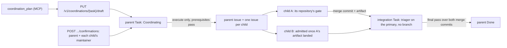

<!-- page-type: explanation -->
# Multi-repository coordination

One change across two public repositories, as one family: a **parent** Task (`spec.kind:
coordination`) holding a versioned plan, one ordinary **child** Task in each repository, and
read-only **integration** Tasks (`spec.kind: integration`). The parent never runs, branches, opens
a pull request, merges or reverts: each child lands through its own repository's gate. In this
release `execute` refuses every filing and admission (see [prerequisites](#execution-prerequisites)),
so a family can be drafted and confirmed but never started.

## The switch

`coordination: {mode, publicOnly: true, maxChildren: 2}` in the factory config, the same block the
broker reads for [`coordination_plan`](reference/api.md#coordination-on-mcp). `publicOnly: false` and any
other `maxChildren` are refused.

| `mode` | What exists |
|---|---|
| `off` (default) | No `coordination_plan` tool, no `/v1/coordinations/...` route (each is a 404), no parent Task, no `maku_factory_coordination_*` series. Every other Task is unchanged |
| `plan` | Drafts and confirmations: a parent Task `Coordinating` with a Room on the primary. No issue, child, integration Task or AgentRun |
| `execute` | Filing, child admission and resume, and integration admission, each behind the [execution prerequisites](#execution-prerequisites) and a fresh repository check |

## Execution prerequisites

Every execute-time filing, child admission or resume, and integration admission calls
`ExecutionPrerequisites.Ready(ctx, repository)` for each repository involved. It must prove
repository-declared class authority and hardened safe outputs with threat checks for
every child and integration input. Production wires `coordination.Prerequisites`: the
live config's class authority (`RepositoryAuthoritative`) and [hardening
readiness](hardening.md#hardening-ready), both asked afresh:

- A repository that is not both refuses with `coordination_prerequisites`: no issue is filed, and
  no child, integration Task or AgentRun is created; the parent keeps that reason and `plan` keeps
  working.
- Nothing is cached: a regression refuses the next admission.
- The merge-policy stage-1 observer (`mergepolicy.Watch`) and the release version are never
  evidence.

Tests inject a fake port to exercise the execute paths.

## Plans and confirmations

A plan is a full `maku.ogenki.io/v1alpha1` `CoordinationPlan` snapshot, bound to its canonical
SHA-256 (`status.coordination.planHash`). Execute needs exactly two children on two distinct
configured public repositories; `primary.repository` is one of them.

| Route | Who | Records |
|---|---|---|
| `PUT /v1/coordinations/{task}/draft` | a linked human with `write` on the primary | the next version, or a replay of the current one |
| `POST /v1/coordinations/{task}/confirmations` | the parent: a maintainer of the primary; a child: its named maintainer with current `write` | one confirmation of the current hash, or one child authorization at its fingerprint |
| `POST /v1/coordinations/{task}/recovery` | the authority the proposed action needs | the [one proposed recovery](#recovery-never-rollback) |

A title or rationale edit carries the parent's confirmation to the new hash; any other edit is
material: the parent confirms again, and so does each child whose fingerprint changed. An
unaffected child keeps its authorization and its running Task. An affected child's old generation
stops (`superseded`), and its replacement starts only once that Task is terminal, has no live run,
holds no ledger reservation and its usage settled.

## Exact artifacts and manifests

A dependent child consumes only `file` artifacts, read through the producer repository's own App at
the producer's landed merge commit. A pull request head, a newer default branch, prose, a green
child or a timestamp never satisfies a dependency.

| Record | Binds |
|---|---|
| Landed artifact (`status.coordination.artifacts`) | repository, path, 40-hex merge commit and blob SHAs, 64-hex SHA-256 of the bytes, size: at most the declared `maxBytes` and 64 KiB |
| Integration manifest (the claim's `MAKU_COORDINATION_MANIFEST`) | parent, plan version and hash, purpose (`beforeDependentMerge` or `final`), each subject's exact head SHA (before a dependent merge) or merge commit SHA (final), the confirmed acceptance, the landed artifacts; its canonical JSON's SHA-256 is the attempt's `manifestHash` |

An integration run is one `triager` claim on the primary, through the existing triager token
path, with no branch, no pull request and no landed references of
its own. Its only result is a typed `integration_result` naming its `manifestHash`. A dependent's
release is stale as soon as its head moves: no merger call happens until a new manifest passes for
the new head. The parent is `Done` only after a `final` pass over exactly every child's current
merge commit under the current plan.

## Budget layers

| Layer | Bound |
|---|---|
| Family | `planningMicroUSD + Σ child.budgetMicroUSD + integration.maxRuns × integration.runMicroUSD ≤ budget.totalMicroUSD`, in checked arithmetic (`budget_overflow`, `budget_exceeded`) |
| Planning | reserved plus settled planning cost within `planningMicroUSD` at confirmation (`planning_budget_exhausted`) |
| Child | its confirmed allocation is the child Task's `spec.budget.taskMicroUSD`, a bound and never a shadow (`allocation_exhausted`); a replacement generation holds only what earlier generations left |
| Integration | `maxRuns` attempts of `runMicroUSD` each (`integration_runs_exhausted`) |
| Day | every run still takes the ordinary person-plus-fleet reservation ([daily budgets](reference/budgets.md#daily-budgets)) |

## Reason codes

| Where | Codes |
|---|---|
| Parent `status.reason` | `awaiting_confirmation`, `confirmed` (plan mode), `filing_eligible`, `filing_incomplete` (issues visible, replay adopts them by marker), `filed`, `integration_passed` (Done), `foreign_room`, or a refusal below |
| A child: its parent entry (`status.coordination.children[].reason`) or its Task | `waiting_dependency`, `artifact_unverified`, `generation_pending`, `integration_pending`, `coordination_stopped`, or a refusal below |
| Integration Task | `integration_pending` (its run was lost: `Escalated`), `integration_passed`, `integration_failed`, `integration_result_missing`, `integration_stale` |
| Repository checks | `repository_not_allowed`, `private_repository_unsupported`, `app_unavailable`, `repository_not_owned`, `access_unverified`, `repository_permission`, `class_not_allowed`, `policy_changed` |
| Gate and service | `coordination_prerequisites`, `coordination_not_executing`, `coordination_off`, `coordination_parent_conflict`, `coordination_not_found`, `coordination_parent_terminal`, `planning_budget_exhausted`, `integration_manifest_invalid`, `recovery_not_proposed`, `plan_revision_required` |
| Plan | `invalid_plan`, `invalid_dependency`, `incomplete_plan`, `policy_unresolved`, `unknown_class`, `policy_mismatch`, `roles_mismatch`, `allocation_below_run`, `allocation_above_ceiling`, `allocation_below_spend`, `budget_overflow`, `budget_exceeded`, `stale_plan`, `plan_version`, `primary_requires_new_parent`, `invalid_confirmation`, `planning_cost_unverified` |
| Lineage (child or integration Task `Rejected`) | `cross_repository_lineage`, `coordination_lineage`, `coordination_parent_missing`, `coordination_scope_changed` |

## Recovery, never rollback

The parent holds at most one proposal (`status.coordination.recovery`), chosen deterministically
from persisted Task state, never by a model: `retry_child`, `resume_child`, `retry_producer`,
`retry_dependent`, `authorize_child`, `retry_integration`, `rerun_integration`, `revise_plan` or
`increase_budget`. The recovery route performs only that action, for the current plan version,
with the same repository authority and ledger checks as the ordinary path; `revise_plan` and
`increase_budget` are a new plan version and its confirmations (`plan_revision_required`).

There is no automatic cross-repository rollback, and the coordination service has no revert call.
A reverted child pauses only its transitive dependents; independent work continues. After the
parent is `Done`, a child revert is recorded as a post-completion incident (the newest four, on the
parent issue) and the parent stays `Done`. A parent's `factory/stop` pauses the family's future
scheduling and integration releases; it revokes no running child, whose own stop and the kill
switch keep theirs.

## Not in this release

- No new CRD, AgentRun role, gateway audience, STS trust policy, parent branch, parent pull request,
  parent run holding a repository token, or parent merge call.
- No private or mixed family, third repository, arbitrary DAG or fan-out, fleet campaign or
  cross-factory handoff.
- No parent roles rail, inbox, resume or notification rendering, filtered parent projection, Slack
  proposal, parent multi-worktree checkout or summary fold: the experience plan owns them. The
  internal `coordination.View` is unfiltered and served on no human route.
- Execute itself, until both prerequisites ship.

Metrics and the parent span: [operations](operations/factory.md#coordination).
