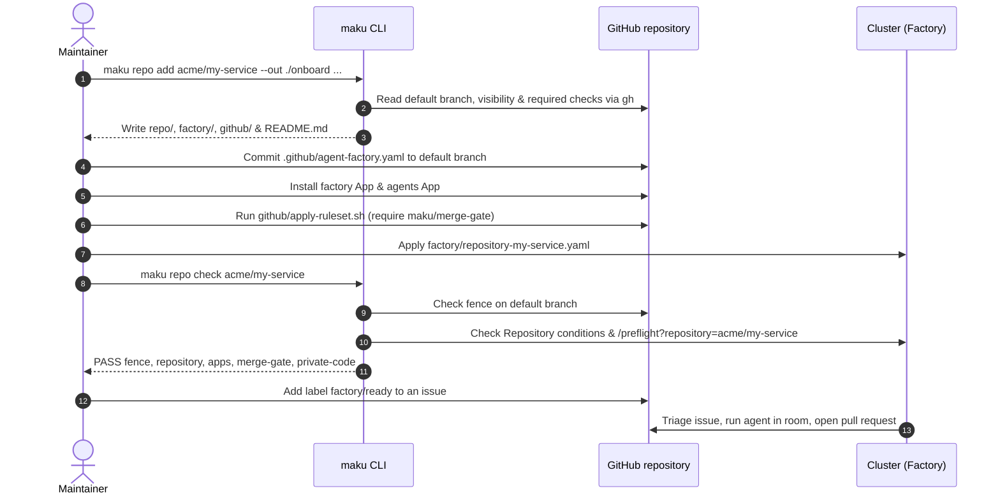

<!-- page-type: how-to -->

# Onboard a repository

Add a GitHub repository to a running Maku install, verify every seam with `maku repo check`, and run your first task on it. If you do not have a cluster install yet, start with [Install on your cluster](install.md) or try the local loop in [Quickstart](quickstart.md).



## Before you start

You need a running Maku install ([Install on your cluster](install.md)), `kubectl` pointed at the factory's cluster, and the GitHub CLI (`gh`) signed in with an account that can read the repository and administer its branch rulesets. The repository's default branch must already require at least one CI status check in a branch ruleset or classic branch protection: the merge gate refuses to auto-merge on a branch with no required check, and `maku repo add` reads those required checks from GitHub so you do not copy them by hand.

Run `maku repo add` with the repository's `owner/name`, an output directory, and the slugs of your install's two GitHub Apps:

```bash
maku repo add acme/my-service \
  --out ./onboard-my-service \
  --factory-app acme-factory \
  --agents-app acme-agents
```

If your Apps are private, add `--factory-app-id ID` with the factory App's ID from its settings page: GitHub answers a private App's public lookup with 404, so `repo add` then looks neither App up and builds the install URLs from the slugs.

`maku repo add` inspects the repository through `gh` (default branch, visibility, required status checks, and your GitHub login as the initial maintainer) and writes five files under `--out` without touching the cluster or opening a pull request:

- `repo/.github/agent-factory.yaml` — the ownership fence for the repository's default branch.
- `factory/repository-my-service.yaml` — the `Repository` custom resource for your GitOps repository.
- `github/ruleset-merge-gate.json` and `github/apply-ruleset.sh` — the default-branch ruleset requiring `maku/merge-gate` and the `gh api` script that creates or updates it.
- `README.md` — the exact commands and App installation URLs for this repository.

Pass `--maintainer LOGIN` (repeatable) to list additional maintainers, `--check NAME` (repeatable) if your account cannot read classic branch protection, `--leak-scan-check NAME` to pick which required check scans for leaked secrets (default: the first required check), and `--factory NAME` or `--namespace NS` if your `Factory` object is not `agent-factory` in namespace `maku`.

## The two Apps

Install both the factory App and the agents App on the repository using the two installation URLs `maku repo add` prints (and records in `README.md`):

```text
https://github.com/apps/acme-factory/installations/new
https://github.com/apps/acme-agents/installations/new
```

Select the target repository on each page and grant the requested permissions. The factory App reads issues, pull requests, rulesets and commit statuses, posts `maku/merge-gate`, and merges pull requests when the gate arms; the agents App is the identity from which per-run installation tokens are minted so agent pushes never share the merger's credentials ([GitHub Apps](github-apps.md)). Installing `policy-bot` is optional and only needed when you delegate approval-rule evaluation to an external status check ([policy-bot](github-apps.md#policy-bot-an-optional-fourth-app)).

## The fence file

Copy `repo/.github/agent-factory.yaml` into the repository and commit it to the default branch:

```yaml
factory: agent-factory
```

The fence file names the single `Factory` allowed to act on the repository ([The ownership fence](reference/config.md#the-ownership-fence)). Before taking intake, running schedules, admitting API runs, or merging a pull request, the factory reads `.github/agent-factory.yaml` from the default branch and verifies that `factory` matches its own name. If a second cluster or a stale staging install can see the same repository, the fence keeps it inert. Wait until the commit is on the default branch before running `maku repo check`.

## The Repository object

Commit `factory/repository-my-service.yaml` to the GitOps path that reconciles your factory namespace (or apply it with `kubectl apply -f` while testing). Because `maku install --print` writes shared merge settings (`mergerLogin`, `verifyFor`, `revertWindow`, `breaker`) once on the `Factory`'s `spec.mergeDefaults` ([Write the install](install.md#write-the-install-maku-install---print)), the generated `Repository` stays twelve lines:

```yaml
apiVersion: maku.ogenki.io/v1alpha1
kind: Repository
metadata: {name: my-service, namespace: maku}
spec:
  factoryRef: agent-factory
  repository: acme/my-service
  maintainers: [alice]
  triggerLabel: factory/ready
  merge:
    requiredChecks: [ci]
    verifyChecks: [ci]
    leakScanCheck: ci
```

If your `Factory` does not set `spec.mergeDefaults`, pass `--merge-defaults=false` to `maku repo add` so those four keys are written directly into `spec.merge` ([Factory resources](merge-policies.md#factory-resources)). Without explicit policy bindings, every catalog policy is evaluated in `shadow` mode on every agent pull request: the gate posts its decision record on the pull request without auto-merging.

If the repository is private or internal, `maku repo add` requires `--acknowledge-private-code` and writes `spec.privateCode.acknowledged: true` into the `Repository`. That field records the repository owner's agreement that repository contents are sent to the configured model providers ([Private code](install.md#private-code)). Without it, the factory refuses new tasks on private repositories.

For a web application or a documentation site, add `spec.screenshots` so the implementer and tester can check their changes in a headless browser, and humans see the screenshots in the room ([Browser verification](browser-verification.md)).

## The merge gate ruleset

Review `github/ruleset-merge-gate.json` and `github/apply-ruleset.sh`, then apply the ruleset with a GitHub token that has admin access to the repository:

```bash
bash ./onboard-my-service/github/apply-ruleset.sh
```

The script is idempotent: it creates (or updates) a default-branch ruleset named `maku-merge-gate` that requires the `maku/merge-gate` status check pinned to your factory App's `integration_id`, blocks force-pushes and branch deletion, and lists the factory App as a bypass actor so its merge call succeeds once the gate arms ([Branch protection for the merge gate](factory.md#branch-protection-for-the-merge-gate)).

## The first task

Once the `Repository` resource has reconciled and the factory has run a fence pass, verify all five onboarding seams with `maku repo check`:

```bash
maku repo check acme/my-service --namespace maku
```

`maku repo check` reads `.github/agent-factory.yaml` on the default branch via `gh`, checks the `Repository`'s `Accepted` and `BindingsValid` conditions in the cluster, and queries the factory pod's `/preflight?repository=acme/my-service` endpoint for the repository's `apps`, `merge-gate`, and `private-code` checks:

```text
PASS  fence          .github/agent-factory.yaml names agent-factory
PASS  repository     Accepted
PASS  apps           all served repositories have both App installations
PASS  merge-gate     maku/merge-gate is required on every served default branch
PASS  private-code   every served repository is public or acknowledged
```

If any line prints `FAIL` or `WARN`, `maku repo check` exits `1` and prints a `Fix:` line naming the file or command to run.

When all five checks pass, create the `factory/ready` label in `acme/my-service` (and, if you want to pin workflows from GitHub, `workflow:quick`, `workflow:standard`, and `workflow:careful`). Open a small issue and apply `factory/ready` from a maintainer account listed in `spec.maintainers` ([Triggers](factory.md#triggers)). Within one poll interval, the factory creates a `Task` and a `Room`, posts the room link on the issue, runs the agent in its sandbox, and opens a pull request with a shadow merge-gate decision record.
