<!-- page-type: operations -->
# Operating the factory

What the factory does, its labels, budgets, merge gate and kill switch, is in
[the factory](../factory.md). This section is what an operator watches. The factory serves its
metrics on `:9090` (the chart's `metrics` port), next to its probes.

```mermaid
flowchart LR
  in["Intake poll / POST /v1/tasks"] -->|"maku_factory_tasks"| tr["Triage & scoper"]
  tr -->|"maku_factory_scoper_runs_total"| run["Sandbox run + token mint"]
  run -->|"maku_factory_run_spend_usd"| out["Safe-output applier & PR"]
  out -->|"maku_factory_prs_opened_total"| gate["Merge gate & monitor"]
  gate -->|"maku_factory_merge_decisions_total"| led["Ledger settle & room close"]
  led -->|"maku_factory_charged_usd_total + webhooks"| done["Task settled"]
```




## Factory metrics

Defined in `internal/factory/fmetrics` (and `maku_factory_build_info` in `internal/metrics`). The
leader alone reports `maku_factory_tasks`, `maku_factory_kill_switch_engaged` and
`maku_factory_task_phase_seconds`, read from its cache at scrape time; a failed read leaves them
absent rather than 0.

The full series table is in [Factory metrics](../reference/metrics.md#factory-metrics).

## Outcome-overlap rollout and shadow evidence

[Outcome-overlap detection](../factory.md#outcome-overlap-detection) is configured in the factory
file, through the chart's `config` value, and is **off by default**. The file change rolls the
factory pods:

```yaml
intake:
  overlap:
    mode: shadow
    scoperEnforcement: false
```

| Stage | Configuration | What may refuse |
|---|---|---|
| Shadow (first) | `mode: shadow`; leave `scoperEnforcement: false` | Nothing. Retrieval, classification, candidate scoper runs, status and metrics are active |
| Limited enforcement | `mode: enforce`, `scoperEnforcement: false` | Exact-active matches only; scoper-active results remain advisory |
| Full enforcement (last) | `mode: enforce`, `scoperEnforcement: true` | Exact-active and valid scoper-confirmed active matches |

The selector is inert outside `enforce` and never controls exact-active refusal. Only
`active_duplicate` can refuse. `completed_duplicate`, `prior_attempt`, `partial_overlap`,
`unverified_overlap` and `no_match` always proceed. An exact refusal creates no AgentRun or run
reservation; a scoper refusal has already used its one evaluation run and reservation, whose spend
remains recorded, but starts no implementation run or reservation.

**Collect shadow evidence before each enforcement step.** Unit/envtest fixtures establish behavior,
not production precision. Use real shadow Tasks from every enabled intake path and retain the
reviewed sample, including the citations on which each decision was based:

1. Seed or select an exact active cross-source duplicate (issue/API/schedule), a reworded candidate,
   and examples whose expected outcomes are completed, prior, partial and no-match. Include an
   unavailable-source or inconclusive-scoper case in a controlled environment for unverified. The
   six expected classifications are `active_duplicate`, `completed_duplicate`, `prior_attempt`,
   `partial_overlap`, `unverified_overlap` and `no_match`.
2. Inspect the bounded Task records rather than goal text in telemetry. This lists the evidence
   fields without dumping issue or candidate payloads:

   ```bash
   kubectl get tasks -n agent-system -o json | jq -r '
     .items[] | select(.status.overlap != null) |
     [.metadata.name, .spec.repository, .spec.source.kind, .status.phase,
      (.status.reason // ""), (.status.overlap.classification // "pending"),
      ((.status.overlap.matches // []) | length),
      ((.status.overlap.sources // []) | join(",")),
      (.status.overlap.scoperRun // ""), (.status.overlap.note // "")] | @tsv'
   ```

3. Have a reviewer compare every shadow `active_duplicate` with its cited active Task/run/issue/PR
   and record true and false positives. Review false negatives against the same sample too. Check
   that `no_match` names only the sources actually checked, that `unverified_overlap` preserves its
   uncertainty, and that no match list exceeds 20. Metrics cannot provide this review: by design
   they have no repository, goal, candidate or citation labels.
4. Read `maku_factory_overlap_evaluations_total` by classification/source,
   `maku_factory_overlap_scoper_runs_total` by outcome and
   `maku_factory_overlap_evaluation_seconds` for initial retrieval latency. In shadow, an
   `overlap_active_duplicate` Task reason is a defect: shadow never refuses. Confirm that pending
   evaluations settle and that repeated reconciles do not increase evaluation or scoper counters.
5. Exercise refusal and replay separately in a test or staging environment: exact-active refusal
   must have zero AgentRuns/reservations; full scoper refusal must have only its evaluation run and
   recorded evaluation spend; a persisted result and a restarted/lost-write pending evaluation must
   not retrieve or create twice. A new generation from re-label/retry must produce fresh evidence.

Advance only after the reviewed evidence is accepted for that stage: exact-active precision/timing
for limited enforcement, plus scoper citation validity, classification quality and replay/recovery
for full enforcement. There is no default numeric precision threshold in the factory; record the
review's acceptance decision. **Do not claim production precision from fixtures or from an
unreviewed shadow sample.**

**Rollback and partial rollback.** Clear `scoperEnforcement` to return from full to limited
enforcement without disabling exact-active refusal. Set `mode: shadow` to stop all overlap refusals
while continuing to collect evidence, or `mode: off` to stop new retrieval and status evaluation.
Never delete Task history as part of rollback. Final records continue to replay, and an evaluation
already pending finishes or adopts its deterministic run even under `shadow` or `off`; its outcome
is advisory after rollback. Existing room recovery, tester contracts, independent reviews and
fresh-run revisions are unchanged.

## Coordination

[Multi-repository coordination](../multi-repository.md)'s eight series. With
`coordination.mode: off` none is recorded, so none is served; under `plan` only what drafts and
confirmations do: plan versions, dropped children, authorization waits and allocations. The Go instruments keep the `agent_factory_` prefix like every factory instrument; the
exporter serves them as below.


The eight series and trace attributes are in [Coordination metrics](../reference/metrics.md#coordination-metrics).

## Hardening, non-code outputs

[Stage H2](../hardening.md#hardening-non-code-outputs-enforced) for one repository. Each step lands
and is checked before the next. Steps 1 to 4 are inert, because nothing reads them until a run
carries the `safe-outputs` annotation, and only step 4 writes it. Listing the repository earlier
leaves the first enforced tasks waiting unanswered (no publisher token).

1. **The Maku release** runs on the cluster. With `enforceOutputs` empty it changes nothing.
2. **The tokens.** The runs get per-run tokens (`runTokens: {enabled: true, perRun: true}`, with
   `runController.gitSecret` left empty), and the factory's config sets `hardening.publisher.minter:
   true`: the factory mints the publisher's token from the agents App with the role table's
   publisher row. The agents App is installed on the repository and grants every permission of the
   [role table](../reference/config.md#run-tokens-the-role-table), the publisher's `pull_requests: write` and
   `issues: write` included; a missing grant fails the publisher's mint with
   `permission_not_granted` (`maku_factory_run_token_mints_total{role="publisher"}`).
3. **The gateway profile.** `output_pr`, `output_comment`, `output_labels` and `output_issue` are
   added to the implementer's and tester's role permissions.
4. **The list, last.** Add `repositories: {<repo>: {mode: audit, enforceOutputs: [pr, comment, labels, issue]}}`
   and restart. The factory refuses to start without `hardening.publisher.minter` and
   `runTokens.perRun`. The log says `the safe-output applier is on`, and no
   `runTokens.perRun: the role table leaves the implementer pull_requests: write` warning.
5. **Check the gauge** after the first fence pass: for that repository,
   `role="implementer", permission="pull_requests", access="read"` and
   `role="publisher", permission="pull_requests", access="write"`.

**Rollback:** remove the repository from `enforceOutputs`, and restart.

**Stop rules.** Roll back on any untraced write, or on a task stuck on its run's end. A
maintainer's edit of an applied pull request or comment body is not one: when every edit since
the answer is a person's, the tracer logs `human_edit`, uncounted, and still checks the text. A
run's own edit reads as the agents App's, never a person's. A retitle has no editor on record, so it stays
untraced: confirm who retitled the pull request before rolling back on a `pr` untraced write.
After an upgrade that changes the T2 sanitiser, pull requests and comments applied before it are
compared with the new T2's text and show as untraced once: confirm those predate the upgrade
before rolling back. Never take `runTokens.perRun` off while a repository is enforced (the factory
refuses to start). `push` stays open in this stage
until the repository enforces it ([below](#hardening-push-enforced)), and raw reads until H4.


The hardening metric series are in [Hardening metrics](../reference/metrics.md#hardening-metrics).

Readiness's `sandbox_write_token` check under `runTokens.perRun` reads the same table: it stays missing while the
implementer and tester hold `contents: write`, which goes with `push` at H3. The runbook that moved
an enforced repository off cloud-native-ref's XR and octo-sts went with both in v0.49.0
([upgrading](../upgrading.md#the-xr-run-kind-and-octo-sts)).

## Hardening, push enforced

[Stage H3](../hardening.md#hardening-push-enforced) for one repository that already enforces the
non-code outputs. Each step lands and is checked before the next.

1. **The Maku release** runs on the cluster: the factory image with `git`, and the harness image
   with the `git` shim. With no `push` in any `enforceOutputs` it changes nothing.
2. **The publisher gains `contents: write`.** The role table's publisher row grants it with
   `push` enforced; `workflows: write` only if the repository wants approved workflow pushes.
3. **The config.** The `maku-factory` chart's `hardening.gitCache.sizeLimit` (e.g. `2Gi`), and
   `hardening.applier.approvalTTL` if 24 h does not suit. Add `push` to the repository's
   `enforceOutputs`, and the repository to the broker's `roomTools.pushRepositories`. Restart
   both. Listing only one of the two serves no push: the broker serves `output_push` to a
   repository its own list names, and the factory applies pushes only for its `enforceOutputs`. The factory refuses to start without `MAKU_GIT_CACHE`. The Slack channel's
   `approvals: true` lets a maintainer decide on the card as well as on the room page.
4. **The role permissions.** `output_status` is added to the implementer's and tester's.
   `output_push` is harness-only and never in a model's role permissions.
5. **The sandbox tokens lose `contents: write`.** `runTokens.perRun` mints from the role table,
   which takes it away for a run whose `safe-outputs` names `push`.

**Rollback:** remove `push` from `enforceOutputs` and the repository from
`roomTools.pushRepositories`, and restart both. Runs created before the restart keep their
annotation: let them end.

**Stop rules.** Roll back on any `untraced_write` of type `push`, on a push stuck unanswered past
`answerWait`, or on a task held `push_awaiting_approval` with no approval on the room page.

**What a maintainer sees.** A push that touches a protected path posts an approval on the room
page and, with `approvals: true`, on the Slack card, with the short digest and the protected
paths. Deciding needs repository write. The decision applies to that digest only: a later push of
the run supersedes the approval.

**Residuals.**

- **Workflow pushes.** GitHub refuses a push that changes `.github/workflows/**` from a token
  without `workflows: write`. Unless the publisher's policy adds it, an approved workflow push is
  refused `output_unavailable`.
- **A lost push reply.** The factory records the push's head on the task
  (`agents.ogenki.io/push-intent`) before `git push`. If the reply is lost, the next inspection
  reads the branch at that head and answers `applied`. If the task cannot be written, nothing is
  pushed and the request waits for the next tick. Only the latest push of a task is recorded. A
  lost lease or a rejection clears the record, so only an ambiguous failure (a timeout) keeps it.
- **Old blobs are not sized.** The factory sizes every blob the bundle adds, from its header,
  without fetching anything. Blobs the remote already holds (the old side of a change, or a file
  reverted to earlier content) are read by the diff in one batched fetch: `core.bigFileThreshold`
  (1 MiB) makes a large one read as binary, and a binary change is refused.
- **Until step 5, the sandbox can still push.** The token is the boundary: the `git` shim is
  advisory, and the tracer reports a direct push as `untraced_write` but does not stop it.

## Hardening, reads filtered

[Stage H4](../hardening.md#hardening-reads-filtered) for a repository that already enforces all five
output types, on the run-controller.

1. **The Maku release** on the factory, the broker and the run-controller, one version for all
   three: a run-controller older than the factory ignores `forge-api: deny` and leaves the API
   open. With no repository at `mode: enforce` nothing changes.
2. **The broker's token.** The `maku` chart's `broker.hardening.forgeRead.audience: agent-factory`
   (it needs `broker.factoryURL`), and a NetworkPolicy from the broker to the factory API.
3. **The factory's principal.** `api.systemIssuer`, `api.systemJWKS`, and `api.systemPrincipals`
   mapping the broker's ServiceAccount to `system:broker`.
4. **The role permissions.** `forge_read` in every role's.
5. **The mode.** `hardening.repositories.<repo>.mode: enforce`, and restart the factory.

Check on the first run: its pod's CNP and egress annotation have no `api.github.com`,
`gh issue view` exits 3, and `status.inputTrust.mode` reads `enforce`. Probe the egress by IP
too: from the sandbox, `curl --resolve api.github.com:443:<a github.com IP> https://api.github.com`
(a request with `Host: api.github.com` to a `github.com` address) must fail, while `git fetch`
works.

**Rollback** is `mode: audit` and a restart: the next run is created without
`forge-api: deny`, and gets its API egress back. Runs already started keep theirs: let them end.

**Residuals.**

- **HTML on `github.com`.** `git` keeps `github.com`, which also serves the issue's HTML page. A
  run that fetches it reads the unfiltered text. The token and egress hold the API, not the web
  page.
- **An approved author's injection.** Text at or above `minAuthorTrust` is delivered, sanitised and
  levelled, but not checked for instructions.

## Merge policy bindings

A `Repository` that binds policies reports each binding in `status.classes[]` and the condition
`BindingsValid`: `True`, or `False` with a message naming every refused binding, as `refused:
dead-links (MissingParameter)`. One refused binding never refuses the `Repository`: its other
classes keep serving, and while the factory runs, the refused one keeps its last resolved class when
that class still holds under today's catalogue and guardrails. After a restart it serves none, and
a `class:` label naming it falls back to `review`.

```bash
kubectl get repository ai-native-ref -n agent-system -o jsonpath='{.status.classes}'
kubectl get mergepolicy dead-links -n agent-system   # CONSUMERS CURRENT LIVE ACCEPTED
```

Refusal reasons (`MissingRef`, `MissingParameter`, `ParameterTwice`, `OverPolicy`, `GuardrailMismatch`, `Unbounded`, `AmbiguousAdoption`, `Invalid`) and their fixes are in [Refused merge policy bindings](failures.md#refused-merge-policy-bindings).

A `MergePolicy` refused alone (`Accepted` `False`, `serving generation 3; generation 4 refused: …`)
keeps its last accepted generation serving every consumer. `maku config validate --base-ref
origin/main` prints the same per-consumer lines before the merge, and the
[settings pages](../reference/web-ui-settings.md#settings) show them after it.


## Spend per identity

Each run has one payer, the last ledger key the meter charges it to: the person in its
`charged-to` annotation, else its own principal. A labelled task's runs pay as the labeller (or the
maintainer whose `/factory retry` sent it back), a schedule's and RunLore's as `system:factory`, an
API run as its caller's `github:<login>`, or `human:<sub>` with no GitHub link. A task's payer is
the key its next run is charged to: `system:factory` with per-person caps off.

The series and label shapes are in [Spend and principal metrics](../reference/metrics.md#spend-and-principal-metrics).

## Sponsored principals

Off until `api.sponsored` is written. The series:
See [Spend and principal metrics](../reference/metrics.md#spend-and-principal-metrics) for the intake, cap and sponsor series.

**Declaring a principal**, in order:

1. In the host, create a ZITADEL machine user and its client-credentials client (the host's
   `zitadel-oidc-clients.sh`), whose tokens carry the project audience. The id and the project id go
   to the `agent-factory-sponsored` Secret (`<name>-client-id`, `project-id`), which the chart mounts
   optional, and to the broker's own mounts for `human.mcp.sponsored[].clientIDFile`.
2. The factory's config: `api.sponsored[]` with its `sponsor`, `repositories`, `dailyUSD`,
   `maxCostUSD`, plus `api.projectIDFile`. `meter.prices` must be set, or the load fails.
3. The broker's config: `human.mcp.sponsored[]` with the same `name`, and `factoryURL`. Restart it:
   it reads its config once at start.
4. The host's Rooms CRD must carry the widened member pattern (`system:` members) **before** a
   sponsored task runs: the factory adds the principal as a `watcher`, and the older CRD rejects it
   (the Task then escalates `rooms_crd_outdated`). The CRD reaches the cluster through
   ai-native-ref's vendored `infrastructure/base/room-broker/crd-rooms.yaml`, refreshed at each pin;
   it does not come from cloud-native-ref.
5. A name maps to the **same** client-id file in the broker's `human.mcp.sponsored[].clientIDFile`
   and the factory's `api.sponsored[].clientIDFile`. If they differ, one client reads another's
   rooms.

A sponsored principal's day is enforced whatever `budgets.enforcePrincipal` says: do not wait for a
shadow week. The intake's check is advisory; the run-time reservation and each run's ceiling/3 cap
are the limits. Removing a principal from the config un-holds its live runs from its day, and a task
that needs another run escalates `principal_unknown`. A refused later run escalates `budget-person`,
possibly with a pull request open. A maintainer's `/factory retry` is paid by the retrier.

A `run.` task that stays `failed` with `no such room` was never triaged (the grace is two minutes:
see [the API](../reference/api.md#sponsored-principals-on-mcp)); check `maku_factory_api_intake_total` and the Task.

### Internal principals and `factory/publish`

Off until `api.internalPrincipals` is written (same prerequisites as a sponsored principal:
`api.projectIDFile`, `meter.prices`, the client id file). `maku_factory_api_intake_total` counts its
requests under `principal="system:<name>"`. The `factory/publish` label must exist on each
repository the factory serves, as `factory/ready` does; the factory removes it once it has answered.
An issue the factory filed from a proposal carries a marker label and `class:<c>`; the maintainer applies `factory/ready`, unless `publishStarts` already started the fix.

**RunLore's verdict.** Off until an internal principal has `verification: true` and a class declares
`monitor.verification.within`; the route is a `404` before. The `runlore:` block (the old
`/intake/runlore`) is optional: leave it out and the intake and its port are not started. Watch
`maku_factory_monitor_verifications_total{verdict="none"}`: a verdict that never arrives.

**Starting the fix from the label.** `publishStarts: true` on an internal principal makes `factory/publish` also start the
fix, charged to the maintainer who labelled (see [`factory/publish`](../reference/sponsored-principals.md#internal-principals)). Only that start is off by default. The
factory labels every issue it files `class:<c>`, with or without `publishStarts`: the class inferred from the proposal's `## Files` (`review` when none fits; a live class is never inferred), so each
`class:<c>` label must exist on the repository, as `factory/ready` does. A `class:` label a maintainer applies takes precedence.

**Roll the broker first.** The broker decodes task facts strictly: the factory posts `origin` and `monitor` in
them, and an older broker refuses such facts. Upgrade the broker, then the factory.

**`room.monitor_verdict`.** A subscriber receives it only when its `events` list names it (see [webhooks](#webhooks)). Switch
RunLore and its subscriber off together. A delivery gives up after four failed tries (about 6 minutes) and the cursor moves on, so
never leave RunLore down past about 6 minutes with the subscriber on: a verdict lost that way reads as an unverified entry at the
end of RunLore's window. With both off together the cursor stays, and the room is replayed when they are back, closed rooms included.
Known limit: a class whose `followUpWindow` is over 24 h can lose its verdict at `roomCloseCap`; the exact case is in
[the post-merge monitor](../factory.md#the-post-merge-monitor).

### An adopted knowledge base repository

For a repository whose bot adds catalog entries (an [adopted class](../factory.md#adopted-classes) with
`diffShape: added-entry`), the repository carries, and each is a policy-bot gate path:

- the fence file `.github/agent-factory.yaml`, naming this factory ([the fence](../reference/config.md#the-ownership-fence));
- the policy-bot configuration;
- the validator's workflow, `.github/workflows/validate-kb.yml`, whose job `validate` is the class's
  holdout check. If a pull request could edit it, it could post `SUCCESS` itself.

The `ready-to-merge` label (the class's `requiredLabel`) must exist on the repository. The adopt poller
reads one page of 100 open pull requests: with 100 or more open it adopts nothing, and logs it, until
some close. A class starts in `shadow`; a handed-off entry whose label was removed is not revived by
labelling it again ([known limit](../factory.md#adopted-classes)).


## Webhooks

The broker's `webhooks` list declares the subscribers of [room events](../reference/api.md#webhooks) (including every subscriber key). The broker's egress for the internet subscribers is generated from this list in ai-native-ref.

**Before enabling.**

- The host mounts `secretFile`: one or two base64 keys of at least 32 bytes, one per line. A mount
  with `subPath` is never refreshed, so use a directory mount. More than two lines, or a bad line, is
  `no_key`: the room is held until the file is fixed.
- The host sets `webhooks:` in the broker config. Without it there is no emitter.
- A `generation` change, or any other change to `webhooks`, takes effect only at a broker restart.
- A cluster subscriber needs an egress allow on the broker and its own ingress allow, as an internet
  one needs its egress.
- `repositories` is matched case-insensitively and is not format-validated: a typo silently sends
  nothing.
- Each event costs one cursor write per subscriber.
- Only the leader emits.

**Rolling back.** Once webhooks have run, an older retention image cannot delete the rooms that have
cursors: the foreign key blocks it. Keep the retention image at or after the migration.

**Rotating the key.** Deliveries are signed with every key in the file, so a subscriber that accepts
either never sees a gap: (1) add the new key as a second line and let the file reach the pod; (2)
configure the subscriber to accept the new key; (3) remove the old line from the file; (4) drop the old
key from the subscriber.

**Disabled subscribers.** Three deliveries in a row given up (one try and three retries each) disable a
subscriber. To re-enable it, fix the cause and bump its `generation` in the config: a reviewed change.

Mind what a disabled subscriber misses. Its cursor keeps advancing while it is disabled, so
re-enabling it resumes at the events of that moment, and the events sent during the outage are not
replayed. A subscriber that needs that history fetches the room through the MCP server or the human API.

Other things to know:

- A re-added subscriber (removed from the config, then declared again) keeps its old cursors and
  replays from them; the rooms created while it was gone start at 0.
- A room whose `Room` is not in the broker's cache yet holds its events until it is.
- Catch-up after a listener drop may not finish while at least 1,000 rooms stay held.
- A run ended by its budget followed by a budget escalation can send two `room.budget_reached`. A
  budget reason added on a rewrite of the same phase is not re-sent.
- `unresolved` counts every sealed room that has no repository, whichever subscriber it is for; its events are not delivered.
- The cursors are purged with their room.
- A room with no repository yet is read again only when its log grows or the listener reconnects.


Delivery and disabled-subscriber series (`maku_rooms_webhook_deliveries_total`, `maku_rooms_webhook_disabled`) are in [Webhook metrics](../reference/metrics.md#webhook-metrics), and `RoomWebhookDisabled` is in [Room alerts](failures.md#room-alerts).

## Intents in shadow

Stage 1 of [natural-language intents](../slack.md#understanding-a-reply): the classifier runs on one channel, the thread keeps today's unknown line, and a person labels what it saw before anything acts on a label. The switch is off everywhere until each step below is done.

1. **Host.** The gateway's `classifier` client and its key (alias `tier-light`), mounted where `human.slackIntents.apiKeyFile` names it. Set `human.slackIntents` on the broker ([integration](../integration.md#the-brokers-configuration)), with `principal` the Slack App's sponsored name and `teamID` its workspace. Check that the broker lists `intent_classify` for the App and for nobody else.
2. **Turn on.** In the App's config, one channel: `intents: shadow`, and `collectReplies: true` only with that channel's agreement.
3. **Measure.** Over a few days of real replies: `maku_slack_intents_total{tier="1"}` by `intent` and `outcome`, `maku_intent_classify_total{outcome}` (`ok`, `low_confidence`, `invalid_output`, `timeout`, `capped`, `error`) and `maku_intent_classify_duration_seconds`. A rising `capped` is `dailyCalls` or `perUserPerHour` too low for the channel; a rising `invalid_output` is a model or gateway change.
4. **Export and label.** `kubectl exec -n agent-system deploy/room-broker -- maku-broker intent-samples --days 7 > samples.jsonl`: one JSON object per reply with its `intent`, `confidence` and `channel`, and nothing else on stdout. Write the correct label beside each. Samples are stored redacted and deleted after `retentionDays`, so export before then.
5. **Compute.** Write-intent precision is, of the replies labelled `steer`, `amend`, `stop` or `retry`, the share whose correct label is the same. Stage 2 waits for 95 % or more. `task intent:eval` runs the committed synthetic set against a live model (`INTENT_EVAL_URL`, `INTENT_EVAL_KEY_FILE`) and fails under the same bar, which is how a model or prompt change is checked before it reaches a channel.
6. **Tune.** `minConfidence` (0.7), `confirmTTL` (10 minutes) and `maxInputChars` (2,000) are config, not code: set them from the unknown share and, once confirms exist, the cancelled-plus-expired share.
7. **Turn off.** `intents: off` on the channel stops tier 1 on the next config load, and unsetting `human.slackIntents` removes the tool. Stored samples stay until their retention.

**Pre-flight after a move.** Any Slack session after the App moved (a cloud move, a new domain) starts by pressing one proposal's Confirm: `maku_slack_app_requests_total{route="interactions"}` must rise. The Interactivity request URL is a [setting of its own](../slack.md#manifest); stale, a press gets Slack's `could not handle this payload` while events still arrive.

## Finished rooms close

A finished task's room closes once its outbox, settle, facts and revert window are done, and while
no person drives it. The last two waits are capped a day after the task ended: past that the room
closes anyway, a person still driving it included, and `maku_factory_rooms_closed_at_cap_total`
counts it.

