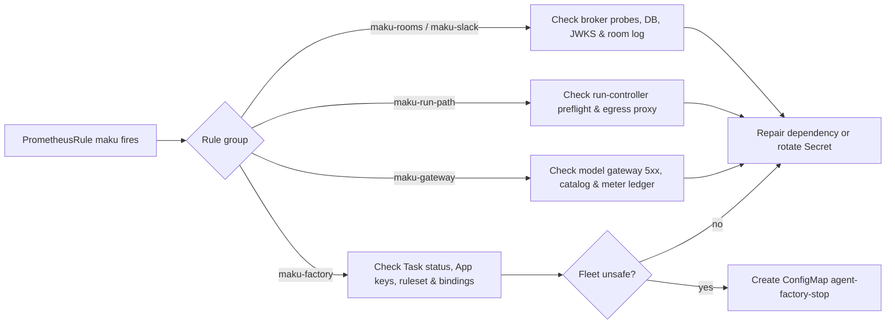

<!-- page-type: operations -->
# Failures, alerts and the kill switch

Start from the symptom or the firing alert below to jump to the matching check, failure table or stop procedure.

| Symptom | Alert | Section |
|---|---|---|
| Broker unreachable, append errors, stalled room, stale JWKS or unposted verdicts | `RoomBrokerDown`, `RoomLogAppendErrors`, `RoomStalled`, `RoomAuthnJWKSStale`, `RoomVerdictsNotReachingGitHub` | [Room alerts](#room-alerts), [Common failures](#common-failures) |
| Runs stay `Pending` (`PreflightPending`) or fail `PreflightFailed`, run-controller or egress proxy down | `RunControllerPreflightFailing`, `RunControllerDown`, `EgressProxyDown`, `AgentSandboxPodPending` | [The run controller's preflight](#the-run-controllers-preflight), [Run path alerts](#run-path-alerts) |
| Intake stops, GitHub unreachable, missing merger or intake Secret, refused `BindingsValid` | `AgentFactoryIntakeErrors`, `FactoryGitHubUnreachable`, `AgentFactoryRepositoryNotOwned` | [Factory alerts](#factory-alerts), [Factory failures](#factory-failures) |
| Merged PR reverted, regression detected, agent bypassed gate, ruleset missing `maku/merge-gate` | `AgentFactoryAutoMergeReverted`, `AgentFactoryMergeRegression`, `FactoryAgentMerged`, `FactoryMergeGateNotRequired` | [Factory alerts](#factory-alerts), [Escalated tasks and the kill switch](#escalated-tasks-and-the-kill-switch) |
| Daily cap high, meter blind, unpriced model, ledger/gateway cost mismatch | `AgentFactoryDailyBudgetHigh`, `AgentFactoryMeterBlind`, `AgentModelUnpriced`, `AgentCostCrossCheckMismatch` | [Budget signals](#budget-signals), [Gateway alerts](#gateway-alerts) |
| Burst of Slack `forge.push` decisions or failing card updates | `SlackDecisionsSpike`, `SlackCardUpdatesFailing` | [Slack alerts](#slack-alerts) |



## Alerts

The umbrella chart renders them as one `PrometheusRule`, `maku`, with `monitoring.prometheusRule.enabled`
([observability](../observability.md)). It holds one group per component, each rendered only with its
component: `maku-rooms` (below), [`maku-factory`](#factory-alerts), [`maku-run-path`](#run-path-alerts),
[`maku-slack`](#slack-alerts) and [`maku-gateway`](#gateway-alerts). The VictoriaMetrics operator converts it to a `VMRule`. Every rule is
PromQL, evaluated by promtool in `charts/agent-factory/tests/monitoring.sh`, and carries two
annotations: `runbook_url`, this page's section for its group, and `dashboard`, the Grafana path
`/d/<uid>`.

| Value | Default | What it does |
|---|---|---|
| `monitoring.prometheusRule.enabled` | `false` | Renders the rule |
| `monitoring.prometheusRule.labels` | `{}` | Added to the rule, for a Prometheus whose `ruleSelector` wants them |
| `monitoring.prometheusRule.disabled` | `[]` | Alert names left out, for an install that keeps its own variant. A name no group holds fails the render |
| `monitoring.prometheusRule.kubeStateMetrics` | `false` | Renders the rules on kube-state-metrics: `AgentSandboxPodPending`, the [Repository conditions](../observability.md#repository-conditions) |
| `monitoring.prometheusRule.docsURL` | the release's `docs/` on GitHub | The base of each `runbook_url` |

### Room alerts

Group `maku-rooms`, with `maku.enabled`. The `up` selectors read the job the chart's `ServiceMonitor`
sets, `room-broker`, in the release namespace.


Every alert in `maku-rooms` and its first step are listed in [Room alerts](../reference/alerts.md#room-alerts).

Bridge logs:

```bash
kubectl logs -n agents -l agents.ogenki.io/run-id=<runId> -c room-bridge
```


### Factory alerts

Group `maku-factory` of the chart's [`PrometheusRule`](#alerts), with `maku-factory.enabled`.


Every alert in `maku-factory` and its first step are listed in [Factory alerts](../reference/alerts.md#factory-alerts). No series, no alert: on a release without a gauge the expression is empty, so a rule is safe to ship ahead of it.

### Run path alerts

Group `maku-run-path`, with `maku.runController.enabled`. The `up` selectors read the jobs the chart's
`PodMonitor`s set, `run-controller` and `egress-proxy`.


Every alert in `maku-run-path` and its first step are listed in [Run path alerts](../reference/alerts.md#run-path-alerts).

### Slack alerts

Group `maku-slack`, with `slack.enabled`. Both are aggregates: their counters carry no user, room or
approval label.


Every alert in `maku-slack` and its first step are listed in [Slack alerts](../reference/alerts.md#slack-alerts).

### Gateway alerts

Group `maku-gateway`, with `maku-gateway.enabled`. Every rule reads agentgateway's own names, as the
meter does ([metering the runs](../gateway.md#metering-the-runs)), on the job the chart's `PodMonitor`
sets (`maku-gateway.name`) in the release namespace. `AgentGatewayCostUnpriced` and the cost
cross-check need a priced catalog (`maku-gateway.modelCatalog.prices`, or the factory's
`meter.prices` through the umbrella); the cross-check also reads the factory's
`maku_factory_run_settled_usd`, so its record `agent_cost:gateway_run_usd` and its alert render only
with `maku-factory.enabled` and its `meter.url`.

The record takes a run's cost as each gateway series' highest value in 6 h, summed over the proxies
that served it: a run's series is born at its first priced call, so `increase()` would drop that
call's cost, and a run that ends before the first scrape entirely. A proxy container that restarts
mid-run resets its series: the record then reads the pre-restart total until the spend after the
restart passes it, which can raise a mismatch the ledger is right about. A replaced pod is a new
series and is summed.


Every alert in `maku-gateway` and its first step are listed in [Gateway alerts](../reference/alerts.md#gateway-alerts).

## Common failures

| Symptom | Cause | Fix |
|---|---|---|
| Broker `CrashLoopBackOff` right after a config change | The config file failed strict parsing (unknown key, a `subPattern` without one capture group) | Read the first log line, fix `room-broker-config` |
| Broker never passes `/startupz` | The Atlas migration has not run: CNPG has not created the login roles yet, or `atlasSchema.ref` names a branch that is gone | `kubectl get atlasmigration -n agent-system`; the operator retries once the roles exist. Point `ref` at the broker image's release tag |
| Bridge `hello` gets `503 no_room` | The `Room` has not been reconciled, so its row does not exist | `kubectl get room -n agent-system <id>`; the bridge retries |
| Bridge gets `503 log_unavailable` | The database is down or refused the call | `kubectl get cluster -n agent-system xplane-rooms-cnpg-cluster` |
| Bridge gets `401 unauthenticated` | Wrong audience, an issuer not in `runIssuers`, or the broker cannot fetch the JWKS | Check the run's `room-token` audience (`room-broker`), the issuer, and the broker's egress to the JWKS host |
| Bridge gets `403 run_not_live` | The run is terminal, revoked or deleted, or the watch has not seen it yet | Expected at the end of a run; otherwise check `kubectl get agentrun -n agents` |
| Bridge gets `409 room_busy`; the log has `limit{concurrent_run}` | A second run joined a room whose first run is still live | Nothing to do: its harness waits behind `room-bridge gate`. If the room is still busy after 3 minutes, the pod fails before the harness runs and the run ends `room_busy`. The holder frees the room once its run ends |
| A room run's pod is `Init:Error`; `room-bridge gate` logs `the room refused this run` | The room stayed busy for 3 minutes, or is sealed | Expected. Start the run again once the holder has ended |
| Bridge gets `410 sealed` | The room is closed or full | Start a new room; a full room means a run far beyond normal size |
| A room run's pod waits in `ContainerCreating` | The `room-broker-ca` Secret is not in `agents`: the bridge mounts it, and the mount is not optional | `kubectl describe pod -n agents <pod>` names the missing Secret; `kubectl get externalsecret -n agents room-broker-ca` |
| Bridge refuses to start: URL not `https://`, or no CA in the file | The composition is older than the bridge's TLS requirement | Pin a composition package that mounts `room-broker-ca` and sets `BROKER_CA_FILE` |
| Bridge logs `x509: certificate signed by unknown authority` | The CA it trusts is not the one that signed the broker's certificate | Compare `room-broker-ca` with the `openbao` issuer's CA |
| JWKS or identity-provider calls time out on one cluster only | A port-scoped egress rule to the cluster's own gateway is dropped by the socket-LB hairpin | Keep the `toEntities: [all]` rule without ports |
| A run ends `agent_error`; the harness log has `agent-run error: LLMServiceUnavailableError` | The model path failed three times in about 30 s: a provider or gateway outage, not one blip | The harness's `agent-run model retry` lines show the attempts. Retry policy: [harness README](../../images/maku-harness/README.md#model-errors). A `429` is never retried: check the run's budget first |
| A run ends `model_unavailable_billing` (or `_auth`, `_quota`); the room has a `harness_error` with `Insufficient balance` | The model provider refused the run: an empty wallet, a rejected key or a spent quota. The task is held in `Queued` and retried with a backoff, and escalates after six refusals in a row | Recharge the provider account or rotate the key, then the held task runs by itself, or `/factory retry` an escalated one |
| A run ends `pod_lost` | The pod died before the harness finished and before its deadline | Expected for evictions; `deadline` means it hit `maxMinutes` |
| Duplicate harness events after a bridge restart | The harness skipped an unreadable event file | A known limit, confined to that run; nothing to repair |
| `RoomStalled` | The run is silent: a stuck harness, or a bridge that lost the broker | Bridge logs; the harness's step log in VictoriaLogs |
| Broker, `migrate` or the retention job exits at start with `Maku needs 16 or later`, `connected as`, `bypasses row-level security` or `create the login roles` | The database is not one the log may run on: a server below 16, a DSN Secret holding another role's credentials, or a role with `SUPERUSER`, `BYPASSRLS` or membership in `rooms_owner` | Fix the server or the role as [the database](../database.md#three-roles-one-dsn-secret-each) says; nothing was written |
| Broker exits at start with `the schema is at <v>, this broker needs <w>` | The schema is behind the broker's image, and nothing migrated it | Set `broker.database.ownerSecret` so the `migrate` init container runs, or let the Atlas operator apply the image's release first |
| Broker exits at start with `rooms_broker cannot read the migration ledger` | The broker's role cannot read the ledger: an Atlas operator's, never adopted, or a revoked grant | Set `broker.database.ownerSecret`: `migrate` adopts the ledger and grants the read ([a ledger the broker cannot read](../database.md#a-ledger-the-broker-cannot-read)) |
| `migrate` refuses the Atlas operator's ledger (`nothing was adopted`) | The operator's revisions are not exactly the first shipped files, complete and with their hashes, or `rooms_owner` cannot read `atlas_schema_revisions` | Let the operator finish or repair its revision, or grant `rooms_owner` `USAGE` and `SELECT` on that schema; then restart the pod |
| A migration that builds an index `CONCURRENTLY` failed (`20260929120000_verdicts`, `20261001130000_delivery_indexes`, `20261001140000_brief_index`, `20261005130000_approval_indexes`, `20261008120000_task_facts_index`), or `\d events` in `psql` shows the index `INVALID` | `CREATE INDEX CONCURRENTLY` runs outside a transaction: a failure leaves an `INVALID` index behind, and the re-run refuses with "already exists" | Drop it by hand before the migration is retried: as `rooms_owner`, `DROP INDEX CONCURRENTLY <index>;` (`events_agent_verdicts`, `events_deliveries`, `events_acks`, `events_brief`, `approvals_pending`, `events_decisions`, `events_decision_acks`, `events_tool_results` or `events_task_facts`), then let the Atlas operator re-run it |
| A run of the `maku.ogenki.io` kind waits Pending, condition `Ready` reason `PreflightPending` | The run controller's [preflight](#the-run-controllers-preflight) has no result yet, or a check holds runs (a git Secret not yet filled, the egress proxy still starting) | The condition's message names the check. It clears by itself once the check passes |
| A run ends Failed, condition `Invalid` reason `PreflightFailed` | A preflight check refuses runs: the RuntimeClass is missing, or the CNI does not enforce NetworkPolicy | The message names the check and its fix. Runs that already have a pod are untouched; start the refused run again once `maku_run_controller_preflight_passed` is 1 |
| A run waits Pending, reason `SandboxPending`, or ends Failed, reason `SandboxUnavailable` | No sandbox node started the preflight's probe pod in time: the pool scaling from zero, a node starting, or a pool that cannot grow | It clears when the pool comes up. After 10 minutes the run ends, no pod created; the factory runs it again once. The probe pod's events say why: `NotTriggerScaleUp` names why no node comes |
| A run waits Pending, reason `QuotaExceeded` | The runs namespace's ResourceQuota `runs` is full: a safety net behind the factory's slots | Nothing to do: it is retried every 30 s. Raise `runsQuota.hard` if the factory's slots are larger than the quota |
| Verdicts stay in the room, `maku_rooms_verdict_posts_total{result="error"}` rises | GitHub is failing or refusing the App's key: each verdict backs off from 15 s to 15 min, and a tick stops after two failures in a row | The broker's `verdict not posted yet` logs; the key at `agents/factory-app`. A verdict older than 24 h is recorded as `verdict_not_posted{reason: expired}` |

## The run controller's preflight

The run controller of the `maku` chart proves the cluster can hold a run before it starts one, at
start and every 10 minutes. A check that cannot decide (the apiserver unreachable) keeps the last
result; one that may cure itself right after install is retried from 10 s, doubling.

| Check | Passes when | When it does not |
|---|---|---|
| `runtimeClass` | The sandbox RuntimeClass exists (skipped under `sandbox.unsafeAllowRunc`) | Failed: new runs are refused, `RuntimeClass "<name>" not found` |
| `gitSecrets` | a laptop's PAT, `gitSecret`, when set (demo only), exists with a `token` key | Waiting: new runs stay Pending with the message |
| `network` (`networkPolicies.mode kubernetes`) | A probe pod, `<namePrefix>preflight-<8 characters>` in the runs namespace, held by a run's own NetworkPolicy under the sandbox class, reaches the broker's 8443 and CONNECTs `github.com:443` through the egress proxy, and three denied targets each time out or are refused twice, 3 s apart: the broker's 9090, the apiserver (`kubernetes.default.svc:443`) and `github.com:443` dialled directly. The last two only the run's egress rules deny, so a CNI that enforces ingress alone fails | A denied target answered: Failed, `deny <host:port> connected: the CNI does not enforce NetworkPolicy`, checked again in 10 minutes. A positive control failed (the proxy or the broker still starting): Waiting, retried soon. The probe pod did not start: Failed, `the probe pod did not start under RuntimeClass "<name>" within <bound>: <its last event>`, retried soon. The bound is 10 minutes while the autoscaler has triggered a scale-up for it or a node is starting it, else 2 minutes (a later `NotTriggerScaleUp`, a `FailedCreatePodSandBox`) |

- **Before the first result** new runs wait Pending, `PreflightPending`, retried every 10 s.
- **A refusal** ends a new run Failed, condition `Invalid`, reason `PreflightFailed`, with the
  check's message. A run that already has a pod is never refused.
- **A probe pod that did not start** holds new runs Pending, `SandboxPending`, for 10 minutes
  from their creation, then ends them `SandboxUnavailable`; `/preflight` says `run_path_sandbox`.
  The probe and a run pod both take the RuntimeClass's scheduling (GKE Sandbox's toleration and
  selector) and nothing else, so a probe that schedules proves a run will. A new node's startup
  taints are tolerated by neither: they clear, and the probe waits.
- **The gauge** `maku_run_controller_preflight_passed{check}` is 1 while a check passes and 0 while
  it refuses; the run controller logs `preflight passed` and `preflight failed: <check>: <message>`
  once per change.
- **The probe pod** is deleted after each verdict, and leftovers from an earlier process before the
  next. The egress proxy logs its CONNECT as `allow run=preflight github.com:443`.
- **The egress proxy's metrics** on its `:9090`: `maku_egress_proxy_connections_total{decision}`
  (`allow`, `refuse`, `error`) and `maku_egress_proxy_bytes_total`.


## Factory failures

| Symptom | Cause | Fix |
|---|---|---|
| `maku_factory_github_up` is 0; factory loops log GitHub errors and no task advances, while the replicas stay `Ready` | GitHub is down, or the App key is refused. Readiness ignores GitHub on purpose: unready replicas would serve nothing more, and the PDB's `unhealthyPodEvictionPolicy: AlwaysAllow` (Kubernetes 1.27+) never blocks a drain either way. The gauge is 1 while any GitHub call succeeded in the last 3 minutes, on each replica, and `FactoryGitHubUnreachable` (`maku_factory_github_up == 0` for 10m) pages on it | Check GitHub's status and the App key (`agent-factory-github`); the loops recover by themselves when GitHub returns |
| Factory `CrashLoopBackOff`; the log says `merger App key ... is missing` | The Secrets are hard prerequisites whenever any merge class is `live` or `shadow` (deciding it reads checks through the merger): the optional mount lets the pod start, and the binary then refuses, so a missing key is a crash loop with a clear log line, no longer `ContainerCreating` | Create the `agent-factory-merger` Secret (keys `app_id`, `private_key`), or turn every class off: with none live or in shadow the key is optional and the merger fails closed. A task at the merge gate then waits for a maintainer (`merge_gate_off`) |
| `maku_factory_intake_errors_total{source="dead-links"}` rises and no dead-links task starts | The detector's `findings.json` was malformed, out of shape (a path or URL the task may not hold, an archive that is no snapshot of its URL), or over 1 MiB and up to 4 MiB: the run pair is refused once, logged and counted. An artifact over 4 MiB is a plain read error instead: retried every minute and not counted | Fix the detector workflow; the next run pair is weighed. A run pair is weighed once, so a maintainer's re-run of a run (a new attempt) also forces a new look |
| The factory logs `has no artifact "findings"` every minute for the dead-links schedule | The detector run uploaded no `findings` artifact, or it expired, or the merger App lacks `actions: read` or egress to `productionresultssa*.blob.core.windows.net` | The workflow must upload `findings.json` on every run, `[]` when clean; grant the merger App `actions: read`; allow the egress host |
| Factory `POST /intake/runlore` answers `503 intake_unconfigured`; `maku_factory_intake_errors_total{source="runlore"}` rises and the log warns once a minute | The `agent-factory-intake` Secret is absent or empty (the mount is optional): the intake refuses everything instead of running open. It is a hard prerequisite whenever RunLore is meant to feed the factory | Create the Secret (key `token`); the token is re-read per request, no restart |


### Refused merge policy bindings

When a `Repository` reports `BindingsValid: False` ([Merge policy bindings](factory.md#merge-policy-bindings)), each refused binding carries one of these reasons:

| Reason | Means | Fix |
|---|---|---|
| `MissingRef` | No served `MergePolicy` has the binding's name, or the policy was refused with no generation served before | Apply the policy, or fix the refused one (`kubectl describe mergepolicy`) |
| `MissingParameter` | The policy `requires` a parameter the binding does not set, or `monitor.flux` without `spec.merge.fluxSource` | Set it on the binding, or `fluxSource` on the `Repository` |
| `ParameterTwice` | A fill-once parameter (`companionFiles`, `requiredLabel`, `oracleWorkflow`) is set by the policy and the binding | Remove one |
| `OverPolicy` | A cap above the policy's | Lower it, or raise the policy's |
| `GuardrailMismatch` | A cap above `mergeGuardrails` | Lower it |
| `Unbounded` | Bound `live` or `shadow`, the resolved class has neither `allowedFiles` nor a `diffShape` | Set `allowedFiles` on the policy or the binding, or a `diffShape` on the policy |
| `AmbiguousAdoption` | Two adopted bindings of one shape share a login and an overlapping branch prefix: the later in the list is refused, and keeps no last class | Narrow one, or unbind it |
| `Invalid` | The resolved class fails the class rules (`semver-minor` bound `live`, `testFirst` without `merge.contractCheck`, a workflow below its floor) | The message names the rule |


## Budget signals

The budget model, prices and caps are in [the factory's budgets](../factory.md#budgets).

| Signal | Meaning |
|---|---|
| A tier sets `runUSD` or `taskUSD` and its model has no price | The rollout fails. An unpriced run would cost $0, and $0 never reaches a cap |
| `maku_factory_run_budget_fallbacks_total{scope="run", why="unpriced"}` | A model that served the run has no price (or, without `gen_ai_request_model` in `meter.query`, its claim's model has none). The run is capped at `runTokens`. The log says `run capped in tokens` |
| `maku_factory_meter_unpriced_model_runs_total{model}` | Runs served by `model`, which has no `meter.prices` row: a backend pins a model the price table lacks. Counted once per run and model, whatever the tier caps in. Alert on any increase |
| `maku_factory_meter_input_excludes_cache_runs_total{model}` | Runs whose `input` for `model` was below its cache tokens: the gateway served them on a path that leaves the cache out of `input`, and the meter priced all of `input` as fresh. Every path the platform runs today counts the cache inside `input`, streamed calls included, so any increase means a gateway, a provider or the harness changed |
| `maku_factory_run_budget_fallbacks_total{scope="run", why="untyped"}` | `meter.query` has no `gen_ai_token_type` grouping, so no run can be priced and every run is capped at `runTokens` |
| `maku_factory_run_budget_fallbacks_total{scope="task", why}` | A task with a USD cap holds a run the meter could not price, so the task is held to `taskTokens`. Counted once per task. The log says `task capped in tokens` |
| `maku_factory_run_revocations_total{reason, limit}` | The limit that fired: `run-usd`, `run-tokens`, `task-usd`, `task-tokens`, `gateway-ceiling`, `fleet` or `principal-day`. The `revoked` annotation keeps the reason (`budget-run`, …), because the composition maps each value to a phase |
| `maku_factory_run_cost_usd{tier, role, cohort, profile}` | A priced run's cost, reported two minutes after the meter first sees it ended, or when its claim is deleted first. `role` is the claim's role, `scoper` when a factory triager run's brief opens with the scoper marker, and `other` outside that vocabulary; `cohort` and `profile` are the claim's `agents.ogenki.io/cohort` and `agents.ogenki.io/profile` annotations, the task's when the run started, `none` without; a `profile` not in the configured `workflows` (a value written by hand, a workflow since removed) reads `other`. Cost by role: `sum by (role) (increase(maku_factory_run_cost_usd_sum[7d]))`. `maku_factory_run_budget_usd{tier}` is the run cap |
| `maku_factory_run_spend_usd{run, model}` | A priced run's spend so far, by the model that served it, from its first reading until its cost is reported. Only runs not yet reported carry the series, so its cardinality is the live runs times their models. One run's final price: `max_over_time(maku_factory_run_spend_usd{run="<id>"}[1d])` |
| `maku_factory_run_settled_usd{run}` | The run's total in the day ledgers: the sum of its `settled.<runId>` entries over the days, taken from the ledger objects the meter read (a new run, a failover, a write in doubt) and from each settle write's returned object, never from the meter's own account. It is what the gateway's cost for the run is checked against, and it shows a double charge the meter's memory and `maku_factory_charged_usd_total` hide. Kept an hour after the run ends, then deleted. Only the leader exports it; run ids outside `[a-z2-7]{8}` are left out |
| `maku_factory_model_cost_usd_total{model}` | Spend by served model, added when each run's cost is reported, plus any spend a run's readings show after that while its claim exists: `increase(...[1d])` is a day's bill per model |
| `maku_factory_run_revocations_total{reason="budget-principal-shadow", principal}` | A run admitted past a day's cap while `enforcePrincipal` is off; `principal` is the key over: `system:factory`, or a person with per-person caps on. Zero false refusals for a week is the bar for enforcing |
| `maku_factory_run_revocations_total{reason="budget-person"}` | A task escalated at Queued because its person's day is spent |
| `maku_factory_budget_spent_usd{principal="github:<login>"}` | A person's spend today, once per-person caps are on; `maku_factory_budget_cap_usd` is their day |

A run's last calls reach the meter a scrape interval plus VictoriaMetrics' 30 s latency offset
after they happen, so the first tick that sees a run ended can read it short. On
`xplane-run-nh5tztlh` that tick read 370,526 of 507,350 tokens. The meter keeps annotating an
ended run's usage, and reports its cost only once the window has passed. A reading slower than
the window still reaches the by-model counter and the Task's cost. It cannot correct the histogram,
and the log says `a run spent after its cost was reported`.

A run's USD total survives a leader failover: the new leader reads what the day ledgers settled
for the run (`settled.<runId>`, summed over the retained days) and starts the run there when its
counters read lower, after a gateway counter reset. Its cost by served model still starts from the
counters, so `maku_factory_model_cost_usd_total` can miss what a run spent before such a reset.


## Escalated tasks and the kill switch

How long an escalated task waits (`caps.escalatedHours`) and how to engage or lift the stop are in
[the factory](../factory.md#escalation-reminders-and-stale-tasks) and
[its kill switch](../factory.md#the-kill-switch). An operator's stop is a fresh object:
`kubectl create configmap agent-factory-stop -n agent-system`.
