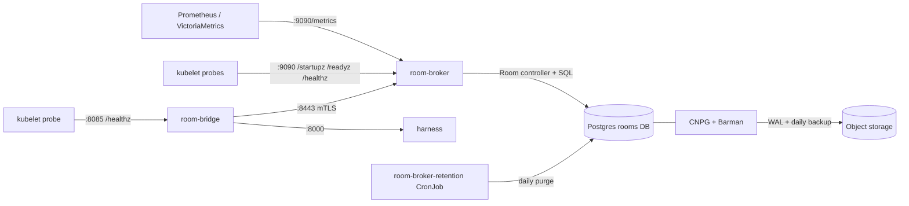

<!-- page-type: operations -->
# Operating rooms

Operate rooms through three windows: the **`Room` CR's status** (`kubectl get room -n agent-system`),
the broker's **metrics and alerts**, and **SQL on the log**. The manifests live in your GitOps
repository; [ai-native-ref](https://github.com/Smana/ai-native-ref) is one example.
For task lifecycles, rollouts and webhooks see [Operating the factory](factory.md); for alerts,
troubleshooting and the kill switch see [Failures and alerts](failures.md).



## Health at a glance

```bash
kubectl get rooms -n agent-system                                   # PHASE, DRIVER, SEQ, PENDING, CLASS
kubectl get pods -n agent-system -l app.kubernetes.io/name=room-broker
kubectl get sqlinstance,atlasmigration -n agent-system              # xplane-rooms Ready, schema migrated
kubectl get cluster -n agent-system xplane-rooms-cnpg-cluster       # the CNPG cluster
flux get kustomization room-broker -n flux-system
```

| Probe (`:9090`) | Fails when |
|---|---|
| `/startupz` | The schema is not migrated yet. The first deploy waits up to 10 minutes for CNPG and Atlas |
| `/readyz` | Postgres does not answer, or the Kubernetes caches are not synced |
| `/healthz` | The process is wedged |

The bridge's `/healthz` on `:8085` fails only when the harness was reachable and has been silent for
over 60 s; it never depends on the broker.

## Metrics

Served on `:9090/metrics`, scraped by the umbrella chart's `ServiceMonitor` `room-broker` when
`monitoring.serviceMonitor.enabled` ([observability](../observability.md)). Traces, from the factory and
from each run, are in [Observability](../observability.md#traces). The broker records them through the
OpenTelemetry metric API with a Prometheus exporter that adds no suffix, so the names below are
exposed byte for byte.
`rooms`, `maku_rooms_approvals_pending` and `maku_rooms_last_event_timestamp_seconds` come from the Room
controller, which runs on the leader only. A room keeps its last values until its next successful
reconcile, so a database outage freezes them rather than emptying them, and it leaves them once its
`Room` is gone. The append counters see every writer: the bridge API, the controller and the run
events.


Every broker and bridge metric series is listed in [Room broker metrics](../reference/metrics.md#room-broker-metrics) and [Bridge stall and stub metrics](../reference/metrics.md#bridge-stall-and-stub-metrics).

## Reading the log with SQL

The web UI and `maku` read rooms; SQL is for what they do not show. Read only: the log
is the audit trail, and a hand-made write defeats it. Run queries as `rooms_broker` where you can,
so the database refuses a mistaken write.

```bash
PSQL="kubectl exec -n agent-system xplane-rooms-cnpg-cluster-1 -c postgres -- psql -d rooms -tA -c"
ROOM=3kq7x2ma
```

| Question | Query |
|---|---|
| The transcript | `$PSQL "SELECT seq, type, actor_id, left(payload::text, 120) FROM events WHERE room_id = '$ROOM' ORDER BY seq"` |
| Is it gapless? | `$PSQL "SELECT max(seq) = count(*) FROM events WHERE room_id = '$ROOM'"` → `t` |
| Why did each run end? | `$PSQL "SELECT run_id, payload->>'phase', payload->>'reason' FROM events WHERE room_id = '$ROOM' AND payload->>'kind' = 'run_phase' AND payload->>'phase' <> 'Running' ORDER BY seq"` |
| Latest redactions | `$PSQL "SELECT room_id, seq, redactions FROM events WHERE redactions <> '{}' ORDER BY ts DESC LIMIT 20"` |
| Who holds the bridge lease? | `$PSQL "SELECT bridge_run FROM rooms WHERE room_id = '$ROOM'"` (`bridge_seen_at` is no longer written; a later migration drops it) |
| Concurrent-run refusals | `$PSQL "SELECT seq, payload FROM events WHERE room_id = '$ROOM' AND payload->>'kind' = 'limit'"` |
| Sealed and when | `$PSQL "SELECT sealed, closed_at, retention, last_seq, bytes FROM rooms WHERE room_id = '$ROOM'"` |
| Append-only, proven | `$PSQL "SET ROLE rooms_broker; UPDATE events SET payload = '{}' WHERE room_id = '$ROOM'"` → `permission denied for table events` |

## The system API from a terminal

The system API needs a token from an allowlisted ServiceAccount (see [API](../reference/api.md#authentication)),
over TLS with the platform CA. From a pod in `agent-system` whose ServiceAccount is in
`systemPrincipals`, and that the broker's CNP admits:

```bash
TOKEN=$(kubectl create token <allowlisted-sa> -n agent-system --audience rooms-system --duration 10m)
curl -s --cacert ca.crt -H "Authorization: Bearer $TOKEN" \
  "https://room-broker.agent-system.svc:8443/v1/rooms/$ROOM/events?afterSeq=0&limit=100"
```

`ca.crt` is the platform CA (`openbao-ca`, the same one `room-broker-ca` copies). Adding an entry
to `systemPrincipals` is a config change and a broker restart. Remove a probe's entry, pod
and ServiceAccount when you are done.

## Retention

The CronJob `room-broker-retention` runs daily at 03:17, as `rooms_retention`. The maku chart renders
it when `broker.database.retentionSecret` names that role's DSN Secret ([the database](../database.md)),
on `broker.retention.schedule`. Run it by hand to check it:

```bash
kubectl create job -n agent-system --from=cronjob/room-broker-retention retention-check
kubectl wait -n agent-system job/retention-check --for=condition=Complete --timeout=5m
kubectl logs -n agent-system job/retention-check          # one "purged expired rooms" line per run, with its rooms and events counts
kubectl delete job -n agent-system retention-check
```

The same job deletes the intent samples of channels that opted in, once each is past the `retentionDays` the broker stamped on it (30 by default), and logs one `purged expired intent samples` line. A sample is a person's reply, redacted: nothing else the platform stores holds thread text.

Each room's purge runs under its own `statement_timeout` of 10 minutes (`SET LOCAL`, the purge
transaction only), not the broker's 15 s. Keep the CronJob's `activeDeadlineSeconds`, if it sets
one, above 10 minutes, or the job is killed before a large room's purge can finish.

Change a room's retention through `Room.spec.retention` before the room is created: the log copies it
into the room's row once, and the database keeps that value immutable.

## Backups and rebuilds

| Item | Setting |
|---|---|
| Backups | CNPG daily at 02:00 to the cluster's CNPG backup bucket, through the Barman Cloud plugin; WAL archived continuously |
| First deploy | No recovery source: nothing exists to recover |
| After a day of real rooms | Promote a seed with cloud-native-ref's `cnpg-promote-seed.sh` and set `objectStoreRecovery.path: rooms-<date>` on the claim |
| Before every teardown | Promote a fresh seed; events after the last promoted seed are lost on a rebuild |

The log's volume is 20 Gi on one instance. A spot interruption stalls rooms but loses nothing that
the harnesses still hold.


## Upgrades

| Change | How |
|---|---|
| Broker image | Pin the new digest in the `App` claim **and** the retention CronJob together; re-vendor `crd-rooms.yaml` from the same ref; move `atlasSchema.ref` to the same release tag |
| New migration | Ships with the image that needs it: move `atlasSchema.ref` in the same commit as the digest. `/startupz` checks only that the first migration ran, so it does not hold a broker back from a later one |
| Bridge image | A new `_BRIDGE_IMAGE` digest in crossplane-configuration, then that package's pin in cloud-native-ref. Runs pick it up at creation; a running run keeps its bridge |
| Config | Edit `room-broker-config`, then `kubectl rollout restart deployment/room-broker -n agent-system`: the broker reads it once |
| Factory run-request API port | The chart serves `POST /v1/runs` on `:8082` (Service port `api`, or `https` with `api.tls.secretName`; container port `api`); the RunLore intake stays on `:8080`. Releases before it served the API on `:8443`: move the factory config's `api.listen` and the broker's `factoryURL` to `:8082` in the same change as the chart, or the broker's `start_run` calls fail until they do |
| Factory run-request API TLS (S-1) | A broker of this release refuses an `http://` `factoryURL` at start, naming `factoryURL`, and the maku chart refuses to render one. Its config load is strict: an older broker image refuses the new keys `factoryInsecure` and `factoryCAFile`, and the new image refuses an `http://` URL without `factoryInsecure`, so the keys land in the same change as the image. Do it in two steps. (1) Bump the broker image with `broker.factoryInsecure: true` (`factoryInsecure: true` in a hand-written config), which keeps plaintext. (2) Flip TLS together: the factory chart's `api.tls.secretName` (plus `api.tls.issuerRef.name` for a cert-manager `Certificate`), the broker's `factoryURL: https://agent-factory.<ns>.svc:8082` with `broker.factoryCA.secretName` (a Secret with the issuing CA's `ca.crt`) and `factoryInsecure` off, and every other direct `:8082` client: RunLore (`POST /v1/tasks` and the verification route, `POST /v1/tasks/{task}/verification`) and sponsored clients over the tailnet must move to `https://` and trust the same CA in the same change. The certificate carries only `agent-factory.<ns>.svc[.<domain>]`, so a tailnet name is not on it: such a client must reach the in-cluster name, or fails verification. Window: a plain request to a TLS factory gets 400, so an old broker still on `http://` fails until it rolls; `Factory.Request` returns an error, no run is created, and a retry reuses the idempotency key |
| Run controller CA Secret (S-3) | The run controller now reads `broker.tls.caSecretName` (default `room-broker-ca`), a Secret in the release namespace holding `ca.crt` only, never the broker's key pair. Create it before upgrading: until it exists new runs stay Pending with `SecretMissing`, and `helm upgrade --wait` still succeeds. The render refuses the key pair's name, and refuses the controller when the release namespace is `runs.namespace` |
| AgentRun admission policy (S-2) | The maku chart now always renders a cluster-scoped `ValidatingAdmissionPolicy` and binding, `room-broker-<release namespace>-agentruns`, bounding the broker's AgentRun patch to the three suspend annotations. The installer needs `create`, `update`, `get` and `delete` on `validatingadmissionpolicies` and `validatingadmissionpolicybindings` (`admissionregistration.k8s.io`), on Kubernetes 1.30+: without those rights `helm upgrade` fails `forbidden`, and on an older cluster `no matches for kind`. The policy is mandatory, with no opt-out. A host that installs the broker some other way than this chart gets no S-2 bound until it adds the same policy |
| Factory | Pin the chart's version and digest in `ocirepo-agent-factory.yaml` and the image in the factory's values, from the same release. The CRDs come from `agent-factory-crds`, pinned at the same release and installed first: the chart has no `crds/` (removed in v0.49.0) |
| CRD group (v0.31.0) | `Room` and `Task` moved to `maku.ogenki.io` in one quiet window; metrics are served as `maku_*` only. `maku-broker migrate-group` is removed (in v0.48.0): an install older than v0.31.0 upgrades through the last v0.4x release that carries it first ([the group move](../superpowers/maku-group-migration.md), now history) |
| Run provenance | Release the factory and the room broker in the same change, broker first. The factory's task facts carry `run.provenance`, and an old broker decodes `POST /v1/rooms/{id}/task` strictly, so it answers **400** to that field. Nothing is lost: the factory retries the same facts with the same `clientSeq` once the broker rolls. Until then, unfinished tasks lose their poll requeue and fall to error backoff (up to about 16 minutes), and finished tasks' room close and settle requeues stall, the close cap included. Keep the window to minutes by shipping both together |
| Run history and spend in the task facts | Roll the broker before the factory: a broker older than its factory refuses the new task facts (`runs`, `spend`, a run's `endedAt`, `outcome`, `verdict`, `microUSD`) with a 400, and the factory retries them under the same `clientSeq`, as for run provenance. The facts key changes for every task at the upgrade, so every task with a room, finished ones included, posts its facts once: expect a one-time burst of posts and Info logs. A sealed or closed room answers 410 and its facts stay due, as for any post after the seal; the factory logs it at Info and does not back off |
| Factory v0.16.0 (daily caps in USD) | Set `budgets.factoryDailyUSD`, `humanDailyUSD` and `perPerson.dailyUSD`; move alerts and dashboards to the `_usd` gauges in the same change as the pin. **Breaking:** the gauges `agent_factory_budget_{remaining,cap}_tokens` are replaced by `agent_factory_budget_{remaining,cap}_usd`. The ledger is now `agent-factory-ledger-usd-<YYYYMMDD>` (the token ledgers are no longer read or written, and are pruned after 35 days). The `Reservation` JSON `maxTokens` is now `maxMicroUSD`. The token day keys (`factoryDaily`, `humanDaily`, `perPerson.dailyTokens`) are accepted, ignored and warned about for one release, **not converted**: a non-default value silently falls back to $42.50 / $8.50. **Rollback:** v0.15.x refuses the USD keys and `meter.prices` `source`/`checkedAt` once a host sets them, so rolling back below v0.16.0 needs the token keys back and no `source`/`checkedAt`; the token ledger then misses the day's USD-settled spend |
| Loop policy (`loops` rows) | Roll out in this order, and add a `loops` row only at the end: (1) the room broker (an old broker refuses the bridge's `harness_end` with 400, and the bridge then halves the batch inside the 3 s final read); (2) the factory and its CRD (an older factory refuses a `loops` key at parse); (3) crossplane-configuration with `spec.loop` plus the room-bridge pin. A host XRD without `spec.loop` would prune it while the Task still records the policy, so the factory creates loop-carrying claims under Strict field validation: the API server then refuses the claim, the run is not started and the error shows in the factory log, instead of a silent loop-off run. A refused loop claim (Invalid or BadRequest naming `spec.loop`) escalates the task as `loop_unsupported` with no retry, and the run is never started; a Strict claim refused on another field escalates as `run_refused`, and the factory log names the field. A class's `checks: true` claims are created Strict the same way: the host XRD needs `spec.loop.checks`, and a repository's `checks.egress` profiles need the XRD's egress enum, before any class switches checks on. A class's `search: true` claims are created Strict too: the host XRD needs `spec.loop.search` (crossplane-configuration v0.9.20) before any class switches search on |
| Sponsored principals and `POST /v1/tasks` (factory interfaces part 2) | **Both CRDs change**: the Task enum and its CEL rules (`source.kind: api`, `sponsor`, `maxMicroUSD`), and the Room member pattern and CEL (`system:` members); the Task CRD arrives through `CreateReplace`, the Room CRD through ai-native-ref's vendored copy. `api.projectIDFile` is required with `api.sponsored`. The host writes `project-id` and `<name>-client-id` into `agent-factory-sponsored` (the chart always mounts it, optional). ai-native-ref adds the broker's mounts, `human.mcp.sponsored` and the network rule for in-cluster clients. **Never roll back below this version once api tasks exist**: an older factory's spec write drops `sponsor` and `maxMicroUSD`, and the CEL refuses it. Three new metric series are registered |
| Harness roles (scoper bound, reviewer brief) | Three orderings. (1) The reviewer schema first: crossplane-configuration#70 merged and pinned on cloud-native-ref, or an upgrade of `agent-factory-crds` on the native runtime. Until then each reviewer start costs a refused create, a Warn and one room note per task, and the reviewer runs without its brief, on the pull request alone. (2) The broker before the bridge pin: an older broker refuses `harness_end{budget_calls}` as a bad item, the run reads `PodFailed`, and `maku_factory_scoper_runs_total{outcome="budget_calls"}` stays at 0 while the scopers are in fact stopped. (3) No `scoper:` key in the factory config before the factory runs this release: the parse refuses unknown keys, so an older factory fails at start. The harness image may roll in any order |
| Judge round triage and cost by role | The pending-checks wait and the failing log tail reach runs only through the `maku-harness` digest bump in crossplane-configuration's composition, then that package's pin on cloud-native-ref. The log tail also needs `productionresultssa*.blob.core.windows.net:443` on the harness egress; until then every failing check gives the "not readable" note. Cost by role needs only the factory: `maku_factory_run_cost_usd` gains `role`, so a query that does not aggregate it splits by role |
| T2 sanitiser (H2 tracer) | The tracer recomputes what each applied output published with the running release's T2. A release that changes T2 (this one trims a pull request's title) makes pull requests and comments applied before the upgrade show once as `untraced_write`, on their next run end. Say so in the release notes, and confirm such a write predates the upgrade before rolling back |
| CRD | Vendored with every pin. `task check` fails when the committed CRD differs from what the Go types generate |

