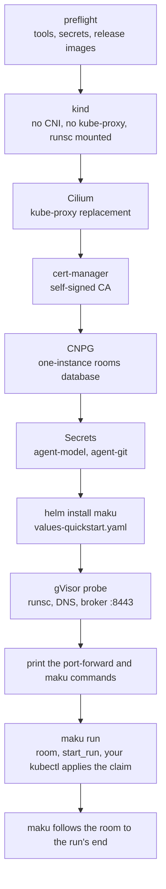

# Quickstart

**`task demo` runs the whole factory loop on your laptop in about 15 minutes: you label an issue, a room of
agents opens a pull request on your repository, and the merge gate posts its verdict on it.** It is a
labelled demo of how production works, not production: [what production adds](#what-production-adds) lists
what the demo leaves out. Never point it at a repository you do not own and have made public on purpose.

```bash
git clone https://github.com/Smana/maku && cd maku
task demo
```

## Before you start

| Need | Detail |
|---|---|
| Tools | Docker with the `buildx` plugin, Helm, kubectl, [Task](https://taskfile.dev), and one of kind or k3d (k3d is used when both are installed). `curl` too. `gh`, logged in, is optional: it saves two manual steps |
| System | Linux with Docker is the proven path. macOS with Docker Desktop is best effort. Runs use the default container runtime (runc), not a sandbox |
| GitHub | An account. The repository must be **public**: the agent can read the model key and the App's token, so the demo refuses a private one |
| Model | An OpenAI-compatible endpoint: its base URL, a model name and an API key. One model serves every role |
| Version | `task demo` installs images whose tag matches your checkout. On a release tag checkout it follows the tag. On a checkout ahead of a release it **refuses to guess and stops**: set `MAKU_VERSION` to a pull-request pre-release tag that exists in `ghcr.io/smana`, or `git checkout` a release tag. The tag's base version follows the latest tag on `main`, so it looks like `v0.36.1-prN.<sha8>`; find yours with `docker buildx imagetools inspect ghcr.io/smana/maku-broker:<tag>` |
| App step | Until a release ships `maku demo app`, the browser step needs Go on your `PATH` (the script runs `go run ./cmd/maku demo app`), or an existing App's id and key (`GITHUB_APP_ID`, `GITHUB_APP_KEY_FILE`, `DEMO_SLUG`). The script first tries to fetch the release's `maku`: in that case the `curl: (22) ... 404` and "could not fetch maku <version> ..." lines it prints are expected, and it falls back to `go run` |
| Network | Pulls from `ghcr.io/smana`, and the GitHub API (60 unauthenticated requests per hour is enough) |

## Run it

`task demo` asks for what it lacks, in this order. It takes each answer from the environment, then from
`.env` at the root of the clone, then from your answers of an earlier run, and asks only if none has it.
Without a terminal it never asks: it stops and names the variable.

| Step | What happens |
|---|---|
| preflight | Checks Docker, Helm, kubectl, curl and buildx, settles `MAKU_VERSION`, and picks k3d or kind |
| model | Asks for the model's base URL, name and key (the key is not echoed) |
| GitHub App | Serves a page on `127.0.0.1`; your browser should open by itself (if not, open the address it prints). **Click Create** on GitHub's page, and the key comes back to the script on localhost. It then prints "Now install the App on your repository: ..." Skipped when you give an existing App |
| repository | Creates `DEMO_REPO` from the template [`Smana/maku-demo`](https://github.com/Smana/maku-demo) (public), seeds its issues and labels, and adds a ruleset (below). Then asks you to **Install** the App on that repository and press Enter |
| cluster | Creates the cluster `maku-demo` with its own kubeconfig in `.demo/`, or uses your current context (`CLUSTER=current`) |
| install | Installs `charts/agent-factory-crds`, then `charts/agent-factory` with `-f values-demo.yaml`, with the `MAKU_VERSION` images pinned by digest, and waits for the rooms database, the broker, the run controller and the factory |
| room page | Forwards the broker to `http://localhost:8080`, in the background |

With `gh` logged in and admin rights on the repository, the script creates the repository, the labels
`factory/ready`, `class:docs-links` and `documentation`, the seeded issues, and a ruleset named
`maku-demo` that requires pull requests and your CI's `ci` check on the default branch. Without `gh`, it
prints the "Use this template" link (`https://github.com/Smana/maku-demo/generate`, set the owner and the
name, Public), waits for you to press Enter, and lists what to add by hand: the labels, the issues, the ruleset and the file `.github/agent-factory.yaml`. The ruleset needs `gh` logged in with admin rights on the repository; otherwise you add it by hand.

The repository must carry `.github/agent-factory.yaml` on its default branch, containing exactly `factory: demo`. The template has it. Without it the factory ignores the repository and its labels. With `gh`, the script warns when the file is missing.

It ends by printing the time per step, the room page, and the issue to label. It never prints a key.
Re-running it resumes: it skips the steps already finished (the state is in `.demo/`), and when `MAKU_VERSION` changed it upgrades the install in place.

Each variable below can be exported or written in `.env` at the root of the clone; an exported value wins.

| Variable | Default | Meaning |
|---|---|---|
| `MODEL_BASE_URL` | asked | The OpenAI-compatible endpoint, for example `https://api.example.com/v1` |
| `MODEL_NAME` | asked | The model every role uses |
| `MODEL_API_KEY` | asked | The key. It is kept in `.demo/answers.env` and `.demo/values.yaml` (mode 0600) and is readable by the agent in its pod |
| `DEMO_REPO` | asked | `owner/name` of your public repository, created from `Smana/maku-demo` when absent |
| `DEMO_LOGIN` | your `gh` login, else asked | The GitHub login allowed to file work for the factory |
| `GITHUB_APP_ID`, `GITHUB_APP_KEY_FILE`, `DEMO_SLUG` | unset | An existing App (its id, its PEM, its slug as in `github.com/apps/<slug>`): skips the browser step. The App needs the permissions in [the factory page](factory.md#demo) |
| `CLUSTER` | `k3d` if installed, else `kind` | `k3d`, `kind` or `current` (your kubeconfig's current context, which you must confirm by typing its name, or with `DEMO_CONFIRM_CONTEXT=<context>` without a terminal) |
| `MAKU_VERSION` | this checkout's release tag, else your last answer | The images' tag, and the `maku` release whose CLI the demo uses. Kept in `.demo/answers.env`. A checkout ahead of a release needs a pull-request pre-release tag (see Version above) |
| `DEMO_LIVE` | your last answer, else off | `1` turns the `docs-links` class live: the gate merges. Kept in `.demo/answers.env` for the next run: `DEMO_LIVE=0 task demo` undoes it |
| `DEMO_NO_GH` | unset | Any value: never use `gh` and never write to GitHub |
| `K3S_IMAGE`, `KIND_NODE_IMAGE` | pinned | The node image of k3d or kind |

The App the browser step creates is private, has no webhook, and holds seven permissions (actions,
contents, issues, pull requests and statuses write; checks and metadata read). One App backs the factory, the
merger and every run.

## Watch the loop

1. Open the issue the script printed (the one labelled `class:docs-links`) and add the label
   **`factory/ready`**. The factory polls every minute.
2. Open the room page, **http://localhost:8080**. A room appears for the issue, with its steps in order:
   the scoper, the implementer, the judge, the reviewer (which records its verdict with `room_verdict`). The implementer's pod runs under the **Not
   sandboxed** banner: the demo has no sandbox, and you are told.
3. The pull request appears on your repository, opened by `<slug>[bot]`. Its `ci` check runs.
4. The gate posts the commit status **`maku/merge-gate`** on the pull request, naming the class and the
   reason. In the demo's first run the class is in *shadow*: the status stays `pending` and says what
   the gate would do ("shadow: would merge; a maintainer merges"), and the gate merges nothing. Only a
   merge by the factory itself posts `success`. You can merge the pull request yourself.
5. The second seeded issue is labelled `documentation`, not `class:docs-links`, so the gate classes it
   `review` and hands it to a human: it posts that a human decides, and you merge the pull request by hand
   on GitHub (the demo does not configure approve-to-merge). If a task escalates, a maintainer's comment
   `/factory retry` on the issue re-runs it from the implementer. The factory reads an escalated task's
   comments every 5 minutes, so the new run can take that long to start.
6. To see a merge with no human, run `DEMO_LIVE=1 task demo` again: it reuses the cluster and your
   answers and turns the `docs-links` class live. Then open a **new** issue labelled `class:docs-links`
   (for example: retarget the other link in `docs/guide.md`, or any one-link fix in a `.md` file) and add
   `factory/ready`. It opens a pull request, `ci` passes, and the gate merges it.

## Team evaluation

The factory can offer the scoper approved harness profiles and record which one each task used. This
walkthrough adds a floor and a frontier variant to the existing demo. It changes no model or App secret.

Create `.demo/evaluation.yaml`, replacing the repository, maintainer and App login placeholders and
keeping the repository's existing values if you changed them. Helm replaces the repository list whole,
so the overlay must restate the complete entry:

```yaml
maku-factory:
  config:
    harnessProfiles:
      review-floor:
        description: Default implement-and-review loop.
      review-frontier:
        tier: frontier
        description: For broad or multi-file documentation tasks that need a larger budget.
    evaluation:
      mode: apply
      controlPercent: 0
    repositories:
      - name: owner/repo
        maintainers: [owner]
        triggerLabel: factory/ready
        classes:
          docs-links: {shadow: true, allowedFiles: ['^.+\.(md|mdx|adoc|rst)$']}
          revert: {shadow: true, allowedFiles: ['^.+$']}
          review:
            harness: review-floor
            harnessAllowed: [review-frontier]
            escalation: {outOfBudget: review-frontier, notConverged: review-frontier}
        merge:
          requiredChecks: [ci]
          verifyChecks: [ci]
          leakScanCheck: ci
          gateStatus: true
          policyBot: false
          approveToMerge: true
          mergerLogin: your-app[bot]
          autoMergesPerDay: 5
          fixRuns: 2
          checkReruns: 1
          verifyFor: 30m
          revertWindow: 168h
          breaker: {window: 10, maxReverts: 1}
```

Upgrade the CRD chart, which carries the Task CRD, then apply both files on top of `values-demo.yaml`.

```bash
helm --kubeconfig .demo/kubeconfig upgrade af-crds charts/agent-factory-crds -n maku
helm --kubeconfig .demo/kubeconfig upgrade af charts/agent-factory -n maku \
  -f charts/agent-factory/values-demo.yaml -f .demo/values.yaml -f .demo/evaluation.yaml --timeout 5m
kubectl --kubeconfig .demo/kubeconfig rollout status -n maku deploy/agent-factory --timeout=240s
```

Create a bounded issue that touches two documentation files, label it `documentation` and
`factory/ready`, then inspect its profile and the run's annotations:

```bash
kubectl --kubeconfig .demo/kubeconfig -n maku get tasks \
  -o custom-columns=NAME:.metadata.name,ISSUE:.spec.issue,PHASE:.status.phase,PROFILE:.status.profile.name,COHORT:.status.profile.cohort,RESOLVED:.status.profile.resolved
kubectl --kubeconfig .demo/kubeconfig -n maku get task <task-id> -o jsonpath='{.status.profile}{"\n"}'
kubectl --kubeconfig .demo/kubeconfig -n agents get agentrun <run-name> \
  -o jsonpath='{.metadata.annotations}{"\n"}'
```

Under `mode: apply`, a scoper recommendation of `review-frontier` resolves the task to that profile
with `source: scoper` and `cohort: treatment`. Set `evaluation.mode: observe` in
`.demo/evaluation.yaml`, upgrade with the same two files, and submit another task. The same
recommendation now records `recommended: review-frontier` and `reason: observe` while `name` remains
`review-floor` and `source` remains `floor`.

Read the recommendation and outcome counters with a temporary port-forward in one shell:

```bash
kubectl --kubeconfig .demo/kubeconfig -n maku port-forward deploy/agent-factory 19090:9090 \
  >/tmp/maku-metrics.log 2>&1 &
pf=$!
trap 'kill "$pf" 2>/dev/null || true' EXIT
curl -fsS http://127.0.0.1:19090/metrics | \
  grep -E '^maku_factory_(profile_recommendations_total|task_outcomes_total)'
```

A scoper may legitimately keep the floor. That yields `reason: none` with no recommendation and is a
valid negative result, not proof that apply or observe mode is broken. Recommendations are model
outputs, so repeat a bounded task whose profile fit is clear rather than changing the expected status.

## Stubbed spec-intake functional test

`task chart:intake:k3d` exercises planner revisions, the scoper question handoff, `need_answer` and
status-comment generations without a real GitHub repository, model account or credential. It creates
and always deletes its own k3d cluster and throwaway keys. The opt-in test needs Docker with buildx,
k3d, Helm, kubectl, Go, OpenSSL, curl and jq; it is not part of `task check` or PR CI because importing
the release harness makes it slow. See the [chart test documentation](../charts/agent-factory/README.md#spec-intake-k3d-test).

## What production adds

The demo runs the same chart as production with `-f values-demo.yaml` (`profile: demo`). It keeps the loop (label polling, the
roles, rooms, the gate's decision and its switch to live) and leaves out what costs infrastructure. The
table names what you have not proven by running it.

| In the demo | In production |
|---|---|
| One GitHub App: the factory, every run and the merger share it, and a run can read its token | A read-only factory App, a separate merger App, and a token per role minted for one run: a reviewer cannot push |
| The model key goes from the run to the provider; a run is bounded by its minutes and the provider's limit on your key | A gateway holds the key outside the sandbox, enforces a per-run, fleet and per-person budget, and meters every call |
| The judge calls the run's own model directly: its alias is not pinned by a proxy | The judge's model is pinned by the identity proxy, so a run cannot swap it |
| No meter and no USD caps (the demo's runs carry a gateway identity, which a meter can price) | The meter reads the gateway's metrics; caps refuse a task over its dollars |
| Runs under runc, with the room's "Not sandboxed" banner | Runs in a gVisor sandbox |
| Network policies on the rooms database (the broker only) and the factory's API (the broker only; the ops port stays open); **runs keep their egress** | Default-deny egress with a per-run FQDN allow-list |
| With `gh`, a ruleset requires pull requests and your CI's `ci` check. The gate's `maku/merge-gate` verdict is **advisory** against an agent that holds the token: the one App backs the factory, the merger and every run, so no ruleset could tell the merger's status from an agent's, and the demo requires none | Two Apps: `main` requires the gate's verdict on agent pull requests through [the gate's ruleset](factory.md#branch-protection-for-the-merge-gate), and no run holds the merger's key |
| Runs reach the broker's room tools on `:8090`, which verifies each run's own token (`roomTools.auth: tokenreview`); the bridge lets the five room tools through (`MCP_BARE_SERVER`, `MCP_READ_ONLY_TOOLS`) | An agent gateway in front of `:8090` authenticates the run and injects a key |
| One local user, no login | OIDC login, roles, room access following GitHub permissions |
| TLS from a CA the chart generates; the database hop is plain inside the cluster | TLS from your CA, database included |
| Public repositories only | Private repositories, with models chosen per data class |

Every Secret production reads, and how to bring each one by hand or with an ExternalSecret, is in
[install Secrets](install-secrets.md).

The demo's runs reach their model through the model gateway, as production's do: agentgateway's
controller and the gateway's proxy each request 128 MiB more (limits 512 MiB and 1 GiB), and on k3d the
apiserver admits anonymous requests (`task demo` creates its cluster so).

To install it, `maku install --print --out DIR` writes the values, the Secrets, the factory objects and
the GitOps files from your answers ([maku](cli.md)), or start from the chart's `values-production.example.yaml` with `profile: production`: the
render names every seam you have not set yet, see [From the demo to production](upgrading.md#from-the-demo-to-production).

## Clean up

```bash
task demo:down           # stops the port-forward, deletes the cluster, removes your answers and values; keeps .demo/app
task demo:down -- --all  # also removes .demo/app: the App's id and key
```

`--all` prints the address where you delete the App on GitHub: `https://github.com/settings/apps/<slug>/advanced`.
Delete the repository on GitHub yourself (Settings, Danger Zone); the script never deletes it. With
`CLUSTER=current`, `demo:down` leaves your cluster alone: run `helm uninstall af -n maku` and
`kubectl delete ns maku agents`.

## Troubleshooting

| Symptom | Cause and fix |
|---|---|
| "the repository is private" | The demo takes public repositories only. Make it public, or use another `DEMO_REPO` |
| "could not tell whether the repository is public: the GitHub API did not answer (rate limit? ...)" | The API limit is hit or the repository does not exist. Set `GITHUB_TOKEN` or log in with `gh`, and check the name |
| "this checkout is not at a release tag, and the chart here may need images newer than the latest release ..." | Your checkout is ahead of a release. Set `MAKU_VERSION` to a pre-release tag that matches it, for example `vX.Y.Z-prN.<sha8>` (check with `docker buildx imagetools inspect ghcr.io/smana/maku-broker:<tag>`), or `git checkout` a release tag |
| "<deployment> did not roll out; its last log lines" | The script prints that deployment's logs. A `MAKU_VERSION` older than the chart is a common cause: the images refuse its values |
| "has no .github/agent-factory.yaml (it is not from the template): the factory will ignore it" | Add that file on the default branch, containing exactly `factory: demo` |
| `gh is logged in but has no admin rights` | You do not administer the repository: add the labels, the issues and the ruleset by hand as the script lists them |
| The factory serves nothing, and its log says `a repository is not wired yet` with the App's installation not found | The App is not installed on `DEMO_REPO` (a wrong or deleted App also shows here, as a 401 or 404 from GitHub). Install it from the App's page: the factory connects within a minute, with no restart |
| "a previous run left a half-made App: a NEW App will be created" | The browser step stopped before the key came back. Delete the old App at the address the script prints, then let it create a new one |
| "no GITHUB_APP_ID and GITHUB_APP_KEY_FILE, and no terminal for the browser flow" | Run in a terminal, or pass an existing App |
| "the current context is now ..., not the ... you confirmed" under `CLUSTER=current` | Your kubeconfig's context changed since you confirmed. Type the new one to confirm, or switch back |
| "set DEMO_CONFIRM_CONTEXT=<context>" | `CLUSTER=current` without a terminal needs that variable to confirm the context |
| "a k3d cluster named maku-demo exists and this script did not create it" | Delete that cluster, or set another `CLUSTER` |
| "port 8080 is in use by something else" | The room page needs 8080: free it, then run `task demo` again |
| "docker buildx is not installed" or "ghcr.io/smana/... not found" | Install buildx, or set `MAKU_VERSION` to a release whose images exist |
| The nodes are not Ready after 120s | `kubectl --kubeconfig .demo/kubeconfig get nodes`, then `task demo:down` and start again |
| Nothing happens after you label the issue | The label must be `factory/ready`, and you must be `DEMO_LOGIN`. The factory polls once a minute |

## Without the script

To install on a cluster you bring, copy
[`charts/agent-factory/values-mine.example.yaml`](../charts/agent-factory/values-mine.example.yaml), change
the lines marked `CHANGE` (the model, the App, your repository and your CI's check names), then install
the CRD chart first and the umbrella on top of `values-demo.yaml`:

```bash
helm install af-crds charts/agent-factory-crds -n maku --create-namespace
helm install af charts/agent-factory -n maku -f charts/agent-factory/values-demo.yaml -f values-mine.yaml
```

The cluster must run Kubernetes 1.30 or later. Helm replaces a list
whole, so the values file restates the whole repository entry. Your repository needs `.github/agent-factory.yaml` on its default branch, containing exactly `factory: demo`: without it the factory ignores the repository. The same holds for a repository you did not create from the template. The chart's
[README](../charts/agent-factory/README.md) lists what it adds and its limits. Create the repository from
[`examples/demo-repo`](../examples/demo-repo/) (published as `Smana/maku-demo`).

## The one-run quickstart

`task quickstart` is the older, smaller path: it needs no GitHub App and no factory. It builds a local
cluster with gVisor and runs one attended, sandboxed agent in a room on a Linux machine with Docker,
without cloud-native-ref. It needs v0.30.0 or later: the `maku-*` images and the `maku` CLI exist only
from that release, so an older `AP_VERSION` fails at preflight (see the Images row below). Read
[what differs from production](#what-differs-from-production) before you trust it with anything.

```bash
export MODEL_API_KEY=… GITHUB_TOKEN=… REPO=owner/throwaway
task quickstart                 # kind + Cilium + gVisor + cert-manager + CNPG + the chart + maku
```

### Prerequisites

| Need | Detail |
|---|---|
| Platform | Linux with Docker (and the `buildx` plugin). `up.sh` stops on any other system and says why: gVisor in kind and a port-forward to a loopback-only listener are proven on Linux only. Podman is untested |
| kubectl | Within one minor of the kind node (1.36-1.38 for 1.37): `up.sh` stops otherwise. `mise.toml` pins one: `mise install kubectl` |
| `LOCAL_PORT` | The port you forward to the broker, default 8080. The broker's `publicURL` follows it and it answers that port only, as `localhost`, `127.0.0.1` or `[::1]` |
| Tools | `docker`, `kind`, `helm`, `kubectl`, `curl`, `git`, `openssl`, `envsubst`, `yq` (mikefarah v4); `sha256sum` (maku), `sha512sum`, `bzip2` and `tar` (gVisor). `up.sh` stops at the first one missing |
| `MODEL_API_KEY` | Anthropic by default; `MODEL` and `MODEL_BASE_URL` select any OpenAI-compatible endpoint, whose host joins the egress profile. For an in-cluster model (`http://<svc>.<ns>.svc.<domain>:<port>`), the port must equal the Service's `targetPort`, and the run may then reach **every pod in the model's namespace on that port**: the rule selects the namespace, not the Service. Run the model in a namespace of its own |
| `GITHUB_TOKEN`, `REPO` | A fine-grained PAT with Contents read/write on **one throwaway repository**, and that repository as `owner/name`. The repository needs a `main` branch with at least one commit |
| Images | The latest `Smana/maku` release. From a `main` checkout, set `AP_VERSION` to a release whose images match the chart: the `maku-*` images it pulls exist from v0.30.0 on, so any `AP_VERSION` before it fails at preflight. The GitHub API is rate-limited (60 requests/hour unauthenticated). `maku` comes from the same release (checksum-verified into `.quickstart/bin/`). `ROOMCTL=<path>` uses a `maku` build of this checkout instead |



The script is idempotent and pins every version it installs (`hack/quickstart/versions.env`); safe to
re-run: it upgrades the release to the latest one. Cluster access is pinned to `.quickstart/kubeconfig`:
`export KUBECONFIG=$PWD/.quickstart/kubeconfig` in your own shell.

### Start a run

In a second terminal, keep the broker forwarded (local mode answers this port only):

```bash
export KUBECONFIG=$PWD/.quickstart/kubeconfig
kubectl -n maku port-forward deploy/room-broker 8080:8080
```

Then, in the first (`XDG_CONFIG_HOME` keeps maku's quickstart config apart from any other):

```bash
export KUBECONFIG=$PWD/.quickstart/kubeconfig XDG_CONFIG_HOME=$PWD/.quickstart/config PATH=$PWD/.quickstart/bin:$PATH
maku configure --url http://localhost:8080
maku run --repo owner/throwaway --task 'Fix a typo in the README'
```

`maku run` creates a room, queues your task for the run's brief, starts the run, applies the claim the
broker rendered with your own `kubectl`, and follows the room until the run ends: exit 0 when it
`Succeeded`. It stops at the first step that fails and names it. It is the quickstart's command only: on a
platform install the factory starts runs. The room page is **http://localhost:8080**.

| Local mode | Consequence |
|---|---|
| The broker answers `publicURL`'s port only | Forward that port (`LOCAL_PORT`); `localhost`, `127.0.0.1` and `[::1]` all work, any other host or port answers `403`; `maku configure` refuses a mismatched port and prints the fix |
| One user, `human:local`, admin and member | No login; the port-forward is the only way in |
| The room page's Start run shows the claim | It does not apply it: `maku run` does |
| `XDG_CONFIG_HOME=$PWD/.quickstart/config` | Keeps the quickstart's maku config apart from a production one |

### Tear down

`task quickstart:down` deletes the kind cluster.

### What differs from production

The README's guarantees link here. The room, the bridge, gVisor and default-deny egress are the
real thing; the rest is scaled down.

| Production (cloud-native-ref) | Quickstart |
|---|---|
| Model calls through the gateway, with a per-run token budget the agent cannot raise | Your API key is in the sandbox. No budget or meter: only `maxMinutes` |
| GitHub through octo-sts: a token scoped to the run, valid up to an hour | Your fine-grained PAT, valid until you revoke it. Scope it to one repository |
| ZITADEL login, roles, approvals by member | One local user, port-forward only |
| The Atlas operator migrates; TLS from OpenBao | The `migrate` init container; a self-signed CA |
| Agent `room_*` tools, warm sandboxes, suspend, Kueue, the factory | Absent |
| Each role gets a token scoped to what it may do (a reviewer cannot push) | Every role gets the same PAT, readable by the agent: the rules ("push only to your branch", "read-only") are instructions, not enforcement |
| The room, the bridge, gVisor, default-deny + FQDN egress | **Same** |

Two DSNs, two roles, and the init container is the one that owns the schema: `db.sh` creates
`rooms-owner-dsn` (`rooms_owner`) and `rooms-broker-dsn` (`rooms_broker`). The chart renders the
first as the `migrate` init container's `ROOMS_MIGRATION_DATABASE_URL` (`maku-broker migrate` creates
every object as `rooms_owner`); the broker itself reads the second as `ROOMS_DATABASE_URL`, and its
role holds `SELECT, INSERT` on `events` only, so `serve` cannot alter the schema or delete history.

### Troubleshooting the one-run quickstart

| Symptom | Cause and fix |
|---|---|
| A run stays `Pending` | Read its `Ready` condition: `kubectl -n agents get agentrun <run> -o jsonpath='{.status.conditions}'`. `SecretMissing`: `agent-model` or `agent-git` is absent from `agents`. `CreateFailed`: the controller could not create the pod; the run stays `Pending` or ends `Failed` (read the condition message, then the controller's logs). `WaitingForGC`: an object of a previous run with the same name is still being garbage-collected; it clears by itself |
| A request from the agent times out | Egress is default-deny. `kubectl -n kube-system exec ds/cilium -c cilium-agent -- hubble observe --verdict DROPPED -n agents`, then widen the egress profile |
| Pods under gVisor have no network | gVisor needs Cilium's `socketLB.hostNamespaceOnly=true`; `up.sh` sets it. A hand-installed Cilium without it breaks run networking |
| `up.sh` fails at "release images" | No release holds the chart's images yet, or the API limit is hit. Set `AP_VERSION=<release tag>` |
| This machine cannot run gVisor | `ALLOW_UNSANDBOXED=1 task quickstart` runs agents under the default runtime. The environment is then **not sandboxed**: the agent's code runs as a plain container with your PAT and API key. Use it only on a machine you trust with that code. The controller sets the run's `Unsandboxed` condition and its room shows a `Not sandboxed` banner. Any value other than `1` stops `up.sh`. |
| `up.sh` stops at "gVisor probe" | It started a run-shaped pod under `runsc` and one check failed, named in the output: `dmesg` (runsc is not the runtime), `dns` (the broker's name does not resolve) or `tcp` (the ClusterIP is unreachable: Cilium `socketLB.hostNamespaceOnly`, or a network policy). Fix the cause, or `ALLOW_UNSANDBOXED=1` to skip the probe |
| `up.sh` stops at "kubectl ... cannot drive" | Your kubectl is more than one minor away from the kind node: `mise install kubectl`, or install a matching one |
| A browser or maku gets 403 | You forwarded another port than `publicURL`'s: forward `LOCAL_PORT`, or re-run `up.sh` with `LOCAL_PORT=<your port>` |
| `maku run` stops at `claim` | kubectl's own error is printed above it: usually `KUBECONFIG` is not `.quickstart/kubeconfig` |
| `task quickstart:check` | Offline drift check of the scripts and their helpers against the chart; no cluster needed |

### CI: `quickstart-e2e`

The job runs the whole path against a stub model: `up.sh`, a port-forward, `curl` checks of local mode through it, then `maku configure` and `maku run` to `Succeeded`, and a harness event in the room's log. It needs two Actions secrets and skips without
them (fork PRs), with a warning and a step summary saying nothing ran: a green skip proves nothing.

| Secret | Value |
|---|---|
| `QUICKSTART_REPO` | A throwaway `owner/name` with a `main` branch and at least one commit |
| `QUICKSTART_GITHUB_TOKEN` | A fine-grained PAT, Contents read on that repository (the stub model never pushes) |

For the chart's values and its caveats, see the [chart README](../charts/maku/README.md).
