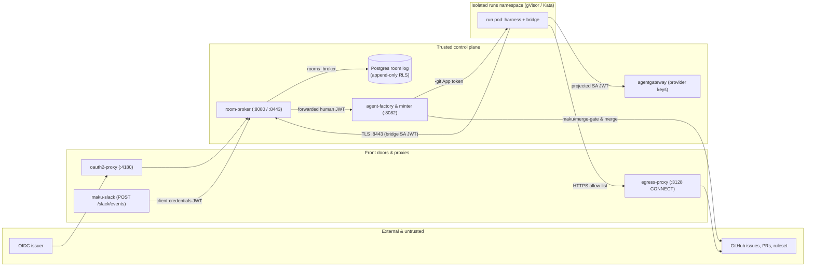

<!-- page-type: explanation -->

# Security

The broker is the one place that authorizes room actions, so it is designed to fail safe: **a
compromised broker still cannot rewrite history, create a run, or reach a harness's keys**. The
database enforces append-only storage, only the factory creates runs, and events
are pushed by the sandbox rather than pulled from it. Approvals are oversight, not a boundary: what
a run can do is fixed when it is created, by controls outside the sandbox. Concrete port, policy,
RBAC, redaction, webhook, Slack and supply-chain tables live in
[Security controls](reference/security-controls.md).

## Threat model

The design's threats, the controls against each, and the package or mechanism that holds the control.

| # | Threat | Controls | Control | Residual |
|---|---|---|---|---|
| T1 | Prompt injection by a human participant | Only members prompt; attribution is immutable; a run cannot exceed its role permissions; side-effect classes need an approver | Room roles (`internal/policy`), approvals, the broker-stamped `actor` | Wasted budget, bad code; bounded by budgets and the merge gate |
| T2 | Injection from agent to agent (brief, verdict, branch code) | No direct agent-to-agent path; peer text fenced as data; reviewers have read-only forge scope; a verdict has no power beyond the factory's merge gate | The fenced brief (`internal/brief`); room tools are the only agent write path (`internal/mcp`) | An injected reviewer can approve bad code *inside the room*; CI and the merge gate remain |
| T3 | Injection into humans | Approval cards render the raw, redacted action, not the agent's prose, plus the `causedBy` author | The approval card (`internal/humanapi`, `web/`) | Social engineering of an approver |
| T4 | Impersonation | The broker stamps `actor` from the credential; offline JWT checks; a live `AgentRun` watch; re-validated human tokens; a human's ZITADEL user must still be active, admins included; a run joins only its own `roomRef` | `internal/authn`, `internal/runwatch`, `internal/ghidentity` (`CheckActive`) | A token from a replaced pod of a still-live run is accepted until it expires (≤ 600 s); a deactivated user's token, which verifies offline for up to 12 h, until the 5-minute access cache expires |
| T5 | Replay, duplicates | Unique idempotency keys; single-use `approvalId`; `driverEpoch` fencing; short-lived tokens | `internal/store`: the idempotency key, the epoch trigger, the `approvals` table | — |
| T6 | Self-confirmation at the harness | Approvals are oversight by design; consequential actions are enforced outside the sandbox; agent events are untrusted claims | Approvals; the gateway and the forge outside the sandbox | A self-confirmed in-profile action is logged as reported; gateway and forge logs are ground truth |
| T7 | Authorization bypass at the broker | One enforcement point; every action re-checked against database state; `not_permitted` counted and alerted | The policy matrix and its table test (`internal/policy`); `RoomRejectedActionsSpike` | Broker bugs |
| T8 | Transcript leakage | Redaction before append; members only; tailnet host; no transcript in PRs; append-only role; retention | `internal/redact`, the database roles, retention; room membership; the PR carries a room id, not a transcript | Secret shapes gitleaks does not know |
| T9 | Cross-site WebSocket hijacking | `Origin` check; oauth2-proxy cookie `SameSite=Strict` | `internal/humanapi`; oauth2-proxy | — |
| T10 | XSS from LLM output | Markdown rendered with HTML disabled; strict CSP; HttpOnly cookie | `web/`; `internal/humanapi`'s headers; oauth2-proxy | XSS could still act *as* the user through the page |
| T11 | Denial of service | Size and rate limits; byte budgets per connection; authentication before subscription; gateway budgets bound agent loops | Payload and batch limits (`internal/envelope`, `internal/bridgeapi`); connection and rate limits (`internal/humanapi`) | A tailnet member can load the broker |
| T12 | Broker compromise | No harness keys (events are pushed); cannot rewrite history; its own CNP; runs only through the factory API, under a live human's token and budget | The database's grants and triggers ([room log](reference/room-log.md#the-guarantees)); the broker's RBAC | Reads every room; can request runs as a connected human; can decide pending approvals, since the triggers bind each approval row to its events, not each `approval_decided` event to a human's act, and a row check would stop nobody holding the broker's credential. The same residual covers a compromised **Slack App** pod, which holds that principal's credentials: it can cast one `forge.push` decision as any linked human without a click — it cannot invent a human, cannot decide another class, cannot escape the two standings or four-eyes, and every such decision is recorded as that person's ([the Slack App](reference/security-controls.md#the-slack-app)). It reads every account's GitHub link, and the factory App's metadata reads answer any login's permission on the App's repositories |
| T13 | Untrusted issue text reaching a prompt | Every text written outside the platform is defused before an agent reads it: invisible and control characters removed, images and raw HTML defused, fence look-alikes replaced, repeated until nothing changes | `internal/factory/sanitize`: a text whose markup does not settle is replaced whole by `Withheld`, failing closed | It is a filter, not a boundary: egress policy and the merge gate's paths are the controls |
| T14 | A forged `Agent-Run` trailer | Trailers are provenance hints, never authorisation; the merge gate binds commits to the agents App by push identity: every push to the branch must be the agents App's in GitHub's repository activity | The merge gate; [`images/maku-harness/README.md`](../images/maku-harness/README.md) | The binding is to the App, not the task: any implementer run can push as the bot. Commits are not signed |
| T15 | Theft or misuse of the merger key, or of the factory pod's other GitHub keys | One workload mounts it; under policy-bot the repository's ruleset lets only that App, and a repository admin, bypass a plain merge; without it, the ruleset requires `maku/merge-gate` from that App ([the merge gate's Apps](#the-merge-gates-apps)) | The chart's `apps.merger.existingSecret` (`charts/maku-factory/values.yaml`); the ruleset | Whoever holds the key can merge. The factory pod holds the factory App's key and, with `runTokens`, the agents App's: whoever takes the pod can mint any role's token on every repository either App is installed on |
| T16 | Work started on a repository by someone who may not change it, or through another repository's room or branch | A room's runs act on its `spec.repository`, a resumed branch on its last run's; every human run needs `write` on the repository on GitHub, admins included, failing closed; a label counts only from that repository's maintainers with `write`; each repository has its own GitHub connections | `internal/factory/api` (`admitRoom`, `admitResume`, `mayWrite`), `internal/repoaccess`, `internal/factory/intake`; [factory](reference/config.md#who-may-start-work-on-a-repository) | A permission revoked inside the 5-minute cache |
| T17 | Two factories (a rebuilt cluster on a stale pin, a second cloud) acting on one repository | The repository's default branch names its one factory in `.github/agent-factory.yaml`, a gate path; a factory it does not name takes no intake, schedules or API runs and merges nothing; an unread fence ages out to not owned | `internal/factory/fence`; [factory](reference/config.md#the-ownership-fence) | Up to 15 minutes of a stale answer while GitHub is unreachable |

## Identities

| Principal | Credential | Validated by the broker | Canonical id |
|---|---|---|---|
| Agent run | A projected ServiceAccount token of `<runs.namePrefix><runId>` (`run-` by default) in `agents`, audience `room-broker`, 600 s, mounted **only** in the bridge container | Offline against the JWKS of an issuer in `runIssuers`; `sub` must match the issuer's `subPattern`; then the `AgentRun` must be live and name a room | `agent:<runId>` |
| System caller | A ServiceAccount token with audience `rooms-system` (the platform's Kyverno policies reserve every `room-broker*` audience for `agents`) | Offline against `systemIssuer` (mode `jwks`), or by the apiserver when it says `mode: tokenreview`; `sub` must be a key of the `systemPrincipals` allowlist, which needs an issuer. The issuer is optional: without one, the broker's system authenticator never authenticates and the routes answer `401` | e.g. `system:factory` |
| Human | A ZITADEL ID token and a JWT access token, both from oauth2-proxy | Offline: issuer, expiry, groups; `aud` holds the project id and a rooms client, and the token names that client: the ID token in `azp`, the access token in `client_id`, since ZITADEL access tokens carry no `azp`. The two must share the `sub` and the client | `human:` |
| Human, preset `generic`, `tokenUse: id` ([identity](identity.md)) | The IdP's ID token, beside a distinct access token oauth2-proxy writes; maku's own ID token as a bearer | Offline: issuer, expiry, the roles claim; `aud` holds the client it was issued to (`azp`, else `client_id`, else its one `aud`), never a `typ: at+jwt` access token. The access token is not parsed | `human:` |

Why offline: every consumer validates issuer-agnostically. A runtime whose identities are
not ServiceAccounts needs one more `runIssuers` entry, not a new code path. Liveness comes from the
`AgentRun` itself (`status.phase` and the `agents.ogenki.io/revoked` annotation): when a run turns
terminal, revoked or deleted, every replica drops its connections on the watch event.

The allowlist of system callers names the factory:
`system:serviceaccount:agent-system:agent-factory: system:factory`.

**Humans.** The `rooms-proxy` ZITADEL client issues JWT access tokens, unlike the platform's other
clients, so that the broker and the factory can validate them offline. oauth2-proxy keeps them in an
HttpOnly, `SameSite=Strict` cookie, away from a page that renders LLM output. Two ZITADEL project
roles, flattened into `groups`, gate access: `agents-admin` (owner and approver everywhere) and
`agents-member` (may create rooms, and watches a room only under room access, below). The broker
reads the two names from its config's `human.groups`, the factory's run API from its config's
`api.groups`, which defaults to the same two. Anyone else is refused
at oauth2-proxy and again by the broker. Revoking a group takes effect within the hour, when
connections re-authenticate.

**Room access.** A room is never more visible than its repository. For a member, the broker
reads the GitHub account the person linked (`human.githubLink`, [GitHub account link](github-link.md)),
never a token claim and never another source. The broker keeps each human's numeric GitHub id, proved
by an OAuth authorization the person made at GitHub, and never a token: the user token is revoked as
soon as `GET /user` answers. It resolves that id to the current login, then asks GitHub whether that
login can read the room's `repository`, both through the factory App's metadata reads. Answers are
cached for at most 5 minutes, so an unlinked account or a revoked collaborator loses the room within
that; past the cache, a check the link store or GitHub cannot answer fails closed. A member with no
link sees no room (`X-Rooms-Access: unlinked`). `agents-admin` bypasses it. The link flow is bound to
the browser that started it (a cookie nonce, a PKCE verifier derived from it) and to the `sub` whose
web session confirms it, so neither a link CSRF nor a stolen callback URL links one account to
another's GitHub id. One GitHub id belongs to one account. "Active" is the link's own
`last_seen_at`, refreshed by the human's requests: a link unseen past `activeWindow` is refused
(`user_inactive`) on every human path. The residual is a deactivated person's Slack link acting until
`activeWindow` after their last sign-in, ended at once by an admin unlink.

When the broker asks the factory for a run on a human's behalf, it forwards that human's access
token, never an asserted `sub`, so the factory proves the principal itself.

**P18 under `tokenUse: id`.** A web session may steer and decide, and maku may not. Under the generic
preset's `tokenUse: id`, the broker tells the two apart by `X-Forwarded-Access-Token` alone:

- a web session's ID token arrives beside a distinct access token;
- maku's bearer, let through by `skip-jwt-bearer-tokens`, arrives with both headers equal, or
  without the access token.

This holds only while oauth2-proxy writes that header on every request, overwriting the
client's, and while nothing reaches `:8080` around oauth2-proxy. A client that could set the header
could pass the web client's ID token as a web session. The broker forwards the ID token to the
factory, whose run API checks that its `aud` holds a rooms client.

## The merge gate's Apps

Two GitHub Apps back the factory. The **factory App** reads and narrates, and the merger is
beside it or folded into it. The **agents App** is the identity runs push and open pull requests as
(`agentsLogin`). `maku/merge-gate` is posted by the merger's connection, and the documented
ruleset requires it from that App's `integration_id`
([branch protection](factory.md#branch-protection-for-the-merge-gate)) on agent pull requests: the
human roles and the merger App bypass that ruleset on their merges, and the agents App never
does. It is `success` only for the factory's own merges: an `arm`, posted after every check that can
still hold the arm and immediately before the merge call, or the merger's revert and adopted
merges, just before them. A post that fails stops the merge, and a merge call that fails puts back
`pending` or `failure`, so no `success` is left standing on a head the factory did not merge. A
shadow decision stays `pending`, so a status no agent token can post is what opens the branch.
The demo is the exception: its one App backs every run, so there the status stays advisory and no
ruleset requires it ([quickstart](quickstart.md)).

**The gate holds only while runs carry App tokens.** Its ruleset's bypass is by repository role.
Give runs a personal access token of a user with the write, maintain or admin role instead of the
agents App's tokens, and every run inherits that user's bypass: an agent can then merge an agent
pull request the gate never armed. Runs get App installation tokens (the minter's), never a
person's token; a laptop's one PAT (`runController.gitSecret`) is demo-only.

Every permission minted for a run or the publisher comes from one table, `minter.Roles`, pinned by unit tests ([role-table invariants](reference/security-controls.md#role-table-invariants)).

**Residual: an agent's merge.** Until H3, the implementer's and the tester's tokens keep
`contents: write`, which can merge a pull request whose required checks are green. Between the
gate's `success` and the factory's own merge, in the same pass, that window lasts seconds. A
pull request found merged by `agentsLogin`, at the gate, in `AutoMerging` or handed to a human, is
counted as `agent_merged` (`maku_factory_pr_outcomes_total`, alert `FactoryAgentMerged`), logged at
error level, and otherwise ends as a human merge does: it is not reverted. H3 closes it, where
those tokens lose `contents: write`.

## Policy-change pull requests

The factory App has one additional write: with `Factory.spec.gitops`, it creates the branch
`factory/promote-<repository>-<policy>`, updates only the configured manifest's `mode: shadow` line
to `mode: live`, and opens a pull request with the supporting decisions. The optimistic blob SHA
prevents an unrelated concurrent edit from being overwritten. A drill opens a revert labelled
`factory/drill`. These are the only policy-change repository writes; previews, backtests and the
editors write nothing.

The broker and factory both re-check the human's maintainer access before either write. The
`promote` package contains no merge call, auto-merge is not enabled, and a maintainer still reviews
and merges. An audit record closes `merged` only when the served binding is live, or `abandoned`
when the pull request closes unmerged; it is never closed by a button. Without `gitops`, the API
returns a command instead and the maintainer opens the PR. The branch prefix and the no-merge rule
are also tested offline; no live GitHub write is claimed by those tests.

## Authorization

Room roles (`watcher`, `collaborator`, `owner`) are cumulative, the `approver` flag is independent, and the `driver` is one token; the broker enforces the full [authorization matrix](reference/security-controls.md#authorization-matrix) (`internal/policy`) on every request:

- **Never an agent approves**: one injected transcript would otherwise approve another's
  action.
- **Never from `maku`**: a token issued to the CLI's ZITADEL client (formerly `roomctl`) cannot decide, steer,
  interrupt or move the driver token, because a local agent could run it. `POST /mcp` takes only
  that client's tokens, so the same holds there, and the text of both is stored as machine-sent.
- **Four-eyes** (off by default, per room): the humans in the triggering turn's `causedBy`
  chain cannot decide it.
- **An invite is two writes**: the Room CR, then the `participant` event. If the append fails after
  the update, the membership briefly has no record; retrying the act with the same `clientSeq`
  heals it (the update is then a no-op, and the append writes or replays the record). The CR
  change is also in the Kubernetes audit log. A sealed room refuses the invite before the update.
- **The broker never creates `AgentRun`s**: its RBAC is `get`, `list`, `watch`, `delete` and `patch`
  on `agentruns` in `agents`; CRUD on `rooms` in `agent-system`; leases; no cluster-admin. The `patch`
  is the suspend trigger's, and RBAC cannot bound it to fields: the maku chart's
  `ValidatingAdmissionPolicy` `room-broker-<namespace>-agentruns` refuses any update by the broker's
  ServiceAccount that changes more than the three suspend annotations
  (`agents.ogenki.io/operating-mode`, `agents.ogenki.io/remaining-seconds`,
  `agents.ogenki.io/resumed-at`): no spec, label, finalizer, owner or other annotation, the meter's
  included. An install without the chart needs the same policy for the same bound.
- **Per-run git Secrets without readback**: under `runTokens.perRun`, the factory holds `create`, `patch` and `delete` (never `get`, `list` or `watch`) bounded by a `ValidatingAdmissionPolicy` to `<namePrefix><8 chars>-git` ([run-token Secret admission](reference/security-controls.md#the-factory-writes-run-token-secrets-it-cannot-read)).
- **Broker-confirmed handoffs**: a web **New task** start files its issue through the factory App, so the factory App applies `factory/ready`. The factory accepts that label in one case only. The label must come from `factoryLogin` and be the issue's first `factory/ready` label. The broker must hold a record, written when it filed the issue, for this repository and issue number, within ten minutes of the label. The record's account, which the factory resolves to a login itself, must maintain and write on the repository. The record is append-only for the broker and readable by `system:factory` alone. A start the factory cannot check is refused (`handoff_unconfirmed`), never left waiting. Issue text, labels and markers never stand in for it, so nobody who can edit or label an issue can forge a start, and a record never confirms another issue. The broker stores no user token ([New task](web-ui.md#new-task-and-investigate-with-an-agent)).
- **Sponsored principals**: machine clients bound to a maintainer are capped server-side by sponsor write access, `dailyUSD`, `maxCostUSD`, `maxOpenTasks` and repository allowlists, and can never steer, approve or call `/v1/runs` ([sponsored principal bounds](reference/security-controls.md#a-sponsored-principals-bounds)).

### Coordination parents

A family spans repositories, so the parent room's gate is not enough (v4 MR13). Every read of a
parent — its view, its summary, its needs, its brief and its checkout document — filters each child
by the caller's own GitHub read of that child's repository, at the time of the read, with nothing
cached: `agents-admin` widens nothing, and a missing link, a lookup error or a GitHub error
withholds the child. A sponsored principal reads only the repositories its
`human.mcp.sponsored[].repositories` lists. A withheld child is a count, and the family-wide fields
that could reveal it by prose or by subtraction are cleared with it. The checkout document is served
only to a caller who reads every child. The unfiltered view never leaves the broker.

## Private code

A repository serving private or internal code sends that code to the configured models and requires explicit opt-in via `spec.privateCode.acknowledged: true` ([private code](install.md#private-code)).

## Network

Every namespace runs default-deny with one allow rule per documented flow, and the bridge-to-broker (`:8443`) and broker-to-factory (`:8082`) hops run reloaded TLS ([TLS on :8443](reference/security-controls.md#tls-on-8443)).

Run confinement is controlled by `maku.networkPolicies.mode` ([network policies and modes](reference/security-controls.md#the-run-paths-network-modes)):

- **`cilium`** confines each run with a per-run `CiliumNetworkPolicy` that filters DNS names and restricts HTTPS egress to GitHub, the run's declared allow-lists, the model gateway and (when enabled) the OTLP collector.
- **`kubernetes`** pairs default-deny `networking.k8s.io/v1` `NetworkPolicy` rules with a `CONNECT`-only forward `egress-proxy` rooted in the immutable `maku.ogenki.io/egress` pod annotation; before starting any run, the run-controller's preflight proves that the CNI denies unallowed egress. DNS to cluster DNS remains open in `kubernetes` mode, leaving DNS tunnelling as its documented residual.
- **`none`** applies no network confinement and surfaces `network_policy_none` on the install banner.

In `gateway` model mode (the production default), no provider API key enters the runs namespace: each run receives a projected ServiceAccount token scoped to `<prefix>.<dataClass>.<alias>` for the run's deadline plus 10 minutes, verified offline by `agentgateway` ([the run's model credential](reference/security-controls.md#the-runs-model-credential)). Run pods themselves are gated by an in-tree `ValidatingAdmissionPolicy`, `restricted` Pod Security, digest-pinned image repositories and a `runs` `ResourceQuota` ([the run pod's admission](reference/security-controls.md#the-run-pods-admission)).

## Untrusted-input hardening

The hardening track moves agent writes to GitHub behind a threat check the factory runs outside
the sandbox:

| Layer | Checks |
|---|---|
| T1, schema | An output's type, size, caps and label allowlist |
| T2, sanitise | The text a write publishes |
| T3, secrets | The redactor's rules, and the run's canary |
| T4, paths | A push's files against the protected paths |
| T5, classifier | agent-guard's prompt-injection verdict |

Repositories progress through four stages before coordination's `execute` admits them ([hardening stages and residuals](reference/security-controls.md#untrusted-input-hardening-stages-and-residuals)):

1. **Audit** (`mode: audit`): checks `T1`–`T5` evaluate writes after the fact as `output_shadowed` records and plant a per-run canary in writer briefs, without blocking the run's own token.
2. **Non-code outputs enforced** (`enforceOutputs: [pr, comment, labels, issue]`): writer runs submit structured `output_*` tool calls that the factory checks and publishes as the agents App, while the post-run tracer flags any direct bypass as `untraced_write` until `pull_requests: write` leaves the sandbox role.
3. **Push enforced** (`enforceOutputs` includes `push`): `git push` becomes an inspected git bundle (`output_push`) verified in a bare, blobless mirror outside the sandbox (fsck, no hooks, no submodules/symlinks/binaries, diff caps, `T1`–`T4`, protected-path approval), letting implementer and tester tokens drop `contents: write` and closing the agent-merge window.
4. **Reads filtered and ready** (`mode: enforce`): runs read issues, pull requests and checks through `forge_read` so text below `minAuthorTrust` is withheld inside the factory, and the run pod loses `api.github.com` egress; once all seven readiness checks hold, the repository reports ready.

## Reporting a vulnerability

Privately, through [GitHub security advisories](https://github.com/Smana/maku/security/advisories/new),
never a public issue. See [SECURITY.md](../SECURITY.md).
