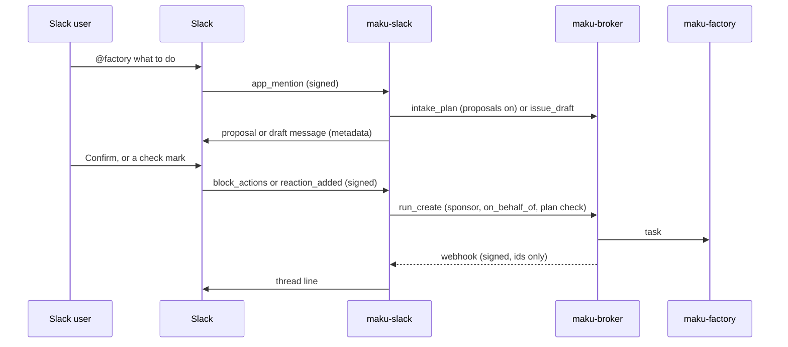

# The Slack App

`maku-slack` is the factory's Slack App: a mention in a thread plans the work as one proposal (or, with [`proposals.enabled`](#config) off, drafts one issue), a maintainer's Confirm or check mark files it and starts the work, and the broker's signed webhooks tell the same thread how it goes. After filing, the thread answers five questions about its task. Steering, every other approval class, and merges stay in the [web UI](web-ui.md); a `forge.push` approval has a card you can decide. A question from the run is linked in the thread, never answered there.



## Manifest

The App is one workspace's: create it from this manifest, install it, and put the signing secret and the bot token in the secret store.

```json
{
  "display_information": { "name": "Factory" },
  "features": { "bot_user": { "display_name": "factory", "always_online": true } },
  "oauth_config": {
    "scopes": { "bot": ["app_mentions:read", "chat:write", "reactions:read", "channels:history", "groups:history", "users:read"] }
  },
  "settings": {
    "event_subscriptions": {
      "request_url": "https://factory-slack.<domain>/slack/events",
      "bot_events": ["app_mention", "reaction_added", "message.channels", "message.groups"]
    },
    "interactivity": { "is_enabled": true, "request_url": "https://factory-slack.<domain>/slack/events" },
    "org_deploy_enabled": false,
    "socket_mode_enabled": false
  }
}
```

Interactivity, and no slash command. Interactivity carries both kinds of button the App posts, a proposal's Confirm and Cancel and an approval card's two buttons, and its request URL is the events URL itself: Slack signs a button press exactly as it signs an event, so one door with one signature check, one size cap and one workspace check serves both, and the body's content type says which shape arrived ([security](security.md#the-slack-app)). The bot scopes do not change: `chat:write` covers `chat.update` (a card rewritten in place) and `chat.postEphemeral` (the line one clicker sees) as it already covers `chat.postMessage`. `chat:write` also covers the [self-serve link](#self-serve-link)'s answer, a direct message from the bot (`chat.postMessage` with the user's id as channel, no `im:write` and no `conversations.open`) and, when that fails, `chat.postEphemeral`. `users:read` is optional: with it the link page names the Slack user by their handle, then their display name (`users.info`), without it by their id only; an App created from an earlier copy adds it under OAuth & Permissions and reinstalls.

Draft editing needs the `message.channels` (and, for private channels, `message.groups`) bot events: an App created from an earlier copy of this manifest must add them under Event Subscriptions in the Slack console and reinstall. The scopes (`channels:history`, `groups:history`) are already there. Without the events, mentions and check marks work as before and replies are never seen.

## Config

`maku-slack --config <file>`, strictly decoded (an unknown key is refused).

| Key | Meaning |
|---|---|
| `teamID` | Required. The one workspace served; any other workspace's events are dropped |
| `channels` | Required, at least one: `<channel id>: {repositories: [owner/name], maxCostUSD, approvals}`. The repositories a draft there may name, and the `max_cost` a check mark there sends (at least 0.01) |
| `channels.<id>.approvals` | Optional, default `false`: a `forge.push` wait in that channel is drawn as [the card](#the-card), and a press on it reaches the broker. Off, the wait keeps the text line, and a press on a card posted while it was on is answered "approvals are not turned on in this channel" with the room link, without reaching the broker. Turning it off is the fast rollback; it is not the authority, since a broker without `human.slackDecide` answers the route with a 404 and a press then says the factory could not be reached |
| `channels.<id>.notify` | Optional: the webhook transitions that post a line in that channel, by full name. Absent means the nine a person is told about (`room.task_triaged`, `room.waiting_for_human`, `room.pr_opened`, `room.verdict_posted`, `room.merged`, `room.reverted`, `room.budget_reached`, `room.ended`, `room.approval_closed`), so a run start posts nothing; `[]` means none. A name that is not a webhook type, a name listed twice, and a type the App draws no line for (`room.task_received`, `room.run_ended`, `room.monitor_verdict`) are refused at start. A card and its close follow `approvals`, not this list |
| `proposals.enabled` | Optional, default `false`: a mention is planned by the broker's `intake_plan` and posted as one [proposal](#flows) with Confirm and Cancel. Off, a mention is a draft, as below; on, against a broker with no planner (`intake_plan` unknown), each mention is drafted exactly as if it were off. Turning it off is the rollback: a Confirm on a proposal posted while it was on says to react with a check mark instead |
| `signingSecretFile`, `botTokenFile`, `webhookKeyFile`, `botUserIDFile` | Required mounted files; each must be readable and non-empty, and the webhook key must parse (one or two base64 lines of at least 32 bytes): the App refuses to start otherwise, naming the field and never the content |
| `clientIDFile`, `clientSecretFile`, `projectIDFile`, `issuerURL` | Required: the ZITADEL machine user's client, the project whose audience the token carries, and the issuer (an absolute `https` URL; `http` is accepted only for a loopback host, in tests). The three files are checked at start like the others |
| `brokerURL`, `roomsURL` | The broker's base URL, its human listener (`http://<svc>.<ns>.svc.cluster.local:8080`, no path: the App calls `<brokerURL>/mcp`), and the room pages' base URL |
| `namespace` | Where the `factory-slack-threads` ConfigMap lives |
| `eventsAddr` `:8080` | Slack's events, `POST /slack/events`: the public route |
| `webhooksAddr` `:8081` | The broker's webhooks, `POST /webhooks`: cluster only |
| `opsAddr` `:9090` | Metrics and the probes |

The App's token is a client-credentials grant with the project-audience scope (`openid` and `urn:zitadel:iam:org:project:id:<project id>:aud`). The factory serves a Slack user listed in its `onBehalfOf.slack`, or, with `onBehalfOf.slackLinks`, one who linked themselves ([self-serve link](#self-serve-link), [The factory](factory.md#sponsored-principals)).

The broker needs one `webhooks` entry for the App ([operations](operations.md#webhooks)):

```yaml
webhooks:
  - name: slack-app
    network: cluster
    url: http://<svc>.<ns>.svc.cluster.local:8081/webhooks
    events: [room.task_triaged, room.run_started, room.waiting_for_human, room.pr_opened, room.verdict_posted,
             room.merged, room.reverted, room.budget_reached, room.ended, room.approval_closed]
    repositories: [Smana/ai-native-ref]
    secretFile: /etc/webhook/key   # the key file the App mounts as webhookKeyFile
```

- `network: cluster`; the port `:8081` is mandatory and the path is exactly `/webhooks`.
- `events` are the ten above, by their full names: the broker refuses a short one. The App posts no line for `room.task_received`, `room.run_ended` or `room.monitor_verdict`, and none for `room.run_started` unless a channel's `notify` lists it. `room.approval_closed` is what makes a card inert after the deadline or another surface's decision, so a subscriber serving a channel with `approvals: true` must list it.
- `repositories` is required.
- `secretFile` is the same key as the App's `webhookKeyFile`: one or two base64 lines, each at least 32 bytes decoded.

## Flows

**Proposal** (`proposals.enabled`). A mention is the request, in the person's own words; no template. The App calls `intake_plan` and posts **one proposal message** in the thread: the repository, the issue or issues, the roles and the budget, each a section, with a header naming the revision and the plan's hash, then Confirm and Cancel. The message's metadata (`factory_proposal`: the plan, its hash, its author, its revision) is the only place a plan is read from, so a restart loses nothing and nothing is stored beside it. A plan the composer wrote because the planner could not is labelled as such. A refused plan is one `Not proposed: …` line per closed reason. A broker without `intake_plan` has no planner, and a thread is the kind it started as. A mention that starts a thread with no proposal is then a [draft](#flows), in the draft's grammar, counted under the draft's words (`drafted`, `refused`) and not as a proposal action; its thread is a draft thread — a reply amends the draft, a check mark files it, and once filed it answers the five questions below. In a thread that already holds a proposal, a reply or a mention is told `Not re-planned: this deployment no longer plans from Slack; …` and nothing is drafted beside it. The two refusals made before the planner is asked — a request past 16 KB and a thread already filed or cancelled — stay the proposal's, with its lines, and count as a proposal `mention`.

- **A reply re-plans.** A reply by the mention's author is more context: the App plans again with the request and the replies and **updates the same message** in place, so its buttons always bind the plan they sit under. Changed sections are marked, and when a hashed field moved (the repository, the budget, an issue's title, body or class, the roles or their order) the header says `requires a new confirmation`. At most 40 revisions per proposal. When Slack refuses the edit, the App posts the revision as a new message and makes the replaced one inert.
- **Confirm** is a maintainer's: it files the plan the message holds through `run_create`'s plan check, the same path as a check mark, and rewrites the message into the Filed line. The presser alone is told why a press filed nothing (`Not filed: a newer revision of this proposal is in this thread; press that message's buttons.`, a repository the channel no longer serves, a hash that no longer binds the plan, and the check mark's refusals below).
- **Cancel** is the author's alone (anyone else is told `Only @author cancels this proposal; a maintainer confirms it.`); it rewrites the message into `Proposal cancelled by @author; mention me again to plan another.`, with no buttons, and starts nothing.
- **A check mark** on the proposal is the fallback for Confirm: the same checks and the same filing, answered in the thread.

**After filing, the thread answers five questions.** A reply in a filed thread is matched, lowercased and without its closing `?`, `.` or `!`, against a closed list of phrases, and answered from the room the Filed line names — never from the thread's text:

| Ask | Answer, from |
|---|---|
| `status`, `how is it going`, `where is it` | the phase, the issue and the room link (`room_summary`) |
| `needs me`, `what needs me` | one line per need with its action and link, or `Nothing waits on this task right now.` (`needs_list`) |
| `what changed`, `what has changed` | the ten newest milestones, then `More: the room page` (`room_changes`) |
| `the pull request`, `pr`, `the pr` | its number and link, or `No pull request yet in this room.` (`room_summary`) |
| `stop`, `stop it`, `how do i stop it` | ``I can't stop a run from here. Apply the `factory/stop` label on the issue, or use Stop on the room page: <link>`` — and no broker call |
| anything else | `Progress is in this thread; approvals and steering are on the room page: <link>. Ask …` |

An answer is at most 12 lines; a longer one is cut at the tenth with `…`. Every value it quotes (a title, a need, a milestone) is escaped and stripped of control and invisible characters, so a `<!channel>`, a mention or a link in it fires nothing; the only links are the App's own room page and the URLs the broker built. Each answer makes one sponsored read at most, and the stop and the unknown answers none. A Filed line whose marker names no room is answered `I can't tell which room this thread filed; open the room page from the Filed line above.`, a room the broker cannot read `The room could not be read just now; try again in a minute.`, and a cancelled thread nothing.

**Draft** (`proposals.enabled` off, or a broker with no planner). A mention whose text starts with the App's own `<@bot>` is free text: the App composes the issue template itself, so nobody types headings (Slack's composer strips `##`, rewrites `- ` as `•` and sends on Enter). Write it like this:

```text
@factory [Smana/ai-native-ref] docs: runbook 18 never says where the key lives
The runbook names the factory's API but not where its key is stored.
Should: say which Secret holds it.
Acceptance: docs/runbooks/18.md gains one line naming the Secret.
```

- **Line 1** is `[<owner/repo>] <title>`; the brackets are optional, and in a channel that serves exactly one repository the repository is optional too. A title that has the factory's `<area>: <what>` shape (`docs: ...`, `fix(agents): ...`) is used as is. Otherwise the App prefixes `docs: ` when the text mentions a doc, runbook or README, else `chore: `: the two areas that never claim a behaviour change. The factory's title rule is not relaxed.
- **Further lines** become `## What is wrong`; with none, the title does.
- A line starting with `should:`, `expected:` or `want:` opens `## What it should be` (default: "As the title says.").
- A line starting with `acceptance:`, `acceptance check:`, `done when:` or `check:` opens `## Acceptance check`, up to the end of the message. Slack's decoration (`*`, `_`, `>`, `•`, `-`) before the keyword is ignored, and the keyword also counts glued to a sentence end (`...the API.Acceptance:`, or followed by a line break). `•` bullets become `- `. With no acceptance given the section says so, and the factory's scoper asks the author on the issue.
- A text that already holds the template's `## What is wrong` heading is passed as typed.

A one-line mention is a complete draft. A malformed line 1 (no repository where the channel serves several) is refused with a `Try:` line built from the user's own text (the channel's repository in front of it; with several repositories the first, plus the list), shown inert like every refusal. The composed issue is posted in the thread, so the check mark files what is shown. The broker's `issue_draft` judges it against the template and a refusal is posted back as is. A good draft is posted in the thread by the bot with metadata `{repo, title, body, sha256}`. When that metadata would exceed 8 KiB (well under Slack's cap) nothing is posted as a draft: the thread gets a short line saying the draft is too long to file from Slack, with none of its text, and the request counts as `too_large`.

**Edit.** A reply in the draft's thread by the Slack user who wrote the mention amends the pending draft, and the App posts the result as a new draft reply (the earlier one stays as history, and a ✅ on it is answered "react on the latest draft"). A reply is read as the mention's free text: `Title: …` replaces the title (the area prefix rule applies again), `Should: …` or `Expected: …` replaces "What it should be", `Acceptance: …`, `Done when: …` or `Check: …` replaces the acceptance check (several lines allowed), anything else is appended to "What is wrong". The draft goes through the broker's `issue_draft` again. A reply that is only a ✅ files the latest draft as a reaction does, and never edits. Other replies from anyone else, in a thread with no draft, after the draft is filed, or that start with a mention of the App are ignored without a word; a reply the broker refuses is answered "Change refused: …". At most 20 drafts per thread, each reply is capped at 4000 characters, and the draft stays under the metadata cap. The state is the draft message's metadata (`author`, `rev`), read back with `conversations.replies`; the App's "Filed" line carries a `factory_filed` metadata marker that ends editing. Nothing is stored beyond what the App kept already.

The draft is shown in Slack's mrkdwn (an intro line, then `*What is wrong*`, `*What it should be*` and `*Acceptance check*` on their own lines with the text below, and a hint to reply or ✅); the issue body keeps the `##` template.

**File.** A `white_check_mark` files the task only when all of these hold: the message is the thread's latest draft; the user is linked, in `onBehalfOf.slack` or by a [self-serve link](#self-serve-link) (and the linked login is a maintainer); the message is the bot's own draft, re-read from Slack (a `conversations.replies` call on the message `ts` with `limit=1`; the message's user is the bot's) with a matching hash; the channel is configured. The idempotency key is the thread (`<team>/<channel>/<thread_ts>`): a second check mark in the thread, on any revision, is a duplicate and files nothing. A thread too long to read (over 5 pages) fails closed: nothing is edited or filed. The App then calls `run_create` with `on_behalf_of: slack:<team>/<user>`, the draft, the channel's `maxCostUSD` and `ref: slack/<team>/<channel>/<thread_ts>`. The thread map records the room, and the Filed line names the sponsor (`Filed #12 for @dana, sponsored by GitHub @smana`), so a wrong link shows at its first use.

**No silent check mark.** Every refusal on the check-mark path (reaction or ✅ reply) is one thread line naming the reason and its fix, said once per draft, user and reason (in memory, like the event dedup), so re-adding the ✅ does not repeat it:

| Case | Line |
|---|---|
| The channel no longer lists the draft's repository | `Not filed: <repo> isn't served in this channel; ask an operator to add it to the channel's repositories.` |
| The channel is no longer served | `Not filed: this channel is no longer served; ask an operator to add it to the Slack App's channels.` |
| The draft's hash fails | `Not filed: this draft no longer matches its check; start a new one with a mention.` |
| A replaced draft, a thread too long | `react on the latest draft`; `start a new one with a mention` |
| `not_linked` | `Not filed: @u is not linked to a GitHub account here; mention me with link to link it, then react again.` |
| `not_a_maintainer` | `Not filed: @u's GitHub account is not a maintainer of <repo>; a maintainer must react.` |
| `repository_not_allowed`, `repository_not_owned` | `ask an operator to add it to the Slack App's repositories` |
| `principal_budget_exhausted` | `the Slack App's budget for today is spent; react again tomorrow` |
| `daily_task_cap` | `the factory's daily task cap is reached; react again after 00:00 UTC` |
| Any other code | `Not filed: <the broker's refusal>` |

A passing failure (`kill_switch`, `principal_task_cap`, `link_unverified`, `ledger_unavailable`, `tasks_unavailable`, `intake_failed`, `meter_unpriced`, the factory or Slack unreachable) says to react again, at most once per 5 minutes per draft, user and reason. **Silent on purpose:** a ✅ on a message that is not the App's draft, a malformed id, the App's own user, a bot's event, another workspace, an event already seen, and a message Slack cannot return (no thread is known to answer in; logged and counted `error`).

### The card

One `forge.push` wait is one card in the thread it was filed from, and the card's two buttons are the only thing in a thread that decides anything ([security](security.md#the-slack-app) has the route, the standings and the closed codes).

**When a card is drawn.** All four hold: the room was filed from Slack (so its thread is in the map), the channel has `approvals: true` **and** lists the wait's repository, the class is `forge.push`, and the event carries an approval id and a branch inside the run pattern. Everything else keeps today's text line, which sends a person to the room page: `forge.pr`, `forge.other`, `mcp.write`, `shell.high`, `egress.new`, and a `forge.push` without a branch. One approval, one message: the App reads the thread, finds the card whose tagged metadata names the same approval id, and rewrites it in place, so a webhook redelivery — or a restart that lost the in-memory delivery set — cannot double it. A thread too long to read posts the card anyway and counts `too_long`.

**What it shows.** The class prose the room page shows, the branch, the deadline as Slack's own date token (the client renders it in the reader's timezone, so the App holds neither a clock nor a zone in the message), the approval's id, and the room's link. No agent text, no reason, no GitHub login, no other person's name: invariant 7 holds over the card as over every line. A card drawn after its deadline is posted already inert — prose and room link, no buttons — because the store would refuse the press; the App's clock decides only what is drawn, never what is decided.

**A press.** The buttons carry `v1|forge.push|<approvalId>|<branch>`, which is a hint and never authority: the broker re-reads the approval, the class, the run's branch and the clicker's standing, and a card that outlived the state it was drawn from decides nothing. Slack answers a press within 3 seconds, so the one door verifies the signature, deduplicates and enqueues, and a worker does the rest. The clicker alone is told what became of it, in one fixed sentence in the card's thread (an ephemeral): `Decided: the push goes out.`, `Not decided: your GitHub account cannot write to this room's repository.`, and so on — one line per closed code, naming no repository, branch, login or approver, and never repeating a broker's prose. Only a recorded decision takes the buttons off.

**Teardown.** Two `chat.update` writes, both best effort and both idempotent: the press's own, which turns the card into its header, class, branch, approval and the clicker's line; and the broker's `room.approval_closed`, which rewrites the same card for any close — approved, denied, expired, superseded — whoever decided, the room page included. A press names no room, so the room link leaves the card on the first write and comes back on the second. A failed update is logged as `card update failed` and counted `error`, and it is never retried: the card is a view, the store's single-decision fence is what refuses a stale press, and three given-up webhook deliveries would disable the subscriber.

**A close with no card is silent.** In a channel with `approvals: true`, a wait that drew only a text line (another class, or a `forge.push` without a branch) gets no close line either: the thread already told that wait's story, and its decision lives where its wait pointed, on the room page. A channel with `approvals` off draws no cards at all, so its close is the thread's line, `The approval closed: <decision>. Room: <url>`. A channel removed from `channels:` after its card was posted takes that same text-line path: the card keeps its buttons, and a press there is `ignored` before any broker call: the App does not serve that channel, so nothing decides.

### Self-serve link

The link routes answer `Referrer-Policy: same-origin` (the rest of the rooms UI is `no-referrer`): under no-referrer a browser sends the form POST's `Origin: null`, which the broker's origin check refuses.

A Slack user links themselves instead of waiting for an `onBehalfOf.slack` entry in git ([design](superpowers/specs/2026-10-28-slack-self-serve-link-design.md)):

1. `@factory link` in a served channel. The App calls the broker's `slack_link_code` with its team and user id (and handle and display name, with `users:read`) and answers **in a direct message from the bot** (only that user sees it; the first line is the labelled link and the bare URL follows on its own line; it says never to send it to anyone; the thread gets a one-line pointer, never the URL; if the DM fails, an ephemeral in the channel, not in the thread, is the fallback, and the Slack error is logged) with `https://rooms.<domain>/link/slack?code=<code>`: single use, 10 minutes, replacing their earlier code.
2. The user opens it, signs in to the rooms UI (ZITADEL), and sees `Link Slack user @handle (<id>) in workspace <team> to your account (GitHub: @login)?`, the display name below it marked as set by that user, and "never confirm a link someone sent you". **Link** posts the form, from the web UI's session only (a maku or MCP token is refused); the broker records `slack(team/user) → the ZITADEL account`.
3. From then on their ✅ files sponsored by that account's **current** GitHub login, still held to the repository's maintainers: a link grants nothing a maintainer did not have.

`@factory unlink` removes the user's self-serve link (never a config entry); the page, opened without a code, lists the account's links with an Unlink button each. Refusals on the page: the code expired or was used, the code is for another workspace, the account has no GitHub link, it holds 5 Slack users already, or the Slack user is linked to another account (it unlinks first: a link never moves silently). With the broker's `human.slackLink` off, both commands answer that self-serve linking is not turned on. `link` and `unlink` are the whole mention; a draft whose title holds the word is a draft.

Both sides must opt in: the broker's `human.slackLink` (principal, team, repository; [integration](integration.md)) and the factory's `onBehalfOf.slackLinks` ([The factory](factory.md#sponsored-principals)). A user in `onBehalfOf.slack` keeps that entry whatever they link: **the config wins**.

**Follow.** The broker's webhooks name a room; the App finds its thread in the map and posts a fixed line: the issue and PR numbers, the coarse state, a closed reason code and the room's URL (`<roomsURL>/r/<room>`).

## State

- The thread map is the ConfigMap `factory-slack-threads`, the only object the App's Role names. Entries older than 30 days are pruned on write, and the encoded map is bounded near 900 KiB (a ConfigMap holds 1 MiB).
- One replica. Slack events (on `event_id`), button presses (on the approval, the user, the action id and the action's own `action_ts`, so Slack's retry of one press is a duplicate) and webhooks (on `webhook-id`) are deduplicated in an in-memory LRU, so a restart can post one duplicate line. Two concurrent redeliveries of one id can both pass the check before either finishes (known race): the worst case is one duplicate thread line, and for a press the store's single-decision fence still records one decision.
- **The message metadata is tagged.** Every message the App posts carries `event_type` and its payload: `factory_draft` (`repo`, `title`, `body`, `sha256`), `factory_proposal` (`plan`, `hash`, `author`, `rev`), `factory_filed` (`repo`, the `room` it started, and `cancelled` on a Cancel's), and `factory_approval` (`approvalId`, `class`, `branch`) on a card. The tag is what finds a card again — a webhook redelivery rewrites it instead of posting a second one, and `room.approval_closed` reads the branch back from it — so a card posted without its tag would be doubled. A draft's payload on the wire is byte-identical to what it always was.
- **Two switches, both off by default, and they do different things.** The broker's `human.slackDecide` is the authority: without it the decide route is the mux's `404`, and a press says the factory could not be reached. The channel's `approvals` is who gets the affordance: without it a wait is a text line and a press never reaches the broker. The broker's switch must be on before any card offers a button, and Slack's interactivity URL must be set before the first card with one is posted.
- A webhook key the App cannot read answers `503 no_key`. That is not a hold: the broker retries a receiver's non-2xx after 10s, 1m and 5m, then counts a failure, and three given-up deliveries disable the subscriber until its `generation` is bumped. A rotated or missing key, or a Slack outage that makes the App answer `502`, therefore loses those events and can disable the subscriber. **Recovery:** fix the key (or wait for Slack), bump `generation` on the broker's `webhooks` entry and restart the broker (a `webhooks` change applies only at restart); the events of the disabled window are not replayed, and a room's page still shows its state. A failed card update is never one of these: it is logged and counted, and the close it was rewriting is answered `200`.
- Series: `factory_slack_requests_total{route, outcome}` (`events`, `webhooks`, `interactions`; the closed list is `drafted`, `edited`, `proposed`, `updated`, `reposted`, `multi_issue`, `answered`, `refused`, `filed`, `posted`, `card_posted`, `card_updated`, `card_closed`, `decided`, `ignored`, `not_enabled`, `not_supported`, `duplicate`, `link`, `unlinked`, `ok`, `bad_request`, `bad_signature`, `no_key`, `too_large`, `too_long`, `busy` and `error`). `busy` is an event or a press answered 503 because the App's 8 workers and its 64 queued items are all taken, or it is shutting down: Slack retries it. A press's own words are `decided` (a decision was recorded), `duplicate` (the fence had already closed it), `not_supported` (the class is not `forge.push`), `refused` (any other closed code the broker answered) and `error` (the broker, Slack or the clicker's line failed).
- `maku_slack_proposal_updates_total{action}` counts the proposal's actions (`mention`, `reply`, `confirm`, `cancel`, `repost`), and `maku_slack_thread_answers_total{question}` the filed thread's answers by question (`status`, `needs`, `changes`, `pr`, `stop`, `unknown`): both on the broker's metric set, served under `maku_`.
- A refusal said once is remembered in memory (at most 4096): a restart can say it once more.
- `factory_slack_build_info{version}`: the running build, constant 1.

## What it never does

- **Answer anything but a `forge.push` approval, and only from a card's button.** The one exception is first, with its limits: a signed press on the card the App itself posted decides that approval, for `forge.push` only, as the linked human the broker resolves — one class, no reason (the decision carries an empty one), no answers to a run's question, and no steering. Everything below still holds everywhere else.
- Answer an approval, steer or stop a run from a thread, or read a reply as a command. A reply is an edit before filing (the author's, re-planning a proposal or amending a draft), one of five questions after, and never a way to steer a run: `stop` only says where stopping happens. A reply that is only a ✅, from anyone, files the latest draft as a reaction does (the same checks, the same lines); any other reply in a draft's thread from anyone else, or after the draft is filed, is dropped unread, and one in a filed proposal's thread is answered and acts on nothing — saying `approve`, `deny`, `stop` or `/factory retry` in the thread of a card does nothing at all, and neither does a ✅ on the card.
- Decide any other class, from any surface it owns: `forge.pr`, `forge.other`, `mcp.write`, `shell.high` and `egress.new` stay on the room page, and a press on a card for another class is `not_supported`.
- Merge. A card's approval releases one push; merging stays a review of the current head on GitHub.
- Take a reason, or show one. A press sends a decision and nothing a model could read as a sentence, and no card carries agent text.
- Post a link code where anyone but its user sees it, or trust a GitHub login from Slack.
- Post room text or anything an agent wrote.
- Answer a slash command.
- Serve another workspace, an unlisted channel or a draft it did not post.
- Hand its Slack token or its ZITADEL secret to the broker or a run.

## Live proof 5

Offline, `internal/slackapp` and `internal/app` cover the draft, the file, the card and the teardown; the two switches' live behaviour is [the design's eight proofs](https://github.com/Smana/ai-native-ref/blob/main/docs/superpowers/specs/2026-11-05-v3x-slack-push-approval-design.md), L1–L8, run on one channel with `approvals: true`. On the cluster, also confirm two things about Slack itself: `conversations.replies` with the reply's `ts` and `limit=1` returns the reply (not the thread's parent), and a bot's messages carry `user=<the bot's U-id>`. The check-mark filter relies on both. The App reads its own message metadata through `conversations.replies`, so `metadata.message:read` is not needed; confirm that too, and that the manifest's bot scopes suffice.
