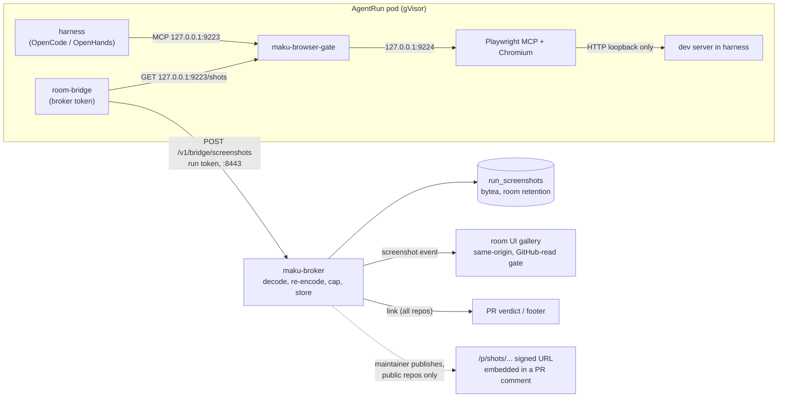

# Harness Screenshots (Phases A and B): Implementation Plan

> **For agentic workers:** REQUIRED SUB-SKILL: Use superpowers:subagent-driven-development (recommended) or superpowers:executing-plans to implement this plan task-by-task. Steps use checkbox (`- [ ]`) syntax for tracking.

**Goal:** An `implementer` or `tester` run of a Repository that opts in gets a loopback-only headless browser (Playwright MCP in a `maku-browser` native sidecar). The agent looks at the dev server it started and checks its own visual fix (phase A). **Every screenshot it takes also reaches the humans**: it shows in the room, in a gallery on the run, and the pull request and the reviewer's verdict link to it; on a public repository a maintainer can publish chosen screenshots into the pull request (phase B). Images attached to the issue reach the agent when its model can see them (phase B3).

**Architecture:** The factory freezes `Repository.spec.screenshots` onto the task at triage. It stamps `AgentRun.spec.screenshots` on implementer and tester runs only. The run-controller adds a `browser` native sidecar (an init container with `restartPolicy: Always`, the same shape as `room-bridge`) to those pods. The sidecar runs `@playwright/mcp` on `127.0.0.1:9224` behind a small Go gate on `127.0.0.1:9223`. The gate is the one place that filters tools, checks the URL, counts screenshots, caps image size **and keeps a copy of each capped screenshot**. The harness (OpenCode or OpenHands) adds a `browser` MCP server that points at the gate and turns on image input only when the run's alias is on the controller's vision list; on a text-only alias the gate strips the image from the model's answer and keeps it for the room. The `room-bridge` sidecar, whose broker token never enters the harness container, relays the gate's screenshots to the broker, which re-encodes, bounds and stores them next to the room's events (the `output_bundles` pattern). The room UI shows them; GitHub gets a link, and pixels only after a maintainer publishes them on a public repository.



**Tech Stack:** Go 1.27 (controller, gate, broker, bridge), TypeScript (room UI, `web/`), Postgres (Atlas migrations), controller-gen CRDs, Helm (charts `maku`, `agent-factory`, `agent-factory-crds`), Python 3 harness drivers (OpenCode 2.4.1, OpenHands agent-server 1.56.0), Node + `@playwright/mcp` + Chromium headless shell, gVisor `runsc`, agentgateway 1.6/1.7.

**Spec:** [`ai-native-ref/docs/superpowers/specs/2026-11-23-v5-harness-screenshots-design.md`](https://github.com/Smana/ai-native-ref/blob/main/docs/superpowers/specs/2026-11-23-v5-harness-screenshots-design.md) (decisions VS1–VS7) and v5 roadmap row Q16 ([`2026-11-22-v5-roadmap-design.md`](https://github.com/Smana/ai-native-ref/blob/main/docs/superpowers/specs/2026-11-22-v5-roadmap-design.md)). Read both. Phase B was deferred by the spec (§9) and is now in scope at the owner's request (2026-11-26); this plan designs it. Where this plan departs from the spec, [Spec vs code](#spec-vs-code) says why, with file:line. Spike results are in the [ledger](2026-11-26-harness-screenshots-ledger.md).

Grounded on Maku `origin/main` `fb2833cc` (phase A rows first written against `a26d990c`) and ANR `origin/main` (2026-11-26).

## Global Constraints

- Opt-in is per `Repository` only (spec §7). It is never set by an issue body, a label or `POST /v1/runs`. Default: off.
- Allowed roles: `implementer` and `tester` only (VS5). The run-controller refuses `spec.screenshots.enabled` on any other role.
- The browser reaches loopback only: `http://127.0.0.1:*`, `http://localhost:*`, `http://[::1]:*` (VS3). It never reaches `file:`, `data:`, `chrome:` or any other host.
- MCP listens on `127.0.0.1:9223` (gate). Playwright MCP listens on `127.0.0.1:9224` (upstream), never `0.0.0.0` (spec §5.1).
- Tools are an allow-list in the gate (default deny). `@playwright/mcp` 0.0.85 (ledger L5) ships `browser_evaluate`, `browser_run_code_unsafe`, `browser_file_upload` and `browser_drop`, which are never served, nor is any tool a page registers through WebMCP (`--no-webmcp` as well) (spec §5.1).
- Caps: `maxScreenshots` defaults to **10**, with a hard ceiling of **25**. Viewport is `1280×800` by default, with a maximum of `1920×1080`. Each image is at most **512 KiB** (spec §5.3).
- Chromium flags: `--no-sandbox --disable-setuid-sandbox --disable-dev-shm-usage --disable-gpu --disable-software-rasterizer --disable-extensions --disable-sync --mute-audio`, with `tini` as PID 1 (VS6).
- Sidecar resources default to `requests: {cpu: 250m, memory: 512Mi}` and `limits: {cpu: "2", memory: 2Gi}`. `/tmp` is an `emptyDir` of `512Mi`, and the cache is `128Mi` (spec §4.1).
- The sidecar gets no `/workspace` mount, no Secret, no projected token, no `HTTPS_PROXY` and no `env.valueFrom` (spec §4.1, AC4).
- Images are pinned by digest and multi-arch (`linux/amd64`, `linux/arm64`). Playwright never downloads at runtime (`PLAYWRIGHT_SKIP_BROWSER_DOWNLOAD=1`).
- The `maku-opencode` and `maku-harness` image sizes grow by 0 bytes (AC1). Python goes into `images/maku-harness/browser_tools.py`, which both images already COPY from.
- Platform constitution: restricted securityContext, `readOnlyRootFilesystem`, `drop: [ALL]`, `RuntimeDefault` seccomp, requests and limits, and probes on long-running containers.
- **Phase B: pixels are data of the run's class.** A screenshot is stored by the broker and shown only to principals who may read the room (`internal/humanapi/access.go:38-73`). It never reaches Postgres events, Slack or GitHub as bytes. GitHub gets a link to the room for every repository. A screenshot's pixels reach GitHub only when a human with write access publishes it, only for `dataClass: public` on a public repository, and only when the Repository allows it.
- **Phase B: never an arbitrary file.** Only the bridge uploads screenshots, and only what the gate captured from Playwright's own answer. The broker decodes every upload (`image.DecodeConfig` first: at most 1920×1080, refusing a decompression bomb), re-encodes it (PNG, or JPEG q80 when the PNG is over 1 MiB), which drops metadata, ancillary chunks and trailing bytes, and stores the re-encoded bytes with `Content-Type` set by the broker.
- **Phase B caps:** 25 screenshots per run (the phase A ceiling), 100 per room, 1 MiB per stored image, 64 MiB per room. Request images: 4 per issue, 5 MiB each before re-encoding, long side at most 1568 px.
- Commits are conventional, in English, with no trailers.

---

## Spec vs code {#spec-vs-code}

The code contradicts the spec, or the spec cannot be built as written, in these places. Each row says what the plan builds instead.

| # | Spec says | Code says | Plan |
|---|---|---|---|
| C1 | §5.2 and §8: the browser gets "zero egress" and the SSRF residual is "None": "outbound packets from `maku-browser` are dropped by the CNI". | Network policy is per pod, not per container. The CNP selects the pod by `agents.ogenki.io/run-id` (`internal/runctl/cnp.go:91-94`). The NetworkPolicy does the same (`internal/runctl/netpol.go`). All containers share one netns, and under gVisor they share one netstack. In `kubernetes` mode (ANR), only the harness gets `HTTPS_PROXY` (`internal/runctl/pod.go:333-336`), but the pod may still dial the egress proxy, the broker and the in-cluster gateway. In Cilium mode it may dial the FQDN allow-list directly (`cnp.go:60-61`). | Chromium is pointed at a dead proxy for every non-loopback host (`--proxy-server=http://127.0.0.1:9` with a loopback bypass list) and gets `--host-resolver-rules` that send all names except localhost to NOTFOUND. The gate refuses a non-loopback `browser_navigate`. The residual is restated honestly: a renderer exploit can reach what the pod reaches, and that is the harness's own trust domain (no credential lives in the sidecar). The spec §8 row needs amending (ANR task A5). |
| C2 | §5.2 layer 1: an "MCP / Chromium origin gate". | Playwright MCP's own docs say `--allowed-origins` "does *not* serve as a security boundary and does *not* affect redirects". | `allowedOrigins` is kept as hygiene only. The enforcing layers are the gate's URL check (agent-requested navigation) and the Chromium proxy and resolver flags (page-initiated requests and redirects). |
| C3 | §4.2: the VAP admits `maku-browser` only "for an `AgentRun` with `spec.screenshots.enabled: true`". | The run-pod VAP matches `pods` only (`charts/maku/templates/run-pod-policy.yaml:30-39`). CEL cannot read the AgentRun. | The VAP keys on the pod's `agents.ogenki.io/role` label (`internal/runctl/objects.go:17-26`), which only the run-controller may set (`run-pod-policy.yaml:54`). It also checks the `browser` container's shape. |
| C4 | §6.1: "Each alias in `maku-gateway`'s model catalog declares `capabilities.vision`." | No such field exists. The catalog is a price table (`charts/maku-gateway/templates/catalog.yaml:1-4`), and aliases are `{provider, model}` (`charts/maku-gateway/values.yaml:81-85`). | The vision list sits beside the aliases the run-controller already reads: `runController.model.gateway.vision.{public,internal}` (`charts/maku/values.yaml:309`, `internal/runctl/config.go:184-211`). The maku-gateway chart is unchanged. |
| C5 | §6.2: a "dedicated `visionAlias`" may stand in for a text-only model. | The screenshot comes back as the MCP tool result inside the run's own conversation, so the run's own model reads it. A second alias would need a describe-the-image sub-call, which the spec does not design. | Phase A needs the run's own alias to be vision-capable. Otherwise the fail-closed fallback applies (§6.3: snapshot only). A vision delegate is listed under Phase B or later. |
| C6 | §4.1: a "sidecar container". | Run status waits on the `harness` container (`internal/runctl/status.go:85-91`). A second regular container would keep the pod `Running` after the harness exits (`restartPolicy: Never`, `pod.go:343`). | `browser` is a native sidecar (an init container with `restartPolicy: Always`), like `room-bridge` (`pod.go:296-305`). The kubelet stops it when the harness exits, and restarts it after an OOM (which helps AC5). |
| C7 | §5.1: the disabled tools are "explicitly disabled". | Playwright MCP has `--caps` (vision, pdf, devtools), but no flag that denies a single tool. | The gate filters `tools/list` and refuses `tools/call` for anything off the allow-list. |
| C8 | §5.3 bullet 4: an "ephemeral vision window" that rewrites old image blocks during condensation. | OpenCode runs with `plugins: []` (`images/maku-opencode/role_config.py:196`) and has no history hook. The OpenHands condenser summarises but does not strip images (`images/maku-harness/openhands_driver.py:121-126`). In both, a past image is part of the cached prefix and is billed at cache-read rates. | Deferred. The [Cost](#cost-and-size) section shows a capped run adds at most about $0.20. AC6 is measured in the drill. If prompt-cache read share drops by more than 5 points, a follow-up builds the window. |
| C9 | §4.3: PNGs are written to `/workspace/.maku-screenshots/`, git-excluded and refused by the push checker. | The sidecar has no `/workspace` (by design, §4.1), and the image comes back inline in the MCP result. Nothing writes a PNG into the workspace. | Phase A writes no PNG into `/workspace`. Playwright's `outputDir` is the sidecar's `/tmp`. The `.git/info/exclude` and push-checker work is dropped (YAGNI) and recorded for Phase B. |
| C10 | §7: per-Repository `memoryLimit`. | Run sizes are chart-level (`pod.go:52-58`). Per-repository resources have no precedent. | Resources live in the chart only (`runController.browser.resources`). `memoryLimit` is left out of the CRD in Phase A. |
| C11 | §1: "working identically across … OpenCode, OpenHands". | OpenCode is still per-issue opt-in on ANR (`ai-native-ref/infrastructure/base/room-broker/helmrelease.yaml:81-87`). Default runs use OpenHands. | Both drivers are wired (Task 10). The drill runs once per harness. |
| C12 | §9: phase B adds "a typed `output_screenshot` safe output on `platform` MCP". | Safe outputs are model requests the factory applies (`internal/mcp/hardening.go:166-220`), and the `platform` MCP token sits in the harness container where the model's commands run (`internal/runctl/pod.go:317-326`). An `output_screenshot` would accept any bytes the model chose. | No model-facing tool uploads pixels. The gate keeps each screenshot it served (or stripped), and the `room-bridge` relays them with its own `room-broker` token, which "never enters the container where the model's commands run" (`pod.go:315-317`). The broker re-encodes every upload anyway (Global Constraints). |
| C13 | §9: "a bounded artifact store (e.g. per-install object bucket …)". | The broker already stores bounded binaries in Postgres: `output_bundles` (`internal/store/migrations/20261113120000_output_bundles.sql`, `internal/store/bundles.go:21-30`), with per-run and per-room quotas, a seal check and a retention sweep. | `run_screenshots` copies that table's shape. No bucket, no new credential. Rows go with the room (`internal/store/retention.go:30-100`). |
| C14 | §9: "per-PR cap, private-repo visibility check so private screenshots are never posted to public URLs". | The verdict comment is posted by the broker (`internal/verdictpost/poster.go:97-115`) and includes the summary only for `dataClass == public`. The enforced PR body passes T2 `sanitize.Text`, which defuses every image (`internal/hardening/text.go:67-90`). `dataClass` is a defaults value, not the repository's visibility (`internal/factory/intake/issues.go:355`). | Every repository gets a link to the room's gallery in the verdict comment and the factory's PR footer. Pixels need a human: `POST /api/rooms/{id}/screenshots/publish` by a writer, for a `public` room whose repository GitHub reports public at that moment, on a Repository with `screenshots.publish: onApproval`. The broker then serves those images at signed unauthenticated URLs and the verdict poster embeds them. |
| C15 | §5.3 and §6.3: no vision means no `browser_take_screenshot`. | Humans can see a screenshot whatever the run's model is. | On a text-only alias the gate still serves `browser_take_screenshot`, keeps the image for the room and answers the model with text only (`screenshot #n kept for the room; your model cannot see images`). The model never receives an image it cannot read (the fail-closed rule holds), and public default runs (`glm-5.3`, text-only, ledger BQ2) still give humans screenshots. |
| C16 | — (issue images are not in the spec) | Intake defuses every issue image to `⟦image: alt⟧` (`internal/factory/sanitize/sanitize.go:67-68,186-196`) and the brief is a ConfigMap `task.md` (`internal/runctl/objects.go:57-69`), which cannot carry binaries of any size. | Phase B3: intake fetches GitHub-hosted issue images only (no arbitrary URL), re-encodes and stores them in the broker as the room's request images, and a room tool `room_image` returns one as MCP image content, served only to a run whose model can see images. The placeholder becomes `⟦image 1: alt⟧` so the brief names them. |

---

## Questions {#questions}

### Answered by the spike (ledger)

| # | Question | Answer |
|---|---|---|
| **BQ1** | Does an MCP tool's image reach the model through each harness? | **Yes, both, as a `user` message** (ledger L1, L2). OpenCode 2.4.1 moves the image into a synthetic `user` message after the `tool` message with no config key (L4). OpenHands 1.56.0 does the same, but only with `capability_overrides: {supports_vision: true}`; without it the image is dropped. So the gateway probe (Task 2) asserts `image_url` on `user` messages, and the OpenHands driver sets the override exactly when the run's alias is on the vision list. |
| **BQ2** | Which ANR aliases accept images? | From provider docs (ledger BQ2): **no** for `glm-5.3` (public `agent-default`, `tier-frontier`); **yes** for `glm-5.3-flash`/`-flashx` (public `tier-light`, `tier-standard`), `k3.1-pro`, `mistral-small-2603` and every Claude 5.5 alias; **likely** for `mistral-medium-2604`. The owner confirms each with drill D0 before the vision list ships. |
| **BQ3** | Chromium under a hardened container? | **Yes under runc** (read-only root, uid 10001, `--cap-drop ALL`, `--network none`, `/tmp` tmpfs): first screenshot 0.9 s after start, RSS about 600 MiB, external fetches fail. Two config facts the image must carry (L5): the resolver rule needs `EXCLUDE 127.0.0.1` or the loopback dev server itself is unreachable, and Playwright MCP 0.0.85 writes action snapshots to `outputDir` files and names them in its text, which the harness cannot open (the gate rewrites those links, Task 8). **runsc** is proven by the `browser-contract` CI job (Task 9); the laptop has none. |

### Decided in this plan

| # | Question | Decision |
|---|---|---|
| BQ4 | Native sidecar or regular container? | Native sidecar (C6). Kubernetes 1.29+, already needed by `room-bridge`. |
| BQ5 | Where does the gate live? | A Go binary in the `maku-browser` image (`cmd/maku-browser-gate`, `internal/browsergate`). |
| BQ7 | Refuse screenshots without a vision alias? | No. The run-controller decides per run (`SCREENSHOTS_VISION=0|1`), and C15 keeps screenshots for humans. |
| PB1 | Where are human-visible screenshots stored? | **The broker's Postgres** (C13), not GitHub. Committing images to a branch would write pixels into public git history for good, needs a `contents: write` token, and GitHub has no API for comment attachments. |
| PB2 | Who uploads? | **The bridge**, from the gate (C12). The model has no upload tool. |
| PB3 | What reaches GitHub? | A link for every repository; pixels only after a writer publishes them on a public repository (C14). |
| PB4 | How do request images reach the agent? | Through a room tool returning MCP image content (C16), the path BQ1 proved, never through the brief ConfigMap. |

### Owner questions {#owner-questions}

| # | Question | Recommendation | Blocks |
|---|---|---|---|
| OQ1 | Publishing pixels into a public pull request needs the broker's `/p/shots/` path to be reachable without login (GitHub's image proxy fetches it anonymously). On ANR that is an oauth2-proxy `skip_auth_routes` entry for `^/p/shots/`. Accept it? | Yes, with signed, room-and-digest-bound URLs that serve only images a writer published, and only for public rooms. Otherwise ship link-only (Tasks 13–18 stand alone). | Task 19, ANR A8 |
| OQ2 | On a text-only model, keep screenshots for humans while the model gets text only (C15)? | Yes. No token cost, and it is the only way public default runs show anything. | Task 8 |
| OQ3 | Keep the phase A cuts: no `/workspace/.maku-screenshots/` copies and no ephemeral vision window (C8, C9; was BQ6)? | Yes, measure AC6 in the drill first. | none |
| OQ4 | Screenshot retention: with the room (default 90 days) or a shorter floor like bundles (14 days)? | With the room: the gallery is the record of what the agent saw, and the per-room 64 MiB cap bounds it. | Task 13 |
| OQ5 | Request images (B3): the factory downloads GitHub-hosted issue images with its installation token, for private repositories too, and stores them in the room. Accept? | Yes, GitHub hosts only, same data class as the issue text it already stores. | Task 20 |
| OQ6 | Run drill D0 (one curl per alias, ledger BQ2) to confirm the vision list. | The exact command is in [Drill D0](#drill-d0). | ANR A2 |

## File structure

| Path | Change | Responsibility |
|---|---|---|
| `api/v1alpha1/agentrun_types.go` | modify | `AgentRunScreenshots{Enabled, MaxScreenshots}` on `AgentRunSpec` |
| `api/factory/v1alpha1/factoryconfig_types.go` | modify | `RepositorySpec.Screenshots` |
| `api/factory/v1alpha1/task_types.go` | modify | `ProfileStatus.Screenshots` (frozen at triage) and `RunProvenance.Screenshots` |
| `internal/factory/config/screenshots.go` | create | `config.Screenshots`, `ScreenshotsFor(role)`, defaults and ceiling |
| `internal/factory/config/config.go` | modify | `Repository.Screenshots` |
| `internal/factory/resources/assemble.go:407` | modify | carry the `screenshots` key |
| `internal/factory/reconciler/{reconciler.go,implement.go,tester.go}` | modify | freeze at triage, then stamp implementer and tester specs |
| `internal/factory/runs/runs.go` | modify | `Spec.Screenshots` → `spec.screenshots` |
| `internal/runctl/config.go` | modify | `Images.Browser`, `Browser.Resources`, `Gateway.Vision`, `Invalid` rules |
| `internal/runctl/browser.go` | create | `browserSidecar(...)`, `visionFor(...)` |
| `internal/runctl/pod.go` | modify | append the sidecar and the harness env |
| `internal/browsergate/{policy.go,image.go,proxy.go}` | create | the tool allow-list, URL check, counter, image cap, JSON and SSE proxy |
| `cmd/maku-browser-gate/main.go` | create | the gate binary |
| `images/maku-browser/{Dockerfile,package.json,package-lock.json,config.json,entrypoint.sh,tests/runsc-contract.sh}` | create | the sidecar image and its gVisor contract |
| `images/maku-harness/browser_tools.py` | create | `browser_mcp(env)`, `browser_rules(env)`, `vision_on(env)` shared by both drivers |
| `images/maku-opencode/role_config.py`, `opencode_driver.py`, `Dockerfile` | modify | the `browser` MCP server, model modalities, rules |
| `images/maku-harness/openhands_driver.py`, `Dockerfile` | modify | `mcp_config.browser`, vision override, rules |
| `charts/maku/{values.yaml,values.schema.json,templates/run-controller-config.yaml,templates/run-pod-policy.yaml}` | modify | image, resources, vision list, VAP |
| `charts/agent-factory/{values.yaml,values.schema.json}` | modify | pass-through and a pinned default |
| `charts/maku-gateway/tests/probe/{client.py,echo-llm.py,probe.sh}` | modify | P7: image parts survive the presets |
| `.github/workflows/{ci.yaml,release.yaml,image.yaml}` | modify | build, runsc contract, release `maku-browser` |
| `docs/browser-verification.md`, `docs/onboard-a-repository.md`, `docs/opencode-harness.md` | create/modify | operator docs |
| `internal/browsergate/shots.go` | create | phase B: the gate's screenshot keep (`/shots`, `/shots/{n}`) |
| `internal/store/migrations/<ts>_run_screenshots.sql`, `internal/store/screenshots.go` | create | phase B: the table, quotas, retention |
| `internal/shots/` (`image.go`, `doc.go`) | create | phase B: decode, bound, re-encode (shared by the broker's upload route and B3 intake) |
| `internal/envelope/screenshot.go` | create | phase B: the `screenshot` event payload |
| `internal/bridgeapi/screenshots.go` | create | phase B: `POST /v1/bridge/screenshots` (run token) and `POST /v1/rooms/{id}/images` (factory) |
| `internal/bridge/shots.go` | create | phase B: the relay from the gate to the broker |
| `internal/humanapi/screenshots.go` | create | phase B: list, image, publish, and the signed public route |
| `internal/summary/flow.go` | modify | phase B: `FlowNode.Screenshots` |
| `web/src/shots.ts`, `web/src/chat.ts`, `web/src/runview.ts`, `web/src/app.css` | create/modify | phase B: the chat card, the run gallery and the viewer |
| `internal/verdictpost/poster.go`, `internal/hardening/footer.go` | modify | phase B: the gallery link, and published images |
| `internal/factory/intake/images.go`, `internal/factory/sanitize/sanitize.go` | create/modify | phase B3: GitHub-hosted issue images |
| `internal/mcp/image.go` | create | phase B3: the `room_image` tool |

---

## Delivery: the PR sequence {#pr-sequence}

Each PR is stacked on the one before, green before the next is built on it, and merged by the owner. Humans see screenshots at the first Maku release carrying PR 1–7, adopted by ANR PR A; so phase B's room work (PR 6–7) comes right after the gate, before the docs, and GitHub (PR 8–9) and request images (PR 10) follow.

| PR | Repo | Tasks | What it makes true |
|---|---|---|---|
| 0 | Maku | this plan, Task 1 ledger | the plan; BQ1–BQ3 answered |
| 1 | Maku | 3, 4, 5 | the opt-in exists end to end in the API, the factory and the controller config; nothing runs yet |
| 2 | Maku | 6, 15 (pod side) | an opted-in implementer or tester pod gets the `browser` sidecar and the bridge its gate URL |
| 3 | Maku | 7, 8 | the gate: allow-list, loopback check, caps, keep |
| 4 | Maku | 9 | the `maku-browser` image and its runsc contract in CI (BQ3 on runsc) |
| 5 | Maku | 10, 11, 2 | both harnesses use it; charts and VAP ship it; the gateway probe P7 |
| 6 | Maku | 13, 14, 15 (relay) | the broker stores what the bridge relays |
| 7 | Maku | 16, 17 | **humans see the screenshots in the room** |
| 8 | Maku | 18, 12, 22 (B1 parts) | the verdict and the pull request link to the gallery; docs |
| 9 | Maku | 19 | publishing into a public pull request (after OQ1) |
| 10 | Maku | 20, 21 | request images reach a vision run |
| A | ANR | A1–A7 | adoption on the Maku release carrying PR 1–8; the drill (D0–D10) |
| B | ANR | A8, A9 | publishing and request images, after PR 9–10 are released |

## Task 1: Offline spike (BQ1, BQ2, BQ3). Done 2026-11-26.

Results: [ledger](2026-11-26-harness-screenshots-ledger.md) rows L1–L5 and BQ2. The capture server, the stub MCP server and the throwaway Playwright image are not committed; the ledger says how each row was proven so it can be rerun. Building may proceed: no harness drops the image once configured (BQ1).

## Task 2: Gateway probe P7: image parts survive each preset

**Files:**
- Modify: `charts/maku-gateway/tests/probe/client.py` (an `IMAGE` message mode)
- Modify: `charts/maku-gateway/tests/probe/echo-llm.py` (report image parts per message)
- Modify: `charts/maku-gateway/tests/probe/probe.sh` (section P7)

**Interfaces:**
- Consumes: L1 and L2 (which message role carries the image).
- Produces: proof that agentgateway forwards `image_url` parts unchanged on the `zai`, `mistral` and `moonshot` presets. Anthropic's native translation is proven live in the drill (step D2).

- [ ] **Step 1: Add the failing assertions.** In `echo-llm.py`, add to `report`:

```python
"images": [
    {"role": m.get("role"), "n": sum(1 for p in (m.get("content") or []) if isinstance(p, dict) and p.get("type") == "image_url")}
    for m in req.get("messages", []) if isinstance(m.get("content"), list)
],
```

In `client.py`, when `message == "IMAGE"`, send the shape both harnesses send (ledger L1, L2): `user`, `assistant` with `tool_calls`, `tool` (text only), then a `user` message with `[{"type":"text","text":"look"},{"type":"image_url","image_url":{"url":"data:image/png;base64,iVBORw0KGgo="}}]`. In `probe.sh`, after P4:

```bash
echo "==> P7: image parts"
for alias in tier-light mistral-light kimi-frontier; do
  r="$(report "$(call "$PUB/m/$alias/v1/chat/completions" /tokens/public-$alias tier-light IMAGE)")"
  jq -e '[.images[] | select(.role == "user" and .n == 1)] | length == 1' <<<"$r" >/dev/null \
    && pass "P7 $alias: the user message after a tool result reaches the provider with its image part" || fail "P7 $alias: $r"
done
```

- [ ] **Step 2: Run the probe, expect P7 to fail** before `echo-llm.py` reports images: `charts/maku-gateway/tests/probe/probe.sh` (needs Docker and k3d. Docker is off by default on the laptop: start it for this run.)
- [ ] **Step 3: Finish echo-llm and client as above. Rerun and expect P7 to pass.** If a preset's transformation drops list content (the Mistral `reasoning_effort` note in `_presets.tpl` is a precedent), record it in the ledger as **L6** and stop for the owner.
- [ ] **Step 4: Commit**

```bash
git add charts/maku-gateway/tests/probe
git commit -m "test(gateway): probe P7 proves image parts pass every preset"
```

## Task 3: API: `spec.screenshots` on Repository and AgentRun

**Files:**
- Modify: `api/v1alpha1/agentrun_types.go` (after `Search`, line 129)
- Modify: `api/factory/v1alpha1/factoryconfig_types.go:158-191`
- Modify: `api/factory/v1alpha1/task_types.go` (`ProfileStatus`, `RunProvenance`)
- Create: `internal/factory/config/screenshots.go`, `internal/factory/config/screenshots_test.go`
- Modify: `internal/factory/config/config.go:404-428`, `internal/factory/resources/assemble.go:407`
- Test: `api/v1alpha1/agentrun_crd_test.go`, `internal/factory/resources/assemble_test.go`
- Generated: `config/crd/*.yaml`, `charts/agent-factory-crds/files/*`, `zz_generated.deepcopy.go` (`task crd:gen`)

**Interfaces:**
- Produces:
  - `v1alpha1.AgentRunScreenshots{Enabled bool "enabled"; MaxScreenshots int32 "maxScreenshots,omitempty"}`, and `AgentRunSpec.Screenshots *AgentRunScreenshots "screenshots,omitempty"`
  - `config.Screenshots{Enabled bool; Roles []string; MaxScreenshots int32}`, `const DefaultMaxScreenshots = 10`, `const MaxScreenshotsCeiling = 25`
  - `func (s *Screenshots) For(role string) (max int32, ok bool)`
  - `ProfileStatus.Screenshots *config.Screenshots`, `RunProvenance.Screenshots bool "screenshots,omitempty"`

- [ ] **Step 1: Write the failing tests**

```go
// internal/factory/config/screenshots_test.go
func TestScreenshotsFor(t *testing.T) {
	var none *Screenshots
	if _, ok := none.For("implementer"); ok {
		t.Fatal("nil screenshots is off")
	}
	s := &Screenshots{Enabled: true}
	for role, want := range map[string]bool{"implementer": true, "tester": true, "reviewer": false, "triager": false, "scoper": false} {
		if _, ok := s.For(role); ok != want {
			t.Errorf("%s: got %v", role, ok)
		}
	}
	if m, _ := s.For("tester"); m != DefaultMaxScreenshots {
		t.Errorf("default max %d", m)
	}
	s = &Screenshots{Enabled: true, Roles: []string{"tester"}, MaxScreenshots: 99}
	if _, ok := s.For("implementer"); ok {
		t.Error("roles narrows the set")
	}
	if m, _ := s.For("tester"); m != MaxScreenshotsCeiling {
		t.Errorf("ceiling: %d", m)
	}
}
```

In `agentrun_crd_test.go`, add a case asserting the CRD schema has `spec.screenshots.maxScreenshots` with `minimum: 1, maximum: 25`. In `assemble_test.go`, copy `TestAssembleCarriesPrivateCode` (line 394) to `TestAssembleCarriesScreenshots`, asserting `RepositoryFor("Smana/maku").Screenshots.Enabled`.

- [ ] **Step 2: Run, expect FAIL** (`undefined: Screenshots`):
`go test ./internal/factory/config/ -run TestScreenshotsFor ./internal/factory/resources/ -run Screenshots ./api/...`
- [ ] **Step 3: Implement**

```go
// internal/factory/config/screenshots.go
// SPDX-License-Identifier: Apache-2.0

package config

import "slices"

const (
	DefaultMaxScreenshots int32 = 10
	MaxScreenshotsCeiling int32 = 25
)

// screenshotRoles are the roles a browser may serve in phase A (VS5).
var screenshotRoles = []string{"implementer", "tester"}

// Screenshots is a Repository's opt-in to the browser sidecar (v5 Q16, phase A).
type Screenshots struct {
	Enabled bool `json:"enabled,omitempty"`
	// +kubebuilder:validation:MaxItems=2
	// +kubebuilder:validation:items:Enum=implementer;tester
	Roles []string `json:"roles,omitempty"`
	// +kubebuilder:validation:Minimum=1
	// +kubebuilder:validation:Maximum=25
	MaxScreenshots int32 `json:"maxScreenshots,omitempty"`
}

// For is the run's screenshot cap and whether role gets the browser.
func (s *Screenshots) For(role string) (int32, bool) {
	if s == nil || !s.Enabled || !slices.Contains(screenshotRoles, role) {
		return 0, false
	}
	if len(s.Roles) > 0 && !slices.Contains(s.Roles, role) {
		return 0, false
	}
	n := s.MaxScreenshots
	if n <= 0 {
		n = DefaultMaxScreenshots
	}
	return min(n, MaxScreenshotsCeiling), true
}
```

Add `Screenshots *config.Screenshots \`json:"screenshots,omitempty"\`` to `RepositorySpec` and to `config.Repository`. Append `"screenshots"` to the key list at `assemble.go:407`. Add `AgentRunScreenshots` with `+kubebuilder:validation:Minimum=1` and `Maximum=25` on `MaxScreenshots`. Add `Screenshots *config.Screenshots` to `ProfileStatus`, and `Screenshots bool` to `RunProvenance`.

- [ ] **Step 4: Regenerate and run, expect PASS:** `task crd:gen && go test ./internal/factory/config/ ./internal/factory/resources/ ./api/... && task crd:check`
- [ ] **Step 5: Commit**

```bash
git add api internal/factory/config internal/factory/resources config/crd charts/agent-factory-crds
git commit -m "feat(api): add the screenshots opt-in to Repository and AgentRun"
```

## Task 4: Factory: freeze at triage, stamp implementer and tester runs

**Files:**
- Modify: `internal/factory/reconciler/reconciler.go:1343-1346` (`ProfileStatus`)
- Modify: `internal/factory/reconciler/implement.go:305-316`, `internal/factory/reconciler/tester.go:67-73`
- Modify: `internal/factory/runs/runs.go:138-150` (`Spec.Screenshots`), `:280` (spec map)
- Modify: `internal/factory/reconciler/implement.go:160,362` (provenance)
- Test: `internal/factory/runs/runs_test.go`, `internal/factory/reconciler/screenshots_test.go` (create)

**Interfaces:**
- Consumes: `config.Screenshots.For(role)` (Task 3).
- Produces: `runs.Spec.Screenshots int32`. 0 means off. A value above 0 renders `spec.screenshots: {enabled: true, maxScreenshots: N}`.

- [ ] **Step 1: Write the failing tests.** In `runs_test.go`: `Spec{Screenshots: 10}` renders `spec.screenshots.enabled == true`, `maxScreenshots == 10`, and `Spec{}` renders no `screenshots` key. In `reconciler/screenshots_test.go`, use the existing fake-reconciler helpers from `harness_test.go`:

```go
func TestScreenshotsRideImplementerAndTesterOnly(t *testing.T) {
	cfg := cfgWithRepo(t, func(rc *config.Repository) { rc.Screenshots = &config.Screenshots{Enabled: true, MaxScreenshots: 7} })
	task := triagedTask(t, cfg) // ProfileStatus frozen
	if task.Status.Profile.Screenshots == nil || !task.Status.Profile.Screenshots.Enabled {
		t.Fatal("triage freezes the repository's screenshots")
	}
	r := newTestReconciler(t)
	if s := r.implementerSpec(cfg, task, "x"); s.Screenshots != 7 {
		t.Errorf("implementer: %d", s.Screenshots)
	}
	if s := r.testerSpec(cfg, task, "x"); s.Screenshots != 7 {
		t.Errorf("tester: %d", s.Screenshots)
	}
	rv := r.implementerSpec(cfg, task, "x")
	rv.Role = "reviewer"
	stampScreenshots(task, &rv)
	if rv.Screenshots != 0 {
		t.Error("reviewer never gets the browser")
	}
}

func TestScreenshotsFrozenAtTriage(t *testing.T) {
	cfg := cfgWithRepo(t, func(rc *config.Repository) { rc.Screenshots = &config.Screenshots{Enabled: true} })
	task := triagedTask(t, cfg)
	cfg.RepositoryFor(task.Spec.Repository).Screenshots.Enabled = false // a later config change
	if s := newTestReconciler(t).implementerSpec(cfg, task, "x"); s.Screenshots != 10 {
		t.Error("a run reads the task's frozen value, not today's config")
	}
}
```

(If `cfgWithRepo` and `triagedTask` are not already in the package's test helpers, write them in this file on top of the existing `harness_test.go` fixtures.)

- [ ] **Step 2: Run, expect FAIL:** `go test ./internal/factory/runs/ ./internal/factory/reconciler/ -run Screenshots`
- [ ] **Step 3: Implement.** In `ProfileStatus` construction add `Screenshots: rc.Screenshots.DeepCopy()` (`rc := r.repo(cfg, t)`; it is nil-safe). Add `stampScreenshots`, and call it in `startRun` next to `s.Harness = harnessFor(t, s)` (`implement.go:315`). `startRun` serves both implementer and tester, so a single call site covers both:

```go
// stampScreenshots gives an implementer or tester run the task's frozen browser opt-in (v5 Q16).
func stampScreenshots(t *v1alpha1.Task, s *runs.Spec) {
	s.Screenshots = 0
	if p := t.Status.Profile; p != nil && t.Spec.Kind != "integration" {
		if n, ok := p.Screenshots.For(s.Role); ok {
			s.Screenshots = n
		}
	}
}
```

In `runs.go`: `if s.Screenshots > 0 { spec["screenshots"] = map[string]any{"enabled": true, "maxScreenshots": int64(s.Screenshots)} }`. In provenance: `Screenshots: s.Screenshots > 0`.
- [ ] **Step 4: Run, expect PASS** (same command).
- [ ] **Step 5: Commit**

```bash
git add internal/factory
git commit -m "feat(factory): freeze the screenshots opt-in at triage and stamp implementer and tester runs"
```

## Task 5: Run-controller config: browser image, resources, vision list, refusals

**Files:**
- Modify: `internal/runctl/config.go:174-211` (`Gateway.Vision`), `:340-349` (`Images.Browser`), `Config.Browser`, `Invalid` (`:516-545`), load-time validation
- Test: `internal/runctl/config_test.go`

**Interfaces:**
- Produces:
  - `Images.Browser string "browser,omitempty"`
  - `Config.Browser BrowserConfig{Resources corev1.ResourceRequirements "resources,omitzero"}`, defaulted at load to the Global Constraints values
  - `Gateway.Vision GatewayAliases "vision,omitzero"`
  - `func (c Config) VisionFor(r *v1alpha1.AgentRun, alias string) bool`

- [ ] **Step 1: Write the failing tests**

```go
func TestScreenshotsRefusals(t *testing.T) {
	on := func(r *v1alpha1.AgentRun) { r.Spec.Screenshots = &v1alpha1.AgentRunScreenshots{Enabled: true, MaxScreenshots: 10} }
	c := testConfig(t)
	if why := c.Invalid(run("r1", on)); !strings.Contains(why, "images.browser") {
		t.Errorf("no browser image: %q", why)
	}
	c.Images.Browser = "ghcr.io/smana/maku-browser:v0.60.0@sha256:" + strings.Repeat("a", 64)
	if why := c.Invalid(run("r1", on)); why != "" {
		t.Errorf("implementer: %q", why)
	}
	if why := c.Invalid(run("r1", on, func(r *v1alpha1.AgentRun) { r.Spec.Role = "reviewer" })); !strings.Contains(why, "implementer or tester") {
		t.Errorf("reviewer: %q", why)
	}
}

func TestVisionFor(t *testing.T) {
	c := testConfig(t)
	c.Model.Mode = ModelModeGateway
	c.Model.Gateway.Vision = GatewayAliases{Public: []string{"mistral-standard"}, Internal: []string{"agent-default"}}
	pub := run("r1")
	if !c.VisionFor(pub, "mistral-standard") || c.VisionFor(pub, "agent-default") {
		t.Error("public list")
	}
	in := run("r1", func(r *v1alpha1.AgentRun) { r.Spec.DataClass = "internal" })
	if !c.VisionFor(in, "agent-default") {
		t.Error("internal list")
	}
}

func TestVisionAliasMustBeServed(t *testing.T) {
	_, err := cfgFrom(t, goodGatewayConfig+"\n      vision: {public: [not-served]}\n")
	if err == nil || !strings.Contains(err.Error(), "vision") {
		t.Fatalf("a vision alias the listener does not serve is refused at load: %v", err)
	}
}
```

(`goodGatewayConfig` is the existing gateway fixture in `config_test.go` or `gateway_test.go`. Indent the appended line under `model.gateway`.)
- [ ] **Step 2: Run, expect FAIL:** `go test ./internal/runctl/ -run 'Screenshots|Vision'`
- [ ] **Step 3: Implement.** Add to `Invalid`, before the gateway block:

```go
	case r.Spec.Screenshots != nil && r.Spec.Screenshots.Enabled && r.Spec.Role != "implementer" && r.Spec.Role != "tester":
		return "spec.screenshots is for an implementer or tester run only (v5 Q16, VS5)"
	case r.Spec.Screenshots != nil && r.Spec.Screenshots.Enabled && c.Images.Browser == "":
		return "spec.screenshots needs images.browser configured"
```

`VisionFor` picks `Vision.Public` or `Vision.Internal` by `r.Spec.DataClass` and returns `slices.Contains`. In `model.mode secret` it returns false. At load, every `Vision.<class>` entry must be in `Aliases.<class>`, with the error message `model.gateway.vision.<class>: %q is not an alias the listener serves`.
- [ ] **Step 4: Run, expect PASS** (same command).
- [ ] **Step 5: Commit**

```bash
git add internal/runctl/config.go internal/runctl/config_test.go
git commit -m "feat(runctl): configure the browser image, its resources and the vision aliases"
```

## Task 6: Run pod: the `browser` native sidecar and the harness env

**Files:**
- Create: `internal/runctl/browser.go`
- Modify: `internal/runctl/pod.go:233-347`
- Test: `internal/runctl/render_test.go`, `internal/runctl/testdata/pod-browser.golden.yaml` (create with `-update`)

**Interfaces:**
- Consumes: `Images.Browser`, `Config.Browser.Resources`, `VisionFor` (Task 5).
- Produces: pod contract.
  - The init container `browser` has `restartPolicy: Always`, the image `c.Images.Browser`, and env `MAX_SCREENSHOTS=<n>` and `VISION=0|1` only.
  - Its mounts are `browser-tmp:/tmp` (emptyDir 512Mi) and `browser-cache:/home/browser/.cache` (emptyDir 128Mi) only.
  - Its probes are `startupProbe` and `readinessProbe` `httpGet 127.0.0.1:9223/healthz`, and `livenessProbe` the same with period 20s.
  - The harness gets `BROWSER_MCP_URL=http://127.0.0.1:9223/mcp` and `SCREENSHOTS_VISION=0|1`.
  - The constant is `BrowserGatePort = 9223`.

- [ ] **Step 1: Write the failing tests**

```go
func TestBrowserPodGolden(t *testing.T) {
	c := testConfig(t)
	c.Images.Browser = "ghcr.io/smana/maku-browser:v0.60.0"
	r := goRun(func(r *v1alpha1.AgentRun) { r.Spec.Screenshots = &v1alpha1.AgentRunScreenshots{Enabled: true, MaxScreenshots: 10} })
	golden(t, "pod-browser.golden.yaml", Pod(r, c, testModel, "abcdefgh"))
}

func TestBrowserSidecarHoldsNothing(t *testing.T) {
	c := testConfig(t)
	c.Images.Browser = "ghcr.io/smana/maku-browser:v0.60.0"
	p := Pod(goRun(func(r *v1alpha1.AgentRun) { r.Spec.Screenshots = &v1alpha1.AgentRunScreenshots{Enabled: true, MaxScreenshots: 10} }), c, testModel, "abcdefgh")
	var b *corev1.Container
	for i := range p.Spec.InitContainers {
		if p.Spec.InitContainers[i].Name == "browser" {
			b = &p.Spec.InitContainers[i]
		}
	}
	if b == nil || b.RestartPolicy == nil || *b.RestartPolicy != corev1.ContainerRestartPolicyAlways {
		t.Fatal("browser is a native sidecar")
	}
	for _, m := range b.VolumeMounts {
		if m.Name != "browser-tmp" && m.Name != "browser-cache" {
			t.Errorf("browser mounts %s", m.Name)
		}
	}
	for _, e := range b.Env {
		if e.ValueFrom != nil || strings.Contains(e.Name, "PROXY") || strings.Contains(e.Name, "TOKEN") {
			t.Errorf("browser env %s", e.Name)
		}
	}
	if !*b.SecurityContext.ReadOnlyRootFilesystem {
		t.Error("read-only root")
	}
}

func TestNoBrowserWithoutOptIn(t *testing.T) {
	c := testConfig(t)
	c.Images.Browser = "ghcr.io/smana/maku-browser:v0.60.0"
	for _, ic := range Pod(goRun(), c, testModel, "abcdefgh").Spec.InitContainers {
		if ic.Name == "browser" {
			t.Fatal("AC1: no opt-in, no sidecar")
		}
	}
}
```

Also add a case for a run with `RoomRef == ""`: the sidecar is the only init container.
- [ ] **Step 2: Run, expect FAIL:** `go test ./internal/runctl/ -run Browser`
- [ ] **Step 3: Implement `browser.go`**

```go
// SPDX-License-Identifier: Apache-2.0

package runctl

import (
	"fmt"
	"strconv"

	corev1 "k8s.io/api/core/v1"
	"k8s.io/apimachinery/pkg/util/intstr"

	v1alpha1 "github.com/Smana/maku/api/v1alpha1"
)

// BrowserGatePort is the browser gate's loopback port: the harness's MCP server named browser.
const BrowserGatePort = 9223

// browserSidecar is the opt-in browser (v5 Q16, VS2): a native sidecar holding no workspace, no
// secret and no token, so the kubelet ends it with the harness and restarts it after an OOM.
func browserSidecar(r *v1alpha1.AgentRun, c Config, vision bool) (corev1.Container, []corev1.Volume) {
	always := corev1.ContainerRestartPolicyAlways
	health := corev1.ProbeHandler{HTTPGet: &corev1.HTTPGetAction{Host: "127.0.0.1", Path: "/healthz", Port: intstr.FromInt32(BrowserGatePort)}}
	v := "0"
	if vision {
		v = "1"
	}
	ctr := corev1.Container{
		Name: "browser", Image: c.Images.Browser, RestartPolicy: &always,
		Env: []corev1.EnvVar{{Name: "MAX_SCREENSHOTS", Value: strconv.Itoa(int(r.Spec.Screenshots.MaxScreenshots))}, {Name: "VISION", Value: v}},
		StartupProbe:    &corev1.Probe{ProbeHandler: health, PeriodSeconds: 1, FailureThreshold: 60},
		ReadinessProbe:  &corev1.Probe{ProbeHandler: health, PeriodSeconds: 10},
		LivenessProbe:   &corev1.Probe{ProbeHandler: health, PeriodSeconds: 20, FailureThreshold: 3},
		Resources:       c.Browser.Resources,
		SecurityContext: containerSecurity(),
		VolumeMounts:    []corev1.VolumeMount{{Name: "browser-tmp", MountPath: "/tmp"}, {Name: "browser-cache", MountPath: "/home/browser/.cache"}},
	}
	return ctr, []corev1.Volume{emptyDir("browser-tmp", "512Mi", false), emptyDir("browser-cache", "128Mi", false)}
}

func browserEnv(vision bool) []corev1.EnvVar {
	v := "0"
	if vision {
		v = "1"
	}
	return []corev1.EnvVar{{Name: "BROWSER_MCP_URL", Value: fmt.Sprintf("http://127.0.0.1:%d/mcp", BrowserGatePort)}, {Name: "SCREENSHOTS_VISION", Value: v}}
}
```

In `Pod`, after the room block (`pod.go:327`) and before `om := meta(...)`:

```go
	if sc := s.Screenshots; sc != nil && sc.Enabled {
		vision := c.VisionFor(r, m.Name)
		ctr, vs := browserSidecar(r, c, vision)
		inits = append(inits, ctr)
		vols = append(vols, vs...)
		harness.Env = append(harness.Env, browserEnv(vision)...)
	}
```

The harness keeps its `HTTPS_PROXY` (`pod.go:333-336`). `NO_PROXY` already covers `127.0.0.1` through `proxyEnv`: verify this in the golden output. The sidecar gets no `proxyEnv`. `m.Name` is the alias the harness calls, which is also what `MODEL` carries (`pod.go:140`).
- [ ] **Step 4: Run, expect PASS** after `go test ./internal/runctl/ -run Browser -update` and a review of the golden diff. Then run `go test ./internal/runctl/` for the package.
- [ ] **Step 5: Commit**

```bash
git add internal/runctl
git commit -m "feat(runctl): add the opt-in browser native sidecar to implementer and tester pods"
```

## Task 7: Browser gate: policy, counter and image cap (pure functions)

**Files:**
- Create: `internal/browsergate/policy.go`, `internal/browsergate/policy_test.go`
- Create: `internal/browsergate/image.go`, `internal/browsergate/image_test.go`

**Interfaces:**
- Consumes: L5 (tool names).
- Produces:
  - `var Allowed = []string{"browser_navigate","browser_navigate_back","browser_snapshot","browser_take_screenshot","browser_click","browser_hover","browser_type","browser_fill_form","browser_select_option","browser_press_key","browser_resize","browser_emulate_media","browser_handle_dialog","browser_wait_for","browser_find","browser_console_messages","browser_network_requests","browser_tabs","browser_close"}` (0.0.85 names, ledger L5; `browser_emulate_media` is how the agent checks dark mode)
  - `func FilterTools(tools []map[string]any) []map[string]any` (the screenshot tool stays without vision: C15)
  - `func CheckCall(name string, args map[string]any) error` (errors: `ErrToolNotAllowed`, `ErrURLRefused`, `ErrViewport`)
  - `type Counter struct{ Path string; Max int }` with `func (c *Counter) Take() (int, error)` (`ErrCapReached` reports `screenshot_cap_reached`; the count is persisted in a file under `/tmp` so it survives a sidecar restart)
  - `func CapImage(b []byte, mime string, limit int) ([]byte, string, error)` (re-encodes as JPEG q=70, halving dimensions until it is ≤ limit; `ErrTooLarge` after 3 passes)
  - `const ImageLimit = 512 << 10`

- [ ] **Step 1: Write the failing tests**

```go
func TestCheckCallURLs(t *testing.T) {
	ok := []string{"http://127.0.0.1:1313/", "http://localhost:5173/docs", "http://[::1]:3000"}
	bad := []string{"https://example.com", "http://169.254.169.254/latest", "http://room-broker.maku.svc:8443/",
		"file:///etc/passwd", "data:text/html,x", "chrome://settings", "http://127.0.0.1.nip.io/", "https://127.0.0.1:8443/",
		"http://localhost@evil.com/", "http://0x7f000001/", "http://127.1/"}
	for _, u := range ok {
		if err := CheckCall("browser_navigate", map[string]any{"url": u}); err != nil {
			t.Errorf("%s: %v", u, err)
		}
	}
	for _, u := range bad {
		if err := CheckCall("browser_navigate", map[string]any{"url": u}); !errors.Is(err, ErrURLRefused) {
			t.Errorf("%s: %v", u, err)
		}
	}
}

func TestCheckCallTools(t *testing.T) {
	for _, n := range []string{"browser_evaluate", "browser_run_code_unsafe", "browser_file_upload", "browser_drop", "browser_drag", "anything_new"} {
		if err := CheckCall(n, nil); !errors.Is(err, ErrToolNotAllowed) {
			t.Errorf("%s: %v", n, err)
		}
	}
	if err := CheckCall("browser_resize", map[string]any{"width": 1921.0, "height": 1080.0}); !errors.Is(err, ErrViewport) {
		t.Error("viewport ceiling 1920x1080")
	}
}

func TestFilterTools(t *testing.T) {
	in := []map[string]any{{"name": "browser_snapshot"}, {"name": "browser_take_screenshot"}, {"name": "browser_evaluate"}, {"name": "browser_run_code_unsafe"}, {"name": "webmcp_page_tool"}}
	if got := names(FilterTools(in)); !slices.Equal(got, []string{"browser_snapshot", "browser_take_screenshot"}) {
		t.Error(got)
	}
}

func TestCounterSurvivesRestart(t *testing.T) {
	p := filepath.Join(t.TempDir(), "count")
	c := &Counter{Path: p, Max: 2}
	c.Take()
	c2 := &Counter{Path: p, Max: 2} // a restarted sidecar
	if n, err := c2.Take(); n != 2 || err != nil {
		t.Fatal(n, err)
	}
	if _, err := c2.Take(); !errors.Is(err, ErrCapReached) {
		t.Fatal(err)
	}
}

func TestCapImage(t *testing.T) {
	big := noisePNG(t, 1920, 1080) // > 512 KiB of random pixels
	out, mime, err := CapImage(big, "image/png", ImageLimit)
	if err != nil || len(out) > ImageLimit || mime != "image/jpeg" {
		t.Fatal(len(out), mime, err)
	}
	small := noisePNG(t, 8, 8)
	if out, mime, _ := CapImage(small, "image/png", ImageLimit); !bytes.Equal(out, small) || mime != "image/png" {
		t.Error("under the limit: unchanged")
	}
}
```

- [ ] **Step 2: Run, expect FAIL:** `go test ./internal/browsergate/`
- [ ] **Step 3: Implement.**
  - **URL rule:** `url.Parse`. Require scheme `http`, `u.User == nil`, and `u.Hostname()` exactly in `{"127.0.0.1","localhost","::1"}`. That refuses `127.1`, `0x7f000001` and `*.nip.io`, because only literal matches pass.
  - **Counter:** read and write the decimal count in `Path` with `os.WriteFile(..., 0o600)` under a `sync.Mutex`.
  - **CapImage:** use `image.Decode` (register `image/png` and `image/jpeg`), `golang.org/x/image/draw.ApproxBiLinear` to halve, and `jpeg.Encode{Quality: 70}`. First check whether `golang.org/x/image` is already in `go.mod`. If it is not, use the standard library's nearest-neighbour halving written inline (8 lines), so no dependency is added.
- [ ] **Step 4: Run, expect PASS** (same command).
- [ ] **Step 5: Commit**

```bash
git add internal/browsergate
git commit -m "feat(browsergate): the browser's tool allow-list, loopback URL check, screenshot cap and image cap"
```

## Task 8: Browser gate: the MCP proxy and the binary

**Files:**
- Create: `internal/browsergate/proxy.go`, `internal/browsergate/proxy_test.go`
- Create: `cmd/maku-browser-gate/main.go`

**Interfaces:**
- Consumes: Task 7.
- Produces:
  - `func NewProxy(upstream string, counter *Counter, keep *Keep, vision bool) http.Handler`, serving `/mcp` (POST, GET, DELETE), `/shots`, `/shots/{n}` and `/healthz`
  - the binary `maku-browser-gate -listen 127.0.0.1:9223 -upstream http://127.0.0.1:9224/mcp -count /tmp/gate/count`, which reads `MAX_SCREENSHOTS` and `VISION`
  - a stdout line per refused or capped call: `maku-browser-gate: refused tool=<n> reason=<code>`, and `maku-browser-gate: screenshot n=<k>/<max> bytes=<b>`

- [ ] **Step 1: Write the failing tests** against an `httptest` fake upstream that answers `tools/list` with seven tools, including `browser_evaluate`. It answers `tools/call browser_take_screenshot` with a 900 KiB PNG, once as `application/json` and once as `text/event-stream` (`event: message\ndata: {...}\n\n`).

```go
func TestProxyFiltersListAndRefusesCalls(t *testing.T) {
	up := fakeUpstream(t)
	h := NewProxy(up.URL+"/mcp", &Counter{Path: filepath.Join(t.TempDir(), "c"), Max: 1}, true)
	list := rpc(t, h, `{"jsonrpc":"2.0","id":1,"method":"tools/list"}`)
	if slices.Contains(toolNames(list), "browser_evaluate") {
		t.Error("filtered")
	}
	res := rpc(t, h, `{"jsonrpc":"2.0","id":2,"method":"tools/call","params":{"name":"browser_evaluate","arguments":{}}}`)
	if !isToolError(res, "tool_not_allowed") || up.calls("browser_evaluate") != 0 {
		t.Error("refused before upstream")
	}
	res = rpc(t, h, `{"jsonrpc":"2.0","id":3,"method":"tools/call","params":{"name":"browser_navigate","arguments":{"url":"http://169.254.169.254/"}}}`)
	if !isToolError(res, "url_refused") {
		t.Error("metadata IP refused")
	}
}

func TestProxyCapsScreenshots(t *testing.T) {
	for _, sse := range []bool{false, true} {
		up := fakeUpstream(t, withSSE(sse))
		h := NewProxy(up.URL+"/mcp", &Counter{Path: filepath.Join(t.TempDir(), "c"), Max: 1}, true)
		res := rpc(t, h, screenshotCall(1))
		if n := imageBytes(t, res); n == 0 || n > ImageLimit {
			t.Errorf("sse=%v: image %d bytes", sse, n)
		}
		if !isToolError(rpc(t, h, screenshotCall(2)), "screenshot_cap_reached") {
			t.Errorf("sse=%v: cap", sse)
		}
	}
}
```

- [ ] **Step 2: Run, expect FAIL:** `go test ./internal/browsergate/ -run Proxy`
- [ ] **Step 3: Implement.**
  - The proxy reads bodies of at most 4 MiB, the same bound as `images/maku-opencode/mcp_proxy.py:12-13`, and refuses redirects.
  - It copies `Content-Type`, `Accept`, `Mcp-Session-Id` and `Last-Event-ID`.
  - A request is a single JSON-RPC object. A JSON-RPC batch array is refused with HTTP 400.
  - A refused call returns HTTP 200 with `{"jsonrpc":"2.0","id":<id>,"result":{"isError":true,"content":[{"type":"text","text":"<code>: <why>"}]}}`.
  - A response is rewritten per message, either the JSON body or each SSE `data:` line, by matching `id` to the pending method. GET SSE streams pass through untouched.
  - `main.go` uses `flag` and `http.Server{ReadHeaderTimeout: 5s}`, and handles SIGTERM by calling `Shutdown`.
  - **Without vision** (C15), a `browser_take_screenshot` answer keeps its image for the room and the model gets `[{"type":"text","text":"screenshot #<n> kept for the room; your model cannot see images. Use browser_snapshot to check structure."}]`.
  - **File links** (ledger BQ3): text parts naming `outputDir` files (`](../../tmp/out/…)`) are rewritten to `(kept in the browser sidecar; call browser_snapshot for the page tree)`, since the harness cannot open the sidecar's `/tmp`.
  - **The keep** (`shots.go`, phase B): each counted screenshot, after `CapImage`, is written to `/tmp/gate/shots/<n>.<png|jpg>` with `<n>.json` (`{"n","mime","bytes","width","height","url","takenAt","vision"}`, `url` being the page URL the last `browser_navigate` or `browser_snapshot` reported, loopback by construction). `GET /shots?after=<n>` lists entries, `GET /shots/<n>` serves the bytes. Both are loopback reads; the gate has no write route.
- [ ] **Step 4: Run, expect PASS:** `go test ./internal/browsergate/ && go build ./cmd/maku-browser-gate`
- [ ] **Step 5: Commit**

```bash
git add internal/browsergate cmd/maku-browser-gate
git commit -m "feat(browsergate): the loopback MCP gate in front of Playwright MCP"
```

## Task 9: The `maku-browser` image and its gVisor contract

**Files:**
- Create: `images/maku-browser/Dockerfile`, `package.json`, `package-lock.json`, `config.json`, `entrypoint.sh`, `README.md`
- Create: `images/maku-browser/tests/runsc-contract.sh`, `images/maku-browser/tests/site/index.html`
- Modify: `.github/workflows/ci.yaml` (a `browser-contract` job modelled on `harness-checks`, lines 191-237), `.github/workflows/release.yaml:50,68,310` (image matrix), `.github/workflows/image.yaml`

**Interfaces:**
- Consumes: L3 and L5 (Task 1), and the gate binary (Task 8).
- Produces: `ghcr.io/smana/maku-browser:<v>@sha256:…`, which runs as uid 10001 with `ENTRYPOINT ["tini","--","/opt/browser/entrypoint.sh"]` and serves `127.0.0.1:9223`.

- [ ] **Step 1: Write the failing contract script.** `runsc-contract.sh` takes `$MAKU_BROWSER_IMAGE` and runs, with `--runtime=runsc --read-only --user 10001:10001 --cap-drop ALL --network none --tmpfs /tmp:size=512m --tmpfs /home/browser/.cache:size=128m --memory 2g`. Each numbered check prints `PASS` or `FAIL` and counts failures, in the same style as `charts/maku-gateway/tests/probe/probe.sh`.
  - B1 `/healthz` answers 200 within 30 s.
  - B2 `tools/list` has no `browser_evaluate` or `browser_run_code`.
  - B3 `python3 -m http.server --bind 127.0.0.1 8080` serving `tests/site/` is started inside the same container through `docker exec`, standing in for the harness's dev server. Navigate to it, then check that `browser_snapshot` contains the page's heading.
  - B4 `browser_take_screenshot` returns one image of 512 KiB or less.
  - B5 (AC3) `https://example.com`, `http://169.254.169.254/` and `file:///etc/passwd` are refused by the gate. A page on `127.0.0.1:8080` that does `fetch('http://93.184.216.34/')` and `` shows only failed requests in `browser_network_requests`. That proves the Chromium proxy and resolver layer independently of the gate.
  - B6 (AC5) after 10 screenshots and `browser_close`, `ps -o stat= -e | grep -c Z` is 0. Then `docker kill -s TERM` exits within 10 s.
  - B7 the 11th screenshot with `MAX_SCREENSHOTS=10` returns `screenshot_cap_reached`.
  - B8 prints the image size in MiB (compressed and unpacked) and the RSS peak after B4.
- [ ] **Step 2: Run, expect FAIL** (there is no image yet): `DOCKER_RUNTIME=runsc images/maku-browser/tests/runsc-contract.sh`
- [ ] **Step 3: Write the image**

```dockerfile
# syntax=docker/dockerfile:1
# maku-browser (v5 Q16, VS2/VS6): Playwright MCP + Chromium headless shell behind the Go gate, loopback only.
# Built with repository-root context: docker build -f images/maku-browser/Dockerfile .
FROM golang:1.27-bookworm@sha256:<pin> AS gate
WORKDIR /src
COPY go.mod go.sum ./
RUN go mod download
COPY cmd/maku-browser-gate cmd/maku-browser-gate
COPY internal/browsergate internal/browsergate
RUN CGO_ENABLED=0 go build -trimpath -ldflags=-s -o /out/maku-browser-gate ./cmd/maku-browser-gate

FROM node:24-bookworm-slim@sha256:<pin>
ENV PLAYWRIGHT_BROWSERS_PATH=/opt/browser/ms-playwright PLAYWRIGHT_SKIP_BROWSER_DOWNLOAD=1 \
    HOME=/home/browser XDG_CONFIG_HOME=/tmp/xdg XDG_CACHE_HOME=/home/browser/.cache NODE_ENV=production
WORKDIR /opt/browser
COPY images/maku-browser/package.json images/maku-browser/package-lock.json ./
RUN set -eux; npm ci --omit=dev --ignore-scripts; \
    PLAYWRIGHT_SKIP_BROWSER_DOWNLOAD=0 npx --no-install playwright install --with-deps --only-shell chromium; \
    apt-get install -y --no-install-recommends tini fonts-noto-core fonts-liberation2 fonts-dejavu-core; \
    rm -rf /var/lib/apt/lists/* /root/.npm; \
    groupadd -g 10001 browser && useradd -u 10001 -g 10001 -d /home/browser -s /usr/sbin/nologin browser; \
    mkdir -p /home/browser/.cache && chown -R 10001:10001 /home/browser; \
    find / -xdev -type f -perm /6000 -exec chmod ug-s {} +
COPY --from=gate /out/maku-browser-gate /usr/local/bin/maku-browser-gate
COPY images/maku-browser/config.json /etc/maku-browser/config.json
COPY --chmod=0755 images/maku-browser/entrypoint.sh /opt/browser/entrypoint.sh
USER 10001
ENTRYPOINT ["tini", "--", "/opt/browser/entrypoint.sh"]
```

`config.json` is the Playwright MCP config. Check the key names against L5's version.

```json
{
  "server": {"host": "127.0.0.1", "port": 9224},
  "capabilities": ["core"],
  "imageResponses": "allow",
  "outputDir": "/tmp/out",
  "network": {"allowedOrigins": ["http://127.0.0.1:*", "http://localhost:*", "http://[::1]:*"]},
  "browser": {
    "browserName": "chromium",
    "isolated": true,
    "launchOptions": {
      "headless": true,
      "chromiumSandbox": false,
      "args": ["--no-sandbox", "--disable-setuid-sandbox", "--disable-dev-shm-usage", "--disable-gpu",
               "--disable-software-rasterizer", "--disable-extensions", "--disable-sync", "--mute-audio",
               "--disable-breakpad", "--disable-crash-reporter", "--no-first-run",
               "--proxy-server=http://127.0.0.1:9", "--proxy-bypass-list=127.0.0.1;localhost;[::1]",
               "--host-resolver-rules=MAP * ~NOTFOUND, EXCLUDE localhost, EXCLUDE 127.0.0.1, EXCLUDE [::1]"]
    },
    "contextOptions": {"viewport": {"width": 1280, "height": 800}, "serviceWorkers": "block"}
  }
}
```

`entrypoint.sh`:

```sh
#!/bin/sh
set -eu
mkdir -p /tmp/xdg /tmp/out /tmp/gate
node /opt/browser/node_modules/@playwright/mcp/cli.js --config /etc/maku-browser/config.json --no-webmcp &
exec maku-browser-gate -listen 127.0.0.1:9223 -upstream http://127.0.0.1:9224/mcp -count /tmp/gate/count
```

`package.json` pins `"@playwright/mcp": "0.0.85"` exactly (published 2026-11-09, ledger L5), and the `playwright-core` it brings. The lock is committed. The image always gets images from Playwright (the gate strips them for a text-only model, C15), so there is no `--image-responses omit`. The spike image (Debian slim, Node 24, `--with-deps` headless shell) was 948 MB unpacked: inside the 1.2 GB review limit, above the 750 MB estimate, so Step 4 tries dropping `--with-deps` in favour of the listed runtime libraries.
- [ ] **Step 4: Build and run, expect PASS:** `docker build -t maku-browser:contract -f images/maku-browser/Dockerfile . && SKIP_BUILD=1 MAKU_BROWSER_IMAGE=maku-browser:contract images/maku-browser/tests/runsc-contract.sh`. Record B8 in the ledger. Budget: about 300 MB compressed, about 750 MB unpacked. Fail the review if it exceeds 1.2 GB unpacked.
- [ ] **Step 5: Wire CI and release.** Add a `browser-contract` job that runs when `images/maku-browser/**`, `internal/browsergate/**` or `cmd/maku-browser-gate/**` changes, using the same gVisor install step as `harness-checks`. Add `maku-browser` to the release, scan and cosign matrices next to `maku-opencode`, multi-arch.
- [ ] **Step 6: Commit**

```bash
git add images/maku-browser .github/workflows
git commit -m "feat(images): add the maku-browser sidecar image with its gVisor contract"
```

## Task 10: Harness drivers: the browser MCP server, image input and the rules

**Files:**
- Create: `images/maku-harness/browser_tools.py`, `images/maku-harness/tests/test_browser_tools.py`
- Modify: `images/maku-opencode/role_config.py:120-209`, `images/maku-opencode/opencode_driver.py:120-200`, `images/maku-opencode/Dockerfile:58-73` (COPY `browser_tools.py`)
- Modify: `images/maku-harness/openhands_driver.py:129-195`, `images/maku-harness/Dockerfile:79` (COPY list)
- Test: `images/maku-opencode/tests/test_role_config.py`, `images/maku-harness/tests/test_browser_openhands.py` (create; runs in the image's `test` stage)

**Interfaces:**
- Consumes: the pod env `BROWSER_MCP_URL` and `SCREENSHOTS_VISION` (Task 6), and L1, L2 and L4 (Task 1).
- Produces:
  - `browser_tools.browser_url(env) -> str | None`
  - `browser_tools.vision_on(env) -> bool`
  - `browser_tools.browser_rules(env) -> str` (empty when the browser is off)
  - the OpenCode MCP server `browser`
  - the OpenHands `mcp_config["browser"]`

- [ ] **Step 1: Write the failing tests**

```python
# images/maku-harness/tests/test_browser_tools.py
class BrowserTools(unittest.TestCase):
    def test_off_without_url(self):
        self.assertIsNone(bt.browser_url({}))
        self.assertEqual(bt.browser_rules({}), "")

    def test_only_loopback_urls_are_used(self):
        self.assertIsNone(bt.browser_url({"BROWSER_MCP_URL": "http://10.0.0.1:9223/mcp"}))
        self.assertEqual(bt.browser_url({"BROWSER_MCP_URL": "http://127.0.0.1:9223/mcp"}), "http://127.0.0.1:9223/mcp")

    def test_rules_name_loopback_and_snapshot_first(self):
        r = bt.browser_rules({"BROWSER_MCP_URL": "http://127.0.0.1:9223/mcp", "SCREENSHOTS_VISION": "1"})
        for s in ("127.0.0.1", "browser_snapshot", "browser_take_screenshot", "--bind 127.0.0.1"):
            self.assertIn(s, r)
        r = bt.browser_rules({"BROWSER_MCP_URL": "http://127.0.0.1:9223/mcp", "SCREENSHOTS_VISION": "0"})
        self.assertNotIn("browser_take_screenshot", r)
```

```python
# images/maku-opencode/tests/test_role_config.py (added cases)
    def test_browser_server_and_image_input(self):
        env = {**PUBLIC, "BROWSER_MCP_URL": "http://127.0.0.1:9223/mcp", "SCREENSHOTS_VISION": "1"}
        cfg = role_config.role_config(env)
        self.assertEqual(cfg["mcp"]["servers"]["browser"], {"type": "remote", "url": "http://127.0.0.1:9223/mcp", "oauth": False, "codemode": False})
        entry = cfg["providers"]["maku"]["models"]["agent-default"]
        self.assertIn("image", entry["modalities"]["input"])  # key per ledger L4

    def test_no_browser_no_server_no_image(self):
        cfg = role_config.role_config(PUBLIC)
        self.assertNotIn("mcp", cfg)
        self.assertNotIn("modalities", cfg["providers"]["maku"]["models"]["agent-default"])

    def test_platform_and_browser_coexist(self):
        env = {**PUBLIC, "BROWSER_MCP_URL": "http://127.0.0.1:9223/mcp"}
        cfg = role_config.role_config(env, mcp_proxy_url="http://127.0.0.1:41000/mcp")
        self.assertEqual(set(cfg["mcp"]["servers"]), {"platform", "browser"})
```

```python
# images/maku-harness/tests/test_browser_openhands.py (image test stage only)
    def test_browser_mcp_and_vision(self):
        env = {**BASE_ENV, "BROWSER_MCP_URL": "http://127.0.0.1:9223/mcp", "SCREENSHOTS_VISION": "1"}
        req = openhands_driver.build_request(env, "task", "rules")
        self.assertEqual(req["agent"]["mcp_config"]["browser"], {"url": "http://127.0.0.1:9223/mcp", "transport": "http"})
        self.assertTrue(req["agent"]["llm"]["capability_overrides"]["supports_vision"])  # key per ledger L2
        self.assertIn("browser_snapshot", req["agent_launch_additions"]["system_message_suffix_append"])
```

- [ ] **Step 2: Run, expect FAIL:**
`cd images/maku-opencode && python3 -m unittest tests.test_role_config -v` and `cd images/maku-harness && python3 -m unittest tests.test_browser_tools -v`
- [ ] **Step 3: Implement.** `browser_tools.py`:

```python
"""The opt-in browser sidecar's harness side (v5 Q16, phase A): one MCP server, image input, rules."""
from urllib.parse import urlparse

_LOOPBACK = {"127.0.0.1", "localhost", "::1"}


def browser_url(env) -> "str | None":
    url = (env.get("BROWSER_MCP_URL") or "").strip()
    return url if url and urlparse(url).hostname in _LOOPBACK else None


def vision_on(env) -> bool:
    return browser_url(env) is not None and env.get("SCREENSHOTS_VISION") == "1"


def browser_rules(env) -> str:
    if browser_url(env) is None:
        return ""
    lines = [
        "## Browser (loopback only)",
        "A headless browser can open pages served inside this sandbox. Start the dev server bound to loopback,",
        "for example `hugo server --bind 127.0.0.1 --port 1313` or `npm run dev -- --host 127.0.0.1`, then open",
        "http://127.0.0.1:<port>/ with browser_navigate. No other host is reachable.",
        "Use browser_snapshot (the accessibility tree) to check structure and text.",
    ]
    if vision_on(env):
        lines.append("Use browser_take_screenshot only to check layout, colour or styling; you have a small fixed number of them.")
    lines.append("Stop the dev server before you finish.")
    return "\n".join(lines)
```

OpenCode `role_config`: when `browser_tools.browser_url(env)` is set, add `servers["browser"]`. When `vision_on`, add L4's key to the run's model entry (`_model_entry(model)`) only. `opencode_driver.py:194-198` passes `rules=request.rules + "\n\n" + browser_rules(env)`. For OpenHands `build_request`, put `mcp_config` together from `platform` (when `MCP_URL` is set) and `browser`. When `vision_on`, merge `{"supports_vision": True}` (L2's key) into `capability_overrides`, and append `browser_rules(env)` to `rules`.
- [ ] **Step 4: Run, expect PASS.** Run the two host commands above, then the image test stages in CI or with Docker on: `docker build --target test -f images/maku-opencode/Dockerfile .` and `docker build --target test images/maku-harness`. Confirm AC1: `docker image inspect` sizes of both harness images grow by under 10 KiB (one small .py file).
- [ ] **Step 5: Commit**

```bash
git add images/maku-harness images/maku-opencode
git commit -m "feat(harness): wire the browser MCP server, image input and loopback rules into both drivers"
```

## Task 11: Charts: values, controller config, run-pod VAP

**Files:**
- Modify: `charts/maku/values.yaml:280-313`, `charts/maku/values.schema.json`
- Modify: `charts/maku/templates/run-controller-config.yaml:77-79`
- Modify: `charts/maku/templates/run-pod-policy.yaml:5-7` (image list) and its validations
- Modify: `charts/agent-factory/values.yaml`, `values.schema.json` (pass-through and the pinned default `maku-browser` tag, written by the release like `opencode`)
- Test: `charts/maku/tests/admission/policy_test.go`, `charts/maku/tests/render.sh` goldens, `charts/agent-factory/tests/render.sh`

**Interfaces:**
- Consumes: the run-controller config keys from Task 5.
- Produces:
  - `runController.images.browser: {repository: ghcr.io/smana/maku-browser, tag: ""}`
  - `runController.browser.resources` (spec defaults)
  - `runController.model.gateway.vision: {public: [], internal: []}`
  - VAP rule: a container named `browser` exists only when the pod's `agents.ogenki.io/role` is `implementer` or `tester`. It has no `volumeMounts` except `browser-tmp` and `browser-cache`, no `env[].valueFrom`, and no `envFrom`.

- [ ] **Step 1: Write the failing admission tests** (envtest VAP, the existing `policy_test.go` harness):

```go
{name: "browser on a reviewer pod is refused", pod: runPod(withRole("reviewer"), withBrowser()), wantErr: "browser"},
{name: "browser mounting the workspace is refused", pod: runPod(withRole("implementer"), withBrowser(mount("workspace", "/workspace"))), wantErr: "browser"},
{name: "browser reading a secret env is refused", pod: runPod(withRole("tester"), withBrowser(secretEnv("x"))), wantErr: "browser"},
{name: "browser on an implementer pod is admitted", pod: runPod(withRole("implementer"), withBrowser())},
{name: "an unlisted browser image is refused", pod: runPod(withRole("implementer"), withBrowser(image("ghcr.io/evil/browser@sha256:" + sha))), wantErr: "images come from"},
```

- [ ] **Step 2: Run, expect FAIL:** `go test ./charts/maku/tests/admission/ -run Browser` (envtest assets: `KUBEBUILDER_ASSETS=$(go tool setup-envtest use -p path 1.36.x)`)
- [ ] **Step 3: Implement.** In `run-pod-policy.yaml` line 6, add the browser repository the same way as `opencode`:

```yaml
{{- if and $c.images.browser $c.images.browser.tag }}{{ $images = append $images $c.images.browser.repository }}{{ end -}}
```

New validation:

```yaml
    - expression: >-
        variables.containers.all(c, c.name != 'browser' ||
        (has(object.metadata.labels) && object.metadata.labels[?'agents.ogenki.io/role'].orValue('') in ['implementer', 'tester'] &&
        (!has(c.volumeMounts) || c.volumeMounts.all(m, m.name in ['browser-tmp', 'browser-cache'])) &&
        (!has(c.env) || c.env.all(e, !has(e.valueFrom))) && !has(c.envFrom)))
      message: "the browser sidecar runs on implementer and tester pods only, mounting its own /tmp and cache, with no secret, token or env from a source (v5 Q16)"
```

In `run-controller-config.yaml`, render `browser:` the same way as `opencode` (lines 77-78), plus `browser.resources` and `model.gateway.vision`.
- [ ] **Step 4: Run, expect PASS:** `go test ./charts/maku/tests/admission/ && charts/maku/tests/render.sh && charts/agent-factory/tests/render.sh` (update goldens and review the diff).
- [ ] **Step 5: Commit**

```bash
git add charts
git commit -m "feat(charts): ship the browser image, its resources, the vision aliases and the run-pod rule"
```

## Task 12: Docs and the full local gate

**Files:**
- Create: `docs/browser-verification.md`
- Modify: `docs/onboard-a-repository.md` (the `screenshots` block), `docs/opencode-harness.md` (link), `docs/security.md` (residual C1), `docs/gateway.md` (the vision list), `docs/README.md` (index)

- [ ] **Step 1: Write `docs/browser-verification.md`.** It covers what it does; the opt-in YAML (spec §7 minus `memoryLimit`); the vision list; resources and quota sizing (+2Gi limit and +512Mi request per opted-in run); the two network layers and the honest residual (C1); the fallback without vision; and a troubleshooting table covering `browser_unavailable`, `screenshot_cap_reached`, `url_refused` and `tool_not_allowed`. Include one mermaid diagram (spec §3, corrected: gate `:9223` → Playwright MCP `:9224`).
- [ ] **Step 2: Run the docs gates:** `task docs && task names`
- [ ] **Step 3: Run the full gate once,** before the PR is marked ready: `task check`. This is the only full-suite run, owned by the executor.
- [ ] **Step 4: Commit**

```bash
git add docs
git commit -m "docs(browser): document the opt-in browser verification and its boundaries"
```

---

# Phase B: humans see the screenshots

Phase B builds on the gate's keep (Task 8). Tasks 13–17 are B1 (the room) and B2 (GitHub link and publishing), Task 20–21 are B3 (request images). Each task names its tests first; the executor writes them failing, then the code.

## Task 13: Broker store: `run_screenshots`

**Files:**
- Create: `internal/store/migrations/<UTC ts>_run_screenshots.sql` (listed in `migrations/kustomization.yaml`, `atlas migrate hash`)
- Create: `internal/store/screenshots.go`, `internal/store/screenshots_test.go`
- Modify: `internal/store/retention.go` (delete a purged room's rows)

**Interfaces:**
- Table `run_screenshots(room_id, run_id, n int, digest text, mime text CHECK in ('image/png','image/jpeg'), width int, height int, bytes bytea CHECK octet_length 1..1048576, source text CHECK in ('browser','request'), page_url text, published_at timestamptz NULL, created_at)`; PK `(room_id, run_id, n)`, unique `(room_id, digest)`. RLS on; the broker role gets `SELECT, INSERT` and `UPDATE (published_at)` only; `rooms_retention` gets `DELETE`; a trigger refuses rows for a sealed room (the `output_bundles` triggers, copied).
- `func (s *Store) PutScreenshot(ctx, room string, sh Screenshot) (Screenshot, error)` with sentinels `ErrScreenshotQuota` (25 per run, 100 per room, 64 MiB per room) and idempotence on `(room, run, n)` (same digest: returns the row; different digest: `ErrScreenshotConflict`).
- `func (s *Store) Screenshots(ctx, room string) ([]ScreenshotMeta, error)`, `func (s *Store) Screenshot(ctx, room, digest string) (Screenshot, error)`, `func (s *Store) PublishScreenshots(ctx, room string, digests []string, at time.Time) error`.

- [ ] **Step 1: Tests** (testcontainers, as `bundles_test.go`): put then read back; the 26th of a run is `ErrScreenshotQuota`; a sealed room refuses; the same `(run, n)` twice with the same digest is idempotent and with another is `ErrScreenshotConflict`; `PurgeExpired` removes the room's rows; the broker role cannot `DELETE` (the grants test pattern).
- [ ] **Step 2: Run, expect FAIL:** `go test ./internal/store/ -run Screenshot`
- [ ] **Step 3: Implement**, then `atlas migrate hash --dir file://internal/store/migrations`.
- [ ] **Step 4: Run, expect PASS** with `task migrations`.
- [ ] **Step 5: Commit** `feat(store): keep run screenshots beside the room, bounded and swept with it`

## Task 14: Upload route and the `screenshot` event

**Files:**
- Create: `internal/shots/image.go`, `internal/shots/image_test.go` (pure)
- Create: `internal/envelope/screenshot.go`; modify `internal/envelope/envelope.go` (type list)
- Create: `internal/bridgeapi/screenshots.go`, `internal/bridgeapi/screenshots_test.go`; modify `internal/bridgeapi/server.go` (route)

**Interfaces:**
- `func shots.Normalize(b []byte, maxW, maxH, limit int) (out []byte, mime string, w, h int, err error)`: `image.DecodeConfig` first (refuse over `maxW×maxH`, refuse any format but PNG and JPEG), decode, re-encode PNG; over `limit`, JPEG q80; still over, `ErrTooLarge`. The output never equals arbitrary input bytes: a polyglot, an ancillary chunk, EXIF or trailing data does not survive.
- Event type `screenshot`, payload `envelope.Screenshot{Run, N, Digest, Mime, Width, Height, Bytes, Source, PageURL, Vision bool}`; `PageURL` must parse as a loopback `http` URL or is dropped.
- `POST /v1/bridge/screenshots?run=<run>&n=<n>&url=<page>&vision=0|1`, body the image (at most 1 MiB + 1 read, else 413), run-token auth exactly as `POST /v1/bridge/events`; the run must belong to the room the token names and carry the `agents.ogenki.io/screenshots` annotation (Task 15). Answers 201 with the meta, 200 on an idempotent repeat, 409, 413, 422 (`not_an_image`, `too_large`, `dimensions`), 429 (quota).

- [ ] **Step 1: Tests.** `image_test.go`: a PNG with a `tEXt` chunk and 1 KiB of trailing bytes comes out without either; a JPEG with EXIF comes out without it; a 1x1 GIF, an SVG and an HTML file are refused; a PNG header claiming 50000×50000 is refused before decoding; random-noise 1920×1080 PNG comes out as JPEG under 1 MiB. `screenshots_test.go`: a bridge token uploads and the room log gains one `screenshot` event with the meta and no bytes; a harness `room-tools` token is refused (401); a token for another room is refused (403); a run without the annotation is refused (403).
- [ ] **Step 2: Run, expect FAIL:** `go test ./internal/shots/ ./internal/bridgeapi/ -run Screenshot`
- [ ] **Step 3: Implement.** The event goes through the same append path as the bridge's events, with actor `agent:<run>`.
- [ ] **Step 4: Run, expect PASS.**
- [ ] **Step 5: Commit** `feat(broker): accept screenshots from the bridge, re-encoded and bounded`

## Task 15: The bridge relays the gate's screenshots

**Files:**
- Create: `internal/bridge/shots.go`, `internal/bridge/shots_test.go`
- Modify: `internal/bridge/bridge.go` (start the relay when `BROWSER_GATE_URL` is set; flush it in the final read), `internal/runctl/pod.go` and `internal/runctl/browser.go` (bridge env `BROWSER_GATE_URL=http://127.0.0.1:9223`, pod and AgentRun annotation `agents.ogenki.io/screenshots: "<max>"`)

**Interfaces:**
- `type ShotRelay struct{ Gate string; Broker shotUploader; Every time.Duration }`, `func (r *ShotRelay) Run(ctx) error`, `func (r *ShotRelay) Flush(ctx) error`. It polls `GET {Gate}/shots?after=<last>` every 2 s, uploads each new entry once, retries a retryable error with the bridge's existing backoff, and drops a permanent refusal (422, 409) with one log line. The gate URL must be loopback (refused at start otherwise).

- [ ] **Step 1: Tests** with a fake gate and a fake broker: three shots are uploaded once each, in order; a 422 on shot 2 does not block shot 3; `Flush` after the harness ends uploads the last shot; a non-loopback gate URL fails `Run` at start. In `render_test.go`: the bridge of a screenshots run gets `BROWSER_GATE_URL` and the annotation; a run without screenshots gets neither (the existing golden files do not change).
- [ ] **Step 2–4:** FAIL, implement, PASS (`go test ./internal/bridge/ ./internal/runctl/`).
- [ ] **Step 5: Commit** `feat(bridge): relay the browser gate's screenshots to the room`

## Task 16: Human API: list, image, and the run's count

**Files:**
- Create: `internal/humanapi/screenshots.go`, `internal/humanapi/screenshots_test.go`; modify `internal/humanapi/server.go` (routes)
- Modify: `internal/summary/flow.go` (`FlowNode.Screenshots int`, folded from `screenshot` events), its tests and `web/test/fixtures`

**Interfaces:**
- `GET /api/rooms/{id}/screenshots` → `[{run, n, digest, mime, width, height, bytes, pageURL, source, publishedAt}]`.
- `GET /api/rooms/{id}/screenshots/{digest}` → the bytes with `Content-Type` from the row, `X-Content-Type-Options: nosniff`, `Content-Security-Policy: default-src 'none'; sandbox`, `Content-Disposition: inline; filename="<room>-<run>-<n>.<ext>"`, `Cache-Control: private, max-age=3600, immutable`. Same gate as `roomEvents`: `principal`, `readAllowed`, `readRoom` (`internal/humanapi/events.go:17`).

- [ ] **Step 1: Tests:** a reader gets the list and the bytes with those headers; a principal without GitHub read access gets 404 (not 403: the room's existence is not disclosed, as `roomEvents`); a digest of another room is 404; `FlowNode.Screenshots` counts a run's events.
- [ ] **Step 2–4:** FAIL, implement, PASS (`go test ./internal/humanapi/ ./internal/summary/`).
- [ ] **Step 5: Commit** `feat(humanapi): serve a room's screenshots to its readers`

## Task 17: Room UI: the screenshot card, the run gallery and the viewer

**Files:**
- Create: `web/src/shots.ts`, `web/test/shots.test.ts`
- Modify: `web/src/chat.ts` (a `screenshot` case), `web/src/render.ts` (raw log line), `web/src/runview.ts` (gallery above the run's events), `web/src/rail.ts` (count on the run node), `web/src/app.css`, `web/preview/` fixtures; rebuild `internal/humanapi/ui/dist/`

**Interfaces:**
- The chat card: `Screenshot n of the run · <page path> · <W>×<H>` with a lazy `` thumbnail from `/api/rooms/{id}/screenshots/{digest}` (allowed by `img-src 'self'`, `internal/humanapi/server.go:94`), alt text naming the page path and run. `Model could not see this` when `vision` is false (C15).
- The run gallery: a wrapping grid of thumbnails in order of `n`; activating one opens a `<dialog>` viewer at full size with previous/next, Escape closes, focus returns to the thumbnail. No new colour tokens, no shadow, opacity and transform only, gated on `prefers-reduced-motion` (`web/DESIGN.md`).
- `#screenshots` scrolls to the latest run's gallery (the link GitHub gets, Task 18).

- [ ] **Step 1: Tests** (vitest, jsdom): a `screenshot` event renders one card with the right `src` and alt; the gallery orders by `n`; the viewer opens, steps and closes with Escape and returns focus; nothing renders an `` whose `src` is not same-origin `/api/rooms/`.
- [ ] **Step 2–4:** FAIL, implement, PASS: `task ui:test && task ui:check`. Look at it with `npm run preview` (fixtures with three screenshots) in light and dark.
- [ ] **Step 5: Commit** `feat(ui): show a run's screenshots in the room`

**Humans see screenshots once Tasks 3–17 are released and adopted (ANR A1–A4, A7).**

## Task 18: GitHub: a link to the gallery

**Files:**
- Modify: `internal/verdictpost/poster.go` (`Body`), `internal/hardening/footer.go` (`WithFooter`), their tests

**Interfaces:**
- When the room holds at least one screenshot, the verdict comment and the factory's PR footer add one line: `Screenshots: <k> taken by the agent, in the room: <publicURL>/r/<room>#screenshots`. Every data class: a link carries no pixels and opens only for readers of the room. Factory-authored words, added after T2, like the footer itself.

- [ ] **Step 1: Tests:** the line appears with the count, for a public and an internal room; it is absent with no screenshots; `tracer.go`'s published-body comparison still matches (`Neutralise` of the footer).
- [ ] **Step 2–4:** FAIL, implement, PASS.
- [ ] **Step 5: Commit** `feat(github): link the verdict and the pull request to the room's screenshots`

## Task 19: Publishing chosen screenshots into a public pull request (owner question OQ1)

**Files:**
- Modify: `api/factory/v1alpha1/factoryconfig_types.go` and `internal/factory/config/screenshots.go` (`Publish string "publish,omitempty"`, enum `never|onApproval`, default `never`), frozen with the rest at triage and carried to the room as the annotation `maku.ogenki.io/screenshots-publish`
- Modify: `internal/humanapi/screenshots.go` (`POST /api/rooms/{id}/screenshots/publish {digests}`; `GET /p/shots/{room}/{digest}.{ext}?exp=&sig=`), `internal/verdictpost/poster.go` (a follow-up comment embedding the published images), `web/src/shots.ts` (select and "Publish to the pull request")
- Config: `broker.publicShots.keyFile` (HMAC key, a mounted Secret), `broker.publicShots.ttl` (default 30 days)

**Interfaces:**
- `publish` is allowed only when every check holds at that moment: the principal `writes()` the room; the room's `dataClass` is `public`; the Repository says `onApproval`; GitHub reports the repository public (`forge` visibility through `intake.CachedPublicity`, `internal/intake/publicity.go`, cache at most 5 minutes); at most 6 images per pull request. Refusals name the failed check.
- The signed URL: `sig = HMAC-SHA256(key, room|digest|exp)`, compared in constant time; served only if the row's `published_at` is set and the room is still public; same headers as Task 16 plus `Cache-Control: public, max-age=86400`. Unpublishing is not offered: GitHub's image proxy may keep a copy, which the publish dialog says.
- The comment: `Screenshots published by @<login>:` then one `` per image, alt text factory-authored, posted by `verdictpost` with its existing App token.

- [ ] **Step 1: Tests:** each refusal (reader, internal room, `never`, private repository, a 7th image); a good publish sets `published_at` and the poster posts one comment with signed URLs; a bad or expired `sig` is 404; an unpublished digest with a valid-looking `sig` is 404; a public route never serves an internal room's image even with a valid `sig` (the room's class is read at serve time).
- [ ] **Step 2–4:** FAIL, implement, PASS (`go test ./internal/humanapi/ ./internal/verdictpost/ ./internal/factory/config/`, `task ui:test`).
- [ ] **Step 5: Commit** `feat(screenshots): let a maintainer publish chosen screenshots into a public pull request`

## Task 20 (B3): Issue images become the room's request images

**Files:**
- Create: `internal/factory/intake/images.go`, `internal/factory/intake/images_test.go`
- Modify: `internal/factory/sanitize/sanitize.go` (numbered placeholders), `internal/factory/intake/issues.go` (collect at snapshot), `internal/factory/forge/github.go` (issue `body_html` via `application/vnd.github.full+json`), `internal/bridgeapi/screenshots.go` (`POST /v1/rooms/{id}/images`, `system:factory` only, the bundle route's client check, `internal/bridgeapi/server.go:175-176`)

**Interfaces:**
- `func CollectImages(ctx, html string, fetch fetcher) ([]RequestImage, error)`: reads `` from GitHub's rendered `body_html` only; keeps a URL only when its host is `private-user-images.githubusercontent.com`, `user-images.githubusercontent.com` or `github.com` with path prefix `/user-attachments/assets/`; follows a redirect only to those hosts; at most 4 images, 5 MiB each, 10 s each; then `shots.Normalize(b, 4096, 4096, 1<<20)` and a long-side downscale to 1568 px. The Task's `spec.text` placeholder becomes `⟦image <k>: <alt>⟧`, with `k` the stored index.
- The factory posts each to the room after `rooms.Ensure` (`source: request`, `n` = index, run empty). The factory's egress allow-list gains the two `githubusercontent.com` hosts (chart values, both host profiles).

- [ ] **Step 1: Tests:** an issue with a GitHub attachment, an external `https://evil.example/x.png` and a data URL keeps only the attachment and leaves the others as plain placeholders; a redirect to a non-GitHub host is refused; a 6 MiB body stops at 5 MiB; a fifth image is not fetched; placeholders are numbered in body order.
- [ ] **Step 2–4:** FAIL, implement, PASS (`go test ./internal/factory/... ./internal/bridgeapi/`).
- [ ] **Step 5: Commit** `feat(intake): keep GitHub-hosted issue images as the room's request images`

## Task 21 (B3): `room_image` gives a vision run the request images

**Files:**
- Create: `internal/mcp/image.go`, `internal/mcp/image_test.go`; modify `internal/app/mcp.go` (`roomTools()`)
- Modify: `internal/runctl/pod.go` (annotation `agents.ogenki.io/vision: "true"` when `VisionFor`), `images/maku-harness/browser_tools.py` (a rule line when the brief names images and vision is on), `web/src/shots.ts` (request images shown at the top of the room)

**Interfaces:**
- Tool `room_image {n: int}` answers `[{"type":"text","text":"Image <n> attached to the request: <alt>"},{"type":"image","mimeType":..,"data":..}]`. Served only to a run whose annotation says vision (a text-only model would choke on it; ledger L4 shows OpenCode forwards images without asking). `n` out of range is a tool error.

- [ ] **Step 1: Tests:** a vision run lists and calls the tool and gets the image part; a non-vision run does not list it; another room's image is unreachable; the rules mention `room_image` only with vision on and images present.
- [ ] **Step 2–4:** FAIL, implement, PASS (`go test ./internal/mcp/ ./internal/runctl/`, the Python unit tests).
- [ ] **Step 5: Commit** `feat(mcp): give a vision run the images attached to its request`

## Task 22: Phase B docs and the full gate

- [ ] `docs/browser-verification.md` gains "What humans see" (the gallery, the link, publishing and its checks, retention), the request-images section, and the phase B security table (below). `docs/security.md` gains rows for C12, C14 and C16. `task docs && task names`, then `task check`.
- [ ] **Commit** `docs(screenshots): document what humans see and how publishing is bounded`

## Phase B security review

| Risk | Control | Residual |
|---|---|---|
| The model uploads arbitrary bytes as a "screenshot" | No model-facing upload tool. Only the bridge's `room-broker` token can call the route, and it never enters the harness container (`pod.go:315-317`). The broker re-encodes every image (Task 14). | The model controls what the page shows, so it controls the pixels: a screenshot is model output, shown with the same trust as the run's messages. |
| A file or polyglot reaches a viewer | Decode then re-encode, broker-set `Content-Type`, `nosniff`, `default-src 'none'; sandbox` on the image response, served from the API path, never `/assets`. | None known. |
| Pixels of a private or internal room reach the public | Room readers only (GitHub read, D7). GitHub gets a link. Publishing needs a writer, a public room, `onApproval`, and a repository GitHub reports public at that moment; the public route re-checks the room's class. | A writer can publish a screenshot that shows a secret the agent rendered. The dialog says the image becomes public and may be cached by GitHub. |
| Decompression bomb or oversized upload | `DecodeConfig` bounds before decode; 1 MiB body cap; quotas per run and room; 1 request per second per run (the bridge route's limiter). | None known. |
| SSRF through request images | Fixed GitHub hosts, redirects only among them, size and time caps, from the factory (not a run pod). | GitHub-hosted content is attacker-chosen pixels: same class as the issue text, fenced the same way in the brief. |
| Signed URL leak | HMAC over room, digest and expiry; served only while `published_at` is set and the room is public. | A leaked URL shows an image that is already public in the pull request. |


---

## ANR adoption (ai-native-ref), after a Maku release carrying Tasks 1–17

No cloud-native-ref change is needed. The `gvisor` RuntimeClass (aws-0 `runtimeclass-gvisor`, gcp-0 GKE Sandbox) and native sidecars already exist and are already used by `room-bridge`. A separate ANR plan file is not needed. These tasks run in an ANR worktree, and `task check` is the evidence.

| # | Change | Files | Test |
|---|---|---|---|
| A1 | Bump Maku pins (all images, plus the new `runController.images.browser` at the release's `vX@sha256:`) | `infrastructure/base/room-broker/helmrelease.yaml:73-111` | `task check` (host `validate-manifests.sh` plus `scripts/ci/tests/test-*room-broker*`) |
| A2 | `runController.model.gateway.vision: {public: [tier-light, tier-standard, kimi-frontier, mistral-light, mistral-standard], internal: [agent-default, tier-light, tier-standard, tier-frontier]}` (ledger BQ2), less any alias drill D0 answers wrong. | same HelmRelease (beside `aliases`) | add an assertion to the existing values test that every vision alias is in `model-gateway/helmrelease.yaml`'s `aliases.<class>` |
| A3 | `screenshots: {enabled: true, roles: [implementer, tester], maxScreenshots: 10}` on the `ai-native-ref` Repository only | `tooling/base/agent-factory/resources/repository-ai-native-ref.yaml`, vendored CRD `scripts/ci/flux-schema/vendored-crds/maku-repository.yaml` | flux-schema validates the new field |
| A4 | Quota: `runsQuota.hard.limits.memory` 64Gi already covers 8 × (4Gi + 2Gi + bridge). Leave it unchanged and record the arithmetic in a comment. Add `maku-browser` to aws-0's headroom pre-pull so the first opted-in run does not pay a ~300 MB pull. | HelmRelease comment; `infrastructure/aws-0/karpenter-nodepools-agents/headroom/*` | `task check` |
| A5 | Amend the spec: §5.2 and §8 per C1 and C2, §6 per C4 and C5, §4.3 and §5.3 per C8 and C9, and add "Phase A as built" pointing at the Maku plan | `docs/superpowers/specs/2026-11-23-v5-harness-screenshots-design.md` | `task docs` |
| A6 | Runbook for the drill below | `docs/runbooks/<next>-browser-verification.md` (follow `docs/docs-style.md`) | `task docs` |
| A7 | Phase B: nothing to configure for the room gallery and the link (Tasks 13–18): the migration ships in the Maku chart's `atlas-db-migrations` ConfigMap, and the broker already has a public URL. Check the `rooms_broker` grants test in `scripts/ci/tests/` still passes. | — | `task check` |
| A8 | Phase B publishing (Task 19), only on OQ1 yes: `publish: onApproval` on the `ai-native-ref` Repository, an oauth2-proxy `skip_auth_routes` entry `^/p/shots/` for the rooms host, and the HMAC key Secret from OpenBao (ExternalSecret beside the broker's). | `tooling/base/agent-factory/resources/repository-ai-native-ref.yaml`, the broker's oauth2-proxy values, `infrastructure/base/room-broker/` | `task check`; drill D11 |
| A9 | Phase B3 (Tasks 20–21): the factory's egress allow-list gains `private-user-images.githubusercontent.com` and `user-images.githubusercontent.com`. | the agent-factory HelmRelease | `task check`; drill D12 |

---

## Live acceptance drill on gcp-0 (runbook A6)

Batch this into one gcp-0 session, per "offline before platform". Preconditions: gcp-0 is up on the Maku release with A1–A4, and GKE Sandbox nodes are warm.

| Step | Action | Pass when | Covers |
|---|---|---|---|
| D0 | The owner runs [the D0 command](#drill-d0) for each alias in A2 | answers "red" on each | BQ2 |
| D1 | Plant a bug on a branch of ANR: in `website/assets/css/custom.css`, set the hero CTA button's text colour equal to its background in dark mode. File issue "The hero button is invisible in dark mode on the website; fix it and verify visually", labelled `factory/ready` plus `model:mistral-standard` (public) | triage freezes `screenshots`; `kubectl get pod -l agents.ogenki.io/role=implementer -o jsonpath='{.spec.initContainers[*].name}'` lists `browser` | AC1 (reviewer pod has no `browser`), VAP |
| D2 | Watch the room and the harness log | the agent runs `hugo server --bind 127.0.0.1 --port 1313` (mise installs `hugo-extended`, and Go fetches Hextra through the `golang` profile), calls `browser_snapshot`, toggles dark mode, then `browser_take_screenshot`; it states the defect, fixes the CSS and re-screenshots; the gate log shows `screenshot n≤10` | AC2 |
| D3 | Repeat D1 with `harness:opencode` | same as D2 | AC7 |
| D4 | Repeat D1 on `dataClass: internal` (`agent-default` = Claude Opus 5.5) | same; proves Anthropic native translation of image parts | AC8, the Task 2 gap |
| D5 | Use `kubectl exec` into the harness container (allowed: not an ephemeral container) and ask the agent, through a steering message, to open `https://example.com` and `http://169.254.169.254/` | both refused with `url_refused`; the `browser_network_requests` of a local page with an external `` shows a failure | AC3 on GKE Sandbox |
| D6 | During D2, `kubectl exec … -c browser -- sh -c 'kill -9 $(pgrep -f chrome | head -1)'`, then send the run a 3 GiB allocation page (a `tests/site/oom.html` copied into the dev server) | the browser container restarts (`restartCount` 1), the harness continues or records `browser_unavailable`, and the run still ends | AC5 |
| D7 | Read the meter and the run's cache line (`agent-run` prompt-cache log) for D2 against a no-screenshot baseline run of the same issue with screenshots off | cache-read share within 5 points; the vision turns are priced (no unpriced fallback) | AC6, AC8 |
| D8 | Check `git status` on the PR branch and the PR diff | no PNG anywhere; the PR fixes only the CSS | AC4 |
| D9 | Open the D2 room in the web UI as a reader, then as a GitHub user without read access | the run shows its gallery; each card names the page and size; the non-reader gets 404 for the room and for an image URL | B1 |
| D10 | Read the verdict comment and the PR footer of D2's pull request | one line links to `/r/<room>#screenshots`, which opens on the gallery | B2 link |
| D11 | (OQ1 yes) Publish two screenshots from the room as a writer; try the same as a reader and on the D4 internal room | the PR gains one comment with both images rendered by GitHub; the reader and the internal room are refused with the failed check named | B2 publish |
| D12 | File an issue with a pasted screenshot of the bug on a vision alias | the brief says `⟦image 1: …⟧`; the agent calls `room_image {n:1}`; the room shows the image under the request | B3 |

Record each step in `ai-native-ref/docs/runbooks/…` with the run IDs and costs. Close the drill with the spec amendment (A5).

---

### Drill D0: one image call per alias {#drill-d0}

Run by the owner: it mints gateway tokens, and the executor never handles keys. Names are ANR's (`model-gateway` in `agent-gateway`, runs in `agents`). The listener admits a subject `system:serviceaccount:agents:run-[a-z2-7]{8}` with the audience `maku-gateway.<class>.<alias>` (`charts/maku-gateway/templates/_helpers.tpl:24`), so the drill uses a throwaway ServiceAccount of that shape. A port-forward enters the gateway pod directly. The image is a 64×64 red PNG. Cost: under $0.01 per call.

```bash
kubectl -n agents create serviceaccount run-dzeroimg
kubectl -n agent-gateway port-forward svc/model-gateway 18080:8080 18081:8081 &
PNG=$(python3 -c 'import base64,struct,zlib
w=h=64; raw=b"".join(b"\x00"+b"\xff\x00\x00"*w for _ in range(h))
c=lambda t,d: struct.pack(">I",len(d))+t+d+struct.pack(">I",zlib.crc32(t+d))
print(base64.b64encode(b"\x89PNG\r\n\x1a\n"+c(b"IHDR",struct.pack(">IIBBBBB",w,h,8,2,0,0,0))+c(b"IDAT",zlib.compress(raw))+c(b"IEND",b"")).decode())')
d0() {  # d0 <class> <port> <alias>
  curl -sS "http://127.0.0.1:$2/m/$3/v1/chat/completions" \
    -H "Authorization: Bearer $(kubectl -n agents create token run-dzeroimg --audience "maku-gateway.$1.$3" --duration 10m)" \
    -H 'Content-Type: application/json' \
    -d "{\"model\":\"$3\",\"max_tokens\":20,\"messages\":[{\"role\":\"user\",\"content\":[{\"type\":\"text\",\"text\":\"One word: what colour is this image?\"},{\"type\":\"image_url\",\"image_url\":{\"url\":\"data:image/png;base64,$PNG\"}}]}]}" \
    | jq -r --arg a "$1/$3" '"\($a): \(.choices[0].message.content // .error.message // .)"'
}
for a in agent-default tier-light tier-standard kimi-frontier mistral-light mistral-standard; do d0 public 18080 "$a"; done
for a in agent-default tier-light tier-standard; do d0 internal 18081 "$a"; done
kill %1; kubectl -n agents delete serviceaccount run-dzeroimg
```

Expected: `red` on every alias but public `agent-default` (`glm-5.3`, text-only: an error or a guess), which is the negative control.

## Risks

| Risk | Likelihood | Impact | Mitigation |
|---|---|---|---|
| A harness drops images in tool results (BQ1) | medium | Phase A is a no-op on that harness | Task 1 finds it before any build. Fall back to the one harness that works, and do not fork upstream. |
| The public default (`glm-5.3`) is text-only (BQ2) | high | Public repos get snapshot-only unless their model is overridden | A vision list plus a per-issue `model:` label. Document it. A vision delegate goes to Phase B. |
| Chromium is unstable under GKE Sandbox (systrap) at high churn | medium | Flaky runs | Native sidecar restart, `--no-zygote` documented as a fallback, and the CI runsc contract |
| The sidecar shares the pod's egress (C1) | certain (by design of K8s) | A renderer exploit reaches what the harness reaches | Chromium proxy and resolver flags, the gate, no credentials in the sidecar. The residual is documented. |
| Page JS on loopback can reach harness ports (`:8000` OpenCode server with Basic auth, the `mcp_proxy` random port that attaches the room-tools token, bridge `:8085`) | low | A repository's dev server could call room tools | Same trust class as the dev-server code, which already runs in the harness with that token readable. `--blocked-origins` lists 8000, 8085, 9223 and 9224 as hygiene. Pinning `mcp_proxy` to a fixed port to block it too is filed as a follow-up. |
| Playwright MCP config keys or tool names shift between versions | medium | Gate filter misses a new tool | The gate is allow-list (default deny), the version is pinned in the lock, and the runsc contract B2 fails on drift. |
| Image size slows cold starts | medium | +20–40 s first pull per node | aws-0 headroom pre-pull (A4). gcp-0 image streaming. Startup probe allows 60 s. |
| Quota pressure | low | Fewer parallel runs | +2Gi limit per opted-in run. A4 arithmetic shows 8 runs still fit. |

---
| Room storage grows | low | Postgres size | 1 MiB per image, 25 per run, 64 MiB per room, deleted with the room (OQ4) |
| A published screenshot shows something secret | low | public exposure | Only a writer publishes, on a public room and repository, with a dialog naming the risk; the model cannot publish |
| GitHub image hosts change (B3) | medium | request images silently missing | The placeholder keeps the alt text; one bounded room note per skipped image |

## Cost and size {#cost-and-size}

**Image:** `maku-browser` is about 280–320 MB compressed and 700–800 MB unpacked (node slim ~75 MB, Chromium headless shell and its libs ~350 MB, fonts ~60 MB, Playwright ~30 MB, gate ~8 MB). Task 9 B8 records the real figure. `maku-opencode` and `maku-harness` grow by one small `.py` file each (AC1 is held as "0 bytes of browser").

**Compute per opted-in run:** +250m CPU and +512Mi requested, with a cap of 2 CPU and 2Gi. Headless Chromium on a docs page idles at 200–400 MiB RSS.

**Tokens per run** (cap 10 screenshots at 1280×800, about 15 later turns re-reading each image from cache):

| Model | Tokens per image | First read | Cache writes | Cache re-reads | Total per run |
|---|---|---|---|---|---|
| Claude Opus 5.5 ($4 / $5 write / $0.20 read per MTok) | ~1.4k | 14k → $0.06 | 14k → $0.07 | 210k → $0.04 | **≈ $0.17** |
| Mistral Medium 2604 ($1.50 / $0.15) | ~4k | 40k → $0.06 | n/a | 600k → $0.09 | **≈ $0.15** |
| Kimi k3.1-pro ($2 / $0.20) | ~4k (assumed) | 40k → $0.08 | 40k → $0.08 | 600k → $0.12 | **≈ $0.28** |

Most runs take 2–4 screenshots, so the typical extra cost is about $0.05–0.10 per run. That is why the ephemeral window (C8) is deferred.

**Build effort:** 22 Maku tasks plus 9 ANR rows. Phase A: roughly 5–7 agent-days (Tasks 7–9 are the bulk). Phase B: roughly 4–5 agent-days (Tasks 13–17 about 3 d, Task 19 about 1 d, Tasks 20–21 about 1 d). ANR about 1 d, and one gcp-0 session of 4–5 h for the drill (D0–D12). Live spend for the drill is under $5 in model calls, plus the cluster hours.

**Storage:** a run that takes 10 screenshots of a docs page stores about 1–3 MiB (re-encoded PNG of flat UI compresses to 100–300 KiB).

---

## Self-review

- **Phase B coverage:** spec §9 item 1 (artifact store) is Task 13 (C13); item 2 (safe-output publishing) is Tasks 14–15 and 19 (C12, C14); the room UI is Tasks 16–17; GitHub is Tasks 18–19; request images (owner request, not in the spec) are Tasks 20–21 (C16).
- **Spec coverage:** VS1 (Phase A) is Tasks 1–12. VS2 is Tasks 6, 9 and 11. VS3 is Tasks 7, 9 and the C1 row. VS4 is Tasks 8 and 9. VS5 is Tasks 3–5 and 11. VS6 is Task 9. VS7 is sequencing, owner's call. §4.2 is Task 11 (C3). §4.3 is C9 (dropped). §5.3 caps are Task 7, and the window is C8 (deferred). §6 is Tasks 2, 5 and 10 plus drill D0/D4 (C4, C5). §7 is Task 3 (C10). AC1–AC8 map to drill D1–D8 and contract B1–B8.
- **Names used across tasks:** `AgentRunScreenshots`, `config.Screenshots.For`, `runs.Spec.Screenshots int32`, `stampScreenshots`, `Images.Browser`, `Config.Browser.Resources`, `Gateway.Vision`, `VisionFor`, `BrowserGatePort`, `browserSidecar`, `browserEnv`, `BROWSER_MCP_URL`, `SCREENSHOTS_VISION`, `MAX_SCREENSHOTS`, `VISION`, `browser_tools.{browser_url,vision_on,browser_rules}`.
- **Ledger-dependent keys** (filled by Task 1, not placeholders): the OpenCode image-input key (L4), the OpenHands vision override key (L2), and the `@playwright/mcp` version and config keys (L5). The tests name the expected shape. The executor updates the shape if the ledger differs.
