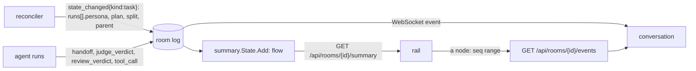

# Animated run view: design

**Status:** design, owner-approved scope (2026-11-03). **Scope:** `internal/envelope`,
`internal/factory/reconciler`, `internal/summary`, `internal/humanapi`, `web/`, `docs/web-ui.md`,
`docs/event-envelope.md`. **Roadmap:** ai-native-ref v4.0 item 8 (issue #280 §2), the diagram and
the run timeline. **Not here:** the diff between two runs, tunable roles, a text path in `maku status`.

## Conclusion

The room page gains a **sticky right rail** that draws the task as **one vertical path**: a node per
run, named by its **persona**; the completion judge as a mark on its implementer; the path after the
pull request as milestones; the planned steps as amber ghosts that light up as each run starts. The
**conversation stays the timeline**: the rail is its index and its per-run filter, and takes the
width the 72ch conversation leaves empty, so the tool calls and logs neither move nor narrow.

The server folds the path into a `flow` section of summary/v1, so the page needs no more of the log
than it holds today. No role list lives in the web code: a persona the page has never seen draws in
its role's colour, which keeps the rail correct once roles become tunable.



```text
┌ title strip · Next · Now line ───────────────────────────────────────┐
│ Needs you                            │ ● scoper          ✓          │
│                                      │   2 m · $0.04 · glm-5.3      │
│ Conversation (72ch)                  │   │ plan                     │
│  ▸ read_file              ✓          │ ● tester          ✓          │
│  ▸ run_tests              ✗          │   │ failing test             │
│  message …                           │ ◉ implementer  ◇×2 · running │
│  ▸ git_push               ✓          │   14 m · $0.82 · glm-5.3     │
│                                      │   ┊ PR #41                   │
│ Raw events ▸                         │ ○ reviewer        planned    │
│                                      │ ○ merge           planned    │
└ dock: composer · theme · connection ─────────────────────────────────┘
```

## What the log holds today

Of the names #280 lists, four are runs; the rest live inside a run or outside every run.

| #280 name | In the code | Drawn as |
|---|---|---|
| implementer, reviewer, tester, triager | Run roles, a closed enum (XRD, `RunRecord.Role`, MCP tool lists) | Nodes |
| scoper | A `triager` run with the `ScoperBrief` (`reconciler/scoper.go`), its handoff carrying `scope` | A node, persona `scoper` |
| splitter | The scoper's `handoff.split`; each part is a child Task with its own room | The scoper's fan-out |
| completion judge | A model call inside the implementer's run, posting `judge_verdict` | `◇×N` on the implementer |
| search | A tool call inside implementer runs | Counted in the node's tool calls |
| merge gate, merger | Task phases after the PR (`AwaitingCI` … `Merged`, `Verifying`, `Done`) | Milestones |

`TaskFacts.Runs` already carries every run (role, trigger, start and end, outcome, verdict, cost,
models; at most `MaxRuns` = 20), and the page reads only the last id (`web/src/strip.ts`). Cost is
per run; no event carries a per-call cost. The page loads the last 500 events (`web/src/conn.ts`)
and cannot load older ones.

## Decisions

1. **One rail per room**, covering every run of the task: loops, revisions and runs a person starts.
2. **`persona` names what a run is for; `role` stays what it may do.** `role` is a security
   boundary (who writes, who may call `room_judge`) and stays closed. `RunFact` gains
   `persona`, set **only by the factory**, bounded to `[a-z][a-z0-9-]{0,31}` and checked in
   `internal/envelope`; the page renders it as text. The factory derives it as it writes the facts
   (a `triager` run in a task whose template is not `investigate` is the `scoper`; every other run
   is its role), so the Task CRD is unchanged. Neither the agent nor the bridge can assert one: task
   facts come only through the system API's `POST /v1/rooms/{id}/task` (`system:*` principals,
   the factory), and no run event, claim annotation or XRD field carries it.
3. **Without a persona, the role.** A room without a task, and every `RunFact` written before this
   change, use the role. One inference covers old rooms: a `triager` run whose handoff carries
   `scope` is drawn as `scoper`. It sits in the fold, marked for removal once no room from before
   `persona` remains within retention.
4. **The factory publishes its plan.** `TaskFacts` gains `plan`, the expected personas in order,
   written at triage from the class's scope setting, test-first and the template, and rewritten
   when it changes. At most 8 entries, each bounded as `persona` is.
5. **Nodes are runs; the judge and search are marks; the path ends at the merge.** After the last
   run, the Task's phases are milestones, each at the seq of its first appearance. A terminal phase
   (`Merged`, `Done`, `Reverted`, `Escalated`, `Closed`, `Stopped`, `NoOp`, `Rejected`) closes the
   path.
6. **One vertical path, loops unrolled.** A reviewer's `changes`, a maintainer's request for
   changes or red CI starts a new round: its nodes follow on the path, and the edge into them
   names the reason. When the rail overflows, finished rounds fold into one line ("round 1 ·
   implementer → reviewer ✗") that opens on click.
7. **Planned steps are ghosts.** Plan entries no run has matched yet draw as dim amber outlines.
   Matching walks the plan in order, each node taking the first unmatched entry with its persona;
   extra rounds match nothing. A ghost `merge` milestone follows the plan.
8. **A split fans out.** A parent's `TaskFacts` gain `split`: `of` (at most `MaxChildren` = 5)
   and the parts opened so far (index, issue, room, outcome), from its `SplitStatus`. A part's
   gain `parent` (room, issue, index, of), from its `Spec.Parent`. The Task CRD is unchanged. Parts
   open one at a time, so each chip reads exactly: done (`landed`), dropped, reverted, running
   (the newest part with no outcome) or queued (not opened yet). The scoper's edge forks into the
   chips, each linking to its part's room; the parent's milestones wait under the fork. A part's
   rail opens with a "part k of N of #parent" node that links back. Each room draws only its own
   runs.
9. **The server folds it.** `internal/summary` gains `flow.go`, folded page by page in
   `State.Add` like the rest of summary/v1, its state bounded by `MaxRuns` nodes and fixed
   counters per node. The page refetches the summary on the events it already does, plus
   `handoff` and `judge_verdict`. Between refetches the page ticks only the active node's age and
   tool-call counts from the WebSocket stream.
10. **The conversation is the timeline.** The rail highlights the node whose events are on screen
    as the conversation scrolls. Clicking a node shows that run's seq range in a view of its own,
    Raw events fold included, in place of the room's, and sets `#run=<id>`; `All runs` returns to
    the room's view. The range comes from the new `GET /api/rooms/{id}/events?after=N&limit=M`
    (`limit` ≤ 500), behind the summary's D7 gate and Read check, over the store's existing
    `Range`, at most 2,000 events a run. A view of its own leaves the room's conversation, and its
    5,000-row trim, untouched.
11. **When the rail shows.** A task room always has it, its plan ghosted from triage. A room
    without a task shows it from its second run; until then the strip's run chip says it all.
12. **Placement.** A sticky right rail, about 300 px, between the title strip and the dock,
    scrolling inside itself. Below about 1100 px it becomes one row of dots under the title strip,
    opening the full rail as a drawer.
13. **A node is two lines and a card.** Line 1: glyph, persona, outcome chip (`✓` succeeded or
    approve or met, `✗` changes, `impossible`, `failed`, `stopped`). Line 2, muted: duration ·
    cost · model. The edge below carries the handoff's label, taken from structured fields only
    (`plan`, `failing test`, `PR #41`, `changes`, `CI red`, `split`), never from a summary's text.
    Hover or focus opens a card: start and end, tool calls ok and failed, the end reason, the
    handoff summary's first line. A person's run carries `started by <who>`.
14. **The clip's visual language, not its engine.** The colour comes from the role: violet for
    the judgement roles (triager, reviewer) and the judge mark, cyan for the implementer and the
    tester; amber for planned;
    grey for people and GitHub; dim for what is no longer the active path. The glyph comes from a
    small persona table in `web/` (the glyphs of `ai-native-ref/motion/ai-platform/assets/icons/glyphs/`),
    with the role's glyph as the fallback. SVG built with `createElementNS`, styled by classes in
    `app.css` (the CSP refuses inline style), in both themes.
15. **Motion in fixed beats.** Live: a ghost takes its role's colour with a short fade, the edge
    draws in (`stroke-dashoffset`) when the handoff lands, the active node breathes slowly, the
    judge mark ticks once per verdict, milestone dots fill. A finished room opens on its final
    state with **Replay**: about 1.2 s per node and 0.4 s per milestone whatever the real
    durations, at most about 20 s, with Skip. Under `prefers-reduced-motion` nothing animates
    and Replay steps node by node. Every state is "the flow up to seq N", so a scrubber can come
    later.
16. **Accessible.** The rail is a labelled `nav`; its nodes are buttons; focus opens the same card
    as hover; a polite `aria-live` line announces each run that starts.

## The flow object

A section of summary/v1, absent when decision 11 hides the rail.

```json
"flow": {
  "plan": ["scoper", "tester", "implementer", "reviewer"],
  "nodes": [
    {"run": "r-7f3a", "persona": "implementer", "role": "implementer", "round": 1,
     "startedAt": "2026-11-03T10:02:11Z", "endedAt": "", "fromSeq": 141, "toSeq": 0,
     "outcome": "", "verdict": "", "microUSD": 820000, "model": "glm-5.3",
     "judge": {"count": 2, "last": "not_yet"}, "tools": {"ok": 57, "failed": 3},
     "edge": "failing test", "startedBy": ""}
  ],
  "ghosts": ["reviewer"],
  "milestones": [{"phase": "AwaitingCI", "at": "2026-11-03T10:31:40Z", "seq": 902}],
  "split": {"of": 3, "parts": [{"index": 1, "issue": 52, "room": "k2mqx7ba", "outcome": "landed"},
                               {"index": 2, "issue": 53, "room": "p4zt6wce"}]},
  "parent": null
}
```

`toSeq` and `endedAt` are empty while the run is live; `edge` names the edge into the node.

## Out of scope

| Item | Where it goes |
|---|---|
| The diff between two runs of a task | Its own design; it needs two finished runs and a side-by-side layout |
| Tunable roles: adding, removing or reordering roles in config | Its own design: a state machine driven by data, the XRD enum, per-role briefs. `persona` is what it builds on |
| A text path in `maku status`, `flow` in MCP answers | A follow-up; `flow` is already in the summary JSON they read |
| A per-call cost | Not recorded; the node shows the run's cost |

## Delivery

| PR | Holds | Visible |
|---|---|---|
| 1 | `persona`, `plan`, `split`, `parent` in the facts; the factory writing them; the `flow` fold; table tests | No |
| 2 | The live rail, the scroll index, the run filter and the events range read | Yes |
| 3 | Motion, Replay, split chips; `docs/web-ui.md`; the ai-native-ref status row | Yes |

Each PR passes `task check` alone. `docs/event-envelope.md` changes with PR 1.
