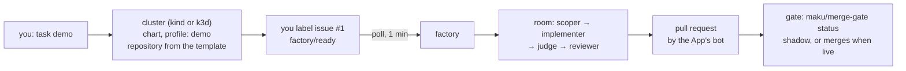

# The factory on a laptop: design

**Status:** design, every decision taken by the owner in a grilling on 2026-11-06
([decisions](#decisions)). Nothing here is built. **Roadmap:** ai-native-ref's
[v4.0 stage 1](https://github.com/Smana/ai-native-ref/blob/main/docs/superpowers/specs/2026-10-31-v4-roadmap-design.md#v4-0),
"anyone can run it", with roadmap decisions V9, V12, V13, V14, V19 and V20 as inputs. **Scope:**
`hack/quickstart/` (becoming `task demo`), a new umbrella chart `charts/agent-factory`,
`internal/factory` (a demo mode), the gate's own commit status, `docs/quickstart.md`. **Not here:**
the production path (stage 2), which ships the same chart with production values.

## Conclusion

The laptop is a **demo of the production machinery, not a secure install.** A platform engineer types
one command and, about 15 minutes later, has watched the whole loop run on a public repository:
a labelled issue, a room where the scoper, implementer, completion judge and reviewer work, a
reviewed pull request, and the merge gate's decision posted on it. The security pieces production
depends on (per-role tokens, the gateway's budget, the meter, isolation, egress control, branch
protection, separate identities) are **left out and named** in a "what production adds" table, so
the demo teaches the architecture without pretending to be it.

The demo installs the **same umbrella chart** as production with `profile: demo`, so production differs
only by values and the nightly job tests the chart every night.



## Decisions {#decisions}

Taken one question at a time, in this order. Later answers supersede earlier ones where marked.

| # | Decision |
|---|---|
| Q1 | **Entry point:** extend Maku's quickstart, run from a clone of this repository. A released `maku up` that needs no clone is later work |
| Q2 | **Platforms:** Linux is in the go test. macOS with Docker Desktop is best-effort and documented, outside the go test and CI |
| Q3 | **Repository:** a template repository with seeded issues, a CI check and `.github/agent-factory.yaml` declaring one class is the documented path. Your own public repository is a documented second step |
| Q4 | **Roles:** scoper → implementer → completion judge → reviewer → gate. The tester and the splitter are off, each switchable with one value |
| Q5 | **Models:** one model for every role, from one OpenAI-compatible endpoint (V14). A per-role override is optional and documented |
| Q6 | *Superseded by Q14* (agentgateway on by default) |
| Q7 | *Superseded by Q14* (a VictoriaMetrics meter) |
| Q8 | **Login:** one local user, no login, as in today's local mode. The factory gains a local mode that needs no OIDC secret and no ZITADEL reader. OIDC stays the production path's seam |
| Q9 | *Superseded by Q14* (two Apps) |
| Q10 | *Superseded by Q14* (per-role tokens minted by the factory) |
| Q11 | *Superseded by Q14* (`contents:write` on the factory App to mint them) |
| Q12 | **The gate's own verdict:** the gate evaluates the class rules itself (no policy-bot) and posts a `maku/merge-gate` commit status naming the class and the reason |
| Q13 | **Live merging:** the template's class is in shadow; the gate posts what it would do. One value turns it live, and the quickstart's last step shows that switch on a second issue |
| Q14 | **A demo profile, labelled "demo: not for untrusted repositories".** Kept: label polling, the roles, rooms, the gate's decision and its switch to live. Dropped and listed in [what production adds](#production-adds): per-role tokens, the gateway and its budget, the meter and USD caps, isolation, and a separate merger identity. One GitHub App does everything; the model key goes from the run to the provider directly |
| Q15 | **Public repositories only:** in demo mode the factory refuses a repository that is not public, before any run starts, because the agent can read the model key and the App's token |
| Q16 | **What the target covers:** from `git clone` to the gate's status on the pull request, App creation, image pulls and the agents' run time included, measured on the owner's laptop over a home connection, with the script printing the time per step |
| Q17 | **Nightly job:** a real public-data model (Kimi) on a dedicated key capped at about $1 a day at the provider, on a test repository made from the template; it fails when the cap is hit. Pull requests keep the stub model |
| Q18 | **Fresh-agent test:** a fresh agent given only the quickstart page reaches the gate's status. It runs before v4.0, recorded in a results file, then before any minor release that changes the quickstart page or scripts |
| Q19 | **One chart:** the demo installs the umbrella chart with `profile: demo`. Production differs only by values |
| Q20 | **Home:** the chart is `charts/agent-factory` in this repository, and this design lives here. ai-native-ref keeps the reference host's values and its own gates |
| Q21 | *Superseded by Q24* (a ruleset created with the reader's `gh`) |
| Q22 | **A minimal cluster:** no Cilium, cert-manager, CNPG or gVisor; the broker keeps TLS, with a CA the chart generates (the database hop is plain inside the cluster); a Postgres pod from the chart; runc. The script creates a kind or a k3d cluster (`CLUSTER=kind\|k3d`), or installs into the current kubeconfig. kind and k3d are both tested in CI. The room page is served on localhost with no port-forward |
| Q23 | **GitHub identity:** a GitHub App created from a manifest in two clicks (Create, Install). The pull requests are its bot's, so you can approve them; a PAT or your `gh` token would make them yours, and GitHub refuses self-approval |
| Q24 | **No branch protection, `gh` optional:** the status shows the gate's verdict and the gate merges by itself when live. With `gh` logged in, the script creates the repository from the template; otherwise it prints the "Use this template" link and waits for the name |
| Q25 | **One command:** `task demo` asks for the model endpoint and key (or reads them from the environment or `.env`), opens the App page, creates the cluster and the repository, installs, and ends by printing the room page's URL and the issue to label. Re-running it resumes where it stopped |
| Q26 | **15 minutes**, from clone to the gate's status |
| Q27 | **Headless runs:** `task demo` also takes an existing App's id and key and skips the browser step. The nightly job and the fresh agent use one pre-made test App installed on their test repository |

## What the reader does

```bash
git clone https://github.com/Smana/maku && cd maku
task demo
```

1. `task demo` asks for the model's base URL, model name and key.
2. It opens GitHub on the App manifest page: you click **Create**, then **Install** on the repository.
   The key returns to the script on localhost.
3. It creates the cluster, installs the chart with `profile: demo`, and creates your repository from the
   template.
4. It prints the room page (`http://localhost:8080`) and the issue to label.
5. You add `factory/ready` to issue #1 and watch the room. The reviewed pull request appears, and the
   gate posts `maku/merge-gate`: what it would do, in shadow.
6. The last step shows the one value that turns the class live; a second issue then merges with no human.

Tools: Docker, Helm, kubectl, kind or k3d, and Task. `task demo:down` removes the cluster.

## What production adds {#production-adds}

The quickstart page carries this table, so a reader knows exactly what the demo does not prove.

| In the demo | In production |
|---|---|
| One GitHub App: the factory, every run and the merger share it, and a run can read its token | A read-only factory App, a separate merger App, and a token per role minted for one run (a reviewer cannot push) |
| The model key goes from the run to the provider; a run is bounded by its minutes and the provider's limit on your key | agentgateway holds the key outside the sandbox, enforces a per-run, fleet and per-person budget, and meters every call |
| No meter and no USD caps | The meter reads the gateway's metrics; caps refuse a task over its dollars |
| Runs under runc, with the room's "not isolated" banner | Runs in a gVisor sandbox |
| No egress control | Default-deny egress with a per-run FQDN allow-list |
| No branch protection; the gate's status is informational for humans | `main` requires the gate's verdict |
| One local user, no login | OIDC login, roles, room access following GitHub permissions |
| TLS from a CA the chart generates; the database hop is plain inside the cluster | TLS from your CA, database included |
| Runs call the broker's `:8090` room tools over plain HTTP in the cluster, and the broker checks each run's own token with the apiserver (`roomTools.auth: tokenreview`) | A gateway verifies the run, holds the room tools key and fronts `:8090` (`roomTools.auth: key`) |
| Public repositories only | Private repositories, with models chosen per data class |

## New work, by component

| Component | Change |
|---|---|
| `internal/factory` | A demo mode: no OIDC secret, no ZITADEL reader, the human is `human:local`; the meter optional (no `meter.url`, no USD caps); `broker.url` may be `http`; a run's token minted from the one App; the public-only refusal before a run starts; the mode exposed to the room page for its banner |
| The gate | Evaluates the class rules itself and posts `maku/merge-gate` (`statuses:write`), in shadow or live, with policy-bot still the production path's reference |
| `charts/agent-factory` | The umbrella chart: Maku's broker and factory, a Postgres pod, and `profile: demo` turning off what production adds. Stage 2 adds the production values |
| `hack/quickstart/` → `task demo` | Cluster creation for kind and k3d, or the current kubeconfig; the App manifest flow and its localhost callback; repository creation through `gh` or the template link; resume on re-run; time per step |
| A template repository | Seeded issues, one CI check, `.github/agent-factory.yaml` with one class in shadow |
| CI | kind nightly on a real capped model (Q17); k3d on pull requests that touch the quickstart, on the stub model |
| `docs/quickstart.md` | Rewritten around `task demo`, with the 15-minute promise and the table above |

## How it is judged

- The nightly kind job takes a labelled issue to a reviewed pull request and the gate's status.
- k3d passes the same path on the stub model.
- A fresh agent with only the quickstart page reaches the same end (Q18).
- The whole path takes 15 minutes or less on the owner's laptop (Q26).
- One person other than the owner completes it from the docs and files a friction log (V20).

## Out of scope

- A released `maku up` with no clone (Q1).
- macOS in CI (Q2).
- Private repositories in the demo (Q15).
- Any security property in the demo: each one is the production path's.
