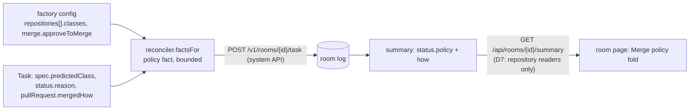

# Merge policy view: design

**Status:** design, decided by the implementer with the owner away ("complete everything",
2026-11-07); every choice below names what it was chosen over. **Scope:** `internal/envelope`,
`internal/factory/reconciler`, `internal/summary`, `web/`, `docs/event-envelope.md`,
`docs/web-ui.md`. **Not here:** a repository-level page, `maku status` text, editing a policy.

## Conclusion

A factory room shows **which merge policy governs its task**: the class it was triaged into,
whether that class is live, shadow or unarmed, what its conditions are, what it takes to merge
(the class's own conditions, a maintainer's approval through the merger App, or a human merge),
the gate's last decision (the shadow decision included) and how the pull request was merged, plus
the repository's whole class table.

The data rides the path the room's other task facts already ride: the factory adds a `policy`
fact to the task facts it posts (it alone holds the class config), the broker stores it in the
room log, `summary/v1` folds it into `status.policy` with the merge sentence, and the room page
renders it as a **Merge policy** fold. No new endpoint, no new credential, no new visibility rule.



```text
▸ Merge policy · docs-links · live
  Class docs-links (live): the factory merges it once its conditions hold.
  Conditions: diff shape links-only · at most 5 files · allowed files ^docs/, ^README\.md$
  To merge: the class's conditions, or a maintainer's approval of the current commit (the merger
  App merges that commit). A pull request touching a gate path always needs a human merge.
  Decision: it would auto-merge, and the merge gate is in shadow.
  Repository classes: docs-links live · deps-patch shadow · revert unarmed (approve to merge on)
```

## Decisions

| # | Decision | Rejected |
|---|---|---|
| D1 | **Source: a `policy` task fact the factory posts.** `factsFor` already writes facts only the config knows (`mergeByApproval`); the policy is one more. The fact is part of the facts hash, so a config change re-posts once, and a sealed room keeps the policy it ended under | (a) a factory `GET /v1/repositories/{repo}/policy` the broker proxies with the human's token: a new read surface on `:8082`, a second repository-access check in the factory, and a room page that shows today's policy rather than the one the task ran under. (b) the broker mounting the factory config: couples the two deployments and hands the broker every repository's config. (c) reading `factory/class:*` labels from GitHub: the name only, and a GitHub call per page view |
| D2 | **Visibility is the room's.** The fact carries the room's own repository's classes only, and the summary is already served only to someone who may read that repository (D7, `repoaccess`). Nothing in a class is a secret: patterns, counts, check names and public GitHub logins. No file path the factory reads a secret from enters the fact | A separate per-field redaction list: nothing in the fact needs one, and it would drift from the config |
| D3 | **Bounded, validated, clamped at the source.** At most 16 classes; each pattern list at most 8 entries of at most 120 runes; names in the class-name charset. `factsFor` clamps and sets `truncated`, so the broker's validation never refuses the facts for good (a refused post blocks every later fact) | Refusing an oversize table: the room would lose all its task facts, not just the policy |
| D4 | **Mode per class: `live`, `shadow`, `unarmed`**, the gate's own three outcomes (`Class.Live`, `Class.Shadow`, neither). `gateOff` is the factory-wide switch (`Config.NeedsMerger` false: no class live or shadow anywhere, so no merger App) | A boolean pair: every reader would re-derive the third case |
| D5 | **The merge sentence is the summary's (Go), not the page's.** `summary.PolicyHow` is pure, beside `MergeHow`/`ApproveHow`, so a later `maku status` line reads the same words | Building the sentence in TypeScript: a second copy of the gate's rules |
| D6 | **The decision comes from facts already posted.** The gate's reason (`status.reasonCode`, with its prose in `reasons()`), and `mergedHow` (`class`, `approved`) from the PR record, which the policy fact carries. `shadow_would_arm` is the shadow decision | A new per-decision record in the fact: the decision record (`internal/factory/decision`) is for the tally, and its rows are larger than the room needs |
| D7 | **Gate paths are named, not listed.** They are policy-bot's rules in the repository (`gate_path` is policy-bot's ERROR status), not the factory's config, so the page states the rule and, when the decision is `gate_path`, that this PR hit one | Copying `.policy.yml` into the fact: the factory does not read it |
| D8 | **A fold in the page, below the notes**, closed by default, its summary line `Merge policy · <class> · <mode>`. Only a factory room with a policy fact shows it | A strip chip: the strip is already the densest line on the page. A rail section: the rail folds into a drawer under 1100 px, hiding the policy on a phone |
| D9 | **Repository-level page deferred.** The fold's class table answers "what are this repository's classes" from any of its rooms | A `/repo/<owner>/<name>` page now: needs a non-room read path (D1's rejected (a)) |

## The fact

`TaskFacts.Policy *PolicyFact`, JSON `policy`:

| Field | Type | Meaning |
|---|---|---|
| `class` | string | the task's predicted class, `""` when none |
| `mode` | `live` \| `shadow` \| `unarmed` | the class's mode; a class the repository does not declare is `unarmed` |
| `gateOff` | bool | no class is live or shadow on the factory: a maintainer merges every pull request |
| `approveToMerge` | bool | `merge.approveToMerge` on, and the class is not adopted (adopted classes keep the class path, AM1) |
| `adopted` | bool | the class adopts another author's pull requests (MC10) |
| `conditions` | object | the class's declared conditions: `allowedFiles[]`, `protectedFiles[]`, `modifyOnly`, `maxPatchFiles`, `maxModifiedLines`, `diffShape` (the built-in shape included), `holdoutChecks[]`, `maxPerDay`, `adoptLogins[]`, `requiredLabel`, `oracle` |
| `classes[]` | `{name, mode, adopted?}` | the repository's class table, sorted by name |
| `mergedHow` | `class` \| `approved` \| `""` | how the merger merged the pull request |
| `truncated` | bool | a list was cut to its bound |

Validation in `envelope`: `mode` in the enum, names match `^[a-z0-9]([-a-z0-9]{0,62}[a-z0-9])?$`,
bounds as D3, `mergedHow` in its enum, logins `ValidLogin`.

## The summary

`status.policy` is the fact plus `how`, from `PolicyHow(p)`:

| Case | `how` |
|---|---|
| `gateOff` | a maintainer merges it: no merge class is live, so the factory merges nothing |
| live, approve on | the factory merges it once the class's conditions hold, or when a maintainer approves the current commit (the merger App merges that commit) |
| live, approve off | the factory merges it once the class's conditions hold; otherwise a maintainer merges it |
| shadow, approve on | the gate decides it as if live but never merges it (shadow); a maintainer's approval of the current commit merges it through the merger App |
| shadow, approve off | the gate decides it as if live but never merges it (shadow); a maintainer merges it |
| unarmed, approve on | a maintainer's approval of the current commit merges it through the merger App |
| unarmed, approve off | the factory never merges this class: a maintainer reviews and merges it |

Every `how` ends with: `A pull request that touches a gate path always needs a human merge.`

## Error handling

- The broker decodes task facts strictly, so a broker older than this change refuses a factory's
  facts that carry `policy`: upgrade the broker first, as for every task fact before it
  (`mergeByApproval`, `monitor`). The factory keeps the facts due and retries; nothing is lost.
  An old factory posts no policy and the page shows no fold.
- The fold renders text through `el()`/`textContent` only: class names and patterns come from
  config (trusted), but the page treats every summary string as text all the same.

## Testing

| Layer | Test |
|---|---|
| `envelope` | table: a valid policy; each bound and enum refused |
| `reconciler` | `factsFor` sets the policy per mode, approve on/off, adopted, gate off, unknown class; clamps 20 classes to 16 with `truncated` |
| `summary` | fold passes `policy` through; `PolicyHow` table over the seven cases |
| `web` | the fold: absent without a policy; summary line; conditions; how; decision from `reasonCode`; class table; text only (no HTML from a name) |
