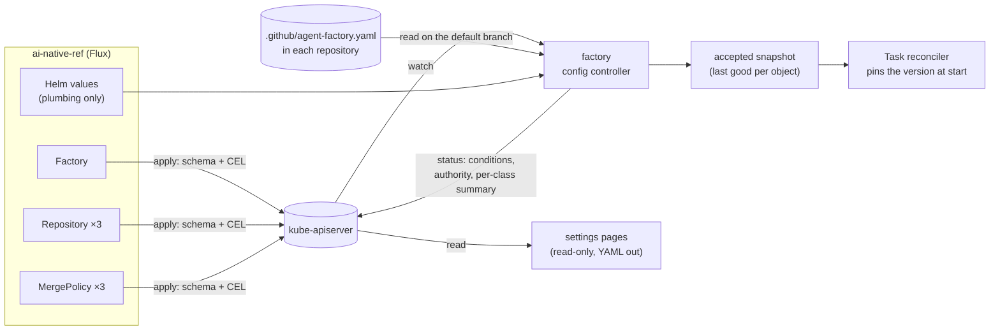

# Factory resources: design

**Status:** design, decided by the owner in a grilling session (2026-11-09, Q1–Q11, recorded as
D1–D11 below). **Scope:** `api/factory/v1alpha1` (three new kinds), `internal/factory/config`,
`internal/factory/reconciler`, `internal/factory/mergepolicy`, `internal/humanapi` (settings pages),
`charts/maku-factory`, a `maku config migrate` command, and in ai-native-ref the manifests that
replace most of `tooling/base/agent-factory/helm-values-configmap.yaml`. **Not here:** Crossplane
compositions, team namespaces, settings pages that write.

## Conclusion

The factory's configuration moves from one 454-line Helm values file into **three Kubernetes
resources that the factory reconciles**, next to the `Task`, `Room` and `AgentRun` it already has:

| Kind | One per | Holds | Today in |
|---|---|---|---|
| `Factory` | factory | the catalogue: tiers, role templates, harness profiles, loops, meter prices, daily caps, `policyManagement` switches | the values file, around the `repositories` list |
| `Repository` | repository served | data class, `classAuthority`, which `Factory` serves it | `repositories[]` entries |
| `MergePolicy` | repository | its classes and merge rules | `repositories[].classes` and `merge` (about 225 lines, three blocks) |

Plumbing (GitHub App key files, broker URL, identity provider, listen addresses) stays in Helm values
and secrets. Each resource has a `status` that says what the factory made of it. **That is the main
gain.** Today a bad change shows up only as a pod in CrashLoopBackOff, and what a policy is doing is
visible only in the settings pages or logs.



```text
$ kubectl get factory,repository,mergepolicy -n agent-system
NAME                          READY   REPOS   SPENT    STOPPED   AGE
factory/aws-0                 True    3       $12.40   false     12d

NAME                                     REPO                     FACTORY   CONNECTED   OPEN   AGE
repository/cloud-native-ref              Smana/cloud-native-ref   aws-0     True        2      12d

NAME                                     REPO                     AUTHORITY   CLASSES   LIVE   ACCEPTED   AGE
mergepolicy/cloud-native-ref             Smana/cloud-native-ref   central     6         2      True       12d
```

## Decisions

| # | Decision | Rejected |
|---|---|---|
| D1 | **What to fix:** no status feedback first, then readability and management. A resource with a status is what a ConfigMap can't give | Validation timing alone: CEL helps, but the deeper checks still need a reconciler and a status to report through |
| D2 | **The resources are the product's API.** The CRDs ship in Maku's chart and Maku's factory reconciles them, so any cluster runs them (kind on a laptop included) without Crossplane | (a) a platform API through Crossplane compositions that render today's ConfigMap: only clusters with Crossplane, and status limited to what a composition sees. (b) both layers now |
| D3 | **Three kinds: `Factory`, `Repository`, `MergePolicy`**, group `maku.ogenki.io`, version `v1alpha1`, namespaced, with a status subresource, `observedGeneration` and `[]metav1.Condition` | (a) `Factory` + `MergePolicy` only: the Factory still lists every repository. (b) finer kinds (`Tier`, `RoleTemplate`, `Class`): many small objects and references between them. (c) one `Factory` resource: validation and status, but no help with readability or ownership |
| D4 | **`MergePolicy` replaces the central blocks; the repository file stays.** The maintainers still own `.github/agent-factory.yaml` on GitHub. The factory reads it and writes what it makes of it into `MergePolicy.status`. `Repository.spec.classAuthority` (`central` or `repository`) says which one decides, so the staged handover (stage 4, `repositoryAuthority`) keeps working | (a) the CR only, dropping the repository file: maintainers would need cluster or GitOps access, and stage 4 goes away. (b) the repository file only, with a read-only CR mirroring it |
| D5 | **Changes apply live, with no restart; the last good version is kept; tasks are pinned.** A change CEL can reject is refused at admission. A change that fails deeper checks gets `Accepted=False` with the reason, and the factory keeps the **last accepted version** of that object. A task records the generations it started under and keeps them | (a) live without pinning: a policy could change under a PR being evaluated. (b) rendering the CRs into today's `config.yaml` and keeping the restart: least code, but a bad change still restarts the pod |
| D6 | **No Crossplane now.** The trigger to revisit: a second factory instance, for another team or cluster. Then an `AgentFactory` XR in crossplane-configuration would bundle the HelmRelease, ExternalSecrets, network policies and a `Factory` | (a) an `AgentFactory` XR now: it would wrap one HelmRelease and one CR. (b) an XR to onboard a repository (Repository, MergePolicy, App installation, ruleset): worth it once onboarding is frequent |
| D7 | **Everything lives in the factory's namespace** (`agent-system`). `Repository.spec.factoryRef` and `MergePolicy.spec.repositoryRef` are local names, fixed once set (CEL transition rule). The chart ships aggregated ClusterRoles: `maku-factory-admin`, `maku-mergepolicy-editor`, `maku-viewer`. Team namespaces wait for a second team, the same trigger as D6 | (a) team namespaces now: cross-namespace references and a namespace selector, for one team. (b) a cluster-scoped `Factory`, like IngressClass: a selector for one factory |
| D8 | **Migration over two releases.** Release N adds the CRDs and `maku config migrate`, which turns today's `config.yaml` into manifests for ANR to commit. The factory reads both. A repository defined in both the file and a CR is refused (`Accepted=False`, reason `DefinedTwice`), never merged silently. Release N+1 drops the catalogue and repository blocks from the file | (a) a big bang: the factory and ANR must upgrade in lockstep. (b) shadow first, comparing only: safest, but slowest |
| D9 | **The settings pages stay read-only.** They read the CRs' spec and status through the factory. Any change comes out as YAML (a patch for the manifest) that the maintainer commits by PR. Flux stays the only writer. Promotions and exceptions stay in Postgres | (a) the pages write the CRs: Flux reverts them on the next reconcile. (b) the pages open the PR through a GitHub App: a new write permission |
| D10 | **`MergePolicy.status`**: conditions `Accepted`, `RepositoryFileValid`, `InSync` (the repository file matches the spec); `authority`; per class its mode (`live`, `shadow`, `unarmed`), last decision with time, and 7-day counts (would merge, merged, held). Columns `REPO AUTHORITY CLASSES LIVE ACCEPTED AGE`. Counts are refreshed at most once a minute; the full history stays in decision markers and Postgres | (a) conditions only: no view of what the policy is doing. (b) the last N decisions in status: grows, and is written often |
| D11 | **`Repository.status`**: conditions `Accepted`, `Connected` (the GitHub App is installed and can read the repository and its file), the `MergePolicy` that applies, open tasks, the last task and its outcome. Columns `REPO FACTORY CONNECTED OPEN AGE`. **`Factory.status`**: conditions `Accepted`, `Ready` (broker reachable, GitHub Apps valid), repositories served, today's spend against the daily cap, whether `factory/stop` is active. Columns `READY REPOS SPENT STOPPED AGE`. Same refresh limit | (a) conditions only: spend and task counts only in Grafana (#420). (b) a rich status on Repository only |

## The resources

Field names follow today's config keys, so `maku config migrate` is a mechanical move. The Go types
live in `api/factory/v1alpha1/` beside `task_types.go`.

```yaml
apiVersion: maku.ogenki.io/v1alpha1
kind: Factory
metadata: {name: aws-0, namespace: agent-system}
spec:
  policyManagement: {read: true, simulation: true, dualEvaluation: true, promotion: true}
  defaults: {dataClass: public, predictedClass: review}
  triage: {controlPercent: 10}
  factoryDailyUSD: 42.50   # today's key names, unchanged
  humanDailyUSD: 8.50
  tiers:
    light:    {model: agent-default, runTokens: 300000, taskTokens: 600000, runMinutes: 20, runUSD: 0.51, taskUSD: 1.02}
  templates:
    pair: {roles: [implementer, reviewer], maxReviewRounds: 2}
  harnessProfiles: {plain: {}, checked: {checks: true}}
  loops: {}         # per-class scoper, judge and reviewer models, as today
  meter: {prices: {}}
---
apiVersion: maku.ogenki.io/v1alpha1
kind: Repository
metadata: {name: cloud-native-ref, namespace: agent-system}
spec:
  factoryRef: aws-0
  repository: Smana/cloud-native-ref
  dataClass: public
  classAuthority: central   # or repository (stage 4)
---
apiVersion: maku.ogenki.io/v1alpha1
kind: MergePolicy
metadata: {name: cloud-native-ref, namespace: agent-system}
spec:
  repositoryRef: cloud-native-ref
  classes: []   # today's repositories[].classes, unchanged in shape
  merge: {}     # today's repositories[].merge, unchanged in shape
```

### Validation

| Where | What |
|---|---|
| **Schema and CEL, at admission** | Field types and enums. Live and shadow together on one class (today `classes.go:161`). Refs fixed once set. Tier caps positive and `taskUSD ≥ runUSD`. Only one `MergePolicy` per `repositoryRef` is checked by the reconciler, because CEL can't see other objects. Write the rules against the wiki's CEL notes (`cel-transition-rule-omitempty-needs-has`, `gofmt-curls-quotes-in-kubebuilder-cel-marker`) |
| **Reconciler, reported as `Accepted=False`** | Everything in today's `Config.Validate()` and `validateRepository` that needs more than one object: a ref to a missing object, a template naming an unknown tier, a class naming a role no template has, two `MergePolicy` for one repository, a repository in both the file and a CR (D8) |

Today's strict decoding (`DisallowUnknownFields`) is enforced by the structural schema.

### The config controller (D5)

A controller-runtime controller in the factory's existing manager (`internal/app/factory.go`)
watches the three kinds. For each object, on each generation:

1. Validate it against the current accepted snapshot of the objects it refers to.
2. If valid, replace that object in the **accepted snapshot** and set `Accepted=True`. If not, set
   `Accepted=False` with the reason, and leave the snapshot untouched.
3. Build the `config.Config` the rest of the factory reads today from the snapshot, plus the
   plumbing from the file. The reconcilers read it through one accessor instead of the value loaded
   at startup.

A task records `status.configGenerations` (`factory`, `repository`, `mergePolicy`) when it starts,
and evaluates against those generations until it ends. The snapshot keeps every generation a task
in progress still holds and drops the rest. The snapshot is in memory, and the API server keeps only
the current generation. So after a restart, a task pinned to an older generation continues on the
current accepted one, and the factory records this as a `ConfigRepinned` event on the task, not
silently.

The status writer refreshes counts at most once a minute per object (D10, D11). Conditions change
immediately.

### The repository file (D4)

The factory already reads `.github/agent-factory.yaml` from the default branch
(`internal/factory/mergepolicy/policy.go`). The result goes into `MergePolicy.status`:

- `RepositoryFileValid`: the file parsed and passed the same validation as the spec.
- `InSync`: the file's classes equal the spec's. When false, `status.repositoryFile.diff` holds a
  bounded summary (class names added, removed or changed).
- `authority`: copied from `Repository.spec.classAuthority`, with the stage-4 rules unchanged: with
  `repository`, an invalid file pauses auto-merge, as today.

### Settings pages (D9)

`/api/policy/*` reads the CRs' spec and status through the factory's existing `/v1/policy/*`
endpoints. Where a page shows a change, it renders the YAML patch for the `MergePolicy` manifest,
in place of today's paste-the-file text.

### Chart

`charts/maku-factory/crds/` gains the three CRDs next to `maku.ogenki.io_tasks.yaml`. Helm never
upgrades `crds/` on its own. ANR's HelmRelease already sets `install.crds: Create` and
`upgrade.crds: CreateReplace` (`tooling/base/agent-factory/helmrelease.yaml:18-23`), so no host change
is needed. The chart's ClusterRoles aggregate into `admin`, `edit` and `view` the way the Kubernetes
built-in roles do. The factory's own Role gains `get/list/watch` on the three kinds and `update` on
their `status`.

### Migration (D8)

| Release | Factory | ANR |
|---|---|---|
| N | Reads the CRs and the file. A repository in both is refused (`DefinedTwice`). `maku config migrate --from config.yaml --namespace agent-system` prints the manifests | Commits the generated manifests, one repository at a time if wanted, removing each repository's block from the file in the same PR |
| N+1 | The file's catalogue and `repositories` blocks are refused at startup with a message naming `maku config migrate`. Only plumbing remains | The values file shrinks to plumbing |

## Not in this spec

- **Crossplane**: an `AgentFactory` XR, at a second factory instance (D6).
- **Team namespaces** and delegation across namespaces (D7).
- **Settings pages that write** (D9).
- **Agents proposing factory changes**: once these resources exist, an agent's PR on a `Factory` or
  `MergePolicy` manifest is an ordinary GitOps PR. `tooling/base/agent-factory/` should be a
  protected path before any agent role can write there. That path is not protected today.
