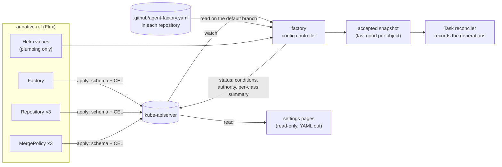

# Factory resources: design

**Status:** design, decided by the owner in a grilling session (2026-11-09, Q1–Q11, recorded as
D1–D11 below), then revised after a review against Maku v0.40.2 the same day (D5, D10 and D11
narrowed; D12–D16 added; see [Review against v0.40.2](#review-against-v0402)). **Scope:** `api/factory/v1alpha1` (three new kinds), `internal/factory/config`,
`internal/factory/reconciler`, `internal/factory/mergepolicy`, `internal/humanapi` (settings pages),
`charts/maku-factory`, a `maku config migrate` command, and in ai-native-ref the manifests that
replace most of `tooling/base/agent-factory/helm-values-configmap.yaml`. **Not here:** Crossplane
compositions, team namespaces, settings pages that write.

## Conclusion

The factory's configuration moves from one 454-line Helm values file into **three Kubernetes
resources that the factory reconciles**, next to the `Task`, `Room` and `AgentRun` it already has:

| Kind | One per | Holds | Today in |
|---|---|---|---|
| `Factory` | factory | the catalogue: tiers, role templates, harness profiles, loops, meter prices, caps, budgets, the kill-switch issue | the values file, around the `repositories` list |
| `Repository` | repository served | maintainers, trigger label, checks, schedules, data class, `classAuthority`, which `Factory` serves it | `repositories[]` entries |
| `MergePolicy` | repository | its classes and merge rules | `repositories[].classes` and `merge` (about 225 lines, three blocks) |

Plumbing (GitHub App key files, broker URL, identity provider, listen addresses) and the feature
switches that change what the factory wires at startup stay in Helm values and secrets (D12). Each resource has a `status` that says what the factory made of it. **That is the main
gain.** Today a bad change shows up only as a pod in CrashLoopBackOff, and what a policy is doing is
visible only in the settings pages or logs.



```text
$ kubectl get factory,repository,mergepolicy -n agent-system
NAME                          ACCEPTED   READY   REPOS   STOPPED   AGE
factory/aws-0                 True       True    3       false     12d

NAME                                     REPO                     FACTORY   ACCEPTED   CONNECTED   AGE
repository/cloud-native-ref              Smana/cloud-native-ref   aws-0     True       True        12d

NAME                                     REPO                     AUTHORITY   CLASSES   LIVE   ACCEPTED   AGE
mergepolicy/cloud-native-ref             Smana/cloud-native-ref   central     6         2      True       12d
```

## Decisions

| # | Decision | Rejected |
|---|---|---|
| D1 | **What to fix:** no status feedback first, then readability and management. A resource with a status is what a ConfigMap can't give | Validation timing alone: CEL helps, but the deeper checks still need a reconciler and a status to report through |
| D2 | **The resources are the product's API.** The CRDs ship in Maku's chart and Maku's factory reconciles them, so any cluster runs them (kind on a laptop included) without Crossplane | (a) a platform API through Crossplane compositions that render today's ConfigMap: only clusters with Crossplane, and status limited to what a composition sees. (b) both layers now |
| D3 | **Three kinds: `Factory`, `Repository`, `MergePolicy`**, group `maku.ogenki.io`, version `v1alpha1`, namespaced, with a status subresource, `observedGeneration` and `[]metav1.Condition` | (a) `Factory` + `MergePolicy` only: the Factory still lists every repository. (b) finer kinds (`Tier`, `RoleTemplate`, `Class`): many small objects and references between them. (c) one `Factory` resource: validation and status, but no help with readability or ownership |
| D4 | **`MergePolicy` replaces the central blocks; the repository file stays.** The maintainers still own `.github/agent-factory.yaml` on GitHub. The factory reads it and writes what it makes of it into `MergePolicy.status`. `Repository.spec.classAuthority` (`central` or `repository`) says which one decides, so the staged handover (stage 4, `repositoryAuthority`) keeps working | (a) the CR only, dropping the repository file: maintainers would need cluster or GitOps access, and stage 4 goes away. (b) the repository file only, with a read-only CR mirroring it |
| D5 | **Changes apply live, with no restart; the last good version is kept; tasks record, not pin** (revised). A change CEL can reject is refused at admission. A change that fails deeper checks gets `Accepted=False` with the reason, and the factory keeps the **last accepted version** of that object while it runs. A task records the generations it started under (`status.configGenerations`, beside `configHash`), and each merge decision records the `MergePolicy` generation it used. Evaluation reads the current accepted snapshot, as stage 4 already does for a repository's own file | (a) pinning each task to its generations: stricter than stage 4, which already changes classes under running tasks, and lost at every restart anyway (D14). (b) rendering the CRs into today's `config.yaml` and keeping the restart: least code, but a bad change still restarts the pod |
| D6 | **No Crossplane now.** The trigger to revisit: a second factory instance, for another team or cluster. Then an `AgentFactory` XR in crossplane-configuration would bundle the HelmRelease, ExternalSecrets, network policies and a `Factory` | (a) an `AgentFactory` XR now: it would wrap one HelmRelease and one CR. (b) an XR to onboard a repository (Repository, MergePolicy, App installation, ruleset): worth it once onboarding is frequent |
| D7 | **Everything lives in the factory's namespace** (`agent-system`). `Repository.spec.factoryRef` and `MergePolicy.spec.repositoryRef` are local names, fixed once set (CEL transition rule). The chart ships aggregated ClusterRoles: `maku-factory-admin`, `maku-mergepolicy-editor`, `maku-viewer`. Team namespaces wait for a second team, the same trigger as D6 | (a) team namespaces now: cross-namespace references and a namespace selector, for one team. (b) a cluster-scoped `Factory`, like IngressClass: a selector for one factory |
| D8 | **Migration over two releases.** Release N adds the CRDs and `maku config migrate`, which turns today's `config.yaml` into manifests for ANR to commit. The factory reads both. A repository defined in both the file and a CR is refused (`Accepted=False`, reason `DefinedTwice`), never merged silently. Release N+1 drops the catalogue and repository blocks from the file | (a) a big bang: the factory and ANR must upgrade in lockstep. (b) shadow first, comparing only: safest, but slowest |
| D9 | **The settings pages stay read-only.** They read the CRs' spec and status through the factory. Any change comes out as YAML (a patch for the manifest) that the maintainer commits by PR. Flux stays the only writer. Promotions and exceptions stay in Postgres | (a) the pages write the CRs: Flux reverts them on the next reconcile. (b) the pages open the PR through a GitHub App: a new write permission |
| D10 | **`MergePolicy.status`** (narrowed for v1): conditions `Accepted`, `RepositoryFileValid`, `InSync` (the repository file matches the spec); `authority`; per class its mode (`live`, `shadow`, `unarmed`) and its last decision with time. Columns `REPO AUTHORITY CLASSES LIVE ACCEPTED AGE`. **Later**, once #420's metrics land: 7-day counts (would merge, merged, held), refreshed at most once a minute. The full history stays in decision markers and Postgres | (a) conditions only: no view of what the policy is doing. (b) the last N decisions in status: grows, and is written often. (c) the counts in v1: a second reader of Postgres before #420 decides where they come from |
| D11 | **`Repository.status`** (narrowed for v1): conditions `Accepted`, `Connected` (the GitHub App is installed and can read the repository and its file), the `MergePolicy` that applies. Columns `REPO FACTORY ACCEPTED CONNECTED AGE`. **`Factory.status`**: conditions `Accepted`, `Ready` (broker reachable, GitHub Apps valid), repositories served, whether `factory/stop` is active. Columns `ACCEPTED READY REPOS STOPPED AGE`. **Later**, with #420: open tasks, the last task and its outcome, today's spend against the daily cap | (a) conditions only: no `kubectl get` answer to "is it serving my repository". (b) spend and task counts in v1: they duplicate Grafana before #420 settles the source |
| D12 | **Live fields and startup fields.** What the factory reads per decision applies live: the catalogue (tiers, templates, harness profiles, loops, caps, budgets, facts, brief, resume, scoper, merge guardrails, meter prices, defaults, `triage.controlPercent`, the kill-switch issue) and each repository's settings, classes and merge rules, including adding or removing a repository. What changes the factory's wiring stays in Helm values and needs a rollout, as today: `policyManagement`, `coordination`, `hardening`, `api` (sponsored and internal principals included), `runs`, `sandbox`, `demo`, the broker, GitHub key files, meter and log URLs, poll intervals, tracing, logins and `roomsURL` | (a) everything live: the factory would start and stop the policy watch, promotion, approval memory and the Flux watcher when a switch flips. (b) restart on an accepted change: no live gain |
| D13 | **Every replica builds the snapshot; only the leader writes status.** The factory runs two replicas behind leader election, and every replica serves the settings API from config. So the config controller runs with `NeedLeaderElection() == false` and only the status writer needs the lease | (a) the leader alone builds the snapshot: a follower would serve the settings pages from a stale config |
| D14 | **An object invalid at startup is not served.** The snapshot is in memory, so after a restart an object with no valid version has no last good one: its repository is not served, it gets `Accepted=False`, and the factory emits a warning event. CEL at admission and `maku config validate` in the GitOps repository's CI make this rare | (a) persisting each object's last accepted spec in an annotation or a ConfigMap: more state, and a second source of truth beside git |
| D15 | **One Factory per process, by name.** The factory serves the `Factory` named by `config.factory` (today's fence name, the cluster's). Any other `Factory` in the namespace gets `Accepted=False`, reason `NotThisFactory`. A `Repository` whose `factoryRef` names another factory is ignored, with the same reason | (a) a `--factory` flag: a second name for the same thing |
| D16 | **The schema is written once.** The config structs that become CR specs move to `api/factory/v1alpha1` with kubebuilder markers, and `internal/factory/config` keeps type aliases, so `Config.Validate()` and every reader keep compiling. The YAML file and the CRs decode into the same Go types | (a) separate API types with a conversion layer: every one of `Class`'s twenty fields written twice, and drift between the two |

## The resources

Field names follow today's config keys, so `maku config migrate` is a mechanical move. The Go types
live in `api/factory/v1alpha1/` beside `task_types.go`.

```yaml
apiVersion: maku.ogenki.io/v1alpha1
kind: Factory
metadata: {name: aws-0, namespace: agent-system}
spec:                # today's key names and shapes, unchanged
  control: {repository: Smana/cloud-native-ref, issue: 2188}
  defaults: {dataClass: public, predictedClass: review}
  triage: {controlPercent: 10}
  tiers:
    light:    {model: agent-default, runTokens: 300000, taskTokens: 600000, runMinutes: 20, runUSD: 0.51, taskUSD: 1.02}
  templates:
    pair: {roles: [implementer, reviewer], maxReviewRounds: 2}
  caps: {activeTasks: 3, concurrentRuns: 4, tasksPerDay: 20, maxTextBytes: 14336, awaitingHumanWIP: 5}
  budgets: {enforceTask: true, factoryDailyUSD: 42.50, humanDailyUSD: 8.50, perPerson: {enabled: true}}
  facts: {finalSpend: true}
  brief: {ciEvidence: true}
  resume: {maxPerTask: 2}
  scoper: {}
  harnessProfiles: {plain: {}, checked: {checks: true}}
  mergeGuardrails: {}
  loops: {}          # per-class scoper, judge and reviewer models, as today
  prices: {}         # today's meter.prices; meter.url and the queries stay in values
---
apiVersion: maku.ogenki.io/v1alpha1
kind: Repository
metadata: {name: cloud-native-ref, namespace: agent-system}
spec:
  factoryRef: aws-0
  repository: Smana/cloud-native-ref
  maintainers: [Smana]
  triggerLabel: factory/ready
  checks: {egress: [pypi]}
  schedules: []
  dataClass: public
  classAuthority: central   # or repository (stage 4)
---
apiVersion: maku.ogenki.io/v1alpha1
kind: MergePolicy
metadata: {name: cloud-native-ref, namespace: agent-system}
spec:
  repositoryRef: cloud-native-ref
  classes: []   # today's repositories[].classes, unchanged in shape
  merge: {}     # today's repositories[].merge, unchanged in shape
```

### Validation

| Where | What |
|---|---|
| **Schema and CEL, at admission** | Field types and enums. Live and shadow together on one class (today `classes.go:161`). Refs fixed once set. Tier caps positive and `taskUSD ≥ runUSD`. Only one `MergePolicy` per `repositoryRef` is checked by the reconciler, because CEL can't see other objects. Write the rules against the wiki's CEL notes (`cel-transition-rule-omitempty-needs-has`, `gofmt-curls-quotes-in-kubebuilder-cel-marker`) |
| **Reconciler, reported as `Accepted=False`** | Everything in today's `Config.Validate()` and `validateRepository` that needs more than one object: a ref to a missing object, a template naming an unknown tier, a class naming a role no template has, two `MergePolicy` for one repository, a repository in both the file and a CR (D8) |

Today's strict decoding (`DisallowUnknownFields`) is **not** fully replaced by the structural
schema: with server-side apply and no `fieldValidation=Strict`, the API server prunes an unknown
field and only warns. So `maku config validate <dir>` decodes the manifests strictly and runs the
reconciler's checks offline, and the GitOps repository runs it in CI (ai-native-ref's `task check`).

A `Repository` with no `MergePolicy` has no classes: its issues are triaged with no class to
predict, and nothing of it merges. `Repository` reports it (`Accepted=True`, `MergePolicy` empty).

### The config controller (D5)

A controller-runtime controller in the factory's existing manager (`internal/app/factory.go`)
watches the three kinds. For each object, on each generation:

1. Validate it against the current accepted snapshot of the objects it refers to.
2. If valid, replace that object in the **accepted snapshot** and set `Accepted=True`. If not, set
   `Accepted=False` with the reason, and leave the snapshot untouched.
3. Build the `config.Config` the rest of the factory reads today from the snapshot, plus the
   plumbing and startup switches from the file (D12). Validate the whole with today's
   `Config.Validate()`; if it fails, the object that triggered the rebuild gets `Accepted=False`
   and the previous `Config` stays.
4. Publish the new `Config` through one accessor (`config.Live`, an `atomic.Pointer[Config]`). Every
   reader that holds `*config.Config` today takes the accessor and loads per decision, never keeps
   the pointer across one. What startup derives from the catalogue (the tiers' run budgets, per-person
   charging, each repository's GitHub and merger connections, the fence's repository list, metric
   labels) is re-derived on each publish.

A task records `status.configGenerations` (`factory`, `repository`, `mergePolicy`) when it starts,
beside today's `configHash`; each merge decision records the `MergePolicy` generation it read
(D5). Every replica runs steps 1–4; only the leader writes status (D13). Conditions change
immediately.

### The repository file (D4)

The factory already reads `.github/agent-factory.yaml` from the default branch
(`internal/factory/mergepolicy/policy.go`). The result goes into `MergePolicy.status`:

- `RepositoryFileValid`: the file parsed and passed the same validation as the spec.
- `InSync`: the file's classes equal the spec's. When false, `status.repositoryFile.diff` holds a
  bounded summary (class names added, removed or changed).
- `authority`: copied from `Repository.spec.classAuthority`, with the stage-4 rules unchanged: with
  `repository`, an invalid file pauses auto-merge, as today.

### Settings pages (D9)

`/api/policy/*` reads the CRs' spec and status through the factory's existing `/v1/policy/*`
endpoints. Where a page shows a change, it renders the YAML patch for the `MergePolicy` manifest,
in place of today's paste-the-file text.

### Chart

`charts/maku-factory/crds/` gains the three CRDs next to `maku.ogenki.io_tasks.yaml`. Helm never
upgrades `crds/` on its own. ANR's HelmRelease already sets `install.crds: Create` and
`upgrade.crds: CreateReplace` (`tooling/base/agent-factory/helmrelease.yaml:18-23`), so no host change
is needed. The chart's ClusterRoles aggregate into `admin`, `edit` and `view` the way the Kubernetes
built-in roles do. The factory's own Role gains `get/list/watch` on the three kinds and `update` on
their `status`.

### Migration (D8)

| Release | Factory | ANR |
|---|---|---|
| N | Reads the CRs and the file. A repository in both is refused (`DefinedTwice`). While a `Factory` is accepted, the file's catalogue keys are ignored with a startup warning naming them, so the catalogue moves in one PR. `maku config migrate --from config.yaml --namespace agent-system` prints the manifests; `maku config validate` checks them | Commits the generated manifests, one repository at a time if wanted, removing each repository's block from the file in the same PR; adds `maku config validate` to `task check` |
| N+1 | The file's catalogue and `repositories` blocks are refused at startup with a message naming `maku config migrate`. Only plumbing remains | The values file shrinks to plumbing |

## Not in this spec

- **Crossplane**: an `AgentFactory` XR, at a second factory instance (D6).
- **Team namespaces** and delegation across namespaces (D7).
- **Settings pages that write** (D9).
- **Agents proposing factory changes**: once these resources exist, an agent's PR on a `Factory` or
  `MergePolicy` manifest is an ordinary GitOps PR. `tooling/base/agent-factory/` should be a
  protected path before any agent role can write there. That path is not protected today.
- **Status counts and spend** (D10, D11): after #420 decides where they come from.
- **Persisting the last accepted version** across restarts (D14).
- **Pinning a task to its generations** (D5): recorded, not pinned.

## Review against v0.40.2

Checked against `main` at 88e4c110 and ai-native-ref's values file, 2026-11-09. What changed the
design:

| Finding | Evidence | Change |
|---|---|---|
| A third of the config had no home: `maintainers`, `triggerLabel`, `checks`, `schedules`, `control`, `caps`, `budgets`, `facts`, `brief`, `resume`, `scoper`, `mergeGuardrails`, `coordination`, `hardening`, `api`, `runs` | `config.go` `Config` and `Repository` | The examples carry every key; D12 places the rest |
| About 24 readers hold `*config.Config`, and startup derives connections, fence, metric labels and feature wiring from it | `internal/app/factory.go`, `factory_repos.go` | D12 (live vs startup), step 4 of the controller |
| The last good version is in memory only | the controller design | D14 |
| Stage 4 already changes classes under running tasks; tasks already carry `configHash` | `mergepolicy/watch.go`, `reconciler.go` | D5 revised: record, don't pin |
| Two replicas behind leader election, each serving the settings API | `charts/maku-factory/values.yaml`, `factory.go` | D13 |
| Server-side apply prunes unknown fields instead of refusing them | Kubernetes field validation | `maku config validate` in CI |
| The fence's name and the `Factory` name were two names | `Config.Factory` | D15 |
| `Class` has about twenty fields | `classes.go` | D16: one set of Go types |
