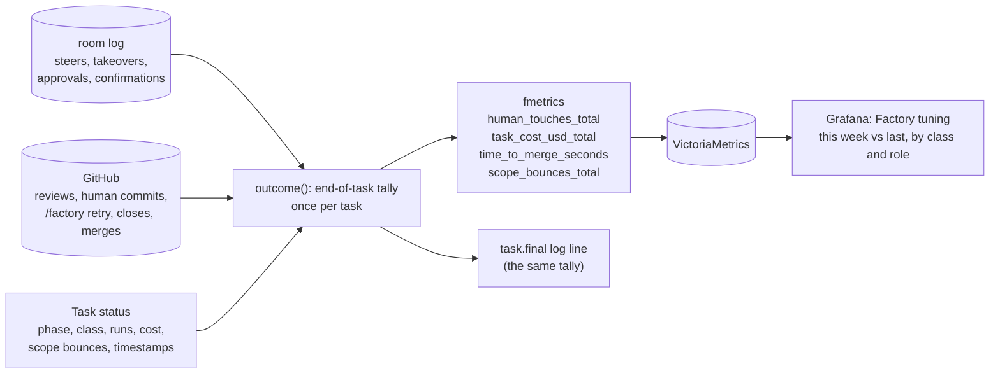

# Factory tuning metrics: design

**Status:** design, decided by the owner in a grilling session (2026-11-09, Q1–Q9, recorded as
D1–D9 below). **Scope:** `internal/factory/fmetrics`, `internal/factory/reconciler`
(`outcome.go`, `scoper.go`), and in ai-native-ref one Grafana dashboard under
`observability/base/agent-platform/`. **Not here:** a self-improvement loop, team adoption and DORA
metrics, LLM-as-judge scores, alerts.

## Conclusion

The factory's operator gets one view that answers two questions: **is the factory getting better
or worse, and why?** and **which class or role costs too much or needs too many human touches?**

Most of the data is already recorded. `human_interventions_total` counts only steers and takeovers,
`run_cost_usd` has no class or outcome, `time_to_pr_seconds` stops at the PR opening, and nothing
counts scoper bounces. This design fills those four holes. All the new counts come from one place:
the factory's end-of-task tally (`outcome()`, which already emits `tier_fit` and `task.final`). A
new "Factory tuning" dashboard shows week-over-week trends by class and role.

## Decisions

| # | Decision | Rejected |
|---|---|---|
| D1 | **Metrics first** among the gaps found in a comparison with Warp's software factory. A self-improvement loop needs scores to work from, and a canary of a factory change needs a metric to compare against. Warp's own advice is to measure adoption before anything else | Starting with self-improvement or with moving runs between local and cloud |
| D2 | **The audience is the operator tuning the factory.** Every metric is broken down by class and role | Team or management reporting (adoption, ROI), per-developer views, headline numbers for a demo: later, once there is more than one team |
| D3 | **Two kinds of human touch.** A *gate* touch is one the policy requires: filing and starting, a plan or split confirmation, an approval request, a merge the policy says a human must do. A *rescue* touch is one the factory caused by falling short: answering a scoper question, a steer, a takeover, `/factory retry`, a review asking for changes, a human commit pushed to the agent branch, closing the PR or taking it over. **Rescue touches per merged PR is the headline number**; gate touches show what the policy costs | One count of every human act (Warp): a stricter merge policy would look like a worse factory. Rescues only: hides what the policy costs. Time spent waiting instead of a count of acts: it's part of D4 |
| D4 | **The first set is touches plus four metrics:** (1) cost per merged PR, (2) how tasks end, (3) time to merge split into working time and waiting time, (4) the scoper bounce rate for issues that went through the intake Q&A against those filed directly (the success measure the spec-intake design deferred, #419). Every number comes from facts the factory already records, so this needs no new model call | DORA now (change failure rate, deploy frequency). Judge scores now. Cost and touches only |
| D5 | **Trends, no alerts.** Each panel shows this week against last week. Spend limits stay the only hard stop | Alerts on week-over-week regressions. Targets per class in the config |
| D6 | **Extend Prometheus and add one Grafana dashboard.** No new store and no new UI | Recomputing everything from GitHub records like `shadow-merge-tally.sh`: exact, but batch only and slow. A page in Maku's web UI: a second place to read metrics. Live counters plus a replay cross-check: later, if the counters drift |
| D7 | **Counted once, when the task ends, by the factory**, from the task's record. The class is known by then and nothing is counted twice. The same tally is added to the `task.final` log line. A task still open shows no touches until it ends; that is acceptable for weekly trends | Counting live where each touch happens: two emitters (broker and factory), and the class may not be known yet. Both: two numbers that can disagree |
| D8 | **Cost is fully loaded, with a waste share.** Cost per merged PR is all of a class's spend in the week (every role, and the tasks that failed or were closed) divided by the PRs that merged that week. The waste share is the part of that spend that went to tasks that never merged | The average cost of the tasks that merged: hides the waste. Both side by side: the waste share already states the gap |
| D9 | **One spec per gap, the next ones later.** This spec covers metrics only. The self-improvement loop was partly grilled and then parked by the owner | Holding this spec until every gap is grilled |

## The changes

### Metrics (`internal/factory/fmetrics`)

| Metric | Type | Labels | Replaces or extends |
|---|---|---|---|
| `agent_factory_human_touches_total` | counter | `repo`, `class`, `role`, `kind`, `touch` (`gate`/`rescue`) | replaces `human_interventions_total` (kinds `steer` and `takeover` become two of its kinds) |
| `agent_factory_task_cost_usd_total` | counter | `repo`, `class`, `outcome` | new. `run_cost_usd` stays, but it has only `tier` and `role`, so it can't give cost by class or separate the waste |
| `agent_factory_time_to_merge_seconds` | histogram | `repo`, `class`, `phase` (`working`/`waiting`) | new, next to `time_to_pr_seconds`, which stops when the PR opens |
| `agent_factory_scope_bounces_total` | counter | `repo`, `class`, `origin` (`intake`/`direct`) | new. A matching `agent_factory_scoped_total{origin}` gives the denominator |

`role` on a touch is the role whose run the human acted on (empty for touches on the task, such as
filing). The `kind` values are a closed list in `fmetrics`, like `interventions()` today, so a
typo can't create a new series:

| `kind` | `touch` | Source |
|---|---|---|
| `file`, `plan_confirm`, `split_confirm`, `approval`, `required_merge` | gate | room log, labels, the merge gate's decision |
| `scoper_answer`, `steer`, `takeover`, `retry`, `changes_requested`, `human_commit`, `close`, `pr_takeover` | rescue | room log, issue and PR events |

`required_merge` is a human merge the class's policy requires. A human merge of a PR the gate would
have merged by itself counts as `pr_takeover`.

`origin` is `intake` when the issue was filed through `issue_file` with a plan hash (spec-intake
design), and `direct` otherwise. Until #419 ships, every issue counts as `direct`.

### Tally (`internal/factory/reconciler/outcome.go`)

`outcome()` already runs once per task when it first ends. It gains a `touches(t)` step that
replaces `interventions()`: it reads the room log from the task's first run (today it reads only the
current run, from `current(t).StartSeq`), and the issue and PR events the factory's forge already
sees. It then records one `human_touches_total` increment per touch, one `task_cost_usd_total` add
with the task's total, and the two `time_to_merge_seconds` observations. Waiting time is the sum of
the intervals the task spent waiting on a human (`waiting_for_human`, `factory/needs-author`, a
pending approval or merge); working time is the rest of the time from intake to merge.

`task.final` gains `touches.gate`, `touches.rescue`, `costUSD` and `waitingSeconds`, so a single
task can be checked against the dashboard.

The scoper (`scoper.go`) increments `scoped_total` on each verdict and `scope_bounces_total` when
it bounces with a question. These two are counted when they happen, not at task end: a bounced
task can wait for a long time, and the bounce rate is about the scoper, not the task.

### Dashboard (ai-native-ref)

`observability/base/agent-platform/grafana-dashboard-factory-tuning.yaml`, with a class variable and
a repository variable. Each panel shows this week against last week:

| Panel | Query shape |
|---|---|
| Rescue touches per merged PR, by class | `sum by (class) (increase(human_touches_total{touch="rescue"}[7d])) / sum by (class) (increase(pr_outcomes_total{outcome=~".*merged"}[7d]))` |
| Rescue touches by kind | stacked, by `kind` |
| Gate touches per merged PR, by class | as the first panel, with `touch="gate"` |
| Cost per merged PR, fully loaded | `sum by (class) (increase(task_cost_usd_total[7d])) / merged PRs` |
| Waste share | spend on outcomes other than merged, divided by all spend |
| How tasks end | `pr_outcomes_total` by outcome, stacked |
| Time to merge, p50 and p90 | split into working and waiting |
| Scoper bounce rate | `scope_bounces_total / scoped_total`, by `origin` |
| Touches by role | rescue touches by `role`, to find the role that needs most help |

The existing "Human interventions (how dark is it?)" panel on the agent-factory dashboard moves to
the new counter.

**To check before building:** week-over-week panels need at least 14 days of retention in
VictoriaMetrics. Retention is set on the host side (cloud-native-ref), not in this repository.

## Not in this spec

The other gaps from the comparison with Warp, not yet designed:

- **Self-improvement loop** (parked by the owner). Decided so far: it changes steering notes and
  target-repo AGENTS.md only; it is a separate loop that copies RunLore's pattern and sends
  environment faults to RunLore through `POST /intake/runlore`; deterministic signals pick the runs
  and a blind judge explains only those; it runs weekly and opens a PR for clusters of at least 3
  runs from at least 2 tasks; it checks each merged change by comparing 4 weeks before and after.
  Still open: what runs it and on whose budget.
- **Factory as code that agents can edit**, with canary and rollback.
- **Agent identities**: one identity per task or role, not one shared agents App.
- **Moving a run between local and cloud.**
- **Adoption and DORA metrics**, for team reporting.
