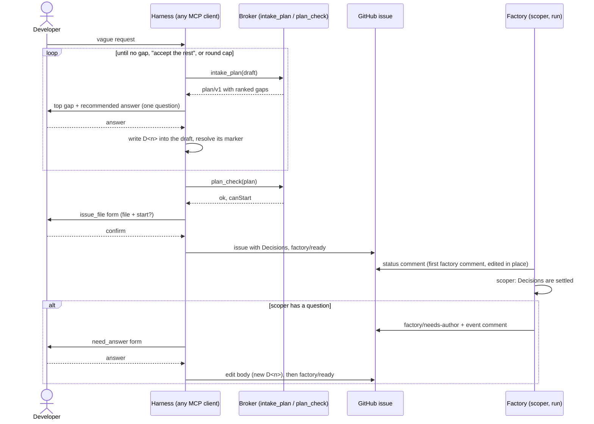

# Spec intake: design

**Status:** design, decided by the owner in a grilling session (2026-11-09, Q1–Q12, recorded as
D1–D12 below). **Scope:** `internal/intake` (`plan/v1`), `internal/humanapi` (`intake_plan`,
`plan_check`), `internal/maku` (`factory_intake` prompt, `need_answer`), `internal/factory/reconciler`
(scoper, status comment), `internal/factory/narrate`, `internal/factory/forge`, the
`factory-handoff` skill, the issue template. **Not here:** factory metrics, the self-improvement
loop, factory-as-code edits by agents, agent identities, moving a run between the cloud and a local
session (next grilling, see [Not in this spec](#not-in-this-spec)).

## Conclusion

A vague request about a complex change becomes a factory-ready issue through **a Q&A loop the
developer's own harness runs** (Claude Code, Cursor, Codex, any MCP client). The factory does not
ask the questions; it **decides when the spec is ready**. `intake_plan` returns the open gaps of a
draft, ranked, each with a recommended answer. The harness asks the developer the top gap, writes
the answer into the draft as a numbered Decision, and calls `intake_plan` again until no gap is
left or the developer accepts the rest as assumptions. `plan_check` is the deterministic final
check, and `issue_file` stays the only door that files.

The same interface works in reverse. When the scoper bounces an issue, `need_answer` lets the
developer answer from the harness instead of editing the issue on GitHub.

On GitHub, the **body** is the spec and only the developer changes it. **Labels** carry the
machine state. **One status comment**, which Maku edits in place, shows where the work is now.



## Why: what the comparison showed

Context for D1. A colleague's thesis: loops bolt more easily onto a good interactive harness than
interactive UX bolts onto a factory, and the open spot is "bring your own interactive harness" onto
a factory, *if the interface between the two is cracked*. The hardest part of that interface is the
spec: a complex change needs several rounds of questions with a human before it is worth handing to
agents.

| Product | How a vague request becomes a spec |
|---|---|
| Warp | A triage agent labels the issue (`needs-info` parks it). A spec agent writes `PRODUCT.md` and `TECH.md` in a draft PR, and a human approves. Warp says the spec agent works with a human, but doesn't document how the Q&A works. Its Factory MCP lets Claude Code, Codex or Cursor put work into the factory, but how a spec is filed through it is not documented. |
| Devin | Interactive Planning lists open questions, then drafts a plan, inside Devin's own UI |
| Factory.ai | Spec mode is read-only until the human approves the plan, inside Droid |
| GitHub spec-kit | `specify` writes `spec.md` with `[NEEDS CLARIFICATION: …]` markers, then a clarify step, inside the developer's agent |
| Agent Factory today | `intake_plan` asks **at most one** question. The scoper bounces an issue with `factory/needs-author`, and the author answers by editing the body |

None of these runs structured Q&A in the developer's own harness and then files the result into an
async pipeline. This design does.

## Decisions

| # | Decision | Rejected |
|---|---|---|
| D1 | **Output: a comparison with Warp, then this design.** The comparison is the section above; the rest of the Warp gaps are the next grilling | A positioning note with no build |
| D2 | **The harness asks, the factory decides when it's ready.** The developer's own tool runs the Q&A, so any MCP client can run it. The factory defines readiness and stays the only judge of it | (a) the factory asks, through more scoper questions over issue comments or Slack: works without a harness, but it's slow and the experience is the weakest. (b) a spec agent in a room, as Warp does: the developer has to leave their harness |
| D3 | **`intake_plan` returns a ranked list of gaps.** Each gap has a question, a recommended answer with its reason, and the section it blocks. Every round re-plans with the answers so far. `plan_check` stays deterministic and free, and is the final check | (a) a deterministic rubric only: misses ambiguity in what the request means. (b) the harness finds gaps itself from a published rubric: each harness would judge differently |
| D4 | **An optional `## Decisions` section in the issue body**, one line per answer: `D<n>: choice, because reason`. The issue stays the only source. When work is split into 1–3 issues, each issue repeats the Decisions it depends on | (a) a spec file merged through its own PR first: a merge before any work starts. (b) a parent issue: the agent has to fetch it |
| D5 | **Stop rule: "accept the rest" plus a round cap.** At any point the developer can accept every open recommendation, and those gaps are filed as `A<n>: assumed X` under Decisions. The broker caps planner rounds per intake (`intake.maxRounds`, default 10). At the cap, the open gaps become assumptions the same way. Nothing is assumed without being written down | (a) only gaps marked critical block: the model sorts gaps into blocking and not, and the developer can't see why. (b) no cap: cost has no bound |
| D6 | **The loop ships as an MCP prompt, `factory_intake`, served by the broker beside the existing `handoff` prompt (`internal/humanapi/mcpprompts.go`),** plus a line in the server instructions. `factory-handoff` becomes a thin wrapper around it. Its "file first" path stays only for requests that `intake_plan` returns with no gaps | (a) rewriting the Claude Code skill only: Cursor and Codex get nothing. (b) running the loop inside `issue_file` as a chain of elicitation forms: forms instead of a conversation |
| D7 | **The scoper treats Decisions and assumptions as settled.** Its prompt gets one rule: don't reopen a numbered `D<n>` or `A<n>`; ask only about what the issue doesn't cover. Issues filed directly on GitHub are scoped as today | (a) skipping the scoper on intake issues: no second look. (b) unchanged: it re-asks what the developer already answered |
| D8 | **`need_answer`, a local MCP tool built like `issue_file`.** For a task in `factory/needs-author` it shows the scoper's question and an elicitation form. When the developer confirms, it uses the developer's own `gh` to (1) add the answer to the body as the next `D<n>`, then (2) apply `factory/ready`. Doing it in that order keeps the freeze-at-label rule (R5, `edited_after_label`) unchanged. It covers scoper questions only | (a) deferring it: a bounce still means editing the issue on GitHub. (b) free-form mid-run questions: a new kind of need, touching run state and the event kinds |
| D9 | **The other Warp gaps are out of this spec**, success metric included; they are the next grilling | A metric or a self-improvement loop added here |
| D10 | **Issue and Maku sync: the body is the spec, labels are the state, one live status comment.** The factory never rewrites the body. The status comment is the first comment the factory posts once the issue is labelled, and it is edited in place from then on (GitHub cannot pin a comment). Event comments stay as the history | (a) a status block at the top of the body: conflicts with R5 and with the developer's edits. (b) labels and event comments only: still no single view of the status. (c) GitHub Project fields: invisible on the issue and needs another permission |
| D11 | **The spec lives in Maku** (this file), proposed as a draft PR. ANR gets only the `intake.maxRounds` setting | Writing it in ai-native-ref: the code is here |
| D12 | **Format: the three sections plus Decisions, with three conventions borrowed from elsewhere.** (1) A gap in a draft is spec-kit's marker `[NEEDS CLARIFICATION: …]`. (2) "What it should be" uses RFC 2119 keywords (MUST, SHOULD, MAY). (3) Decisions are one-line ADRs. No EARS or Gherkin requirement | (a) spec-kit's full `spec.md`: too long for a fix. (b) EARS for every requirement: awkward to write. (c) a GitHub issue form: possible later, not needed by the loop |

## The changes

### `plan/v1`: gaps instead of one question (D3, D5, D12)

`Plan.Question *Question` becomes `Plan.Gaps []Gap`, ranked so that the first gap blocks the most:

| Field | Type | Meaning |
|---|---|---|
| `id` | string | stable across rounds while the gap stays open (`g1`, `g2`…), so the harness can match an answer to its marker |
| `section` | string | `what-is-wrong`, `what-it-should-be`, `acceptance-check`, or `scope` |
| `text` | string | the question, untrusted text |
| `recommended` | `Answer` | the existing `{answer, why}` |

`Plan` also gains `round int` (1-based, written by the broker) and `roundsLeft int`. When the cap is
reached, `gaps` is still returned, and `canStart` holds only if every gap is resolved or accepted.

The draft's body carries each open gap as `[NEEDS CLARIFICATION: g<n> <text>]` at the point it
blocks. The harness replaces the marker with the decided text and appends `D<n>`. "Accept the rest"
replaces each remaining marker with the gap's recommended answer and appends `A<n>: assumed
<answer>, because <why>`.

`Gaps` is part of `Material`, so it is covered by the plan's hash: a plan whose gaps changed is
another plan. Whether clients that still read `question` get the first gap mapped onto it, and for
how long, is left to the implementation plan: it was not decided in the grilling.

### `plan_check` (D12)

`plan_check` adds one deterministic refusal: `unresolved_marker`, for a body that still contains
`[NEEDS CLARIFICATION:`. It also checks the Decisions grammar (`^[DA]\d+: .+$`, numbers ascending,
no gaps in the numbering). It makes no LLM call, as today.

### Issue template (D4, D12)

`references/issue-template.md` gains, after **Acceptance check**:

```markdown
## Decisions

D1: <choice>, because <reason>
A1: assumed <answer>, because <why>
```

The section is optional: a fix with no gaps has none. `issue_draft` accepts it, and the redactor
covers it like the other sections.

### `factory_intake` prompt (D6)

The broker already serves MCP prompts (`internal/humanapi/mcpprompts.go`, with `handoff`), and `maku mcp`
relays them. It gains a second prompt, `factory_intake(request)`, and `handoff` is kept for fixes. Its text is the loop:
call `intake_plan`, ask the developer the **first** gap only, with its recommendation, apply the
answer, repeat; offer "accept the rest" at every question; when no gaps remain, call `plan_check`,
show the draft, then `issue_file`. The installed `factory-handoff` skill (still pinned to v0.32.0
and unaware of `intake_plan`) is replaced by a wrapper that invokes the prompt.

### Scoper (D7)

The scoper prompt (`internal/factory/reconciler/scoper.go`) gets one rule: the issue's `D<n>` and
`A<n>` lines are settled; a `question` envelope MUST NOT reopen one. `askForAcceptance` is
unchanged.

### `need_answer` (D8)

A local tool in `internal/maku`, beside `issuefile.go`, with the same guards: elicitation is
required (a client that can't show forms gets `needs_confirmation`), the form defaults to "don't
send", and nothing is written without the developer's confirmation. Input: the issue. It reads
the open question from the `NeedsAuthor` event and shows it with the scoper's assumption as the
recommended answer. On confirm: `gh issue edit` (append the next `D<n>`), then `gh issue edit
--add-label factory/ready`. It acts only on issues in `factory/needs-author`.

### Status comment (D10)

The factory forge gains `EditComment(ctx, id, body)`. Today `Comment` only appends, and `PostOnce`
only dedupes repeats of an event by its marker (`narrate.go:67`). `narrate` gains `Status(t)`,
which renders:

```text
Factory status · implementing · updated 2026-11-09 14:02 UTC
Room: <link> · waiting on: nobody
Spec: body as of 2026-11-09 13:40 UTC (sha256:…), 4 decisions, 1 assumption
PR: #1234 (checks running) · spend $3.10 of $20
```

The factory posts the comment once, with a status marker, when it first acts on the label. On each
state change it finds that comment by the marker and the factory's login, then edits it. Event
comments are posted as today.

## Not in this spec

To grill next (the rest of the comparison with Warp):

- Factory metrics: human touches per PR, adoption (share of merged PRs that went through the
  factory), cost per PR, LLM-as-judge scores. This includes this design's own measure: the scoper
  bounce rate on issues that went through the Q&A compared with those filed directly.
- A self-improvement loop: score runs against rubrics, cluster the low scorers, and have an agent
  open PRs on skills and AGENTS.md.
- Factory-as-code edits by agents, with canary and rollback.
- Agent identities as service accounts.
- Moving a run between the cloud and a local session (`room_fork` and `room_checkout` don't attach
  to a live run).
