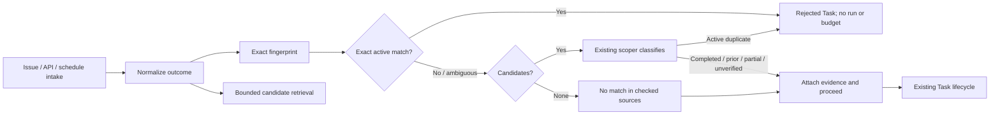

# Intake outcome overlap detection — design

Date: 2026-11-11 · Status: design approved in conversation; awaiting written-spec review

## Problem

Agent Factory already prevents replay of identical keys: deterministic Task names, AgentRun IDs,
idempotency keys, resourceVersion reservations, execution leases, and event IDs stop duplicate
execution. Those mechanisms do not stop different keys from pursuing the same outcome. Two issues,
or an issue plus a sponsored API or scheduled Task, can therefore implement the same change and
open conflicting work.

The objective is to prevent duplicate outcomes while preserving existing idempotent orchestration.
Reliability means avoiding duplicated implementation and rework, not maximizing scoper usage.

## Existing capabilities to preserve

- Task/Run status, next triggers, room history, retry/resume, and fail-closed orphan handling already
  provide recovery. No separate recovery command is needed.
- Tester → implementer exists with test-first contracts and independent reviewers. No behavioral
  testing role or second testing workflow is needed.
- Every revision is already a fresh sandboxed run with bounded fix accounting. No fresh-fixer role or
  sanitized-packet workflow is needed; prior handoffs and review verdicts remain useful evidence.
- Existing maintainer retry/relabel flows provide human override without another API.

## Scope and non-goals

Scope: outcome-overlap detection across issue, sponsored API, and scheduled intake, using the
existing scoper only when candidate classification needs judgment.

Non-goals:

- No new agent role, standing dispatcher, service, overlap database, or initial search index.
- No semantic preflight on every intake or unrestricted GitHub history search.
- No OpenCode session, worktree, controller-prompt, or `/recover-sdd` concepts.
- No behavioral-testing or fresh-fixer implementation plans.
- No hiding prior handoffs or review verdicts from the evidence packet.
- No automatic blocking for completed, prior, partial, or unverified matches.
- No payloads in logs, traces, or metrics.

## Decisions

| Topic | Decision |
|---|---|
| Approach | Candidate retrieval plus scoped review, not fingerprint-only or semantic-everything |
| Exact match | SHA-256 of canonical goal scoped by repository |
| Candidates | Deterministic lexical retrieval, active first, at most 20 |
| Ambiguous candidates | Existing scoper, read-only, only when needed |
| Blocking | Only a confirmed active duplicate; stop before AgentRun and execution-budget reservation |
| Other matches | Completed, prior, partial, and unverified matches proceed with evidence and qualified wording |
| Result | One bounded `overlap` object on Task status, replayed idempotently |
| Rollout | `off` → `shadow` → exact-active enforcement → scoper-confirmed enforcement after evidence |
| Recovery/testing | Validate existing machinery; add no parallel implementation |

## Architecture



The exact fingerprint short-circuits only a confirmed exact active match. It never creates a scoper
run. Candidate retrieval happens after intake sanitization and before an AgentRun or execution
budget reservation. The resulting Task generation replays the persisted evaluation rather than
repeating retrieval or classification.

## Outcome model and retrieval

### Canonical goal and fingerprint

Sanitize intake using the existing untrusted-input pipeline, then normalize Unicode NFKC, case,
whitespace, and punctuation. Keep the sanitized text separate from derived values. The exact
fingerprint is SHA-256 of the repository name plus the canonical goal. Identical goals produce
identical fingerprints; reworded goals require candidate review.

### Candidate retrieval

Derive deterministic lexical terms from the goal and acceptance criteria. Rank active work first,
then lexical overlap descending, recency descending, and Task name ascending for stable ties.
Return at most **20 candidates** across these sources, in order:

1. Task CRs across issue, sponsored API, and scheduled intake.
2. AgentRun history and room outcomes.
3. GitHub issues/PRs, only for matched-candidate evidence or unresolved coverage gaps.

Do not perform unrestricted semantic GitHub searches. Do not add an index until profiling shows a
need; any future index is a separate optimization.

### Result persistence

Add this bounded object to Task status:

```yaml
fingerprint: sha256
classification: active_duplicate | completed_duplicate | prior_attempt |
  partial_overlap | unverified_overlap | no_match
matches:                    # maximum 20
  - task: <name>
    run: <name>
    issue: <number>
    pr: <number>
    relation: exact | lexical
    phase: <existing phase/outcome>
sources: [tasks, runs, rooms, github]
scoperRun: <optional existing AgentRun name>
checkedAt: <timestamp>
note: <bounded to 512 characters>
```

The CRD schema enforces the enum, match/source limits, and note bound. No separate overlap database
or status service is introduced.

## Classification and lifecycle

| Classification | Existing evidence mapping | Action |
|---|---|---|
| **Active duplicate** | Exact active fingerprint, or scoper confirms an active task/run for the same outcome | Create a `Rejected` Task with evidence; create no AgentRun and reserve no execution budget |
| **Completed duplicate** | `Done` or `NoOp`; `Merged` remains active until post-merge verification completes | Do not block; reuse the completed result as evidence |
| **Prior attempt** | `Rejected`, `Reverted`, `Escalated`, `Closed`, or `Stopped` | Do not block; surface previous outcome and lessons on re-label |
| **Partial overlap** | Shared behavior/files without the same outcome, including `Split` | Do not block; adjust scope or coordination in the new brief |
| **Unverified overlap** | Missing evidence, unavailable sources, or inconclusive scoper result | Do not auto-block; report uncertainty and checked sources explicitly |

Active states are `Received`, `Triaged`, `Queued`, `Implementing`, `Reviewing`, `AwaitingCI`,
`AutoMerging`, `Verifying`, `Coordinating`, and `AwaitingHuman`. `Merged` is active until `Done` because
post-merge verification remains work in progress.

`no_match` means **no duplicate found in the checked sources**, never proof that no duplicate exists.
A candidate-source outage produces `unverified_overlap`; Task-status write failures retry
reconciliation without proceeding.

## Scoper contract and security boundaries

- **Input:** sanitized goal, exact fingerprint, and up to 20 structured candidate records containing
  status, repository, refs, and relevant room/review evidence.
- **Role:** read-only classification only. The existing scoper does not edit code, create branches,
  or dispatch implementation.
- **Untrusted content:** candidate text is fenced and never becomes an instruction. Existing
  sanitization and inert-identifier rules remain authoritative.
- **Evidence:** preserve prior handoffs and review verdicts when relevant. Do not hide useful prior
  findings behind an OpenCode-style sanitized packet.
- **Output:** one classification, evidence citations, checked sources, and blind spots. Inconclusive
  output becomes `unverified_overlap`.
- **Failure:** existing bounded recovery applies; failure never proves absence of duplicate work.
- **Observability:** IDs, enums, and counts only—never goal or candidate text.
- **Budget:** only candidate reviews consume run budget. Exact matches and empty candidate sets
  create no scoper run.

## Persistence and idempotency

Evaluate once per Task generation. A restart or retry replays the stored result and never repeats
retrieval or a scoper run. A required scoper uses the existing deterministic AgentRun identity and
resume rules.

A confirmed active refusal, whether exact or scoper-confirmed, becomes `Rejected` with its overlap
record but no AgentRun or execution budget reservation. Retrying or re-labeling follows existing
generation rules, producing new evidence rather than duplicate evaluation or execution.

Add `overlap_active_duplicate` as the refusal reason for narration and status reporting. Evidence
references remain IDs and links, not payloads.

## Observability and rollout

Add bounded metrics for evaluation count by classification and source, and scoper-run count by
outcome. Label values are limited to `tasks`, `runs`, `rooms`, `github`, and the six classification
values. Do not include goal text, candidate text, issue title, or repository payload in labels.

Add `intake.overlap.mode` with:

- `off`: no retrieval or status evaluation.
- `shadow`: retrieve and record classifications without rejecting work; measure retrieval time and
  false positives.
- `enforce`: allow the enforcement stages below, initially exact-active only, then scoper-confirmed
  active after acceptance.

Rollout:

1. **Shadow:** record evidence and gather precision/timing data without blocking.
2. **Limited enforcement:** block exact active fingerprints; scoper classifications remain advisory.
3. **Full enforcement:** enable scoper-confirmed active blocking after fixture and shadow evidence
   is accepted.
4. Roll back to `shadow` or `off` without deleting Task history.

## Validation

### Required tests

- Fingerprint normalization is stable across Unicode, case, whitespace, and punctuation variants.
- Candidate ranking is active-first, deterministic, and capped at 20.
- Every phase maps to the correct classification; `Merged` remains active until `Done`.
- Exact active matches produce `Rejected` with no AgentRun or budget reservation.
- Completed, prior, partial, unverified, and no-match results never auto-block.
- Cross-source issue/API/schedule matches are detected and replayed idempotently.
- Restart/retry never repeats evaluation or a scoper run.
- Source outages produce `unverified_overlap`; status-write failures retry.
- Candidate prompt injection cannot turn text into instructions.
- Logs, traces, and metrics contain no goal or candidate text.
- CRD validation rejects oversized or invalid overlap records.
- `task check` and the chart-install k3d e2e pass.

### Acceptance evidence

- A seeded active cross-source duplicate creates no AgentRun and reserves no execution budget.
- A reworded candidate reaches the scoper once and is classified with evidence; retries do not create
  another scoper run.
- Shadow fixtures show all six outcomes, including `no_match` and `unverified_overlap`.
- Existing recovery, test-first, fresh-run, and review behavior remains unchanged.

## Expected repository touchpoints

| Area | Future change |
|---|---|
| `internal/factory/intake` | Canonicalization, fingerprinting, bounded candidate retrieval, and source coverage |
| `internal/factory/reconciler` | Evaluation ordering, refusal, persisted replay, and lifecycle integration |
| `api/factory/v1alpha1/task_types.go` | Bounded `overlap` status and validation |
| `internal/factory/config` and chart values | `intake.overlap.mode` and configuration hash validation |
| `internal/factory/fmetrics` | Bounded overlap metrics |
| Intake/reconciler/config/API tests | Classification, security, idempotency, and rollout coverage |
| `docs/factory.md` and operations docs | Outcome-overlap behavior, evidence, limitations, and rollout |

No new role, service, database, or initial index is expected. Implementation planning must preserve
current checkout changes and use an isolated branch/worktree.

## Review notes

The original four-capability OpenCode design is a requirements reference only. Agent Factory already
satisfies cold recovery, independent behavioral testing, and fresh-fixer goals structurally; those
must remain validation activities rather than new subsystems.
