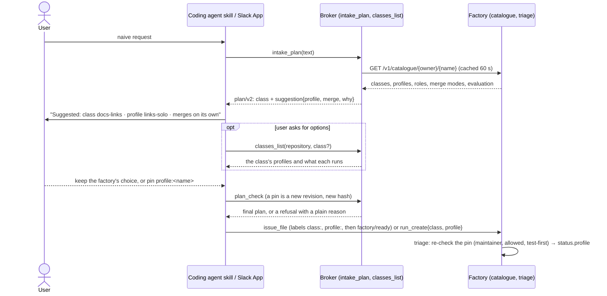

# Profile choice at intake: design

**Status:** design. The owner decided the three behaviours on 2026-11-11 (O1–O3 below: suggestion,
override, introspection, planner first). The rest (P1–P12) is proposed here and waits for review; the
choices that change the team evaluation are also listed as [open questions](#open-questions).
**Builds on:** [team evaluation room profile](2026-11-10-team-evaluation-room-profile-design.md),
[spec intake](2026-11-09-spec-intake-design.md), [factory resources](2026-11-09-factory-resources-design.md).
**Scope:** `internal/intake` (`plan/v2`), `internal/humanapi` (`intake_plan`, `plan_check`, a new
`classes_list` tool, the settings pages), `internal/maku` (`issue_file`, the `factory-handoff` skill),
`internal/slackapp` and `internal/roomview` (the proposal), the factory API (a catalogue read, two
`TaskRequest` fields), `internal/factory/triage`, `internal/factory/reconciler` (`profile.go`,
`stepup.go`), `Task.status.profile`, metrics. **Not here:** see [Not in this spec](#not-in-this-spec).

## Conclusion

A user who asks for something in plain words ("fix the broken links in the docs") should see, before
anything is filed, **which class the work falls in, which harness profile runs it, and how it will
merge**, with one line saying why. They can accept that, or pin another profile the class allows.

Today none of this is visible at intake, and part of it does not reach the factory:

| What | Where it is decided today | Visible at intake? |
|---|---|---|
| Class | a maintainer's `class:<name>` label, else `review` (`triage.predictClass`) | the plan shows `issues[].class`, but **neither `issue_file` nor `run_create` passes it on**: the factory never reads it |
| Template (roles) | `triage.Matrix(class, source, tier)`, then the profile's `template` when it sets one | the plan shows the roles from the broker's own `human.intake.plan.classes` table |
| Tier | the C7 classifier; with no `triage.classifierURL`, `standard` | no |
| Harness profile | the class's floor (`harness`); the scoper may recommend one of `harnessAllowed`, used only in `evaluation.mode: apply` | no |
| Merge outcome | the class's mode (`live`, `shadow`, `off`) and the repository's `merge.approveToMerge` | no |

The design keeps **one source of truth, the factory's accepted config snapshot** (the `Factory`,
`Repository` and `MergePolicy` objects plus the repository file under `classAuthority: repository`).
The broker reads it through a new catalogue endpoint; the planner suggests from it, the user confirms
or pins from it, and the factory re-checks every pin at triage, because labels can be added by hand.



## Decisions

| # | Decision | Rejected |
|---|---|---|
| O1 | **Suggestion.** From a naive request the intake planner suggests a class, a harness profile and the merge outcome (`live` auto-merge, `shadow`, maintainer merge, or maintainer approval under `approveToMerge`), with a one-line why. The coding-agent skill and the Slack proposal show it before the user confirms | The user picks from a list with no suggestion: a naive user does not know the classes |
| O2 | **Override.** The user can pin a profile with `profile:<name>` (an issue label, or an intake field). It is honoured only if the class's floor or `harnessAllowed` lists it, refused otherwise with a plain reason, and recorded as `source=label` | A free choice of any profile: bypasses TE2, the floor rule |
| O3 | **Introspection.** A read-only MCP tool shows the options: classes, their profiles, the roles each profile runs, the merge mode | Options only inside the plan: the user cannot ask "what else is there" |
| P1 | **The word is "profile", never "workflow".** Docs, UI, tools and messages say *harness profile* (first use) and *profile* after. See [Vocabulary](#vocabulary) | "workflow": already means a GitHub Actions workflow in these docs (`oracle.workflow`, holdout workflows, `.github/workflows/`), and no `Workflow` object exists |
| P2 | **The catalogue is read live from the factory**, through `GET /v1/catalogue/{owner}/{name}` built from the accepted snapshot, cached by the broker for 60 s. `human.intake.plan.classes` becomes a fallback, then goes (stage 5) | (a) a second copy in broker config: drifts from `MergePolicy` the day a class is promoted. (b) the broker reading the CRs itself: a second Kubernetes reader and RBAC for the broker, and it would miss the repository file |
| P3 | **The merge outcome is the broker's, not the model's.** It is derived from the class's mode and `approveToMerge`; the model writes only `why` | The model naming the outcome: it would be wrong the day a class is promoted |
| P4 | **Accepting the suggestion pins nothing.** The default on confirm is *the factory's choice*: the class (when its route carries one, P7) and no `profile:`. A profile is pinned only when the user picks one, the suggested one included | Every accepted suggestion pins: each intake task would leave the evaluation's cohorts, and the planner would silently replace the scoper |
| P5 | **A pin is honoured only from a maintainer** (`Repository.spec.maintainers`), like a `class:` label today (T3: labels are intent, never authority). On GitHub the label's last applier is checked; on `run_create` the sponsor's linked login | Anyone may pin since variants never go below the floor: true for safety, not for cost, as a variant can raise the tier |
| P6 | **The factory is the authority; intake is an early check.** `plan_check` refuses a pin the catalogue refuses; triage checks again, because a label added on GitHub never passed intake. A pin refused at triage runs the task as if unpinned and says why | Intake-only checking: a hand-applied label would bypass it |
| P7 | **The class reaches the factory.** `issue_file`'s "start" applies `class:<c>` (and `profile:<p>` when pinned) with the developer's `gh` **before** `factory/ready`; `run_create` gains `class` and `profile` fields bound by the plan hash | Leaving the class display-only, as today: the suggestion would describe a run that does not happen |
| P8 | **A pin puts the task in the `labeled` cohort; a class label alone does not** (open question 1). `source=label` then means one thing: a person chose the profile | Today's rule (a declared class is `labeled`): with P7, every intake task would leave the evaluation |
| P9 | **A pin is honoured in `observe` and in `apply`.** The evaluation mode governs the scoper's recommendation only; a pinned task is never offered one (`profileChoices` is nil for `source=label`, as today) | Pins only in `apply`: `observe` would ignore a person's explicit choice |
| P10 | **Escalation still applies to a pinned task, except to the profile it already runs.** `stepUp` skips when the class's target equals the active profile | No escalation for pins: a pinned task that runs out of budget would go straight to a human |
| P11 | **One introspection tool, `classes_list`**, with an optional `class` argument for the detail | Two tools (`classes_list` and `policy_explain`): the second is the first filtered |
| P12 | **Refusals are a closed list** with one sentence each, shared by intake and triage (see [Refusals](#refusals)) | Free-text reasons: a metric cannot label them and a reader gets three spellings |

## Vocabulary

**Recommendation: "profile"** (*harness profile* on first use on a page). Reasons:

1. It is the name in the code and the API: `HarnessProfile`, `Factory.spec.harnessProfiles`,
   `classes.<c>.harness`, `harnessAllowed`, `Task.status.profile`, the room UI's *Harness profile*
   block, the `agent_factory_profile_*` metrics.
2. "Workflow" already has a meaning in the docs: a GitHub Actions workflow (`oracle.workflow`,
   holdout checks, `.github/workflows/release.yaml`). Two meanings on one page is a support question.
3. Maku has no workflow object. A profile is a named row (`template`, `tier`, `checks`, `testFirst`,
   `loop`), not a sequence a user edits; "workflow" promises more than it is.

What a reader sees: "**Profile** `links-solo`: one implementer at tier light, no tests first." The
roles carry the "who does what" a user expects from the word workflow. `docs/naming.md` gains one row
saying "workflow" is reserved for GitHub Actions.

## The catalogue

`GET /v1/catalogue/{owner}/{name}` on the factory API, with the caller's token (as
`/v1/policy/evidence`), answers from the accepted snapshot. It never reads GitHub:

```json
{
  "repository": "Smana/cloud-native-ref",
  "generations": {"factory": 12, "repository": 4, "mergePolicy": 9},
  "evaluation": {"mode": "observe", "controlPercent": 20},
  "approveToMerge": true,
  "maintainer": true,
  "classes": [
    {"name": "docs-links", "description": "Dead links in docs", "mode": "live",
     "ceilingUSD": 2.0, "floor": "links-solo", "allowed": [], "escalation": null},
    {"name": "review", "description": "Anything else: a maintainer merges", "mode": "off",
     "ceilingUSD": 8.0, "floor": "review-floor", "allowed": ["review-frontier"],
     "escalation": {"outOfBudget": "review-frontier", "notConverged": "review-frontier"}}
  ],
  "profiles": {
    "links-solo": {"template": "solo", "roles": ["implementer"], "tier": "light", "checks": false,
                   "testFirst": false, "loop": "", "description": "One file of links, no logic"},
    "review-floor": {"template": "", "roles": null, "tier": "", "checks": true, "testFirst": false,
                     "loop": "", "description": "The default: triage picks pair or trio"},
    "review-frontier": {"template": "trio", "roles": ["implementer", "tester", "reviewer"], "tier": "frontier",
                        "checks": true, "testFirst": true, "loop": "", "description": "Changes across several files"}
  }
}
```

- **Offered classes:** every class of the repository except `revert` (the factory's own), adopted
  classes (`author.adopt`: another author's pull requests) and oracle classes (their tasks come from a
  detector). `review` is always offered.
- **`roles: null`** means the profile sets no `template`, so `triage.Matrix` picks it from the class and
  the tier. The plan then says "pair, or trio at tier frontier", never a guess.
- **`mode`** is the class's `live`, `shadow` or `off`; a class the gate does not arm (gate off) is
  `unarmed`, as in the `policy` task fact.
- **`maintainer`** is the caller's own flag (P5), so a surface can say before filing that a pin will
  be refused.
- The broker caches per repository for 60 s. A factory that does not answer: until stage 5 the broker
  falls back to `human.intake.plan.classes` and plans without a suggestion; from stage 5 it refuses
  `catalogue_unavailable`.

## The plan: `plan/v2`

Two fields per issue. `apiVersion` is material, so every hash changes at the upgrade: a plan or Slack
proposal made before it is refused `plan_changed` and is re-planned (open question 5).

| Field | Material? | Who writes it | Meaning |
|---|---|---|---|
| `issues[].class` | yes (unchanged) | the model, checked against the catalogue | the class |
| `issues[].profile` | yes, new, `""` allowed | the user, through a revision | the pin; `""` is the factory's choice |
| `issues[].suggestion` | no (display) | broker + model | `{profile, merge: {outcome, approveToMerge}, why}`; `why` ≤ 200 characters, untrusted text |

`suggestion.profile` is one of the class's floor or `allowed`; a model answer outside them is replaced
by the floor and logged. `suggestion.merge.outcome` is one of:

| Outcome | When | Words shown |
|---|---|---|
| `auto` | class `live` | merges on its own when the gate's conditions hold |
| `shadow` | class `shadow` | a maintainer merges; the factory records whether it would have |
| `approval` | class `off`, the gate on, `merge.approveToMerge: true`, an agents class (the `policy` fact's `approveToMerge`) | a maintainer's approval merges it |
| `maintainer` | any other class `off` or `unarmed` | a maintainer merges it |

A pin is a revision like an answered gap: the harness sends the candidate with only `profile`
changed, the broker admits that edit kind, checks the pin against the catalogue and returns a new
hash. The issue body gains a Decision record (`D<n> profile: review-frontier, pinned by the
developer`), or, when the user keeps the factory's choice and the suggestion differed, an Assumption
(`A<n> profile: factory's choice; suggested review-frontier`), so the GitHub issue carries what was
chosen.

The roles shown (`issues[].roles`) come from the pinned profile's template when it sets one, else from
the floor's, else from the catalogue's "pair, or trio at tier frontier".

## Override and the factory

**Inputs.** A `profile:<name>` label on the issue, or `TaskRequest.profile` (with `TaskRequest.class`)
on `run_create`. The factory API copies them to a new `Task.spec.intake {class, profile, login}`;
`login` is the sponsor's resolved login, never a value from the request.

**Triage** (`predictClass`, `floorProfile`) in this order:

1. Class: a maintainer's `class:` label, else `spec.intake.class` from a maintainer, else as today.
2. Pin: more than one `profile:` label, or a label and a field that disagree → refuse
   `profile_conflict`. A pin from a non-maintainer → `not_maintainer`.
3. `config.ProfileFor(class, name)`: unknown → `profile_unknown`; class without `harness` →
   `class_no_profiles`; class `live` or `shadow` (one profile by TE2) → `class_profile_fixed`; not the
   floor nor in `harnessAllowed` → `profile_not_allowed`.
4. A `testFirst` pin on a non-public task → `profile_internal`; with no tests paths →
   `profile_no_tests_paths` (the checks `variantFor` already runs for a scoper pick, read at
   resolution).
5. Honoured: `profileSpec` applies it (template, loop row, tier only upward and through the task's
   ceiling), cohort `labeled`, `source=label`.

**Status.** `Task.status.profile` gains two optional fields, copied into the `profile` task fact and
`summary/v1` like the others:

| Field | Meaning |
|---|---|
| `requested` | the pinned profile name, ≤ 63 |
| `refused` | the refusal code when the pin was refused, ≤ 32 |

A refused pin runs the task as if unpinned (its cohort by hash, the floor, the scoper as the mode
allows) and narrates one line: "Agent factory: `profile:review-frontier` was not applied: class
`docs-links` is live, so its merge policy runs it under `links-solo` only." The room UI's *Harness
profile* block shows `Requested` and `Refused` when present.

**Evaluation.**

| Task | Cohort | `source` | Scoper consulted? |
|---|---|---|---|
| pinned, honoured | `labeled` | `label` | no |
| pinned, refused | by hash (`control` / `treatment`) | `control` / `floor` / `scoper` | as today |
| class label or intake class, no pin (P8) | by hash | `control` / `floor` / `scoper` | as today |
| no class, no pin | by hash | as today | as today |

`evaluation.mode` and `controlPercent` keep their meaning: they decide the scoper's recommendation for
unpinned tasks. P8 changes the population of `labeled`: class-labelled tasks join the cohorts. The
`agent_factory_task_outcomes_total{source="label"}` series changes meaning at that release, which the
release notes and the dashboard annotate.

**Escalation.** `stepUp` keeps its rules (no step for `control`, one step only) and adds one: no step
when the class's target is the active profile (P10). A pinned `review-frontier` that runs out of budget
goes to a maintainer, rather than running once more under the same profile.

## Refusals

One closed list in `internal/intake/refusal.go`, read by triage too. Each sentence names the class and
the allowed profiles, which the user may read (they are in the catalogue); it never names another
repository.

| Code | Where | Sentence |
|---|---|---|
| `profile_unknown` | intake, triage | `<p>` is not a profile of this factory. `classes_list` shows the profiles. |
| `profile_not_allowed` | intake, triage | Class `<c>` runs under `<floor>` or `<allowed…>`; `<p>` is not one of them. |
| `class_profile_fixed` | intake, triage | Class `<c>` is `<live\|shadow>`: its merge policy runs it under `<floor>` only. |
| `class_no_profiles` | intake, triage | Class `<c>` declares no profiles: the factory runs it as configured. |
| `not_maintainer` | intake, triage | Only a maintainer of this repository can choose the profile; the factory will choose it. |
| `profile_conflict` | triage | The issue names more than one profile; none was applied. |
| `profile_internal` | intake, triage | `<p>` writes tests first, which runs on public tasks only. |
| `profile_no_tests_paths` | triage | `<p>` writes tests first, and this repository declares no tests paths. |
| `catalogue_unavailable` | intake | The factory's list of classes could not be read; try again in a minute. |

At intake a refusal is a `plan_check` refusal: the plan is not finalised and the user picks again or
keeps the factory's choice. At triage it is never a task failure.

## Introspection: `classes_list`

A read-only tool on the broker's MCP server, also used by the Slack App.

- **Input:** `repository` (required), `class` (optional).
- **Output:** the catalogue as text and structured content. Without `class`: one line per offered
  class (`docs-links · live · merges on its own · profile links-solo`). With `class`: its profiles,
  each with roles, tier, tests-first, loop and description, which is the floor, the escalation
  targets, and whether the caller may pin.
- **Access:** a human principal who can read the repository, as for the settings pages; the Slack App
  only with `on_behalf_of`. Counted by the existing `rooms_human_mcp_calls_total{tool}`.

## Surfaces

**Coding-agent skill** (`internal/maku/skill/factory-handoff/SKILL.md`). One paragraph after the gap
loop and one table row:

> Before `issue_file`, show the plan's suggestion line as it is, for example
> `Suggested: class review · profile review-floor · a maintainer's approval merges it — one file, no logic change`.
> Offer three answers: keep the factory's choice (the default), take the suggested profile, or name
> another (`classes_list` shows the class's profiles). A profile the developer picks is a revision:
> call `plan_check` with only `profile` changed. Never pin a profile the developer did not choose, and
> never apply `class:` or `profile:` labels yourself: `issue_file`'s start does, with their `gh`.

| Ask | Tool |
|---|---|
| see the classes and profiles a repository offers | `classes_list` |

**`issue_file`.** The form shows the class, the profile (pinned, or "factory's choice") and the merge
outcome. On "start" it applies, in order, `class:<c>`, `profile:<p>` when pinned, then
`factory/ready`, so triage reads both. When the catalogue says the developer is not a maintainer, the
form says the class and profile will not count and offers start without them.

**Slack proposal** (`roomview.Proposal`). The issue tail line becomes two lines:

```text
class docs-links · profile links-solo (one implementer, tier light) · merges on its own when the gate's conditions hold
why: one Markdown file, links only
```

Under them, a static select "Profile: factory's choice | <floor> | <allowed…>" for an `off` class, and
nothing for a `live` or `shadow` class (one profile). Choosing one re-plans (a new revision and hash);
Confirm binds the hash shown, as today. An "Options" button posts `classes_list`'s answer for the
class, ephemeral.

**`/settings`.** No new page. Each class card on a repository page gains a *Profiles* row: the floor,
the allowed variants, the escalation targets, and each profile's roles and tier. The Settings index
lists the factory's evaluation mode and control share. Read-only, as D9 of factory resources.

## Metrics

| Metric | Labels | Counts |
|---|---|---|
| `intake_profile_choices_total` (broker) | `surface`, `class`, `choice` = `factory`\|`suggested`\|`other` | confirmed plans by what the user did with the profile |
| `intake_profile_refusals_total` (broker) | `surface`, `reason` | pins refused at intake |
| `intake_catalogue_reads_total` (broker) | `outcome` = `hit`\|`miss`\|`error` | catalogue reads |
| `agent_factory_profile_pins_total` (factory) | `class`, `profile`, `outcome` = `honoured`\|`refused`, `reason` | pins seen at triage |

`class` and `profile` are config names (bounded); a name no longer in config is `other`, as
`recommendedLabel` does. Outcomes and cost per pinned profile come from the existing
`agent_factory_task_outcomes_total` and `agent_factory_task_usd_total` with `source="label"`.

## Rollout

| Stage | Ships | Behaviour change |
|---|---|---|
| 1 | Catalogue endpoint, `classes_list`, the settings *Profiles* row | none: read-only |
| 2 | `plan/v2` with `suggestion` (display), shown in the skill and Slack; `run_create` and `issue_file` carry the class (P7) | maintainers' intake tasks now carry their class |
| 3 | Pins: the `profile` revision, `profile:` label, `TaskRequest.profile`, triage checks, `requested`/`refused`, refusals, metrics, P10 | pinned tasks run their profile |
| 4 | P8, the cohort rule, after the owner answers open question 1 | class-labelled tasks join the cohorts |
| 5 | Drop `human.intake.plan.classes` | broker needs the catalogue |

Each stage is one Maku release; ai-native-ref bumps the pin per stage. Stages 2 and 4 change what the
evaluation counts, so each starts with `evaluation.mode: observe` on the live factory.

## Testing

- Catalogue: offered classes (no `revert`, adopted, oracle), `roles: null`, `mode` for each case,
  `maintainer` per caller.
- Plan: `plan/v2` hash covers `profile`; the `profile` edit kind is admitted and nothing else changes;
  a suggestion outside the class becomes the floor.
- Triage: each refusal, label order with `factory/ready`, label applier checks, refused pin runs
  unpinned, honoured pin is `labeled`/`label` in observe and apply.
- Escalation: no step to the active profile.
- Surfaces: skill text, Slack proposal lines and select, `issue_file` label order, settings row.
- Full gate: `task check`. Live proof on the next aws-0 session: one pinned, one refused, one default.

## Open questions

1. **Cohort rule (P8).** Should a class label alone stop putting a task in `labeled`? Recommended: yes,
   so P7 does not drain the evaluation. It changes the meaning of past `source=label` data.
2. **Who may pin (P5).** Maintainers only, or any requester with write access, since a variant never
   goes below the floor? The cost of a frontier variant is the argument for maintainers.
3. **The planner and the scoper.** Should the planner's suggestion reach the scoper as a hint for
   unpinned tasks? Proposed: no, the two stay independent so the evaluation can compare them.
4. **Escalation to the same profile (P10)** also applies to a scoper-applied variant that equals the
   target, which today runs once more under the same profile. Keep that, or change both?
5. **In-flight plans at the `plan/v2` upgrade.** Re-plan (proposed) or accept `plan/v1` for one release?
6. **Floors without a template.** Should a profile offered at intake be required to set `template`, so
   the roles shown are never "pair, or trio"?

## Not in this spec

- A `Workflow` object, CRD or user-defined sequence of roles.
- Changing `triage.Matrix`, the classifier, tiers or templates.
- A profile below the class's floor, or a profile the class does not list.
- Pinning a merge mode: the merge outcome is shown, never chosen at intake.
- Per-user or per-channel default profiles.
- Settings pages that write; profiles declared in the repository file.
- The scoper's recommendation logic, and the self-improvement loop.
