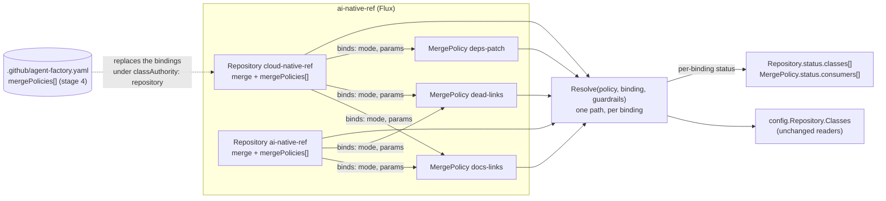

# Reusable merge policies: design

**Status:** design for a grill with the owner (2026-11-12). The owner stated the problem and agreed
the model in principle on 2026-11-11; B1–B19 below refine it, and [Open questions](#open-questions)
are what the grill decides. **Builds on:** [factory resources](2026-11-09-factory-resources-design.md)
(D3, D4, D5, D8, D10, D16), [merge policies](../../merge-policies.md), and the profile-choice spec in
PR #470 (its catalogue). **Scope:** `api/factory/v1alpha1` (`MergePolicy` reshaped, `Repository`
gains `merge` and `mergePolicies`), `internal/factory/config` (the split types and one resolve
function), `internal/factory/resources` (Assemble, migrate, validate), `internal/factory/mergepolicy`
(the repository file's grammar, export), `internal/factory/decision`, `internal/factory/evidence`,
`internal/humanapi` (settings pages), the `approval_grants` binding, and in ai-native-ref the four
repositories' manifests. **Not here:** see [Not in this spec](#not-in-this-spec).

## Conclusion

The owner's problem (2026-11-11): *"MergePolicies are named by the repository name. I would have
expected MergePolicies such as alerts, dead-links, docs… and the Repositories would reference these
MergePolicies."*

Today a `MergePolicy` is one repository's whole policy: `repositoryRef` 1:1, every class inline, and
a `merge:` block of repository settings. `docs-links` and `revert` are written four times (once per
live repository), `dead-links` twice, identically. The reshape splits what a class **means** from
how a repository **uses** it:

| Object | One per | Holds | Today in |
|---|---|---|---|
| `MergePolicy` | class definition (`docs-links`, `dead-links`, `alert-rules`, `deps-patch`) | what the class means: author, diff shape, limits, monitor, harness, which parameters a repository must supply | each repository's `MergePolicy.spec.classes.<c>` |
| `Repository.spec.merge` | repository | repository settings: required and verify checks, logins, breaker, caps, `approveToMerge` | `MergePolicy.spec.merge` |
| `Repository.spec.mergePolicies[]` | (repository, class) | a binding: the policy's name, the **mode**, and the repository's parameters (`allowedFiles`, `holdoutChecks` …) | the same class entry, mixed in |

**Mode, evidence, the breaker, daily caps and promotion stay per (repository, class).** That is why a
shared policy cannot carry the mode: evidence is counted per repository, and twenty clean merges in
cloud-native-ref say nothing about runlore. Promotion edits the binding, never the shared policy.

The factory resolves each binding into the same `config.Class` the gate reads today, so the gate,
triage, the adopter, the monitor and #470's catalogue read `config.Repository.Classes` unchanged. The
reshape is confined to the API, Assemble, the repository file's grammar, status, the decision record,
the grant binding and the settings pages.



```text
$ kubectl get mergepolicy,repository -n agent-system
NAME                              CONSUMERS   CURRENT   LIVE   ACCEPTED   AGE
mergepolicy/docs-links            4           4         1      True       1d
mergepolicy/revert                4           4         1      True       1d
mergepolicy/dead-links            2           1         0      True       1d    # one consumer still serves gen 3
mergepolicy/deps-patch            1           1         0      True       1d

NAME                              REPO                     FACTORY   CLASSES   LIVE   ACCEPTED   CONNECTED   AGE
repository/cloud-native-ref       Smana/cloud-native-ref   aws-0     11        2      True       True        14d
repository/runlore                Smana/runlore            aws-0     2         0      True       True        14d
```

## The model

### `MergePolicy`: one class definition

The spec is today's `config.Class` (D16: one set of Go types) less `live` and `shadow`, plus
`requires` and `requiresApproval`. The object's name **is** the class name.

```yaml
apiVersion: maku.ogenki.io/v1alpha1
kind: MergePolicy
metadata: {name: dead-links, namespace: agent-system}
spec:
  description: Retargets dead external links a detector found, and nothing else.
  requires: [allowedFiles, holdoutChecks, oracleWorkflow]   # each binding must supply these
  modifyOnly: true
  maxModifiedLines: 20
  diffShape: links-only
  protectedFiles: ['^docs/(superpowers|specs)/']
  oracle: {probe: dead-links, maxFindings: 10}               # the workflow is the repository's
  monitor: {oracleRuns: 2, followUpWindow: 168h}
  maxPerDay: 1
---
apiVersion: maku.ogenki.io/v1alpha1
kind: MergePolicy
metadata: {name: docs-links, namespace: agent-system}
spec:
  description: Fixes a broken link in the docs, and nothing else.
  requires: [holdoutChecks]                                  # links-only is built in (R52)
```

### `Repository`: settings and bindings

```yaml
apiVersion: maku.ogenki.io/v1alpha1
kind: Repository
metadata: {name: ai-native-ref, namespace: agent-system}
spec:
  factoryRef: aws-0
  repository: Smana/ai-native-ref
  maintainers: [Smana]
  classAuthority: central
  merge:                       # today's MergePolicy.spec.merge, verbatim, plus fluxSource
    requiredChecks: [validate, lint]
    verifyChecks: [validate, lint]
    policyBotLogin: ogenki-merge-gate[bot]
    mergerLogin: ogenki-agent-merger[bot]
    autoMergesPerDay: 2
    leakScanCheck: lint
    approveToMerge: true
    breaker: {window: 10, maxReverts: 1, maxFollowUps: 1, recoverAfter: 3}
  mergePolicies:
    - {name: docs-links, mode: shadow, holdoutChecks: [validate]}
    - {name: revert,     mode: shadow, holdoutChecks: [validate]}
    - {name: docs,       mode: "off"}
    - name: dead-links
      mode: shadow
      allowedFiles: ['^(docs|website/content)/.+\.md$']
      holdoutChecks: ['External links 🔗']
      oracleWorkflow: dead-links.yaml
      protectedFiles: ['^website/content/docs/decisions/']   # added to the policy's
```

### Which field lives where (B4)

Every field has exactly one combination rule. No templating, no override of a policy-only field.

| Kind | Fields | Policy | Binding | Resolved as |
|---|---|---|---|---|
| **Meaning** | `description`, `author.adopt` (logins, branches), `harness`, `harnessAllowed`, `escalation`, `checks`, `testFirst`, `diffShape`, `modifyOnly`, `oracle.probe`, `oracle.maxFindings`, `releaseAgeCheck`, `monitor` (`followUpWindow`, `oracleRuns`, `verification`, `flux.within`) | yes | refused | the policy's |
| **Mode** | `mode`: `live`, `shadow`, `off` | refused | required | the binding's |
| **Fill once** | `allowedFiles`, `companionFiles`, `requiredLabel`, `oracleWorkflow` | optional | optional; **required** when listed in the policy's `requires` | set in exactly one place; both is `ParameterTwice` |
| **Additive** | `holdoutChecks`, `protectedFiles`, `requiresApproval` | optional | optional | the union |
| **Caps** | `maxPatchFiles`, `maxModifiedLines`, `maxPerDay` | optional | optional, at most the policy's | the lower; a binding above the policy is `OverPolicy` |
| **Repository fact** | the Flux source a monitor watches | — | — | `Repository.spec.merge.fluxSource`; a policy with `monitor.flux` bound where it is unset is `MissingParameter` |

A binding can tighten (add a deny path, a holdout, an approval path, lower a cap) and fill what the
policy leaves open. It can never widen what the policy says, so a reviewer of a policy reads the
loosest any consumer can be. Narrowing a policy's `allowedFiles` from a binding is refused rather
than proved: a regular-expression subset is not decidable, and `mergepolicy.Structural` already
calls a rewritten pattern a relaxation. Narrow with `protectedFiles` instead.

## Decisions

| # | Decision | Rejected |
|---|---|---|
| B1 | **A `MergePolicy` is one reusable class definition, and its name is the class name.** No alias: the binding's `name` is the policy's name and the class every surface shows (the `class:<name>` label, the decision marker's `class=`, metric labels, the policy-bot rule `low-risk: <class>`, the grant and promotion rows). The name is held to the class pattern, `^[a-z0-9]([-a-z0-9]{0,38}[a-z0-9])?$`, by CEL on `metadata.name`, the bound the `approval_grants.class` column already sets. The built-in names keep their rules wherever they are bound: `docs-links` and `revert` are `links-only` (R52), `review` merges nothing, `revert` is never predicted from a label | (a) today's one policy per repository: the duplication the owner named. (b) an `as:` alias on the binding (bind `docs-strict` as class `docs`): two names for one thing in every log line, and about 50 lines in 18 files key behaviour on the class name. (c) a new kind (`MergeClass`) beside a deprecated `MergePolicy`: cleaner migration, but the owner's word is *MergePolicy* (open question 2) |
| B2 | **`Repository.spec.merge` holds the repository's merge settings**, `config.Merge` verbatim, plus `fluxSource` (the GitRepository that delivers the repository, today repeated inside each class's `monitor.flux`) | (a) a separate `MergeSettings` kind: a fourth object per repository for one block. (b) Factory-level merge defaults now: 7 of the 13 keys are identical across the four repositories, but defaults with per-repository overrides are a second resolution rule (open question 7) |
| B3 | **Bindings are a list keyed by name**: `+listType=map`, `+listMapKey=name`, at most 32. The API server refuses a duplicate name at admission, and server-side apply owns each entry separately. `mode` is required; `review` takes only `off` | A map `name → binding`, like today's `classes`: YAML tooling (kustomize, yq) merges a duplicate key silently before admission, so "duplicates are refused" would be untestable |
| B4 | **One combination rule per field** ([the table](#which-field-lives-where-b4)): meaning on the policy, mode on the binding, fill-once parameters named by `requires`, additive lists unioned, caps lowered only | (a) a binding overrides any field: the policy would mean nothing. (b) a binding narrows `allowedFiles`: undecidable. (c) templated parameters (`${allowedFiles}`): a second language inside the spec, for the same four fields |
| B5 | **Mode, evidence, the breaker, daily caps and promotion stay per (repository, class).** Promotion edits the binding's `mode`, in the `Repository` manifest under `central` authority or in the file under `repository`. The `policy_promotions` and `operator_exceptions` rows keep `(repository, class)`, and since class names do not change in migration (B1), the 180 days of evidence carry over | Mode on the policy: one repository's clean merges would arm every consumer, and one consumer's bad merge would have to trip the others |
| B6 | **Class selection does not change, and does not need precedence**, with one exception closed. An agents task's class is its schedule's, a maintainer's `class:` label, else `review`: never a file match. An adopted pull request is matched by login, branch prefix, diff shape and the class's file fence, and between two same-shape classes today's adopter takes the first **by name**. A repository binding two adopted policies with the same `diffShape` and overlapping logins and branch prefixes is refused (`AmbiguousAdoption`) | (a) a `priority` field: precedence for a case no repository has. (b) keeping the silent name order: renaming a shared policy would change which class adopts a Renovate pull request in another repository |
| B7 | **The policy's shape is the flat central shape** (`config.Class` less `live`/`shadow`), plus `requires` and `requiresApproval`. The file's `conditions.any` is not carried: a class with branches becomes two policies | (a) the file's shape (`conditions.all/any/deny`, `limits`): a second shape for the same class again, and the gate already reads the flat one. (b) carrying `any`: a binding's `allowedFiles` would have to say which branch it fills, and no live file uses `any` |
| B8 | **Stay on `v1alpha1`, over two releases.** Release N serves both shapes of `MergePolicy`: a legacy object is recognised by `spec.repositoryRef` (CEL: the legacy and the class fields never together), and a `Repository` with `mergePolicies` is served from its bindings. A repository both bound and named by a legacy `MergePolicy` is refused, `DefinedTwice`, as D8 did for the file. Release N+1 removes the legacy shape from the schema | (a) `v1alpha2` with a conversion webhook: one legacy object becomes N policies and a `Repository` patch, and a CRD conversion is one object to one object, round-tripping; it would also put a webhook and its certificate in the chart. (b) a breaking change in one release: the API server prunes the legacy fields on read once the schema drops them, and ai-native-ref's HelmRelease (which upgrades the CRDs) and its resources Kustomization apply in no guaranteed order, so the factory could read an empty `MergePolicy cloud-native-ref` mid-upgrade |
| B9 | **Each binding resolves, fails and keeps its last good version on its own.** A policy is `Accepted` when it is valid alone (`ValidateClass` with a placeholder for each `requires` field). A binding that does not resolve (`MissingRef`, `MissingParameter`, `ParameterTwice`, `OverPolicy`, `GuardrailMismatch`, `AmbiguousAdoption`, `Invalid`) drops that one class: the factory keeps the binding's last resolved class while it runs (D5), and serves none after a restart (D14), so a `class:` label naming it falls back to `review`. The repository and its other classes keep serving | (a) refusing the whole `Repository`: one shared-policy edit would stop every class of every consumer it breaks. (b) refusing the policy when one consumer cannot take it: one repository would veto the edit for all, and the policy's author may not own that repository |
| B10 | **Status moves to where the key is.** `Repository.status.classes[]` (moved from `MergePolicy.status`): per binding `name`, `mode`, `policyGeneration` served, `accepted` with reason and message, last decision and time. `Repository.status` also takes `authority` and the conditions `RepositoryFileValid`, `InSync`, and a new `BindingsValid` (false while any binding is refused, the message naming them). `MergePolicy.status.consumers[]` (at most 64): `repository`, `mode`, `servedGeneration`, `accepted`, `reason`; columns `CONSUMERS CURRENT LIVE ACCEPTED AGE`, where `CURRENT` counts consumers serving the policy's current generation | Per-binding conditions as `metav1.Condition` entries: conditions are keyed by type, so 32 bindings would need 32 condition types |
| B11 | **The blast radius is shown before the merge, then in status.** `maku config validate --base <manifests>` resolves every binding under the old and the new manifests and prints, per changed policy, each consumer's mode, its structural change (`unchanged`, `tightening`, `relaxation` with why) and whether it still resolves. ai-native-ref's `task check` runs it against `origin/main`, so the pull request's log carries it. After the merge, `MergePolicy.status.consumers[]` and the settings page show the same per consumer | Status alone: it shows the damage after Flux applied it. Whether a relaxation of a policy with live consumers should also demote them to shadow, as a cut-over file's does, is open question 4 |
| B12 | **The decision record and the task name the policy generation and the binding's.** `policygen=` becomes the generation of the class's `MergePolicy`; a new `repogen=` is the `Repository` generation (mode and parameters). `Task.status.configGenerations.mergePolicy` records the task's class's policy generation: the class is fixed at triage, so one number still suffices | One `policygen=` for "the policy set": no single object has that generation |
| B13 | **Approval grants stay per (repository, class)** and bind to a new hash: the sha256 of the resolved class, mode excluded, printed as `resolved=<12 hex>`. `policy=` keeps its meaning (the file's sha256). A shared-policy edit suspends that class's grants in every consumer; an edit to another class no longer suspends this one's. Because `requiresApproval` is now central (B7), a grant applies under `central` authority too, still behind `approvalMemory` | (a) grants per class across repositories: a maintainer of one repository would arm merges in another. (b) keeping the file's hash: an unrelated class's edit suspends every grant of the repository, and a central binding has no file. No grant exists to migrate: `approvalMemory` is off on aws-0 |
| B14 | **One resolve path, guardrails on every binding.** `Resolve(policy, binding, guardrails)` serves central bindings and the file's alike; `mergeGuardrails` caps both | Guardrails on file classes only, as today: two resolve paths for one object. Live impact of the change: none, `mergeGuardrails` is unset on aws-0 |
| B15 | **The stage-4 file takes the binding shape.** `mergePolicies:` is the same list as `Repository.spec.mergePolicies`, naming policies of the factory's namespace; guardrails cap. Under `classAuthority: repository` the `Repository` declares no `mergePolicies` (two authoritative sources, MP15, as today). `merge` stays central. A file that does not parse pauses auto-merge (`policy_invalid`), as today; a binding that parses but does not resolve against its central policy is isolated like a central one (B9) | (a) inline class definitions in the file: maintainers keep inventing classes without a central pull request, at the cost of two places a class can be defined (open question 3). (b) pausing the whole repository on one unresolved binding: an operator's policy edit would pause a repository it does not own |
| B16 | **The settings pages follow the split, still read-only (D9).** The repository page's cards become bindings: each shows its policy and generation, the parameters this repository supplies, the mode and the evidence. A new page per policy, `/settings/merge-policies/policies/<name>`, shows the definition and its consumers (mode, served generation, accepted). The editor edits a binding (output: a `Repository` manifest patch) or a policy (output: `mergepolicy-<class>.yaml` and the consumer impact of B11). Promotion's card says "set `mode: live` on the binding in `repository-<name>.yaml`". `maku policy export` writes the file in the binding shape | One editor for both: a policy edit and a binding edit have different reviewers and different blast radii |
| B17 | **`maku config migrate` converts today's objects, and proves it.** From legacy `MergePolicy` manifests (or a config file's `repositories[]`), it splits each class by the table: meaning fields to one policy per class name, fill-once fields to the bindings (named in `requires` when every consumer sets them), additive fields to the policy when every consumer has the same list and to the bindings otherwise, caps to the policy at the loosest consumer's value and to the bindings below it, `merge` to `Repository.spec.merge`. Two consumers whose meaning fields differ for one class name are refused with the differing fields: the converter never renames. It then resolves every repository before and after and refuses unless each `config.Class` is equal | A converter without the equality check: the one property that matters (no gate decision changes) would rest on review |
| B18 | **ai-native-ref migrates one repository per pull request**, smallest first: runlore, runlore-kb, ai-native-ref, cloud-native-ref (the only one with live classes). The first pull request also teaches `scripts/ci/factory_config.py` the binding shape, which the parity, profiles, repo-files, pins and kb-class tests read. cloud-native-ref's `.github/agent-factory.yaml` is rewritten in the binding shape between releases N and N+1 | One pull request for all four: a regression in cloud-native-ref's live classes would revert the other three |
| B19 | **Order relative to #470: its stage 1, then this release N, then #470's 4, 2, 3, then N+1, then #470's 5.** #470's catalogue reads `config.Repository.Classes`, which resolution keeps; only its `generations.mergePolicy` changes meaning. Amend #470 before its stage 1 merges: `generations: {factory, repository, mergePolicies: {<class>: <n>}}` | (a) this reshape first: #470's stage 1 settings *Profiles* row would land on cards this reshape is about to rebuild, and its stage 1 is read-only and small. (b) after all of #470: pins (its stage 3) would be checked against per-repository copies of `harnessAllowed` that this reshape then moves |

## Validation

| Where | What |
|---|---|
| **CEL, at admission** | `MergePolicy`: `metadata.name` matches the class pattern; in release N the legacy fields and the class fields never together; `requires` names only fill-once fields; `review` takes only `harness`, `harnessAllowed`, `escalation` and `description`. `Repository`: binding names unique (`listType=map`); `mode` in `live`, `shadow`, `off`; `docs-links` and `revert` bound when any binding is (OD-8, as the file's rule); `classAuthority: repository` implies no `mergePolicies`. Write the rules against the wiki's CEL notes (`has()` on `oldSelf`'s optional fields) |
| **Reconciler, per binding** | `MissingRef` (no such policy), `MissingParameter` (a `requires` field unset, or `monitor.flux` without `fluxSource`), `ParameterTwice`, `OverPolicy`, `GuardrailMismatch`, `AmbiguousAdoption` (B6), `Invalid` (the resolved class fails `ValidateClass`: `semver-minor` bound `live`, `testFirst` without `checks` …) |
| **Reconciler, per policy** | `Invalid` when it fails alone; a refused generation keeps the last accepted one serving every consumer (D5), `Ready`-style message `serving generation 3; generation 4 refused` |
| **Offline** | `maku config validate` (strict decoding, D8's reason) and `--base` for the blast radius (B11) |

**A shared policy invalid for one repository only.** Take `dead-links` at generation 4 adding
`requiredLabel` to `requires`. The policy is valid alone: `Accepted=True`. ai-native-ref's binding
supplies no label: its `classes[dead-links]` reads `accepted: false, reason: MissingParameter,
policyGeneration: 3`, `BindingsValid=False` names it, and the class keeps serving generation 3 until a
restart. cloud-native-ref's binding does supply it and serves generation 4.
`mergepolicy/dead-links` shows `CONSUMERS 2, CURRENT 1`, and its `consumers[]` entry for
ai-native-ref carries the reason. `maku config validate --base` would have printed the same line on
the pull request.

## Keys

| Record | Key today | Key after | Changes |
|---|---|---|---|
| Promotion evidence | (repository, class) | same | none: the class name is the policy name (B1) |
| `policy_promotions`, `operator_exceptions` | (repository, class) | same | none |
| Breaker, `maxPerDay` | (repository, class) | same | none |
| `approval_grants` | (repository, class, file hash) | (repository, class, resolved-class hash) | B13; no live grant |
| Decision marker | `class= policy= policygen=` | `class= policy= policygen= repogen= resolved=` | B12, B13 |
| `Task.status.configGenerations` | `factory, repository, mergePolicy` | same fields; `mergePolicy` is the class's policy | B12 |
| #470 catalogue `generations` | `mergePolicy: n` | `mergePolicies: {class: n}` | B19 |
| Metric labels | `class` | same | none |

## The repository file (stage 4)

```yaml
factory: aws-0
mergePolicies:
  - {name: docs-links, mode: live, holdoutChecks: ['Check the documentation links 🔗']}
  - {name: revert,     mode: live, holdoutChecks: ['Check the documentation links 🔗']}
  - name: alert-rules
    mode: shadow
    allowedFiles: ['^observability/.+\.ya?ml$']
    requiresApproval: [{changedFiles: ['^observability/base/']}]
```

| Release | Parser | cloud-native-ref's file (the only file with classes) |
|---|---|---|
| N | Accepts `classes:` (legacy) or `mergePolicies:`, never both. Stages 1 and 3 compare either against the served bindings | Rewritten with `maku policy export` in one pull request; divergence stays 0, `dual=agree` holds |
| N+1 | `classes:` refused, the message naming `maku policy export` | — |

No repository is cut over (`repositoryAuthority` is off on aws-0), so the file's grammar change acts
on no merge: it changes only what stages 1 and 3 compare.

## Migration of the four live repositories

Today: four `MergePolicy` objects, 189 lines without comments. After: twelve policies and four
`Repository` objects carrying `merge` and their bindings. **The line count stays about the same**;
the gain is one definition per class, a shared edit reviewed once, and the blast radius shown.

| Policy | Consumers (mode) | Parameters left on the bindings |
|---|---|---|
| `docs-links`, `revert` | cloud-native-ref (live), ai-native-ref, runlore-kb, runlore (shadow) | `holdoutChecks`, which differ per repository |
| `dead-links` | cloud-native-ref, ai-native-ref (shadow) | `allowedFiles`, `holdoutChecks`, `oracleWorkflow` |
| `docs`, `tests`, `dashboards`, `scripts` | cloud-native-ref, ai-native-ref (off) | none |
| `review` | cloud-native-ref (off) | none |
| `alert-rules`, `deps-patch`, `deps-minor` | cloud-native-ref (shadow) | `allowedFiles`; `fluxSource` moves to `merge` |
| `kb-entries` | runlore-kb (shadow) | `allowedFiles`, `companionFiles`, `requiredLabel` |

Every class name repeated across repositories today has identical meaning fields, so the converter
(B17) refuses nothing on the live set. Steps:

1. Maku release N; ai-native-ref bumps the pin.
2. One pull request per repository (B18), each: the policies it is the first to need, the
   `Repository` with `merge` and bindings, the legacy `MergePolicy` deleted, the converter's
   equality check and `maku config validate --base` in `task check`.
3. cloud-native-ref's `.github/agent-factory.yaml` in the binding shape.
4. Live proof on the next aws-0 session: for each repository, `kubectl get mergepolicy,repository`;
   every decision after the switch carries the same `class=` as before; the Evidence page's counts
   for cloud-native-ref's classes equal the counts read before the switch; `dual=agree`.
5. Maku release N+1; ai-native-ref bumps the pin.

## Not in this spec

- **Bundles**: one binding pulling several policies (`docs-pack`). Deferred by the owner.
- **Aliases** (B1), and a binding overriding `harness` or `harnessAllowed` (open question 11).
- **Factory-level merge defaults** (open question 7).
- **Policies across namespaces** or per team (factory resources D7).
- **Settings pages that write** (D9).
- **Generating policy-bot rules** from a policy: `low-risk: <class>` is still written by hand per
  repository.
- **Changing what a class means today**: no gate row, reason or metric changes; the resolved classes
  are equal before and after (B17).

## Open questions

1. **No alias (B1).** A repository wanting a stricter `docs` gets a policy with another name
   (`docs-strict`), so another `class:` label, another policy-bot rule and evidence starting at zero.
   Accept, or add `as:` now? Recommendation: accept; the fill-once and additive fields cover the
   live variants.
2. **Kind name.** Keep `MergePolicy` for the definition (the owner's word; needs B8's union release),
   or name it `MergeClass` and retire `MergePolicy` (no union, but "policy" leaves the vocabulary)?
   Recommendation: `MergePolicy`.
3. **Inline definitions in the stage-4 file (B15).** Bindings only means a maintainer who wants a new
   class asks for a central pull request. No repository is cut over, so nothing breaks today.
   Recommendation: bindings only.
4. **A relaxation of a policy with live consumers.** A cut-over file's relaxed live class runs in
   shadow until a restart. Should a central policy's relaxation demote its live consumers too, or is
   the B11 CI output enough? Recommendation: CI output only; the policy is reviewed by an operator.
5. **Evidence across policy generations.** Evidence counts every shadow decision of (repository,
   class) over 180 days, whatever the policy said then. Should a relaxation segment it ("12 of 20
   under the current generation")? Recommendation: show the split on the card, block nothing.
6. **Run-only classes.** `docs`, `tests`, `dashboards`, `scripts` and `review` are `off` everywhere;
   they exist to shape runs (`checks`) and to be valid `class:` labels. Are they merge policies, or
   should a later spec give them their own home?
7. **Merge defaults.** 7 of the 13 `merge` keys are identical across the four repositories. Add
   `Factory.spec.mergeDefaults` later, or never?
8. **The grant hash (B13).** Agree to bind grants to the resolved class rather than the file, before
   `approvalMemory` is turned on anywhere?
9. **Guardrails on central bindings (B14).** Agree, given that `mergeGuardrails` is unset on aws-0
   and would then bound central classes the day it is set?
10. **`AmbiguousAdoption` (B6).** Stricter than today: is refusing the second same-shape adopted
    binding right, or should the name order stay, documented?
11. **Per-repository harness.** May a binding pick its `harness` among the policy's `harnessAllowed`?
    #470's catalogue would then read the floor from the binding. Recommendation: not in this spec.
12. **Which policies a file may bind.** Any policy of the factory's namespace, or only those an
    operator lists on the `Repository`? Recommendation: any; the policy is reviewed centrally and the
    guardrails cap.
13. **Dropping `any` (B7).** No live file uses it. Agree to refuse it at N+1?
14. **`fluxSource` on `merge` (B2).** One Flux source per repository is the assumption. A repository
    delivered by two GitRepositories would need it per binding.
