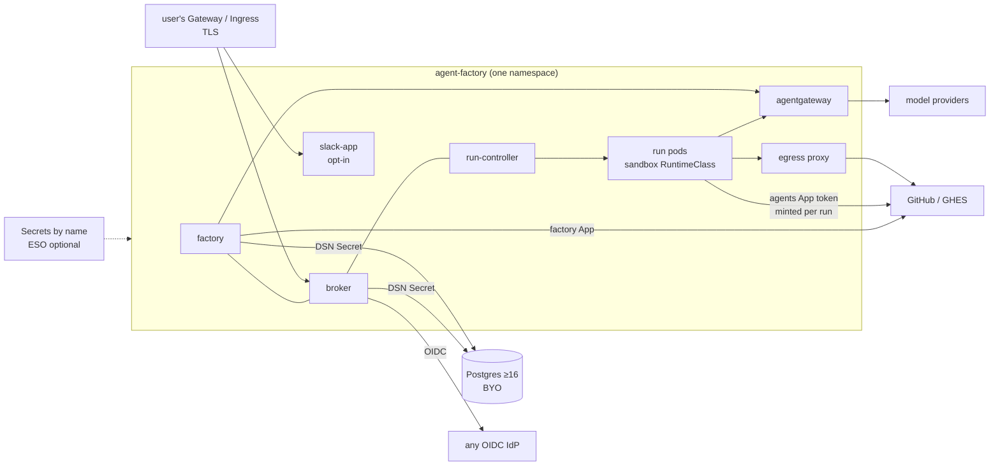

# v4 stage 2, the production path: design

**Status:** design, agreed with the owner on 2026-11-12 in a grilling (Q1–Q26 below). **Scope:**
`charts/agent-factory` (and a new `charts/agent-factory-crds`), the run-controller, the factory's
token minter and merge-gate status, the broker's account link, `maku install` and `maku preflight`,
CI (`.github/workflows/`), and the install docs. ai-native-ref (ANR) and cloud-native-ref (cnref)
follow with their own changes (see "Rollout"). **Follows**
`2026-11-06-factory-on-a-laptop-design.md`, whose stage 1 shipped the umbrella chart with
`profile: demo` and named this stage: "the same chart with production values".

**Release:** this design does not cut v4. Every stage below ships as a v0.4x minor. The v4.0.0
tag, release and chart version wait for the owner's explicit go.

## Goal

A platform team that already runs a Kubernetes cluster installs Agent Factory with one Helm chart,
through Flux or Argo CD, wiring its own identity, secrets, database and network. Nothing in the
product path needs a component chosen by cnref. cnref becomes one set of values for that chart.

## Facts this design rests on

Read from the code on 2026-11-12, before the questions:

- **The umbrella has one profile.** `charts/agent-factory` renders only `profile: demo`;
  `_helpers.tpl` fails with "profile is required: demo, or production values (stage 2)". The demo
  values are the chart's defaults. There is no `values.schema.json`. The CRDs sit in `crds/`, which
  Helm never upgrades; ANR relies on Flux's `CreateReplace`.
- **Hard dependencies today**, all from cnref's stack:
  - Cilium: the run-controller's network policy mode is `cilium|none`.
  - Crossplane: the AgentRun XR is the default run kind; the scoper and loop policies require it
    (`internal/factory/config/config.go:2286`, `:2313`).
  - CNPG through the `SQLInstance` composition.
  - Kueue (ANR only).
  - OpenBao through ExternalSecrets.
  - ZITADEL: the roles claim (`internal/authn/jwt.go:77`) and the `human.access.readerFile` PAT.
  - octo-sts, which needs a fetchable ServiceAccount issuer.
  - policy-bot as the merge gate.
  - The Envoy AI gateway in front of the planner.
  - Kyverno policies (ANR) on top of Maku's ValidatingAdmissionPolicies.
  - VictoriaMetrics VMRules (ANR).
- **CI already installs on kind.** `demo-e2e.yaml` runs a k3d install, plus a nightly kind job with
  real models. `quickstart-e2e.yaml` runs on kind with Cilium, gVisor, cert-manager and CNPG.
  `migrate-e2e.sh` tests an upgrade from v0.30.0.
- **Earlier v4 decisions** this design makes concrete:
  - V11: a generic k3s/kubeadm proof.
  - V15: bring-your-own OIDC, secrets and GitOps; agentgateway required.
  - V17: semver on chart values, a nightly upgrade test.
  - V18: one umbrella chart; cnref is values.
  - V19: gVisor required.

## Decisions

| # | Decision |
|---|---|
| D1 (Q1) | **The audience is a platform team with an existing cluster.** It brings its own cluster, identity provider, secrets tooling and GitOps controller. The quickstart (stage 1) stays the way to try it on a laptop. |
| D2 (Q2) | **One factory per install.** The chart is namespaced. Several teams means several installs, each with its own Apps, database and fence (`.github/agent-factory.yaml`). |
| D3 (Q3) | **Public repositories by default; private ones by explicit opt-in.** A Repository serving private code needs `spec.privateCode.acknowledged: true`. That field states the code is sent to the configured models, which are usually SaaS. Without it the factory refuses to serve a private repository. The docs say this on the install page and the Repository reference. Self-hosted models remain possible through agentgateway, but nothing in the product depends on them. |
| D4 (Q4) | **GitHub only, GHES included.** The API and web URLs are values (`github.apiURL`, `github.webURL`). GitLab and other forges are out of scope. |
| D5 (Q5) | **Maku's run-controller is the run path.** The scoper and loop policies work on run-controller runs; the requirement on the AgentRun XR goes. Crossplane is not a dependency, and cnref deletes its XR (D15). |
| D6 (Q6) | **Network: NetworkPolicy plus an egress proxy.** <ul><li>Every component is default-deny, using standard `networking.k8s.io/v1` policies.</li><li>Run pods may reach only DNS, agentgateway and an in-cluster egress proxy, plus the OTLP collector's port when run tracing is configured (step 6 R1). The proxy enforces each run's FQDN allow-list (GitHub, package registries the Repository names).</li><li>Cilium policies stay an optional mode.</li><li>A preflight refuses to start runs when the CNI does not enforce NetworkPolicy (it probes a denied connection).</li></ul> |
| D7 (Q7) | **agentgateway only, shipped in the umbrella.** It serves the agents, the planner and the classifier. Model keys are Secrets referenced by its values. The Envoy AI gateway leaves the product path. |
| D8 (Q8) | **Any OIDC provider, plus a one-time GitHub account link.** <ul><li>The broker accepts any OIDC issuer; the roles claim name and its values are configurable.</li><li>Each person links their GitHub account once in the broker, which is how the factory maps a human to a GitHub login.</li><li>ZITADEL becomes an optional preset; the `readerFile` PAT goes.</li></ul> |
| D9 (Q9) | **Bring-your-own Postgres ≥16.** The broker and its retention job read DSN Secrets, one per database role; the factory has no database (amended in step 5 PR D). Maku runs its schema migrations at start-up. Backups and high availability are the operator's job. The bundled Postgres StatefulSet stays demo-only. |
| D10 (Q10) | **The factory mints short-lived installation tokens per run**, scoped to one repository with the role's permissions (the role table follows what the repository enforces, as amended by the owner on 2026-11-12, HR12: an implementer gets `contents:write` and `pull_requests:write` only while the factory does not publish those outputs for it, and loses them as `pr`, `comment`, `labels` and then `push` are enforced; a reviewer is read-only, its verdict goes through the room). octo-sts becomes optional. |
| D11 (Q11) | **The merge gate is Maku's own commit status** (`maku/merge-gate`). It is computed from the MergePolicy and posted by the factory App; branch protection requires it. policy-bot becomes an optional integration. |
| D12 (Q12) | **Two GitHub Apps.** The agents App writes code and opens PRs. The factory App handles issues, labels, statuses and merges. An agent token can never approve or merge its own PR. |
| D13 (Q13) | **The chart contract:** <ul><li>Defaults are production-safe and fail closed when a required seam is missing.</li><li>The demo moves to `values-demo.yaml`, and the `profile` switch is deleted at the end of the rollout.</li><li>A `values.schema.json` makes the values contract enforceable.</li><li>The CRDs move to a separate `agent-factory-crds` chart, as templates, so Helm, Flux and Argo CD all upgrade them. It is installed first.</li><li>Once v4.0.0 is cut, breaking value changes happen only in a major version, each with a migration note.</li></ul> |
| D14 (Q14) | **Secrets are plain Kubernetes Secrets named in the values.** Each credential has an `existingSecret` and documented keys; the preflight fails the install when one is missing. An optional `externalSecrets.enabled` renders ExternalSecrets against a ClusterSecretStore named by the user. ESO, Sealed Secrets, SOPS or `kubectl create secret` all work. |
| D15 (Q15) | **cnref runs the product path.** cnref is one set of values: the run-controller, agentgateway for the planner, the Maku merge-gate status, factory-minted tokens. Cilium, CNPG, ZITADEL and OpenBao remain cnref's platform choices, consumed only through the generic seams (NetworkPolicy, a DSN Secret, OIDC, Secrets by name). There is one tested path, and the live sessions prove what users run. |
| D16 (Q16) | **Kueue is dropped everywhere.** Admission stays in the factory's slots and budgets. The chart renders a ResourceQuota on the runs namespace as a cluster-level safety net. |
| D17 (Q17) | **Admission rules are ValidatingAdmissionPolicies only**, shipped in the chart with their bindings: the sandbox RuntimeClass, a restricted securityContext, no hostPath, limits set, the image allow-list. No controller is needed. cnref keeps Kyverno for its own platform rules; the factory never depends on it, and ANR's duplicate Kyverno policies are deleted. |
| D18 (Q18) | **A sandboxed RuntimeClass is required; its name is configurable.** <ul><li>`sandbox.runtimeClassName` defaults to `gvisor`; Kata or `gke.gvisor` also work.</li><li>A preflight refuses runs when the class is missing.</li><li>`sandbox.unsafeAllowRunc: true` exists for the demo and kind only, and the Status page flags it.</li><li>The sandbox nodes are the user's. The docs cover GKE Sandbox, k3s, and EKS through Bottlerocket or a custom AMI.</li></ul> |
| D19 (Q19) | **Exposure through Gateway API or Ingress; TLS is the user's.** <ul><li>`expose.mode` is `httproute`, `ingress` or `none`, with the parentRef or ingressClass and the hostnames as values.</li><li>The user's gateway or ingress terminates TLS (a cert-manager annotation is optional); the chart never issues certificates.</li><li>In-cluster traffic is plain HTTP inside the default-deny policies.</li><li>Only the Slack events path must be public; the factory polls GitHub and needs no public path (step 6 R2). The docs show how to expose just that.</li></ul> |
| D20 (Q20) | **Core always; Slack opt-in; RunLore outside.** The core is the factory, the broker and the run-controller (merging any of them is a later refactor, out of scope). The Slack App is a subchart, off by default (`slack.enabled: false`); the MCP server, the CLI and the web UI are enough to run the factory. RunLore stays its own product, integrated through its MCP endpoint value when present: `maku.broker.roomTools.knowledge.url`, which the broker forwards `kb_search` and `kb_get` to for triager runs (step 6 R5). The minimal install is the three core Deployments plus Postgres and agentgateway; the egress proxy (D6) and the web front door (D19, oidc) come with their seams (step 6 R3). |
| D21 (Q21) | **Observability in the Prometheus standard.** Always on: `/metrics` on every component, and OTLP traces to a configurable endpoint (off when unset). Opt-in: a ServiceMonitor, a PrometheusRule with the alerts, and Grafana dashboards as ConfigMaps carrying the sidecar label. The VictoriaMetrics operator converts the prometheus-operator objects, so ANR's VMRule copy is deleted. |
| D22 (Q22) | **ANR stays, shrunk to values and proofs.** It remains the AI layer cnref applies through `OCIRepository/ai-native-ref`, keeping the host contract, its release cadence and the docs site. Its content becomes: <ul><li>the umbrella HelmRelease and its values;</li><li>the agentgateway routes;</li><li>cnref-specific Secrets and ExternalSecrets;</li><li>the live-session runbooks.</li></ul> Kueue, the Kyverno duplicates, the VMRules, the Crossplane XR, the Envoy AI gateway and policy-bot leave, and so do the duplicated room-broker and slack-app manifests. Its CI renders the chart with the cnref values. |
| D23 (Q23) | **The proof of "any Kubernetes":** <ul><li>Every chart PR: a kind install with Calico (not Cilium, which proves the NetworkPolicy path) and gVisor, and a k3s install with its bundled flannel and kube-router policy, Traefik Ingress and an external Postgres container. Both run the e2e with fake models, so no secrets are needed.</li><li>Nightly: an upgrade from the last released minor to HEAD, and the real-model job.</li><li>Before v4.0 is announced: one manual install each on GKE (the gcp-0 dogfood) and on a kubeadm cluster, recorded in the session ledger.</li><li>Managed clouds are not automated.</li></ul> |
| D24 (Q24) | **Install UX: a wizard that writes, never applies.** <ul><li>`maku install --print` asks about each seam and creates the two GitHub Apps through GitHub's manifest flow.</li><li>It writes `values.yaml` and the Secret manifests (or the ExternalSecret references), and never applies anything, so the output goes into Flux or Argo CD.</li><li>`maku preflight` runs as a Helm test hook and from the CLI. It checks CNI policy enforcement, the RuntimeClass, database reachability and version, OIDC discovery, the App permissions and the gateway's models.</li><li>One "Install on your cluster" page carries a seam table: each seam, its default, and what is lost without each optional piece.</li></ul> |
| D25 (Q25) | **Rollout: additive in Maku, then cnref flips one seam at a time** (see "Rollout"). The room database is kept throughout; no data migration. Each step ships as a v0.4x minor. The v4.0.0 release waits for the owner's explicit go. |
| D26 (Q26) | **Support floor:** <ul><li>Kubernetes ≥1.30 (the VAPs need it), tested on the three latest minors.</li><li>Postgres ≥16.</li><li>GitHub.com and GHES ≥3.14.</li><li>Helm ≥3.15 (3.14 renders offline only with --kube-version), Flux ≥2.4, Argo CD ≥2.12.</li></ul> This spec lives in Maku; ANR keeps a pointer and its shrink checklist. |

## The seams

| Seam | Required | The user brings | Without it |
|---|---|---|---|
| Kubernetes ≥1.30 + a NetworkPolicy CNI | yes | the cluster | preflight refuses runs |
| Sandbox RuntimeClass | yes | gVisor or Kata nodes | preflight refuses runs (demo: `unsafeAllowRunc`) |
| Postgres ≥16 | yes | a database and DSN Secrets | the install fails |
| OIDC IdP | yes | issuer, client, roles claim | no one can sign in |
| Two GitHub Apps | yes | created by `maku install` | no work can start |
| Model keys | yes | Secrets for agentgateway | runs fail at the gateway |
| Exposure | yes, for webhooks | a Gateway or an Ingress, TLS | no GitHub events |
| Slack | no | a Slack App | MCP, CLI and web only |
| RunLore | no | its MCP endpoint | no knowledge-base lookups |
| ESO | no | a ClusterSecretStore | write Secrets another way |
| Prometheus operator, Grafana | no | the CRDs, the sidecar | metrics only, no alerts or dashboards |

## Rollout

Each step is a v0.4x minor of Maku, then an ANR PR that switches cnref, then a gcp-0 live check
recorded in the session ledger.

1. **Chart contract** (D13): `values-demo.yaml`, `values.schema.json`, the `agent-factory-crds`
   chart. `profile: demo` keeps working.
2. **Run path** (D5, D6, D16, D17, D18): the scoper and loop policies on the run-controller, the
   NetworkPolicy mode and the egress proxy, the RuntimeClass value and preflight, the
   ResourceQuota, the VAPs. ANR switches cnref from the XR and drops Kueue and the Kyverno
   duplicates.
3. **GitHub seams** (D10, D11, D12): the per-run token minter, the `maku/merge-gate` status, the two
   Apps. ANR switches cnref off octo-sts (for the factory) and policy-bot.
4. **Gateway** (D7): agentgateway for the planner and the classifier. ANR drops the Envoy AI
   gateway; the suspended Kimi and Mistral overrides move into the agentgateway values.
5. **Identity and data** (D8, D9, D14): any OIDC issuer, the account link, DSN Secrets, Secrets by
   name with optional ESO. cnref keeps ZITADEL, CNPG and OpenBao behind these seams.
6. **Exposure, components, observability** (D19, D20, D21): `expose.mode`, the Slack subchart off by
   default, the PrometheusRule and dashboards. ANR deletes the VMRules and the duplicated
   room-broker and slack-app manifests (D22).
7. **Install UX and proof** (D3, D23, D24): `maku install --print`, `maku preflight`, the install
   page, the kind+Calico and k3s jobs, the nightly upgrade, the private-code opt-in.
8. **Clean-up:** once cnref runs only the product path, Maku deletes the old paths and the
   `profile` switch. The chart is then ready for v4.0.0. Cutting it waits for the owner's go,
   after the manual GKE and kubeadm installs (D23).

## Owner rulings, 2026-11-12

Decided after the plans for steps 2 and 3 and hardening H1–H5 were written:

| Ruling | Decision |
|---|---|
| HR12 | The minter's role table is the enforce-aware one (D10 above is amended). `minter.Roles = TableHR12` |
| HR13 | A repository with `enforceOutputs` whose runs hold a shared or unscoped token (a PAT, the demo's shared token, step 2's interim writer) is a configuration error: the factory refuses to start and names the fix (per-run tokens, or the XR and octo-sts) |
| HR42 | Readiness R2 on the run-controller path reads the minter's role table (option A): H5 reports ready only once step 3's per-run tokens are configured |
| HR28 | Protected-path push approvals are bound to the bundle's digest: they outlive the run and approve exactly that content. The Slack push approval accepts an approval with no live run |
| PR9 | The install's unsafe settings stay a banner every signed-in human sees |
| Pins | A pinned issue shows the pinned profile's roles (profile choice G3) |
| Merge gate | `maku/merge-gate` is posted and required on agent PRs only, through a separate default-branch ruleset that human roles and the merger App bypass in pull-request mode; the demo requires no gate (owner, 2026-11-12) |
| Release | The next Maku minor is cut once step 3 (PRs A to E) has merged, not before |
| A11 (D13 exception) | agentgateway's four CRDs are not in `agent-factory-crds`: with them the release Secret sits 16 KB under Kubernetes' 1 MiB limit. They are vendored in `config/agentgateway` and applied outside Helm (a Flux Kustomization with `prune: false`, an Argo CD Application with `Prune=false`, `kubectl apply --server-side`, or the upstream `agentgateway-crds` chart); the six maku CRDs stay in `agent-factory-crds` (owner, 2026-11-13) |
| Step 6 R1 (D6 amended) | When run tracing is configured, run pods may also reach the OTLP collector, on its OTLP port only; without tracing, D6's list is unchanged (owner, 2026-11-13) |
| Step 6 R2 (D19 amended) | Only the Slack events path must be public: the factory polls GitHub and needs no public path (owner, 2026-11-13) |
| Step 6 R3 (D20 amended) | The minimal install is the three core Deployments plus Postgres and agentgateway; the egress proxy (D6) and the web front door (D19, oidc) come with their seams (owner, 2026-11-13) |
| Step 6 R4 | The oauth2-proxy web front door is an umbrella template rendered from `maku.broker.human`, not a subchart (step 5's PR11 is superseded) (owner, 2026-11-13) |
| Step 6 R5 | RunLore's `kb_search` and `kb_get` reach runs through a broker pass-through on the room tools (`maku.broker.roomTools.knowledge`), not MCP federation in `maku-gateway` (owner, 2026-11-13) |
| Step 6 R6 | `profile: production` renders in step 6, not step 7: it checks the seams of each enabled component (owner, 2026-11-13) |
| Step 7 R1 (D3 timing) | In step 7, a private repository without `privateCode.acknowledged` gets a warning only (a condition, a gauge, the banner). It is refused from step 8 (owner, 2026-11-13) |
| Step 7 R2 (D14 read) | "The preflight fails the install" is met by two things, with no pre-install hook: the components refuse to start, naming the Secret and key, and the preflight's Helm test hook fails. Argo CD users run `maku preflight` or the suspended preflight CronJob (owner, 2026-11-13) |
| Step 7 R3 | `maku install --print` writes the credentials it generates (the App keys, the factory App's client secret, a cookie secret) to a git-ignored `secrets/` directory, mode 0600. It never asks for a third-party secret (owner, 2026-11-13) |
| Step 7 R4 | `values-demo.yaml` defaults to `model.mode: gateway` from step 7 (owner, 2026-11-13) |
| Step 7 R5 | The GitHub account link uses the factory App's OAuth client. The wizard sets its callback URL in the App manifest (owner, 2026-11-13) |
| Step 7 R6 | The nightly installs through Flux 2.4 and Argo CD 2.12. The per-PR jobs use plain Helm (owner, 2026-11-13) |
| Step 7 R7 (D26) | The nightly also tests Kubernetes 1.30, the floor, on kind (owner, 2026-11-13) |
| Step 7 R8 (D23) | The recorded GKE and kubeadm installs that gate v4.0 run on step 8's last minor, after one kubeadm dry run on step 7's minor (owner, 2026-11-13) |
| Step 7 R9 (D23, D2) | The GKE proof is a fresh second install on gcp-0, in its own namespace, from `maku install --print` output with test-organization Apps (owner, 2026-11-13) |
| Step 7 R10 (D2) | The aggregated ClusterRoles `maku-factory-admin`, `maku-mergepolicy-editor` and `maku-viewer` move into `agent-factory-crds`. Every other cluster-scoped object gets a release-prefixed name, so two installs can share a cluster (owner, 2026-11-13) |
| Step 7 R11 (D23) | k3d (k3s in Docker) counts as the k3s install (owner, 2026-11-13) |
| Step 8 R1 | Step 8 ships as two minors: deprecation signals first (S8.1), then removals (S8.2). A removal merges only after its signal has read zero for seven days (owner, 2026-11-13) |
| Step 8 R2 | A removal needs zero on both gcp-0 and aws-0, unless the owner has decommissioned aws-0 (owner, 2026-11-13) |
| Step 8 R3 (D10 read) | octo-sts support is deleted entirely once the XR is gone. D10's "optional" is met by the per-run minter (owner, 2026-11-13) |
| Step 8 R4 (D7) | `model.mode: secret` stays as a demo-only mode, refused without `demoValues` and shown on the banner as `model_key_in_sandbox` (owner, 2026-11-13) |
| Step 8 R5 | `factory_slack_*` is renamed `maku_slack_app_*` in step 8, with no dual export (owner, 2026-11-13) |
| Step 8 R6 | `maku-broker migrate-group`, `internal/migrategroup` and the v0.30.0 upgrade e2e are deleted. An install older than v0.31 upgrades through a v0.4x release first (owner, 2026-11-13) |
| Step 8 R7 | The factory config's legacy single-repository shape (v2 D1) is deleted (owner, 2026-11-13) |
| Step 8 R8 (D13) | The values schema-diff gate ships report-only. Only the owner's v4.0.0 release PR arms it (owner, 2026-11-13) |
| Step 8 R9 (D3) | The private-code warning becomes a refusal in step 8, once the gauge reads 0 on both clouds (owner, 2026-11-13) |
| Step 8 R10 (D9) | The broker's unreadable-ledger bridge (#521) becomes a refusal in step 8, once `maku_rooms_schema_unverified` reads 0 on both clouds (owner, 2026-11-13) |

## Not here

- GitLab and other forges (D4).
- Local GPU models as a product requirement (D3).
- Several factories per install (D2).
- Merging the factory and broker binaries (D20).
- RunLore inside the umbrella (D20).
- Automated EKS or AKS tests (D23).
- Hardening H1–H5, which get their own spec.
