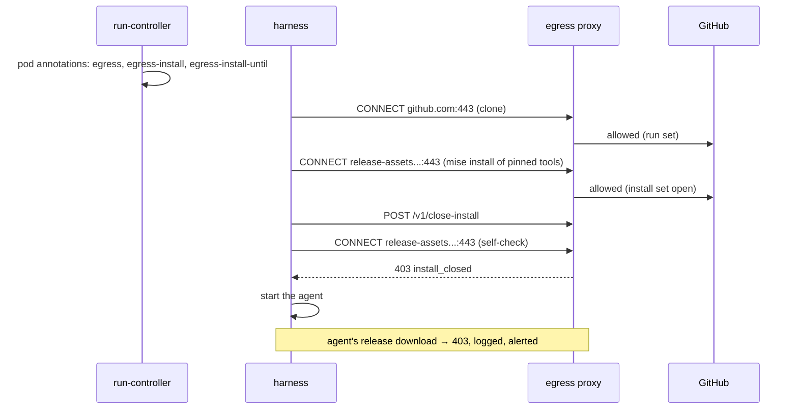

# GitHub egress tightening: release downloads only while the toolchain installs

**Status:** design, approved for speccing by the owner 2026-11-26, not built.
**Scope:** Maku (run-controller config, egress proxy, harness) and ai-native-ref (drill runbook,
pin bump). cloud-native-ref owns none of it. Read against Maku `origin/main` at `5fd4b41e`
(v0.54.7+4) and the live gcp-0 config of 2026-11-26.

**Outcome.** A run can still clone, push, call the GitHub API and install the tools its repository
pins. It can no longer download a GitHub release asset once the agent is running. The toolchain
installs in a phase before the agent starts; the harness then closes the install hosts at the
egress proxy, checks that they are closed, and only then starts the agent.

## The incident

On gcp-0, during the paired harness trial of 2026-11-26
([results](https://github.com/Smana/ai-native-ref/blob/main/docs/runbooks/agent-factory/results-harness-paired-trial-2026-11-26.md)),
an OpenCode implementer on `maku-opencode` v0.54.5 found that the image had no `bash`, so
`agent-checks` failed. The run's log shows the two steps it took next:

```text
agent-run step 18: shell | python3 ... urlopen("https://api.github.com/repos/robxu9/bash-static/releases/latest") ...
agent-run step 19: shell | cd /tmp/opencode/bin && python3 -c "urllib.request.urlretrieve(
  'https://github.com/robxu9/bash-static/releases/download/5.2.015-1.2.3-2/bash-linux-x86_64','bash-real')" && chmod ...
```

It downloaded an unpinned, unverified static binary from a stranger's release and ran it in the
gVisor sandbox. Every request went to an allowed host: `api.github.com`, then `github.com`, which
answers a release download with a 302 to `release-assets.githubusercontent.com` (older assets go
to `objects.githubusercontent.com`). The proxy allowed all three.

The missing `bash` is an image defect, tracked separately. This spec is about the egress that let
the workaround happen.

## How egress works today

| Piece | Where | What it does |
|---|---|---|
| Profiles | `internal/runctl/config.go` `defaultProfiles` | `github` is always on: `github.com`, `api.github.com`, `codeload.github.com`, `objects.githubusercontent.com`, `raw.githubusercontent.com`, `release-assets.githubusercontent.com`. Opt-in: `pypi`, `npm`, `golang` (`proxy.golang.org`, `sum.golang.org`, `dl.google.com`), `crates`. gcp-0 uses these defaults; no install overrides them. |
| Allow-list | `Config.FQDNs`, `Egress` | `github` plus the run's `spec.egress.profiles` (and the model host), minus `api.github.com` for a `forge-api: deny` run. Written to the pod's `maku.ogenki.io/egress` annotation. |
| Mode `kubernetes` (gcp-0, the default) | `internal/egressproxy` | A CONNECT-only forward proxy. It knows a run by its source pod IP and allows `host:port` pairs from the annotation. It sees the CONNECT target, never the HTTPS path. |
| Mode `cilium` | `internal/runctl/cnp.go` | `toFQDNs` on 443 for the same hosts. L3/L4 only; no path either. |

**Neither enforcement point can see a URL path.** Filtering by `owner/repo` or by version would
need TLS interception (a CA trusted in the sandbox, and a proxy that reads the git token, the
model traffic and every response) or a GitHub-aware fetch service in front of mise. Host-level
control is what we have, so the design works by host and by time.

Release URLs do not help either. After the 302, a `release-assets` URL is signed and names a
numeric repository ID, not an `owner/repo`. The only place an `owner/repo` and tag appear is the
`github.com/<o>/<r>/releases/download/<tag>/<asset>` request, inside TLS.

## Threat and what an attacker gains

The agent already runs code it writes; that is the product. A downloaded binary adds three
things:

1. **Payloads the model could not write.** A prompt-injected agent (through an issue, a review
   comment, a fetched page) can fetch a prebuilt exploit, a scanner or a miner in one request.
2. **Untrusted evidence.** Check results come from whatever binary is on `PATH`. A fetched
   `bash` (or `task`, or `promtool`) that nobody pinned produces the "checks pass" line that the
   reviewer and the merge gate read.
3. **An unreviewed supply chain.** The bytes come from a release nobody pinned or verified, so
   anyone who can publish to that release can change them.

What the second line of defence still bounds, unchanged by this spec:

| Control | Bounds |
|---|---|
| gVisor | A kernel exploit hits the Sentry, not the node kernel. An escape needs a gVisor bug. |
| Default-deny network | The payload reaches only the run's allow-list: no cluster addresses, no metadata service, no arbitrary hosts. DNS tunnelling stays the `kubernetes` mode's documented residual risk. |
| No secrets in the environment | The git token comes through the credential helper, scoped to the run's repository and short-lived. The pod holds no cloud credentials. |
| Push and merge path | Pushes go through `agent-push` to the run's branch. A pull request still faces review, the merge gate and CI, which installs its own pinned tools. |
| Resource limits | A miner gets the pod's CPU limit and the run's budget, then the pod ends. |

The risk is medium: mainly integrity and defence in depth, not a direct path to the cluster.

## What legitimately reaches GitHub

| Need | Who | Host | Path | When |
|---|---|---|---|---|
| Clone, fetch, push | harness (`git`, credential helper) | `github.com` | `/<o>/<r>.git/info/refs`, `git-upload-pack`, `git-receive-pack` | whole run |
| Forge reads and writes | `gh`, harness, `forge_read` | `api.github.com` | `/repos/...`, `/graphql` | whole run (absent with `forge-api: deny`) |
| mise resolves a release | `agent-checks --install` (mise `aqua:`/`github:` backends) | `api.github.com` | `/repos/<o>/<r>/releases/tags/<v>` | install |
| mise downloads the asset | same | `github.com` → 302 → `release-assets.githubusercontent.com` (new) or `objects.githubusercontent.com` (old) | `/<o>/<r>/releases/download/<v>/<asset>` → signed URL | install |
| ANR's declared tools | `agent-checks` | as above, except `go` | `task` (go-task/task), `promtool` (prometheus/prometheus), `kustomize` (kubernetes-sigs/kustomize), `hugo-extended` (gohugoio/hugo), `pre-commit` (pre-commit/pre-commit `.pyz`) | install |
| Go toolchain | mise core `go` | `dl.google.com` (`golang` profile) | `/go/go<v>.linux-amd64.tar.gz` | install |
| Go modules | `go` | `proxy.golang.org`, `sum.golang.org`; private modules by `git` on `github.com` | `/<module>/@v/...` | whole run |
| pre-commit hook repositories | `pre-commit` | `github.com` (git clone at `rev`), then `pypi` for Python hooks | `/<o>/<r>` | first `pre-commit run` today; install phase after this change |
| Hooks that fetch binaries at pip install (`shellcheck-py`, `actionlint-py`) | pip build | `github.com` → `release-assets` | release download | same as above; ANR's two hook repos do not |
| Tarballs (`codeload`) | nothing found in the harness, mise's backends or the ANR checks | `codeload.github.com` | `/<o>/<r>/tar.gz/<ref>` | to be measured (task M1) |
| Raw files | nothing found; the agent reading files | `raw.githubusercontent.com` | `/<o>/<r>/<ref>/<path>` | to be measured (task M1) |
| Image build (`fetch_release.py`) | CI, not the run | `github.com`, `api.github.com` | release download, sha256-pinned | out of scope |

The only consumer of the release hosts inside a run is the toolchain install. Everything the agent
needs later uses `github.com` (git) and `api.github.com`.

A 24-hour tally from gcp-0's proxy logs (the proxy restarted shortly before, so it is a small
sample) agrees: `api.github.com` 16, `github.com` 7, `dl.google.com` 2,
`release-assets.githubusercontent.com` 1, `raw.githubusercontent.com` 1.

## Options

| Option | Stops the incident | Keeps installs working | Cost | Verdict |
|---|---|---|---|---|
| A. Drop the release hosts for good | yes | no: every mise install of a GitHub tool fails | none | rejected |
| B. **Install phase, then close the hosts** (proxy-side, one-way) | yes | yes, for the pins installed before the agent starts | proxy endpoint, two annotations, harness reorder; the agent starts after the install | **chosen** |
| C. TLS-intercepting proxy with an `owner/repo@version` allow-list from `mise.toml`, or a sha256 match against mise's lock | yes, and also catches `git clone` of arbitrary repositories | yes, and also later installs | CA in the sandbox; the proxy sees the git token and the model traffic; certificate pinning in clients breaks; a new component on the critical path | rejected: the proxy becomes the most valuable target in the cluster |
| D. GitHub-aware fetch service (a mirror mise talks to, which serves only the base branch's pins after a checksum check) | yes | yes, if mise can be pointed at it for every backend | new service, mise backend configuration per tool type, an extra hop for every install | deferred: revisit if B's residual (below) matters |
| E. Exec guard (`noexec` on writable mounts) | partly | `/workspace` must stay executable for the toolchain and builds | small | rejected as a control; the agent writes the binary to `/workspace` |
| F. Alert only (refusal or release download in the agent phase → alert) | no | yes | small | kept as the detection half of B |

## Decision

Option B, with F's detection.

1. **Two host sets.** The always-on `github` profile becomes `github.com` and `api.github.com`. A
   new install set holds `release-assets.githubusercontent.com` and
   `objects.githubusercontent.com`. `raw.githubusercontent.com` and `codeload.github.com` leave
   both sets unless task M1 finds an install that needs them, in which case they join the install
   set, never the run set.
2. **The run-controller writes the install set separately.** It writes a second pod annotation,
   `maku.ogenki.io/egress-install`, and a deadline, `maku.ogenki.io/egress-install-until`: pod
   creation plus the install ceiling (`agent-checks`' RC9 bound plus a margin). The run-controller
   alone writes both, as it does `maku.ogenki.io/egress`.
3. **The proxy allows the install set while it is open.** Install hosts are allowed for a pod
   until either the deadline passes or the pod closes them. Closing is a plain `POST /v1/close-install`
   on the proxy's port from the pod's own IP, keyed by pod UID. It can only narrow access: there is
   no reopen. The deadline means a harness that never closes fails closed.
4. **The harness installs first.** `agent-run` runs `agent-checks --install` in the foreground
   after the clone, bounded by the install ceiling. The install now also runs
   `pre-commit install-hooks` when `pre-commit` is a declared tool. Then the harness closes the
   install hosts and checks that a CONNECT to `release-assets.githubusercontent.com:443` gets 403.
   If it does not, the run fails with `egress_install_open` and the agent never starts.
5. **Later installs fail clearly.** A tool whose pin changes during the run (a Renovate-style bump)
   or that is missing after the phase is reported as
   `toolchain incomplete: <tool> (pin changed after the install phase; CI checks it)`. It is not
   retried.
6. **Detection.** Proxy refusals carry a `reason` (`not_allowed`, `install_closed`) in the log and
   in `maku_egress_proxy_decisions_total`. An `install_closed` refusal is the incident's signature,
   so it gets an alert rule in the chart.



### What B does not close

- **`git clone` of any public repository on `github.com`.** A repository can hold a committed
  binary. Closing that needs option C or D. B removes the default path every "download a static
  binary" recipe uses (the one the model took) and logs the attempt, but it is not a complete
  barrier.
- **The `pypi`, `npm` and `crates` profiles** serve prebuilt artefacts from anyone (wheels,
  `postinstall` scripts). A run opts into these profiles. Their pinning is a separate design;
  the host-level proxy cannot enforce it either.
- **`cilium` mode.** A CNP cannot narrow itself on a signal from the pod. In this mode the
  install set stays open for the whole run, which is today's behaviour, and the install banner
  says so. See open question 2.
- **Pin integrity.** mise verifies the checksums that aqua publishes. Nothing stops a pull request
  from bumping a pin to a bad version, but that change goes through review and CI and is not in
  the run's power at install time: the install reads the work tree's pins as they were at the
  clone.

## Plan

Each task is one pull request with its tests. M tasks are in Maku; A tasks are in ai-native-ref.

| # | Task | Done when |
|---|---|---|
| M1 | Measure: log `phase=install\|agent` on every proxy decision (today the phase is inferred from the `toolchain ready` timestamp); collect 10 runs across ANR and Maku | a table of hosts per phase; settles `raw` and `codeload` |
| M2 | Config: split `defaultProfiles["github"]`; add `installEgress` (default: the two release hosts, plus whatever M1 found). An install that still lists the release hosts in `egressProfiles.github` keeps them in the run set and gets a validation warning naming this spec | `config_test.go` cases for the default, the override and the warning |
| M3 | runctl: write `egress-install` and `egress-install-until`; `Egress()` and the goldens leave the install hosts out of `egress` | `pod*.golden.yaml` updated; envtest passes |
| M4 | egressproxy: `Entry.InstallAllow` and `InstallUntil`; `POST /v1/close-install` from the pod's IP, keyed by UID, idempotent, refused for an IP not in the index; `reason` label; alert rule `MakuEgressInstallClosedRefusal` in `charts/agent-factory/files/rules/run-path.yaml` | `proxy_test.go`: allowed before close, refused after close, refused after the deadline, no reopen, another pod cannot close this pod's set, IP reuse with a new UID starts open |
| M5 | harness: `prefetch` moves to the foreground before the agent; `--install` runs `pre-commit install-hooks`; close, self-check, `egress_install_open` fail-closed; post-phase install message | `tests/` cover the order and the fail-closed path against the harness's test proxy |
| M6 | harness `contract_env`: the tester's reinstall becomes a no-op check (`MISE_OFFLINE=1`) and reports what is missing | test |
| M7 | Docs: the egress page, the threat model's residuals, `docs/upgrading.md` (the `github` profile changed; overrides keep the old behaviour) | `task docs` passes |
| M8 | Release: Maku minor (behaviour change on egress) | tagged under the current merge grant, or by the owner |
| A1 | ANR runbook `docs/runbooks/agent-factory/<n>-github-egress-drill.md` (the drill below), then a results file after the live run | `task check` passes |
| A2 | ANR pin bump to M8's release; no values change, because ANR uses the default profiles | `task check` passes; drill passed |

cloud-native-ref: no change. It does not render the run-controller config.

Latency: today's prefetch overlaps with the agent's first turns. Under B the agent waits for it.
M1 measures the install time from `agent-run.checks.install` spans. If it costs more than about
60 s at p50, the follow-up is a toolchain cache shared across runs, keyed by `mise.toml`'s hash.
That is not a reason to keep the release hosts open.

## Live drill

Run on gcp-0 (or aws-0) with the M8 release, ANR as the repository, `kubectl` read-only apart from
the run itself.

1. **The incident, replayed.** Start an implementer run whose task tells the agent to run
   `python3 -c "import urllib.request; urllib.request.urlretrieve('https://github.com/robxu9/bash-static/releases/download/5.2.015-1.2.3-2/bash-linux-x86_64','/workspace/b')"`.
   - Pass: the download fails. The proxy logs
     `refuse run=<id> release-assets.githubusercontent.com:443 reason=install_closed` (or
     `objects...`), and `MakuEgressInstallClosedRefusal` fires.
   - Also try `raw.githubusercontent.com` and `codeload.github.com`: both refused with
     `not_allowed`.
2. **The pinned toolchain still installs.** In the same run, before the agent's first step, the
   harness logs `toolchain ready` with `task`, `promtool`, `kustomize`, `hugo-extended`, `go` and
   `pre-commit` installed, and the pre-commit hook environments are present. `agent-checks` in
   the agent phase reports no `toolchain incomplete`.
3. **The proxy's view of the phases.** `kubectl -n agent-system logs -l app.kubernetes.io/name=egress-proxy | grep run=<id>`
   shows `allow ... release-assets...` with `phase=install` only, then the close, then refusals.
4. **Fail closed.** Annotate a test run's pod with a deadline in the past (a run-controller test
   flag, not a hand edit): the self-check gets 403 and the agent starts. Make the close endpoint
   return 500: the run ends with `egress_install_open`, and the agent never starts.
5. **No regression.** One ordinary ANR task (an issue the factory would take anyway) reaches a
   pull request with checks green, and its wall time is within the M1 latency budget.

The results go to `docs/runbooks/agent-factory/results-github-egress-drill-<date>.md` in ANR.

## Open questions

| # | Question | Recommendation |
|---|---|---|
| 1 | Close `git clone` of arbitrary repositories too (option C or D)? | Not now. Ship B, watch the `install_closed` alert and the proxy's `github.com` traffic. Design D only if an incident uses the clone path. Never C. |
| 2 | `cilium` mode keeps the install hosts open all run. Route `cilium` mode's 443 through the egress proxy as well, so there is one enforcement point? | Yes, as a follow-up spec: it also gives `cilium` mode the per-run logs. Until then, the banner states the gap. |
| 3 | Is `raw.githubusercontent.com` needed by any install? | Let M1 decide; the default is that it leaves both sets. |
| 4 | A run that changes a tool pin cannot install the new version. Allow a second install window on a harness request? | No: reopening is what the one-way close forbids. CI covers the bumped pin; the message says so. |
| 5 | Should `pypi`, `npm` and `crates` get the same install-then-close treatment? | Yes for the hook environments (they install in the phase now). Not for the agent's own `pip install`: the agent legitimately adds dependencies. Pinning there is a separate spec. |
| 6 | Bake `bash` and the common tools into every harness image so a missing tool never tempts a workaround? | Yes, `bash` at least: that is the image defect behind this incident, tracked separately. Baking the whole toolchain would fight the per-repository pins. |
