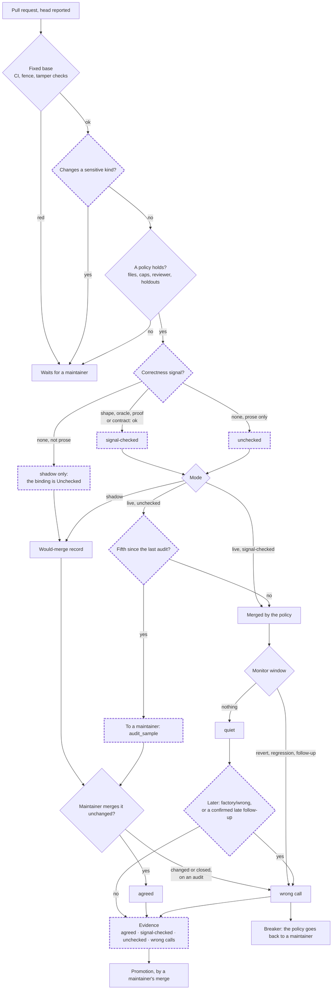

# Merge policies: what checked the meaning of a change, and what the counts are allowed to say

**Date:** 2026-11-26 · **Status:** design, [owner decisions of 2026-11-26](#owner-decisions-2026-11-26) (1 to 11), which settle CS1 to CS9 and add the guidance surfaces · **Track:** v5 roadmap, track 4 (live auto-merge beyond `docs-links`) · **Builds on:** [merge policies review](2026-11-14-merge-policies-review-design.md) (MR1 to MR14) and [trust and usability](2026-11-24-merge-policies-trust-and-usability-design.md) (MT1 to MT4) · **Facts read on:** Maku `origin/main` `e9040a50` (v0.54.5), ai-native-ref `main` `209292a`, the served objects of gcp-0 on 2026-11-26

## The question

> What if the merge policy assesses a change as safe and successful, but in reality it causes bugs and impact?

Today: Maku was wrong, nothing records it, and the merge counts toward trust.

After this design, three things are true.

1. **Fewer such merges can happen.** A change merges without a human only when something independent of its author checked what it means. Prose is the one exception, and a maintainer is asked about every fifth one.
2. **No page claims the change was right.** A count says who or what judged it: a signal, a maintainer, or nobody.
3. **When the bug surfaces, it lands on the policy.** One label, at any time, turns the merge into a wrong call. It pauses the policy and blocks its promotion.

No gate can prove an arbitrary change correct. The design does not try. It makes the policy say what it checks, refuse what nothing checks, and keep the ledger open for late news.

## Why

### What the gate and the monitor read today

| Stage | Reads | Says |
|---|---|---|
| Gate (rows 1 to 12 of [the merge gate](../../factory.md#the-merge-gate)) | Required CI, the reviewer's verdict, `allowedFiles`, `protectedFiles`, caps, `diffShape`, `holdoutChecks`, `oracle` | The change is **inside the policy** |
| Monitor ([the signals](../../factory.md#the-post-merge-monitor)) | Main's CI, Flux readiness, the detector's next runs, RunLore's verdict, follow-ups inside `followUpWindow` | **Nothing loud** happened in the window |
| Evidence (`internal/factory/evidence`) | Shadow decisions a maintainer merged unchanged (`clean`); reverts, follow-ups, regressions (`bad`) | A maintainer agreed, and nothing loud followed |

None of the three reads what the change means, unless a shape or an oracle does.

### Facts

| Fact | Where |
|---|---|
| `clean` is "a maintainer merged the shadow decision unchanged at the judged head". After promotion no maintainer looks, and a merge is good when the monitor is silent | `internal/factory/evidence/evidence.go` (`Evaluate`, `Outcomes`) |
| The pages say "7 of 20 clean decisions" and "Live · 34 clean decisions recorded" | `web/src/class-card.ts:51`, `:201`; `internal/factory/narrate/narrate.go:710` |
| The monitor's good verdict is the word `healthy` | `internal/factory/reconciler/monitor.go` (`Worst`) |
| "Verified" already means two other things: main stayed green (`merged_verified`) and RunLore's verdict (`monitor.verified`) | `internal/factory/reconciler/merge.go`, `monitor.go` |
| `alert-rules` is `spec: {evidence: standard, monitor, requires: [plan]}`. Its file scope is the binding's. Nothing checks what an alert change means | gcp-0, `MergePolicy/alert-rules`, `Repository/cloud-native-ref` |
| RunLore's `resolved` is read as healthy. An alert whose threshold was raised out of reach also resolves | `monitor.go:162` |
| cloud-native-ref parses alert expressions (`promtool check rules`). It has no test of when an alert fires | cloud-native-ref `scripts/ci/validate-vmrules.sh` |
| A holdout check passes on `SUCCESS`. Nothing asks whether it exercised the changed lines | [the merge gate](../../factory.md#the-merge-gate), row 8 |
| The policy editor renders at most 14 fields. `requires`, `monitor`, `oracle` and `author` are not among them, and `evidence` shows only with a shape or an oracle. `alert-rules` opens as an empty form under the sentence "No extra policy restriction" | `web/src/policy-page.ts` (`policyEditor`), `web/src/policy-words.ts` |
| The policy page prints `requires: [plan]` as "Each binding must supply: plan". It is a workflow stage, not a binding parameter | `web/src/policy-page.ts:77` |
| The test contract exists: a tester writes failing tests before the implementer, the check proves red at the base and green at the head, and the implementer cannot touch them | [the tester stage](../../factory.md#the-tester-stage), gate rows 2b and 2c |
| Proofs and tamper checks (MT2) are designed and not built | `internal/factory/config/classes.go` has no `proof` |
| One binding is live today: `docs-links` on cloud-native-ref | gcp-0 |

## Threat model

A **wrong-but-green** change passes every row of the gate and stays quiet in the monitor's window.

| # | Class | Example | Caught today by | Missed today because | After this design |
|---|---|---|---|---|---|
| T1 | Loud breakage | Build red, Flux object not Ready | Required CI, main's CI, Flux, auto-revert, breaker | — | Unchanged |
| T2 | Out-of-scope edit | A docs task edits a workflow | `allowedFiles`, `protectedFiles`, guardrails, caps | — | Unchanged |
| T3 | Silent wrong value | Threshold, timeout, replicas, feature flag | A reviewer's veto, when it notices | Everything stays green | No signal, not prose: never merges alone (CS2). With a contract: the test names the intended value (CS3) |
| T4 | Logic no test covers | A branch condition inverted | A reviewer's veto | No test fails | Out of scope: no policy covers application code (MT non-goal). A future one needs a contract |
| T5 | Factually wrong prose | A runbook step that no longer works | A reviewer's veto | No machine can tell | Prose merges alone only under audit, 1 in 5 (CS4); late reports count (CS6) |
| T6 | Latent effect | A limit too low, OOM next week; certificate or retention change | Nothing, once `followUpWindow` has passed | The window closed | Not prose: needs a signal (CS2). The ledger stays open (CS6) |
| T7 | Security loosening | A wider NetworkPolicy, a new ClusterRoleBinding | `protectedFiles`, by path only | The file sits beside ordinary YAML; signals look healthier | Sensitive kinds go to a maintainer under every policy (CS5) |
| T8 | Symptom silenced | An alert's threshold raised until it stops; a test skipped | MT2's `test_weakened` (designed) | `resolved` reads as healthy | `resolved` is no longer a correctness signal (CS1); the contract must fail at the base (CS3) |
| T9 | Correct bump, bad upstream | A patch release with a regression | Release age, Flux, auto-revert | Quiet regressions | The shape checks the bump, not the release. Said so on the page (CS7); the ledger stays open (CS6) |
| T10 | Vacuous green | A check passes without reading the changed rule | — | `SUCCESS` is all the gate reads | A holdout is never a correctness signal (CS1). A contract is red before and green after by construction (CS3) |

Which existing layer catches what:

| Layer | T1 | T2 | T3 | T4 | T5 | T6 | T7 | T8 | T9 | T10 |
|---|---|---|---|---|---|---|---|---|---|---|
| Bounds: files, caps, `modifyOnly` | | yes | | | | | by path | | | |
| Determining shape, oracle | | yes | yes | n/a | n/a | | yes | yes | no | yes |
| Required CI, holdouts | yes | | | | | | | | | no |
| Reviewer verdict (a veto) | | | some | some | some | | some | some | | |
| Test contract | | | yes | yes | | | | yes | | yes |
| Monitor: CI, Flux, detector | yes | | | | | | | | some | |
| Monitor: RunLore's verdict | | | | | | | | no | | |
| Follow-ups, revert, breaker | after the fact | | in the window | in the window | in the window | no | no | in the window | in the window | |
| Maintainer, in shadow | yes | yes | yes | yes | yes | some | yes | yes | | |

"yes" under a shape or an oracle means: for the diffs that shape admits. The last row is the only one that reads meaning for every class, and it stops at promotion.

## Vocabulary

One table. Docs, the settings pages, `maku policy`, the pull request comment and Slack use these words and no others.

| Word | Means | Does not mean | Replaces in prose | Wire name, unchanged |
|---|---|---|---|---|
| **holds** | Every row of the gate passes on one head: the change is inside the policy | The change is right | — | `decision=arm`, `shadow_would_arm` |
| **correctness signal** | Something independent of the author that checks what the change means. A closed list: [the signals](#cs1-the-signals) | A green check | — | `signal=` (new) |
| **signal-checked** | A decision a correctness signal judged, and passed | Proven correct | — | `signal=<kind>:ok` |
| **unchecked** | A decision nothing judged for meaning. Also a policy with no correctness signal | Wrong | — | `signal=none` |
| **agreed** | A maintainer merged a shadow or audited decision unchanged, at the judged head | The maintainer read every line | "clean decision" | `clean`, `mergedUnchanged` |
| **quiet** | The monitor's window ended with no revert, no regression, no follow-up | Right | "healthy", "clean merge" | `verdict=healthy` |
| **regression** | A monitor signal turned bad inside the window | Every bad merge | — | `verdict=regression` |
| **wrong call** | A merge under a policy later found wrong, by any route, at any time | A drill | "bad outcome" | `bad` |

Rules for the words:

- "Verified" is never shown alone. `merged_verified` reads "main stayed green". `monitor.verified` reads "RunLore: resolved".
- "Right", "correct", "safe" and "successful" appear on no surface. Maku does not know.
- A number is always followed by its judge: "34 merged alone, all signal-checked by `links-only`", "20 merged alone: 4 audited and agreed, 16 unchecked".

## Decisions

CS1 to CS9 are the design. The owner settled each on 2026-11-26: [owner decisions](#owner-decisions-2026-11-26).

| # | Decision | In one line |
|---|---|---|
| CS1 | **A policy's correctness signal is derived from fields it already has**, from a closed list | No new "signal" field to fill in |
| CS2 | **An unchecked policy does not go live**, unless it changes prose only | The binding resolves `Unchecked` and serves in shadow |
| CS3 | **The test contract is the correctness signal for configuration**, with `requires: [plan, tests]` | A human approves the intent, a test checks the diff against it |
| CS4 | **Live prose is audited**: every fifth decision goes to a maintainer | The human sample never stops |
| CS5 | **Sensitive kinds go to a maintainer** under every policy | A default list in the guardrails, added to, never removed from |
| CS6 | **The ledger stays open**: `factory/wrong` at any time, late follow-ups as candidates for 30 days | One window per repository, not per change kind |
| CS7 | **Every surface says what checked the meaning, and what is left open** | One generated sentence, one vocabulary |
| CS8 | **Evidence counts an agreed decision only when it carries the policy's current signal** | Extends the 2026-11-24 rule on loosened policies |
| CS9 | **No mutation probing by Maku now.** The contract's red-at-base rule is the one mutant | Optional later, in the tester's harness |

### The flow, with the new parts



Dashed boxes are new. Everything else exists.

### CS1: the signals

A correctness signal is derived from the resolved policy. Nobody declares it twice.

| Signal | Derived from | Establishes | Leaves open | Can it pass without reading the change? | `evidence` |
|---|---|---|---|---|---|
| **Determining shape** | `diffShape: links-only`, `semver-patch`, `semver-minor` | Every changed line has one mechanical meaning | The target: the new page's words, the upstream release | No: computed from the diff | `low` (`semver-minor`: `standard`, as today, and a signal for a live binding only beside a `rendered` proof) |
| **Oracle** | `oracle` | A detector outside the pull request named the defect, and the diff removes exactly that | The detector's own errors | No: computed from the findings and the diff, and run again after the merge | `low` |
| **Equivalence proof** (MT2, not built) | `proof.kind: formatter`, `generator`, `rendered` | The head equals something already trusted | The proof workflow's bugs | No: it reproduces the diff | `low` |
| **Contract** | `requires` holds `plan` and `tests`, and the task has a contract | A test written before the change, from a plan a maintainer approved, is red at the base and green at the head, and the implementer did not touch it | Behaviour the plan did not name | No: red at the base | `standard` |

Not correctness signals, and never shown as one:

| What | Why not |
|---|---|
| `allowedFiles`, caps, `modifyOnly`, `protectedFiles` | Bounds. They say where and how much, not what |
| `diffShape: added-entry` | Structure only: one new file and appended lines. The entry's words are free |
| `holdoutChecks`, required CI | They say something still works. They can pass without reading the changed lines (T10) |
| A reviewer's verdict | A veto, not an approval (MR12, [R2] of the 2026-11-24 design) |
| `proof.kind: custom` (MT2) | Maku cannot say what it proves. It stays a bound, as MT2 has it |
| Monitor: main's CI, Flux | Loud breakage only |
| Monitor: RunLore's `resolved` | The symptom is gone. A silenced alert also resolves (T8). It is shown as supporting evidence, beside the signal |

A decision records what judged it: `signal=links-only:ok`, `signal=contract:ok`, `signal=none`.

**Rejected.**

| Alternative | Why not |
|---|---|
| A new `spec.correctness` field the author fills in | A second place to state what `diffShape`, `oracle`, `proof` and `requires` already state. Two places disagree |
| A `proof.kind: test` beside MT2's kinds | The contract already is that test, with red-at-base built in and the implementer fenced out. A second mechanism would need its own non-vacuity protocol |
| Counting a green holdout as a signal when it reports what it covered | The workflow would grade itself. The contract's red-at-base is measured by Maku's check |
| An LLM judge's score as a signal | Unstable, correlated with the author's errors ([R2]); rejected in MT too |

### CS2: an unchecked policy does not go live

| Resolved policy | `mode: live` | `mode: shadow` |
|---|---|---|
| Has a correctness signal | Served live | Served |
| Unchecked, every `allowedFiles` pattern ends in a prose suffix | Served live, audited (CS4) | Served |
| Unchecked, anything else | Refused `Unchecked`; served in shadow | Served |

- Prose suffixes are a closed list: `\.md$`, `\.mdx$`, `\.mdx?$`, `\.rst$`, `\.txt$`, `\.adoc$`. The gate checks each changed file's extension again at decision time.
- `Unchecked` is a binding reason beside `Unbounded`. It follows the existing rule: never above the mode the binding asks for, so it falls to shadow and keeps gathering agreed decisions.
- `MergePolicy.status` gains `signal` (`links-only`, `oracle`, `contract`, `none`) and a printer column `CHECKED BY`.
- A `semver-minor` policy bound `live` without a `rendered` proof (MT2) also resolves `Unchecked`: the shape checks the bump, not what the new chart renders. `semver-patch` is not held to this.
- `evidence: low` still needs a signal that cannot pass unread: a determining shape, an oracle or an equivalence proof. `added-entry` no longer qualifies ([migration](#migration)).

This narrows MR12, and says so: a reviewer's verdict still lets an unchecked policy **hold**, in shadow and for prose. It no longer lets one merge configuration alone. No served decision changes at upgrade: the one live binding today is `docs-links`.

**Rejected.**

| Alternative | Why not |
|---|---|
| Warn only | The warning is read once. The gap stays open |
| Refuse live for every unchecked policy, prose included | Simpler, but it reverses MR12 and MR4 for `docs`. The owner ruled for prose under audit ([decision 1](#owner-decisions-2026-11-26)) |
| Cap the evidence weight of unchecked decisions (count half) | A number nobody can explain. The 2026-11-24 anti-goal: no number without a list behind it |
| Require more agreed decisions (50) instead | More silence is still silence. After promotion nobody looks |

### CS3: the contract is the signal for configuration

```yaml
kind: MergePolicy
metadata: {name: alert-rules}
spec:
  description: Alert rule changes whose intent a test states.
  requires: [plan, tests]          # was: [plan]
  monitor: {verification: {within: 2h}, followUpWindow: 2h}
  evidence: standard
```

| Rule | Detail |
|---|---|
| When it counts | The policy requires `plan` and `tests`, the task has `status.contract`, and gate rows 2b and 2c hold |
| No contract on the task | The policy does not hold: `contract_absent`. Today the implementer may run without one; that stays true, and such a pull request waits for a maintainer |
| Why `plan` too | The tester is an agent. The plan is what a maintainer approved. Without it the test and the change share one author's reading of the task |
| What it reads as | "Merges after you approve the plan, without a review of the diff". Not "without you" |
| The reviewer | Still required (MR12). The contract checks named behaviour; the veto stays cheap |
| What a threshold change looks like | The plan says "fire above 5 % for 10 minutes". The tester writes that as a rule test. The implementer makes it pass. A change that raises the threshold out of reach fails the test |
| Repository work | The contract's runner must run the tests of that file type. For alert rules: `promtool test rules` over the `VMRule`'s `spec`, in cloud-native-ref's `scripts/ci/tests/`. An adoption task, not Maku's |

### CS4: live prose is audited

| Rule | Detail |
|---|---|
| Who | A live policy that is unchecked. A signal-checked policy is never audited |
| How often | Every fifth decision that would merge, counted in the policy's ledger since the last audit. `mergeGuardrails.auditEvery`, 2 to 10, default 5 |
| What happens | The pull request waits for a maintainer with `audit_sample`, carrying its would-merge record. The comment says why: "Maku asks you about one in five" |
| Merged unchanged at the judged head | **agreed**. The count restarts |
| Changed before the merge, or closed | A **wrong call** (`audit_disagreed`). The breaker counts it |
| The audit is not answered | The policy keeps merging until the next audit is due. Then every decision waits: `audit_pending`. An absent maintainer costs at most 8 unchecked merges |
| Agent instructions | `AGENTS.md`, `CLAUDE.md`, `.agents/`, `.claude/` are prose that steers agents. They stay protected paths (MT2's default) and never reach this rule |

The mechanism is the shadow one, kept running: same record, same "merged unchanged" test, same evidence code.

**Rejected.**

| Alternative | Why not |
|---|---|
| Review a sample after the merge | A second queue, and a wrong sample is already on main |
| A random sample | Not explainable on a page, and not reproducible in a tally. A count is both |
| Audit every policy, signal or not | A human re-checking what a shape computed adds cost and no information |

### CS5: sensitive kinds

A fixed-base row, read with the diff, before any policy is evaluated.

| Rule | Detail |
|---|---|
| What is read | Each changed `.yaml` or `.yml` file, both sides, document by document |
| What refuses | A document added, removed or changed whose `kind` is on the list: `sensitive_change`, with the kind and the file |
| Default list | Network: `NetworkPolicy`, `CiliumNetworkPolicy`, `CiliumClusterwideNetworkPolicy`, `AuthorizationPolicy`. Access: `Role`, `ClusterRole`, `RoleBinding`, `ClusterRoleBinding`, `ServiceAccount`, and any kind matching `(?i)iam`. Admission: `ValidatingAdmissionPolicy`, `ValidatingAdmissionPolicyBinding`, `ValidatingWebhookConfiguration`, `MutatingWebhookConfiguration`, `ClusterPolicy`, `Policy`. Secrets: `Secret`, `ExternalSecret`, `SecretStore`, `ClusterSecretStore` |
| Where it lives | `mergeGuardrails.sensitiveKinds`. A platform's list is **added** to the default. Nothing removes an entry: no policy, no binding |
| Direction | Any change refuses, a tightening too. Telling wider from narrower needs a model of each kind |
| A file that does not parse | Refuses `sensitive_unreadable`. A template is not judged by guessing |
| A maintainer's approval | Merges it, as for a gate path. The hand-off names the kind |
| Second step ([decision 5](#owner-decisions-2026-11-26)) | `sensitiveFields` in any document: `securityContext`, `hostNetwork`, `hostPID`, `hostPath`, `privileged`, `serviceAccountName` |
| With a `rendered` proof (MT2) | The proof's workflow reports the kinds that changed in the rendered output. The same list applies. This is the only way a Helm value that widens a rendered NetworkPolicy is seen |

Known limit: HCL is not read. A policy that admits `.tf` files gets no such row; it is unchecked and not prose, so it cannot go live without a contract.

**Rejected.**

| Alternative | Why not |
|---|---|
| Paths only, per repository | The NetworkPolicy sits in the same directory as the alert rule. Every repository would write the list again, and miss one |
| A list each repository may shorten | The repository that shortens it is the one that needed it |
| Allow tightening | See "Direction" |

### CS6: the ledger stays open

`followUpWindow` keeps its meaning: when the monitor's verdict is final. What changes is that the final verdict no longer closes the merge's record.

| Route to a wrong call | Who | Until when | Status |
|---|---|---|---|
| Revert, regression, follow-up in the window | The factory | `followUpWindow`, `revertWindow` | Exists |
| Audit disagreement | A maintainer | At the audit | CS4 |
| **`factory/wrong`** on the merged pull request | A maintainer. The actor is checked, as for `factory/hold` | Any time | New. Also `maku policy wrong owner/name#PR --reason "…"` and a "Report a wrong call" button on the decision's page |
| **Late follow-up candidate** | The factory proposes, a maintainer confirms | `merge.latentWindow`, default 30 days | New, second step |
| RunLore names the merge as an incident's root cause | An internal principal with `verification: true` | Any time | Optional. No new mechanism on Maku's side: the verification endpoint takes it |

Late follow-up candidates:

| Rule | Detail |
|---|---|
| What | A pull request merged after `followUpWindow` and inside `latentWindow` that rewrites lines an auto-merge introduced. Same blame read as today's follow-ups |
| Why a candidate, not a wrong call | After a week, an edit to the same line is often ordinary work |
| What a maintainer sees | A comment on the later pull request and a row on the policy's page: "Did #412 fix a mistake in #398?" Yes sets `factory/wrong` on #398. No dismisses it |
| What it blocks | Promotion (`candidates_open`), until answered. Never the breaker |

What a wrong call does, whatever its route:

| Effect | Rule |
|---|---|
| Evidence | Counts in `bad`. Blocks promotion (`bad_outcome`), as today |
| Breaker | Counts while the merge is among the newest `window` merges, or younger than `latentWindow`. Reverts count against `maxReverts`, every other route against `maxFollowUps`. No new knob |
| Recovery | Unchanged, and already honest: a paused policy merges nothing alone, so only maintainers' merges refill the window. Silence never lifts a pause |
| A wrong call under a contract | The hand-off asks for the missing test. The next task on that file starts from it |
| Narration | Control issue and room: "Wrong call on `docs`: #398, reported by a maintainer 12 days after the merge" |

**Rejected.**

| Alternative | Why not |
|---|---|
| A latent window per change kind (30 days for limits, 90 for certificates) | The policy already is the change kind, and no data says which number. A change whose effect takes 90 days to show should not merge unchecked at all (CS2). One repository-wide window bounds the automatic search; the label has no window |
| Longer `followUpWindow` | It also delays the verdict, the breaker's recovery and promotion |
| Canary analysis on the merge (Argo Rollouts, Flagger) | A GitOps merge has no canary population, and Flux attribution is per source, not per merge. An analysis is a better ear for loud signals, not a reader of meaning. An outside observer can already post `persisting` through the verification endpoint |

### CS7: what every surface says

One function builds one sentence from the resolved policy (the policy and one repository's binding). The web pages, `maku policy explain`, the promotion pull request and Slack call it.

| Policy | The sentence |
|---|---|
| `docs-links`, live | "**Merges without you when** an agent changes only link targets in Markdown, at most 20 lines, and `Check the documentation links 🔗` passes. **Meaning checked by** the `links-only` shape: every changed line is a link target on the same host. **Not checked:** what the new page says. **After the merge** Maku watches main for 30 minutes and reverts on red. **Undo:** `factory/revert` within 7 days." |
| `docs`, shadow | "**Would merge without you when** an agent changes Markdown under `website/content/`, at most 5 files and 60 lines, 2 a day, and a reviewer approves. **Meaning checked by** nothing: this is prose. **Once live** Maku asks you about every fifth one." |
| `alert-rules`, today | "**Never merges without you:** nothing checks what a change to YAML under `observability/` means. Maku records when it would have merged. **To let it merge alone,** require a plan and tests." |
| `alert-rules`, with CS3 | "**Merges after you approve the plan, without a review of the diff, when** an agent changes YAML under `observability/` and a reviewer approves. **Meaning checked by** the test contract: red before the change, green after. **Not checked:** behaviour the plan did not name." |
| `deps-patch` | "… **Meaning checked by** the `semver-patch` shape: only a patch version moves. **Not checked:** the release itself; Maku waits for its release age and watches Flux for 1 hour." |

#### The policy page and its editor

| Block | Today | After |
|---|---|---|
| Top | `policyWords`: "No extra policy restriction" for `alert-rules` | The sentence above, per repository when bindings differ |
| What checks the meaning | Absent | One line: the signal, or "Nothing. This policy cannot merge alone" with the two ways to add one |
| Fields the form does not edit (`requires`, `monitor`, `oracle`, `author`, `evidence`) | Not rendered: an empty form | Rendered read-only, each with one line of plain words: "Requires a plan you approve", "After a merge, waits 2 h for RunLore's verdict", "20 agreed decisions before promotion" |
| File scope | Only the policy's own `allowedFiles` | The policy's, then each binding read-only: "In cloud-native-ref (shadow): YAML under `observability/`", with a link to that repository's page |
| `requires` | "Each binding must supply: plan" | "Tasks that touch these files run: a plan you approve" |
| Check and backtest | Consumers and changed decisions | Also: "this edit removes the correctness signal: 1 live binding falls to shadow" |

#### The policy card and the Promote button

| State | Today | After |
|---|---|---|
| Shadow, progress | "7 of 20 clean decisions to promote" | "7 of 20 agreed: you merged 7 unchanged, changed 1. 0 wrong calls" |
| Shadow, unchecked and not prose | Same bar, a Promote button at 20 | The bar, and "Cannot merge alone: nothing checks the meaning". No button; a link to "How to add a signal" |
| Live, signal-checked | "Live · 34 clean decisions recorded" | "Live since 2026-11-25. 34 merged alone, all signal-checked by `links-only`. 34 quiet. 0 wrong calls" |
| Live, prose | Same | "Live since … 20 merged alone: 4 audited and agreed, 16 unchecked. 0 wrong calls. Next audit in 3" |
| Wrong calls | A count in `bad` | The list, each with its route and age |
| **Promote** | Enabled when eligible | Unchanged. Above it, the sentence in the future tense, then the blockers with counts: `below_minimum` ("needs 13 more agreed"), `bad_outcome`, `no_drill`, `candidates_open`, `Unchecked` |
| The promotion pull request (MT4) | Counts and supporting pull requests | The sentence, "Meaning checked by", "Not checked", the agreed list, the wrong calls |

#### `maku policy`

```
$ maku policy explain Smana/cloud-native-ref#2741
#2741 waits for a maintainer.
  alert-rules   holds: 1 of 3 files, 6 of 40 lines, reviewer approved.
                meaning checked by: nothing. This policy cannot merge alone (Unchecked).
                recorded as: would have merged. Merge it unchanged if you agree: 8 of 20 agreed.
  docs          does not hold: observability/base/rules.yaml is not Markdown.

$ maku policy list Smana/cloud-native-ref
POLICY       MODE    CHECKED BY        PROGRESS                      WRONG CALLS
docs-links   live    links-only        34 merged alone, 34 quiet     0
deps-patch   shadow  semver-patch      3 of 5 agreed                 0
docs         shadow  nothing (prose)   7 of 20 agreed                0
alert-rules  shadow  nothing           8 of 20 agreed, stays shadow  0
```

| Surface | Line |
|---|---|
| Merged comment | "Merged by policy `docs-links`: 1 of 3 files, 4 of 20 lines. Meaning checked by the `links-only` shape. Undo with `factory/revert` within 7 days." |
| Audit comment | "Policy `docs` would have merged this. Maku asks you about one in five: merge it unchanged if you agree." |
| Monitor comment | "Quiet: main stayed green, no fix followed in 72 h. Found it wrong later? Label it `factory/wrong`." |
| Slack | "`docs-links` merged #2741 alone (signal-checked)". "Wrong call on `docs`: #398, reported 12 days after the merge; the policy is paused." |

### CS8: evidence

| Rule | Today | After |
|---|---|---|
| An agreed decision counts toward promotion | When recorded under a policy at least as tight as the current one (2026-11-24) | Also only when its record carries the signal the policy now has. A decision recorded as `signal=none` does not count for a policy that now requires a contract: it would not hold today |
| Records from before `signal=` existed | — | Read as the signal the policy's fields derive, when that signal is computed from the diff alone (shape, oracle). Otherwise `none` |
| Live counts on the page | `clean` | Four numbers: merged alone, signal-checked, audited and agreed, wrong calls. Unchecked is the remainder, and is printed |
| The promotion minimum | 5 or 20 `clean` | 5 or 20 **agreed**. Same numbers, honest name |
| "How sure is this?" | Clopper-Pearson bound on `bad` | Unchanged, with one sentence: "A wrong call nobody reported is not in this number" |

### CS9: mutation probing

| Question | Answer |
|---|---|
| What would it prove | That the signal fails on a deliberately wrong variant of the diff |
| What already does that | A shape, an oracle and an equivalence proof cannot pass unread. The contract is red at the base: the base is one wrong variant, measured on every task |
| What it would add | More wrong variants: a contract that is red at the base and still green on a threshold ten times higher |
| Decision | Not now. Maku does not run a repository's code in the gate (MT2), and the tester's harness is where a second variant belongs |
| Trigger to revisit | The first wrong call under a contract-backed policy. CS6 already asks for the missing test |

## Guidance surfaces

Owner requirement, 2026-11-26: the pages, the docs and the website must **guide and explain**, not only use the new words. A reader who has never seen a merge policy must learn from the surface in front of them what the policy does, what checks it, and what to do next. CS7 fixes the words; this section fixes what each surface teaches.

### 1. The policy editor and page (web)

| Element | Specification |
|---|---|
| Header | The generated sentence of CS7, per policy and per binding: "Merges without you when… / Meaning checked by… / Not checked…". For an unchecked policy: "Never merges without you: …", with the way out |
| Help under every field | One line saying what the field does and **what happens when it is exceeded or unmet**, with the reason a maintainer will read. Table below |
| Every field rendered | `requires`, `evidence`, `monitor`, `oracle`, `author` appear, read-only where the form cannot edit them, each with its plain words. `alert-rules` no longer opens as an empty form |
| `requires` label | "Tasks that touch these files run: a plan you approve". The line "Each binding must supply" (`web/src/policy-page.ts:77`) goes |
| The repository binding | Read-only on the policy's page, one row per repository: mode, file scope in words, added checks, added protected paths, a link to the repository's page where it is edited |
| Progress | "7 agreed, 0 wrong calls, of 20 needed. Rollback drill: not done." Once live: "34 merged alone: 34 signal-checked, 34 quiet". Each number links to its list. No "clean", no "healthy" |
| Promote, disabled | The button stays visible and says why, in one line per blocker, each with its next step. Table below |
| "How merge policies decide" | A link in the page header opens a short explainer: holds → merge → monitor → evidence, with the diagram of this design and the vocabulary table. Same content as the docs section in point 4, not a second copy: the page renders that section |

Help lines, one per field:

| Field | Help line |
|---|---|
| Files it may change | "A pull request that touches any other file waits for a maintainer (`file_not_allowed`)." |
| Files it must never touch | "One matching file sends the whole pull request to a maintainer (`file_protected`)." |
| Most files changed, most lines changed | "Above this, the pull request waits for a maintainer (`patch_too_large`). Lines are additions plus deletions." |
| Most merges a day | "After this many, the next one waits until tomorrow (`auto_merge_cap`)." |
| Edit files only | "A file added, deleted or renamed sends the pull request to a maintainer (`file_added_or_deleted`)." |
| Required diff shape | "Every changed line must have this shape, or the policy does not apply (`class_mismatch`). A shape is what lets Maku check the meaning." |
| Checks that must pass | "Each must report success from GitHub Actions on this exact commit. Skipped counts as failed (`holdout_red`). A check says something still works, not that the change is right." |
| Changes that need approval | "A matching file asks a maintainer even when the policy is live (`approval_required`)." |
| Required stages (`requires`) | "Tasks touching these files run these stages. A plan and tests together are what let Maku check the meaning of a configuration change." |
| Evidence | "How many decisions a maintainer must agree with before promotion: 5 when a shape or an oracle checks the meaning, else 20." |
| After a merge (`monitor`) | "What Maku watches and for how long. Silence here is 'quiet', not 'right'." |
| Detector (`oracle`) | "A scheduled workflow names the defects. The pull request must fix exactly those (`oracle_unrequested`, `oracle_finding_open`)." |
| Author (`author`) | "Whose pull requests this policy takes: the factory's agents, or another bot's by login and branch." |

Why Promote is disabled:

| Blocker | The button says | Next step offered |
|---|---|---|
| `Unchecked`, not prose | "Nothing checks what these changes mean, so this policy cannot merge alone." | "Add a signal": opens the guided flow at step 2 |
| `Unchecked`, prose | Not a blocker. Above the button: "Once live, Maku asks you about one in five." | — |
| `below_minimum` | "Needs 13 more decisions you agree with." | The list of pull requests waiting for a merge |
| `bad_outcome` | "1 wrong call in the last 180 days: #398." | The wrong call's page |
| `no_drill` | "No rollback drill on this repository yet." | "Run the drill", with the three steps |
| `candidates_open` | "2 later fixes may have corrected a merge of this policy. Answer them first." | The candidates |
| Sensitive kinds | Not a blocker of promotion. On the card: "Changes to network, access, admission or secret objects always wait for a maintainer, live or not." | The list in force |

### 2. A guided "new policy" flow

Three steps, on the "Start from a shipped policy" entry of the editor. It writes nothing: it ends in the editor, pre-filled, where **Check** and the backtest already are.

| Step | Asks | Then |
|---|---|---|
| 1 | "What kind of change?" | A closed list, below |
| 2 | "What can check its meaning?" | The suggestion for that kind, or "Nothing yet: this policy will record what it would do and stay in shadow", with what would change that |
| 3 | "Where, and how much?" | Files, caps, a day's limit, each with its help line. Then the generated sentence, before the editor opens |

| Kind of change | Suggested signal | Preset | Says |
|---|---|---|---|
| Link targets in docs | `links-only` shape | `docs-links` | "Can go live after 5 agreed decisions." |
| Dead links a scan finds | Oracle and `links-only` | `dead-links` | "Needs a detector workflow in the repository." |
| Dependency patch updates | `semver-patch` shape | `deps-patch` | "Checks the bump, not the release." |
| Dependency minor updates | `semver-minor` shape | `deps-minor` | "Stays in shadow until a rendered-manifest proof exists." |
| Prose | None | `docs` | "Can go live after 20; Maku then asks you about one in five." |
| Entries a bot adds | None (`added-entry` bounds the structure) | `kb-entries` | "As prose: 20, then one in five." |
| Configuration (alerts, values, manifests) | Contract: `requires: [plan, tests]` | `alert-rules` | "Needs a test runner for this file type in the repository. Without it: shadow only." |
| Generated or formatted files | Equivalence proof (MT2) | — | "Available when proofs ship." |
| Application code | — | — | "No policy covers it. A maintainer merges." |

### 3. CLI

| Command | Prints |
|---|---|
| `maku policy explain owner/name#PR` | Per policy: holds or not, with the numbers; the same sentence; "meaning checked by: …" or "meaning checked by: nothing"; and, when a signal is missing, the line "To let it merge alone: …" |
| `maku policy explain owner/name <policy>` | The sentence for that binding, the progress line, the blockers with their next steps: the page's card, in a terminal |
| `maku policy list` | The `CHECKED BY` column and wrong calls (CS7) |
| `maku policy wrong owner/name#PR --reason "…"` | Reports a wrong call (CS6) |

The sentence comes from one Go function. The web page reads it from the API and does not rebuild it.

### 4. Maku docs

| Page | Change |
|---|---|
| `docs/merge-policies.md`, new first section "Holds, agreed, signal-checked" | The vocabulary table, the flow diagram, and three sentences: what a policy decides, what the monitor hears, what the counts mean. **Every surface links here**: the page's explainer, the pull request comment, `maku policy explain --help`, the Slack line |
| Same page, "The catalog" | One worked example per shipped policy (`docs-links`, `deps-patch`, `docs`): a real diff that holds, one that does not and why, the sentence, the decision record with `signal=`, what the monitor then reads, and how a wrong call would be reported |
| Same page, "Worked examples" | `alert-rules` rewritten around the contract: the plan, the rule test, the change, the record |
| `docs/factory.md`, "The post-merge monitor" | "Quiet" defined once, with the link above. The `healthy` wire value named as such |
| `docs/reference/web-ui-settings.md` | The editor's help lines and the guided flow |
| Reasons table | The new reasons with their next step: `audit_sample`, `audit_pending`, `sensitive_change`, `sensitive_unreadable`, `contract_absent`, binding `Unchecked` |

### 5. The ai-native-ref website

Written to `docs/docs-style.md`: for a reader who was not there. Links to cloud-native-ref are absolute.

| Page | Holds |
|---|---|
| `website/content/docs/use/guide/merge-policies.md`, rewritten as the operator's concept and guide page | **The mental model**: a policy says "inside", a signal says "means what it should", a maintainer says "agreed", the monitor says "quiet". **What can go wrong**, as one table: loud (reverted), silent (needs a signal), latent (the open ledger), security (always a maintainer). **How to make a change kind safe to go live**, worked on alert rules: write the rule test, require a plan and tests, watch 20 decisions, promote. **What Maku will never tell you**: that a change was right. Screenshot placeholders for the policy page header, a disabled Promote button with its reason, the guided flow's step 2, and an audit comment |
| `website/content/docs/operate/auto-merge-safety.md` | The threat model table of this design, in the site's words, and the sensitive-kind list in force on the platform |
| `website/content/docs/use/guide/cheat-sheet.md` | Rows: `factory/wrong` ("this merge was a mistake, at any time"), `maku policy wrong`, `maku policy explain`, "Maku asked me about a pull request it could have merged" (the audit) |
| `website/content/docs/use/guide/when-things-go-wrong.md` | "A merge turned out wrong after the window": label it, what happens to the policy |
| `website/content/docs/use/guide/merging.md` | The comment lines of point 6, with what each asks of the reader |

### 6. Decision comments, GitHub and Slack

Every decision message carries one line naming the signal, or saying there is none. It links to the docs section of point 4.

| Message | Line |
|---|---|
| Merged, signal-checked | "Meaning checked by the `links-only` shape." |
| Merged, live prose | "Meaning not checked: this is prose. Maku asks a maintainer about one in five." |
| Would have merged (shadow), with a signal | "Meaning checked by the test contract." |
| Would have merged (shadow), unchecked | "Meaning not checked. This policy cannot merge alone until something checks it." |
| Audit | "Maku asks you about one in five: merge it unchanged if you agree." |
| Waits, sensitive kind | "Changes `ClusterRoleBinding` in `rbac.yaml`: always a maintainer's." |
| Slack, one line | "`docs-links` merged #2741 alone (meaning checked by `links-only`)" or "… (meaning not checked)" |

## Migration

Seven policies are served on gcp-0. One binding is live.

| Policy | Signal | Keeps live eligibility | `evidence` | Changes |
|---|---|---|---|---|
| `docs-links` (catalog; live on cloud-native-ref) | `links-only` | Yes | `low` | None. Stays live |
| `dead-links` | Oracle and `links-only`; the detector runs again after the merge | Yes | `low` | None |
| `deps-patch` (catalog) | `semver-patch` | Yes | `low` | Words only: "Not checked: the release itself" |
| `deps-minor` | `semver-minor`, for shadow only | **No**, until the `rendered` proof (MT2) reports the kinds a bump changes ([decision 6](#owner-decisions-2026-11-26)) | `standard` | A live binding would resolve `Unchecked`. It is in shadow today. A minor release can change a chart's RBAC, which the shape does not see |
| `docs` (catalog) | None, prose | Yes, audited 1 in 5 | `standard` | Gains the audit once live. Runbooks deserve `requiresApproval` in each repository's binding |
| `kb-entries` | None: `added-entry` is structure, the entry is prose | Yes, audited 1 in 5 | `low` to `standard` | **Reverses finding A2 of the 2026-11-24 design** ([decision 2](#owner-decisions-2026-11-26)), at the cost of 15 more agreed decisions |
| `alert-rules` | None, not prose | **No**, until `requires: [plan, tests]` and a rule-test runner in cloud-native-ref | `standard` | A live binding would resolve `Unchecked`. It is in shadow today, so nothing served changes. RunLore's verdict stays, as supporting evidence |

Upgrade behaviour:

| Case | Behaviour |
|---|---|
| A live binding that becomes `Unchecked` | Served in shadow, with the reason on the binding's status, on the page and in `maku policy list`. None exists today |
| Old decision records | Read under CS8's rule. `docs-links` keeps its count |
| JSON and metric names (`clean`, `bad`, `healthy`) | Unchanged. Only words change |
| Repositories with no binding | Still evaluate the catalog in shadow. Nothing to do |

## Sequence

One spec, three plans, in the order of [decision 10](#owner-decisions-2026-11-26). Each plan is a pull request series behind `task check`.

| Plan | Repository | Holds | Changes a served decision |
|---|---|---|---|
| 1. Words and guidance, right after the 2026-11-24 usability plan | Maku | The vocabulary, the sentence, `signal=` in the record, and [guidance surfaces](#guidance-surfaces) 1 to 4 and 6 | No |
| 2. Rules, before any second policy goes live | Maku | `Unchecked`, the audit, `factory/wrong`, sensitive kinds, CS8. Then `sensitiveFields` and late candidates | Yes: only toward a maintainer |
| 3. Adoption | ai-native-ref, cloud-native-ref | `alert-rules` requires tests, the rule-test runner, `kb-entries` evidence, runbooks under `requiresApproval`, and [guidance surface](#guidance-surfaces) 5 | With each Maku pin |

### Acceptance criteria

Plan 1, words and guidance (Maku). Each is checked by a test or by `task check`.

| # | Criterion |
|---|---|
| W1 | One Go function builds the sentence. The policy page, `maku policy explain`, the promotion pull request and the comments print its output; a test compares them |
| W2 | The policy page of a policy with only `requires`, `evidence` and `monitor` (the `alert-rules` fixture) shows a header sentence, those three fields with their plain words, and each binding read-only. No empty form |
| W3 | Every editor field has a help line that names what happens when it is exceeded or unmet. A test fails on a field without one |
| W4 | The string "Each binding must supply" is gone; `requires` reads as workflow stages |
| W5 | The card prints agreed, signal-checked, quiet, wrong calls and the drill's state. "clean" and "healthy" appear in no user-facing string; a vocabulary check in `task check` refuses them outside wire names |
| W6 | A disabled Promote button shows one line per blocker and a next step, for each row of the blocker table |
| W7 | The guided flow reaches the editor for each kind of change in its table, with the suggested signal or the "stays in shadow" line |
| W8 | `maku policy explain` prints the sentence and, when the policy has no signal, the missing-signal line |
| W9 | `docs/merge-policies.md` opens with "Holds, agreed, signal-checked", carries one worked example per catalog policy, and the page explainer, the comments and the CLI help link to that section; the link check holds them |
| W10 | Every merged, shadow, audit and Slack decision message carries the signal line. A golden test per message |
| W11 | No served decision changes: the gate's golden decisions are byte-identical but for the added `signal=` field |

Plan 3, adoption (ai-native-ref and cloud-native-ref). `task check` in ai-native-ref is the evidence.

| # | Criterion |
|---|---|
| AD1 | The website's merge-policies page holds the mental model, the four-row threat table (loud, silent, latent, security), the alert-rule walkthrough and the screenshot placeholders, and passes `task docs` |
| AD2 | The cheat sheet has the `factory/wrong`, `maku policy wrong`, `maku policy explain` and audit rows |
| AD3 | `auto-merge-safety.md` lists the sensitive kinds in force and the threat model |
| AD4 | cloud-native-ref's test runner runs alert rule tests, and one rule test exists as the worked example the site cites |
| AD5 | `alert-rules` declares `requires: [plan, tests]`; `kb-entries` declares `evidence: standard`; runbook paths sit under `requiresApproval` |
| AD6 | Screenshot placeholders are replaced at the first live session after the Maku pin |

Plan 1 can ship before the 2026-11-24 proofs. Plan 2's contract signal needs nothing from them. The `rendered` row of CS5 waits for them.

## Prior art, briefly

| Practice | What it does | Taken | Left |
|---|---|---|---|
| Rubber Stamper, autorollers ([R1], [R2] of the 2026-11-24 design) | Merge unattended only what a program proves benign | The whole of CS1 and CS2 | — |
| Post-submit audit and acceptance sampling | Inspect a fixed fraction, stop the line on a defect | CS4, moved before the merge | A sampling plan with confidence levels |
| Argo Rollouts and Flagger analysis | Judge a rollout on metrics before widening it | The outside observer's verdict, which the verification endpoint already carries | A canary controller: a GitOps merge has no canary |
| `promtool test rules`, `kyverno test`, `conftest verify` | Test what a rule means, not that it parses | The contract's runner for configuration (CS3) | A Maku field per tool |
| Mutation testing | Grade a test by the wrong variants it kills | Red at the base, as the one variant | More variants (CS9) |

## What this does not close

| Residual | Why it stays | Bound |
|---|---|---|
| A contract that tests the wrong intent | The maintainer approved a plan that said the wrong thing | A human's decision, recorded as theirs |
| A maintainer who agrees without reading | No machine reads a mind | The audit keeps asking; a wrong call lands on the policy |
| Four in five live prose merges nobody reads | The price of unattended prose | 5 files, 100 lines, 2 a day; `factory/wrong`; accepted by [decision 1](#owner-decisions-2026-11-26) |
| A bad upstream release inside a correct bump | The shape checks the bump | Release age, Flux, auto-revert, the open ledger |
| A wrong call nobody ever reports | Unknowable | Said on the page, in those words |

## Goals, non-goals, anti-goals

- **Goals:** no merge without a human unless something independent checked its meaning or it is audited prose; no surface that claims a change was right; a wrong call reportable in one action, at any time.
- **Non-goals:** proving correctness; a policy for application code; a canary controller; a per-tool test field; reading HCL.
- **Anti-goals:** a risk score; a weighted evidence count; a signal a workflow grades for itself; a sensitive-kind list a repository can shorten.

## Owner decisions, 2026-11-26

Each is an owner decision of 2026-11-26, given on the ten questions this study closed with, each taking the recommendation, plus one requirement of the owner's own (11).

| # | Owner decision, 2026-11-26 | Settles |
|---|---|---|
| 1 | **An unchecked policy merges alone only when it changes prose, audited one in five.** Anything else stays in shadow. MR12 is narrowed for configuration and kept for prose | CS2, CS4 |
| 2 | **`added-entry` is not a correctness signal.** `kb-entries` moves from `evidence: low` to `standard` and is audited once live. Finding A2 of 2026-11-24 is reversed | CS1, migration |
| 3 | **"Clean" and "healthy" leave every human surface** for "agreed" and "quiet". JSON, metric and record names stay. "Verified" is never shown alone | CS7 |
| 4 | **The contract counts only with `requires: [plan, tests]`.** Without an approved plan it is not a signal | CS3 |
| 5 | **Any change to a sensitive kind goes to a maintainer**, a tightening included. The default list is additive only. `sensitiveFields` ships in the second step | CS5 |
| 6 | **`deps-minor` has no live binding until MT2's `rendered` proof** reports the kinds a bump changes. `deps-patch` keeps its eligibility | CS1, CS2, migration |
| 7 | **One `merge.latentWindow` of 30 days per repository.** Late follow-ups are candidates: they block promotion, never the breaker. `factory/wrong` has no window. No per-policy window | CS6 |
| 8 | **Any change a maintainer makes to an audited pull request before merging is a wrong call**, whatever its size. So is a close | CS4 |
| 9 | **No mutation probing now.** Revisit at the first wrong call under a contract | CS9 |
| 10 | **Order:** the words plan right after the 2026-11-24 usability plan; the rules plan before any second policy goes live; then adoption in ai-native-ref and cloud-native-ref | Sequence |
| 11 | **The UI, the docs and the website guide and explain**, not only use the new words: [guidance surfaces](#guidance-surfaces), as acceptance criteria of plans 1 and 3 | Guidance surfaces, sequence |
