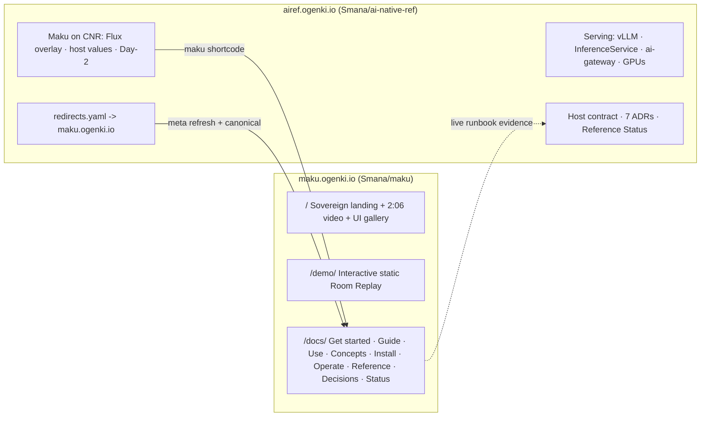

# Maku dedicated website & `ai-native-ref` split

**Date:** 2026-11-27 · **Status:** design approved by the owner 2026-11-27 (grill interview Q1–Q11) · **Supersedes:** [v5 roadmap Q14](https://github.com/Smana/ai-native-ref/blob/main/docs/superpowers/specs/2026-11-22-v5-roadmap-design.md#owner-decisions-2026-11-22) (deferring `maku.ogenki.io` until after PoC #1) · **Extends:** [documentation review design](2026-11-14-documentation-design.md) (open item #2: moving the User Guide when Maku gets a rendered site)

## Outcome

Maku gets its own product website at **`https://maku.ogenki.io/`**, served from `Smana/maku` via GitHub Pages using **Hugo + Hextra** deeply themed to Maku's **Ogenki Day & Night Web UI design system** (`web/src/app.css`, local `Space Grotesk` / `Inter` / `JetBrains Mono` fonts, `.dark`-switched Orbit hex marks, matched light/dark UI screenshots), with a bespoke `layouts/home.html` product front door, the interactive static Room Replay mounted at `/demo/`, and all Maku documentation (existing ~52 pages + migrated 12-chapter User Guide + product architecture/alternatives + 15 product ADRs + Product Status & Roadmap) under `/docs/`.

`Smana/ai-native-ref` remains the live GitOps reference deployment for both GPU serving and Maku on Cloud Native Reference (`clusters/`, `infrastructure/`, `tooling/`, `apps/`, `docs/runbooks/`), while **`https://airef.ogenki.io/`** shrinks to **Self-hosted GPU Model Serving**, a concise **Maku on Cloud Native Ref** deployment & day-2 section, **Host contract**, the **7 serving/host ADRs**, and **Reference Deployment Status** — with auto-generated cross-domain redirects (`redirects.yaml`) for every moved URL.

---

## Owner decisions (2026-11-27)

| # | Area | Decision |
|---|---|---|
| **Q1** | Repo & website boundary | Maku owns all product docs & website; `ai-native-ref` stays the GitOps reference deployment for both serving and Maku, while `airef.ogenki.io` shrinks to Serving + Maku-on-CNR + Host contract + Reference Status. |
| **Q2** | Domain & URL topology | `maku.ogenki.io` on `Smana/maku` GitHub Pages: `/` product landing, `/demo/` interactive static Room Replay, `/docs/` documentation. |
| **Q3** | Site generator stack | Hugo (`hugo-extended`, pinned in `mise.toml`) + Hextra (`website/go.mod`), deeply themed to Maku's Web UI tokens + bespoke `layouts/home.html` + `web/scripts/demo-site.sh` mounted at `/demo/`. |
| **Q4** | Docs source of truth | Move reader docs from `docs/` into `website/content/docs/`; keep `docs/superpowers/` and `docs/assets/brand/` out of the site; leave a short `docs/README.md` pointer; update the 3 `hack/gen-*.go` targets, `README.md`, and chart `runbook_url`s. |
| **Q5** | Theme contract | Full **Day + Night Ogenki parity** on landing, docs, and `/demo/`, defaulting to `system` (`prefers-color-scheme`) via the `.dark` class on `<html>`, with local `.woff2` fonts and matched light/dark screenshots. |
| **Q6** | Landing page (`/`) | Full product front door: sovereign hero → 2:06 real-run screencast + chapter rail → architecture & 4 sovereign pillars → tabbed light/dark real Web UI gallery → interactive Room Replay section → `task demo` & Tier-1/Tier-2 adoption + Pilot CTA. |
| **Q7** | Architecture Decision Records | Move 15 product ADRs (`0041`–`0045`, `0048`–`0049`, `0051`, `0053`, `0056`, `0058`–`0062`, preserving original numbers; next is `0063`) to `maku.ogenki.io/docs/decisions/`; keep 7 serving & host-deployment ADRs (`0003`, `0004`, `0021`, `0046`, `0050`, `0054`, `0057`) in `ai-native-ref`. |
| **Q8** | Status & roadmap | Split by ownership: `maku.ogenki.io` owns **Product Status & Roadmap** (proven / experimental / known limitations / v5, linking `ai-native-ref` runbooks as evidence); `airef.ogenki.io/docs/status/` shrinks to **Reference Deployment Status** (`activeCluster`, pinned `makuVersion`, serving status, runbook index). |
| **Q9** | User Guide & deduplication | Keep the 12-chapter User Guide + Cheat Sheet intact under `website/content/docs/guide/` (generalized off host specifics); fold unique `airef/how-it-works` material (`roles`, `alternatives`, `runlore`, `providers`, `routing-and-cost`, Draw.io diagrams) into `concepts/`; drop redundant `airef` wrappers. |
| **Q10** | `airef.ogenki.io` redirects | Auto-generate cross-domain redirect pages (`<meta http-equiv="refresh">` + `<link rel="canonical">` + `noindex`, hidden from sidebar/search/sitemap) from `website/data/redirects.yaml`; retarget `` shortcode to `https://maku.ogenki.io/docs/...`. |
| **Q11** | Rollout & Q14 amendment | Amend v5 roadmap Q14 and execute in **3 staged PRs**: PR 1 (`maku` foundation + landing + `/demo/` + existing ~52 docs + DNS cutover), PR 2 (`maku` content migration from ANR), PR 3 (`ai-native-ref` slim-down + redirects + shortcode + Q14 update). |

---

## Site topology & ownership boundary

### Ownership matrix

| Topic | Owner (`maku.ogenki.io`) | Reference deployment (`airef.ogenki.io`) |
|---|---|---|
| Product overview, sovereign positioning, video, live Room Replay | `/` and `/demo/` | Links `maku.ogenki.io` prominently |
| Laptop quickstart, Tier-1 Pilot, Team evaluation | `/docs/get-started/` | Links `maku.ogenki.io/docs/get-started/` |
| Developer onboarding (8-word quickstart, 12-chapter User Guide, Cheat Sheet) | `/docs/guide/` | Redirected to `maku.ogenki.io/docs/guide/` |
| Feature guides (repo onboarding, merge policies, upkeep routines, browser verification, CLI, Web UI, Slack, GitHub link) | `/docs/use/` | Redirected; host only states which policies/routines are bound |
| Architecture, roles, factory, security, hardening, multi-repo, OpenCode, RunLore integration, providers, routing/cost, alternatives | `/docs/concepts/` | Redirected; `ai-gateway` half stays under Serving |
| Generic K8s install & seams (sandbox, DB, OIDC, GitHub Apps, model gateway, exposure, secrets, observability, integration) | `/docs/install/` | Concise **Maku on CNR** page naming this host's Flux umbrellas & seam values |
| Operations (rooms, factory, failures, drills, upgrading) | `/docs/operate/` | Host-specific **Day-2** page (kill switch, pin bump, CNPG restore, active cluster switch) |
| Reference (API, event envelope, room log, CRDs, config, budgets, metrics, alerts, security controls, UI settings, support) | `/docs/reference/` | Host contract (`reference/host-contract/`) & `InferenceService` claim (`reference/inference-service/`) |
| Architecture Decision Records | `/docs/decisions/` (15 product ADRs `0041`–`0062`, next `0063`) | `/docs/decisions/` (7 serving & host ADRs: `0003`, `0004`, `0021`, `0046`, `0050`, `0054`, `0057`) |
| Product maturity & v5 roadmap | `/docs/status/` (alias `/docs/roadmap/`), linking ANR runbooks as evidence | `/docs/status/` shrinks to `activeCluster`, `makuVersion`, serving status, and runbook index |
| GPU model serving (vLLM, KEDA, L4 GPUs, S3 Files / GCS FUSE, Envoy AI Gateway, Semantic Router, LoRA canaries, coding clients on `ai-gateway`) | Not covered (links `airef.ogenki.io` once as optional self-hosted GPU reference) | Primary focus of `airef.ogenki.io` |

---

## Information architecture: `maku.ogenki.io`

### Top navigation bar (`website/hugo.yaml`)

1. **Brand lockup (left):** `.dark`-switched Orbit hex SVG (`32x32`, 16 px clearspace) + lowercase `maku` wordmark (`Space Grotesk 700`, `-0.03em`).
2. **Main menu (ordered, concise):**
   - `Get started` → `/docs/get-started/`
   - `User guide` → `/docs/guide/` *(added in PR 2)*
   - `Docs` → `/docs/` (opens sidebar with `Get started`, `User guide`, `Use`, `Concepts`, `Install`, `Operate`, `Reference`, `Decisions`, `Status`, `Contributing`)
   - `Demo` → `/demo/`
   - `Status` → `/docs/status/` *(PR 1: `/docs/roadmap/`, upgraded in PR 2)*
   - `GitHub` icon → `https://github.com/Smana/maku`
   - FlexSearch bar (`Ctrl K`) + Day/Night/System theme toggle

### Complete file mapping (`maku/docs/` → `maku/website/content/docs/`)

#### PR 1 — Existing Maku docs (~52 files)

| Target path in `website/content/docs/` | Source in `docs/` | `diataxis` | Notes |
|---|---|---|---|
| `_index.md` | `docs/README.md` | — | Landing index with reader-path cards |
| `get-started/_index.md` | *(new)* | — | Section cards: Quickstart, Tier-1 Pilot, Team evaluation |
| `get-started/quickstart.md` | `docs/quickstart.md` | `tutorial` | Alias `/docs/quickstart/` |
| `get-started/pilot.md` | `docs/pilot.md` | `how-to` | Alias `/docs/pilot/` |
| `get-started/team-evaluation.md` | `docs/team-evaluation.md` | `how-to` | Alias `/docs/team-evaluation/` |
| `use/_index.md` | *(new)* | — | Feature & workflow guides index |
| `use/onboard-a-repository.md` | `docs/onboard-a-repository.md` | `how-to` | |
| `use/make-a-repository-ready.md` | `docs/make-a-repository-ready.md` | `how-to` | |
| `use/merge-policies.md` | `docs/merge-policies.md` | `explanation` | Target of `hack/gen-reasons.go` & `hack/gen-policy-explainer.go` (keep shared section plain Markdown) |
| `use/upkeep-routines.md` | `docs/upkeep-routines.md` | `how-to` | Matched light/dark screenshots via `themed-img` |
| `use/browser-verification.md` | `docs/browser-verification.md` | `how-to` | |
| `use/cli.md` | `docs/cli.md` | `how-to` | |
| `use/web-ui.md` | `docs/web-ui.md` | `how-to` | Matched light/dark screenshots via `themed-img` |
| `use/slack.md` | `docs/slack.md` | `how-to` | |
| `use/github-link.md` | `docs/github-link.md` | `how-to` | |
| `concepts/_index.md` | *(new)* | — | Architecture, glossary, factory & security index |
| `concepts/glossary.md` | `docs/concepts.md` | `explanation` | Alias `/docs/concepts/` |
| `concepts/architecture.md` | `docs/architecture.md` | `explanation` | |
| `concepts/factory.md` | `docs/factory.md` | `explanation` | |
| `concepts/security.md` | `docs/security.md` | `explanation` | |
| `concepts/hardening.md` | `docs/hardening.md` | `explanation` | |
| `concepts/multi-repository.md` | `docs/multi-repository.md` | `explanation` | |
| `concepts/opencode-harness.md` | `docs/opencode-harness.md` | `explanation` | |
| `install/_index.md` | `docs/install.md` | `how-to` | Install overview & order diagram as section index |
| `install/sandbox-nodes.md` | `docs/sandbox-nodes.md` | `reference` | |
| `install/database.md` | `docs/database.md` | `reference` | |
| `install/identity.md` | `docs/identity.md` | `reference` | |
| `install/github-apps.md` | `docs/github-apps.md` | `reference` | |
| `install/gateway.md` | `docs/gateway.md` | `reference` | |
| `install/exposure.md` | `docs/exposure.md` | `reference` | |
| `install/install-secrets.md` | `docs/install-secrets.md` | `reference` | Target of `hack/gen-seams.go` |
| `install/observability.md` | `docs/observability.md` | `reference` | |
| `install/integration.md` | `docs/integration.md` | `how-to` | |
| `operate/_index.md` | `docs/operations.md` | `operations` | |
| `operate/rooms.md` | `docs/operations/rooms.md` | `operations` | Alias `/docs/operations/rooms/` |
| `operate/factory.md` | `docs/operations/factory.md` | `operations` | Alias `/docs/operations/factory/` |
| `operate/failures.md` | `docs/operations/failures.md` | `operations` | Alias `/docs/operations/failures/`; chart `runbook_url` target |
| `operate/drills.md` | `docs/drills.md` | `operations` | |
| `operate/upgrading.md` | `docs/upgrading.md` | `reference` | |
| `reference/_index.md` | `docs/reference/README.md` | `reference` | |
| `reference/api.md` | `docs/reference/api.md` | `reference` | Alias `/docs/api/` (replaces `docs/api.md` stub) |
| `reference/event-envelope.md` | `docs/reference/event-envelope.md` | `reference` | Alias `/docs/event-envelope/` (replaces `docs/event-envelope.md` stub) |
| `reference/room-log.md` | `docs/reference/room-log.md` | `reference` | Alias `/docs/room-log/` (replaces `docs/room-log.md` stub) |
| `reference/room-crd.md` … `reference/support.md` (12 pages) | `docs/reference/*.md` | `reference` | 1:1 move (`budgets`, `components`, `config`, `metrics`, `alerts`, `narration`, `room-crd`, `security-controls`, `sponsored-principals`, `support`, `task-crd`, `web-ui-settings`) |
| `roadmap.md` | `docs/roadmap.md` | `explanation` | Upgraded to `status.md` (with alias `/docs/roadmap/`) in PR 2 |
| `contributing/_index.md` | `docs/contributing/README.md` | — | |
| `contributing/*.md` (3 pages) | `docs/contributing/*.md` | — | `development`, `one-run-quickstart`, `intake-functional-test` |

**Stays in `docs/` (not rendered on the site):**
- `docs/README.md`: 15-line pointer to `https://maku.ogenki.io/docs/`.
- `docs/assets/brand/` & `docs/assets/maku-run.webp`: authoritative brand kit & README embed (site copies/serves what it renders from `website/static/`).
- `docs/superpowers/`: internal specs, plans, and design records.

#### PR 2 — Migrated from `Smana/ai-native-ref`

| Target path in `website/content/docs/` | Source in `ai-native-ref/website/content/docs/` | Editorial treatment |
|---|---|---|
| `guide/_index.md` | `use/guide/_index.md` | Update relrefs to Maku paths |
| `guide/developer-quickstart.md` | `use/developer-quickstart.md` | Generalize any host wording; sits at weight 5 |
| `guide/meet-the-factory.md` … `guide/upkeep-routines.md` (12 chapters) + `guide/cheat-sheet.md` | `use/guide/*.md` | Strip Tailscale/ZITADEL/cluster-specific URLs → generic Maku seams; keep each chapter under ceiling; link `use/` & `reference/` instead of restating tables |
| `concepts/roles.md` | `how-it-works/roles.md` | Bring Mermaid diagram + animation clip (`agent-factory-v3`) |
| `concepts/alternatives.md` | `how-it-works/alternatives.md` | Product 5-layer evaluation & reconsideration triggers |
| `concepts/runlore.md` | `how-it-works/runlore.md` | Agent-to-agent incident-to-fix loop |
| `concepts/providers.md` | `how-it-works/providers.md` | Data-class provider selection & public-only guardrails (generalize host defaults as examples) |
| `concepts/routing-and-cost.md` | `how-it-works/routing-and-cost.md` | Prompt caching math, static routing, metering & cost lessons (label reference host figures) |
| `concepts/architecture.md` *(enriched)* | `images/diagrams/agent-factory-overview.svg` | Copy native-text SVG (`agent-factory-overview.svg`) + drawio source note into Maku architecture |
| `decisions/_index.md` + 15 ADRs | `decisions/0041`–`0045`, `0048`–`0049`, `0051`, `0053`, `0056`, `0058`–`0062` | Preserve original numbers; lineage note explaining `0041` start and `0063` next; cross-links to retained ANR ADRs become full `https://airef.ogenki.io/docs/decisions/...` URLs |
| `status.md` (alias `/docs/roadmap/`) | `status.md` + `maku` `roadmap.md` | Unified **Product Status & Roadmap**: Proven live (linking ANR runbooks as external evidence), Implemented awaiting validation, In progress, v5 roadmap, Known limitations — zero `aws-0`/`gcp-0` cluster-state claims |

**Redundant `airef` pages NOT duplicated into Maku (redirected directly to existing Maku pages in PR 3):**
- `use/slack.md` → `/docs/use/slack/`
- `use/make-your-repository-ready.md` → `/docs/use/make-a-repository-ready/`
- `how-it-works/factory.md` → `/docs/concepts/factory/`
- `how-it-works/rooms.md` → `/docs/concepts/glossary/` (or `/docs/use/web-ui/`)
- `how-it-works/runtime.md` → `/docs/concepts/architecture/`
- `how-it-works/merge-gate.md` → `/docs/use/merge-policies/`
- `operate/access.md` → `/docs/install/identity/`
- `operate/tune-a-run.md` → `/docs/operate/factory/`
- `operate/auto-merge-safety.md` → `/docs/use/merge-policies/`
- `reference/{harness,factory-configuration,commands,planner,gate-reasons}.md` → corresponding `/docs/reference/` pages

---

## Visual design system: Ogenki Web UI parity

`maku.ogenki.io` must look and feel like an extension of the Maku Web UI ([`web/src/app.css`](../../../web/src/app.css)), not a stock Hextra template.

### 1. Exact token mapping (`website/assets/css/custom.css`)

| Semantic token | Day (`:root`) | Night (`.dark`) | Use on `maku.ogenki.io` |
|---|---|---|---|
| `--maku-bg` (`--surface-000`) | `#f5f6fc` | `#0d1330` | Page background (navbar, docs canvas, landing sections) |
| `--maku-surface` (`--surface-100`) | `#fdfdff` | `#161c42` | Cards, panels, sidebar active containers, code headers |
| `--maku-raised` (`--surface-200`) | `#eceef8` | `#1f2754` | Raised bars, table headers, hover fills, secondary buttons |
| `--maku-deep` | `#eef0fa` | `#070b22` | Landing hero atmospheric canvas & terminal/video window wells |
| `--maku-ink` (`--foreground`) | `#12163a` | `#eef0fa` | Primary text & headings |
| `--maku-ink-muted` (`--muted-foreground`) | `#545b85` | `#a9b1d6` | Secondary text, captions, eyebrows, footer links |
| `--maku-line` (`--border`) | `#b9bfdc` | `#3a4478` | Structural dividers, card outlines, rail track |
| `--maku-primary` (`--blue`) | `#1d63b0` | `#5aa9f0` | Primary links, active nav, focus rings, `writer` lane |
| `--maku-violet` (`--violet`) | `#6a4bd8` | `#a78bfa` | Orbit core echo, `judge` lane, aurora end stop |
| `--maku-pink` (`--pink`) | `#c2306f` | `#ff6fb5` | Aurora start stop, `you` lane on chapter rail |
| `--maku-green` (`--green`) | `#11795a` | `#3ddc97` | Eyebrow live dot, `done` / verified states |
| `--maku-amber` (`--amber`) | `#965800` | `#ffb547` | Warning callouts, `factory` / `plan` lane |
| `--maku-on-accent` | `#fdfdff` | `#0d1330` | Text on solid `--maku-primary` / solid CTA buttons |
| `--maku-aurora` | `linear-gradient(90deg, #c2306f 0%, #6a4bd8 100%)` | `linear-gradient(90deg, #ff6fb5 0%, #a78bfa 100%)` | Hero accent emphasis, active chapter rail fill, hairline highlights |

- **Hextra primary hue override:** align Hextra's `--primary-hue` / `--primary-saturation` / `--primary-lightness` to Ogenki blue (`212deg` Day / `208deg` Night) AND override Hextra's page/navbar/sidebar/card backgrounds (`#ffffff` / `#111111` defaults → `--maku-bg` / `--maku-surface`) so docs pages never drop back to generic white/black Tailwind grays.
- **Token-parity guard:** a test in `hack/site-check.sh` (or `web/test/`) parses the core Ogenki hex tokens from `web/src/app.css` and asserts `website/assets/css/custom.css` carries the exact same values for both Day and Night, plus checks WCAG AA contrast (≥4.5:1 text, ≥3:1 UI/borders) in both themes.

### 2. Typography & self-hosted fonts

- **Zero external font CDNs** (same privacy/offline contract as `web/test/brand-style.test.ts`): copy `SpaceGrotesk-Variable.woff2`, `Inter-Variable.woff2`, `Inter-Variable-Italic.woff2`, and `JetBrainsMono-Variable.woff2` (plus their `LICENSE-*.txt`) from `web/src/assets/fonts/` into `website/static/fonts/`, preloaded in `layouts/_partials/custom/head-end.html` with `font-display: swap`.
- **Roles:**
  - Display & headings (`h1`–`h4`, navbar wordmark): `Space Grotesk` (`700`, `text-wrap: balance`; wordmark lowercase `maku` at `-0.03em`).
  - Body prose: `Inter` (`400` body, `700` bold, `text-wrap: pretty`, `-webkit-font-smoothing: antialiased`).
  - Code, CLI commands, tabular metrics, uppercase eyebrows (`13px`, `letter-spacing: 0.08em`): `JetBrains Mono` (`font-variant-numeric: tabular-nums`).

### 3. Craft & micro-interaction rules (`make-interfaces-feel-better` + `impeccable`)

- **Concentric radii:** `outerRadius = innerRadius + padding` across cards, terminal frames, screenshot stages, and segmented UI tabs.
- **Shadows for elevation, borders for structure:** layered transparent `box-shadow` in Day collapsing to crisp `rgb(255 255 255 / 0.08)` rings in Night (matching `--shadow-border` in `web/src/app.css`).
- **Image outlines:** `1px` neutral-opacity outline (`oklch(0 0 0 / 0.1)` Day / `oklch(1 0 0 / 0.1)` Night) on UI screenshots; drawio SVGs stay on a crisp `color-scheme: light` white card with `cursor: zoom-in`.
- **Matched light/dark screenshots (`layouts/_shortcodes/themed-img.html`):** renders both `*-light.png` and `*-dark.png` (switched solely by `.dark`, never a media query — identical to `web/src/brand.ts`) so the UI gallery and docs screenshots always match the active theme!
- **Motion discipline:** never `transition: all`; explicit `transition-property` (`transform`, `opacity`, `border-color`, `background-color`); tactile `scale(0.98)` on button press; `>= 40px` desktop / `>= 44px` mobile hit targets; full `@media (prefers-reduced-motion: reduce)` fallbacks.

### 4. Bespoke landing page (`website/layouts/home.html`)

Shares Hextra's single navbar (Orbit hex mark + `maku` wordmark + nav links + FlexSearch + theme toggle) and footer, while rendering a custom full-width product showcase in 6 purposeful bands:

1. **Hero (control-room canvas, Day + Night tuned):**
   - Subtle radial aurora + masked 28 px dot grid (atmospheric deep navy `#070b22` in Night, airy cool-lavender `#eef0fa`/`#f5f6fc` mist in Day).
   - Eyebrow badge with emerald live dot (`Apache-2.0 · Sovereign Kubernetes Agent Factory`).
   - Display headline (`Space Grotesk 700`): **"Sovereign coding agents on your Kubernetes cluster."** with aurora-gradient emphasis on the key phrase.
   - Crisp 2-sentence lead (complementary to Claude Code / OpenCode / Cursor; controls outside the sandbox).
   - Primary CTA (`Try on your laptop · 15 min` → `/docs/get-started/quickstart/`), secondary CTAs (`Drive live replay` → `#replay`, `Run a Tier-1 Pilot` → `/docs/get-started/pilot/`).
   - Real-run proof strip (4 tabular-num stat tiles from the recorded run: `12 min` sentence to merge · `2` agents · `1` human click · `$0.14` model spend).
2. **Real run stage (upgraded from `web/preview/landing.html`):**
   - Two-column desktop layout: framed 2:06 real-run screencast (`maku-run.mp4` + poster + English captions, `preload="metadata"`) beside the synchronized 10-step **run rail** (color-coded `you` / `factory` / `agent` / `done` nodes with animated aurora progress line; click any step to seek).
3. **Architecture & four sovereign pillars:**
   - Clean custom inline SVG / native diagram showing the trust boundary (`Issue / MCP / Slack` → `maku-factory` → `gVisor sandbox + maku-bridge` → `agentgateway USD budgets & data classes` → `Auditable Room (PostgreSQL RLS)` → `GitOps MergePolicy gate + revert breaker`).
   - 2×2 structured grid covering the four moats: **Sovereign control plane (zero vendor lock-in)**, **Sandboxed & bounded (gVisor + scoped tokens + hard USD caps)**, **Collaborative rooms (complementary to local agents)**, **Earned auto-merge & upkeep routines (shadow → live + revert breaker)**.
4. **Inside Maku — real Web UI showcase (interactive CSS/JS tabs, matched Day & Night screenshots):**
   - 4 accessible tabs (`Live room`, `Merge policies`, `Upkeep routines`, `Cluster settings`) displaying the real 1280px light/dark UI captures from `docs/assets/web-ui/`, each with a 1-sentence caption and direct doc link.
5. **Interactive Room Replay (`/demo/`):**
   - Lazy-loaded iframe (`loading="lazy"`) embedding `/demo/index.html` (or `/demo/replay.html` — synced with the parent page's theme when opened, plus "Open full screen ↗" CTA to `/demo/`) so evaluators inspect a real multi-run timeline, diffs, judge verdicts, and cost cards with zero installation.
6. **Adopt on your terms (`task demo` + Tier-1 Pilot vs Tier-2 Production + Partner Pilot callout):**
   - Copyable one-command laptop quickstart terminal block (`git clone https://github.com/Smana/maku && cd maku && task demo`).
   - Compact side-by-side comparison cards for **Tier-1 Pilot (Week 1–4)** vs **Tier-2 Hardened Production** linking directly to `/docs/get-started/pilot/` and `/docs/install/`.
   - Apache-2.0 partner collaboration callout card (hairline aurora border, matching `airef`'s proven contrast-safe pink→violet CTA) + sponsor note in footer.

---

## Slimmed `airef.ogenki.io` & cross-domain redirects (PR 3)

### Retained top navigation (`ai-native-ref/website/hugo.yaml`)

- `Serving` → `/docs/serving/` (`vLLM`, `InferenceService`, autoscaling/GPUs, `ai-gateway` + Semantic Router + LoRA canaries, coding clients on `ai-gateway`, serving observability)
- `Maku on CNR` → `/docs/maku-deployment/` (how `ai-native-ref` deploys & pins Maku via Flux umbrellas on Cloud Native Reference, host seam values, Day-2 operations)
- `Host contract` → `/docs/reference/host-contract/`
- `Decisions` → `/docs/decisions/` (the 7 serving & host ADRs: `0003`, `0004`, `0021`, `0046`, `0050`, `0054`, `0057`)
- `Status` → `/docs/status/` (`activeCluster`, `makuVersion`, serving status, runbook index)
- `Maku ↗` → `https://maku.ogenki.io/`
- `Cloud Native Ref ↗` → `https://cnref.ogenki.io/`
- `GitHub` + Search

### Cross-domain redirect mechanism

- `ai-native-ref/website/data/redirects.yaml` maps every moved path (and every legacy `/docs/platform/ai-platform/...` alias it previously held) to its canonical `https://maku.ogenki.io/docs/...` URL.
- A small post-Hugo build script (`scripts/ci/build-redirects.py`, invoked inside `task docs` and the Pages workflow right after `hugo --gc --minify`) writes `<public>/<from>/index.html` for every entry with:
  - `<meta charset="utf-8">`
  - `<meta name="robots" content="noindex">`
  - `<link rel="canonical" href="<to>">`
  - `<meta http-equiv="refresh" content="0; url=<to>">`
  - Accessible fallback link for browsers with meta-refresh disabled.
- Because these files are written post-Hugo (not as Hugo content pages), they **never** pollute Hextra's sidebar, FlexSearch index, or `sitemap.xml`, and a unit test verifies zero collisions with live `airef` pages and valid `https://maku.ogenki.io/...` targets!

---

## Build, CI, DNS & quality gates

### Toolchain & CI (`Smana/maku`)

- Pin `hugo-extended = "0.168.0"` in `mise.toml` (same as `ai-native-ref/mise.toml`; `hugo-extended` is mandatory for Hextra).
- `website/go.mod`: nested Go module (`module github.com/Smana/maku/website`, `require github.com/imfing/hextra v0.12.3`) — skipped by root `go build ./...`, `go test ./...`, `golangci-lint`, and `govulncheck`.
- `website/static/CNAME`: bare `maku.ogenki.io` with **no trailing dot and no trailing newline** (`printf 'maku.ogenki.io' > website/static/CNAME`), guarded in CI (`grep -qxF 'maku.ogenki.io' website/static/CNAME`) per the GitHub Pages CNAME gotcha.
- **Unified deploy workflow (`.github/workflows/pages.yaml`, replacing `.github/workflows/demo.yaml`):**
  - Triggers on `push` to `main` touching `website/**`, `web/**`, `docs/assets/**`, or `.github/workflows/pages.yaml`, plus `tags: ["v*"]` and `workflow_dispatch`.
  - Build job:
    1. `cd website && hugo --gc --minify --destination ../_site`
    2. `bash web/scripts/demo-site.sh _site/demo` (puts `replay.html` / `index.html` + `demo.js` + `fixtures/` + `assets/` under `_site/demo/`, keeping `/demo/` directly playable as the interactive Room Replay!)
    3. Verify `_site/CNAME` equals bare `maku.ogenki.io` and `_site/demo/index.html` exists.
  - Deploy job: `actions/deploy-pages` to `github-pages` environment.
- **Static gates wired into `task check:static`:**
  - `task site:build` (`cd website && hugo --gc --minify`, with `refLinksErrorLevel: ERROR` failing on any broken internal ref).
  - `hack/docs.sh` extended to scan `website/content/docs/**/*.md` (word ceilings from YAML `diataxis:` front matter, no status vocabulary, no design IDs / cluster names outside `contributing/` and `decisions/`, valid relative links).
  - `hack/vocabulary.sh` and `hack/names.sh` updated for `website/content/docs/` (exempting `decisions/` historical ADR text where appropriate, and keeping `website/content/docs/operate/upgrading.md` in `slack_allow`).
  - `hack/ci-changes.sh` treats `website/*` as non-deployable docs/site changes (never triggers unnecessary Go binary/image prereleases).
  - `hack/site-check.sh` verifies: bare `CNAME`, font files match `web/src/assets/fonts/`, Ogenki Day/Night tokens in `website/assets/css/custom.css` match `web/src/app.css`, zero external font CDN URLs, and WCAG AA contrast pairs hold.
- **Visual verification before merge (PR 1 & PR 2):**
  - Local `hugo server` + Playwright screenshot pass at desktop (`1440×900`) and mobile (`390×844`) across **both Day and Night** on `/`, `/demo/`, `/docs/get-started/quickstart/`, and `/docs/use/upkeep-routines/` (checking overflow, contrast, `.dark` mark/screenshot swap, chapter rail interaction, and tab switching).

### DNS & GitHub Pages cutover (after PR 1 merges)

1. Add DNS record: `maku.ogenki.io` `CNAME` → `smana.github.io`.
2. Set GitHub Pages custom domain on `Smana/maku` to `maku.ogenki.io` and verify HTTPS enforcement (`gh api repos/Smana/maku/pages --jq '{cname, status, https_enforced, html_url}'`).
3. Verify `github-pages` environment still permits `main` and `v*` tags.
4. Check `https://blog.ogenki.io/maku/`: confirm redirect to `https://maku.ogenki.io/` (or add a tiny redirect page in `Smana/smana.github.io` if `blog.ogenki.io/maku/` returns 404 after CNAME separation).

---

## Implementation plans

Executed strictly in sequence so `maku.ogenki.io` is live and verified before any page leaves `airef.ogenki.io`:

1. **PR 1 (`Smana/maku`) — Foundation, Ogenki design system, bespoke landing, `/demo/` & existing docs:** [`docs/superpowers/plans/2026-11-27-maku-website-pr1-foundation-plan.md`](../plans/2026-11-27-maku-website-pr1-foundation-plan.md)
2. **PR 2 (`Smana/maku`) — Migrate User Guide, `how-it-works`, 15 product ADRs & Product Status:** [`docs/superpowers/plans/2026-11-27-maku-website-pr2-content-migration-plan.md`](../plans/2026-11-27-maku-website-pr2-content-migration-plan.md)
3. **PR 3 (`Smana/ai-native-ref`) — Slim `airef.ogenki.io`, cross-domain redirects, `maku` shortcode & Q14 amendment:** [`docs/superpowers/plans/2026-11-27-maku-website-pr3-airef-slimdown-plan.md`](../plans/2026-11-27-maku-website-pr3-airef-slimdown-plan.md)
