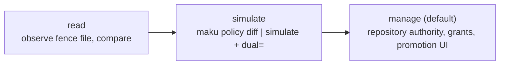
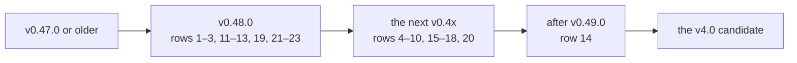

<!-- page-type: reference -->

# Upgrading

What changes in the install steps, release by release. A release that is not listed here upgrades with
the same `helm upgrade` as before. Until v4.0.0 the chart values may still change in a 0.x minor; each
such change has a section here. From v4.0.0, a breaking value change happens only in a major version.

## Contents

- [Opt-in OpenCode harness](#opt-in-opencode-harness)
- [Workflows as stage lists and custom roles](#workflows-as-stage-lists-and-custom-roles)
- [Independent stage switches and `scoper.planTier`](#independent-stage-switches-and-scoperplantier)
- [A task steps up once](#a-task-steps-up-once)
- [The six-tool MCP surface, and the names it replaced (v0.5x, six-tool surface)](#the-six-tool-mcp-surface-and-the-names-it-replaced-v05x-six-tool-surface)
- [Merge policies removals](#merge-policies-removals)
- [Merge policy safety tightening (v0.53.x)](#merge-policy-safety-tightening-v053x)
- [Merge policy usability and GitOps](#merge-policy-usability-and-gitops)
- [The gate picks the policy from the diff (v0.52.0)](#the-gate-picks-the-policy-from-the-diff-v0520)
- [Workflows name what runs](#workflows-name-what-runs)
- [Workflows: old names warn (v0.51.0)](#workflows-old-names-warn-v0510)
- [Merge policies: bounds, guardrail defaults and evidence levels (v0.50.0)](#merge-policies-bounds-guardrail-defaults-and-evidence-levels-v0500)
- [The merge policy catalog (v0.50.0)](#the-merge-policy-catalog-v0500)
- [The shared ClusterRoles in the CRD chart (v0.48.0)](#the-shared-clusterroles-in-the-crd-chart-v0480)
- [The demo's model gateway (v0.48.0)](#the-demos-model-gateway-v0480)
- [From the demo to production](#from-the-demo-to-production)
- [The Slack App's subchart, the broker's parity keys, the factory's default-deny (v0.48.0)](#the-slack-apps-subchart-the-brokers-parity-keys-the-factorys-default-deny-v0480)
- [The runs namespace's default-deny, optional (v0.48.0)](#the-runs-namespaces-default-deny-optional-v0480)
- [The clean-up (v0.48.0)](#the-clean-up-v0480)
- [The per-repository merge policy removed (v0.48.0)](#the-per-repository-merge-policy-removed-v0480)
- [One policy-management stage, `merge.maxPerDay`, `factory/hold` (v0.50.0)](#one-policy-management-stage-mergemaxperday-factoryhold-v0500)
- [Reusable merge policies (v0.48.0)](#reusable-merge-policies-v0480)
- [Exposure and the web front door (v0.47.0)](#exposure-and-the-web-front-door-v0470)
- [The preflight (v0.47.0)](#the-preflight-v0470)
- [Private code (v0.47.0)](#private-code-v0470)
- [Secrets by name (v0.47.0)](#secrets-by-name-v0470)
- [The GitHub account link (v0.47.0)](#the-github-account-link-v0470)
- [RunLore's knowledge base for runs (v0.47.0)](#runlores-knowledge-base-for-runs-v0470)
- [Run traces (v0.47.0)](#run-traces-v0470)
- [Scrape objects, alerts and dashboards (v0.47.0)](#scrape-objects-alerts-and-dashboards-v0470)
- [Runs through the model gateway (v0.46.0)](#runs-through-the-model-gateway-v0460)
- [Push enforced (v0.46.0)](#push-enforced-v0460)
- [Two GitHub Apps (v0.46.0)](#two-github-apps-v0460)
- [Per-run tokens (v0.46.0)](#per-run-tokens-v0460)
- [The run path (v0.46.0)](#the-run-path-v0460)
- [The chart contract (v0.46.0)](#the-chart-contract-v0460)

## Opt-in OpenCode harness

`AgentRun.spec.harness` now accepts `opencode` beside `openhands` (the default remains `openhands`). Upgrades require no values change unless you opt in: set `runController.images.opencode.tag` by digest in `charts/maku` to enable the OpenCode runner image and add `ghcr.io/smana/maku-opencode` to the run-pod admission policy. `maku_factory_task_outcomes_total`, `maku_factory_task_usd_total`, and `maku_factory_run_cost_usd` gain a bounded `harness` label (`openhands` or `opencode`, default `openhands`), and `cohort` adds `rescue` for explicit `/factory retry harness=openhands` rescues. See [Opt-in OpenCode harness](opencode-harness.md).

## Workflows as stage lists and custom roles

Each workflow in `Factory.spec.workflows` can now be written as one readable definition with `budget` (`light`, `standard`, or `frontier`) and an ordered `stages` list (`scoper`, `tester`, `implementer`, `reviewer`). The shipped `quick`, `standard`, and `careful` presets and `maku install --print` now use this list form directly, without requiring separate `templates` or `loops` rows.

Existing workflows written with `template`, `tier`, `checks`, and `loops` rows keep loading unchanged; setting `stages` alongside legacy keys (`template`, `tier`, `loop`, `checks`) on the same workflow is refused. Setting a top-level `templates` block emits a deprecation warning in this release and will be refused in the next minor; migrate custom template definitions (such as a two-role `solo`) into `workflows.<name>.stages`.

`Factory.spec.roles` accepts up to 16 custom read-only roles (`capability: read`), each pointing to a relative brief file (at most 16 KiB) under the factory's configuration directory. Custom roles execute with the `reviewer` run role (read-only GitHub token) and record their declared name in `agents.ogenki.io/persona`. The `maku-factory` chart exposes `roleBriefs` to project brief files under `/etc/agent-factory/config/roles/`.
## Independent stage switches and `scoper.planTier`

Each `loops` row now accepts independent stage keys `ask`, `plan`, and `review` beside `tests`, `search`, `judge`, and `split`. `plan: true` is equivalent to `scope: scoper` (`plan: false` to `scope: off`); setting a contradicting `plan` and `scope` on the same row is refused. `review` resolves the template for a workflow that names none (`pair` when `true`, `solo` when `false`) and is refused if it contradicts an explicit template. Existing platform rows that omit `ask`, `plan`, and `review` resolve as before (`plan` from `scope`, `review` from the template, `ask` from the scoper). The shipped presets now include a `quick` row (`review: false`) and set `ask: true` on `default`, `quick`, and `careful`. `Factory.spec.scoper.planTier` (`light`, `standard`, or `frontier`; unset is `light`) chooses the tier the scoper runs at; `maku install --print` writes `frontier`.

## A task steps up once

The shipped workflows now carry a one-step ladder (`quick` → `standard` → `careful`) via `Factory.spec.workflows.<name>.stepUp`, and each `Repository` can control step-up with `Repository.spec.workflow.stepUp` (`auto` by default, `ask` to wait with an offer, or `off`). On a verified failure (`budget-run`, `budget-task`, `stalled`, `not_met`, `review_rounds_exhausted`, `ci_red`), an unpinned task steps up at most once within its confirmed cap; pinned tasks, tasks capped below the target ceiling, and confirmed plans that did not show the stepped-up figure escalate with an offer instead. A platform that wrote its own `standard` (or `quick`) workflow entry keeps that entry whole and gets no automatic step-up until it adds `stepUp`; existing `escalation` blocks continue to work as before.

## The six-tool MCP surface, and the names it replaced (v0.5x, six-tool surface)

A coding agent sees six tools, `handoff`, `start`, `inbox`, `task`, `wait` and `answer`, where it saw up to
nineteen. Every tool, prompt, command, key and route the six replace is removed, not deprecated: a client,
a saved prompt or a config that still names one fails as the table below says. Upgrade the broker and
the Slack App first, then `maku` (`maku setup <client>` again, which rewrites the registration, the skill
and the command), and remove the two settings named under **What to change before upgrading**, below.

**What the six tools change.**

| Change | Detail |
|---|---|
| The six tools | `handoff` (broker) plans the work, holds the plan on the broker for 24 hours under an id and asks at most one question at a time; `start` (local) re-validates the stored plan and shows the form that files the issue and starts the work; `inbox` and `task` (broker) read what waits and where one task stands; `wait` and `answer` (local) follow a task and answer its question or leave a note. They are always listed, whatever the broker's switches say; with planning off, `handoff` answers `Planning is not available here; file on GitHub.` The client never sees or edits a plan envelope. [The MCP server](cli.md#the-mcp-server), [API](reference/api.md#post-mcp) |
| `human.mcp.start` | `{default, except[]}` says where `start`'s form offers "Start now": every repository the planner serves except those in `except`, and on by default when `human.intake.plan.enabled` is. It replaces `human.mcp.sessionStart`, which was an allow list and is not inverted. A release before this one honoured `sessionStart` with a warning; this one refuses it (below) |
| `--advanced` | `maku setup <client> --advanced` registers `maku mcp --advanced`, which also lists `room_tail`, `room_fork`, `room_checkout`, `coordination_checkout`, `coordination_open` and `coordination_plan`, and nothing else |
| The Slack `notify` default | A channel with no `notify` list posts four transitions: `room.task_triaged`, `room.waiting_for_human`, `room.pr_opened` and `room.ended`. `room.run_started`, `room.verdict_posted`, `room.budget_reached` and `room.approval_closed` post nothing by default, and `room.merged` and `room.reverted` edit the thread's end line in place. A channel that lists its own keys keeps them. To keep the old lines, list them: `notify: [room.task_triaged, room.run_started, room.waiting_for_human, room.pr_opened, room.verdict_posted, room.merged, room.reverted, room.budget_reached, room.ended]` ([Slack](slack.md#config)) |
| The MCP server's name | `maku`. `maku setup <client>` rewrites an existing `factory` entry in the client's config to `maku` and says so |
| The setup route | `maku configure` reads `/.well-known/maku`; the web host's skip-auth route is `^/\.well-known/maku$` (the chart sets it) |
| Stored plans | The broker keeps each plan `handoff` shows in a new `handoffs` table, bound to the caller, for 24 hours; the retention job deletes expired rows without reading them. The broker's `migrate` creates it at start ([database](database.md)) |

**What is removed now.**

| Removed | Replacement |
|---|---|
| Broker tools `intake_plan`, `plan_check` | `handoff`: `{text, repository?, ...}` to begin, `{id, answer}` or `{id, acceptRest: true}` to continue. The `{plan, hash, candidate}` envelope is gone |
| Broker tool `issue_draft` | `handoff` plans and checks the issue; `start`'s form files it. `task`'s `canStart` and `canStartWhy` say whether the caller may start work on a repository |
| Broker tool `classes_list` | `start`'s form offers the workflows the repository's catalogue allows, with the default pre-filled |
| Broker tools `needs_list`, and `rooms_list` in the list your agent sees | `inbox`: what needs you, or your own tasks when nothing waits or `human.needs.enabled` is off. `maku rooms`, `maku needs` and `GET /api/rooms`, `GET /api/needs` are unchanged |
| Broker tools `room_summary`, `room_brief`, `room_changes` | `task {task, since?}`: the state, what needs you, the budget, the merge gate's decision once there is one, and the milestones since `since`, with one cursor. `maku status` and `maku changes` read it |
| Broker tool `room_queue` | `answer {task, text}` with no question open: a note for the next run, after a form |
| Relay tool `issue_file` | `start {id}` |
| Relay tool `need_answer` | `answer {task, text?}`, which also restarts the task when you may start work on the repository |
| Relay tool `room_wait` | `wait {task?, timeout?}` |
| Unlisted `handoff_check` and `task_note` | They are internal calls of `start`, `answer` and the Slack App, not a surface to depend on |
| Prompts `factory_intake`, `plan`, `status`, `resume` | The three prompts `handoff`, `task` and `inbox` |
| The `/factory` command and the `factory-handoff` skill | `/maku` and the `maku-handoff` skill. `maku setup` and `maku skill install` no longer write the old pair, and `maku doctor` no longer reads it: delete a copy an older maku wrote |
| The route `/.well-known/roomctl` (`404`) | `/.well-known/maku`. `GET /api/roomctl` stays |
| Config `human.mcp.sessionStart` | `human.mcp.start`. The broker refuses to start: `human.mcp.sessionStart was removed: use human.mcp.start` |
| The Slack `proposals:` switch | Removed: the App's config fails to load on an unknown field. A mention is always planned through `handoff` and posted as a proposal; with no planner it answers `Planning is not available here; file on GitHub.` |
| The Slack draft grammar (`@factory [repo] title`, `Should:`, `Acceptance:`, the draft reply edits and the `factory_draft` message tag) | Plain words in the mention. A reply by the author re-plans the proposal |

**What to change before upgrading.** Delete `human.mcp.sessionStart` from the broker's values (the broker refuses it even when it is empty) and `proposals:` from the Slack App's `config`. `sessionStart` was an allow list and `human.mcp.start` is not: with the planner on, "Start now" is now offered on every repository the planner serves, so list in `human.mcp.start.except` each one where the form must not offer it, or set `default: false` to offer it nowhere. Replace a saved prompt or script that calls a removed tool. The `/factory retry` and `/factory split` comments on a GitHub issue are the factory's own triggers and are unchanged.

## Merge policy safety tightening (v0.53.x)

The gate fails closed in cases that previously passed or waited on an unrelated check. Repository
rollback now has one explicit switch, `merge.autoRevert` (default `false`), and three policy defaults
change as described below:

- `links-only` reads `.md` and `.mdx` files only. It recognizes real inline and reference links, not
  footnotes or call-shaped text; refuses unchanged, empty and non-regular files; keeps the first path
  segment on user-owned Git hosts; and accepts an archive only of the old URL.
- Only a maintainer's removal of `factory/hold` re-enters the gate. Labels, base branch and reviews
  are read again immediately before the success status.
- A live policy's protected path, approval subset or red holdout stops every live candidate. Holdouts
  are read only after the diff conditions hold; an unreadable file hands off `diff_unreadable`, and a
  skipped or neutral leak scan is not green.
- A refused binding never serves above its written mode. `disabled` and a missing `MergePolicy`
  restore no old class; a refused `shadow` binding can restore only shadow.
- File bindings receive the default guardrails even when the file has no central `classes` or uses
  `classAuthority: repository`; an unset `merge.maxPerDay` inherits the guardrail's daily cap.
- A policy's cap above a guardrail is clamped to that guardrail. An explicit binding value above a
  guardrail is still refused as `GuardrailMismatch`.
- A live policy without `holdoutChecks` no longer emits the TO5 warning, and neither `docs-links` nor
  `revert` is a mandatory binding. The chart catalog now ships `docs-links`, `deps-patch` and `docs`.
- Set `merge.autoRevert: true` to keep automatic rollback; an existing live `revert` binding still
  loads, sets that switch and reports a `Deprecated` condition. Revert creation records GitHub's head,
  and the merger merges only that exact head after checks pass, without native auto-merge.

## Repository-file authority

The default merge gate needs no policy-bot integration and no repository-file rollout. The legacy
integration and stage ladder below apply only to repositories that explicitly use them.

### policy-bot, an optional integration

By default `merge.policyBot` is `false` and `merge.gateStatus` is `true`: Maku posts `maku/merge-gate`
on the pull request, branch protection requires that status, and no `.policy.yml` file is used.
Self-modification of `.github/`, `.policy.yml`, `CODEOWNERS` and every holdout check's workflow is
blocked directly by the gate (`gate_path` and the guardrail `protectedFiles`).

When a repository opts in with `merge.policyBot: true` and `merge.policyBotLogin`, policy-bot reads
`.policy.yml` from the base branch and posts `policy-bot: main`. The gate then requires that status
in its fixed base: `success` lets the policy rows run; `error` is `gate_path`; anything else is
`policy_pending`; a missing status or one from another login is `policy_absent`. Maku neither reads
nor writes `.policy.yml`: under `merge.policyBot: true`, each policy that should arm needs a
hand-written `low-risk:` rule in `.policy.yml` approving only pull requests within that policy's
paths and sizes and excluding `.github/` and `.policy.yml`:

```yaml
policy:
  approval:
    - or:
        - human-authored
        - "low-risk: docs-small"
approval_rules:
  - name: "low-risk: docs-small"
    if:
      has_author_in: {users: ["ogenki-agents[bot]"]}
      only_has_contributors_in: {users: ["ogenki-agents[bot]"]}
      from_branch: {pattern: '^agent/[a-z2-7]{8}$'}
      only_changed_files: {paths: ['^docs/.+\.md$']}
      no_changed_files: {paths: ['^\.policy\.yml$', '^\.github/', '^CODEOWNERS$']}
      file_not_added: {paths: ['.*']}
      file_not_deleted: {paths: ['.*']}
      modified_lines: {total: "< 41"}
```

Land `.policy.yml` and `.github/agent-factory.yaml` in one human-merged pull request so policy-bot
evaluates the rule from the merge on.

## Rollout stages



`policyManagement.stage` controls how far repository-file management, simulation and the settings UI
are enabled (`manage` when omitted):

| `stage` | Needs | Does | Merge authority | Exit / verification |
|---|---|---|---|---|
| `read` | — | Each fence read parses, validates and resolves `.github/agent-factory.yaml` and compares it with the central policies | Central | `maku_factory_policy_central_divergence == 0` and no `maku_factory_policy_load_errors_total` series |
| `simulate` | — | Everything in `read`, plus `maku policy diff`, `maku policy simulate`, and live dual evaluation (`policy=` and `dual=` on every decision record) | Central | Simulator matches conformance fixtures; a week with no `agreement="unexplained"` |
| `manage` | Broker `factoryURL` when set explicitly on the broker; `human.approvalMemory: true` for saved grants | Everything in `simulate`, plus `classAuthority: repository` where a `Repository` sets it, approval-memory lookups, `/v1/policy/evidence` and `/v1/policy/repositories` on the factory, and `/settings/*` and promotions on the broker | Central unless a `Repository` sets `classAuthority: repository` | Promotion pull requests and grant lifecycle verified |

The broker reads its own `policyManagement` block (`stage` and `operators`) with the same validation
rules (`internal/config/config.go`). A config breaking a rule below fails the rollout:

| Rule | Message |
|---|---|
| `stage` is `read`, `simulate` or `manage` | `policyManagement.stage "…" is one of read, simulate, manage` |
| The six legacy switches were removed | Refused at config load and CRD admission ([upgrading](upgrading.md#merge-policies-removals)) |
| `classAuthority: repository` needs `stage: manage` | `classAuthority repository needs policyManagement.stage manage` |
| A cut-over entry declares no central `classes` or `mergePolicies` | `classAuthority repository: classes are declared centrally too, two authoritative sources (MP15): remove them` |
| Broker `stage: manage`, set explicitly, needs `factoryURL` | `policyManagement.stage manage needs factoryURL: …`. Left unset, a broker without `factoryURL` starts and serves no settings page |


## Merge policy usability and GitOps

Recent decisions are available through `maku policy list` and `maku policy explain` and the matching
broker API. `maku policy pause --repository owner/name --reason "incident freeze"` prints the
`merge.paused` edit, or opens it as a GitOps pull request when `Factory.spec.gitops` is set; `resume`
removes it. GitOps changes are always pull requests and Maku never merges them.

`Repository` status adds `servedMode` beside the written mode, a `Ready` condition that is false on a
refused generation or binding, and a `Paused` condition carrying the operator's reason. `kubectl get`
now prints `POLICIES`, `LIVE` and `BINDINGSVALID`; `MergePolicy` adds `Description`.
`maku_factory_policy_considered_total{repository,policy,reason}` counts every refused candidate and
backs the automatic-merge and waiting panels. A refused binding alerts after 15 minutes, a paused
repository after 24 hours.

## Merge policies removals

This release removes every field and mode v0.50.0 deprecated. Unknown
fields on a `MergePolicy`, `Repository` or `Factory` are rejected by the CRD schema, and the config
file refuses removed keys with a message pointing here. See [merge policies](merge-policies.md#start-here)
for the zero-binding catalog setup and [worked examples](merge-policies.md#worked-examples):

| Removed field or value | Replacement |
|---|---|
| `MergePolicy.spec.harness`, `classes.<name>.harness` | `Repository.spec.workflow.default` (`workflow.default` on the repository) |
| `MergePolicy.spec.harnessAllowed`, `classes.<name>.harnessAllowed` | nothing: every workflow the `Factory` defines may be pinned |
| `MergePolicy.spec.escalation`, `classes.<name>.escalation` | `Factory.spec.workflows.<workflow>.escalation` |
| `MergePolicy.spec.testFirst`, `classes.<name>.testFirst` | `Repository.spec.workflow.testFirst` (needs `merge.contractCheck`) |
| `MergePolicy.spec.checks`, `classes.<name>.checks` | `Factory.spec.workflows.<workflow>.checks` |
| `MergePolicy.spec.requires` | nothing: incomplete bindings are refused by the bound and parameter rules |
| `MergePolicy.spec.live`, `MergePolicy.spec.shadow` | `mode: live` or `mode: shadow` on each `Repository.spec.mergePolicies` binding |
| `MergePolicy` named `review`, or a binding named `review` | nothing: `no_policy_matched` sends unmatched pull requests to a human |
| `mode: "off"` on a `mergePolicies` binding | delete the binding, or set `mode: disabled` for a catalog policy (`docs-links`, `deps-patch`, `docs`) |
| `Schedule.class` without an `oracle.probe` policy | `Schedule.workflow` (`workflow` on the schedule) |
| `merge.autoMergesPerDay`, `mergeDefaults.autoMergesPerDay` | `merge.maxPerDay`, `mergeDefaults.maxPerDay` |
| `mergeGuardrails.minPromotionEvidence` | `evidence` (`low` or `standard`) on each `MergePolicy` |
| `policyManagement.{read,simulation,dualEvaluation,repositoryAuthority,approvalMemory,promotion}` | `policyManagement.stage` (`read`, `simulate` or `manage`) |

`maku config migrate` rewrites every removed field above into its new home when converting a legacy
config file into `Factory`, `Repository` and `MergePolicy` manifests. Shadow evidence recorded under
earlier label-chosen decisions (`class=<name>` in the merge gate's marker) carries over unchanged to
diff-chosen decisions for the same policy name.

## The gate picks the policy from the diff (v0.52.0)

Breaking: the merge gate no longer decides on the task's class. It judges the pull request's diff
against every policy the repository evaluates, its catalog policies included, and merges under the
strictest `live` one that holds ([selection](merge-policies.md#selection-from-the-diff)).

| Change | Before | Now | What to do |
|---|---|---|---|
| Which policy decides | the class fixed at intake (a `class:` label, a schedule, the plan; else `review`) | the strictest `live` policy whose every condition holds on the diff; a task with findings (a schedule's probe) or an adopted pull request keeps its one class | none: `workflow:<name>` picks the workflow, never the merge policy |
| A diff no policy admits | `class_unarmed`, or `class_mismatch` against the label | `no_policy_matched`, with each policy's refusal in the record's `considered=` | Alerts or dashboards on `class_unarmed` read `no_policy_matched` |
| A policy with no `diffShape` and no `oracle` | merged on its conditions | holds only on a reviewer's approve: a workflow without a reviewer (`quick`) leaves it `reviewer_verdict_missing` | Run with a reviewer (`standard` or `careful`), or give the policy a shape |
| Shadow evidence | one record, the class's | one record line per shadow policy that holds, beside the decision's | `scripts/shadow-merge-tally.sh` reads each class's own line |
| A capped or paused strictest policy | — | the pull request goes to a human: a looser policy never takes over | none |
| The decision's wording | "merged by the merger App: the class's conditions held" | "Merged automatically by policy `<name>`", or "Waits for a human: `<reason>`" | none |
| Conformance fixtures | version 1 | version 2: a fixture decided under the class it names reads differently | Rewrite fixtures you keep outside Maku |

A saved approval grant still binds to the task's class's resolved hash: a pull request the diff
assigns to another policy finds no grant and asks for an approval (`approval_required`).
## Workflows name what runs

Shipped in v0.52.0 with the merge gate that reads the diff: the class no longer
chooses what runs on a task. A task's workflow is the first of a maintainer's `workflow:<name>`
label (or the choice at confirmation), the task's source (a `Schedule`'s `workflow`, `quick` when
it names none; `quick` for a revert and an oracle finding; `none` for an adopted pull request), and
the `Repository`'s `workflow.default`, `standard` when unset. A maintainer may pin any workflow on any
class, `quick` included: a pull request no reviewer read waits for a human unless a shape or an
oracle checks its diff.

Everything v0.51.0 warned about is refused, each error naming this section:

| Old key or label | Write instead | Refused from |
|---|---|---|
| `harnessProfiles` (a `Factory`, the file) | `workflows`, the same map | v0.52.0 |
| `templates.trio` | `pair` | v0.52.0 |
| `triage.classifierURL` (the values file) | nothing: remove the key | v0.52.0 |
| `defaults.template`, `defaults.tier` | nothing: a workflow names its template and its tier | v0.52.0 |
| a `loops` row named neither `default` nor a workflow (`loops.docs`) | a row named after a workflow; set that workflow's `loop` to share one | v0.52.0 |
| `workflows.<name>.testFirst` | the `Repository`'s `workflow.testFirst`: the tester runs in `careful` | v0.52.0 |
| `human.intake.plan.classes` (the broker) | `factoryURL`: the factory's catalog names the classes and workflows | v0.52.0 |
| the `profile:<name>` label | `workflow:<name>`; a `profile:` or `class:` label is read by nothing and told once on its issue | v0.52.0 |
| the `class:<name>` label | nothing: the gate reads the diff | v0.52.0 |

Where a `MergePolicy`'s workflow fields moved (now refused; see [merge policies removals](#merge-policies-removals)):

| Field on `MergePolicy` | Lands on |
|---|---|
| `harness` | the `Repository`'s `workflow.default` (one per repository) |
| `harnessAllowed` | nothing: every workflow the `Factory` defines may be pinned |
| `escalation` | `Factory.spec.workflows.<name>.escalation`, on the workflow a task steps from |
| `testFirst` | the `Repository`'s `workflow.testFirst` (needs `merge.contractCheck`) |
| `checks` | `Factory.spec.workflows.<name>.checks` |

`maku config migrate` rewrites `harnessProfiles` as `workflows`, `trio` as `pair`, and drops
`templates.trio`, `triage.classifierURL`, `defaults.template`, `defaults.tier` and a workflow's
`testFirst`; a `loops` row named after a class has no mechanical home and is refused. The pin
refusals `class_no_profiles`, `class_profile_fixed`, `profile_not_allowed` and `profile_internal`
are gone; a task triaged before this release keeps the code it recorded. The status source `floor`
is now `repository`.

## Workflows: old names warn (v0.51.0)

This release is additive: every config and manifest the previous one accepts still loads. What the
next minor refuses loads with a warning in the factory's log (`config warning`, ending
`refused from the next minor`), and the `Factory`'s `Deprecated` condition lists its path.

| Setting or label | Why it goes | What to write instead |
|---|---|---|
| `templates.trio` | the same roles as `pair` since the tester left it | name `pair` |
| `triage.classifierURL` (the values file) | the task classifier was never deployed; the scoper replaced it | remove the key |
| `defaults.template`, `defaults.tier` | a workflow names its template and its tier | remove the keys |
| `harnessProfiles` | renamed | `workflows`, the same map |
| a `loops` row named neither `default` nor a workflow (`loops.docs`) | a row is named by the workflow whose loop it is | rename the row after a workflow and set that workflow's `loop` |
| `human.intake.plan.classes` (the broker) | the factory's catalog names the workflows | set `factoryURL` and remove the table |
| the `profile:<name>` label | renamed | `workflow:<name>`; a task pinned through `profile:` is told once on its issue |

Two synonyms are read from this release: `workflows` is `harnessProfiles` (a `Factory` or a file
that sets both is refused: `workflows and harnessProfiles: set one`), and a `workflow:<name>` label
is the same pin as `profile:<name>` (a `profile:` and a `workflow:` label naming different workflows
conflict, `profile_conflict`). `maku mcp` now labels a pinned plan `workflow:<name>`.

A broker whose planner is on no longer needs `human.intake.plan.classes` or
`human.intake.plan.repositories` when it sets `factoryURL`: the plan's classes and candidate
repositories come from the factory's catalog (`GET /v1/catalogue`, serving public repositories and
acknowledged private ones). Leaving `human.intake.plan.repositories` set narrows the factory's list,
and any entry the factory does not serve logs a warning naming it; remove the key when every
repository the factory serves should be eligible.

## Merge policies: bounds, guardrail defaults and evidence levels (v0.50.0)

Four changes reach a bound class, a `Repository`'s or a repository file's. A class the config file
declares under `classes` is held to the bound rule only.

| Change | Before | Now | What to do |
|---|---|---|---|
| The bound rule | only a `live` class without policy-bot needed `allowedFiles` | every `live` or `shadow` class, resolved with its binding, needs `allowedFiles` or a `diffShape` (`docs-links` and `revert` have theirs built in); otherwise its binding is `Unbounded` and its class is not served | Give the policy or the binding `allowedFiles`, or bind it `disabled` |
| Guardrail defaults | an unset `mergeGuardrails` capped nothing | `protectedFiles` always starts with `^\.github/`, `^\.policy\.yml$`, `^CODEOWNERS$`; an unset `maxPatchFiles`, `maxModifiedLines` or `maxPerDay` is 10, 300 or 5 | A policy or binding above one of these is `GuardrailMismatch` and names the cap (`maxModifiedLines 400 is over the guardrail's 300`): lower it, or set that guardrail on the `Factory` |
| `evidence` on a policy | 20 clean decisions, or `mergeGuardrails.minPromotionEvidence` when higher | `evidence: low` is 5 (a policy with a `diffShape` or an `oracle`), `standard`, the default, 20; `minPromotionEvidence` is ignored | Set `evidence: low` where a shape or an oracle checks the diff |
| A binding's `allowedFiles` over a policy's | `ParameterTwice` | it narrows the policy's: a path must match both | none |

A binding's mode may now be `disabled`; `"off"` still reads as `disabled`. `maku config migrate`
compares the classes under the default guardrails, so a config-file class within them migrates
unchanged, and one above them is a `changed:` line.

## The merge policy catalog (v0.50.0)

The `agent-factory` chart now renders four `MergePolicy` objects with the factory, labelled
`maku.ogenki.io/catalog: "true"`: `docs-links`, `revert`, `deps-patch` and `docs`
([the catalog](merge-policies.md#the-catalog)). Every `Repository` evaluates each one it does not bind,
in `shadow`: it records would-merge decisions and merges nothing. A repository the config file serves
is unchanged.

| Change | Before | Now | What to do |
|---|---|---|---|
| `mergePolicies.catalog.enabled` | no catalog | `true`: four `MergePolicy` objects in the release's namespace | `false` to render none |
| An existing `MergePolicy` of a catalog name, without the label | yours | the install fails before any apply: `MergePolicy docs exists and is not the catalog's: add it to mergePolicies.catalog.exclude` | List the ones you keep in `mergePolicies.catalog.exclude`, or delete yours in the change that upgrades. Under Argo CD, which renders without `lookup`, the check never runs: exclude them first |
| A `Repository` that binds no catalog policy | not evaluated | `shadow` | Bind it `mode: disabled` to switch it off for that repository |
| `deps-patch` in `shadow` | — | adopts Renovate's patch pull requests (`renovate[bot]`, `renovate/` branches) as tasks, to decide them in shadow | Bind it `disabled` where Renovate's pull requests must stay untouched |
| The promotion drill | a `factory/drill` revert of one of the class's own pull requests | one merged `factory/drill` revert in the repository clears `no_drill` for every class | none |

## The shared ClusterRoles in the CRD chart (v0.48.0)

Several installs can share a cluster. The roles every install shares move from the factory
chart to `agent-factory-crds`, under the same names, so whatever binds them keeps working:
`maku-factory-admin`, `maku-mergepolicy-editor` and `maku-viewer` (aggregated into `admin`, `edit` and
`view`) and `agent-factory-flux-reader`. Each is kept on uninstall, as the CRDs are. The umbrella
renders none of them (`maku-factory.clusterRoles: false`), and the factory's Flux binding is now the
install's, `agent-factory-<namespace>-flux-reader`.

| New key | Default | What it does |
|---|---|---|
| `agent-factory-crds`: `clusterRoles` | `true` | renders the four shared ClusterRoles |
| `maku-factory.clusterRoles` | `true` in the factory chart, `false` under the umbrella | renders them from the factory chart, for an install of that chart alone |

**An umbrella install hands the roles to `agent-factory-crds` before upgrading,** as it did the CRDs
([adopting the CRDs](#adopting-the-crds)). Without it, Helm refuses the CRD chart's upgrade, since the
roles belong to the umbrella's release. `helm.sh/resource-policy: keep` then stops the umbrella's
upgrade from deleting what it no longer renders:

```bash
roles="maku-factory-admin maku-mergepolicy-editor maku-viewer agent-factory-flux-reader"
kubectl get clusterrole $roles --ignore-not-found -o name | xargs -r -I{} sh -c '
  kubectl label {} app.kubernetes.io/managed-by=Helm --overwrite
  kubectl annotate {} meta.helm.sh/release-name=af-crds meta.helm.sh/release-namespace=maku helm.sh/resource-policy=keep --overwrite'
helm upgrade af-crds oci://ghcr.io/smana/charts/agent-factory-crds --version <version> -n maku
helm upgrade af oci://ghcr.io/smana/charts/agent-factory --version <version> -n maku -f values.yaml
```

Use your CRD release's name and namespace. Each role keeps its UID, and `task chart:adopt-roles:k3d`
proves the sequence from the previous chart. `task demo` runs it for you.

**An install of the `maku-factory` chart alone changes nothing:** `clusterRoles` stays `true` there.
When it moves under the umbrella ([adopting the umbrella](#adopting-the-umbrella-from-maku-factory)),
run the same commands first: they hand the roles from the factory's release to the CRD chart's.

## The demo's model gateway (v0.48.0)

`values-demo.yaml` now runs the demo through the model gateway, as production does:
`maku.runController.model.mode: gateway`, `agentgateway.enabled` and `maku-gateway.enabled`, the
runs' `gatewayIdentity`. `values-demo-gateway.yaml`, which layered these before, is deleted. A demo
install now:

- applies Gateway API's CRDs (v1.2 or later) and agentgateway's (`kubectl apply --server-side -f
  config/agentgateway`) before the umbrella;
- sets `maku-gateway.identity.issuer` (the cluster's ServiceAccount issuer), the provider's host
  (`maku-gateway.providers.demo.host`, with `port`, `path` and `tls`) and each alias's `model`, and
  only `demo.model.apiKey`: `demo.model.baseURL`, `name` and `judgeName` are refused in gateway mode;
- on k3s (k3d), starts the apiserver with `--kube-apiserver-arg=anonymous-auth=true`: the gateway's
  controller reads its JWKS anonymously. kind and kubeadm leave it on.

`task demo` does all three, and `values-mine.example.yaml` shows the values. agentgateway's controller
and the gateway's proxy each request 128 MiB (limits 512 MiB and 1 GiB) on the laptop. To keep the provider key in the sandbox instead, set
`maku.runController.model.mode: secret` with `maku-gateway.enabled: false`, `agentgateway.enabled: false`
and `maku-factory.config.runs.gatewayIdentity: false`: still demo-only (`maku.demoValues`).

`maku install --print` writes a production install's files ([maku](cli.md)): values, Secrets, the
factory objects, the merge gate's ruleset and the GitOps files, and it applies nothing.

## From the demo to production

From v0.47.0 the chart renders production, and since v0.49.0 its defaults are
production: there is no `profile` to set. Start from
[`values-production.example.yaml`](../charts/agent-factory/values-production.example.yaml), never from
`values-demo.yaml`: its `demoValues` admits the demo-only values and skips the seams. Without it, the
render checks the seams of each enabled component and fails once, with every missing seam on its own
line, its key and its doc:

```text
Error: execution error at (agent-factory/templates/gate/renders/before/subcharts.yaml:5:4): 9 missing or refused seams (docs/upgrading.md#from-the-demo-to-production; the demo is -f values-demo.yaml):
  - maku.broker.image.tag: <version>@sha256:<digest>, never a bare tag (got ""; docs/security.md#supply-chain)
  - maku.broker.human.issuer: the OIDC issuer humans sign in at (docs/identity.md#the-keys)
  ...
```

| Component | Its seams | Refused |
|---|---|---|
| The release | none | `postgres.enabled` |
| `maku` | the four images by digest; `broker.human.mode: oidc` with an `issuer`; `broker.runIssuer.issuer`, or `runIssuer.mode: tokenreview`; `broker.database.brokerSecret` ([The database](database.md)); an https `broker.publicURL`; `sandbox.runtimeClassName`; with `maku-factory`, `maku-factory.runTokens.perRun` | `maku.demoValues`, `runController.model.mode: secret`, `runController.gitSecret`, `sandbox.unsafeAllowRunc` and `runController.allowUnsandboxed` (the demo and kind only) |
| `maku-factory` | its image by digest; the factory App's Secret (`apps.factory.existingSecret`); the agents App's (`apps.agents.existingSecret`) with `runTokens: {enabled: true, perRun: true}`; with `maku`, `config.api.humanIssuer`, which must agree with the broker's identity ([Identity](identity.md)) | `demo`, `config.demo` |
| `slack` | the agreements of [`values-slack.example.yaml`](../charts/agent-factory/values-slack.example.yaml) and its three Secrets by name | |
| `webProxy` | `existingSecret`, and the broker's identity it derives its arguments from ([Exposure](exposure.md)) | |
| `expose` | each surface's hosts, and its parentRefs or IngressClass; the gateway's pods in the release's policy mode | |

`maku.networkPolicies.mode: none` and `maku.broker.factoryInsecure` stay allowed in production: the
web UI shows them on its unsafe-settings banner. The chart renders none of the demo's own objects: no
Postgres, no generated TLS (bring `room-broker-tls` and `room-broker-ca`, or set
`maku.broker.tls.issuerRef` for cert-manager, and the factory's `openbao-ca`), no `agent-model` or
`agent-factory-github` Secret ([Install Secrets](install-secrets.md)).

`task chart:production:k3d` installs this path on a throwaway k3d cluster: a test-only RuntimeClass
`gvisor` on runc, a Postgres outside the chart, the generic OIDC stub as the issuer, the web through
agentgateway, and the monitoring objects. A cluster that runs no sandbox runtime has no production
render: `sandbox.unsafeAllowRunc` is for the demo and kind only.

### Adopting the umbrella from `maku-factory`

An install that runs the `maku-factory` chart alone adopts the umbrella one component at a time.
`maku.enabled: false` with `maku-factory.enabled: true` is a valid production render, so the factory
moves first, under the same release name:

1. Install [`agent-factory-crds`](../charts/agent-factory-crds/README.md) and adopt the CRDs
   ([Adopting the CRDs](#adopting-the-crds)).
2. Nest your `maku-factory` values under `maku-factory:` (Flux's `valuesFrom` cannot prefix a whole
   file: re-nest the file itself), and upgrade the release to the umbrella:

   ```bash
   helm upgrade agent-factory oci://ghcr.io/smana/charts/agent-factory --version <version> -n agent-system \
     --set maku-factory.enabled=true -f factory-values.yaml
   ```

   The factory's Deployment, Service and ConfigMap keep their names, so Helm upgrades them in place:
   the Deployment keeps its UID, and the Tasks are untouched. `helm history` shows an upgrade, not an
   install.
3. Then turn `maku.enabled` on with the broker's values, and the rest (`expose`, `webProxy`, `slack`,
   `monitoring`) each in its own upgrade.

## The Slack App's subchart, the broker's parity keys, the factory's default-deny (v0.48.0)

New keys, all off by default, so a release that sets none of them renders as before:

| New key | Default | What it does |
|---|---|---|
| `slack` (the `maku-slack` subchart) | `enabled: false` | the Slack App ([Slack App, Install](slack.md#install)). Its values must agree with `maku.broker.webhooks` and both `sponsored` lists (`values-slack.example.yaml`) |
| `maku.broker.webhooks`, `suspend`, `policyManagement`, `coordination` | unset | the broker's own blocks, verbatim. A webhook may name its key's Secret (`existingSecret`, `key`) and its peers (`networkPolicy.to`) |
| `networkPolicies.factory` | `enabled: false` | the factory's default-deny, in maku's mode |

**`slack.enabled: true` now installs the App.** Before this release, `slack.enabled: true` only added
the `maku-slack` alert group, for an App installed outside the chart. It now renders the App and checks
its agreements, so an install that kept its own App either moves it to the subchart, or turns
`slack.enabled` off, and loses that alert group and the `expose.slack` route with it.

## The runs namespace's default-deny, optional (v0.48.0)

`networkPolicies.runsNamespaceDefaultDeny` (default `true`: the render is unchanged) controls the
runs namespace's `default-deny` policy, in mode `cilium` or `kubernetes`. An install whose platform
owns the runs namespace's default-deny sets it to `false`, and the chart renders none, so the two no
longer conflict. The platform's policy must then deny both directions, as the chart's does: each run's
own policy adds only its allowances on top of it.

## The clean-up (v0.48.0)

v0.48.0 through v0.50.0 delete the paths v0.46.0 and v0.47.0 kept for older installs and flip the defaults they left at
their old values. Each change below is breaking: a removed or flipped value is refused by the schema
or by a render `fail` that names its replacement, never silently ignored.

This section is the migration note from any v0.4x release to the v4.0 candidate. Each path this clean-up
removes or flips is one row below: what replaces it, the release that ships the change, and the
subsection with the details. Rows 1 to 3, 11 to 13, 19 and 21 to 23 shipped in v0.48.0; the others
ship in the release after it, except row 14, which ships in the release after v0.49.0.



| # | Removed or flipped | Instead | Release | Details |
|---|---|---|---|---|
| 1 | `networkPolicies.enabled` (`maku`) | `networkPolicies.mode`, default `kubernetes` | v0.48.0 | [the run path's old keys](#the-run-paths-old-keys) |
| 2 | `runController.runtimeClassName`, `runController.allowUnsandboxed` (`maku`) | `sandbox.runtimeClassName`, default `gvisor`; `sandbox.unsafeAllowRunc` | v0.48.0 | [the run path's old keys](#the-run-paths-old-keys) |
| 3 | The factory's `spec.queueName` on AgentRuns (Kueue) | `runsQuota`, the factory's slots and budgets | v0.48.0 | [the run path's old keys](#the-run-paths-old-keys) |
| 4 | The `cloud.ogenki.io` run kind (`runs.group`) | `maku.ogenki.io`, now also the binaries' default | after v0.48.0 | [the XR run kind and octo-sts](#the-xr-run-kind-and-octo-sts) |
| 5 | octo-sts: `hardening.publisher.octoSTS`, `hardening.publisher.audience`, `networkPolicies.factory.octoSTS`, the harness's `STS_URL`, readiness's policy files | the per-run minter, `hardening.publisher.minter` | after v0.48.0 | [the XR run kind and octo-sts](#the-xr-run-kind-and-octo-sts) |
| 6 | Readiness's fix text naming the XR and octo-sts | per-run tokens | after v0.48.0 | [the XR run kind and octo-sts](#the-xr-run-kind-and-octo-sts) |
| 7 | `loops.<class>.models` and `split` without `runs.gatewayIdentity` | `runs.gatewayIdentity: true` | after v0.48.0 | [the XR run kind and octo-sts](#the-xr-run-kind-and-octo-sts) |
| 8 | The shared git token: `runController.gitTokens`, `gitReadSecret`, `unsafeSharedGitToken` (`maku`) | per-run tokens, the only mode; a laptop's PAT is `runController.gitSecret` with `demoValues` | after v0.48.0 | [the shared git token](#the-shared-git-token) |
| 9 | `githubSecret`, `mergerSecret`, `runTokens.appSecret` (`maku-factory`); `runTokens.appIDFile`, `privateKeyFile` (factory config) | `apps.factory`, `apps.merger`, `apps.agents` | after v0.48.0 | [the old App keys](#the-old-app-keys) |
| 10 | The merge defaults `gateStatus: false`, `policyBot: true`, `apps.merger.mode: separate` | `gateStatus: true`, `policyBot: false`, `apps.merger.mode: factory` | after v0.48.0 | [the merge defaults](#the-merge-defaults) |
| 11 | `model.mode: secret` as the default (`maku`) | `model.mode: gateway`; `secret` is demo-only | v0.48.0 | [the gateway is the model path](#the-gateway-is-the-model-path) |
| 12 | The Envoy AI gateway's `meter.logsURL` in the docs | `meter.throttle.promQuery` | v0.48.0 | [runs through the model gateway](#runs-through-the-model-gateway-v0460) |
| 13 | `values-demo-gateway.yaml` | `values-demo.yaml` | v0.48.0 | [the demo's model gateway](#the-demos-model-gateway-v0480) |
| 14 | The ZITADEL reader: `human.access.readerFile`, `api.access.readerFile`, `zitadelReaderSecret` (`maku-factory`) | the GitHub account link: `human.githubLink`, `api.access.links: broker` | after v0.49.0 | [the ZITADEL reader](#the-zitadel-reader) |
| 15 | `profile` (umbrella) | `demoValues: true`, which `values-demo.yaml` sets | after v0.48.0 | [the chart contract](#the-chart-contract) |
| 16 | `networkPolicies.plain` (umbrella) | each component's own default-deny policies | after v0.48.0 | [the chart contract](#the-chart-contract) |
| 17 | The `crds/` of `maku` and `maku-factory` | `agent-factory-crds` alone | after v0.48.0 | [the chart contract](#the-chart-contract) |
| 18 | `preflight.enabled: false` | default `true` | after v0.48.0 | [the chart contract](#the-chart-contract) |
| 19 | The private-code warning | a refusal without `spec.privateCode.acknowledged` | v0.48.0 | [private code is refused](#private-code-is-refused-without-its-acknowledgement) |
| 20 | Serving on a ledger the broker cannot read | a refusal at start | after v0.48.0 | [an unreadable ledger is refused](#an-unreadable-ledger-is-refused) |
| 21 | The factory config's single-repository shape | `Repository` objects, from `maku config migrate` | v0.48.0 | [the single-repository config](#the-single-repository-config) |
| 22 | `maku-broker migrate-group` | upgrade through an earlier v0.4x first | v0.48.0 | [the group migration](#the-group-migration) |
| 23 | The `factory_slack_*` metrics | `maku_slack_app_*` | v0.48.0 | [the Slack App's metric names](#the-slack-apps-metric-names) |

The per-repository `MergePolicy` and the repository file's `classes:` are not in this table: reusable
merge policies' second release removed them, and v0.48.0 carries it
([the per-repository merge policy removed](#the-per-repository-merge-policy-removed-v0480)).

Before you upgrade, check that nothing still uses a removed path:

1. **The values.** Render the new release with the values you run. Each removed or flipped key fails,
   naming its replacement and its subsection here:

   ```bash
   helm get values <release> -n <namespace> -o yaml > current.yaml
   helm template <release> oci://ghcr.io/smana/charts/agent-factory --version <new> -n <namespace> -f current.yaml >/dev/null
   ```

2. **The configs.** The broker, the factory and the run-controller decode their configs strictly and
   refuse a removed key at start (rows 4, 5, 9, 14 and 21). Upgrade each chart with its images.
3. **The runtime paths,** each to print nothing or 0:

   ```bash
   kubectl get agentruns.cloud.ogenki.io -A --no-headers 2>/dev/null | wc -l   # row 4: no XR run left
   kubectl get repository -A -o jsonpath='{range .items[?(@.status.conditions[?(@.type=="PrivateCode")].reason=="Unacknowledged")]}{.metadata.name}{"\n"}{end}'   # row 19
   ```

   For row 20, `maku_rooms_schema_unverified` reads 0 on every broker pod (v0.48.0 is the last release
   to export it). For row 23, no rule or dashboard of yours names `factory_slack_`.

### The values contract

`hack/values-contract.sh` compares each chart's `values.schema.json` and `values.yaml` with the same
chart in a release, pulled from `oci://ghcr.io/smana/charts` and cosign-verified as the release
workflow's. It prints one row per change:

| Class | What it is |
|---|---|
| breaking | a key removed or renamed (gone from the schema, refused by a removal message, or dropped from `values.yaml` with no schema entry left); a narrowed type, enum or pattern; a new required key; an object that stops accepting unknown keys |
| behaviour | a changed default |
| compatible | an added key, a widened type or enum, a dropped pattern |

```bash
task chart:contract                        # against the latest release
task chart:contract CONTRACT_FROM=v0.48.0  # against a given one
```

CI runs it on each pull request that changes a chart, and writes the table to the job summary. It is
report-only: before v4.0.0 a breaking value change may ship in a v0.x minor, with its section on this
page. From v4.0.0, a breaking row needs a major version and a migration note; arming the report to
fail (`--strict`) is part of cutting v4.0.0.

### The run path's old keys

The `maku` chart's keys that step 2 kept beside their replacements are removed, and the defaults are
the product path's: plain NetworkPolicies and gVisor. The schema refuses each old key with a message
naming its replacement; under `--skip-schema-validation` the template does.

| Removed | Set instead | Default now |
|---|---|---|
| `networkPolicies.enabled` | `networkPolicies.mode`: `cilium` for `true`, `none` for `false` | `kubernetes` (was `cilium`, from `enabled: true`) |
| `runController.runtimeClassName` | `sandbox.runtimeClassName` | `gvisor` (was `""`, falling back to the old key's `gvisor`) |
| `runController.allowUnsandboxed` | `sandbox.unsafeAllowRunc`, with `sandbox.runtimeClassName: ""` | `false` |

An install that set none of them and ran on Cilium now renders plain NetworkPolicies and the egress
proxy: set `networkPolicies.mode: cilium` to keep the CiliumNetworkPolicies. Because
`sandbox.runtimeClassName` now defaults to `gvisor`, `sandbox.unsafeAllowRunc: true` needs it emptied,
or the render fails with `choose one`. `values-quickstart.yaml` sets `mode: cilium`, and the umbrella's
`values-demo.yaml` sets `mode: none` and the unsandboxed pair.

The factory no longer writes `spec.queueName` on the AgentRuns it creates (Kueue is dropped).
The runs quota (`runsQuota`) and the factory's slots and budgets bound the runs.

### The old App keys

The `maku-factory` keys that v0.46.0 kept beside `apps.*` are removed. The schema refuses each
with a message naming its replacement; under `--skip-schema-validation` the template does. The
factory's config refuses the `runTokens` file aliases the same way when it starts.

| Removed | Set instead |
|---|---|
| `githubSecret` | `apps.factory.existingSecret`, whose default is now `agent-factory-github` |
| `mergerSecret` | `apps.merger.existingSecret` (new; empty means `agent-factory-merger`), with `apps.merger.mode: separate` |
| `runTokens.appSecret` | `apps.agents.existingSecret`, mounted at `/etc/agent-factory-agents` |
| `runTokens.appIDFile`, `runTokens.privateKeyFile` (factory config) | `github.agentsAppIDFile`, `github.agentsKeyFile`, which `apps.agents` writes |

`runTokens.enabled` now needs `apps.agents.existingSecret`; the `/etc/agent-factory-run-tokens` mount
is gone. Upgrade the chart and the image together: the config is decoded strictly.

### The shared git token

Per-run tokens are the only run token outside a demo. The run-controller
mounts each run's own Secret, `<run>-git`, which the factory mints for the run's repository and role.

| Removed | Instead |
|---|---|
| `runController.gitTokens` (`maku`) | Nothing to set: per-run is the only mode. Drop the key |
| `runController.gitReadSecret` (`maku`) | Each run's token is minted for its role. Drop the key |
| `runController.unsafeSharedGitToken` (`maku`) | `runController.gitSecret` alone names a laptop's one PAT, with `demoValues: true` |
| The factory's shared `agent-git` / `agent-git-read` writer (`runTokens.enabled` without `perRun`) | `runTokens: {enabled: true, perRun: true}` and `apps.agents.existingSecret` |

The schema refuses each removed key with a message naming what replaced it. Under
`--skip-schema-validation` the template does, and so does the run-controller's config at start.
`runController.gitSecret` now defaults to `""`, and it is refused without `demoValues`. When it is
set, every role mounts that PAT, and the banner shows `shared_git_token`. `values-quickstart.yaml`
sets it to `agent-git`. `maku-factory` refuses `runTokens.enabled` without `runTokens.perRun`. The
umbrella refuses a factory with neither `runTokens.perRun` nor a laptop PAT, and one with both.

### The merge defaults

Three defaults that v0.46.0 left at their old values flip to the product path. A
repository's `merge` block, the Factory's `spec.mergeDefaults` and a Repository's `spec.merge` read
them the same way.

| Key | Unset before | Unset now | To keep the old behaviour |
|---|---|---|---|
| `merge.gateStatus` | `false`: no `maku/merge-gate` status | `true`: the factory posts `maku/merge-gate`, so the App that signs merges needs `statuses: write` | `gateStatus: false` |
| `merge.policyBot` | `true`: the gate reads `policy-bot: main` | `false`: `maku/merge-gate` is the required status, and every live class needs `allowedFiles` | `policyBot: true`, with `policyBotLogin` |
| `apps.merger.mode` (`maku-factory`) | `separate`: a merger App of its own | `factory`: the merger signs with the factory App, so every `merge.mergerLogin` must be `factoryLogin` | `apps.merger.mode: separate` |

An install that set all three explicitly, as cloud-native-ref does, renders and decides as before.
One that relied on the old defaults sets the right-hand column, or follows
[Retiring policy-bot](factory.md#branch-protection-for-the-merge-gate) to move to the new ones.

### The XR run kind and octo-sts

Runs are the run-controller's AgentRuns (`maku.ogenki.io`), and their tokens are minted per run
by the factory. cloud-native-ref's Crossplane AgentRun (`cloud.ogenki.io`) and octo-sts, its
token source, are removed.

| Removed | Set instead | Refused by |
|---|---|---|
| `runs.group: cloud.ogenki.io` (broker, factory, `maku` chart) | `runs.group: maku.ogenki.io`, or leave it unset | the broker and the factory at start; the `maku` and `maku-factory` renders |
| any other `runs.group` | `maku.ogenki.io` | the same |
| `hardening.publisher.octoSTS` (factory config) | `hardening.publisher.minter: true` | the factory at start; the `maku-factory` render |
| `hardening.publisher.audience` (`maku-factory`) | none: the minter reads no projected token | the schema; the template under `--skip-schema-validation` |
| `networkPolicies.factory.octoSTS` (umbrella) | none | the schema; the template |
| `STS_URL` (the harness's exchange) | the run-controller's `GIT_TOKEN_FILE` | the credential helper |

The defaults move with it:

- **`runs`** unset is the run-controller's kind (`maku.ogenki.io`, `agents`, `run-`), in the broker,
  the factory and the `maku-factory` chart's Roles and run-token policy. It was the XR's
  (`cloud.ogenki.io`, `agents`, `xplane-run-`). A broker whose `runIssuers[].subPattern` names
  `xplane-run-` and leaves `runs` unset is refused at start: set `runs.namePrefix` or the pattern.
- **`runs.gatewayIdentity`** unset now refuses `loops.<class>.models` and `split`, as it did on
  `maku.ogenki.io`: set it once the run-controller runs in `model.mode: gateway`.
- **`hardening.enforceOutputs`** needs `runTokens.perRun` and `hardening.publisher.minter`.
  Readiness's `sandbox_write_token` and `publisher_policy` checks and the permission gauge read the role table only: the policy files
  `.github/chainguard/*.sts.yaml` are no longer read and can be deleted.
- **`human_edit`** (the tracer's exemption for a maintainer's edit of an applied output) now
  applies under `runTokens.perRun`, where a run's own edit is the agents App's.

### The ZITADEL reader

The GitHub account link is the only identity source. The reader that read ZITADEL's GitHub IdP
links with a PAT, kept beside the link since v0.47.0, is removed:

| Removed | Set instead |
|---|---|
| `human.access.readerFile` (broker config) | `human.githubLink` (`maku.broker.githubLink.existingSecret`); `human.access` now needs it |
| `api.access.readerFile` (factory config) | `api.access.links: broker`, now the only value `api.access` accepts |
| `zitadelReaderSecret` (`maku-factory`) and its mount at `/etc/agent-factory-zitadel-reader` | nothing: the factory reads the links from the broker |

Each `readerFile` is refused at start, naming its replacement. The schema refuses
`zitadelReaderSecret`, and so does the template under `--skip-schema-validation`. A human with no
link now has no GitHub login, with no fallback: they see no room (`X-Rooms-Access: unlinked`),
the MCP draft check answers `not_linked`, and the factory refuses their runs (`repository_permission`).
The reader's other job, refusing at once a user deactivated in ZITADEL, is gone too: a link is active
while its human signed in within `human.githubLink.activeWindow` (default `168h`).

Before you upgrade, move every active human onto the link
([the GitHub account link](#the-github-account-link-v0470) and
[its page](github-link.md)), then remove both `readerFile`s, `zitadelReaderSecret` and the reader's
Secret. Delete the reader's machine user in ZITADEL afterwards: nothing reads its PAT.

### The chart contract

The umbrella's defaults are production, the subcharts carry no CRD, and the preflight is on. Each
removed key is refused by the schema with a message naming its replacement; under
`--skip-schema-validation` the template does.

| Change | Before | Now | What you do |
|---|---|---|---|
| `profile` (umbrella) | `demo` or `production`, required | removed: every render without `demoValues` checks the seams of each enabled component | Delete `profile` from your values. The demo stays `-f values-demo.yaml`, whose `demoValues: true` is the one switch that admits the demo-only settings |
| The demo-only settings | refused under `profile: production` | refused without `demoValues`, naming `values-demo.yaml`: `postgres.enabled`, `maku.demoValues`, `maku.sandbox.unsafeAllowRunc`, `maku.runController.model.mode: secret`, `maku-factory.demo` | nothing, unless a production values file set one |
| `networkPolicies.plain` (umbrella) | `true` in `values-demo.yaml`: `rooms-db` and the factory's API admitted the broker alone | removed. The bundled Postgres renders its own `rooms-db` policy; the factory's is `networkPolicies.factory`, in `maku.networkPolicies.mode` `kubernetes` or `cilium` | Delete the key. On a CNI that enforces NetworkPolicy, set `maku.networkPolicies.mode: kubernetes` and `networkPolicies.factory.enabled: true` |
| The `crds/` of `maku` and `maku-factory` | the six CRDs, also inside the umbrella | none: [`agent-factory-crds`](../charts/agent-factory-crds/README.md) alone carries them | Install `agent-factory-crds` first, also for `maku` or `maku-factory` used alone, and [adopt the CRDs](#adopting-the-crds) if it does not own them yet. Flux's `crds: Skip` and Argo CD's `skipCrds` on those releases are now no-ops |
| `maku.preflight.enabled`, `maku-factory.preflight.enabled` | `false` | `true`: the Helm test hook, the suspended CronJob `<release>-preflight`, and each component's `/preflight` | nothing; `false` on both turns it off. Under Flux, `spec.test.enable: true` runs the hook after each upgrade ([the preflight](install.md#check-it-the-preflight)) |

```bash
kubectl get crd -l app.kubernetes.io/managed-by=Helm -o custom-columns=NAME:.metadata.name,RELEASE:.metadata.annotations.meta\.helm\.sh/release-name | grep maku.ogenki.io
```

Every `maku.ogenki.io` CRD must name your `agent-factory-crds` release before you upgrade. Removing the
subcharts' `crds/` deletes no CRD: Helm never deletes what it created from `crds/`, and
`agent-factory-crds` marks each CRD `helm.sh/resource-policy: keep`.

The preflight's Role gets the Secrets of [install Secrets](install-secrets.md) the values enable, by
name, the broker's TLS pair and the DSNs among them, to check their keys. Its pod runs only when
`helm test` or `maku preflight` starts it.

### Private code is refused without its acknowledgement

A Repository serving private code (`private` or `internal` on GitHub, or a visibility the factory
cannot read) without `spec.privateCode.acknowledged: true` is now refused new tasks, where v0.47.0
warned. Its `factory/ready` gets the refusal and loses the label, the API
answers `403 private_code_unacknowledged`, schedules and adoption start nothing there, and the
preflight fails `private_code_unacknowledged`. Tasks already started finish.

Before upgrading, check that the gauge reads 0, or acknowledge each repository it names:

```bash
kubectl -n <namespace> get repository -o custom-columns=NAME:.metadata.name,REPO:.spec.repository,PRIVATE:'.status.conditions[?(@.type=="PrivateCode")].reason'
kubectl -n <namespace> patch repository <name> --type merge -p '{"spec":{"privateCode":{"acknowledged":true}}}'
```

That field states the repository's code is sent to the configured models, which are usually SaaS
([private code](install.md#private-code)). The demo still serves public repositories only.

### An unreadable ledger is refused

The broker refuses to start when `rooms_broker` cannot read the migration ledger, where it used to
serve with a warning. The gauge `maku_rooms_schema_unverified` and the alert
`RoomBrokerSchemaUnverified` are removed, and the preflight's `database` check fails with
`db_ledger_unreadable` instead of warning `schema_unverified`.

Before upgrading, check that the gauge reads 0 on every broker pod. If it reads 1, set
`broker.database.ownerSecret` and let one `migrate` run: it adopts the Atlas operator's ledger and
grants the read ([a ledger the broker cannot read](database.md#a-ledger-the-broker-cannot-read)).
Remove any query or alert of your own on the gauge.

### The gateway is the model path

| Value | Before | Now |
|---|---|---|
| `maku.runController.model.mode` | `secret` by default | `gateway` by default: set `model.gateway.aliases.public` (and `maku-factory.config.runs.gatewayIdentity: true` under the umbrella), or the render fails ([runs through the gateway](gateway.md#runs-through-the-gateway)) |
| `maku.runController.model.mode: secret` | any install | demo-only: refused without `demoValues: true` (`runController.model.mode secret is demo-only (v4 D7)`), and on the install banner as `model_key_in_sandbox` |
| `demoValues` (maku chart) | absent | `false`. `values-quickstart.yaml` and the umbrella's `values-demo.yaml` (as `maku.demoValues`) set it |

An install whose run controller still uses `agent-model`:

1. Move it to the gateway, with the [v0.46.0 steps](#runs-through-the-model-gateway-v0460).
2. Or, for a demo only, set `model.mode: secret` and `demoValues: true` explicitly.

An install with `runController.enabled: false` (runs reconciled elsewhere) reads neither value and
renders as before.

### The single-repository config

The factory config's top-level `repository`, `maintainers`, `triggerLabel`, `controlIssue`,
`classes`, `merge` and `schedules` are refused at start, each by name:

```text
config: repository is the single-repository shape, removed (v2 D1): serve the repository from a Repository object, which maku config migrate writes from this file (docs/upgrading.md#the-single-repository-config)
```

Convert the file before you upgrade. `maku config migrate` still reads the old shape: it writes the
`Factory`, `Repository` and `MergePolicy` objects and the residual file, with `controlIssue` moved to
`control` on that repository and `api.repositories` dropped (the list derives it):

```bash
maku config migrate --from factory.yaml --residual factory.new.yaml > resources.yaml
```

### The group migration

`maku-broker migrate-group` and its v0.30.0 upgrade e2e are removed. An install still serving `Room`
and `Task` under the pre-rebrand API group (older than v0.31.0) first upgrades to the last v0.4x release
before this one, runs [the group move](superpowers/maku-group-migration.md) with that release's `maku-broker`,
then upgrades here.

### The Slack App's metric names

The Slack App's metrics are served as `maku_slack_app_*`, with no dual export:

| Before | Now |
|---|---|
| `factory_slack_requests_total{route, outcome}` | `maku_slack_app_requests_total{route, outcome}` |
| `factory_slack_build_info{version}` | `maku_slack_app_build_info{version}` |

The chart's `SlackCardUpdatesFailing` rule moves with it. Rewrite any query, rule or dashboard you
keep outside the chart before the upgrade, or read both names across it
(`maku_slack_app_requests_total or factory_slack_requests_total`).

## The per-repository merge policy removed (v0.48.0)

Breaking. The release after [reusable merge policies](#reusable-merge-policies-v0480)
removes the per-repository shape:

| Removed | What happens to it now |
|---|---|
| `MergePolicy.spec.repositoryRef`, `classes` and `merge` | Gone from the CRD. The API server prunes them on read: a forgotten per-repository object reads as an empty class policy with `CONSUMERS 0`, which serves nothing and binds nothing. `maku config validate` refuses one: `the per-repository MergePolicy was removed in this release: maku config migrate --manifests (from the previous release)` |
| `MergePolicy.status.authority`, `classCount`, `classes`; the `REPO` column; `Repository.status.mergePolicy` | Gone. A repository's authority, classes and counts are on its `Repository` |
| The `NoMergePolicy` and `DuplicatePolicy` reasons | Gone. A `Repository` without bindings is served with no class but `review`, or refused `Invalid` by the config's own rules |
| `maku config migrate --manifests` | Gone: it converted per-repository manifests. `--from` still converts a config file's `repositories[]` |
| A `.github/agent-factory.yaml` with `classes:` (and `conditions.any`) | Refused, `RepositoryFileValid` `False`: `the classes shape was removed in this release: write mergePolicies with maku policy export; under repository authority, …rewrite each class by hand as a mergePolicies binding of a MergePolicy`. Under central authority `maku policy export` writes the file; under repository authority, rewrite it by hand, and until then auto-merge pauses, as for any invalid file |
| The catalogue's `generations.mergePolicy` (MCP `classes_list`) | Gone; `generations.mergePolicies` has each bound class's policy generation |
| The settings page's per-repository rows and its class-file editor | Gone. A bound repository edits its bindings; a policy is edited on its own page |

Before you upgrade, on every cluster:

```bash
kubectl get mergepolicy -A -o jsonpath='{..repositoryRef}'   # prints nothing
```

and no repository's `.github/agent-factory.yaml` has a `classes:` key. Convert what is left with the
previous release's `maku config migrate --manifests` and `maku policy export` first. Then upgrade the
CRDs (`agent-factory-crds`) and the factory together.

## One policy-management stage, `merge.maxPerDay`, `factory/hold` (v0.50.0)

This release is additive: every manifest and config the previous one accepts still loads. What
the next release refuses is named, on each object, by a `Deprecated` condition (`True`,
`RemovedNextRelease`, the fields in its message):

```bash
kubectl get factory,repository,mergepolicy -n agent-system -o json |
  jq -r '.items[] | select(.status.conditions[]? | .type == "Deprecated") | "\(.kind)/\(.metadata.name): \(.status.conditions[] | select(.type == "Deprecated") | .message)"'
```

| Before | Now | Until the next release |
|---|---|---|
| `policyManagement.{read, simulation, dualEvaluation, repositoryAuthority, approvalMemory, promotion}` | `policyManagement.stage`: `read`, `simulate` or `manage` ([the stages](upgrading.md#repository-file-authority)) | The switches load as the highest stage they cover; `stage` and a switch set together fail config load |
| Nothing set under `policyManagement` | Stage `manage` | — |
| `merge.autoMergesPerDay` | `merge.maxPerDay` | Both load; set to different values they refuse the repository. A repository that sets either takes neither from the Factory's `mergeDefaults` |

**Nothing set is now `manage`, not "all off".** On the factory that observes each repository's file,
evaluates every decision twice, serves the promotion evidence and consults approval grants; a
repository is still decided on its own file only where its entry sets `classAuthority: repository`.
To keep the previous behaviour as closely as possible, set `policyManagement: {stage: read}` on the
factory and the broker. A broker left at the default with no `factoryURL` starts and serves no
settings page; one that sets `promotion` or `stage: manage` still needs `factoryURL`.

**`factory/hold`** on a pull request hands it to a human (`held`) before any class is read; removing
the label returns it to the gate. Create the label in each repository the factory merges in, so that
maintainers can apply it from the pull request page.

## Reusable merge policies (v0.48.0)

A `MergePolicy` becomes one reusable class definition, named by its object, and a `Repository`
binds the ones it uses under `spec.mergePolicies`, with its own `spec.merge`
([factory resources](merge-policies.md#factory-resources)). This release reads both shapes; the next
minor, now shipped, [removes the per-repository one](#the-per-repository-merge-policy-removed-v0480).
Nothing changes until a manifest does: a repository served from
a per-repository `MergePolicy` is decided exactly as before, with one warning per such object at
every start (`MergePolicy <name> is in the per-repository shape, removed in the next minor: maku
config migrate`).

1. Upgrade the chart and the CRDs (`agent-factory-crds`), then bump the factory.
2. Convert, offline, and check that no resolved class changes:

   ```bash
   maku config migrate --config factory.yaml --manifests resources.yaml > bound.yaml
   maku config validate --config factory.yaml --base-ref origin/main --expect-unchanged bound.yaml
   ```

   `migrate` writes nothing unless every resolved class and merge setting is unchanged, and prints a
   `changed:` line for each difference.
3. Commit the converted manifests in one pull request per repository: the policies it is the first
   to need, its `Repository` with `merge` and `mergePolicies`, and its per-repository `MergePolicy`
   deleted. Flux applies the new objects, then prunes the old one; between the two the per-repository
   `MergePolicy` is refused `DefinedTwice` and the `Repository` is already served from its bindings.
4. Check what the factory serves:

   ```bash
   kubectl get mergepolicy,repository -n agent-system
   ```

   Every policy's `CONSUMERS` and `CURRENT` match, and each `Repository` is `Accepted` with
   `BindingsValid` `True`.
5. A repository's own `.github/agent-factory.yaml` with `classes:` is rewritten in the binding shape
   with `maku policy export`.

Before the next minor, check that no per-repository object and no `classes:` file is left: its
[section](#the-per-repository-merge-policy-removed-v0480) has the checks.

## Exposure and the web front door (v0.47.0)

New keys, all off by default, so a release that sets none of them renders as before:

| New key | Default | What it does |
|---|---|---|
| `expose.mode` | `none` | `httproute` or `ingress` renders a route per surface: `web` (to the web front door) and `slack` (`POST /slack/events`, with `slack.enabled`), each with its own hosts and parentRefs or class ([Exposure](exposure.md)) |
| `webProxy.enabled` | `false` | oauth2-proxy as `rooms-web-proxy`, its arguments derived from `maku.broker.human`, its credentials from `webProxy.existingSecret` |
| `maku.broker.webProxy` | `false` | the broker's `:8080` admits the front door's pods alone; must equal `webProxy.enabled` |

An install that runs its own oauth2-proxy and HTTPRoute (cloud-native-ref's `rooms-oauth2-proxy`)
keeps them until it turns these on, then deletes them: both would serve the same host. The chart's
proxy keeps the cookie name `_rooms`, so sessions survive the switch when the cookie secret is the
same Secret.

## The preflight (v0.47.0)

One new key, off by default, so a release that does not set it renders as before:

| New key | Default | What it does |
|---|---|---|
| `maku.preflight.enabled` | `false` | Renders the install's preflight: a Helm test hook (`helm test <release>`), and a suspended CronJob, `<release>-preflight`, from which `kubectl create job --from=cronjob/<release>-preflight` runs it under Argo CD. It runs the run-controller image's `preflight` subcommand and checks the Kubernetes version (1.30 or later), the six maku CRDs (and `preflight.extraCRDs`), the RuntimeClass, and each Secret of [install Secrets](install-secrets.md) the values enable, with its keys. Each result is a JSON line on the Job's log, and the summary is its termination message. `preflight.strict` fails on a warning too |

The pod reads the API server only, through its own ServiceAccount. Its Role gets the Secrets by
name, and its ClusterRole gets the named CRDs, the RuntimeClass and `/version`. In `kubernetes` and
`cilium` modes, a policy limits its egress to the API server and the components' `:9090`, and the
broker and the run-controller admit it there.

Each component then answers for itself, on its ops port (`:9090`, beside `/metrics`, never exposed
publicly): `GET /preflight` runs its own checks through its own network path and credentials, each
bounded to 10 s and all within 30 s, and caches the answer for 30 s. The answer holds codes and fixed
messages only: no DSN, key, token or upstream error body. A refusal's detail stays in the
component's own log. The components serve `/preflight` only when the preflight is enabled
(`MAKU_PREFLIGHT=true`, which the charts set), so on a default install no pod can make them spend
their credentials.

| Component | Its checks |
|---|---|
| broker | `database` (its own role, RLS, the schema), `oidc`, `github-link`, `knowledge` (`tools/list` names `kb_search` and `kb_get`), `models` (one-token completion per planner and classifier alias) |
| run-controller | `run-path`: its own preflight's last result, one code per refusal (`tracing` and `models` report `skip`) |
| factory | `apps` (each installation's grants), `merge-gate`, `private-code`, `exposure`, `oidc` |

| New key | Default | What it does |
|---|---|---|
| `maku-factory.preflight.enabled` | `false` | Serves the factory's `/preflight`, and grants the factory `get` and `list` on HTTPRoutes, GRPCRoutes, TLSRoutes and Ingresses in its namespace, for `exposure`: a route to the broker's Service, on any port, fails. The umbrella refuses `maku.preflight.enabled` without it |
| broker config `preflight.timeout` | `10s` | One broker check's bound, between 1 s and 30 s |

With `maku.preflight.enabled`, the chart adds a `run-controller` Service on `:9090` for the
collection. An image older than the chart answers 404 there, reported as `component_too_old`.

## Private code (v0.47.0)

One new optional field on the `Repository`, `spec.privateCode.acknowledged`. A Repository serving private code needs `spec.privateCode.acknowledged: true`. That field states the code is sent to the configured models, which are usually SaaS.
This release warns and serves; the next one refuses
([private code](install.md#private-code)).

1. Apply the CRD chart first: the new field is in `agent-factory-crds`.
2. After the upgrade, list the repositories it warns about:

   ```bash
   kubectl get repositories -o jsonpath='{range .items[*]}{.metadata.name}{"\t"}{.status.conditions[?(@.type=="PrivateCode")].status}{"\n"}{end}'
   ```
3. Set `privateCode: {acknowledged: true}` on each one that reads `False`, or stop serving it.

A repository defined in the factory's config file takes the same key on its `repositories` entry.
The web UI shows the banner only when the broker has `factoryURL`, and the broker and factory images
move together: an older factory answers 404 on `GET /v1/install`, and the banner shows nothing for it.

## Secrets by name (v0.47.0)

Every Secret an install reads is listed in [install Secrets](install-secrets.md), with its keys.
Two new keys, off by default, so a release that sets neither renders as before:

| New key | Default | What it does |
|---|---|---|
| `maku.broker.reloader` | `false` | Annotates the broker's Deployment for Stakater Reloader, so a rotated DSN Secret rolls it ([rotation](install-secrets.md#rotation)) |
| `externalSecrets` | `enabled: false` | The umbrella renders an `ExternalSecret` for each seam listed under `externalSecrets.secrets`, against `storeRef`, a store you run ([ExternalSecrets](install-secrets.md#externalsecrets)) |

The broker and the factory now check the files of the chart's mounted Secrets at start. A missing or
empty one stops the start, and the message names the seam, the Secret and its key. Before, the
component started and refused at the first use. An optional mount (the intake's token, the ZITADEL
reader, the sponsored ids, the merger App) is still refused at use, as before.

## The GitHub account link (v0.47.0)

New keys, all off by default, so a release that sets none of them renders and runs as before:

| New key | Default | What it does |
|---|---|---|
| `maku.broker.githubLink.existingSecret` | `""` | The [GitHub account link](github-link.md)'s OAuth client (`client_id`, `client_secret`), mounted for `human.githubLink`; the broker's egress then reaches GitHub on 443 |
| `maku.broker.githubLink.webURL`, `activeWindow` | `https://github.com`, `168h` | GitHub's site (a GHES), and how long a link stays active without its human signing in |
| `maku-factory.config.api.access.links` | `""` | `broker`: the factory reads each human's GitHub link from the broker (`GET /v1/links/github`) |

To move an install off the ZITADEL reader:

1. Register `<publicURL>/link/github/callback` on the factory App, and store its client in a Secret.
2. Set `broker.githubLink.existingSecret`, add `skip-auth-route: GET=^/link/github/callback$` to
   oauth2-proxy, and set `api.access.links: broker` in the factory. Keep both `readerFile`s: the reader
   then answers only for an account with no link.
3. Upgrade the broker and the factory together: both decode their configs strictly, and the broker's
   migration adds `github_links`, `github_link_states` and `github_link_events`.
4. Each human opens `/link/github` once. Once every active human has linked, remove
   `human.access.readerFile`, `api.access.readerFile` and `zitadelReaderSecret`.

## RunLore's knowledge base for runs (v0.47.0)

New keys, off by default, so a release that does not set it renders as before:

| New key | Default | What it does |
|---|---|---|
| `maku.broker.roomTools.knowledge.url` | `""`: no knowledge tool | the broker's `:8090` serves `kb_search` and `kb_get` to the listed roles (`triager`) and forwards them to this MCP endpoint ([RunLore](integration.md#runlore)) |
| `maku.broker.roomTools.knowledge.networkPolicy.to` | `[]` | the peers the broker's egress opens on the URL's port; required with `url` in `networkPolicies.mode` `cilium` or `kubernetes`. In cilium mode an entry is an endpoint selector or a whole peer (`toFQDNs`, `toCIDR`, …) |
| `maku.broker.roomTools.knowledge.networkPolicy.port` | the URL's port | the port the policies open, when the Service's `targetPort` differs |

The run controller now lists `room-broker__kb_search` and `room-broker__kb_get` in every room run's
`MCP_READ_ONLY_TOOLS`, whether or not the broker serves them. The broker decodes its config strictly,
so a `roomTools.knowledge` block needs this release's broker image: chart and images move together.

## Run traces (v0.47.0)

One new key in the `maku` chart, off by default, so a release that does not set it renders as before:

| New key | Default | What it does |
|---|---|---|
| `runController.tracing.otlpEndpoint` and `runController.tracing.collector` | unset: runs export no span | each run's harness exports its span over OTLP/HTTP under its task's trace, and each run's policy opens the endpoint's port to the collector's pods ([Observability](observability.md#traces)) |

`maku-factory.config.tracing.otlpEndpoint` keeps its meaning: the factory's gRPC `host:port`.

The harness no longer hands agent-server a trace endpoint, because agent-server's spans carry
prompts and tool output ([what spans contain](observability.md#what-spans-contain)). A run template
that relied on those spans, such as cloud-native-ref's AgentRun composition, sets
`AGENT_TRACE_CONTENT=1` in the harness's environment to keep them, behind a collector that filters
span attributes. Set this way, the harness's own root span is unchanged.

The run controller decodes its config strictly, so a `tracing:` block needs this release's run
controller image: chart and images move together. Runs already started keep their pods, without
traces, until they end.

## Scrape objects, alerts and dashboards (v0.47.0)

New umbrella keys, all off by default, so a release that sets none of them renders as before:

| New key | Default | What it does |
|---|---|---|
| `monitoring.serviceMonitor` | `enabled: false` | `ServiceMonitor`s for the broker and the factory, `PodMonitor`s for the run-controller, the egress proxy and the model-gateway proxies ([observability](observability.md)). The scraper must be admitted: `maku.networkPolicies.kubernetes.metricsFrom` in maku's mode kubernetes, `monitoring.serviceMonitor.cilium.fromEndpoints` in its mode cilium (the default), `maku-gateway.metrics.allowFrom` with the gateway's policy on |
| `monitoring.prometheusRule` | `enabled: false` | The `PrometheusRule` `maku`, a group per component ([alerts](operations/failures.md#alerts)); with `maku-gateway.enabled`, the [gateway group](operations/failures.md#gateway-alerts) and the cost cross-check |
| `monitoring.dashboards` | `enabled: false` | A ConfigMap per product dashboard, `maku-dashboard-<uid>`, for Grafana's sidecar or a grafana-operator `configMapRef` ([dashboards](observability.md#dashboards)). An install that runs cloud-native-ref's `GrafanaDashboard`s with the same uids removes them first, or Grafana holds two dashboards with one uid |
| `slack.enabled` | `false` | Until the Slack App's subchart ships, only the `maku-slack` alert group, for an App installed outside the chart |

Both need the prometheus-operator CRDs. An install that runs its own copies of these rules (the
`VMRule`s cloud-native-ref carries) removes them when it turns `prometheusRule` on, or both fire. Two
alerts are renamed from what this page's [factory alerts](operations/failures.md#factory-alerts) documented:
`FactoryRepositoryNotOwned` is `AgentFactoryRepositoryNotOwned`, as cloud-native-ref named it, and
`AgentFactoryClassPausedLong` watches every class, not a fixed list.

## Runs through the model gateway (v0.46.0)

New keys, all off by default, so a release that sets none of them renders as before:

| New key | Default | What it does |
|---|---|---|
| `maku.runController.model.mode` | `secret`: `runController.modelSecret`, as before | `gateway`: runs call the model gateway with their own token, and `modelSecret` is not read ([the model gateway](gateway.md#runs-through-the-gateway)) |
| `maku.runController.model.gateway` | `model-gateway` in the release namespace, ports 8080 and 8081, prefix `maku-gateway`, no aliases | the gateway and the aliases each listener serves |
| `values-demo-gateway.yaml` | not layered | the demo with the gateway: `demo.model.apiKey` becomes the provider's Secret `demo-model` in the release namespace, and no `agent-model` is rendered. Folded into `values-demo.yaml` and deleted in v0.48.0 ([the demo's gateway](#the-demos-model-gateway-v0480)) |
| `maku-factory.config.runs.gatewayIdentity` | unset | `true`: portable runs carry a gateway identity, so the meter prices them, and `loops.<class>.models` and `split` are accepted ([metering the runs](gateway.md#metering-the-runs)). The umbrella requires it with `model.mode: gateway` and a portable factory |
| `maku-factory.config.meter.throttle.promQuery` | unset | the gateway's 429s from PromQL on `meter.url`, in place of `meter.logsURL` with `meter.throttleQuery`; one of the two is required outside the demo, never both |
| `maku-gateway.modelCatalog.prices` (umbrella) | `maku-factory.config.meter.prices` | the gateway's catalog takes the factory's prices when its own are empty |

To move an install to `gateway` mode:

1. Run the gateway, with `maku-gateway` and its providers' Secrets.
2. Set `model.mode: gateway` and `model.gateway.aliases` to the gateway's aliases, and
   `maku-factory.config.runs.gatewayIdentity: true`.
3. Upgrade.
4. Delete `agent-model` from the runs namespace: nothing reads it any more.

Runs already started keep their pods and their key until they end. The run controller and the
factory decode their configs strictly, so a `model:` block, `runs.gatewayIdentity` and
`meter.throttle` need this release's images: chart and images move together. The refusal messages
of `loops.<class>.models` and `split` on a portable runtime now name `runs.gatewayIdentity`.
Under `runs.gatewayIdentity` the factory stamps each AgentRun `spec.meteredBy: gateway`: upgrade
`agent-factory-crds` first, since an older AgentRun CRD prunes the field, and a secret-mode run
controller then starts the run unmetered.

## Push enforced (v0.46.0)

Opt-in per repository; without `push` in an `enforceOutputs` list nothing changes.

| Key | Chart | What it does |
|---|---|---|
| `config.hardening.repositories.<repo>.enforceOutputs: [..., push]` | `maku-factory` | The factory pushes the run's bundle as the publisher ([Hardening, push enforced](hardening.md#hardening-push-enforced)) |
| `hardening.gitCache.sizeLimit` | `maku-factory` | The push applier's mirror cache. Required once a repository enforces `push`: without it the factory refuses to start |
| `config.hardening.applier.approvalTTL`, `mirrorMaxBytes` | `maku-factory` | How long a protected-path push waits (24 h, at most 168 h), and one mirror's size limit (1 GiB, at least 64 MiB) |
| `broker.roomTools.pushRepositories` | `maku` | The repositories the broker serves `output_push` to; list the same ones |

`mode: enforce` is now refused with "enforce arrives with stage H4". The factory and broker
configs are decoded strictly: upgrade the charts and the images together. The order of the steps
is in [Operations](operations/factory.md#hardening-push-enforced).

## Two GitHub Apps (v0.46.0)

New `maku-factory` keys name the Apps ([GitHub Apps](github-apps.md)). Each maps onto an old
key, which keeps working, and with none of them set the render is unchanged.

| New key | Old key | Rule |
|---|---|---|
| `apps.factory.existingSecret` | `githubSecret` | The new key wins when set |
| `apps.agents.existingSecret` | `runTokens.appSecret` | The new key wins; both set and different fail the render. Mounted at `/etc/agent-factory-agents`, read through `config.github.agentsAppIDFile` and `agentsKeyFile` |
| `apps.merger.mode: factory` | `mergerSecret` | The merger signs with the factory App: no merger volume, and every `merge.mergerLogin` must be `factoryLogin`. `mergerSecret` set beside it fails the render |

`mergerSecret` now defaults to `""`, which means `agent-factory-merger` as before. The demo's
`values-demo.yaml` sets `apps.merger.mode: factory` in place of its explicit merger files: its
factory config is unchanged, and its pod no longer mounts the absent `agent-factory-merger` Secret.
The config also gains `github.agentsAppIDFile` and `agentsKeyFile`; it is decoded strictly, so
upgrade the chart and the image together.

## Per-run tokens (v0.46.0)

Two opt-in keys, which go together; without them nothing changes (`gitTokens: shared` stays the
default, and `runTokens.enabled` alone keeps the two shared Secrets).

| Key | Chart | What it does |
|---|---|---|
| `runTokens.perRun: true` | `maku-factory` | The factory mints each run's own token, `<run>-git`, from the App in `runTokens.appSecret` (the demo: its own App). Its runs-namespace Role becomes `create`, `patch`, `delete` on Secrets with no `get`, and the admission policy that bounds it renders with it. Needs `config.runs.group: maku.ogenki.io` and, outside the demo, `agentsLogin` different from `factoryLogin` |
| `runController.gitTokens: perRun` | `maku` | Each run mounts its own Secret; `gitSecret`, `gitReadSecret` and `unsafeSharedGitToken` are not read (setting `unsafeSharedGitToken` fails the render) |

Set `runController.gitReadSecret: ""` with `perRun` (the chart refuses both). The umbrella fails a
render that sets one key without the other, or `perRun` without
`maku.agentRunPolicies.creators` naming the release's factory. `values-demo.yaml` sets all three
(its creators name `system:serviceaccount:maku:agent-factory`: install the demo in another
namespace with your own). The App needs every permission of the
[role table](reference/config.md#run-tokens-the-role-table). The factory and run-controller configs are
decoded strictly: upgrade the chart and the images together.

With the standalone `maku` and `maku-factory` charts nothing pairs the two keys, and the factory
cannot read the run-controller's mode: set both, or an `enforceOutputs` repository the factory
admits would run on the shared write token. API runs reserved before the upgrade carry no
repository in their reservation and get no per-run token: let them end before enabling `perRun`.

**The publisher from the minter.** `config.hardening.publisher.minter: true` (opt-in, needs
`runTokens.enabled`) mints the safe-output publisher's token from the agents App instead of
exchanging it at octo-sts; it is refused together with `hardening.publisher.octoSTS.url`. Without
it nothing changes. Readiness and the permission gauge now read the token source the runs get: the
octo-sts policy files on the XR as before, the role table under `runTokens.perRun`. v0.49.0 removed
the XR and octo-sts ([the XR run kind and octo-sts](#the-xr-run-kind-and-octo-sts)).

## The run path (v0.46.0)

New keys in the `maku` chart, each rendered only with `runController.enabled`, so an install without
the run controller (cloud-native-ref's AgentRun composition) renders as before. Every older key keeps
its meaning until v0.48.0 deletes it.

| New key | Default | Old key, still honoured |
|---|---|---|
| `sandbox.runtimeClassName` | `""`: the old key | `runController.runtimeClassName` (`gvisor`) |
| `sandbox.unsafeAllowRunc` | `false` | `runController.allowUnsandboxed` |
| `networkPolicies.mode` (`cilium`, `kubernetes`, `none`) and `networkPolicies.kubernetes` | `""`: the old key | `networkPolicies.enabled` (`true` is `cilium`, `false` is `none`) |
| `egressProxy` | 2 replicas, rendered only in mode `kubernetes` | None |
| `broker.database.podLabels` | `{}`: `podLabel`'s key | None |
| `runController.gitReadSecret`, `runController.unsafeSharedGitToken` | `agent-git-read`, `false` | None: a reviewer or triager run needs one of them |
| `runsQuota`, `runPodPolicy` | On | None |
| `agentRunPolicies` | Off until set | None |

Where an old and a new key conflict (`sandbox.unsafeAllowRunc` with `sandbox.runtimeClassName`,
`networkPolicies.mode: cilium` with `networkPolicies.enabled: false`), the render fails naming both.
The run controller decodes its config strictly, so its image and the chart move together; the
egress proxy is the same image.

## The chart contract (v0.46.0)

This release changes three things in `charts/agent-factory`.

| Change | What you do |
|---|---|
| The CRDs ship in their own chart, `agent-factory-crds`, as templates every tool upgrades, each kept on uninstall (`helm.sh/resource-policy: keep`) | Install it first, release `af-crds`. On a cluster that already has the CRDs, adopt them first (below) |
| The demo's defaults moved from `values.yaml` to `values-demo.yaml`; `values.yaml` is the production-safe skeleton | Add `-f charts/agent-factory/values-demo.yaml` before your own values files. `--set profile=demo` alone now fails with `profile demo needs -f values-demo.yaml` |
| `values.schema.json` rejects unknown top-level keys and malformed values, and every chart requires Kubernetes 1.30 or later (`kubeVersion: ">=1.30.0-0"`) | Fix the key or value the error names. Use Helm 3.15 or later: Helm 3.14 assumes Kubernetes 1.29 when it renders offline, so its `helm template` needs `--kube-version 1.30.0` or later |

`maku` and `maku-factory`, used on their own, change only by their `kubeVersion`. They kept their
`crds/` until v0.49.0, which removes them ([the chart contract](#the-chart-contract)).

### Two charts, one set of CRDs

The `maku` and `maku-factory` subcharts kept their `crds/` until v0.49.0, so the umbrella
carried the same six CRDs. Once `agent-factory-crds` is installed, it alone manages them: on an earlier
release, tell your GitOps tool to skip the umbrella's copies. From v0.49.0 there are none to skip.

| Tool | On the umbrella's release |
|---|---|
| Argo CD | `spec.source.helm.skipCrds: true` |
| Flux | `spec.install.crds: Skip` and `spec.upgrade.crds: Skip` |
| Helm | nothing: `helm upgrade` never touches `crds/`, and `helm install` skips a CRD that exists |

### Adopting the CRDs

On a cluster where the CRDs came from the `maku` and `maku-factory` subcharts' `crds/` (any install from
before this release), Helm refuses `agent-factory-crds`: each CRD "exists and cannot be imported into the
current release". Hand the CRDs to the release you are about to install (here `af-crds` in the
namespace `maku`) with three commands:

```bash
crds=$(kubectl get crd -o name | grep '\.maku\.ogenki\.io$')
kubectl label $crds app.kubernetes.io/managed-by=Helm --overwrite
kubectl annotate $crds meta.helm.sh/release-name=af-crds meta.helm.sh/release-namespace=maku --overwrite
```

The two annotations must name the release exactly as the tool that installs the chart names it. With
Flux, `meta.helm.sh/release-name` is the HelmRelease's computed name: `<targetNamespace>-<name>` when
`spec.targetNamespace` is set, `<name>` otherwise, unless `spec.releaseName` sets it.
`meta.helm.sh/release-namespace` is the namespace the release is installed in (`spec.targetNamespace`,
else the HelmRelease's own). A name that differs gives the same "cannot be imported" refusal.

Then install the CRD chart and upgrade the umbrella:

```bash
helm install af-crds charts/agent-factory-crds -n maku
helm upgrade af charts/agent-factory -n maku -f charts/agent-factory/values-demo.yaml -f values-mine.yaml
```

Existing Rooms and Tasks are untouched: the CRDs are relabelled, never deleted. The chart's install
test proves it (`ADOPT=1 bash charts/agent-factory/tests/install.sh k3d`): it creates a Room before
the adoption and checks the same Room, by uid, after it. `task demo` runs these commands itself on a
demo cluster from before this release.
