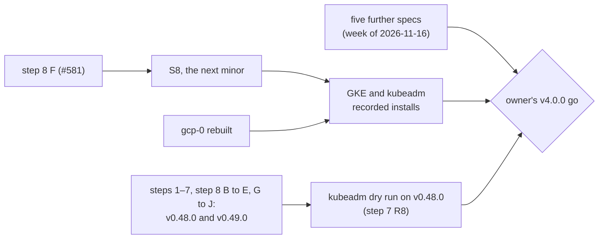

# The v4.0 decision pack

What the owner needs to rule on v4.0.0: for each decision of the
[production path design](superpowers/specs/2026-11-12-v4-production-path-design.md#decisions)
(D1 to D26), what implements it and what proves it; then every item still owed, with its owner and
its evidence. The page states facts and links. It recommends nothing: the v4.0.0 tag, release and
chart version wait for the owner's explicit go (D25).

Read against Maku `origin/main` `8cdecd1c` and ai-native-ref (ANR) `origin/main` `ca4b24b`, on
2026-11-14. The latest Maku release is v0.49.0 (2026-11-14). A line counts as done only with a merged
pull request or a recorded proof; anything else is listed under [open items](#open-items).

The owner's ruling of 2026-11-14: v4.0.0 is not cut now. Five further specs, planned for the week of
2026-11-16, are implemented first; the v4.0 go stays the owner's, after them.

The reference platform, gcp-0, was proved live on 2026-11-14 across ANR v3.16.0 to v3.26.0: the
broker from the `maku` chart, the `agent-factory-crds` release, the model gateway, runs on the
run-controller end to end through a merged factory pull request, Kueue, octo-sts and the ZITADEL
reader removed, and the GitHub link. gcp-0 was then torn down: the live proofs left (the GKE and
kubeadm installs, the Slack retest, RunLore's live `kb_search`, the screencasts) wait for its rebuild.



## The rollout, step by step

Each step's plan lists its pull requests; each step ships in a v0.4x minor.

| Step | Plan | Merged |
|---|---|---|
| 1, the chart contract | [step 1](superpowers/plans/2026-11-12-v4-step-1-chart-contract-plan.md) | [#484] |
| 2, the run path | [step 2](superpowers/plans/2026-11-12-v4-step-2-run-path-plan.md) | A [#489], B [#490], C [#492] |
| 3, the GitHub seams | [step 3](superpowers/plans/2026-11-12-v4-step-3-github-seams-plan.md) | A [#496], B [#504], C [#509], D [#510], E [#500] |
| 4, the gateway | [step 4](superpowers/plans/2026-11-12-v4-step-4-gateway-plan.md) | A [#506], B [#512], C [#511], D [#518] |
| 5, identity and data | [step 5](superpowers/plans/2026-11-12-v4-step-5-identity-data-plan.md) | A [#524], B [#530], C [#536] (its k3d proof [#543]), D [#521], E [#544] |
| 6, exposure, components, observability | [step 6](superpowers/plans/2026-11-13-v4-step-6-exposure-components-observability-plan.md) | A [#526], B [#523], B2 [#529], C [#534], D [#545], E [#556], F [#527], G [#564] |
| 7, install UX and proof | [step 7](superpowers/plans/2026-11-13-v4-step-7-install-ux-proof-plan.md) | A [#547], B [#555], C [#567], D [#540], E1 [#537], E2 [#565], F [#570], G [#573], H [#566], I [#572] (this page), R10 [#569], the wizard's render fix [#568] |
| 8, clean-up | [step 8](superpowers/plans/2026-11-13-v4-step-8-cleanup-plan.md) | B [#574], C [#576], D [#578], E [#559], G [#577], H [#571] (private code) and [#579] (the ledger), I [#558], J [#580] (the migration note, the values contract). Open: F [#581] (the ZITADEL reader) |
| Reusable merge policies (gates step 8 PR D) | — | A to K, the last [#563] |

v0.47.0 carries steps 1 to 5, step 6 A to D and F, and step 7 A, D and E1. v0.48.0 adds the rest of
steps 6 and 7, reusable merge policies K, and step 8 B, E, I and H's private-code half. v0.49.0 adds
step 8 C, D, G, H's ledger half and J. PR F ships in the next minor, which completes step 8: the S8
minor.

## The decisions and their evidence

| # | Decision | Implemented by | Proved by | Owed before v4.0 |
|---|---|---|---|---|
| D1 | The audience is a platform team with its own cluster | [#566] | [Install on your cluster](install.md) | the recorded installs (D23) |
| D2 | One factory per install, several per cluster | [#569] (step 7 R10) | `charts/agent-factory/tests/two-installs.sh` ([several installs](install.md#several-installs-in-one-cluster)) | the GKE install beside cnref's (step 7 R9); the `kind-calico` leg's second install is [#570] |
| D3 | Private code by explicit opt-in | [#540] (warn), [#571] (refuse) | [private code](install.md#private-code), the preflight's `private-code` check | none in ANR: the four repositories cnref serves are public |
| D4 | GitHub only, GHES included | `github.webURL`, the wizard's GHES answers ([#565]) | [the support floor](install.md#the-support-floor) | none; no GHES install has run, and D23 asks for none |
| D5 | The run-controller is the run path | [#490] | the k3d legs of `demo-e2e.yaml` | none: step 8 PR C is [#576]; ANR R3 is [ANR #376], live on gcp-0 on 2026-11-14 |
| D6 | NetworkPolicy plus an egress proxy | [#492], [#556] (component egress) | the `k3d (kubernetes)` leg; the `run-path` preflight check ([network modes](security.md#the-run-paths-network-modes)) | none: step 8 PR B is [#574], `kind-calico` is [#570] |
| D7 | agentgateway only | [#506], [#512], [#511], [#518], [#559] | the `k3d (gateway)` leg; the nightly USD proof [#542] ([model gateway](gateway.md)) | the Envoy AI gateway's deletion (open item 21); ANR R2 is [ANR #372], the planner moved in [ANR #387] |
| D8 | Any OIDC issuer, a one-time GitHub link | [#524], [#530], [#536] | [#543] on k3d ([identity](identity.md), [GitHub link](github-link.md)) | step 8 PR F ([#581]); ANR removed its reader in [ANR #391], v3.25.0 |
| D9 | Bring your own Postgres 16 | [#521] | the `k3d (external-db)` leg ([the database](database.md)); ANR R1 on gcp-0, 2026-11-14: `maku_rooms_schema_unverified` 0 on both broker pods | none: step 8 PR H's ledger half is [#579] (step 8 R10) |
| D10 | Per-run minted tokens | [#496], [#504], [#509] | [per-run tokens](upgrading.md#per-run-tokens-v04x-v4-rollout-step-3) | none: step 8 PR D (the shared token) is [#578], PR C (octo-sts, step 8 R3) is [#576] |
| D11 | `maku/merge-gate` is the merge gate | [#500] | [branch protection](factory.md#branch-protection-for-the-merge-gate) | ANR retiring policy-bot; step 8 PR D (the defaults) is [#578] |
| D12 | Two GitHub Apps | [#510], [#537] | [GitHub Apps](github-apps.md) | none |
| D13 | The chart contract | [#484] | `charts/agent-factory/tests/schema.sh` and `render.sh` ([the chart contract](upgrading.md#the-chart-contract-v04x-v4-rollout-step-1)) | arming the values contract (step 8 R8, the owner's v4.0.0 go); PR J's report is [#580] ([the values contract](upgrading.md#the-values-contract)), PR G (`profile` goes) is [#577], ANR C1 is [ANR #370] |
| D14 | Secrets by name, ESO optional | [#544] | the preflight's `secrets` check ([install Secrets](install-secrets.md)) | none |
| D15 | cnref runs the product path | [ANR #375] (R1, the broker), [ANR #370] (C1), [ANR #372] (R2), [ANR #376] (R3), [ANR #384], [ANR #385], [ANR #386], [ANR #387], [ANR #388], [ANR #391], [ANR #392] | R1, R2, R3, C1 and the GitHub link on gcp-0, 2026-11-14 ([open items](#open-items) 12, 13, 15, 16, 17) | every ANR cutover in [the ANR checklist](#the-anr-shrink-checklist-d22) |
| D16 | Kueue dropped | [#489] (the runs quota) | [the run path](upgrading.md#the-run-path-v04x-v4-rollout-step-2) | none: step 8 PR B is [#574], ANR deleted Kueue in [ANR #384] |
| D17 | ValidatingAdmissionPolicies only | [#489] | `charts/maku/tests/admission` | ANR deleting its Kyverno duplicates |
| D18 | A sandboxed RuntimeClass, by name | [#489], [#547] (its check) | the `runtimeclass` preflight check ([sandbox nodes](install.md#sandbox-nodes)) | GKE Sandbox in the GKE install; gVisor under `kind-calico` is [#570] |
| D19 | Gateway API or Ingress; TLS is the user's | [#545], [#567] (outside checks) | `charts/agent-factory/tests/expose.sh` ([exposure](exposure.md)) | ANR's routes (step 6 follow-up 3); Traefik Ingress under `k3s` is [#570] |
| D20 | Core always, Slack opt-in, RunLore outside | [#556], [#527] | [Slack App](slack.md), [integration](integration.md) | ANR's Slack subchart and RunLore follow-ups; the owner's Slack and RunLore live checks |
| D21 | Prometheus-standard observability | [#526], [#523], [#529], [#534] | `charts/agent-factory/tests/monitoring.sh` ([observability](observability.md)) | ANR deleting its VMRules (step 6 follow-up 5) |
| D22 | ANR shrinks to values and proofs | — | — | [the ANR checklist](#the-anr-shrink-checklist-d22) |
| D23 | The proof of "any Kubernetes" | the real-model nightly in `demo-e2e.yaml` | that nightly, green on 2026-11-11, 12 and 13 ([run](https://github.com/Smana/maku/actions/runs/43412992897)) | the recorded GKE and kubeadm installs, after gcp-0's rebuild; step 7 F is [#570], G is [#573] |
| D24 | A wizard that writes, never applies; the preflight | [#547], [#555], [#567], [#537], [#565], [#566], [#568] | [`maku install --print`](install.md#write-the-install-maku-install---print), [the preflight](install.md#check-it-the-preflight) | none: `preflight.enabled` is on by default since step 8 PR G ([#577]) |
| D25 | Additive, then one seam at a time | v0.46.0, v0.47.0, v0.48.0, v0.49.0 | [upgrading](upgrading.md), one section per step | S8, the next minor (step 8 PR F); step 7's minor is v0.48.0 |
| D26 | The support floor | [#484] (`kubeVersion`), [#547] (`kubernetes` check) | [the support floor](install.md#the-support-floor) | Kubernetes 1.30, Flux 2.4 and Argo CD 2.12 on the nightly (step 7 PR G, [#573]; step 7 R6 and R7) |

## Open items

Owners: **Maku** is a Maku pull request; **ANR** is an ANR (or cnref) pull request and its gcp-0
live check; **owner** is the owner's own run, release or ruling.

| # | Item | Owner | Waits on | Evidence |
|---|---|---|---|---|
| 1 | Step 7 PR F: `kind-calico` on three minors and `k3s`, per chart PR (D23, D2) | Maku | **done** | [#570] |
| 2 | Step 7 PR G: the nightly upgrade and the Flux and Argo CD legs at the floor (D23, D26) | Maku | **done** | [#573] |
| 3 | Step 7's v0.4x minor | Maku | **done** | v0.48.0 (2026-11-14) |
| 4 | The kubeadm dry run on step 7's minor (step 7 R8) | owner | — (3 is done) | [runbook](#kubeadm-step-7-r8) |
| 5 | Step 8 PR B: `networkPolicies.enabled`, the old sandbox keys, `queueName` | Maku | **done** | [#574] |
| 6 | Step 8 PR C: the XR run kind, octo-sts | Maku | **done** | [#576] |
| 7 | Step 8 PR D: the shared token, the old Secret keys, the merge defaults | Maku | **done** | [#578] |
| 8 | Step 8 PR F: the ZITADEL reader | Maku | its merge (16 is done) | [#581]; its rows in [the migration note](upgrading.md#the-clean-up-v04x-v4-rollout-step-8) read "pending PR F" |
| 9 | Step 8 PR G: `profile`, `networkPolicies.plain`, the subcharts' `crds/`, `preflight.enabled: true` | Maku | **done** | [#577] |
| 10 | Step 8 PR H's ledger half: an unreadable ledger refused (step 8 R10) | Maku | **done** | [#579] ([#571] is the private-code half) |
| 11 | Step 8 PR J, then the S8 minor: the migration note, the schema-diff report (report-only, step 8 R8), this page's step 8 rows | Maku | J **done**; the S8 minor: 8 | J is [#580], released in v0.49.0; [its report](upgrading.md#the-values-contract) against v0.48.0 |
| 12 | ANR R1: the broker from the `maku` chart; `maku_rooms_schema_unverified` to 0 | ANR | **done** | [ANR #375], ANR v3.16.0. gcp-0, 2026-11-14: the `room-broker` claim deleted; the HelmRelease installed from maku 0.47.0, one helm revision; `migrate` logged `adopted 18 revisions from the Atlas operator`; the gauge 0 on both pods; the lease held by the new pod; the new CronJob's retention job completed; rooms listed through MCP |
| 13 | ANR R3: runs off the XR (`runs.group: maku.ogenki.io`, the run-controller); Kueue and the Kyverno duplicates deleted | ANR | the Kyverno duplicates (`security/base/agent-policies/validatingpolicies.yaml` present) | [ANR #376], ANR v3.19.0: on gcp-0, 2026-11-14, issue [ANR #377] ran triager, implementer and reviewer to `Succeeded` on gVisor, and `ogenki-agents[bot]` opened [ANR #383] with a per-run token. Kueue deleted: [ANR #384], v3.20.0 |
| 14 | ANR: the factory off octo-sts, policy-bot retired per repository, the merger folded (step 3 follow-ups 1 to 4) | ANR | policy-bot's retirement and the merger | octo-sts deleted: [ANR #385], v3.21.0. `tooling/base/policy-bot` present; `mergeDefaults` still `gateStatus: false`, `policyBot: true` |
| 15 | ANR R2: the model gateway from `maku-gateway`; then runs and the planner on it, and the Envoy AI gateway deleted (step 4 follow-ups 1 to 5) | ANR | 21 for the deletion | [ANR #372]: 7 public aliases answer 200, no token 401 (the internal aliases fail upstream on an invalid Anthropic key, an owner item). The planner on it: [ANR #387], v3.23.0, live on gcp-0 on 2026-11-14. `infrastructure/base/envoy-ai-gateway` and `llm-gateway` present |
| 16 | ANR: the GitHub link beside the reader, then the reader gone (step 5 follow-ups 2 and 3) | ANR | **done** | the link beside the reader: [ANR #388], v3.24.0; the reader removed: [ANR #391], v3.25.0; both on gcp-0, 2026-11-14 |
| 17 | ANR C1: `agent-factory-crds` ahead of the factory, `crds: Skip` | ANR | **done** | [ANR #370], v3.18.0: the CRDs adopted in place (UIDs unchanged, `keep` on all six) |
| 18 | ANR: the umbrella adopted component by component, its CI rendering the chart, the ExternalSecrets in values (step 6 follow-ups 1, 3 to 8) | ANR | — (12 and 17 are done) | none |
| 19 | ANR: `preflight.enabled` with Flux's `test.enable`; the shared ClusterRoles adopted before the pin that carries [#569] (step 7 follow-ups 2 and 3) | ANR | 18 | the ClusterRoles handed to `agent-factory-crds`, UIDs unchanged: [ANR #386] (Maku v0.48.0, ANR v3.22.0) |
| 20 | The v4.0.0 go: the tag, the release, the 4.0 chart, arming the schema-diff gate (step 8 R8) | owner | the five further specs (week of 2026-11-16), 11, 22, 23 | — |
| 21 | `llm-platform` on cnref: retire the lab behind the Envoy AI gateway, or move it behind a `maku-gateway` custom provider (step 4) | owner | — | [step 4 plan](superpowers/plans/2026-11-12-v4-step-4-gateway-plan.md#after-this-step-not-in-these-prs) |
| 22 | The recorded GKE install on S8 (D23, step 7 R9) | owner | 11, gcp-0's rebuild | [runbook](#gke-step-7-r9) |
| 23 | The recorded kubeadm install on S8 (D23, step 7 R8) | owner | 11, the rebuild | [runbook](#kubeadm-step-7-r8) |
| 24 | The Slack App retest on the subchart | owner | 18, the rebuild | [ANR #361] lists it |
| 25 | RunLore live: a triager's `kb_search` through the broker (step 6 follow-up 6) | owner | 18, the rebuild | served to triager runs: [ANR #390], v3.25.0; no live run recorded |
| 26 | The screencasts | owner | the rebuild | [ANR #245] (the script) |
| 27 | ANR: drop its `atlasSchema` before the first release that adds a migration | ANR | — | none |

Not owed: step 7's private-code follow-up. cnref serves `Smana/ai-native-ref`,
`Smana/cloud-native-ref`, `Smana/runlore` and `Smana/runlore-kb`, all public (read 2026-11-14).

## The ANR shrink checklist (D22)

ANR's [pointer to this design](https://github.com/Smana/ai-native-ref/blob/main/docs/superpowers/specs/2026-11-12-v4-production-path-design.md#shrink-checklist)
holds the checklist; each line here is its row, read against ANR `ca4b24b`.

| Step | ANR's change | State on ANR `main` |
|---|---|---|
| 1 | `agent-factory-crds` first, no `CreateReplace` | done: [ANR #370] |
| 2 | Off the XR; Kueue and the Kyverno duplicates deleted | runs on the run-controller ([ANR #376]); Kueue deleted ([ANR #384]); `security/base/agent-policies/validatingpolicies.yaml` present |
| 3 | Off octo-sts; policy-bot retired; the gate required | octo-sts deleted ([ANR #385]); `tooling/base/policy-bot` present |
| 4 | The planner on agentgateway; the Envoy AI gateway deleted | the model gateway ([ANR #372]) and the planner on it ([ANR #387]); `infrastructure/base/envoy-ai-gateway` and `llm-gateway` present |
| 5 | ZITADEL, CNPG and OpenBao behind the seams; the reader PAT gone | the broker on CNPG's DSN Secrets ([ANR #375]); the reader removed ([ANR #391]) |
| 6 | Routes, the Slack subchart, the chart's rules; the duplicated manifests deleted | `tooling/base/agent-factory/slack-app` and both `vmrule-*.yaml` present; the broker's manifests replaced by a HelmRelease ([ANR #375]) |
| 7 | The GKE install on gcp-0 before any v4 announcement | [GKE](#gke-step-7-r9) |

## The manual installs

Both run on S8, step 8's minor (step 7 R8): a run on an earlier minor proves a chart v4.0 does not ship. A
defect goes in an issue, not in the ledger's proof slot.

### GKE (step 7 R9)

A fresh second install on gcp-0, in its own namespace, beside cnref's own release (which also
proves D2):

1. Pick a namespace (`maku-proof`), a test organization, one public repository in it, a fresh
   database with its three roles ([the database](database.md)), and a GKE Sandbox node pool.
2. `maku install --print --out ./gke-proof` with `apps.create`: both Apps are created in the test
   organization. Set `sandbox.runtimeClassName: gvisor`, and `agentgateway.enabled: false` (cnref's
   controller serves the Gateway, [several installs](install.md#several-installs-in-one-cluster)).
   `maku.runController.createRuntimeClass` stays off.
3. Apply it in the [documented order](install.md#apply-it), by plain Helm or Flux. The shared
   ClusterRoles already belong to cnref's `agent-factory-crds`.
4. `helm test`, then `maku preflight --namespace maku-proof --strict --json`.
5. File a `docs-links` issue in the test repository, label it, and wait for its pull request,
   `maku/merge-gate` `success` and the merge.
6. Check that cnref's Deployments kept their UIDs, and that a run in `maku-proof` cannot reach cnref's
   broker.
7. Write the ledger entry, then uninstall the release and delete the test Apps.

### kubeadm (step 7 R8)

A throwaway kubeadm cluster, Kubernetes 1.30 or later, with a NetworkPolicy CNI and gVisor's `runsc`
(or Kata) registered as a containerd handler ([sandbox nodes](install.md#sandbox-nodes)).

- **The dry run,** on step 7's minor: `maku install --print`, apply, `helm test`, one task to a
  merged pull request. Each install-UX defect becomes an issue. It is not the v4.0 proof.
- **The recorded run,** on S8: the same steps, then the ledger entry.

### The ledger entry

Both runbooks end with one entry in the session ledger:

```markdown
## <date>: v4.0 install proof, <GKE | kubeadm>

- Maku: <version>; images and charts by digest: <list>
- Cluster: <name>, Kubernetes <version>; CNI <name and policy mode>; sandbox <class, handler>
- Answers file (no secrets): <path or inline>
- `maku preflight --json`: <output>
- Task <issue>, pull request <url>, merge <commit>
- Defects: <issue per defect, or none>
```

## The owner rulings that touch v4.0

Settled: the spec's [owner rulings](superpowers/specs/2026-11-12-v4-production-path-design.md#owner-rulings-2026-11-12),
step 7 R1 to R11, step 8 R1 to R11 (R11 supersedes R1 and R2), and 2026-11-14's: v4.0.0 is not cut
now, five further specs come first. Still open:

| Ruling | From | What it gates |
|---|---|---|
| The v4.0.0 go, after the five further specs, and arming the values schema-diff gate (step 8 R8) | the spec, D25 | the tag, the release, the 4.0 chart |
| `llm-platform` on cnref | step 4 | deleting the Envoy AI gateway (D22) |
| The classifier on cnref: `human.slackIntents` in shadow, and its provider | step 4 | nothing in v4.0 |
| `maku/merge-gate` on human-authored pull requests | step 3 | nothing in v4.0: a later Maku plan |

[#484]: https://github.com/Smana/maku/pull/484
[#489]: https://github.com/Smana/maku/pull/489
[#490]: https://github.com/Smana/maku/pull/490
[#492]: https://github.com/Smana/maku/pull/492
[#496]: https://github.com/Smana/maku/pull/496
[#500]: https://github.com/Smana/maku/pull/500
[#504]: https://github.com/Smana/maku/pull/504
[#506]: https://github.com/Smana/maku/pull/506
[#509]: https://github.com/Smana/maku/pull/509
[#510]: https://github.com/Smana/maku/pull/510
[#511]: https://github.com/Smana/maku/pull/511
[#512]: https://github.com/Smana/maku/pull/512
[#518]: https://github.com/Smana/maku/pull/518
[#521]: https://github.com/Smana/maku/pull/521
[#523]: https://github.com/Smana/maku/pull/523
[#524]: https://github.com/Smana/maku/pull/524
[#526]: https://github.com/Smana/maku/pull/526
[#527]: https://github.com/Smana/maku/pull/527
[#529]: https://github.com/Smana/maku/pull/529
[#530]: https://github.com/Smana/maku/pull/530
[#534]: https://github.com/Smana/maku/pull/534
[#536]: https://github.com/Smana/maku/pull/536
[#537]: https://github.com/Smana/maku/pull/537
[#540]: https://github.com/Smana/maku/pull/540
[#542]: https://github.com/Smana/maku/pull/542
[#543]: https://github.com/Smana/maku/pull/543
[#544]: https://github.com/Smana/maku/pull/544
[#545]: https://github.com/Smana/maku/pull/545
[#547]: https://github.com/Smana/maku/pull/547
[#555]: https://github.com/Smana/maku/pull/555
[#556]: https://github.com/Smana/maku/pull/556
[#558]: https://github.com/Smana/maku/pull/558
[#559]: https://github.com/Smana/maku/pull/559
[#563]: https://github.com/Smana/maku/pull/563
[#564]: https://github.com/Smana/maku/pull/564
[#565]: https://github.com/Smana/maku/pull/565
[#566]: https://github.com/Smana/maku/pull/566
[#567]: https://github.com/Smana/maku/pull/567
[#568]: https://github.com/Smana/maku/pull/568
[#569]: https://github.com/Smana/maku/pull/569
[#570]: https://github.com/Smana/maku/pull/570
[#571]: https://github.com/Smana/maku/pull/571
[#572]: https://github.com/Smana/maku/pull/572
[#573]: https://github.com/Smana/maku/pull/573
[#574]: https://github.com/Smana/maku/pull/574
[#576]: https://github.com/Smana/maku/pull/576
[#577]: https://github.com/Smana/maku/pull/577
[#578]: https://github.com/Smana/maku/pull/578
[#579]: https://github.com/Smana/maku/pull/579
[#580]: https://github.com/Smana/maku/pull/580
[#581]: https://github.com/Smana/maku/pull/581
[ANR #245]: https://github.com/Smana/ai-native-ref/pull/245
[ANR #361]: https://github.com/Smana/ai-native-ref/pull/361
[ANR #370]: https://github.com/Smana/ai-native-ref/pull/370
[ANR #372]: https://github.com/Smana/ai-native-ref/pull/372
[ANR #375]: https://github.com/Smana/ai-native-ref/pull/375
[ANR #376]: https://github.com/Smana/ai-native-ref/pull/376
[ANR #377]: https://github.com/Smana/ai-native-ref/issues/377
[ANR #383]: https://github.com/Smana/ai-native-ref/pull/383
[ANR #384]: https://github.com/Smana/ai-native-ref/pull/384
[ANR #385]: https://github.com/Smana/ai-native-ref/pull/385
[ANR #386]: https://github.com/Smana/ai-native-ref/pull/386
[ANR #387]: https://github.com/Smana/ai-native-ref/pull/387
[ANR #388]: https://github.com/Smana/ai-native-ref/pull/388
[ANR #390]: https://github.com/Smana/ai-native-ref/pull/390
[ANR #391]: https://github.com/Smana/ai-native-ref/pull/391
[ANR #392]: https://github.com/Smana/ai-native-ref/pull/392
