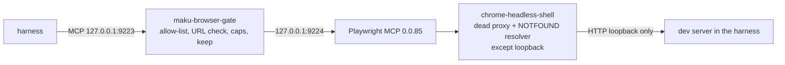

# maku-browser

The `browser` sidecar of an `implementer` or `tester` run that opts in to screenshots
(`ghcr.io/smana/maku-browser`): Playwright MCP and Chromium's headless shell behind
`maku-browser-gate`, all on loopback.



## What the image carries

| Piece | Pin |
|---|---|
| Base | `node:24-bookworm-slim` by digest; npm, npx, corepack and yarn removed after the install |
| Playwright MCP | `@playwright/mcp` 0.0.85 exactly, with `playwright` and `playwright-core` 1.66.0-alpha-2026-11-09 (`package-lock.json`, `npm ci --ignore-scripts`) |
| Browser | Chromium headless shell only, baked into `/opt/browser/ms-playwright`; `PLAYWRIGHT_SKIP_BROWSER_DOWNLOAD=1` at runtime |
| Libraries | Playwright's Debian 12 list for Chromium, without the X server and the large CJK/Thai fonts its `--with-deps` adds; the build fails if the shell's `ldd` does not resolve |
| Gate | `/usr/local/bin/maku-browser-gate`, built from `cmd/maku-browser-gate` |
| Init | `tini` (PID 1, reaps Chromium's orphans) runs `entrypoint.sh`, which supervises both processes |

Uid 10001, no setuid or setgid bit, no credential and no network setting of its own beyond
[`config.json`](config.json).

## The three network layers

1. **The gate** refuses any tool argument URL that is not `http://127.0.0.1`, `http://localhost`
   or `http://[::1]`, and any tool off its allow-list.
2. **Chromium's flags** send every non-loopback request to a dead proxy (`127.0.0.1:9`) and resolve
   every name but localhost to NOTFOUND: they stop what a page asks for, redirects included.
3. **`allowedOrigins`** in `config.json` is hygiene only: Playwright documents it as no security
   boundary.

The pod's network policy is per pod, not per container: a renderer exploit could reach what the
harness reaches. No credential lives in this container.

## Build and test

```bash
docker build -t maku-browser:contract -f images/maku-browser/Dockerfile .
SKIP_BUILD=1 MAKU_BROWSER_IMAGE=maku-browser:contract DOCKER_RUNTIME=runc images/maku-browser/tests/runsc-contract.sh
```

`DOCKER_RUNTIME` defaults to `runsc`; CI's `browser-contract` job runs the contract under gVisor.
