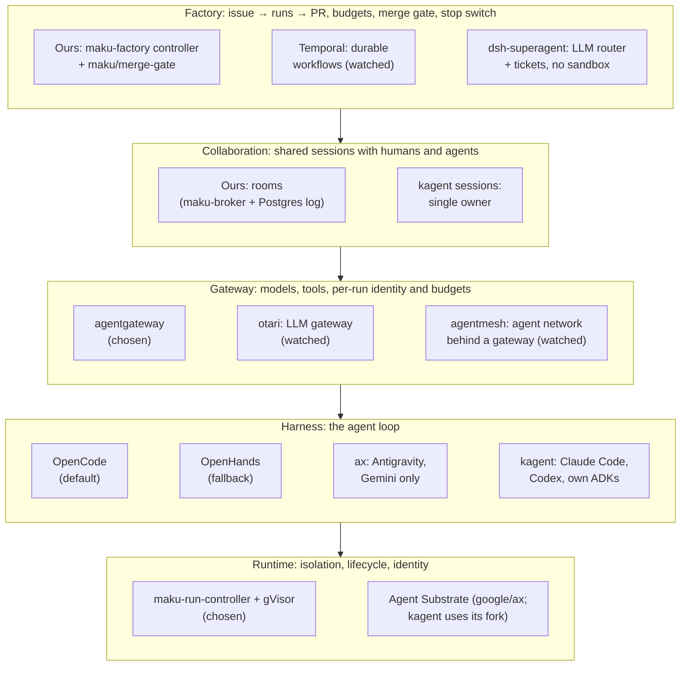


**Living evaluation.** The agent ecosystem moves fast. Each detailed evaluation states when it was checked and what would reopen it, and the page grows as new candidates appear.


What alternatives did we consider for each layer of Maku, and why did the current choices win? A new candidate gets a row in [the table](#decisions-at-a-glance). If it could replace a whole layer, it also gets a detailed evaluation linked under [Projects evaluated in detail](#projects-evaluated-in-detail).

**In short:**

- **No candidate evaluated so far covers more than one or two layers.** The factory, the rooms, and the controls around them stay ours whatever we adopt.
- **A choice can be deferred rather than refused.** Each detailed evaluation lists concrete triggers that would make us reconsider it.

## How candidates are evaluated

- **Against code, not announcements.** Claims are checked in the project's repository at a pinned commit and linked.
- **On the work still ahead.** What is already built does not count in its favour; what adopting a candidate would still leave us to build does.
- **Against Maku's requirements:**
  - runs on standard Kubernetes (including EKS and GKE, on spot nodes);
  - every workload gets its own identity and network policy;
  - no long-lived credential reaches a sandbox;
  - open source first.

## Where each tool fits

A self-hosted coding-agent factory has five layers. Most "agent platforms" cover one or two of them; Maku needs all five.

## Decisions at a glance

| Layer | Chosen | Alternatives considered | Why |
|---|---|---|---|
| **Runtime** | `maku-run-controller` + [gVisor](https://gvisor.dev), one pod per run ([ADR-0041](), [ADR-0062]()) | Agent Substrate (with google/ax or kagent), Kata/Firecracker, OpenHands Enterprise, Coder, E2B/Daytona | Open source; runs on EKS, GKE, and generic Kubernetes, including spot nodes; each run gets its own ServiceAccount and network policy. Kata/Firecracker needs bare-metal hosts or nested virtualisation: the smallest AWS metal host has 128 vCPU, roughly $1.5/h spot or $5.4/h on demand ([Vantage](https://instances.vantage.sh/aws/ec2/c6i.metal)), against a few cents an hour for a run's spot node. An agent step mostly waits on the model (~11 s per reply), so gVisor's syscall overhead stays small |
| **Harness** | [OpenCode]() by default, [OpenHands](https://github.com/OpenHands/software-agent-sdk) agent-server as the fallback | Headless Claude Code, kagent's harnesses, ax's Antigravity agent, [DeepSeek Harness](#dsh-superagent-prototype) | Both are open source, headless, work with any OpenAI-compatible model, and support MCP. OpenCode's image is lighter; Maku adds its loop guard and room, provider, and recovery adapters (paired trial [results](https://github.com/Smana/ai-native-ref/blob/main/docs/runbooks/agent-factory/results-harness-paired-trial-2026-11-26.md)). Claude Code is proprietary; Antigravity is Gemini-only; DeepSeek Harness lacks a stable HTTP API |
| **Gateway** | [agentgateway](https://agentgateway.dev) (`maku-gateway` chart, [ADR-0053]()) | Envoy AI Gateway (Agent Router 1.1), [otari](#otari), [agentmesh](#agentmesh) | See [The model gateway](). agentgateway enforces JWT `sub` prefixes and per-alias audiences directly via CEL, ships current MCP authorization, and idles at ~6–8 MiB. otari lacks Kubernetes packaging, token exchange, and per-data-class listeners; agentmesh sits behind a gateway rather than replacing one |
| **Gateway guardrails** | Gateway guard hooks + open classifiers + structural boundaries outside the sandbox | [Google Model Armor](#google-model-armor), NeMo Guardrails, Guardrails AI, LlamaFirewall, ShieldGemma, llm-guard | Filters add evidence, never the security boundary: the boundaries remain per-run identity, per-role tool rules, egress allow-lists, safe outputs ([ADR-0061]()), and the merge gate. Model Armor is an inline cloud SaaS on Google infrastructure only |
| **Rooms** | A log we own: `maku-broker` on PostgreSQL (`LISTEN`/`NOTIFY`, [ADR-0044]()) | OpenHands shared conversations, ACP, A2A through a gateway, Valkey Streams, NATS JetStream, ax or Substrate sessions, kagent sessions | **Protocols:** none records who said what across multiple humans and agents, or who may approve. **Brokers:** an event commits to PostgreSQL first (fixing its gapless `seq` under append-only roles and RLS), then wakes replicas via `LISTEN`/`NOTIFY`; at a few events per second a second stateful broker adds operational weight without stronger guarantees |
| **Factory** | A custom Kubernetes controller (`maku-factory`) + namespace `ResourceQuota` ([ADR-0048]()) | Argo Workflows, Tekton, Temporal, Crossplane `Task` composition, gh-aw, OpenAI Symphony, DeepSeek dsh-superagent | A task's state lives in Kubernetes objects and GitHub; waiting hours on CI or review is a cheap requeue so restarts lose nothing. Budgets, merge policies, and the kill switch are domain logic any workflow engine would still need. Temporal suits code-driven workflows and stays watched |
| **Merge gate** | Maku's built-in merge gate (`maku/merge-gate` status required by a repository ruleset) | [policy-bot](https://github.com/palantir/policy-bot), required reviews, rulesets alone, Prow/tide, Mergify, Kodiak | The policy is a reviewable `MergePolicy` object in Git, the gate decides each head from diff shape, paths, caps, reviewer verdict, and CI, and merge authority stays isolated to one dedicated GitHub App |

## What would make us reconsider

Each layer's reconsideration triggers — when Temporal, NATS JetStream, microVMs, otari, Agent Substrate, warm pools, agentmesh, OpenCode, DeepSeek Harness, or Google Model Armor would win — are recorded with the October and November 2026 evaluations in [the evaluation records](https://github.com/Smana/ai-native-ref/blob/main/docs/superpowers/specs/2026-11-14-alternatives-evaluations.md#what-would-make-us-reconsider).

## Projects evaluated in detail

Checked in October and November 2026 across `google/ax`, `Agent Substrate`, `kagent`, `OpenCode`, `Temporal`, `OpenAI Symphony`, `otari`, `agentmesh`, `Google Model Armor`, and `dsh-superagent-prototype` (plus the `kagent` + `Substrate` rebuild comparison); the commit-pinned evaluations and gap tables are in [the evaluation records](https://github.com/Smana/ai-native-ref/blob/main/docs/superpowers/specs/2026-11-14-alternatives-evaluations.md).

## Reconsidering Substrate and kagent: not now, deliberately open

`AgentRun` remains the stable runtime abstraction.

**Reconsider direct Agent Substrate** when a measured cold-start, memory-continuity, or density problem justifies a proof of concept, and the candidate can demonstrate:

- supported EKS and GKE installation and upgrades;
- safe per-run identity and external short-lived GitHub credential injection;
- per-run DNS/FQDN egress and quota-equivalent admission;
- controlled node and Spot loss without lost or duplicated effects;
- complete cleanup and a net reduction in code and operations.

**Reconsider kagent** only when it also provides non-bypassable OSS authorization, attributed multi-participant sessions, delegated approver evidence, supported OpenHands/BYO restoration, and a clean one-run/one-identity mapping — deleting more custom code than its adapters and control planes add ([kagent evaluation](https://github.com/Smana/ai-native-ref/blob/main/docs/superpowers/specs/2026-10-04-kagent-evaluation-research.md)).

## Sources

- [Detailed project evaluations](https://github.com/Smana/ai-native-ref/blob/main/docs/superpowers/specs/2026-11-14-alternatives-evaluations.md)
- [Agent Factory v1 review](https://github.com/Smana/ai-native-ref/blob/main/docs/superpowers/specs/2026-10-12-agent-factory-v1-review.md)
- [OpenCode as a second harness: research and design](https://github.com/Smana/ai-native-ref/pull/404)
- [otari evaluation](https://github.com/Smana/ai-native-ref/blob/main/docs/superpowers/specs/2026-10-20-otari-evaluation-research.md)
- [kagent evaluation](https://github.com/Smana/ai-native-ref/blob/main/docs/superpowers/specs/2026-10-04-kagent-evaluation-research.md)
- [Runtime research and ecosystem re-check](https://github.com/Smana/ai-native-ref/blob/main/docs/superpowers/specs/2026-10-01-agent-ecosystem-recheck-research.md)
