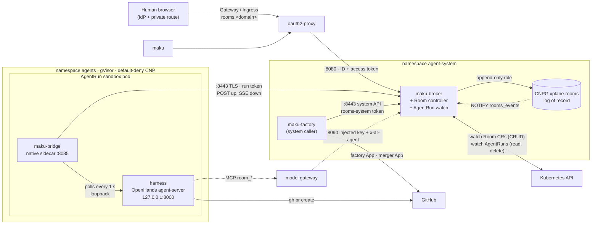
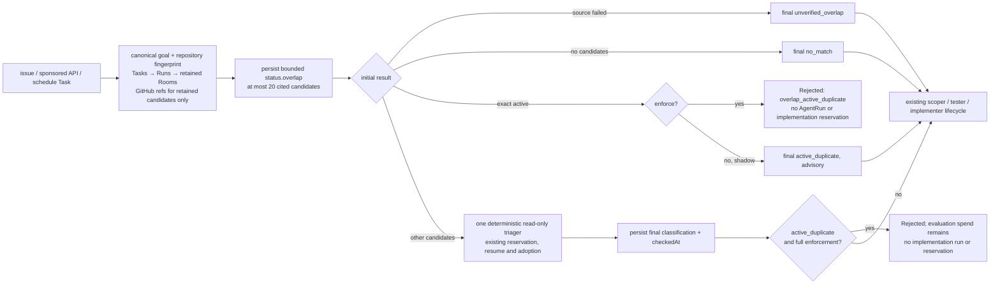
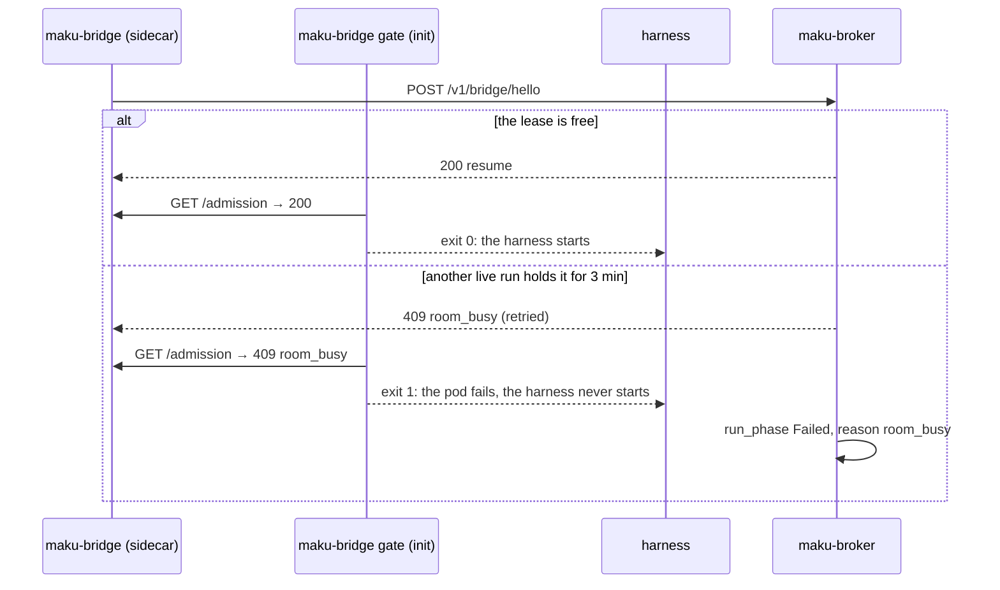
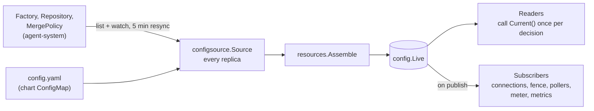

Five services, one CLI and one run image. **`maku-factory`** turns a labelled GitHub issue into a
narrated run and merges the result through its gate. **`maku-broker`** is the log of record: it owns
the `Room` CRD, authenticates every writer, redacts and sequences events, and stores each room's log
in Postgres. **`maku-bridge`** is a native sidecar in every `AgentRun` pod that names a room: it polls
the harness on loopback and pushes its events to the broker over TLS on `:8443`.
**`maku-run-controller`**, on a cluster without cloud-native-ref's Crossplane runtime, turns each
`maku.ogenki.io` `AgentRun` into a gVisor pod. **`maku-slack`** is the factory's Slack App: a thread
becomes a task, and the broker's webhooks post the room's progress back to it. **`maku`** is the
terminal client for people. **`maku-harness`** is the image the run executes in (OpenHands
agent-server, `gh`, the pull-request footer). Nothing dials into a sandbox: every connection from
the `agents` namespace is one the pod opens.

For listening ports, container images, release signing, Kubernetes resources and Go package layout, see [Components, ports, images and packages]().


## Components

| Component | Runs | Does |
|---|---|---|
| `maku-factory` | Deployment `agent-factory` in `agent-system`, two replicas, one leading; chart `charts/maku-factory` | Reconciles the `Task` CRD, polls maintainer-labelled issues, answers `POST /v1/runs` on `:8082` (TLS 1.3 with `api.tls`), meters each run, narrates on the issue, runs the merge gate |
| `maku-broker` | Deployment `room-broker` (an identity that keeps its pre-maku name, see [naming](https://github.com/Smana/maku/blob/main/docs/superpowers/naming.md#technical-names)) in `agent-system`, from an `App` claim; two replicas with a PDB | The log of record, the Room controller, the `:8443`, `:8080`, `:8090` and `:9090` listeners, the retention job (`maku-broker retention`) |
| `maku-bridge` | Native sidecar `room-bridge` (`restartPolicy: Always`) after `identity-proxy`, in every run pod with `spec.roomRef` | Mirrors the harness into the room; carries steering, interrupts and decisions back over one SSE stream |
| `maku-harness` | The run container of the `AgentRun` pod | The agent itself; it opens the pull request with `gh pr create` and the provenance footer (`images/maku-harness/pr_footer.py`). In the test-first flow it also runs the tester's red check and signed contract push, and holds an implementer to the contract with the `pre-commit` hook and `test-contract hold` ([README](https://github.com/Smana/maku/blob/main/images/maku-harness/README.md#the-test-first-tester)) |
| `maku-run-controller` | Deployment `run-controller`, chart `charts/maku`, on clusters without cloud-native-ref's Crossplane runtime | Reconciles `maku.ogenki.io` `AgentRun`s into a run's pod, ServiceAccount, ConfigMaps and CiliumNetworkPolicy |
| `maku-slack` | A Deployment beside the factory ([Slack App]()) | Slack events on `:8080` start factory tasks from a thread; the broker's webhooks on `:8081` post each room's progress back to it |
| Room controller | Inside the broker, reconciling `Room` CRs | Creates the room's log row and its first event, projects `status`, runs the finalizer that seals the log |
| `AgentRun` watch | Inside the broker, on every replica | Admits bridges of live runs only, drops a run's connections when it ends, records joins, phases and end reasons |
| Log store | CNPG `SQLInstance xplane-rooms`, database `rooms` | Append-only events, one gapless `seq` per room |
| `Room` CRD | `maku.ogenki.io/v1alpha1`, namespaced | The room's policy and projected status ([reference]()) |
| `Task` CRD | `charts/maku-factory`, shipped with the factory | One issue's state machine, from `Received` to `Done` ([factory]()) |
| Fan-out | Postgres `LISTEN`/`NOTIFY` on channel `rooms_events`, one listener connection per replica | Every append notifies `"<room> <last_seq>"` in its own transaction, so only committed events are announced. Each replica reads a notified room once for all its viewers, and polls every second while its listener is down ([connection budget](#connection-budget)) |
| Web UI | Embedded in the broker (`web/`, TypeScript), behind oauth2-proxy | Watch a room, post, steer, approve, fork, invite and close |
| `maku` | A CLI on a developer's machine | Watch, post, queue and fork from a terminal; never steer or approve |

## Trust boundaries



| Boundary | Crossed by | Control |
|---|---|---|
| Sandbox → broker | The bridge's `POST` and SSE on `:8443` | TLS; an audience-bound run token checked offline, then a live `AgentRun` watch; the run CNP opens this egress only when `roomRef` is set; the bridge lease admits one run per room |
| Harness → bridge | Nothing: the bridge calls the harness, on loopback | The harness never holds the room token: only the bridge container mounts it |
| Human → broker | oauth2-proxy → `:8080`, for the web UI and `maku` alike | OIDC SSO, agent groups, re-validated ID and access tokens; the web UI adds an `Origin` check and a `SameSite=Strict` cookie, `maku` sends a bearer token |
| Agent tools → broker | Model gateway → `:8090` | The gateway authenticates the run and injects a key; the broker derives the run from `x-ar-agent` and its role from the `AgentRun`, never from a header |
| System callers → broker | `:8443` system API | Audience `rooms-system`, and `sub` in an explicit allowlist |
| Factory → GitHub | Two Apps, each a key in a Secret: the factory App, with the merger App beside it or folded into it, and the agents App, whose key mints the runs' tokens | The factory merges only as the merger App, squash, at the head it decided on. Under policy-bot, the repository's ruleset blocks a plain merge, and the merger App and a repository admin bypass it. Without it, the ruleset requires `maku/merge-gate` from the App that posts it, `success` only when the factory merges ([branch protection]()). The minter's role table never grants a run or the publisher `statuses`, `workflows` or `administration` |
| Broker → database | Postgres `:5432` | The `rooms_broker` role: append and read events; no update or delete |
| Broker → Kubernetes | The API server | Read and delete `AgentRun`s, never create; CRUD on `Room`s; no cluster-admin |

One boundary crosses out to a model: the broker's planner (`handoff`, off unless configured) makes at most one `chat/completions` call per attempt, in-cluster to the model gateway's clients listener ([`maku-gateway`]()) on `tier-frontier` with a 20 s deadline and a 64 KiB reply cap. It sends public text only for public repositories (private repositories are refused before the call), derives roles and budgets from configuration rather than the model, and audits calls by plan hash, model, token counts and outcome. It files nothing: the plan is shown and held on the broker for 24 hours under the id `handoff` returns, and `start` (or the Slack confirm) has the broker re-validate it before anything is filed (`acceptRest` applies recommendations deterministically without a model call; `maxRounds` turns remaining gaps into assumptions).

After the model answers, a deterministic gap floor checks the issue body without a model call and appends ranked gaps when observable behaviour, an acceptance check, or a concrete file/component in the request is missing (model citations are marked `kind: model_claim` and never count; `planner.servedModel` records the answering model outside the material hash). The final re-validation (`start`), `run_create`, task creation, hardening issue output and proposal publishing all fail closed on unresolved markers or malformed Decisions sections.

## One task's life

A maintainer labels an issue; the factory opens a room, starts runs in it, narrates on the issue
and merges when the gate allows. The pull request is opened by the run, not by the factory.

```mermaid
sequenceDiagram
  autonumber
  participant M as Maintainer
  participant GH as GitHub
  participant F as maku-factory
  participant BR as maku-broker
  participant P as AgentRun pod (bridge, harness)

  M->>GH: label the issue
  F->>GH: poll maintainer-labelled issues
  F->>F: create the Task; initial outcome-overlap evaluation when enabled
  Note over F: an enforced exact-active match is rejected here; ambiguous candidates get one read-only evaluation run
  F->>F: triage template, tier and budget
  F->>BR: create the Room CR (Kubernetes API, reconciled by the broker)
  F->>P: create the implementer AgentRun with roomRef
  P->>BR: bridge mirrors the harness into the room
  P->>GH: gh pr create, with the provenance footer
  F->>GH: narrate on the issue: PR, room link
  F->>P: create the reviewer AgentRun in the same room
  P->>BR: reviewer verdict (approve or changes)
  BR->>GH: verdict comment on the PR
  F->>GH: read checks
  alt gate allows, CI green
    F->>GH: merge as the merger App
  else a maintainer is needed
    F->>GH: narrate: waiting for a maintainer
    M->>BR: review, steer or approve in the web UI (maku: watch, post, queue and fork)
    M->>GH: merge, or ask for changes
  end
  Note over F,P: a lost sandbox is resumed from the room's log in a fresh run
  F->>GH: narrate the outcome on the issue
```

| Step | What happens | Detail |
|---|---|---|
| 1. Label | A maintainer labels the issue | [factory]() |
| 2. Implementer run | The factory starts a run in a new room; the run opens the pull request | [concepts]() |
| 3. Reviewer verdict | A reviewer run in the same room reads the diff and records a verdict | [room log]() |
| 4. CI | The factory waits for the required checks | [factory]() |
| 5. Wait for a maintainer | Outside the auto-merge classes the task is `AwaitingHuman` | [factory]() |
| 6. Review and revise | A person steers in the room, or requests changes on the pull request (queued as the room's message); the next run starts from the brief | [concepts]() |
| 7. Resume a lost sandbox | The next run rebuilds its context from the log | [room log]() |
| 8. Approve and merge | The merger App merges, or a maintainer does | [security]() |

### Outcome-overlap evaluation

The factory's initial Task admission can compare an outcome across issue, sponsored API and
scheduled intake without adding a service or changing the room protocol. The feature is off by
default; `shadow` persists the same decisions without refusing, while `enforce` permits exact-active
refusal and a separate `scoperEnforcement` selector permits scoper-confirmed refusal.



The fingerprint is SHA-256 over the lowercase repository, a NUL separator and the sanitized goal's NFKC/case/punctuation/whitespace-normalized form. Retrieval is deterministic and bounded; source failures or inconclusive evaluations become `unverified_overlap`, never an automatic refusal. Final records replay without re-evaluation, pending candidate reviews survive restarts and rollbacks, and only confirmed active duplicates refuse work. The field and phase contract is in [the factory](); rollout and evidence collection are in [Operations]().

A second run whose bridge says hello while the first is live gets `409 room_busy`, and the broker
appends `state_changed{kind: limit, reason: concurrent_run}`. The lease holds the work, not only
the log: `maku-bridge gate`, an init container between the bridge and the harness, starts the
harness only once the bridge holds the lease. A room still busy after 3 minutes fails the pod
before the harness runs, and the run ends `room_busy`.



## Replicas and the leader

Any replica serves any room. The broker's replicas elect one leader through a Kubernetes lease named
`room-broker`; the factory's through `agent-factory.agents.ogenki.io`.

| Work | Who does it | Why |
|---|---|---|
| Serve bridges, the system API, humans and tools | Every broker replica | Stateless; the database serialises writers per room |
| Cut a run's connections when it ends | Every broker replica | Each holds its own connections |
| Append run lifecycle events (`participant`, `run_phase`) | The broker leader | Every step has a fixed idempotency key, so a new leader replays without writing twice |
| Project `Room.status` | The broker leader, every 15 s and on phase changes | One status write per event would load the API server |
| Post verdicts to GitHub | The broker leader, sweeping every 15 s | One comment per verdict, marked so a new leader never posts twice |
| Expire a lapsed human driver's lease, back to the room's system holder | The broker leader, sweeping every 30 s | Each change is keyed on its epoch and re-checks the lapse under the room's row lock, so a new leader never moves a token twice |
| Deliver new events to viewers | Every broker replica, for its own viewers | Each `LISTEN`s once; notifications coalesce per room, so one read serves every viewer |
| Poll issues, reconcile `Task`s, sweep the stop object | The factory leader | One poller means one snapshot and one deduplication |
| Meter runs and tasks | The factory leader | One reading of the usage query per interval |
| Narrate on issues (the outbox) | The factory leader | At least once, so a comment carries a marker and is never posted twice |
| Probe GitHub, serve `POST /v1/runs`, `:9090` metrics | Every factory replica | A follower must report its own view of GitHub and answer requests |

### Connection budget

About 30 of the database's 100 connections (PostgreSQL's default `max_connections`). There is no
PgBouncer, so `LISTEN` holds a plain session.

| Holder | Connections |
|---|---|
| Two replicas: a pool of 8 (`pool_max_conns`, overridable in the URL) plus 1 listener each | 18 |
| A third pod during a rolling update | 9 |
| The daily retention job | up to 8, in practice 1 |
| The Atlas operator's migrations | 1–2 |

## How the factory reads its configuration

Every factory replica builds its configuration from two inputs: the config file the chart renders,
and the `Factory`, `Repository` and `MergePolicy` resources in `agent-system`. A change to a
resource applies without a restart.



`Source` lists the three kinds through the uncached API reader, so a replica never serves a stale
cache. When `Assemble` refuses an object, `Source` substitutes the last spec it accepted for that
object and assembles again; the result goes into `config.Live`. A watch event on any of the three
kinds, or the five-minute resync, runs it again. A reader calls `Current()` once at the top of a
decision and drops the result afterwards, so one decision never sees two configurations.

On each publish the subscribers re-derive what depends on the catalogue:

- Repository connections are synced. A repository already served keeps its working connection when
  a reconnect fails, and the factory retries every minute. A new repository that cannot be wired
  (a GitHub App not installed, a merger key missing) is not served, and
  `maku_factory_config_wire_errors_total{repository}` counts it; its `Connected` condition is `False`
  `WiringFailed` with the error, the factory serves the others, and the retry wires it within a
  minute of the cause being fixed, with no restart.
- The fence's repository list, the issue pollers, the meter and the metric labels are rebuilt.
- A removed repository's `repository_owned` gauge keeps its last value until the next restart, and its tasks wait (re-checked every five minutes) until a publish serves its repository again while its poller skips passes and the API refuses requests with `repository_not_allowed`.

The source runs on every replica, not only the leader, so a follower serves the settings API from
the same configuration. Only leader-only work stays leader-only.

### Live fields and fields that need a rollout

| Live: applies on the next decision | Startup: needs a rollout |
|---|---|
| The catalogue: `control`, `defaults`, `tiers`, `templates`, `caps`, `budgets`, `facts`, `brief`, `resume`, `scoper`, `loops`, `workflows`, `mergeGuardrails`, `meter.prices`, `triage.controlPercent` | `policyManagement`, `coordination`, `hardening`, `api`, `runs`, `sandbox`, `demo`, `broker`, `github`, `factory` |
| `repositories`: adding or removing one, and each one's settings, classes and merge rules | `intake`, `meter.url`, `meter.query`, `meter.logsURL`, `meter.throttleQuery`, `meter.throttle`, `runs`, `poll`, `tracing`, `factoryLogin`, `agentsLogin`, `roomsURL`, `runlore.listen`, `triage.classifierURL` |

### What happens when a change is refused, and at startup

- A refused object keeps its last accepted version in memory while the process runs; after a restart, an invalid object is not served.
- Before starting the manager, the factory runs the first sync. If nothing is servable yet, `/healthz` and `/startupz` answer 200 on `:9090` while `/readyz` answers 503 (`waiting for a servable config:`) and retries with exponential backoff (5 s to 60 s). Once a sync serves and caches sync, `/readyz` turns 200, so GitOps rollouts never crash-loop or deadlock while CRDs and resources arrive.
- Deleting the only `Repository` logs `config not servable, keeping the current one` and keeps the last config until restart.
- A malformed config file (empty, not YAML, unknown key, or duplicate `coordination`/`hardening` block) or a `Forbidden` list response fails startup immediately. With no CRDs installed, the factory runs from the file alone and picks up CRDs installed later on resync.
- Each task records `status.configGenerations` (`factory`, `repository`, `mergePolicy`) beside `configHash` for audit while reading the current live configuration on each decision.

## Nothing is lost while the sandbox lives

The harness keeps its own event store, so a broker or database outage delays the log without losing
events.

| Failure | Behaviour |
|---|---|
| Broker unreachable at start | The bridge retries `hello` with backoff up to 5 s, forever. The sandbox never stops for it |
| Broker or database down mid-run | The bridge buffers up to 8 MiB, then stops polling (back-pressure) and resumes from the log's cursor. Past the cap it still answers what the policy decides alone (allow, deny); a step that needs a human waits, unasked, until the buffer drains, rather than being rejected for the outage |
| Bridge restarted | `hello` returns the last stored cursor; re-sent items are dropped by their idempotency key |
| Harness cold start (agent-server ~85 s under gVisor) | A failed harness read waits at most 2 poll intervals until the harness first answers, then at most 10 |
| Conversation ends | Each status change reads the harness log to its end at once, before agent-run stops agent-server |
| Pod terminating | The bridge reads what the log has left to its end, if the harness is still up, and flushes within 25 s of the 30 s grace period |
| Room sealed (`410`) | The bridge stops mirroring |
| A run ends or is revoked | Its connections are dropped on the watch event, not at a later token check |

A replayed harness event keeps its key: event *i* owns item keys `4i … 4i+3` (at most four log items
per harness event). One known limit: if the harness skips an event file it cannot read,
a restarted bridge can miss that event or re-append later ones under new keys.
