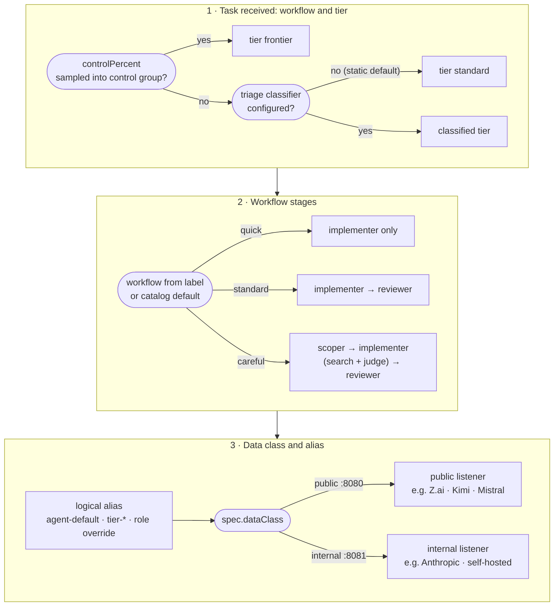
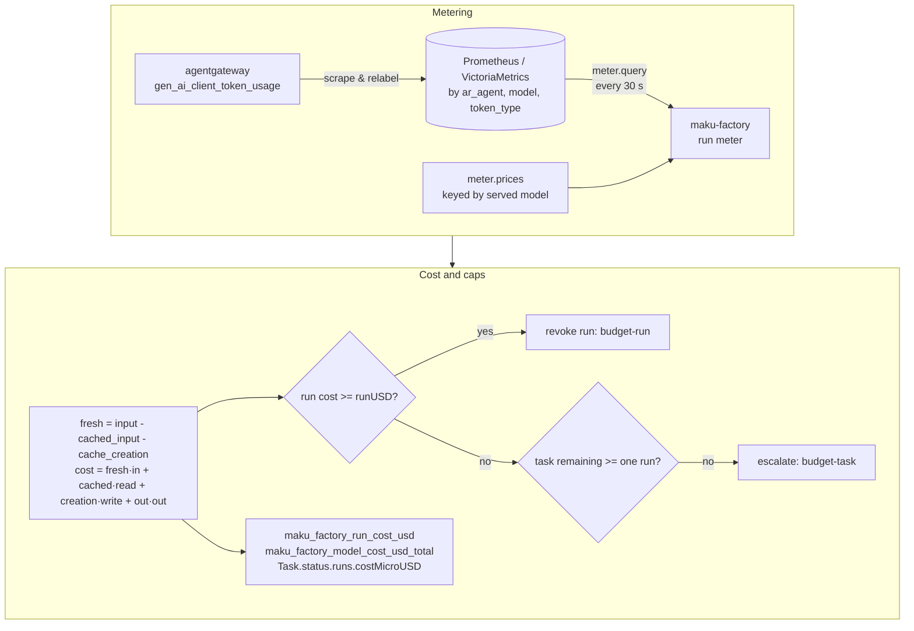
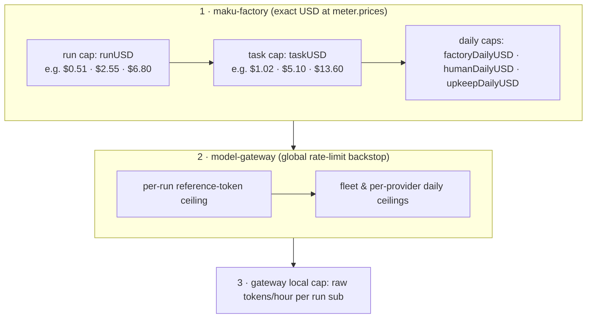

**Routing is static. Prompt caching drives the bill, and the model decides the outcome.**

An agent run gets one model from its data class and workflow — never switched per request — because every model switch drops the prompt cache. In live runs on the [ai-native-ref](https://airef.ogenki.io/) reference deployment, more than 90% of input tokens sent by coding agents were prompt-cache reads, cutting spend roughly fourfold. On harder engineering tasks, model capability dominated every routing knob: in the 15-issue hard-task cohort, Claude was accepted on 13 of 15 issues while GLM was accepted on none, regardless of harness.

This page covers Maku's routing, metering, and cost model. Gateway wiring and identity live in [The model gateway](), budget configuration in [Budgets](), and provider data-class rules in [Model providers](). Dollar figures below are measured examples from the reference deployment.

## How a run gets its model {#agent-routing}

Every routing choice for an agent run is decided once at task intake and pinned for the entire run. There is no per-request failover or canary: escalation starts a fresh run at a higher tier rather than switching models mid-trajectory.

A run's projected ServiceAccount token names its exact data class and alias (`maku-gateway.<class>.<alias>`). `maku-gateway` refuses any other alias with `403` before making an upstream call and forces the upstream `model` field to the alias's configured target.

Example alias table (reference deployment):

| Logical alias | `public` listener (example) | `internal` listener (example) |
|---|---|---|
| `tier-light` | `glm-5.3-flash` | `claude-haiku-5-5` |
| `tier-standard` | `glm-5.3-flashx` | `claude-sonnet-5-5` |
| `tier-frontier` | `glm-5.3` | `claude-opus-5-5` |
| `agent-default` | `glm-5.3` | `claude-opus-5-5` |

When every tier points at `agent-default`, the tier sets token/USD caps, deadlines, and role composition rather than downgrading the model — letting teams evaluate budget fit before testing smaller models. Moving any tier to its own model is a one-line change in `Factory.spec.tiers`.

## Metering and layered budgets {#costs}

`meter.prices` in the `Factory` specification is the single source of truth for per-model pricing (fresh input, cache read, cache creation, and output per million tokens).

Key guarantees of the meter:

- **Keyed by served model, never logical alias.** A model missing from `meter.prices` is never treated as free: its run falls back to hard token caps and fires `AgentModelUnpriced`.
- **Cache-aware input accounting.** Where a provider's `input` counter includes cached tokens, the meter subtracts cached and cache-creation tokens so cache reads are priced at their discounted rate; if `input` is smaller than cached tokens, it falls back safely and alerts (`AgentMeterInputExcludesCache`).
- **Bounded overshoot.** Revocation happens on the next 30 s meter tick; in-flight responses finish cleanly.

Three budget layers back each other up (example figures from the reference deployment):

## Efficiency lessons from live runs {#efficiency}

### Prompt caching is the largest lever {#caching}

Coding-agent trajectories repeat the repository context on every turn. Measured runs consistently read **85–96%** of input tokens from prompt cache (91–96% on GLM runs, ~85% on internal Claude runs), cutting total spend by roughly **75%** compared to uncached tokens. That is why per-request model switching hurts agent workloads: cold-starting a second model mid-run multiplies the next turn's input cost ~5×.

### Caps in USD, not raw tokens

Raw token caps count every cache read identically to an output token. In the reference hard-task cohort, a 1.5 M token cap terminated 11 of 15 runs at only $0.58–$0.76 of actual spend. Expressing caps in **USD** (`runUSD`, `taskUSD`, `factoryDailyUSD`, `upkeepDailyUSD`) prices cache reads at their true rate so cache-heavy runs get the full work their budget pays for.

### Cheaper tiers and optional self-hosting {#self-host-vs-api}

A cheaper model that fails costs more per merged pull request than a stronger model that succeeds on the first pass. Likewise, self-hosting open-weights GPUs is motivated by privacy, weight pinning, and warm editor completion — not lower cost than hosted APIs at moderate agent volume ([Providers]()). If you also serve interactive coding clients through an Envoy AI Gateway + vLLM stack, see [AI Native Reference › AI Gateway](https://airef.ogenki.io/docs/serving/ai-gateway/).

## Tuning and measurement {#tuning}

Tiers, prices, daily budgets, and upkeep caps live in the `Factory` resource and reload live without restarting `maku-factory` ([Architecture](), [Budgets]()). Metrics and alert rules are documented in [Install › Observability]() and [Reference › Alerts](). Detailed October/November 2026 reference measurements and PromQL recipes live in [the reference measurement notes](https://github.com/Smana/ai-native-ref/blob/main/docs/superpowers/specs/2026-11-14-routing-and-cost-measurements.md).
