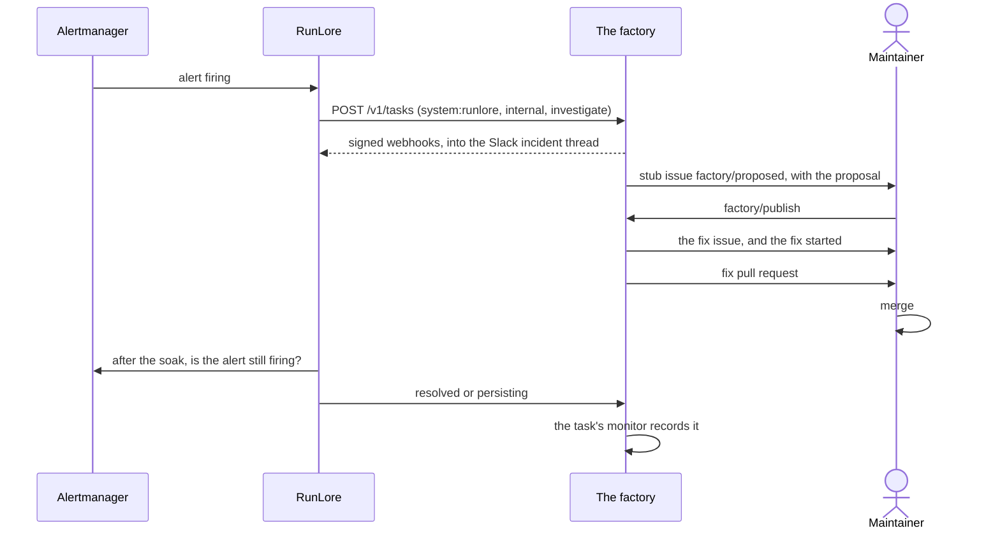

[RunLore](https://github.com/Smana/runlore) investigates operational alerts. With Maku it works agent to agent through the factory's standard [HTTP API]() as an internal [sponsored principal]() with a sponsor, a cost ceiling, and a daily cap. One incident runs end to end: an alert, an `investigate` task, a proposal, `factory/publish`, a fix pull request, its merge, a soak, and a verdict (`resolved` or `persisting`) recorded on the task's monitor.

| You want to… | Do this |
|---|---|
| Publish RunLore's proposal | Read the proposal on the stub issue (`factory/proposed`), then label it **`factory/publish`**: the factory files the fix issue with a footer naming its origin and starts the fix on the repository's default workflow (`standard`), charged to you |
| Start the fix by hand | Only when the operator left `publishStarts` off, or the fix issue was edited after it was filed: add a `workflow:<name>` label if needed, then `factory/ready` |
| Read the verdict | `kubectl get task <fix> -o jsonpath='{.status.monitor}'`: `resolved` means the alert cleared |
| React to a fix that did not hold | `persisting` labels the pull request `factory/monitor:regression`, opens a follow-up stub, and pauses the policy like any other regression; clear the pause as for any policy |

The investigation stays internal: it runs on an internal-approved model, read-only, and starts no public work until a maintainer labels the proposal. RunLore's link to the factory is off by default. An operator turns it on in two halves together: RunLore's configuration pointing at Maku's API, and RunLore's webhook subscriber in the room broker's `webhooks`, which carries signed task events back to RunLore. Reference operator steps and keys: [runbook 20](https://github.com/Smana/ai-native-ref/blob/main/docs/runbooks/agent-factory/20-runlore-agent-to-agent.md).
