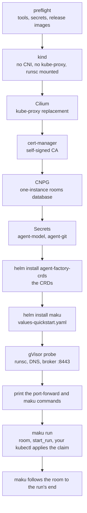

`task quickstart` is the older, single-run path: it needs no GitHub App and no factory. It builds a local
kind cluster with gVisor and runs one attended, sandboxed agent in a room on Linux with Docker.
It requires `Smana/maku` v0.30.0 or later (earlier `AP_VERSION` tags lack the `maku-*` images and `maku` CLI and fail at preflight). Read
[what differs from production](#what-differs-from-production) before trusting it with real credentials.

```bash
export MODEL_API_KEY=… GITHUB_TOKEN=… REPO=owner/throwaway
task quickstart                 # kind + Cilium + gVisor + cert-manager + CNPG + the chart + maku
```

## Prerequisites

| Need | Detail |
|---|---|
| Platform | Linux with Docker and `buildx`. `up.sh` stops elsewhere: gVisor in kind and loopback port-forwarding are proven on Linux only; Podman is untested |
| kubectl | Within one minor of the kind node (1.36–1.38 for 1.37), or `up.sh` stops. `mise.toml` pins one: `mise install kubectl` |
| `LOCAL_PORT` | Port forwarded to the broker (default `8080`). `publicURL` follows it and answers that port only on `localhost`, `127.0.0.1` or `[::1]` |
| Tools | `docker`, `kind`, `helm`, `kubectl`, `curl`, `git`, `openssl`, `envsubst`, `yq` (mikefarah v4), `sha256sum`, `sha512sum`, `bzip2`, `tar` |
| `MODEL_API_KEY` | Anthropic by default; `MODEL` and `MODEL_BASE_URL` select any OpenAI-compatible endpoint and add its host to the egress allow-list. For an in-cluster URL (`http://<svc>.<ns>.svc.<domain>:<port>`), the port must equal `targetPort`, and the rule opens that port to **every pod in the model's namespace** — use a dedicated namespace |
| `GITHUB_TOKEN`, `REPO` | Fine-grained PAT with Contents read/write on **one throwaway repository**, and `owner/name` with a `main` branch and at least one commit |
| Images | Latest `Smana/maku` release (`AP_VERSION` on `main`, v0.30.0+; GitHub API limit 60/hour unauthenticated). `maku` is checksum-verified into `.quickstart/bin/`; `ROOMCTL=<path>` uses a local build |



The script is idempotent, pins versions in `hack/quickstart/versions.env`, upgrades on re-run, and writes `.quickstart/kubeconfig` (`export KUBECONFIG=$PWD/.quickstart/kubeconfig`).

## Start a run

In a second terminal, forward the broker:

```bash
export KUBECONFIG=$PWD/.quickstart/kubeconfig
kubectl -n maku port-forward deploy/room-broker 8080:8080
```

In the first terminal (`XDG_CONFIG_HOME` isolates the quickstart config):

```bash
export KUBECONFIG=$PWD/.quickstart/kubeconfig XDG_CONFIG_HOME=$PWD/.quickstart/config PATH=$PWD/.quickstart/bin:$PATH
maku configure --url http://localhost:8080
maku run --repo owner/throwaway --task 'Fix a typo in the README'
```

`maku run` creates a room, queues the task for the brief, starts the run, applies the rendered claim with `kubectl`, and follows the room until the run ends (exit 0 on `Succeeded`, stopping at the first failing step). It works on local brokers only; on platform installs the factory starts runs. The room page is **http://localhost:8080**.

| Local mode | Consequence |
|---|---|
| Answers `publicURL`'s port only | Forward `LOCAL_PORT`; `localhost`, `127.0.0.1` and `[::1]` work, any other host/port returns `403`, and `maku configure` refuses port mismatches |
| One user, `human:local` (admin + member) | No login; port-forward is the only entry |
| Start run in the UI shows the claim | It does not apply it; `maku run` does |
| `XDG_CONFIG_HOME=$PWD/.quickstart/config` | Keeps quickstart config separate from production |

## Tear down

`task quickstart:down` deletes the kind cluster.

## What differs from production

The room, bridge, gVisor and default-deny egress match production; the rest is scaled down.

| Production | Quickstart |
|---|---|
| Model calls through the model gateway, with a per-run budget outside the sandbox | API key inside the sandbox; bounded only by `maxMinutes` |
| Short-lived per-role GitHub tokens from the factory's minter (reviewers cannot push) | One fine-grained PAT shared across roles; read-only rules are instructions, not enforcement |
| OIDC login, roles, per-member approvals | One local user over port-forward |
| Managed database roles and external CA | `migrate` init container and a self-signed CA |
| Room tools (`:8090`), warm sandboxes, suspend, Kueue, the factory | Absent |
| The room, the bridge, gVisor, default-deny + FQDN egress | **Same** |

`db.sh` creates two Secrets: `rooms-owner-dsn` (`rooms_owner`, mounted only by the `migrate` init container as `ROOMS_MIGRATION_DATABASE_URL`) and `rooms-broker-dsn` (`rooms_broker`, read by `serve` as `ROOMS_DATABASE_URL` with `SELECT, INSERT` on `events` only, so `serve` cannot alter schema or history).

## Troubleshooting the one-run quickstart

| Symptom | Cause and fix |
|---|---|
| A run stays `Pending` | Inspect `kubectl -n agents get agentrun <run> -o jsonpath='{.status.conditions}'`: `SecretMissing` (`agent-model` or `agent-git` missing in `agents`), `CreateFailed` (read message and controller logs), or `WaitingForGC` (clears automatically) |
| Agent request times out | Egress is default-deny: run `kubectl -n kube-system exec ds/cilium -c cilium-agent -- hubble observe --verdict DROPPED -n agents` and widen the allow-list |
| No network under gVisor | Cilium needs `socketLB.hostNamespaceOnly=true` (`up.sh` sets it; a manual Cilium without it breaks run networking) |
| `up.sh` fails at "release images" | Release images missing or GitHub API rate-limited; set `AP_VERSION=<release tag>` |
| Host cannot run gVisor | `ALLOW_UNSANDBOXED=1 task quickstart` (exact `1`) runs on the default runtime (**not sandboxed**, with your PAT and API key; sets `Unsandboxed` and shows `Not sandboxed`) |
| `up.sh` stops at "gVisor probe" | Failed `dmesg` (runtime not `runsc`), `dns` (broker DNS), or `tcp` (ClusterIP `:8443` / `socketLB.hostNamespaceOnly` / policy); fix or set `ALLOW_UNSANDBOXED=1` |
| `up.sh` stops at "kubectl ... cannot drive" | Skew exceeds one minor: run `mise install kubectl` |
| Browser or `maku` gets `403` | Forwarded port differs from `LOCAL_PORT`; forward `LOCAL_PORT` or re-run with `LOCAL_PORT=<port>` |
| `maku run` stops at `claim` | Check `kubectl` error above it (usually `KUBECONFIG` is not `.quickstart/kubeconfig`) |
| `task quickstart:check` | Offline drift check of scripts and manifests against the chart |

## Without the script

To install the factory demo on an existing Kubernetes 1.30+ cluster without `task demo`, copy
[`charts/agent-factory/values-mine.example.yaml`](https://github.com/Smana/maku/blob/main/charts/agent-factory/values-mine.example.yaml), edit the `CHANGE` lines (model, App, repository, CI checks; restate the full `repositories` list because Helm replaces lists whole), ensure `.github/agent-factory.yaml` on the default branch contains `factory: demo` (see [`examples/demo-repo`](https://github.com/Smana/maku/tree/main/examples/demo-repo), published as `Smana/maku-demo`), and install:

```bash
helm install af-crds charts/agent-factory-crds -n maku --create-namespace
helm install af charts/agent-factory -n maku -f charts/agent-factory/values-demo.yaml -f values-mine.yaml
```

Limits and options are in the [umbrella chart README](https://github.com/Smana/maku/blob/main/charts/agent-factory/README.md).

## CI: `quickstart-e2e`

`quickstart-e2e` runs `up.sh` against a stub model, checks local mode over port-forward, runs `maku configure` and `maku run` to `Succeeded`, and asserts a harness event in the log. Without its two Actions secrets (fork PRs) it skips with a warning — a green skip proves nothing.

| Secret | Value |
|---|---|
| `QUICKSTART_REPO` | Throwaway `owner/name` with a `main` branch and at least one commit |
| `QUICKSTART_GITHUB_TOKEN` | Fine-grained PAT with Contents read on that repository (the stub model never pushes) |

For chart values and caveats, see the [`maku` chart README](https://github.com/Smana/maku/blob/main/charts/maku/README.md).
