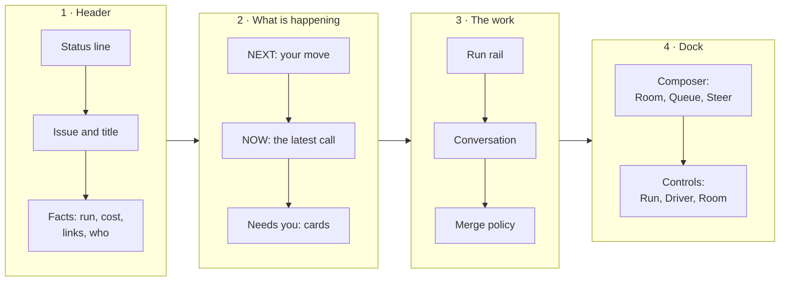

By the end of this chapter you will find any of your tasks, see where it stands, be told when it needs you, give the agents a note or a correction, and know what a task may spend.

## Where to follow a task {#notifications}

You do not have to watch. Each place you started from tells you when a task needs you:

| Started from | You are told by | Ask for more |
|---|---|---|
| Slack | Four lines in the thread: started, needs you, pull request opened, and one end line edited in place on merge or revert | Reply `status`, `needs me`, `what changed`, `the pull request` |
| Your coding agent | `wait`, running in the background, returns when the task needs you, opens a pull request, or ends | `/maku task`, `/maku inbox` |
| GitHub | Comments on the issue, and GitHub's own notifications | The room link in the first comment |
| Anywhere | The room list's tab title counts the rooms that need you: `(2) Maku rooms` | `maku needs` in a terminal |

## The room list {#the-room-list}

Every task has a room, and the room list shows them all, the ones that need you first. Open it from the *Watch* link in the first comment, the Slack thread's room link, or the address your platform team gave you.

<figure class="maku-shot">
  
  <figcaption>The room list. Filter by <strong>needs me</strong> to see only tasks waiting for you.</figcaption>
</figure>

| Filter | Shows |
|---|---|
| **mine** | Tasks whose issue you filed or labelled, or whose pull request you authored or review |
| **needs me** | Rows with something waiting for you |
| Repository picker | One repository's rooms |

The list refreshes itself every 10 seconds; the control beside **New room** changes the interval or pauses it. A room you expect but cannot see is almost always a missing GitHub link ([chapter 2]()).

## The room page {#the-room-page}

Click a row to open its room. The page reads from top to bottom:



| Part | What it tells you |
|---|---|
| **Status line** | Where the task stands, in fixed words: `Waiting for you — approve a pending action`, `Done — merged` |
| **Facts** | The run (role, id, model, age), the budget (`Tokens 189 k of 1.5 M`, and dollars when the task is priced), the pull request and dashboards, the data class, and who drives |
| **NEXT** | Shown while the task waits: why, then `Your move:` and the one step |
| **NOW** | What the agent is doing: its latest call, its status, and how long ago |
| **Needs you** | One card per thing waiting for you ([chapter 6]()) |
| **Notes** | The agents' own account of their progress, labelled as their claim. Useful, but the pull request is what counts |
| **Merge policy** | A fold: the task's policy, its mode, and what it takes to merge ([chapter 7]()) |
| **Run rail** | One node per run: implementer, reviewer, then the merge, each with its state, cost, and model. Click a node to see only that run's events |
| **Conversation** | Every message and tool call. Plumbing folds into one line per turn; **Raw events** shows everything |
| **Dock** | The composer, the theme button, and the connection |



## Talk to the agents {#queue-a-note}

The composer at the foot of the page has a **Deliver to** choice. Pick by how urgent the correction is:

| Deliver to | Who reads it | When | Use it for |
|---|---|---|---|
| **Room** | People only; no agent receives it | Now | A note to the other people in the room |
| **Queue** | The next run, in its instructions | When the next run starts | "Also update the README", a detail the reviewer should check |
| **Steer** | The running agent | At once: it reads it on its next step | "Stop, you are editing the wrong file" |

Most of the time a queued note, or a **Request changes** review on the pull request, is enough. A queued note never interrupts the run in progress, and you can remove it from **Queued for the next run** until it is delivered.

From your coding agent (`answer` when no question is open) or a terminal you can queue a note too, but never steer:

```bash
maku post <task> --queue "the acceptance check also covers docs/README.md"
```

## Steer the running agent {#steer}

Steering is the *driver's* alone. The driver holds the room's driver token; for a task that is the factory itself, until someone takes it.

1. Open **Driver** in the controls. Ask the driver for the token with **request**, or, as the room's owner, **take** it with a reason.
2. Choose **Steer** in the composer and write your correction. **Interrupt** stops the agent's current step first.
3. When you are done, **give** the token back. While you hold it, the task waits for you: the room shows a *hold* ([chapter 6]()).

Steering, interrupting, and taking the token work only in the browser. A token issued to `maku` is refused, because an agent on your machine can type into a terminal.

## Budgets {#budgets}

Every run has a deadline and a spending cap, and every task has a budget of its own, so a confused agent stops on its own. You see them in three places:

| Where | What it shows |
|---|---|
| The first comment on GitHub | The run's cap and deadline: `Budget: 1.5 M tokens, 45 minutes (tier standard)` |
| The room's facts, `task` (`maku status`), and the Slack end line / `status` | Spent so far against the task's budget: `$0.16 of $2.00` |
| The Slack plan, and your agent's `handoff` plan | The **budget**: the most the task may spend |

The caps come from the task's *tier* and the factory's configured `meter.prices` table (for flat-rate subscriptions, operators can assign nominal prices so dollar caps still bound token use). A budget from Slack or your coding agent can only lower the task's cap, never raise it.

Example (`standard` tier): each run at most 1.5 M tokens, 45 minutes, and $2.55; the whole task at most $5.10. When a run reaches its cap, it stops. When the task cannot afford another whole run, it waits for you with the reason `budget-task`. Full budget configuration: [Reference › Budgets]().

## Stop a task {#stop}

Put the label `factory/stop` on the issue or its pull request, or in the Slack thread type `stop` (or press **Stop**) and confirm as a maintainer ([Slack flows]()). The task's run ends and the pull request stays open.

To pick a stopped task up later, see [chapter 10]().

**Next:** [chapter 6]() covers each moment a task stops and asks for you.
